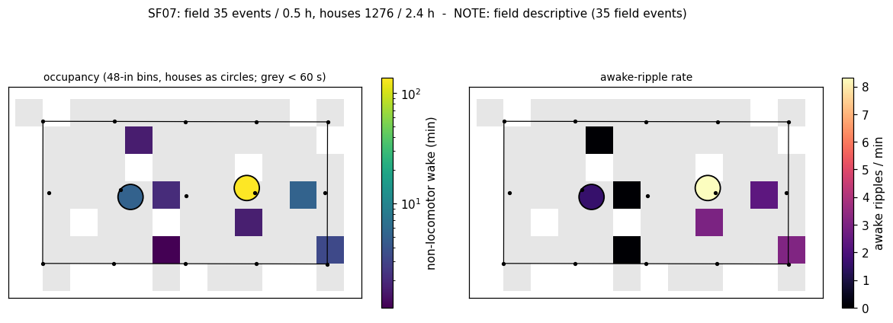
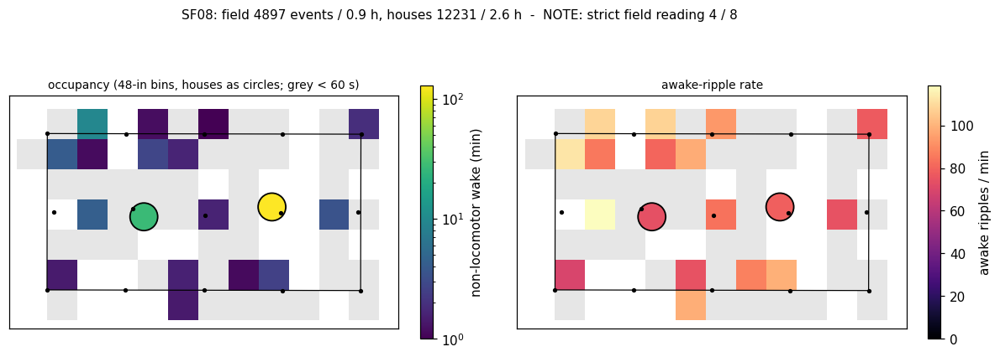
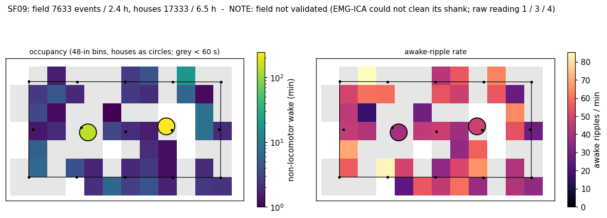
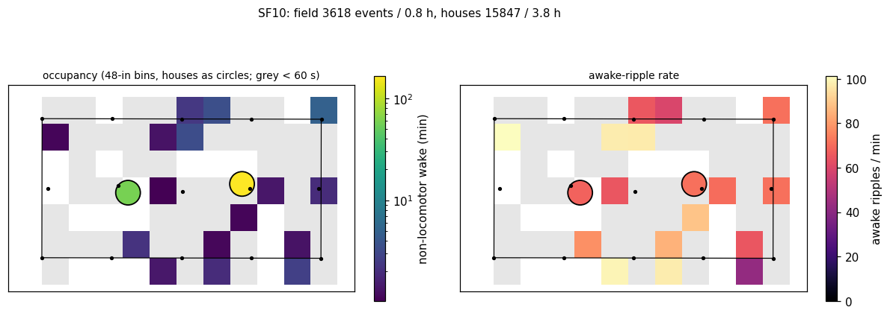
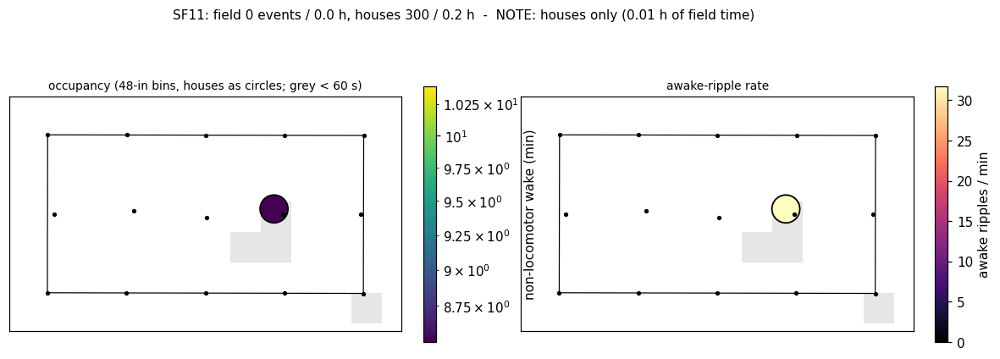
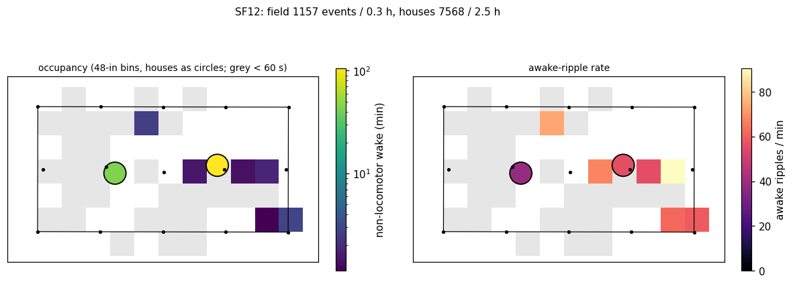
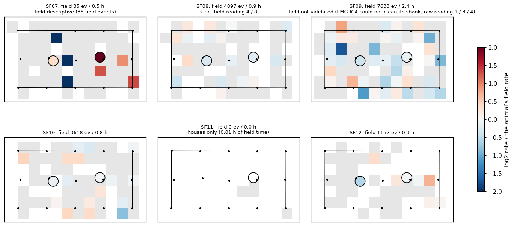
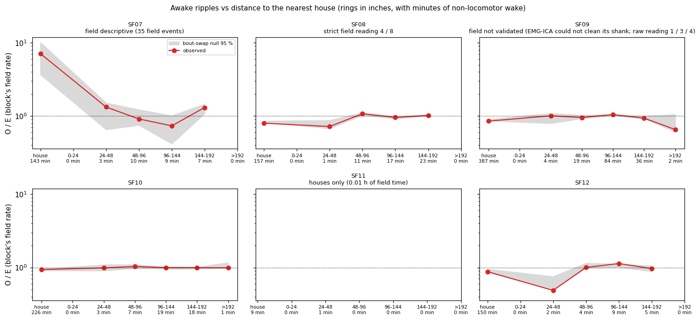

# Awake ripples at night across the paddock (cohort 2026c) - Phase 2: maps per animal

## Reading (generated from the tables below)

- Animals in inference (>= 300 field events and >= 10 field bins >= 60 s): SF08, SF09, SF10; the others are descriptive.
- **SF08** (strict field reading 4 / 8): place dependence of the field map (T1) not shown (spatial information 0.019 vs null 0.024 bits/event, Holm p 0.928; p < 0.05 in 0 / 5 sensitivities); stability across nights / trial halves not estimable (too little field time per night); house / field rate ratio 0.80 (bout-swap null median 0.85, Holm p 0.006; p < 0.05 in 5 / 5 sensitivities); distance slope in the field 0.04 (Holm p 1.00).
- **SF09** (field not validated (EMG-ICA could not clean its shank; raw reading 1 / 3 / 4)): place dependence of the field map (T1) holds (spatial information 0.045 vs null 0.036 bits/event, Holm p 0.015; p < 0.05 in 4 / 5 sensitivities); stability: LONO r -0.47 (p 0.56), odd / even trials r -0.52 (p 0.78); house / field rate ratio 0.85 (bout-swap null median 0.88, Holm p 0.006; p < 0.05 in 4 / 5 sensitivities); distance slope in the field -0.06 (Holm p 0.74).
- **SF10**: place dependence of the field map (T1) holds (spatial information 0.038 vs null 0.028 bits/event, Holm p 0.018; p < 0.05 in 5 / 5 sensitivities); stability across nights / trial halves not estimable (too little field time per night); house / field rate ratio 0.94 (bout-swap null median 0.93, Holm p 0.651; p < 0.05 in 0 / 5 sensitivities); distance slope in the field -0.02 (Holm p 1.00).
- House vs field, all animals with both: the rate per non-locomotor minute is lower in the houses than in the field in 4 / 5 (food was in the houses: home + food site + huddle).

Plan: [2026-10-10-awake-ripple-map.md](../../../../implementation_plan/2026-10-10-awake-ripple-map.md), Amendment 6 (fixed before any map). Driver `ephys/awake_ripple_map.py phase2` (`ephys/awake_ripple_phase2.py`); per-second tables `D:\Field2026_analysis_out\2026c\awake_ripple_map_20261010_1452`; bulk `D:\Field2026_analysis_out\2026c\awake_ripple_map_20261010_1452\phase2`; 1000 bout swaps (sensitivities 500).

Validity (Amendment 5, strict blind reading by HC + raw MUA): awake ripples pass in the houses and the field (estimated true-ripple share 1.00 / 0.94). Notes per animal below.

## Per animal

| animal | field events / h | house events / h | field bins >= 60 s | inference | T1 spatial info (null median) | p (Holm) | T2 LONO r (null) | p (Holm) | T2b odd / even trials r (null) | p (Holm) | house / field rate ratio (null) | p (Holm) | 1-D slope (null) | p (Holm) | note |
|---|---|---|---:|:---:|---|---|---|---|---|---|---|---|---|---|---|
| SF07 | 35 / 0.48 | 1276 / 2.39 | 6 | no | 0.465 (0.465) | 1.000 (-) | - (-) | - (-) | - (-) | - (-) | 3.41 (3.09) | 0.476 (-) | -0.01 (-0.04) | 0.813 (-) | field descriptive (35 field events) |
| SF08 | 4897 / 0.87 | 12231 / 2.61 | 16 | yes | 0.019 (0.024) | 0.928 (0.928) | - (-) | - (-) | - (-) | - (-) | 0.80 (0.85) | 0.002 (0.006) | 0.04 (0.02) | 0.689 (1.000) | strict field reading 4 / 8 |
| SF09 | 7633 / 2.42 | 17333 / 6.45 | 39 | yes | 0.045 (0.036) | 0.005 (0.015) | -0.47 (-0.44) | 0.559 (0.559) | -0.52 (-0.33) | 0.778 (0.778) | 0.85 (0.88) | 0.002 (0.006) | -0.06 (-0.01) | 0.248 (0.743) | field not validated (EMG-ICA could not clean its shank; raw reading 1 / 3 / 4) |
| SF10 | 3618 / 0.81 | 15847 / 3.76 | 16 | yes | 0.038 (0.028) | 0.009 (0.018) | - (-) | - (-) | - (-) | - (-) | 0.94 (0.93) | 0.651 (0.651) | -0.02 (-0.02) | 0.947 (1.000) |  |
| SF11 | 0 / 0.01 | 300 / 0.16 | 0 | no | - (-) | - (-) | - (-) | - (-) | - (-) | - (-) | - (-) | - (-) | - (-) | - (-) | houses only (0.01 h of field time) |
| SF12 | 1157 / 0.34 | 7568 / 2.50 | 6 | no | 0.022 (0.011) | 0.052 (-) | - (-) | - (-) | - (-) | - (-) | 0.88 (0.91) | 0.180 (-) | 0.35 (0.18) | 0.008 (-) |  |

## 1-D profile (observed / expected against the block's field rate; null 95 % band)

| animal | house | 0-24 | 24-48 | 48-96 | 96-144 | 144-192 | >192 |
|---|---|---|---|---|---|---|---|
| SF07 | 7.12 [3.67, 10.17] | 0.00 [0.00, 0.00] | 1.33 [0.65, 1.52] | 0.91 [0.75, 1.23] | 0.73 [0.42, 1.01] | 1.31 [1.08, 1.46] | - |
| SF08 | 0.80 [0.82, 0.86] | - | 0.72 [0.67, 0.88] | 1.07 [1.02, 1.12] | 0.96 [0.92, 0.98] | 1.02 [1.00, 1.05] | 0.79 [0.47, 0.90] |
| SF09 | 0.85 [0.86, 0.91] | - | 1.01 [0.79, 1.09] | 0.95 [0.93, 1.03] | 1.05 [1.01, 1.05] | 0.93 [0.92, 1.00] | 0.65 [0.61, 1.05] |
| SF10 | 0.94 [0.91, 0.96] | - | 0.99 [0.91, 1.10] | 1.03 [0.97, 1.10] | 0.99 [0.96, 1.03] | 0.99 [0.95, 1.02] | 0.99 [0.98, 1.17] |
| SF11 | - | - | - | - | - | - | - |
| SF12 | 0.88 [0.87, 0.95] | - | 0.49 [0.51, 0.76] | 1.00 [0.99, 1.15] | 1.13 [1.01, 1.12] | 0.97 [0.89, 1.06] | - |

## Bout-level Poisson GLM (description)

| animal | pieces | house IRR [95 % CI] | field log-distance coefficient [95 % CI] |
|---|---:|---|---|
| SF07 | 2974 | - [-, -] | - [-, -] |
| SF08 | 1490 | 0.82 [0.79, 0.86] | -0.02 [-0.23, 0.20] |
| SF09 | 3787 | 0.89 [0.79, 1.00] | -0.07 [-0.27, 0.13] |
| SF10 | 1999 | 0.89 [0.81, 0.98] | 0.04 [-0.10, 0.19] |
| SF11 | 144 | - [-, -] | - [-, -] |
| SF12 | 1431 | 0.91 [0.79, 1.05] | 0.10 [-0.11, 0.31] |

## Sensitivities (animals in inference)

| sensitivity | animal | field events | T1 (p) | T2 (p) | T2b (p) | house / field RR (p) | slope (p) |
|---|---|---:|---|---|---|---|---|
| no_qc_i1 | SF08 | 4754 | 0.018 (0.820) | - (-) | - (-) | 0.80 (0.004) | 0.05 (0.719) |
| no_qc_i1 | SF09 | 7042 | 0.047 (0.006) | -0.18 (0.285) | -0.54 (0.645) | 0.87 (0.024) | -0.05 (0.427) |
| no_qc_i1 | SF10 | 3516 | 0.039 (0.018) | - (-) | - (-) | 0.94 (0.535) | -0.03 (0.938) |
| anchors_gt6 | SF08 | 4815 | 0.019 (0.848) | - (-) | - (-) | 0.80 (0.004) | 0.04 (0.327) |
| anchors_gt6 | SF09 | 6860 | 0.045 (0.002) | -0.71 (0.766) | -0.55 (0.449) | 0.86 (0.088) | -0.09 (0.216) |
| anchors_gt6 | SF10 | 3560 | 0.037 (0.004) | - (-) | - (-) | 0.94 (0.587) | -0.02 (0.475) |
| no_ble_pass | SF08 | 4717 | 0.019 (0.848) | - (-) | - (-) | 0.79 (0.004) | 0.04 (0.471) |
| no_ble_pass | SF09 | 7514 | 0.047 (0.008) | -0.57 (0.701) | -0.59 (0.806) | 0.85 (0.016) | -0.07 (0.156) |
| no_ble_pass | SF10 | 3386 | 0.040 (0.022) | - (-) | - (-) | 0.93 (0.942) | -0.00 (0.691) |
| no_rain_nights | SF08 | 3222 | 0.018 (0.978) | - (-) | - (-) | 0.79 (0.004) | -0.11 (0.563) |
| no_rain_nights | SF09 | 7197 | 0.033 (0.325) | -0.47 (0.389) | -0.43 (0.886) | 0.86 (0.016) | -0.04 (0.591) |
| no_rain_nights | SF10 | 2459 | 0.037 (0.006) | - (-) | - (-) | 0.98 (0.411) | -0.07 (0.910) |
| sf08_settled | SF08 | 3655 | 0.020 (0.701) | - (-) | - (-) | 0.81 (0.004) | -0.25 (0.519) |
| sf08_settled | SF09 | 7633 | 0.045 (0.010) | -0.47 (0.519) | -0.52 (0.764) | 0.85 (0.012) | -0.06 (0.267) |
| sf08_settled | SF10 | 3618 | 0.038 (0.014) | - (-) | - (-) | 0.94 (0.635) | -0.02 (0.914) |

## Figures

- 
- 
- 
- 
- 
- 
- 
- 

## Definitions

Units: WISER inches (unverified offset frame; topology and distances only); time in field-PC seconds.
- **Awake ripple (aSWR):** a production kept SWR (`excluded == False`) whose peak falls in a non-locomotor detectable wake second (WAKE, head IMU ok and state still / active, outside handling, SWR-covered, theta-detectable, EMG-detectable on ripple-only blocks, with a position).
- **Occupancy** $o_i$: non-locomotor detectable wake seconds in place $i$; **rate** $\lambda_i = c_i / o_i$ (events per minute in tables and maps).
- **Spatial information** (Skaggs): $I = \sum_i p_i \frac{\lambda_i}{\bar\lambda} \log_2 \frac{\lambda_i}{\bar\lambda}$, $p_i = o_i / \sum o$, field bins with $o_i \ge 60$ s, within block; combined as the occupancy-weighted mean. Bits per event; 0 = uniform.
- **LONO r**: for each night $n$, Pearson $r$ between $\lambda^{(n)}_i$ and $\lambda^{(-n)}_i$ over bins with >= 60 s in both (>= 3 bins); the mean over nights weighted by bins.
- **T2b** (Amendment 1's secondary split): trials (the night split at home naps) ranked by start; odd vs even trials' field rates, Pearson $r$ over bins >= 60 s in both halves (>= 3 bins).
- **House / field rate ratio** (Mantel-Haenszel over blocks $b$): $RR = \frac{\sum_b c_{h,b} o_{f,b} / o_b}{\sum_b c_{f,b} o_{h,b} / o_b}$.
- **Ring O / E**: $O_k = \sum_b c_{k,b}$, $E_k = \sum_b o_{k,b} \, c_{f,b} / o_{f,b}$ (the block's field rate); the **slope** of $\log((O_k + 0.5)/E_k)$ on $\log \bar d_k$ over field rings with >= 60 s, weighted by occupancy minutes.
- **Bout swap null**: bouts = maximal runs of consecutive non-locomotor seconds in a record; strata = night x block x duration class $\lfloor \log L / \log 1.25 \rfloor$ x clock hour; within a stratum the bouts' event sequences are permuted, offsets rescaled to the recipient's length. It keeps each bout's place, duration, time of night and event count distribution, and breaks the event-place link. p = (1 + #null >= obs) / (N + 1) (T1, T2 one-sided; RR and slope two-sided).
- **Screen** for inference: >= 300 field aSWR and >= 10 field bins >= 60 s. Holm over the animals in inference.

## Caveats

- The houses are home, food site and huddle at once (food was in the houses): a house-vs-field difference is not 'home' or 'reward' alone.
- WISER frame unverified: maps show topology and distances, not compass directions; landmarks are reference marks.
- Awake ripples are detected on CA1 LFP after the production's flags; SF09's field events were not validated (cannot be EMG-cleaned); SF08's field reading was half doubtful; SF07 / SF11 have too little field time for inference.
- Theta-quiet aSWR (the pre-registered sensitivity) is a separate pass, not in this report yet.

