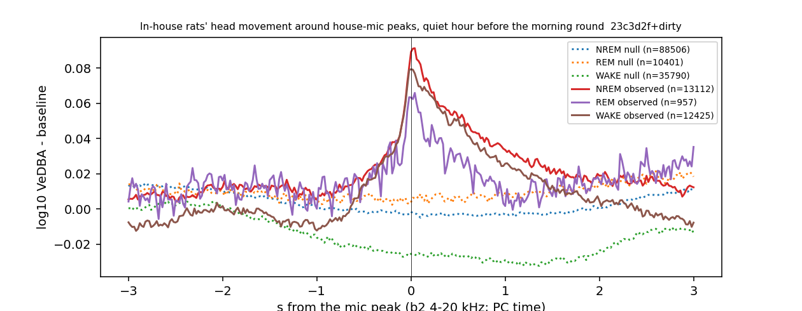

# House-mic peaks → the in-house rats' head IMU, before the morning round (cohort 2026c)

Plan `implementation_plan/2026-10-08-mic-imu-sync.md`, Amendment 1 (before results). Driver `ephys/mic_imu_sync.py peaks` (commit 23c3d2f+dirty); bulk `D:\Field2026_analysis_out\2026c\mic_imu_peaks_20261008_1922`. Descriptive; the sounds are not listened to. **Technical ledger.**

## Definitions

```
Plan Amendment 1: mic peaks -> in-house rats' IMU, in the quiet hour before the morning battery round.
Windows: Plan Amendment 1: per date, [round_start - 60 min, round_start - 5 min] with round_start = the earliest logged /
inferred round stop between 05:00 and 10:00; else 07:00-08:00; minus logged acoustic field events.
Peak: Frames >= PEAK_DB above the 2-s running median after >= 1 s below; returns indices and the peak size (dB, max
excess within 0.2 s).
Per peak and in-house rat (WISER zone; IMU valid >= 80 % over -3..+1 s): moved = an IMU onset (Phase-6 rule) within [-0.3, +0.5] s; resp = max log10 VeDBA over [-0.3, +0.5] s minus its median over [-3, -1] s; lag < 0 = the rat moved before the sound; woke10 = an asleep rat scored WAKE within 10 s. PC time of a mic frame = mic time - 0.02 s. Null = 5 random times per peak in the same windows, >= 2 s from any peak.
```

Windows: 12 (11.1 h); see `windows.csv` in the run folder.

## Peaks: share with none / one / several in-house rats moving (observed vs null)

| house | band | which | peaks | per_hour | none | one | several | rats_in_house |
|---|---|---|---|---|---|---|---|---|
| house_1 | b1 | null | 870 | nan | 0.98 | 0.02 | 0.0 | 1.001 |
| house_1 | b1 | observed | 285 | 25.714 | 0.954 | 0.046 | 0.0 | 1.063 |
| house_1 | b2 | null | 177 | nan | 0.949 | 0.051 | 0.0 | 1.0 |
| house_1 | b2 | observed | 88 | 7.94 | 1.0 | 0.0 | 0.0 | 1.216 |
| house_1 | b3 | null | 182 | nan | 0.973 | 0.027 | 0.0 | 1.0 |
| house_1 | b3 | observed | 72 | 6.496 | 1.0 | 0.0 | 0.0 | 1.306 |
| house_1 | b4 | null | 99 | nan | 0.939 | 0.061 | 0.0 | 1.0 |
| house_1 | b4 | observed | 38 | 3.429 | 0.974 | 0.026 | 0.0 | 1.474 |
| house_2 | b1 | null | 20377 | nan | 0.863 | 0.109 | 0.028 | 4.171 |
| house_2 | b1 | observed | 4085 | 368.571 | 0.788 | 0.156 | 0.056 | 4.107 |
| house_2 | b2 | null | 31255 | nan | 0.884 | 0.095 | 0.021 | 4.534 |
| house_2 | b2 | observed | 6262 | 564.992 | 0.752 | 0.163 | 0.084 | 4.465 |
| house_2 | b3 | null | 27248 | nan | 0.878 | 0.097 | 0.025 | 4.43 |
| house_2 | b3 | observed | 5462 | 492.812 | 0.771 | 0.155 | 0.074 | 4.345 |
| house_2 | b4 | null | 19023 | nan | 0.866 | 0.105 | 0.028 | 4.23 |
| house_2 | b4 | observed | 3801 | 342.947 | 0.783 | 0.15 | 0.067 | 4.246 |

## b2 peaks by size: share with any in-house rat moving vs the null

| house | tier | peaks | any_moved | null_any_moved |
|---|---|---|---|---|
| house_1 | 10-15 dB | 54 | 0.0 | 0.051 |
| house_1 | 15-20 dB | 23 | 0.0 | 0.051 |
| house_1 | 20-30 dB | 8 | 0.0 | 0.051 |
| house_1 | >30 dB | 3 | 0.0 | 0.051 |
| house_2 | 10-15 dB | 3867 | 0.237 | 0.116 |
| house_2 | 15-20 dB | 1457 | 0.255 | 0.116 |
| house_2 | 20-30 dB | 809 | 0.273 | 0.116 |
| house_2 | >30 dB | 129 | 0.318 | 0.116 |

## Per rat and state (b2): moved, response, woke within 10 s

| which | state | rat_peaks | moved | resp_median | woke10 |
|---|---|---|---|---|---|
| null | NREM | 88506 | 0.032 | 0.335 | 0.035 |
| null | REM | 10401 | 0.049 | 0.332 | 0.095 |
| null | WAKE | 35790 | 0.03 | 0.35 | 0.0 |
| null | unknown | 7199 | 0.015 | 0.372 | 0.0 |
| observed | NREM | 13112 | 0.119 | 0.379 | 0.066 |
| observed | REM | 957 | 0.119 | 0.342 | 0.144 |
| observed | WAKE | 12425 | 0.046 | 0.401 | 0.0 |
| observed | unknown | 1570 | 0.064 | 0.408 | 0.0 |

## Lag of the first IMU onset relative to the peak (b2, observed; < 0 = the rat moved first)

| lag_bin_s | onsets |
|---|---|
| (-0.3, -0.2] | 261 |
| (-0.2, -0.1] | 338 |
| (-0.1, 5.55e-17] | 523 |
| (5.55e-17, 0.1] | 364 |
| (0.1, 0.2] | 231 |
| (0.2, 0.3] | 210 |
| (0.3, 0.4] | 205 |
| (0.4, 0.5] | 171 |



## The 30 largest b2 peaks (for listening; file under F:/3rd_rat or the storage copy, offset in s)

| house | t | peak_db | rats_in_house | movers | top_rat | mic_file | mic_offset_s |
|---|---|---|---|---|---|---|---|
| house_2 | 2026-09-04 05:59:39.440000 | 48.76 | 6 |  | SF12 | 2026-09-04/MIC01/MIC01_2026-09-04_05-00-00_to_06-00-00.wav | 3579.44 |
| house_2 | 2026-09-05 06:27:30.860000 | 46.66 | 5 | SF11 | SF12 | 2026-09-05/MIC01/MIC01_2026-09-05_06-00-00_to_07-00-00.wav | 1650.86 |
| house_2 | 2026-09-04 06:37:13.120000 | 43.5 | 6 | SF07;SF08;SF09;SF10;SF11;SF12 | SF09 | 2026-09-04/MIC01/MIC01_2026-09-04_06-00-00_to_07-00-00.wav | 2233.12 |
| house_2 | 2026-09-05 06:34:01.040000 | 43.11 | 6 |  | SF12 | 2026-09-05/MIC01/MIC01_2026-09-05_06-00-00_to_07-00-00.wav | 2041.04 |
| house_2 | 2026-09-02 06:52:34.500000 | 42.35 | 4 |  | SF09 | 2026-09-02/MIC01/MIC01_2026-09-02_06-00-00_to_07-00-00.wav | 3154.5 |
| house_2 | 2026-09-06 06:41:18.420000 | 41.93 | 6 | SF08;SF09 | SF09 | 2026-09-06/MIC01/MIC01_2026-09-06_06-00-00_to_07-00-00.wav | 2478.42 |
| house_2 | 2026-09-05 06:03:15.560000 | 41.64 | 6 | SF08;SF11 | SF11 | 2026-09-05/MIC01/MIC01_2026-09-05_06-00-00_to_07-00-00.wav | 195.56 |
| house_2 | 2026-09-11 07:46:29.200000 | 41.34 | 5 | SF07;SF08;SF09;SF10 | SF12 | 2026-09-11/MIC01/MIC01_2026-09-11_07-00-00_to_08-00-00.wav | 2789.2 |
| house_2 | 2026-09-09 07:25:12.039999999 | 41.25 | 5 | SF09;SF12 | SF12 | 2026-09-09/MIC01/MIC01_2026-09-09_07-00-00_to_08-00-00.wav | 1512.04 |
| house_2 | 2026-09-01 06:26:02.320000 | 41.09 | 1 |  | SF07 | 2026-09-01/MIC01/MIC01_2026-09-01_06-00-00_to_07-00-00.wav | 1562.32 |
| house_2 | 2026-09-07 07:29:31.560000 | 39.89 | 5 |  | SF07 | 2026-09-07/MIC01/MIC01_2026-09-07_07-00-00_to_08-00-00.wav | 1771.56 |
| house_2 | 2026-09-10 06:27:41.900000 | 39.62 | 5 |  | SF12 | 2026-09-10/MIC01/MIC01_2026-09-10_06-00-00_to_07-00-00.wav | 1661.9 |
| house_2 | 2026-09-08 06:03:45.720000 | 39.46 | 5 |  | SF09 | 2026-09-08/MIC01/MIC01_2026-09-08_06-00-00_to_07-00-00.wav | 225.72 |
| house_2 | 2026-09-07 07:43:23.199999999 | 39.05 | 5 |  | SF09 | 2026-09-07/MIC01/MIC01_2026-09-07_07-00-00_to_08-00-00.wav | 2603.2 |
| house_1 | 2026-09-08 05:48:06.340000 | 38.85 | 1 |  | SF10 | 2026-09-08/MIC02/MIC02_2026-09-08_05-00-00_to_06-00-00.wav | 2886.34 |
| house_2 | 2026-09-08 05:52:41.880000 | 38.54 | 4 |  | SF09 | 2026-09-08/MIC01/MIC01_2026-09-08_05-00-00_to_06-00-00.wav | 3161.88 |
| house_2 | 2026-09-10 06:25:27.640000 | 38.45 | 5 | SF10 | SF10 | 2026-09-10/MIC01/MIC01_2026-09-10_06-00-00_to_07-00-00.wav | 1527.64 |
| house_2 | 2026-09-01 06:04:30.520000 | 37.91 | 1 |  | SF07 | 2026-09-01/MIC01/MIC01_2026-09-01_06-00-00_to_07-00-00.wav | 270.52 |
| house_2 | 2026-09-01 06:05:39.020000 | 37.82 | 1 |  | SF07 | 2026-09-01/MIC01/MIC01_2026-09-01_06-00-00_to_07-00-00.wav | 339.02 |
| house_2 | 2026-09-10 06:36:37.740000 | 37.6 | 5 |  | SF09 | 2026-09-10/MIC01/MIC01_2026-09-10_06-00-00_to_07-00-00.wav | 2197.74 |
| house_2 | 2026-09-05 06:01:16.400000 | 37.4 | 5 |  | SF08 | 2026-09-05/MIC01/MIC01_2026-09-05_06-00-00_to_07-00-00.wav | 76.4 |
| house_2 | 2026-09-08 05:41:51.340000 | 37.3 | 4 |  | SF09 | 2026-09-08/MIC01/MIC01_2026-09-08_05-00-00_to_06-00-00.wav | 2511.34 |
| house_2 | 2026-09-08 06:03:10.640000 | 37.29 | 5 |  | SF07 | 2026-09-08/MIC01/MIC01_2026-09-08_06-00-00_to_07-00-00.wav | 190.64 |
| house_2 | 2026-09-07 07:53:45.120000 | 36.99 | 5 | SF09;SF12 | SF09 | 2026-09-07/MIC01/MIC01_2026-09-07_07-00-00_to_08-00-00.wav | 3225.12 |
| house_2 | 2026-09-08 05:51:26.220000 | 36.6 | 3 |  | SF08 | 2026-09-08/MIC01/MIC01_2026-09-08_05-00-00_to_06-00-00.wav | 3086.22 |
| house_2 | 2026-09-11 07:38:30.120000 | 36.56 | 5 | SF08;SF10 | SF07 | 2026-09-11/MIC01/MIC01_2026-09-11_07-00-00_to_08-00-00.wav | 2310.12 |
| house_2 | 2026-09-04 06:44:31.660000 | 36.33 | 6 |  | SF11 | 2026-09-04/MIC01/MIC01_2026-09-04_06-00-00_to_07-00-00.wav | 2671.66 |
| house_2 | 2026-09-01 05:38:42.560000 | 36.07 | 1 |  | SF07 | 2026-09-01/MIC01/MIC01_2026-09-01_05-37-32_to_06-00-00.wav | 70.56 |
| house_2 | 2026-09-08 06:01:26.860000 | 36.05 | 4 |  | SF12 | 2026-09-08/MIC01/MIC01_2026-09-08_06-00-00_to_07-00-00.wav | 86.86 |
| house_2 | 2026-09-05 06:33:57.300000 | 36.03 | 6 |  | SF07 | 2026-09-05/MIC01/MIC01_2026-09-05_06-00-00_to_07-00-00.wav | 2037.3 |

