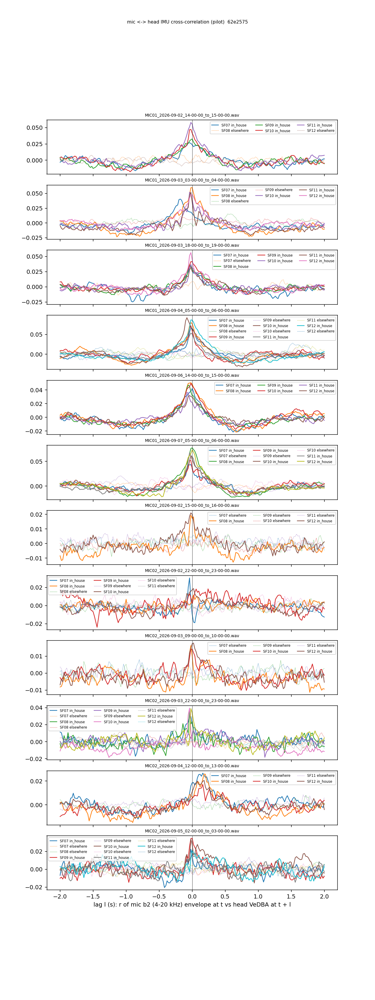

# In-house microphones ↔ head IMU: pilot (cohort 2026c)

Plan `implementation_plan/2026-10-08-mic-imu-sync.md` (criteria fixed before results). Driver `ephys/mic_imu_sync.py pilot` (commit 62e2575); bulk `D:\Field2026_analysis_out\2026c\mic_imu_sync_pilot_20261008_1753`. **Technical ledger.**

## Definitions

```
In-house microphones <-> head IMU: who made the sound, and the mic clock (plan
implementation_plan/2026-10-08-mic-imu-sync.md; definitions there, repeated in the report).

    python ephys/mic_imu_sync.py pilot [--raw F:/3rd_rat] [--hours-per-mic 6]
    python ephys/mic_imu_sync.py --selftest

Mic envelope: 20-ms frames of the WAV, exactly as ephys/mic_band_levels.py (Hann, mean removed, full-scale sine = 0 dB,
all-zero frames missing), frame centres on the PC clock by the file's timing model (stretched / end-anchored), put on a
50-Hz PC grid by nearest centre. IMU: log10(VeDBA + 0.01) at 50 Hz from make_imu (t_pc_ms), invalid samples missing.
Both detrended by their 2-s running median. Cross-correlation r(l) = Pearson(m(t), v(t + l)), l in [-2, +2] s; peak lag
> 0 = the IMU sees the event later than the mic's own time stamp, i.e. the mic timeline runs ahead by that much.
```

## Hours (chosen by occupancy only)

| mic | house | start | end | part | rat_seconds |
|---|---|---|---|---|---|
| MIC01 | house_2 | 2026-09-02 14:00:00 | 2026-09-02 15:00:00 | day | 14400 |
| MIC01 | house_2 | 2026-09-03 03:00:00 | 2026-09-03 04:00:00 | night | 14966 |
| MIC01 | house_2 | 2026-09-03 18:00:00 | 2026-09-03 19:00:00 | day | 18425 |
| MIC01 | house_2 | 2026-09-04 05:00:00 | 2026-09-04 06:00:00 | night | 14671 |
| MIC01 | house_2 | 2026-09-06 14:00:00 | 2026-09-06 15:00:00 | day | 21600 |
| MIC01 | house_2 | 2026-09-07 05:00:00 | 2026-09-07 06:00:00 | night | 16586 |
| MIC02 | house_1 | 2026-09-02 15:00:00 | 2026-09-02 16:00:00 | day | 7200 |
| MIC02 | house_1 | 2026-09-02 22:00:00 | 2026-09-02 23:00:00 | night | 11402 |
| MIC02 | house_1 | 2026-09-03 09:00:00 | 2026-09-03 10:00:00 | day | 10800 |
| MIC02 | house_1 | 2026-09-03 22:00:00 | 2026-09-03 23:00:00 | night | 7635 |
| MIC02 | house_1 | 2026-09-04 12:00:00 | 2026-09-04 13:00:00 | day | 14400 |
| MIC02 | house_1 | 2026-09-05 02:00:00 | 2026-09-05 03:00:00 | night | 5273 |

## Pass criteria

| criterion | value | n | pass |
|---|---|---|---|
| (a) in-house coupled (>= 75 %) | 0.957 | 46 | True |
| (b) elsewhere coupled (<= 10 %) | 0.027 | 37 | True |
| (c) mic-hours whose coupled rats agree within 40 ms | 0.75 | 12 | False |

## Mic offset per file (b2, coupled in-house rats; + = the IMU sees the event later = the mic timeline runs ahead)

| mic | file | part | timing | coupled_rats | offset_s | max_dev_s | lags |
|---|---|---|---|---|---|---|---|
| MIC01 | MIC01_2026-09-02_14-00-00_to_15-00-00.wav | day | stretched | 4 | -0.02 | 0.02 | SF07:-0.04;SF09:+0.00;SF10:-0.02;SF11:-0.02 |
| MIC01 | MIC01_2026-09-03_03-00-00_to_04-00-00.wav | night | stretched | 5 | -0.02 | 0.16 | SF07:-0.18;SF08:+0.00;SF10:-0.04;SF11:-0.02;SF12:-0.02 |
| MIC01 | MIC01_2026-09-03_18-00-00_to_19-00-00.wav | day | stretched | 6 | -0.02 | 0.02 | SF07:-0.04;SF08:-0.04;SF09:-0.02;SF10:-0.02;SF11:-0.02;SF12:-0.02 |
| MIC01 | MIC01_2026-09-04_05-00-00_to_06-00-00.wav | night | stretched | 6 | -0.02 | 0.06 | SF07:-0.02;SF08:-0.02;SF09:-0.02;SF10:-0.08;SF11:-0.02;SF12:-0.02 |
| MIC01 | MIC01_2026-09-06_14-00-00_to_15-00-00.wav | day | stretched | 6 | -0.02 | 0.06 | SF07:+0.00;SF08:-0.02;SF09:-0.06;SF10:-0.02;SF11:-0.08;SF12:-0.04 |
| MIC01 | MIC01_2026-09-07_05-00-00_to_06-00-00.wav | night | stretched | 6 | -0.02 | 0.02 | SF07:-0.02;SF08:+0.00;SF09:-0.04;SF10:-0.02;SF11:-0.04;SF12:+0.00 |
| MIC02 | MIC02_2026-09-02_15-00-00_to_16-00-00.wav | day | stretched | 2 | -0.02 | 0.0 | SF08:-0.02;SF12:-0.02 |
| MIC02 | MIC02_2026-09-02_22-00-00_to_23-00-00.wav | night | stretched | 2 | -0.017 | 0.037 | SF07:-0.04;SF10:+0.02 |
| MIC02 | MIC02_2026-09-03_09-00-00_to_10-00-00.wav | day | stretched | 3 | 0.0 | 0.02 | SF08:-0.02;SF10:+0.00;SF12:+0.02 |
| MIC02 | MIC02_2026-09-03_22-00-00_to_23-00-00.wav | night | stretched | 4 | -0.04 | 0.02 | SF07:-0.04;SF08:-0.04;SF10:-0.04;SF12:-0.02 |
| MIC02 | MIC02_2026-09-04_12-00-00_to_13-00-00.wav | day | stretched | 4 | 0.18 | 0.02 | SF07:+0.16;SF08:+0.18;SF10:+0.16;SF12:+0.18 |
| MIC02 | MIC02_2026-09-05_02-00-00_to_03-00-00.wav | night | stretched | 4 | -0.01 | 0.01 | SF07:-0.02;SF09:+0.00;SF10:-0.02;SF12:+0.00 |

## Drift within the hour (in-house rats, 10-min windows, median lag per window)

| mic | file | windows | lag_first_s | lag_last_s | slope_s_per_h |
|---|---|---|---|---|---|
| MIC01 | MIC01_2026-09-02_14-00-00_to_15-00-00.wav | 6 | -0.02 | -0.02 | 0.015 |
| MIC01 | MIC01_2026-09-03_03-00-00_to_04-00-00.wav | 6 | -0.01 | -0.12 | -0.084 |
| MIC01 | MIC01_2026-09-03_18-00-00_to_19-00-00.wav | 6 | -1.26 | -0.02 | 1.07 |
| MIC01 | MIC01_2026-09-04_05-00-00_to_06-00-00.wav | 6 | -0.02 | -0.02 | 0.007 |
| MIC01 | MIC01_2026-09-06_14-00-00_to_15-00-00.wav | 6 | 0.01 | -0.03 | -0.009 |
| MIC01 | MIC01_2026-09-07_05-00-00_to_06-00-00.wav | 6 | 0.14 | -0.01 | -0.117 |
| MIC02 | MIC02_2026-09-02_15-00-00_to_16-00-00.wav | 6 | -0.11 | -0.55 | -0.238 |
| MIC02 | MIC02_2026-09-02_22-00-00_to_23-00-00.wav | 6 | -0.04 | 0.29 | 0.61 |
| MIC02 | MIC02_2026-09-03_09-00-00_to_10-00-00.wav | 6 | 0.0 | -0.08 | -0.12 |
| MIC02 | MIC02_2026-09-03_22-00-00_to_23-00-00.wav | 6 | -0.02 | 0.24 | 0.54 |
| MIC02 | MIC02_2026-09-04_12-00-00_to_13-00-00.wav | 6 | 0.16 | 0.06 | -0.118 |
| MIC02 | MIC02_2026-09-05_02-00-00_to_03-00-00.wav | 5 | -0.01 | -1.82 | -1.776 |

## Bands

| where | band | pairs | peak_r_median | r_lag0_median | lag_median_s |
|---|---|---|---|---|---|
| elsewhere | b0 | 37 | 0.009 | 0.0 | -0.52 |
| elsewhere | b1 | 37 | 0.009 | 0.0 | 0.0 |
| elsewhere | b2 | 37 | 0.009 | -0.0 | -0.12 |
| elsewhere | b3 | 37 | 0.009 | -0.001 | 0.18 |
| elsewhere | b4 | 37 | 0.009 | -0.0 | 0.16 |
| in_house | b0 | 56 | 0.029 | 0.016 | -0.04 |
| in_house | b1 | 56 | 0.04 | 0.028 | -0.02 |
| in_house | b2 | 56 | 0.037 | 0.03 | -0.02 |
| in_house | b3 | 56 | 0.03 | 0.023 | -0.02 |
| in_house | b4 | 56 | 0.03 | 0.022 | -0.02 |

## Pairs (b2)

| mic | file | part | animal | where | seconds | onsets | peak_lag_s | peak_r | r_lag0 | null_p99 | coupled |
|---|---|---|---|---|---|---|---|---|---|---|---|
| MIC01 | MIC01_2026-09-02_14-00-00_to_15-00-00.wav | day | SF07 | in_house | 3600 | 180 | -0.04 | 0.027 | 0.024 | 0.013 | True |
| MIC01 | MIC01_2026-09-02_14-00-00_to_15-00-00.wav | day | SF08 | elsewhere | 3600 | 123 | 0.06 | 0.008 | 0.002 | 0.013 | False |
| MIC01 | MIC01_2026-09-02_14-00-00_to_15-00-00.wav | day | SF09 | in_house | 3600 | 262 | 0.0 | 0.033 | 0.033 | 0.01 | True |
| MIC01 | MIC01_2026-09-02_14-00-00_to_15-00-00.wav | day | SF10 | in_house | 3600 | 235 | -0.02 | 0.047 | 0.042 | 0.011 | True |
| MIC01 | MIC01_2026-09-02_14-00-00_to_15-00-00.wav | day | SF11 | in_house | 3600 | 193 | -0.02 | 0.058 | 0.055 | 0.011 | True |
| MIC01 | MIC01_2026-09-02_14-00-00_to_15-00-00.wav | day | SF12 | elsewhere | 3598 | 154 | -1.52 | 0.008 | -0.005 | 0.009 | False |
| MIC01 | MIC01_2026-09-03_03-00-00_to_04-00-00.wav | night | SF07 | in_house | 3318 | 207 | -0.18 | 0.04 | 0.016 | 0.012 | True |
| MIC01 | MIC01_2026-09-03_03-00-00_to_04-00-00.wav | night | SF08 | in_house | 1608 | 87 | 0.0 | 0.06 | 0.06 | 0.016 | True |
| MIC01 | MIC01_2026-09-03_03-00-00_to_04-00-00.wav | night | SF08 | elsewhere | 1979 | 4 | 0.58 | 0.015 | -0.003 | 0.016 | False |
| MIC01 | MIC01_2026-09-03_03-00-00_to_04-00-00.wav | night | SF09 | elsewhere | 3254 | 97 | -0.18 | 0.011 | 0.007 | 0.015 | False |
| MIC01 | MIC01_2026-09-03_03-00-00_to_04-00-00.wav | night | SF10 | in_house | 3100 | 160 | -0.04 | 0.052 | 0.04 | 0.012 | True |
| MIC01 | MIC01_2026-09-03_03-00-00_to_04-00-00.wav | night | SF11 | in_house | 3185 | 166 | -0.02 | 0.052 | 0.035 | 0.009 | True |
| MIC01 | MIC01_2026-09-03_03-00-00_to_04-00-00.wav | night | SF12 | in_house | 3349 | 206 | -0.02 | 0.048 | 0.048 | 0.011 | True |
| MIC01 | MIC01_2026-09-03_18-00-00_to_19-00-00.wav | day | SF07 | in_house | 1658 | 57 | -0.04 | 0.034 | 0.027 | 0.015 | True |
| MIC01 | MIC01_2026-09-03_18-00-00_to_19-00-00.wav | day | SF07 | elsewhere | 1927 | 76 | 0.36 | 0.013 | 0.009 | 0.013 | False |
| MIC01 | MIC01_2026-09-03_18-00-00_to_19-00-00.wav | day | SF08 | in_house | 3500 | 300 | -0.04 | 0.036 | 0.028 | 0.016 | True |
| MIC01 | MIC01_2026-09-03_18-00-00_to_19-00-00.wav | day | SF09 | in_house | 3560 | 217 | -0.02 | 0.042 | 0.041 | 0.013 | True |
| MIC01 | MIC01_2026-09-03_18-00-00_to_19-00-00.wav | day | SF10 | in_house | 3489 | 233 | -0.02 | 0.037 | 0.031 | 0.012 | True |
| MIC01 | MIC01_2026-09-03_18-00-00_to_19-00-00.wav | day | SF11 | in_house | 3160 | 180 | -0.02 | 0.033 | 0.025 | 0.008 | True |
| MIC01 | MIC01_2026-09-03_18-00-00_to_19-00-00.wav | day | SF12 | in_house | 3000 | 198 | -0.02 | 0.056 | 0.045 | 0.014 | True |
| MIC01 | MIC01_2026-09-04_05-00-00_to_06-00-00.wav | night | SF07 | in_house | 3206 | 189 | -0.02 | 0.067 | 0.065 | 0.015 | True |
| MIC01 | MIC01_2026-09-04_05-00-00_to_06-00-00.wav | night | SF08 | in_house | 2285 | 160 | -0.02 | 0.08 | 0.077 | 0.015 | True |
| MIC01 | MIC01_2026-09-04_05-00-00_to_06-00-00.wav | night | SF08 | elsewhere | 1302 | 3 | -1.34 | 0.013 | -0.006 | 0.021 | False |
| MIC01 | MIC01_2026-09-04_05-00-00_to_06-00-00.wav | night | SF09 | in_house | 1278 | 4 | -0.02 | 0.072 | 0.059 | 0.021 | True |
| MIC01 | MIC01_2026-09-04_05-00-00_to_06-00-00.wav | night | SF09 | elsewhere | 2272 | 12 | -0.16 | 0.01 | -0.004 | 0.016 | False |
| MIC01 | MIC01_2026-09-04_05-00-00_to_06-00-00.wav | night | SF10 | in_house | 2401 | 144 | -0.08 | 0.092 | 0.063 | 0.017 | True |
| MIC01 | MIC01_2026-09-04_05-00-00_to_06-00-00.wav | night | SF10 | elsewhere | 1162 | 4 | 1.56 | 0.015 | -0.01 | 0.023 | False |
| MIC01 | MIC01_2026-09-04_05-00-00_to_06-00-00.wav | night | SF11 | in_house | 2566 | 118 | -0.02 | 0.054 | 0.051 | 0.014 | True |
| MIC01 | MIC01_2026-09-04_05-00-00_to_06-00-00.wav | night | SF11 | elsewhere | 1031 | 1 | 1.72 | 0.023 | 0.005 | 0.024 | False |
| MIC01 | MIC01_2026-09-04_05-00-00_to_06-00-00.wav | night | SF12 | in_house | 2877 | 137 | -0.02 | 0.087 | 0.086 | 0.012 | True |
| MIC01 | MIC01_2026-09-04_05-00-00_to_06-00-00.wav | night | SF12 | elsewhere | 709 | 2 | 1.52 | 0.028 | -0.004 | 0.029 | False |
| MIC01 | MIC01_2026-09-06_14-00-00_to_15-00-00.wav | day | SF07 | in_house | 3598 | 227 | 0.0 | 0.042 | 0.042 | 0.008 | True |
| MIC01 | MIC01_2026-09-06_14-00-00_to_15-00-00.wav | day | SF08 | in_house | 3600 | 237 | -0.02 | 0.051 | 0.049 | 0.01 | True |
| MIC01 | MIC01_2026-09-06_14-00-00_to_15-00-00.wav | day | SF09 | in_house | 3600 | 235 | -0.06 | 0.047 | 0.032 | 0.01 | True |
| MIC01 | MIC01_2026-09-06_14-00-00_to_15-00-00.wav | day | SF10 | in_house | 3592 | 204 | -0.02 | 0.05 | 0.046 | 0.011 | True |
| MIC01 | MIC01_2026-09-06_14-00-00_to_15-00-00.wav | day | SF11 | in_house | 3600 | 158 | -0.08 | 0.036 | 0.022 | 0.011 | True |
| MIC01 | MIC01_2026-09-06_14-00-00_to_15-00-00.wav | day | SF12 | in_house | 3597 | 177 | -0.04 | 0.032 | 0.03 | 0.008 | True |
| MIC01 | MIC01_2026-09-07_05-00-00_to_06-00-00.wav | night | SF07 | in_house | 1653 | 24 | -0.02 | 0.044 | 0.037 | 0.02 | True |
| MIC01 | MIC01_2026-09-07_05-00-00_to_06-00-00.wav | night | SF07 | elsewhere | 1861 | 20 | -1.76 | 0.013 | -0.008 | 0.019 | False |
| MIC01 | MIC01_2026-09-07_05-00-00_to_06-00-00.wav | night | SF08 | in_house | 3417 | 299 | 0.0 | 0.077 | 0.077 | 0.013 | True |
| MIC01 | MIC01_2026-09-07_05-00-00_to_06-00-00.wav | night | SF09 | in_house | 2285 | 34 | -0.04 | 0.052 | 0.035 | 0.017 | True |
| MIC01 | MIC01_2026-09-07_05-00-00_to_06-00-00.wav | night | SF09 | elsewhere | 1166 | 22 | -1.08 | 0.021 | -0.003 | 0.029 | False |
| MIC01 | MIC01_2026-09-07_05-00-00_to_06-00-00.wav | night | SF10 | in_house | 2276 | 122 | -0.02 | 0.062 | 0.054 | 0.015 | True |
| MIC01 | MIC01_2026-09-07_05-00-00_to_06-00-00.wav | night | SF10 | elsewhere | 1209 | 20 | -0.48 | 0.018 | -0.002 | 0.02 | False |
| MIC01 | MIC01_2026-09-07_05-00-00_to_06-00-00.wav | night | SF11 | in_house | 3475 | 307 | -0.04 | 0.067 | 0.059 | 0.011 | True |
| MIC01 | MIC01_2026-09-07_05-00-00_to_06-00-00.wav | night | SF12 | in_house | 3313 | 215 | 0.0 | 0.073 | 0.073 | 0.016 | True |
| MIC02 | MIC02_2026-09-02_15-00-00_to_16-00-00.wav | day | SF07 | elsewhere | 3600 | 160 | 0.18 | 0.007 | 0.004 | 0.009 | False |
| MIC02 | MIC02_2026-09-02_15-00-00_to_16-00-00.wav | day | SF08 | in_house | 3600 | 156 | -0.02 | 0.019 | 0.017 | 0.007 | True |
| MIC02 | MIC02_2026-09-02_15-00-00_to_16-00-00.wav | day | SF09 | elsewhere | 3600 | 202 | -0.12 | 0.006 | -0.002 | 0.007 | False |
| MIC02 | MIC02_2026-09-02_15-00-00_to_16-00-00.wav | day | SF10 | elsewhere | 3600 | 220 | 0.38 | 0.006 | 0.001 | 0.009 | False |
| MIC02 | MIC02_2026-09-02_15-00-00_to_16-00-00.wav | day | SF11 | elsewhere | 3600 | 207 | 0.36 | 0.008 | 0.001 | 0.01 | False |
| MIC02 | MIC02_2026-09-02_15-00-00_to_16-00-00.wav | day | SF12 | in_house | 3600 | 167 | -0.02 | 0.021 | 0.02 | 0.012 | True |
| MIC02 | MIC02_2026-09-02_22-00-00_to_23-00-00.wav | night | SF07 | in_house | 3023 | 125 | -0.04 | 0.03 | -0.01 | 0.01 | True |
| MIC02 | MIC02_2026-09-02_22-00-00_to_23-00-00.wav | night | SF08 | in_house | 1204 | 28 | 0.02 | 0.012 | 0.007 | 0.017 | False |
| MIC02 | MIC02_2026-09-02_22-00-00_to_23-00-00.wav | night | SF08 | elsewhere | 2238 | 144 | 1.8 | 0.008 | 0.002 | 0.012 | False |
| MIC02 | MIC02_2026-09-02_22-00-00_to_23-00-00.wav | night | SF09 | in_house | 664 | 48 | 0.24 | 0.018 | 0.002 | 0.03 | False |
| MIC02 | MIC02_2026-09-02_22-00-00_to_23-00-00.wav | night | SF09 | elsewhere | 2818 | 174 | -0.24 | 0.008 | -0.001 | 0.012 | False |
| MIC02 | MIC02_2026-09-02_22-00-00_to_23-00-00.wav | night | SF10 | in_house | 2666 | 154 | 0.02 | 0.019 | 0.017 | 0.009 | True |
| MIC02 | MIC02_2026-09-02_22-00-00_to_23-00-00.wav | night | SF10 | elsewhere | 834 | 25 | -0.56 | 0.013 | -0.005 | 0.02 | False |
| MIC02 | MIC02_2026-09-02_22-00-00_to_23-00-00.wav | night | SF11 | elsewhere | 3233 | 77 | -1.84 | 0.006 | 0.0 | 0.009 | False |
| MIC02 | MIC02_2026-09-03_09-00-00_to_10-00-00.wav | day | SF07 | elsewhere | 3600 | 142 | -0.8 | 0.008 | -0.001 | 0.011 | False |
| MIC02 | MIC02_2026-09-03_09-00-00_to_10-00-00.wav | day | SF08 | in_house | 3600 | 201 | -0.02 | 0.016 | 0.01 | 0.01 | True |
| MIC02 | MIC02_2026-09-03_09-00-00_to_10-00-00.wav | day | SF09 | elsewhere | 3597 | 186 | 1.34 | 0.007 | -0.003 | 0.009 | False |
| MIC02 | MIC02_2026-09-03_09-00-00_to_10-00-00.wav | day | SF10 | in_house | 3600 | 171 | 0.0 | 0.014 | 0.014 | 0.01 | True |
| MIC02 | MIC02_2026-09-03_09-00-00_to_10-00-00.wav | day | SF11 | elsewhere | 3600 | 167 | -0.78 | 0.004 | -0.001 | 0.01 | False |
| MIC02 | MIC02_2026-09-03_09-00-00_to_10-00-00.wav | day | SF12 | in_house | 3586 | 152 | 0.02 | 0.018 | 0.017 | 0.009 | True |
| MIC02 | MIC02_2026-09-03_22-00-00_to_23-00-00.wav | night | SF07 | in_house | 847 | 0 | -0.04 | 0.03 | 0.022 | 0.02 | True |
| MIC02 | MIC02_2026-09-03_22-00-00_to_23-00-00.wav | night | SF07 | elsewhere | 2703 | 16 | -0.22 | 0.005 | -0.0 | 0.01 | False |
| MIC02 | MIC02_2026-09-03_22-00-00_to_23-00-00.wav | night | SF08 | in_house | 719 | 1 | -0.04 | 0.036 | 0.024 | 0.019 | True |
| MIC02 | MIC02_2026-09-03_22-00-00_to_23-00-00.wav | night | SF08 | elsewhere | 2849 | 9 | 1.96 | 0.011 | -0.0 | 0.013 | False |
| MIC02 | MIC02_2026-09-03_22-00-00_to_23-00-00.wav | night | SF09 | in_house | 1267 | 5 | 0.24 | 0.015 | 0.008 | 0.016 | False |
| MIC02 | MIC02_2026-09-03_22-00-00_to_23-00-00.wav | night | SF09 | elsewhere | 2275 | 14 | -1.1 | 0.011 | 0.007 | 0.012 | False |
| MIC02 | MIC02_2026-09-03_22-00-00_to_23-00-00.wav | night | SF10 | in_house | 3415 | 109 | -0.04 | 0.04 | -0.0 | 0.006 | True |
| MIC02 | MIC02_2026-09-03_22-00-00_to_23-00-00.wav | night | SF11 | elsewhere | 3368 | 127 | -1.72 | 0.005 | 0.002 | 0.007 | False |
| MIC02 | MIC02_2026-09-03_22-00-00_to_23-00-00.wav | night | SF12 | in_house | 1101 | 0 | -0.02 | 0.039 | 0.034 | 0.022 | True |
| MIC02 | MIC02_2026-09-03_22-00-00_to_23-00-00.wav | night | SF12 | elsewhere | 2483 | 75 | 0.18 | 0.005 | 0.001 | 0.01 | False |
| MIC02 | MIC02_2026-09-04_12-00-00_to_13-00-00.wav | day | SF07 | in_house | 3600 | 203 | 0.16 | 0.027 | 0.018 | 0.011 | True |
| MIC02 | MIC02_2026-09-04_12-00-00_to_13-00-00.wav | day | SF08 | in_house | 3600 | 171 | 0.18 | 0.026 | 0.006 | 0.009 | True |
| MIC02 | MIC02_2026-09-04_12-00-00_to_13-00-00.wav | day | SF09 | elsewhere | 3600 | 157 | 1.72 | 0.008 | 0.001 | 0.009 | False |
| MIC02 | MIC02_2026-09-04_12-00-00_to_13-00-00.wav | day | SF10 | in_house | 3597 | 137 | 0.16 | 0.017 | 0.006 | 0.01 | True |
| MIC02 | MIC02_2026-09-04_12-00-00_to_13-00-00.wav | day | SF11 | elsewhere | 3597 | 192 | 1.68 | 0.008 | 0.003 | 0.01 | False |
| MIC02 | MIC02_2026-09-04_12-00-00_to_13-00-00.wav | day | SF12 | in_house | 3598 | 108 | 0.18 | 0.02 | 0.011 | 0.007 | True |
| MIC02 | MIC02_2026-09-05_02-00-00_to_03-00-00.wav | night | SF07 | in_house | 1067 | 0 | -0.02 | 0.022 | 0.014 | 0.019 | True |
| MIC02 | MIC02_2026-09-05_02-00-00_to_03-00-00.wav | night | SF07 | elsewhere | 2447 | 29 | 0.8 | 0.009 | -0.005 | 0.013 | False |
| MIC02 | MIC02_2026-09-05_02-00-00_to_03-00-00.wav | night | SF08 | elsewhere | 3063 | 13 | -1.14 | 0.009 | 0.001 | 0.012 | False |
| MIC02 | MIC02_2026-09-05_02-00-00_to_03-00-00.wav | night | SF09 | in_house | 846 | 2 | 0.0 | 0.035 | 0.035 | 0.019 | True |
| MIC02 | MIC02_2026-09-05_02-00-00_to_03-00-00.wav | night | SF09 | elsewhere | 2599 | 88 | 0.86 | 0.013 | -0.005 | 0.013 | True |
| MIC02 | MIC02_2026-09-05_02-00-00_to_03-00-00.wav | night | SF10 | in_house | 892 | 0 | -0.02 | 0.034 | 0.028 | 0.022 | True |
| MIC02 | MIC02_2026-09-05_02-00-00_to_03-00-00.wav | night | SF10 | elsewhere | 2608 | 35 | 0.86 | 0.007 | -0.0 | 0.012 | False |
| MIC02 | MIC02_2026-09-05_02-00-00_to_03-00-00.wav | night | SF11 | in_house | 1075 | 0 | 0.0 | 0.019 | 0.019 | 0.019 | False |
| MIC02 | MIC02_2026-09-05_02-00-00_to_03-00-00.wav | night | SF11 | elsewhere | 2507 | 6 | -0.16 | 0.009 | 0.005 | 0.01 | False |
| MIC02 | MIC02_2026-09-05_02-00-00_to_03-00-00.wav | night | SF12 | in_house | 889 | 0 | 0.0 | 0.021 | 0.021 | 0.021 | True |
| MIC02 | MIC02_2026-09-05_02-00-00_to_03-00-00.wav | night | SF12 | elsewhere | 2642 | 51 | -1.48 | 0.011 | -0.002 | 0.011 | False |

## Who moved: b2 transients (>= 10 dB over the 2-s median) with an in-house IMU onset within 0.2 s (offset applied)

| mic | file | part | which | transients | none | one | several |
|---|---|---|---|---|---|---|---|
| MIC01 | MIC01_2026-09-02_14-00-00_to_15-00-00.wav | day | observed | 186 | 0.769 | 0.183 | 0.048 |
| MIC01 | MIC01_2026-09-02_14-00-00_to_15-00-00.wav | day | shifted_null | 186 | 0.909 | 0.086 | 0.005 |
| MIC01 | MIC01_2026-09-03_03-00-00_to_04-00-00.wav | night | observed | 590 | 0.871 | 0.115 | 0.014 |
| MIC01 | MIC01_2026-09-03_03-00-00_to_04-00-00.wav | night | shifted_null | 586 | 0.93 | 0.06 | 0.01 |
| MIC01 | MIC01_2026-09-03_18-00-00_to_19-00-00.wav | day | observed | 645 | 0.876 | 0.107 | 0.017 |
| MIC01 | MIC01_2026-09-03_18-00-00_to_19-00-00.wav | day | shifted_null | 636 | 0.888 | 0.102 | 0.009 |
| MIC01 | MIC01_2026-09-04_05-00-00_to_06-00-00.wav | night | observed | 995 | 0.894 | 0.092 | 0.013 |
| MIC01 | MIC01_2026-09-04_05-00-00_to_06-00-00.wav | night | shifted_null | 976 | 0.913 | 0.077 | 0.01 |
| MIC01 | MIC01_2026-09-06_14-00-00_to_15-00-00.wav | day | observed | 415 | 0.788 | 0.149 | 0.063 |
| MIC01 | MIC01_2026-09-06_14-00-00_to_15-00-00.wav | day | shifted_null | 414 | 0.913 | 0.063 | 0.024 |
| MIC01 | MIC01_2026-09-07_05-00-00_to_06-00-00.wav | night | observed | 940 | 0.872 | 0.094 | 0.034 |
| MIC01 | MIC01_2026-09-07_05-00-00_to_06-00-00.wav | night | shifted_null | 932 | 0.907 | 0.078 | 0.015 |
| MIC02 | MIC02_2026-09-02_15-00-00_to_16-00-00.wav | day | observed | 64 | 0.969 | 0.031 | 0.0 |
| MIC02 | MIC02_2026-09-02_15-00-00_to_16-00-00.wav | day | shifted_null | 54 | 0.963 | 0.037 | 0.0 |
| MIC02 | MIC02_2026-09-02_22-00-00_to_23-00-00.wav | night | observed | 977 | 0.959 | 0.04 | 0.001 |
| MIC02 | MIC02_2026-09-02_22-00-00_to_23-00-00.wav | night | shifted_null | 963 | 0.963 | 0.037 | 0.0 |
| MIC02 | MIC02_2026-09-03_09-00-00_to_10-00-00.wav | day | observed | 27 | 0.963 | 0.037 | 0.0 |
| MIC02 | MIC02_2026-09-03_09-00-00_to_10-00-00.wav | day | shifted_null | 27 | 1.0 | 0.0 | 0.0 |
| MIC02 | MIC02_2026-09-03_22-00-00_to_23-00-00.wav | night | observed | 342 | 0.982 | 0.018 | 0.0 |
| MIC02 | MIC02_2026-09-03_22-00-00_to_23-00-00.wav | night | shifted_null | 332 | 0.982 | 0.018 | 0.0 |
| MIC02 | MIC02_2026-09-04_12-00-00_to_13-00-00.wav | day | observed | 139 | 0.885 | 0.086 | 0.029 |
| MIC02 | MIC02_2026-09-04_12-00-00_to_13-00-00.wav | day | shifted_null | 138 | 0.942 | 0.058 | 0.0 |
| MIC02 | MIC02_2026-09-05_02-00-00_to_03-00-00.wav | night | observed | 156 | 1.0 | 0.0 | 0.0 |
| MIC02 | MIC02_2026-09-05_02-00-00_to_03-00-00.wav | night | shifted_null | 156 | 1.0 | 0.0 | 0.0 |



