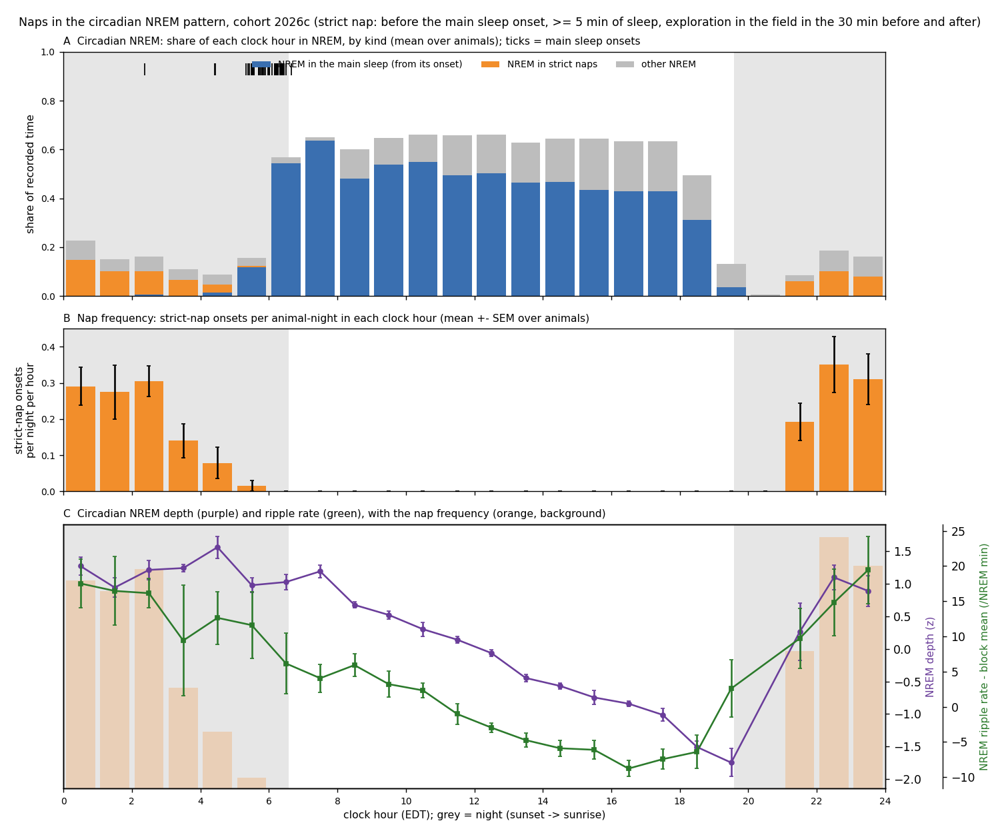

# Naps at night: frequency, timing and ripples (2026c)

Generated by `ephys/night_sleep_wiser.py naps` (repo `7725711+dirty`) from the per-second tables of the night-sleep run; definition = plan Amendment 1 of [`implementation_plan/2026-10-09-night-sleep-wiser.md`](../../../../implementation_plan/2026-10-09-night-sleep-wiser.md) (the user's: before the main sleep starts, plenty of activity / exploring before and after).

## Answer

- **117 strict naps** in 57 analysed animal-nights (active phase defined): median 2 per night (IQR 1 - 3); per animal SF07 1.3, SF08 2.2, SF09 2.3, SF10 2.6, SF11 1.0, SF12 2.3 per night.
- Duration median 23 min (IQR 14 - 33), NREM median 20 min; in a house for a median 100 % of their seconds.
- Of 235 pre-onset night sleep stretches (>= 5 min), 117 (50 %) meet the exploration criterion on both sides.
- **Timing:** most frequent at hour 22 (0.35 onsets per night); per-hour frequencies in the table below.
- **Ripple rate:** strict naps vs the first 2 h of the main sleep: SF07 49 vs 48; SF08 109 vs 94; SF09 87 vs 63; SF10 104 vs 95; SF11 61 vs 56; SF12 81 vs 76 /NREM min; naps higher in 6 / 6.

## Per clock hour

| Hour | Strict-nap onsets per night (mean) | SEM | NREM in main sleep | NREM in strict naps | Other NREM |
|---|---|---|---|---|---|
| 00 | 0.29 | 0.05 | 0.00 | 0.15 | 0.08 |
| 01 | 0.28 | 0.07 | 0.00 | 0.10 | 0.05 |
| 02 | 0.31 | 0.04 | 0.00 | 0.10 | 0.06 |
| 03 | 0.14 | 0.05 | 0.00 | 0.07 | 0.04 |
| 04 | 0.08 | 0.04 | 0.02 | 0.03 | 0.04 |
| 05 | 0.02 | 0.02 | 0.12 | 0.01 | 0.03 |
| 06 | 0.00 | 0.00 | 0.54 | 0.00 | 0.02 |
| 07 | 0.00 | 0.00 | 0.64 | 0.00 | 0.01 |
| 08 | 0.00 | 0.00 | 0.48 | 0.00 | 0.12 |
| 09 | 0.00 | 0.00 | 0.54 | 0.00 | 0.11 |
| 10 | 0.00 | 0.00 | 0.55 | 0.00 | 0.11 |
| 11 | 0.00 | 0.00 | 0.50 | 0.00 | 0.16 |
| 12 | 0.00 | 0.00 | 0.50 | 0.00 | 0.16 |
| 13 | 0.00 | 0.00 | 0.46 | 0.00 | 0.16 |
| 14 | 0.00 | 0.00 | 0.47 | 0.00 | 0.18 |
| 15 | 0.00 | 0.00 | 0.43 | 0.00 | 0.21 |
| 16 | 0.00 | 0.00 | 0.43 | 0.00 | 0.21 |
| 17 | 0.00 | 0.00 | 0.43 | 0.00 | 0.21 |
| 18 | 0.00 | 0.00 | 0.31 | 0.00 | 0.18 |
| 19 | 0.00 | 0.00 | 0.04 | 0.00 | 0.10 |
| 20 | 0.00 | 0.00 | 0.00 | 0.00 | 0.01 |
| 21 | 0.19 | 0.05 | 0.00 | 0.06 | 0.03 |
| 22 | 0.35 | 0.08 | 0.00 | 0.10 | 0.09 |
| 23 | 0.31 | 0.07 | 0.00 | 0.08 | 0.08 |

## Ripple rate by kind of sleep (ripple-eligible NREM: tiers validated / good, the temperature analysis' exclusions)

| Animal | Strict naps (rate, NREM min) | Other night sleep | Main sleep, first 2 h | Main sleep, all |
|---|---|---|---|---|
| SF07 | 49.4 (191) | 48.0 (880) | 48.0 (419) | 42.5 (2945) |
| SF08 | 109.4 (189) | 94.7 (398) | 93.6 (444) | 83.7 (3080) |
| SF09 | 86.8 (377) | 68.3 (995) | 63.2 (440) | 60.4 (3412) |
| SF10 | 103.7 (547) | 80.0 (1531) | 95.4 (407) | 77.3 (2984) |
| SF11 | 60.9 (15) | 46.1 (597) | 55.9 (24) | 51.5 (79) |
| SF12 | 81.0 (521) | 68.0 (915) | 76.4 (362) | 70.8 (2133) |

## Definitions

- **Sleep stretch**: sleep epochs (NREM / REM) merged across wake gaps < 120 s, an unknown epoch ends it; >= 5 min from first to last sleep epoch and >= 3 min NREM.
- **Active phase of night D**: from the start of the first long wake (>= 30 min) beginning after 15:00 of D to the night's main sleep onset (MSO; if none, sunrise D+1 + 2 h).
- **Strict nap**: a sleep stretch inside the active phase whose 30-min flanks before and after are each covered >= 80 % by the record, >= 50 % WAKE and >= 5 min in the field (WISER zone, known seconds). Text: sleep taken between bouts of active exploration, before the main sleep.
- **Nap frequency**: strict-nap onsets in a clock hour / the animal's analysed nights; mean +- SEM over animals.
- **NREM composition**: per clock hour, the share of recorded seconds that are NREM inside the main sleep (from the MSO to the next long wake), inside strict naps, or elsewhere.
- **Ripple rate**: kept NREM SWR events / ripple-eligible NREM minutes inside each kind of sleep (>= 10 min).
