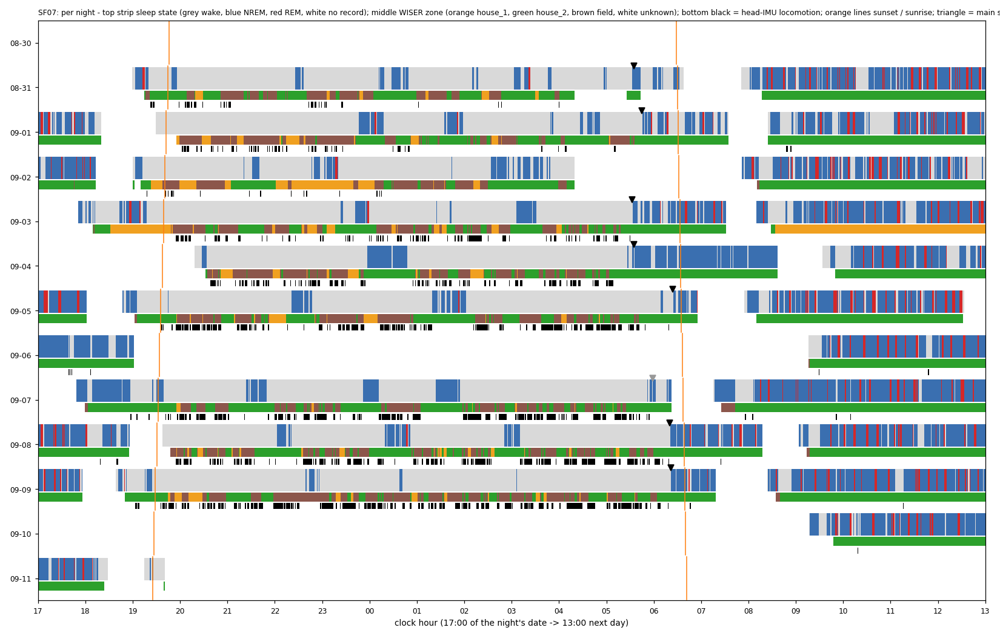
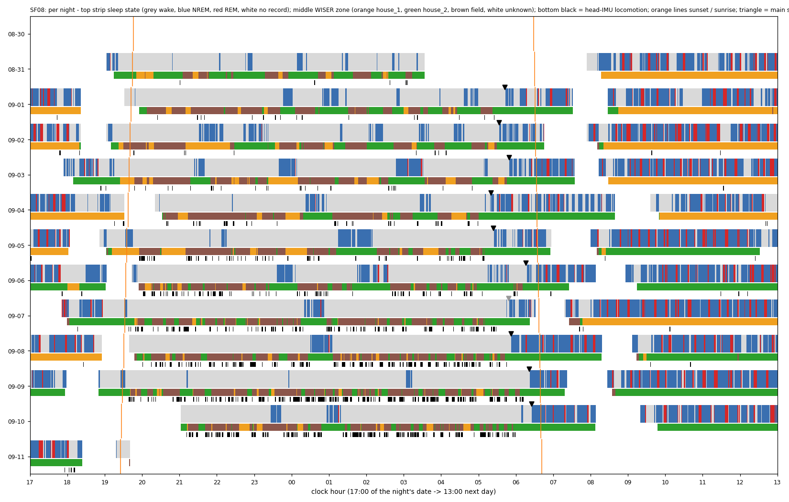
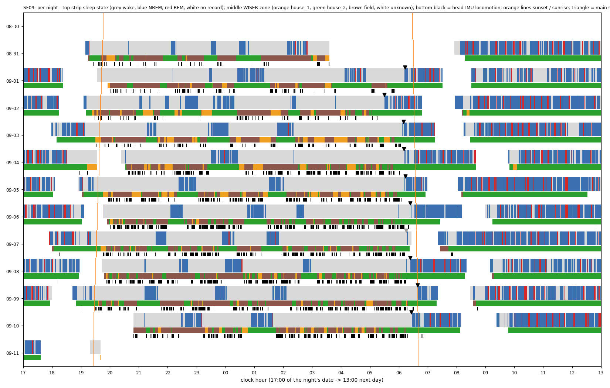
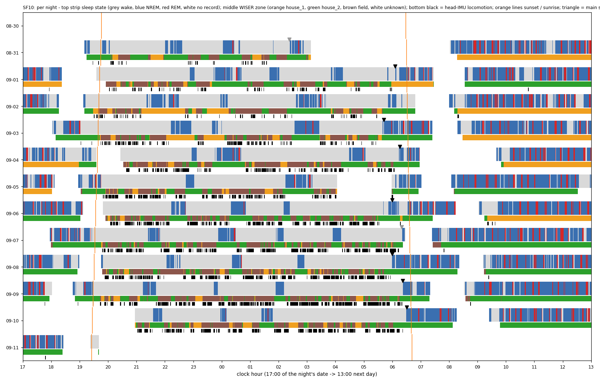
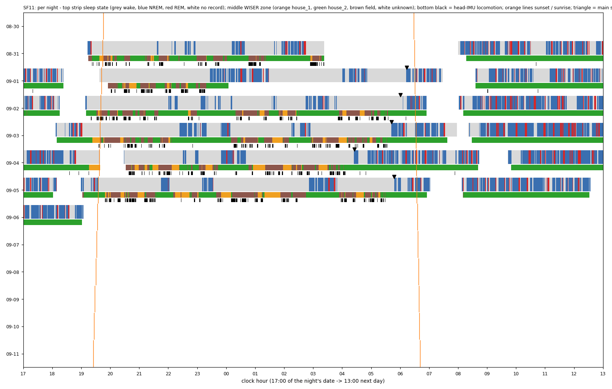
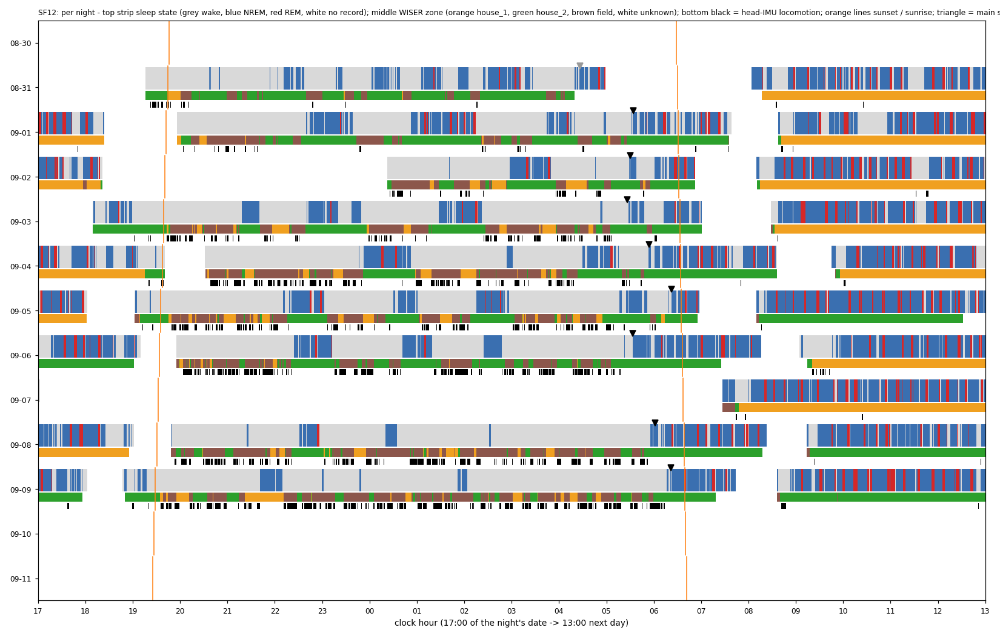
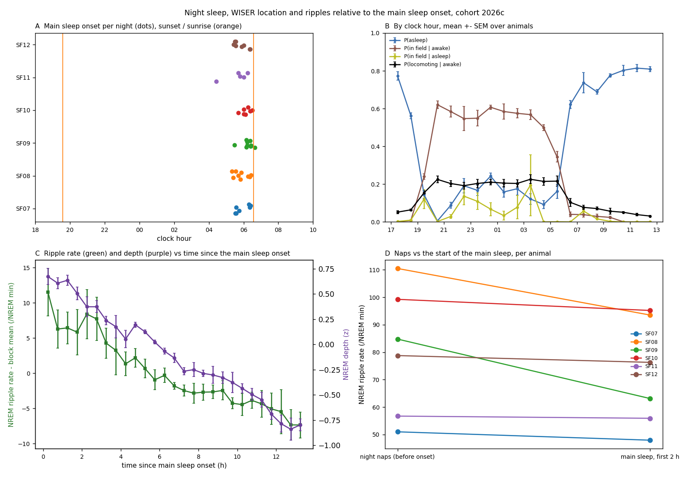

# When do the rats sleep at night? Night sleep / wake with WISER, and the main sleep onset (2026c)

Generated by `ephys/night_sleep_wiser.py run` (repo `3efd1ab+dirty`), long wake >= 30.0 min; plan [`implementation_plan/2026-10-09-night-sleep-wiser.md`](../../../../implementation_plan/2026-10-09-night-sleep-wiser.md) (written before computing). Run folder (per-second tables): `D:\Field2026_analysis_out\2026c\night_sleep_wiser_20261009_1051`.

## Answer

- **Main sleep onset (MSO)**: defined (not censored) on 45 of 78 animal-nights; clock time median 06:01 (IQR 05:34 - 06:21); per animal SF07 05:44, SF08 05:49, SF09 06:13, SF10 06:06, SF11 05:47, SF12 05:44.
- **Night NREM (sunset -> sunrise) after the MSO**: 26 % (mean over nights; per animal SF07 32 %, SF08 35 %, SF09 16 %, SF10 21 %, SF11 26 %, SF12 26 %). **NREM between 00:00 and 04:00 after the MSO: 0 %** (NREM-weighted).
- **Naps before the MSO**: median 69 min of sleep per night (IQR 54 - 87); main sleep inside the night median 19 min.
- **The last long wake before the MSO**: median 185 min, in the field for a median 48 % of its seconds with a known zone (known for 100 %); zone at MSO: house_2 43, house_1 1, unknown 1.
- **Ripples vs time since onset (C, D)**: held-out-date RMSE of the main-sleep ripple rate - clock harmonics vs time since MSO: tau better in 3 / 6 animals (SF07 12.0 vs 16.3, SF08 12.9 vs 13.0, SF09 15.6 vs 15.4, SF10 8.9 vs 8.1, SF11 nan vs nan, SF12 15.4 vs 15.0).
- **Naps vs the first 2 h of the main sleep**: SF07 51 vs 48 /NREM min (depth +0.22 vs +0.57); SF08 111 vs 94 /NREM min (depth +0.54 vs +0.56); SF09 85 vs 63 /NREM min (depth +0.47 vs +0.81); SF10 99 vs 95 /NREM min (depth +0.47 vs +0.75); SF11 57 vs 56 /NREM min (depth +0.56 vs +0.54); SF12 79 vs 76 /NREM min (depth +0.46 vs +0.49); main-sleep start higher in 0 / 6.

## Per night

| Animal | Night | Record coverage | MSO | Status | Last long wake (min, field share) | Nap min | Main-sleep min (night) | Night NREM after MSO | Zone at MSO |
|---|---|---|---|---|---|---|---|---|---|
| SF07 | 08-30 | 0 % |  | no record |  |  |  |  % | nan |
| SF07 | 08-31 | 100 % | 05:34 | ok | 106, 17 % | 69 | 25 | 27 % | house_2 |
| SF07 | 09-01 | 100 % | 05:44 | ok | 53, 53 % | 71 | 24 | 24 % | house_2 |
| SF07 | 09-02 | 79 % |  | no long wake in the window |  |  |  |  % | nan |
| SF07 | 09-03 | 100 % | 05:32 | ok | 121, 41 % | 49 | 40 | 45 % | house_2 |
| SF07 | 09-04 | 94 % | 05:34 | ok | 288, 47 % | 58 | 52 | 48 % | house_2 |
| SF07 | 09-05 | 100 % | 06:24 | ok | 263, 43 % | 63 | 9 | 12 % | house_2 |
| SF07 | 09-06 | 0 % |  | no record |  |  |  |  % | nan |
| SF07 | 09-07 | 98 % | 05:58 | censored | 248, 47 % | 82 | 7 | 8 % | house_2 |
| SF07 | 09-08 | 99 % | 06:19 | ok | 193, 46 % | 59 | 16 | 22 % | house_2 |
| SF07 | 09-09 | 100 % | 06:21 | ok | 452, 62 % | 18 | 17 | 48 % | house_2 |
| SF07 | 09-10 | 0 % |  | no record |  |  |  |  % | nan |
| SF07 | 09-11 | 2 % |  | no record |  |  |  |  % | nan |
| SF08 | 08-30 | 0 % |  | no record |  |  |  |  % | nan |
| SF08 | 08-31 | 72 % |  | no long wake in the window |  |  |  |  % | nan |
| SF08 | 09-01 | 100 % | 05:42 | ok | 44, 42 % | 59 | 21 | 25 % | house_2 |
| SF08 | 09-02 | 100 % | 05:33 | ok | 61, 42 % | 96 | 40 | 29 % | house_2 |
| SF08 | 09-03 | 100 % | 05:49 | ok | 35, 34 % | 87 | 31 | 27 % | house_2 |
| SF08 | 09-04 | 93 % | 05:20 | ok | 97, 38 % | 43 | 48 | 50 % | house_2 |
| SF08 | 09-05 | 100 % | 05:24 | ok | 201, 51 % | 65 | 42 | 38 % | house_2 |
| SF08 | 09-06 | 99 % | 06:16 | ok | 31, 39 % | 85 | 10 | 11 % | house_2 |
| SF08 | 09-07 | 99 % | 05:49 | censored | 297, 61 % | 34 | 27 | 43 % | house_2 |
| SF08 | 09-08 | 99 % | 05:52 | ok | 287, 71 % | 32 | 39 | 55 % | house_2 |
| SF08 | 09-09 | 100 % | 06:21 | ok | 195, 57 % | 15 | 17 | 52 % | house_2 |
| SF08 | 09-10 | 86 % | 06:25 | ok | 309, 55 % | 38 | 15 | 30 % | house_2 |
| SF08 | 09-11 | 2 % |  | no record |  |  |  |  % | nan |
| SF09 | 08-30 | 0 % |  | no record |  |  |  |  % | nan |
| SF09 | 08-31 | 73 % |  | no long wake in the window |  |  |  |  % | nan |
| SF09 | 09-01 | 100 % | 06:13 | ok | 82, 38 % | 81 | 14 | 15 % | house_2 |
| SF09 | 09-02 | 100 % | 05:29 | ok | 184, 54 % | 85 | 46 | 32 % | house_2 |
| SF09 | 09-03 | 100 % | 06:10 | ok | 229, 40 % | 83 | 19 | 18 % | house_2 |
| SF09 | 09-04 | 93 % | 06:10 | ok | 349, 57 % | 48 | 11 | 19 % | house_2 |
| SF09 | 09-05 | 100 % | 06:13 | ok | 253, 50 % | 60 | 18 | 22 % | house_2 |
| SF09 | 09-06 | 98 % | 06:23 | ok | 221, 50 % | 73 | 7 | 8 % | house_2 |
| SF09 | 09-07 | 98 % | 06:15 | censored | 265, 53 % | 66 | 2 | 4 % | house_2 |
| SF09 | 09-08 | 98 % | 06:24 | ok | 206, 46 % | 69 | 11 | 15 % | house_2 |
| SF09 | 09-09 | 100 % | 06:39 | ok | 274, 61 % | 69 | 0 | 0 % | house_2 |
| SF09 | 09-10 | 88 % | 06:26 | ok | 292, 56 % | 73 | 12 | 15 % | house_2 |
| SF09 | 09-11 | 2 % |  | no record |  |  |  |  % | nan |
| SF10 | 08-30 | 0 % |  | no record |  |  |  |  % | nan |
| SF10 | 08-31 | 68 % | 02:22 | censored | 115, 49 % | 65 | 22 | 23 % | house_2 |
| SF10 | 09-01 | 100 % | 06:06 | ok | 114, 21 % | 96 | 19 | 17 % | house_1 |
| SF10 | 09-02 | 100 % |  | no long wake in the window |  |  |  |  % | nan |
| SF10 | 09-03 | 100 % | 05:42 | ok | 137, 56 % | 102 | 41 | 28 % | house_2 |
| SF10 | 09-04 | 93 % | 06:16 | ok | 78, 41 % | 91 | 11 | 11 % | house_2 |
| SF10 | 09-05 | 82 % |  | no long wake in the window |  |  |  |  % | nan |
| SF10 | 09-06 | 98 % | 06:00 | ok | 220, 48 % | 73 | 14 | 17 % | house_2 |
| SF10 | 09-07 | 98 % | 06:20 | censored | 130, 44 % | 87 | 6 | 6 % | house_2 |
| SF10 | 09-08 | 98 % | 06:00 | ok | 187, 53 % | 57 | 32 | 36 % | house_2 |
| SF10 | 09-09 | 100 % | 06:22 | ok | 251, 62 % | 52 | 17 | 26 % | house_2 |
| SF10 | 09-10 | 87 % | 06:30 | ok | 284, 53 % | 54 | 9 | 15 % | house_2 |
| SF10 | 09-11 | 2 % |  | no record |  |  |  |  % | nan |
| SF11 | 08-30 | 0 % |  | no record |  |  |  |  % | nan |
| SF11 | 08-31 | 71 % |  | no long wake in the window |  |  |  |  % | nan |
| SF11 | 09-01 | 100 % | 06:14 | ok | 86, nan % | 122 | 10 | 8 % | unknown |
| SF11 | 09-02 | 100 % | 06:01 | ok | 144, 41 % | 73 | 17 | 18 % | house_2 |
| SF11 | 09-03 | 100 % | 05:42 | ok | 169, 58 % | 87 | 28 | 24 % | house_2 |
| SF11 | 09-04 | 92 % | 04:25 | ok | 226, 47 % | 56 | 87 | 59 % | house_2 |
| SF11 | 09-05 | 100 % | 05:47 | ok | 123, 46 % | 88 | 25 | 22 % | house_2 |
| SF11 | 09-06 | 0 % |  | no record |  |  |  |  % | nan |
| SF11 | 09-07 | 0 % |  | no record |  |  |  |  % | nan |
| SF11 | 09-08 | 0 % |  | no record |  |  |  |  % | nan |
| SF11 | 09-09 | 0 % |  | no record |  |  |  |  % | nan |
| SF11 | 09-10 | 0 % |  | no record |  |  |  |  % | nan |
| SF11 | 09-11 | 0 % |  | no record |  |  |  |  % | nan |
| SF12 | 08-30 | 0 % |  | no record |  |  |  |  % | nan |
| SF12 | 08-31 | 86 % | 04:26 | censored | 64, 33 % | 151 | 26 | 14 % | unknown |
| SF12 | 09-01 | 98 % | 05:33 | ok | 35, 50 % | 149 | 37 | 19 % | house_2 |
| SF12 | 09-02 | 57 % | 05:30 | ok | 104, 22 % | 51 | 33 | 39 % | house_2 |
| SF12 | 09-03 | 100 % | 05:26 | ok | 185, 58 % | 119 | 36 | 24 % | house_2 |
| SF12 | 09-04 | 92 % | 05:54 | ok | 43, 27 % | 104 | 30 | 22 % | house_2 |
| SF12 | 09-05 | 100 % | 06:22 | ok | 31, 25 % | 132 | 10 | 8 % | house_2 |
| SF12 | 09-06 | 97 % | 05:33 | ok | 171, 47 % | 99 | 50 | 34 % | house_2 |
| SF12 | 09-07 | 0 % |  | no record |  |  |  |  % | nan |
| SF12 | 09-08 | 97 % | 06:01 | ok | 327, 64 % | 48 | 27 | 35 % | house_2 |
| SF12 | 09-09 | 100 % | 06:21 | ok | 259, 53 % | 44 | 17 | 27 % | house_2 |
| SF12 | 09-10 | 0 % |  | no record |  |  |  |  % | nan |
| SF12 | 09-11 | 0 % |  | no record |  |  |  |  % | nan |

## By clock hour (mean over animals)

| Hour | Animals | P(asleep) | P(NREM) | P(field given awake) | P(field given asleep) | P(locomoting given awake) | Zone unknown |
|---|---|---|---|---|---|---|---|
| 00 | 6 | 0.24 | 0.23 | 0.61 | 0.07 | 0.21 | 0.03 |
| 01 | 6 | 0.16 | 0.15 | 0.58 | 0.03 | 0.21 | 0.03 |
| 02 | 6 | 0.18 | 0.16 | 0.58 | 0.08 | 0.20 | 0.03 |
| 03 | 6 | 0.12 | 0.11 | 0.57 | 0.19 | 0.23 | 0.03 |
| 04 | 6 | 0.09 | 0.09 | 0.50 | 0.00 | 0.21 | 0.06 |
| 05 | 6 | 0.16 | 0.15 | 0.35 | 0.00 | 0.22 | 0.05 |
| 06 | 6 | 0.62 | 0.57 | 0.04 | 0.00 | 0.10 | 0.06 |
| 07 | 6 | 0.74 | 0.65 | 0.04 | 0.06 | 0.08 | 0.19 |
| 08 | 6 | 0.69 | 0.60 | 0.03 | 0.02 | 0.07 | 0.16 |
| 09 | 6 | 0.78 | 0.65 | 0.02 | 0.00 | 0.06 | 0.07 |
| 10 | 6 | 0.80 | 0.66 | 0.00 | 0.00 | 0.05 | 0.00 |
| 11 | 6 | 0.81 | 0.66 | 0.00 | 0.00 | 0.04 | 0.00 |
| 12 | 6 | 0.81 | 0.66 | 0.00 | 0.00 | 0.03 | 0.03 |
| 13 | 6 | 0.77 | 0.63 | 0.00 | 0.00 | 0.06 | 0.10 |
| 14 | 6 | 0.79 | 0.64 | 0.00 | 0.00 | 0.04 | 0.01 |
| 15 | 6 | 0.79 | 0.65 | 0.00 | 0.00 | 0.05 | 0.05 |
| 16 | 6 | 0.79 | 0.64 | 0.00 | 0.00 | 0.05 | 0.01 |
| 17 | 6 | 0.77 | 0.64 | 0.00 | 0.00 | 0.05 | 0.02 |
| 18 | 6 | 0.56 | 0.49 | 0.01 | 0.01 | 0.06 | 0.08 |
| 19 | 6 | 0.14 | 0.13 | 0.24 | 0.12 | 0.15 | 0.14 |
| 20 | 6 | 0.01 | 0.01 | 0.62 | 0.00 | 0.23 | 0.02 |
| 21 | 6 | 0.09 | 0.09 | 0.58 | 0.03 | 0.20 | 0.00 |
| 22 | 6 | 0.19 | 0.19 | 0.55 | 0.14 | 0.19 | 0.00 |
| 23 | 6 | 0.17 | 0.16 | 0.55 | 0.11 | 0.20 | 0.00 |

## Ripple rate and depth by time since MSO

| tau (h) | Animals | Rate - block mean | SEM | Depth (z) | SEM |
|---|---|---|---|---|---|
| 0.0 | 6 | +11.5 | 3.4 | +0.67 | 0.08 |
| 0.5 | 6 | +6.3 | 2.7 | +0.61 | 0.06 |
| 1.0 | 5 | +6.5 | 2.3 | +0.64 | 0.05 |
| 1.5 | 5 | +5.9 | 3.2 | +0.51 | 0.06 |
| 2.0 | 5 | +8.4 | 3.5 | +0.37 | 0.10 |
| 2.5 | 6 | +7.7 | 3.1 | +0.37 | 0.06 |
| 3.0 | 6 | +4.3 | 2.1 | +0.24 | 0.04 |
| 3.5 | 6 | +3.3 | 3.5 | +0.18 | 0.11 |
| 4.0 | 6 | +1.4 | 1.7 | +0.05 | 0.09 |
| 4.5 | 5 | +2.2 | 1.3 | +0.19 | 0.02 |
| 5.0 | 5 | +0.7 | 1.3 | +0.12 | 0.02 |
| 5.5 | 5 | -0.9 | 1.4 | +0.02 | 0.02 |
| 6.0 | 5 | -0.3 | 1.0 | -0.07 | 0.03 |
| 6.5 | 5 | -1.8 | 0.5 | -0.13 | 0.04 |
| 7.0 | 5 | -2.4 | 0.8 | -0.27 | 0.03 |
| 7.5 | 5 | -2.8 | 1.4 | -0.25 | 0.07 |
| 8.0 | 5 | -2.7 | 1.1 | -0.29 | 0.03 |
| 8.5 | 5 | -2.6 | 1.0 | -0.30 | 0.08 |
| 9.0 | 5 | -2.4 | 1.4 | -0.33 | 0.06 |
| 9.5 | 5 | -4.3 | 0.8 | -0.38 | 0.10 |
| 10.0 | 5 | -4.4 | 1.6 | -0.44 | 0.05 |
| 10.5 | 5 | -3.8 | 1.1 | -0.50 | 0.06 |
| 11.0 | 5 | -4.3 | 1.9 | -0.55 | 0.07 |
| 11.5 | 5 | -5.0 | 2.2 | -0.69 | 0.05 |
| 12.0 | 5 | -5.4 | 3.1 | -0.79 | 0.08 |
| 12.5 | 5 | -7.3 | 2.2 | -0.84 | 0.11 |
| 13.0 | 4 | -7.3 | 1.8 | -0.80 | 0.06 |

## Definitions

- **State**: FINAL 1-s sleep states (WAKE / NREM / REM), records = included sessions joined across splits <= 60 s (`sleep_cycles_v2.build_records`; inclusion `sleep_schedule.included_sessions`, to 09-11 19:40).
- **Long wake**: maximal WAKE runs merged across sleep interruptions < 120 s (an unknown epoch ends a run), kept if >= 30.0 min.
- **Main sleep onset (MSO)** of night D: the first sleep epoch (NREM / REM) after the last long wake that ends between sunset D and sunrise D+1 + 2 h; 'censored' when its record covers < 3 h after it and ends before sunrise.
- **Naps**: sleep seconds between sunset D and the MSO; **main sleep (in the night)**: sleep seconds from the MSO to sunrise.
- **Time since MSO** tau: from the MSO until the next long wake starts (across the morning-round gap).
- **WISER zone** per second: the nearest valid fix within +-5 s of the default track (V3 / B2), house_1 / house_2 = inside the confirmed house rectangle grown by 14 in (jitter ~7 in median, p95 ~15 in), else field; fixes flagged handling / all-tag silence / off-animal ignored; no fix = unknown (never 'outside'). Positions are in the UNVERIFIED WISER inch frame: only house membership is used, no physical position.
- **Locomoting** = the head-IMU state of the fix (3 = locomoting; 0 = unusable excluded).
- **Ripple rate / depth**: kept NREM SWR events (tiers validated / good, the temperature analysis' exclusions) per NREM minute; depth = the raw spectral slope of `imu_fixch`, z within animal x block; tau bins 30 min, block-demeaned.
- **Clock vs tau**: per animal, 30-min bins inside the main sleep; weighted least squares with block intercepts + 2 clock harmonics, or + tau and tau^2, or both; leave-one-date-out RMSE weighted by NREM minutes.

## WISER measurement notes (regime-aware-wiser-tracking)

- Frame: inches, unverified offset; only rectangle membership with a 14-in buffer is used (no spatial claim beyond house vs field).
- Unknown zone share by hour is in the hourly table; gaps are unknown, not 'left the house'.
- Rain nights degrade UWB (fewer anchors); zone claims on those nights are weaker.

## Sensitivity: the long-wake threshold (pre-registered; computed from the run's per-second tables)

| Long wake >= | Nights with an MSO | MSO median (IQR) | 00-04 h NREM after the MSO | MSO before 04:00 |
|---|---|---|---|---|
| 20 min | 49 | 06:16 (06:00 - 06:25) | 0.0 % | 0 nights |
| 30 min (primary) | 45 | 06:01 (05:34 - 06:21) | 0.0 % | 0 nights |
| 60 min | 46 | 05:56 (05:29 - 06:18) | 0.5 % | 1 night |
