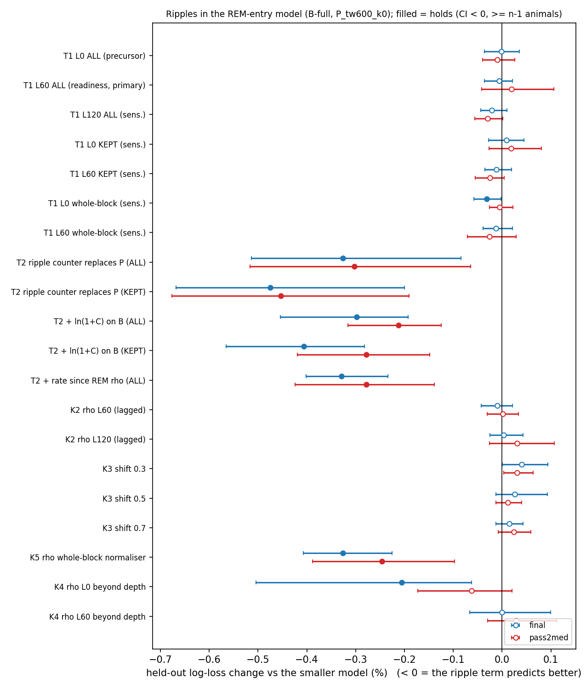

# Ripples in the REM-entry model (cohort 2026c)

Plan, pre-registered before any fit: [2026-10-09-rem-ripple-model.md](../../../../implementation_plan/2026-10-09-rem-ripple-model.md) (Amendment 1 = the model owner's reply; Amendment 2 = the artifact checks, written before they ran). Driver `ephys/rem_ripple_model.py`; run `D:\Field2026_analysis_out\2026c\rem_ripple_model_20261009_1314`, checks `D:\Field2026_analysis_out\2026c\rem_ripple_checks_20261009_1340`; git `fd9ca63+dirty`.

## Answer

1. **Recent rate (T1).** **The recent ripple rate (10-min window, any lag) does not improve held-out REM-entry prediction on both scorings.** Beyond the NREM counter, the clock and the wake history, the ripple rate of the last 10 min of NREM adds no predictive information.

2. **Accumulated count (T2).** **The ripples accumulated since the last REM (T2) pass the numeric rule on both scorings** (T2 + ln(1+C) on B (ALL), T2 + ln(1+C) on B (KEPT), T2 + rate since REM rho (ALL), T2 ripple counter replaces P (ALL), T2 ripple counter replaces P (KEPT)). By the plan's rule this is description, because T1 failed at L = 60 s; Amendment 2 tests it for artifacts.

3. **Artifact checks (Amendment 2).** **The ripple-counter gain does not survive the pre-registered artifact checks:** (i) failed (final -0.010 % [-0.043, +0.021]; pass2med +0.001 % [-0.030, +0.034]) — the gain is a precursor of the transition (it vanishes when the last minute is left out); (iii) failed (pass2med -0.063 % [-0.172, +0.021]) — beyond NREM depth the gain is not stable across the two scorings.

4. **Overall.** No NREM-ripple measure carries REM-scheduling information beyond the NREM counter, the clock and the wake history once the last minute before a step is left out. The ripple information about REM is local: ripples vanish in the final minute before REM entry. Post hoc, about 55-65 % of the counter's gain sits on the single 10-s step right before REM, and about 60 % in bouts that end in REM within their first minute, i.e. short NREM stretches with few ripples. So the macro-scale reciprocity (ripple-rich naps, REM-poor nights) is not a scheduling link at the scale of the REM cycle: it is accounted for by the drivers the model already has, plus a transition-local drop of ripples as the hippocampus enters REM.

## The question

- Naps and the early main sleep are ripple-rich and REM-poor. Across sleep periods REM and ripple rate are reciprocal (ρ −0.54, 6/6). Ripples also drop in the last minute before REM (6/6).
- Is that a link, or two outputs of the same drivers?
- The test: does the ripple rate of the preceding NREM improve **held-out** prediction of the next REM entry?
  - The reference model is the sleep model's best: Step B's B-full, i.e. the NREM counter P_tw600_k0 + clock + experiment day + wake history (L1) + animal.
  - Only information from before each 10-s step is used.
- Ripples stay a candidate predictor: they never define naps or REM, and the staging is unchanged.

## Definitions

Steps, outcome and model: `ephys/sleep_model.py` Step B. A step = 10 s of NREM, starting at $t$; outcome = stay / REM / WAKE at its end; multinomial logit, C = 1e4.

- **Covered second:** session tier validated / good (SWR quality guide), before `use_until`, outside the probe-advance settle windows. SF11 is covered only to 09-02 ~17:04.
- **ALL events (primary):** every detected event whose peak second is NREM in the scoring being modelled, flags ignored. **KEPT (sensitivity):** the same with `excluded == False`.
- **Window rate**, for lag $L$ ∈ {0, 60, 120 s}, over the record seconds $[t-L-600,\,t-L)$:
  $$rr_L = \ln\frac{k + 0.5}{(m/60)\,\bar r_b(t-L)}$$
  where $k$ = events in the window, $m$ = its NREM seconds, and $\bar r_b(\tau)$ = events per NREM minute of the animal × probe block over its covered NREM seconds before $\tau$.
  - It needs ≥ 30 min, which makes the normaliser causal. **Text:** the recent ripple rate relative to the block's running average; 0 = typical, +0.69 = twice the usual rate.
  - Sensitivity 'whole-block': $\bar r_b$ over the whole block.
- **Ripple counter:** $C = E/\bar r_b(t)$, with $E$ kept exactly like P_tw600_k0:
  - NREM adds its events up to $t$;
  - a wake of $d$ s multiplies by $e^{-d/600}$;
  - REM empties it;
  - unknown freezes it.
  - **Text:** the ripples accumulated since the last REM, in 'expected NREM minutes', so $C$ and $P$ read in the same units.
  - Enters as $\ln(1+C)$ (spline in the history slot, replacing $P$; or linear on top of B).
- **Rate since REM:** $\rho = \ln\frac{C+0.5}{P+0.5}$, the discounted relative ripple rate since the last REM.
- **Depth:** $\text{depth}_L$ = mean raw spectral slope (imu_fixch, z within animal × block) over the window's NREM seconds.
- **Subsets:**
  - S1: the step and every NREM second of $[t-720, t)$ covered; $m$ ≥ 180 s in all three windows; all rates finite.
  - S2: S1 + every NREM second since the last REM covered.
  - All models of one comparison are fitted on the same subset.
- **Rule:** $\Delta$ = held-out log-loss change in % of the smaller model, forward chaining over day-half blocks (fold 0 dropped), 95 % CI by bootstrap over folds.
  - **holds** = CI upper < 0 **and** ≥ n − 1 of the n animals with test steps better.
  - A term counts only if it holds on **both** FINAL and pass2med.

## Data

- Alignment with the owner's cached held-out steps (final): 126231 / 126231 rows matched, y equal on 126231.
- Alignment with the owner's cached held-out steps (pass2med): 126889 / 126889 rows matched, y equal on 126889.
- Reproduction of Step B, B-full vs gate-only on all steps (final): -2.35 % [-3.15, -1.68], 6/6 animals, 122735 test steps / 2544 REM. Step B: −2.17 % (122,735 / 2,544), there with the counter's grid point chosen per fold (nested); here it is fixed at P_tw600_k0.
- Reproduction of Step B, B-full vs gate-only on all steps (pass2med): -1.97 % [-2.22, -1.66], 6/6 animals, 123304 test steps / 2666 REM. Step B: −1.97 % (123,304 / 2,666), there with the counter's grid point chosen per fold (nested); here it is fixed at P_tw600_k0.

Steps per subset (REM entries in brackets):

| scoring | animal | all | S1 | S2 |
|---|---|---:|---:|---:|
| final | SF07 | 31502 (770) | 23324 (673) | 23071 (673) |
| final | SF08 | 31789 (675) | 21011 (496) | 20962 (495) |
| final | SF09 | 33268 (615) | 28451 (604) | 28451 (604) |
| final | SF10 | 34467 (806) | 29780 (787) | 29780 (787) |
| final | SF11 | 17182 (418) | 4045 (121) | 4045 (121) |
| final | SF12 | 31460 (596) | 20850 (458) | 20850 (458) |
| pass2med | SF07 | 32852 (914) | 24961 (781) | 24961 (781) |
| pass2med | SF08 | 32123 (755) | 20905 (530) | 20905 (530) |
| pass2med | SF09 | 33878 (630) | 29086 (608) | 29086 (608) |
| pass2med | SF10 | 35565 (840) | 30503 (813) | 30503 (813) |
| pass2med | SF11 | 18676 (480) | 5097 (162) | 5097 (162) |
| pass2med | SF12 | 31996 (600) | 21271 (473) | 21271 (473) |

S1 keeps the steps whose preceding 12 min are ripple-covered. Steps after an uncovered stretch (another tier, a settle window, SF11 after 09-02) or early in a block (no causal normaliser yet) are lost.

## Results

| test | scoring | comparison | Δ % | 95 % CI | animals better | holds |
|---|---|---|---:|---|---:|:---:|
| T1 L0 ALL (precursor) | final | B+rra0 vs B | -0.001 | [-0.036, +0.035] | 2/5 | no |
| T1 L60 ALL (readiness, primary) | final | B+rra60 vs B | -0.006 | [-0.036, +0.021] | 3/5 | no |
| T1 L120 ALL (sens.) | final | B+rra120 vs B | -0.021 | [-0.044, +0.010] | 4/5 | no |
| T1 L0 KEPT (sens.) | final | B+rrk0 vs B | +0.009 | [-0.028, +0.045] | 1/5 | no |
| T1 L60 KEPT (sens.) | final | B+rrk60 vs B | -0.011 | [-0.035, +0.020] | 3/5 | no |
| T1 L0 whole-block (sens.) | final | B+rrw0 vs B | -0.032 | [-0.058, -0.002] | 5/5 | yes |
| T1 L60 whole-block (sens.) | final | B+rrw60 vs B | -0.012 | [-0.039, +0.021] | 4/5 | no |
| T2 ripple counter replaces P (ALL) | final | Bc vs B | -0.326 | [-0.513, -0.085] | 5/5 | yes |
| T2 ripple counter replaces P (KEPT) | final | Bck vs B | -0.475 | [-0.668, -0.200] | 5/5 | yes |
| T2 + ln(1+C) on B (ALL) | final | B+lCa vs B | -0.298 | [-0.454, -0.193] | 5/5 | yes |
| T2 + ln(1+C) on B (KEPT) | final | B+lCk vs B | -0.406 | [-0.565, -0.281] | 5/5 | yes |
| T2 + rate since REM rho (ALL) | final | B+rho vs B | -0.329 | [-0.401, -0.234] | 5/5 | yes |
| T1 L0 ALL (precursor) | pass2med | B+rra0 vs B | -0.010 | [-0.040, +0.026] | 3/5 | no |
| T1 L60 ALL (readiness, primary) | pass2med | B+rra60 vs B | +0.019 | [-0.041, +0.106] | 2/5 | no |
| T1 L120 ALL (sens.) | pass2med | B+rra120 vs B | -0.029 | [-0.056, +0.001] | 5/5 | no |
| T1 L0 KEPT (sens.) | pass2med | B+rrk0 vs B | +0.018 | [-0.027, +0.080] | 2/5 | no |
| T1 L60 KEPT (sens.) | pass2med | B+rrk60 vs B | -0.025 | [-0.055, +0.005] | 3/5 | no |
| T1 L0 whole-block (sens.) | pass2med | B+rrw0 vs B | -0.005 | [-0.026, +0.023] | 3/5 | no |
| T1 L60 whole-block (sens.) | pass2med | B+rrw60 vs B | -0.026 | [-0.071, +0.029] | 4/5 | no |
| T2 ripple counter replaces P (ALL) | pass2med | Bc vs B | -0.303 | [-0.517, -0.065] | 5/5 | yes |
| T2 ripple counter replaces P (KEPT) | pass2med | Bck vs B | -0.454 | [-0.677, -0.190] | 5/5 | yes |
| T2 + ln(1+C) on B (ALL) | pass2med | B+lCa vs B | -0.212 | [-0.315, -0.125] | 4/5 | yes |
| T2 + ln(1+C) on B (KEPT) | pass2med | B+lCk vs B | -0.278 | [-0.419, -0.148] | 4/5 | yes |
| T2 + rate since REM rho (ALL) | pass2med | B+rho vs B | -0.278 | [-0.424, -0.138] | 4/5 | yes |

### Direction (T3, description)

Full-subset fit of B + the ripple term, z-scored. Coefficient = log-odds change per +1 SD vs staying in NREM.
Negative on REM = more recent ripples, later REM.

| scoring | term | fit | animal | b REM | b WAKE | steps | REM |
|---|---|---|---|---:|---:|---:|---:|
| final | rra0 | pooled | all | +0.016 | -0.052 | 127461 | 3139 |
| final | rra0 | per_animal | SF07 | +0.053 | -0.037 | 23324 | 673 |
| final | rra0 | per_animal | SF08 | +0.073 | -0.025 | 21011 | 496 |
| final | rra0 | per_animal | SF09 | -0.049 | -0.039 | 28451 | 604 |
| final | rra0 | per_animal | SF10 | +0.078 | -0.108 | 29780 | 787 |
| final | rra0 | per_animal | SF11 | +0.007 | -0.134 | 4045 | 121 |
| final | rra0 | per_animal | SF12 | +0.033 | -0.072 | 20850 | 458 |
| final | rra60 | pooled | all | +0.103 | -0.025 | 127461 | 3139 |
| final | rra60 | per_animal | SF07 | +0.159 | -0.005 | 23324 | 673 |
| final | rra60 | per_animal | SF08 | +0.185 | +0.024 | 21011 | 496 |
| final | rra60 | per_animal | SF09 | +0.052 | -0.027 | 28451 | 604 |
| final | rra60 | per_animal | SF10 | +0.172 | -0.052 | 29780 | 787 |
| final | rra60 | per_animal | SF11 | +0.063 | -0.137 | 4045 | 121 |
| final | rra60 | per_animal | SF12 | +0.120 | -0.042 | 20850 | 458 |
| pass2med | rra0 | pooled | all | +0.007 | -0.041 | 131823 | 3367 |
| pass2med | rra0 | per_animal | SF07 | +0.061 | -0.015 | 24961 | 781 |
| pass2med | rra0 | per_animal | SF08 | -0.047 | -0.064 | 20905 | 530 |
| pass2med | rra0 | per_animal | SF09 | -0.051 | -0.040 | 29086 | 608 |
| pass2med | rra0 | per_animal | SF10 | +0.021 | -0.159 | 30503 | 813 |
| pass2med | rra0 | per_animal | SF11 | -0.094 | -0.099 | 5097 | 162 |
| pass2med | rra0 | per_animal | SF12 | +0.066 | +0.020 | 21271 | 473 |
| pass2med | rra60 | pooled | all | +0.083 | -0.006 | 131823 | 3367 |
| pass2med | rra60 | per_animal | SF07 | +0.170 | +0.021 | 24961 | 781 |
| pass2med | rra60 | per_animal | SF08 | +0.044 | -0.038 | 20905 | 530 |
| pass2med | rra60 | per_animal | SF09 | +0.018 | -0.021 | 29086 | 608 |
| pass2med | rra60 | per_animal | SF10 | +0.098 | -0.086 | 30503 | 813 |
| pass2med | rra60 | per_animal | SF11 | -0.052 | -0.056 | 5097 | 162 |
| pass2med | rra60 | per_animal | SF12 | +0.125 | +0.048 | 21271 | 473 |

## Artifact checks of the counter gain (Amendment 2)

All on S2, ALL events, ρ = ln((C + 0.5) / (P + 0.5)). Pre-registered reading: ρ counts as REM-readiness information only if (i)–(iv) all pass on both scorings.

- (i) **K2 lagged:** events of the current bout counted only to t − L, and P lagged alike.
- (ii) **K3 shifts:** each record's per-NREM-second event counts rolled by 0.3 / 0.5 / 0.7 of its length. This keeps the record's mean rate and breaks the timing.
- (iii) **K4 depth:** d̄ = discount-weighted mean NREM depth z since the last REM, with P's bookkeeping.
- (iv) **K1:** the held-out change split into binary REM and binary WAKE log-loss.
- **K5:** ρ with the whole-block normaliser.

| check | scoring | Δ % | 95 % CI | animals better | holds |
|---|---|---:|---|---:|:---:|
| K2 rho L0 (= T2 rho) | final | -0.329 | [-0.401, -0.234] | 5/5 | yes |
| K2 rho L60 (lagged) | final | -0.010 | [-0.043, +0.021] | 3/5 | no |
| K2 rho L120 (lagged) | final | +0.004 | [-0.025, +0.042] | 3/5 | no |
| K3 shift 0.3 | final | +0.040 | [+0.001, +0.094] | 0/5 | no |
| K3 shift 0.5 | final | +0.026 | [-0.013, +0.093] | 0/5 | no |
| K3 shift 0.7 | final | +0.015 | [-0.013, +0.043] | 1/5 | no |
| K5 rho whole-block normaliser | final | -0.326 | [-0.407, -0.226] | 5/5 | yes |
| K4 rho L0 beyond depth | final | -0.205 | [-0.504, -0.062] | 4/5 | yes |
| K4 rho L60 beyond depth | final | -0.000 | [-0.067, +0.099] | 4/5 | no |
| K2 rho L0 (= T2 rho) | pass2med | -0.278 | [-0.424, -0.138] | 4/5 | yes |
| K2 rho L60 (lagged) | pass2med | +0.001 | [-0.030, +0.034] | 1/5 | no |
| K2 rho L120 (lagged) | pass2med | +0.031 | [-0.026, +0.107] | 2/5 | no |
| K3 shift 0.3 | pass2med | +0.030 | [+0.003, +0.064] | 1/5 | no |
| K3 shift 0.5 | pass2med | +0.012 | [-0.013, +0.040] | 2/5 | no |
| K3 shift 0.7 | pass2med | +0.024 | [-0.008, +0.059] | 2/5 | no |
| K5 rho whole-block normaliser | pass2med | -0.246 | [-0.388, -0.097] | 4/5 | yes |
| K4 rho L0 beyond depth | pass2med | -0.063 | [-0.172, +0.021] | 4/5 | no |
| K4 rho L60 beyond depth | pass2med | +0.028 | [-0.029, +0.111] | 1/5 | no |

K1 — where the held-out change sits (binary log-losses, % of B's):

| comparison | scoring | outcome | Δ % | 95 % CI | animals better |
|---|---|---|---:|---|---:|
| B+rho0 vs B | final | total | -0.329 | [-0.401, -0.234] | 5/5 |
| B+rho0 vs B | final | rem | -0.555 | [-0.720, -0.368] | 5/5 |
| B+rho0 vs B | final | wake | -0.144 | [-0.220, -0.049] | 5/5 |
| B+rho60 vs B | final | total | -0.010 | [-0.043, +0.021] | 3/5 |
| B+rho60 vs B | final | rem | +0.004 | [-0.061, +0.058] | 2/5 |
| B+rho60 vs B | final | wake | -0.021 | [-0.055, +0.022] | 3/5 |
| B+rho0 vs B | pass2med | total | -0.278 | [-0.424, -0.138] | 4/5 |
| B+rho0 vs B | pass2med | rem | -0.464 | [-0.768, -0.167] | 5/5 |
| B+rho0 vs B | pass2med | wake | -0.127 | [-0.190, -0.073] | 4/5 |
| B+rho60 vs B | pass2med | total | +0.001 | [-0.030, +0.034] | 1/5 |
| B+rho60 vs B | pass2med | rem | +0.031 | [-0.029, +0.098] | 1/5 |
| B+rho60 vs B | pass2med | wake | -0.022 | [-0.046, +0.003] | 2/5 |

Conditions: (i) FAIL, (ii) pass, (iii) FAIL, (iv) pass

K6 — direction (full-subset fit, log-odds vs staying in NREM per +1 SD). Negative on REM = more ripples since the last REM than its NREM time predicts, so a later REM:

| scoring | term | fit | animal | b REM | b WAKE |
|---|---|---|---|---:|---:|
| final | rho0 | pooled | all | -0.245 | -0.111 |
| final | rho0 | per_animal | SF07 | -0.227 | -0.078 |
| final | rho0 | per_animal | SF08 | -0.454 | -0.107 |
| final | rho0 | per_animal | SF09 | -0.229 | -0.099 |
| final | rho0 | per_animal | SF10 | -0.157 | -0.141 |
| final | rho0 | per_animal | SF11 | -0.143 | -0.101 |
| final | rho0 | per_animal | SF12 | -0.311 | -0.163 |
| final | rho60 | pooled | all | +0.032 | -0.046 |
| final | rho60 | per_animal | SF07 | +0.112 | +0.006 |
| final | rho60 | per_animal | SF08 | +0.121 | +0.045 |
| final | rho60 | per_animal | SF09 | -0.013 | -0.062 |
| final | rho60 | per_animal | SF10 | +0.087 | -0.078 |
| final | rho60 | per_animal | SF11 | -0.083 | -0.040 |
| final | rho60 | per_animal | SF12 | +0.011 | -0.121 |
| final | lCa | pooled | all | -1.077 | -0.350 |
| final | lCa | per_animal | SF07 | -1.178 | -0.379 |
| final | lCa | per_animal | SF08 | -1.220 | -0.333 |
| final | lCa | per_animal | SF09 | -1.142 | -0.357 |
| final | lCa | per_animal | SF10 | -1.128 | -0.345 |
| final | lCa | per_animal | SF11 | -0.970 | -0.331 |
| final | lCa | per_animal | SF12 | -1.080 | -0.395 |
| pass2med | rho0 | pooled | all | -0.240 | -0.113 |
| pass2med | rho0 | per_animal | SF07 | -0.230 | -0.084 |
| pass2med | rho0 | per_animal | SF08 | -0.540 | -0.185 |
| pass2med | rho0 | per_animal | SF09 | -0.214 | -0.116 |
| pass2med | rho0 | per_animal | SF10 | -0.199 | -0.176 |
| pass2med | rho0 | per_animal | SF11 | -0.185 | -0.072 |
| pass2med | rho0 | per_animal | SF12 | -0.221 | -0.095 |
| pass2med | rho60 | pooled | all | +0.011 | -0.037 |
| pass2med | rho60 | per_animal | SF07 | +0.065 | +0.003 |
| pass2med | rho60 | per_animal | SF08 | -0.073 | -0.026 |
| pass2med | rho60 | per_animal | SF09 | -0.043 | -0.058 |
| pass2med | rho60 | per_animal | SF10 | +0.019 | -0.091 |
| pass2med | rho60 | per_animal | SF11 | -0.014 | +0.008 |
| pass2med | rho60 | per_animal | SF12 | +0.070 | -0.062 |
| pass2med | lCa | pooled | all | -0.894 | -0.433 |
| pass2med | lCa | per_animal | SF07 | -1.007 | -0.432 |
| pass2med | lCa | per_animal | SF08 | -1.039 | -0.469 |
| pass2med | lCa | per_animal | SF09 | -0.974 | -0.481 |
| pass2med | lCa | per_animal | SF10 | -0.960 | -0.471 |
| pass2med | lCa | per_animal | SF11 | -0.929 | -0.382 |
| pass2med | lCa | per_animal | SF12 | -0.874 | -0.477 |

## Post hoc: where the unlagged gain sits (not pre-registered)

Held-out per-step log-loss change of B + ρ (unlagged) vs B, from the same forward chaining (folds 1..). Negative = ρ helps; *share* = that cell's part of the total change.

| scoring | bout | position | steps | mean Δll × 10³ | share of gain | mean ρ0 | mean ρ60 |
|---|---|---|---:|---:|---:|---:|---:|
| final | ends in REM | last step | 2078 | -18.46 | 0.54 | -0.085 | -0.004 |
| final | ends in REM | 10-50 s before | 7844 | +0.34 | -0.04 | -0.024 | +0.002 |
| final | ends in REM | 60-110 s before | 6655 | -0.78 | 0.07 | +0.009 | +0.008 |
| final | ends in REM | 2-5 min before | 13666 | -0.69 | 0.13 | +0.005 | -0.002 |
| final | ends in REM | > 5 min before | 11050 | +0.25 | -0.04 | -0.028 | -0.040 |
| final | ends in WAKE | last step | 2970 | +3.77 | -0.16 | -0.025 | -0.001 |
| final | ends in WAKE | 10-50 s before | 11645 | -0.36 | 0.06 | -0.005 | +0.003 |
| final | ends in WAKE | 60-110 s before | 9120 | -0.79 | 0.10 | +0.008 | +0.008 |
| final | ends in WAKE | 2-5 min before | 14702 | -0.91 | 0.19 | +0.013 | +0.008 |
| final | ends in WAKE | > 5 min before | 8146 | -1.18 | 0.14 | +0.019 | +0.015 |
| final | no transition (censored) | last step | 34 | -0.37 | 0.00 | -0.038 | -0.064 |
| final | no transition (censored) | 10-50 s before | 130 | -0.37 | 0.00 | -0.031 | -0.044 |
| final | no transition (censored) | 60-110 s before | 98 | -0.68 | 0.00 | -0.023 | -0.038 |
| final | no transition (censored) | 2-5 min before | 148 | -1.00 | 0.00 | -0.014 | -0.026 |
| final | no transition (censored) | > 5 min before | 70 | +0.94 | -0.00 | -0.009 | -0.074 |
| pass2med | ends in REM | last step | 2143 | -18.25 | 0.64 | -0.083 | -0.004 |
| pass2med | ends in REM | 10-50 s before | 8115 | +0.93 | -0.12 | -0.021 | +0.002 |
| pass2med | ends in REM | 60-110 s before | 6924 | +0.03 | -0.00 | +0.007 | +0.007 |
| pass2med | ends in REM | 2-5 min before | 14349 | -0.12 | 0.03 | +0.008 | +0.001 |
| pass2med | ends in REM | > 5 min before | 12176 | +0.28 | -0.06 | -0.010 | -0.020 |
| pass2med | ends in WAKE | last step | 3021 | -2.06 | 0.10 | -0.027 | -0.002 |
| pass2med | ends in WAKE | 10-50 s before | 11670 | -0.28 | 0.05 | -0.002 | +0.004 |
| pass2med | ends in WAKE | 60-110 s before | 8916 | -0.59 | 0.09 | +0.013 | +0.011 |
| pass2med | ends in WAKE | 2-5 min before | 14108 | -0.75 | 0.17 | +0.019 | +0.010 |
| pass2med | ends in WAKE | > 5 min before | 7102 | -0.77 | 0.09 | +0.025 | +0.017 |
| pass2med | no transition (censored) | last step | 33 | -0.59 | 0.00 | -0.037 | -0.061 |
| pass2med | no transition (censored) | 10-50 s before | 133 | -0.48 | 0.00 | -0.036 | -0.048 |
| pass2med | no transition (censored) | 60-110 s before | 107 | -1.01 | 0.00 | -0.024 | -0.035 |
| pass2med | no transition (censored) | 2-5 min before | 164 | -0.39 | 0.00 | -0.015 | -0.025 |
| pass2med | no transition (censored) | > 5 min before | 71 | -0.99 | 0.00 | +0.008 | -0.098 |
| final | ends in REM | first minute of the bout | 9607 | -4.48 | 0.61 | -0.077 | -0.026 |
| final | ends in REM | 1-5 min | 19940 | -0.45 | 0.13 | -0.008 | -0.025 |
| final | ends in REM | > 5 min | 11746 | +0.39 | -0.06 | +0.031 | +0.029 |
| final | ends in WAKE | first minute of the bout | 13847 | -0.50 | 0.10 | -0.041 | -0.013 |
| final | ends in WAKE | 1-5 min | 23202 | -0.28 | 0.09 | +0.006 | -0.008 |
| final | ends in WAKE | > 5 min | 9534 | -1.01 | 0.14 | +0.075 | +0.075 |
| final | no transition (censored) | first minute of the bout | 153 | +1.52 | -0.00 | -0.119 | -0.105 |
| final | no transition (censored) | 1-5 min | 241 | +0.02 | -0.00 | -0.021 | -0.072 |
| final | no transition (censored) | > 5 min | 86 | -5.20 | 0.01 | +0.153 | +0.148 |
| pass2med | ends in REM | first minute of the bout | 9903 | -3.41 | 0.56 | -0.072 | -0.023 |
| pass2med | ends in REM | 1-5 min | 20797 | +0.11 | -0.04 | -0.008 | -0.024 |
| pass2med | ends in REM | > 5 min | 13007 | +0.14 | -0.03 | +0.044 | +0.043 |
| pass2med | ends in WAKE | first minute of the bout | 13924 | -1.09 | 0.25 | -0.042 | -0.019 |
| pass2med | ends in WAKE | 1-5 min | 22440 | -0.44 | 0.16 | +0.012 | -0.004 |
| pass2med | ends in WAKE | > 5 min | 8453 | -0.68 | 0.09 | +0.089 | +0.089 |
| pass2med | no transition (censored) | first minute of the bout | 158 | +0.64 | -0.00 | -0.127 | -0.123 |
| pass2med | no transition (censored) | 1-5 min | 279 | -0.79 | 0.00 | +0.001 | -0.048 |
| pass2med | no transition (censored) | > 5 min | 71 | -2.90 | 0.00 | +0.133 | +0.136 |

## Reading and limits

- A held-out gain is predictive information, not a mechanism. Ripples and REM may both follow an unmeasured state, such as cortical slow-wave dynamics or temperature.
- Ripple counts are not memory processing: replay content can fall while ripples rise (sleep deprivation; Giri et al. 2024, https://pubmed.ncbi.nlm.nih.gov/38867049/).
- **L = 0 vs L = 60 s:**
  - A gain only at L = 0 is the transition already under way, since ripples drop in the last minute before REM.
  - Only L = 60 s speaks to slower REM readiness.
- **ALL vs KEPT:** the kept events drop theta- and REM-flagged events, which shares information with the scorer's REM call. So the ALL version decides.
- **Animals:** SF11 has no test steps, because its ripples end on 09-02, inside the six train-only blocks. The rule is therefore n − 1 of 5.
- **T2 was pre-registered as description unless T1 held at L = 60 s.** Its gain is therefore read only through the Amendment-2 checks; C is strongly collinear with P.

