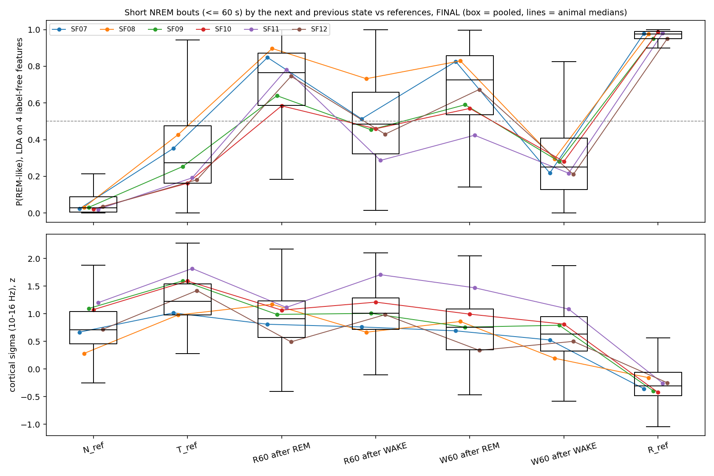

# What are the short NREM bouts that end in REM? (cohort 2026c) — Part A, label-free description

Plan (before computing): [2026-10-09-short-rem-bouts.md](../../../../implementation_plan/2026-10-09-short-rem-bouts.md). Driver `ephys/short_rem_bouts.py`; run `D:\Field2026_analysis_out\2026c\short_rem_bouts_20261009_1534`; git `2b2eb1b+dirty`.

**Part A is a description, not the decision.** The features come from the same LFP the scorer read. The human blind reading (Part B) decides.

## Pre-registered reading (Part A)

- **final:** REM-like. Of 6 animals with R60-after-REM bouts (rule: ≥ 5):
  - REM-like (median pREM > 0.5): 6;
  - genuine NREM (pREM < 0.5, cortical delta / sigma within ±0.5 SD of N_ref): 0;
  - intermediate (median inter ≥ 0.3, or pREM 0.3–0.7): 4.
- **pass2med:** REM-like. Of 6 animals with R60-after-REM bouts (rule: ≥ 5):
  - REM-like (median pREM > 0.5): 6;
  - genuine NREM (pREM < 0.5, cortical delta / sigma within ±0.5 SD of N_ref): 0;
  - intermediate (median inter ≥ 0.3, or pREM 0.3–0.7): 6.

**What the numbers say (FINAL, range of the animal medians):**
- **pREM:**
  - short NREM bouts between two REM bouts (R60 after REM): 0.58–0.90;
  - real REM (R_ref): 0.95–0.99;
  - mid-NREM (N_ref): 0.02–0.03;
  - the last 30 s of long NREM before REM (T_ref): 0.16–0.43.
- **What decides it is the state before the bout, not after:**
  - short bouts after REM that end in WAKE (W60 after REM): 0.42–0.83;
  - short bouts after WAKE: R60 0.29–0.73, W60 0.21–0.30.
- **Ripples per NREM-labelled minute:** R60 after REM 0–32, R_ref 0–7, N_ref 48–89.
- **Reading:**
  - The short NREM bouts between REM bouts look like REM by label-free LFP features, but not fully: they sit between REM and NREM, and the intermediate criterion is also met.
  - They are about as ripple-poor as REM.
  - This supports (a): REM interruptions or intermediate sleep cut out of REM episodes. Part B, the human reading, decides.
  - SF11 has only 3 such bouts (ripples covered to 09-02); without it the rule still passes 5/5.

## Definitions

- **Sets:**
  - R60 / W60 = NREM bouts ≤ 60 s followed by REM / WAKE, split by the state before them.
  - N_ref = the middle 30 s of NREM bouts ≥ 5 min.
  - R_ref = REM bouts ≥ 40 s without their first and last 10 s.
  - T_ref = the last 30 s of NREM bouts ≥ 5 min that end in REM.
  - References: up to 60 per animal × block. Coverage as in the REM ripple model.
- **Epochs:** each second whose 2-s Hann window lies inside the segment. Bouts < 3 s have none, so the neighbouring states never leak in.
- **Features:**
  - CA1 radiatum: $\theta$ = log P(6–10 Hz); $td$ = log P(6–10) / P(1–4).
  - Cortex (top, ripple-free site): $\delta_{ctx}$ = log P(1–4); $\sigma_{ctx}$ = log P(10–16), the spindle band.
  - Detected SWR events per second (flags and states ignored); fast LFP-EMG corr.
  - All z-scored per animal × block on the pooled N_ref + R_ref epochs.
- **pREM** = the LDA posterior of REM (equal priors) fitted per animal × block on N_ref vs R_ref epochs, averaged over the segment's epochs. **pREM_ctx** = the same with the cortical features only.
- **inter** = the share of epochs with $\sigma_{ctx}$ ≥ the N_ref median and $td$ ≥ the midpoint of the N_ref and R_ref medians (spindles with theta: the intermediate stage).

## Per animal (medians over segments)

| scoring | animal | group | n | pREM | frac REM | pREM ctx-only | inter | ripples /min | theta z | td z | delta ctx z | sigma ctx z | EMG z |
|---|---|---|---:|---:|---:|---:|---:|---:|---:|---:|---:|---:|---:|
| final | SF07 | N_ref | 142 | 0.02 | 0.00 | 0.04 | 0.00 | 50 | -0.48 | -1.25 | +1.27 | +0.67 | +0.01 |
| final | SF07 | R60 after REM | 185 | 0.85 | 0.88 | 0.76 | 0.45 | 8 | +0.43 | +0.25 | -0.11 | +0.81 | -0.24 |
| final | SF07 | R60 after WAKE | 115 | 0.51 | 0.50 | 0.57 | 0.29 | 27 | -0.17 | -0.28 | +0.18 | +0.76 | +0.12 |
| final | SF07 | R_ref | 146 | 0.98 | 0.99 | 0.97 | 0.11 | 6 | +0.21 | +0.58 | -0.59 | -0.36 | -0.19 |
| final | SF07 | T_ref | 114 | 0.35 | 0.34 | 0.35 | 0.31 | 27 | +0.30 | -0.38 | +0.54 | +1.02 | -0.26 |
| final | SF07 | W60 after REM | 61 | 0.83 | 0.88 | 0.75 | 0.38 | 5 | +0.06 | +0.22 | -0.09 | +0.69 | -0.14 |
| final | SF07 | W60 after WAKE | 423 | 0.22 | 0.20 | 0.33 | 0.07 | 45 | -0.69 | -0.76 | +0.57 | +0.53 | +2.15 |
| final | SF07 | W60 after unknown | 3 | 0.18 | 0.12 | 0.25 | 0.07 | 46 | -0.68 | -0.95 | +0.81 | +0.83 | +1.22 |
| final | SF08 | N_ref | 108 | 0.03 | 0.00 | 0.07 | 0.00 | 89 | +0.09 | -1.41 | +1.46 | +0.28 | -0.17 |
| final | SF08 | R60 after REM | 84 | 0.90 | 0.91 | 0.80 | 0.72 | 11 | +0.79 | +0.46 | +0.27 | +1.17 | -0.06 |
| final | SF08 | R60 after WAKE | 122 | 0.73 | 0.76 | 0.67 | 0.49 | 65 | +0.54 | -0.08 | +0.40 | +0.67 | -0.05 |
| final | SF08 | R_ref | 120 | 0.98 | 0.99 | 0.94 | 0.21 | 7 | +0.04 | +0.43 | -0.42 | -0.16 | +0.00 |
| final | SF08 | T_ref | 83 | 0.43 | 0.41 | 0.42 | 0.45 | 64 | +0.61 | -0.42 | +0.87 | +0.98 | +0.03 |
| final | SF08 | W60 after REM | 31 | 0.83 | 0.84 | 0.77 | 0.56 | 14 | +0.54 | +0.22 | +0.13 | +0.86 | -0.14 |
| final | SF08 | W60 after WAKE | 325 | 0.30 | 0.27 | 0.49 | 0.08 | 90 | +0.16 | -0.88 | +0.55 | +0.20 | +0.89 |
| final | SF08 | W60 after unknown | 1 | 0.03 | 0.00 | 0.10 | 0.00 | 41 | +0.77 | -1.15 | +1.25 | +0.35 | +0.47 |
| final | SF09 | N_ref | 60 | 0.03 | 0.02 | 0.07 | 0.10 | 72 | +0.71 | -0.77 | +1.39 | +1.10 | +0.04 |
| final | SF09 | R60 after REM | 63 | 0.64 | 0.64 | 0.59 | 0.36 | 3 | +0.29 | +0.35 | +0.15 | +0.99 | -0.28 |
| final | SF09 | R60 after WAKE | 160 | 0.45 | 0.46 | 0.46 | 0.25 | 38 | +0.57 | -0.11 | +0.34 | +1.01 | -0.03 |
| final | SF09 | R60 after unknown | 1 | 0.20 | 0.13 | 0.18 | 0.48 | 5 | +0.85 | +0.01 | +0.89 | +1.54 | +0.05 |
| final | SF09 | R_ref | 60 | 0.95 | 0.97 | 0.93 | 0.02 | 0 | -0.20 | +0.26 | -0.46 | -0.40 | -0.20 |
| final | SF09 | T_ref | 60 | 0.25 | 0.24 | 0.25 | 0.45 | 35 | +0.78 | +0.12 | +0.74 | +1.60 | -0.33 |
| final | SF09 | W60 after REM | 22 | 0.59 | 0.60 | 0.57 | 0.22 | 16 | +0.33 | +0.02 | +0.16 | +0.76 | -0.18 |
| final | SF09 | W60 after WAKE | 639 | 0.28 | 0.26 | 0.37 | 0.11 | 62 | +0.54 | -0.54 | +0.61 | +0.79 | +0.75 |
| final | SF09 | W60 after unknown | 1 | 0.16 | 0.15 | 0.18 | 0.15 | 57 | +0.96 | -0.70 | +1.26 | +1.05 | +3.83 |
| final | SF10 | N_ref | 60 | 0.02 | 0.00 | 0.03 | 0.03 | 85 | +0.21 | -1.14 | +1.51 | +1.07 | -0.14 |
| final | SF10 | R60 after REM | 120 | 0.58 | 0.57 | 0.57 | 0.28 | 32 | -0.00 | -0.19 | +0.22 | +1.07 | -0.05 |
| final | SF10 | R60 after WAKE | 188 | 0.46 | 0.44 | 0.47 | 0.25 | 56 | +0.10 | -0.44 | +0.36 | +1.21 | +0.12 |
| final | SF10 | R_ref | 60 | 0.99 | 0.99 | 0.98 | 0.02 | 2 | -0.06 | +0.44 | -0.54 | -0.42 | -0.19 |
| final | SF10 | T_ref | 60 | 0.16 | 0.16 | 0.16 | 0.26 | 69 | +0.29 | -0.52 | +0.97 | +1.59 | -0.34 |
| final | SF10 | W60 after REM | 28 | 0.57 | 0.59 | 0.54 | 0.18 | 22 | -0.48 | -0.54 | +0.27 | +0.99 | +0.27 |
| final | SF10 | W60 after WAKE | 424 | 0.28 | 0.25 | 0.37 | 0.03 | 68 | -0.25 | -1.05 | +0.57 | +0.81 | +1.45 |
| final | SF10 | W60 after unknown | 2 | 0.20 | 0.20 | 0.23 | 0.03 | 61 | -0.14 | -1.19 | +0.90 | +0.68 | +3.51 |
| final | SF11 | N_ref | 35 | 0.02 | 0.00 | 0.03 | 0.00 | 48 | -0.31 | -1.78 | +1.70 | +1.20 | +0.01 |
| final | SF11 | R60 after REM | 3 | 0.78 | 0.80 | 0.52 | 0.29 | 0 | +0.74 | -0.12 | +0.61 | +1.12 | +0.41 |
| final | SF11 | R60 after WAKE | 61 | 0.29 | 0.27 | 0.31 | 0.25 | 39 | -0.06 | -0.89 | +0.97 | +1.71 | +0.40 |
| final | SF11 | R60 after unknown | 1 | 0.18 | 0.18 | 0.13 | 0.18 | 0 | +1.16 | -0.68 | +1.39 | +1.53 | +0.19 |
| final | SF11 | R_ref | 60 | 0.98 | 0.99 | 0.96 | 0.03 | 1 | +0.05 | +0.39 | -0.40 | -0.26 | -0.16 |
| final | SF11 | T_ref | 14 | 0.19 | 0.17 | 0.11 | 0.24 | 38 | +0.57 | -1.13 | +1.43 | +1.82 | +0.06 |
| final | SF11 | W60 after REM | 2 | 0.42 | 0.43 | 0.36 | 0.28 | 39 | +0.27 | -0.68 | +0.93 | +1.47 | +0.01 |
| final | SF11 | W60 after WAKE | 143 | 0.22 | 0.19 | 0.30 | 0.06 | 50 | -0.60 | -1.21 | +1.01 | +1.09 | +0.96 |
| final | SF11 | W60 after unknown | 1 | 0.29 | 0.30 | 0.35 | 0.04 | 22 | -1.23 | -1.37 | +0.98 | +0.92 | -0.33 |
| final | SF12 | N_ref | 60 | 0.03 | 0.03 | 0.04 | 0.03 | 79 | -0.35 | -1.28 | +1.50 | +0.72 | -0.12 |
| final | SF12 | R60 after REM | 88 | 0.75 | 0.74 | 0.72 | 0.19 | 5 | -0.27 | -0.13 | +0.07 | +0.49 | -0.22 |
| final | SF12 | R60 after WAKE | 90 | 0.43 | 0.42 | 0.48 | 0.21 | 35 | -0.16 | -0.62 | +0.46 | +0.98 | +0.05 |
| final | SF12 | R60 after unknown | 2 | 0.41 | 0.46 | 0.36 | 0.41 | 13 | +0.29 | -0.25 | +0.59 | +1.13 | +1.13 |
| final | SF12 | R_ref | 60 | 0.95 | 0.97 | 0.95 | 0.09 | 1 | +0.20 | +0.41 | -0.47 | -0.25 | -0.13 |
| final | SF12 | T_ref | 60 | 0.18 | 0.17 | 0.19 | 0.24 | 54 | -0.10 | -0.76 | +0.99 | +1.42 | -0.35 |
| final | SF12 | W60 after REM | 23 | 0.67 | 0.71 | 0.73 | 0.19 | 9 | -0.61 | -0.24 | +0.12 | +0.34 | -0.11 |
| final | SF12 | W60 after WAKE | 425 | 0.21 | 0.18 | 0.31 | 0.02 | 57 | -0.60 | -1.17 | +0.76 | +0.50 | +1.59 |
| final | SF12 | W60 after unknown | 1 | 0.05 | 0.09 | 0.08 | 0.00 | 11 | -0.25 | -1.45 | +1.48 | +0.70 | +1.51 |
| pass2med | SF07 | N_ref | 163 | 0.02 | 0.00 | 0.04 | 0.00 | 52 | -0.45 | -1.17 | +1.17 | +0.70 | +0.00 |
| pass2med | SF07 | R60 after REM | 247 | 0.83 | 0.86 | 0.75 | 0.40 | 5 | +0.40 | +0.29 | -0.17 | +0.69 | -0.26 |
| pass2med | SF07 | R60 after WAKE | 134 | 0.59 | 0.61 | 0.65 | 0.29 | 22 | -0.17 | -0.19 | +0.05 | +0.64 | +0.04 |
| pass2med | SF07 | R60 after unknown | 1 | 0.83 | 0.80 | 0.82 | 0.50 | 0 | +1.01 | +0.68 | -0.43 | +0.87 | -0.31 |
| pass2med | SF07 | R_ref | 152 | 0.98 | 0.99 | 0.96 | 0.10 | 6 | +0.24 | +0.63 | -0.64 | -0.38 | -0.27 |
| pass2med | SF07 | T_ref | 139 | 0.42 | 0.41 | 0.40 | 0.28 | 27 | +0.29 | -0.28 | +0.44 | +0.96 | -0.36 |
| pass2med | SF07 | W60 after REM | 83 | 0.83 | 0.86 | 0.76 | 0.36 | 5 | +0.21 | +0.25 | -0.17 | +0.67 | -0.28 |
| pass2med | SF07 | W60 after WAKE | 431 | 0.27 | 0.25 | 0.42 | 0.07 | 40 | -0.96 | -0.67 | +0.38 | +0.40 | +2.14 |
| pass2med | SF07 | W60 after unknown | 3 | 0.14 | 0.11 | 0.21 | 0.07 | 44 | -0.57 | -0.79 | +0.72 | +0.82 | +1.40 |
| pass2med | SF08 | N_ref | 104 | 0.04 | 0.03 | 0.07 | 0.03 | 87 | +0.08 | -1.38 | +1.48 | +0.26 | -0.15 |
| pass2med | SF08 | R60 after REM | 89 | 0.93 | 0.94 | 0.84 | 0.75 | 9 | +0.77 | +0.51 | +0.17 | +1.21 | -0.12 |
| pass2med | SF08 | R60 after WAKE | 145 | 0.66 | 0.67 | 0.63 | 0.48 | 70 | +0.53 | -0.15 | +0.46 | +0.67 | -0.14 |
| pass2med | SF08 | R_ref | 120 | 0.98 | 0.99 | 0.95 | 0.23 | 8 | +0.00 | +0.42 | -0.39 | -0.12 | -0.05 |
| pass2med | SF08 | T_ref | 84 | 0.45 | 0.45 | 0.45 | 0.41 | 64 | +0.59 | -0.39 | +0.83 | +0.99 | -0.05 |
| pass2med | SF08 | W60 after REM | 28 | 0.79 | 0.82 | 0.72 | 0.71 | 16 | +0.67 | +0.36 | +0.34 | +1.05 | -0.20 |
| pass2med | SF08 | W60 after WAKE | 356 | 0.34 | 0.32 | 0.50 | 0.09 | 89 | +0.09 | -0.85 | +0.49 | +0.20 | +0.65 |
| pass2med | SF08 | W60 after unknown | 1 | 0.01 | 0.00 | 0.04 | 0.00 | 44 | +0.79 | -1.15 | +1.34 | +0.36 | +0.14 |
| pass2med | SF09 | N_ref | 60 | 0.06 | 0.03 | 0.08 | 0.10 | 70 | +0.70 | -0.73 | +1.28 | +0.98 | +0.13 |
| pass2med | SF09 | R60 after REM | 40 | 0.58 | 0.61 | 0.52 | 0.43 | 1 | +0.37 | +0.39 | +0.19 | +1.09 | -0.41 |
| pass2med | SF09 | R60 after WAKE | 175 | 0.45 | 0.44 | 0.45 | 0.29 | 36 | +0.52 | -0.00 | +0.30 | +1.04 | +0.01 |
| pass2med | SF09 | R60 after unknown | 1 | 0.22 | 0.22 | 0.18 | 0.48 | 5 | +0.78 | +0.03 | +0.78 | +1.44 | +0.09 |
| pass2med | SF09 | R_ref | 60 | 0.94 | 0.96 | 0.92 | 0.03 | 0 | -0.24 | +0.32 | -0.50 | -0.40 | -0.20 |
| pass2med | SF09 | T_ref | 60 | 0.27 | 0.24 | 0.24 | 0.41 | 35 | +0.70 | -0.02 | +0.73 | +1.46 | -0.14 |
| pass2med | SF09 | W60 after REM | 22 | 0.63 | 0.67 | 0.56 | 0.34 | 3 | +0.32 | +0.42 | +0.14 | +0.88 | -0.22 |
| pass2med | SF09 | W60 after WAKE | 694 | 0.34 | 0.31 | 0.45 | 0.11 | 60 | +0.45 | -0.47 | +0.42 | +0.65 | +0.95 |
| pass2med | SF09 | W60 after unknown | 4 | 0.29 | 0.25 | 0.35 | 0.07 | 40 | +0.22 | -0.70 | +0.64 | +0.62 | +3.81 |
| pass2med | SF10 | N_ref | 60 | 0.03 | 0.03 | 0.03 | 0.03 | 80 | +0.06 | -1.19 | +1.50 | +1.13 | -0.08 |
| pass2med | SF10 | R60 after REM | 128 | 0.51 | 0.50 | 0.50 | 0.28 | 33 | +0.04 | -0.30 | +0.29 | +1.14 | -0.06 |
| pass2med | SF10 | R60 after WAKE | 196 | 0.43 | 0.41 | 0.43 | 0.25 | 53 | +0.14 | -0.47 | +0.41 | +1.23 | +0.11 |
| pass2med | SF10 | R60 after unknown | 1 | 0.18 | 0.16 | 0.17 | 0.32 | 28 | +0.38 | -0.54 | +0.90 | +1.41 | +0.55 |
| pass2med | SF10 | R_ref | 60 | 0.97 | 0.98 | 0.97 | 0.01 | 2 | +0.09 | +0.44 | -0.50 | -0.36 | -0.13 |
| pass2med | SF10 | T_ref | 60 | 0.18 | 0.17 | 0.15 | 0.28 | 64 | +0.38 | -0.52 | +1.06 | +1.73 | -0.24 |
| pass2med | SF10 | W60 after REM | 37 | 0.50 | 0.50 | 0.57 | 0.17 | 20 | -0.55 | -0.62 | +0.30 | +1.00 | -0.01 |
| pass2med | SF10 | W60 after WAKE | 399 | 0.25 | 0.23 | 0.36 | 0.02 | 67 | -0.22 | -1.11 | +0.58 | +0.81 | +1.21 |
| pass2med | SF10 | W60 after unknown | 4 | 0.16 | 0.16 | 0.22 | 0.04 | 58 | -0.08 | -1.33 | +0.87 | +0.79 | +4.59 |
| pass2med | SF11 | N_ref | 57 | 0.02 | 0.00 | 0.04 | 0.00 | 54 | -0.28 | -1.38 | +1.35 | +0.98 | +0.02 |
| pass2med | SF11 | R60 after REM | 29 | 0.72 | 0.74 | 0.64 | 0.30 | 10 | +0.17 | +0.05 | +0.09 | +0.93 | -0.11 |
| pass2med | SF11 | R60 after WAKE | 53 | 0.45 | 0.44 | 0.50 | 0.24 | 30 | -0.13 | -0.38 | +0.37 | +1.13 | +0.15 |
| pass2med | SF11 | R60 after unknown | 1 | 0.31 | 0.31 | 0.19 | 0.08 | 0 | +1.26 | -0.28 | +0.96 | +1.13 | -0.02 |
| pass2med | SF11 | R_ref | 60 | 0.98 | 0.98 | 0.95 | 0.03 | 1 | +0.13 | +0.54 | -0.55 | -0.36 | -0.20 |
| pass2med | SF11 | T_ref | 32 | 0.30 | 0.31 | 0.22 | 0.28 | 26 | +0.74 | -0.48 | +0.88 | +1.41 | -0.11 |
| pass2med | SF11 | W60 after REM | 9 | 0.54 | 0.46 | 0.54 | 0.25 | 24 | -0.40 | -0.33 | +0.33 | +0.90 | +0.85 |
| pass2med | SF11 | W60 after WAKE | 134 | 0.33 | 0.31 | 0.54 | 0.06 | 47 | -1.03 | -0.75 | +0.35 | +0.61 | +1.73 |
| pass2med | SF11 | W60 after unknown | 3 | 0.27 | 0.25 | 0.41 | 0.03 | 26 | -1.17 | -0.97 | +0.50 | +0.55 | +1.12 |
| pass2med | SF12 | N_ref | 60 | 0.03 | 0.03 | 0.03 | 0.03 | 82 | -0.41 | -1.26 | +1.47 | +0.78 | +0.06 |
| pass2med | SF12 | R60 after REM | 76 | 0.64 | 0.62 | 0.63 | 0.28 | 3 | +0.02 | -0.17 | +0.20 | +0.77 | +0.13 |
| pass2med | SF12 | R60 after WAKE | 95 | 0.44 | 0.43 | 0.50 | 0.24 | 34 | -0.29 | -0.56 | +0.40 | +0.97 | +0.25 |
| pass2med | SF12 | R60 after unknown | 2 | 0.37 | 0.43 | 0.31 | 0.41 | 13 | +0.26 | -0.28 | +0.59 | +1.14 | +1.27 |
| pass2med | SF12 | R_ref | 60 | 0.96 | 0.98 | 0.95 | 0.09 | 0 | +0.29 | +0.43 | -0.52 | -0.26 | -0.11 |
| pass2med | SF12 | T_ref | 60 | 0.23 | 0.19 | 0.23 | 0.31 | 46 | +0.03 | -0.63 | +0.80 | +1.40 | -0.28 |
| pass2med | SF12 | W60 after REM | 23 | 0.58 | 0.55 | 0.59 | 0.10 | 22 | -0.63 | -0.68 | +0.24 | +0.53 | +0.16 |
| pass2med | SF12 | W60 after WAKE | 430 | 0.24 | 0.21 | 0.37 | 0.00 | 56 | -0.70 | -1.12 | +0.63 | +0.41 | +1.80 |

## LDA fits (reference accuracy on N_ref vs R_ref epochs)

| animal | block | N_ref epochs | R_ref epochs | fitted | accuracy |
|---|---:|---:|---:|:---:|---:|
| SF07 | 0 | 464 | 0 | False | – |
| SF07 | 1 | 638 | 1751 | True | 0.98 |
| SF07 | 2 | 1740 | 3840 | True | 0.97 |
| SF07 | 3 | 1740 | 3227 | True | 0.98 |
| SF08 | 4 | 1392 | 5749 | True | 0.96 |
| SF08 | 5 | 1740 | 4956 | True | 0.97 |
| SF09 | 6 | 1740 | 5328 | True | 0.95 |
| SF10 | 7 | 1740 | 4672 | True | 0.98 |
| SF11 | 8 | 1015 | 4330 | True | 0.98 |
| SF12 | 9 | 1740 | 5386 | True | 0.96 |
| SF07 | 0 | 406 | 572 | True | 0.97 |
| SF07 | 1 | 841 | 1172 | True | 0.96 |
| SF07 | 2 | 1740 | 3914 | True | 0.97 |
| SF07 | 3 | 1740 | 3131 | True | 0.98 |
| SF08 | 4 | 1276 | 4871 | True | 0.97 |
| SF08 | 5 | 1740 | 5044 | True | 0.98 |
| SF09 | 6 | 1740 | 4336 | True | 0.95 |
| SF10 | 7 | 1740 | 4975 | True | 0.97 |
| SF11 | 8 | 1653 | 4036 | True | 0.97 |
| SF12 | 9 | 1740 | 4940 | True | 0.96 |

## Limits

- The features come from the LFP the scorer used (a related theta measure). Part A therefore cannot be independent of the scorer; the cortex-only pREM is the part furthest from it.
- Short bouts < 3 s carry no epoch.
- Description only: no claim about mechanism.

