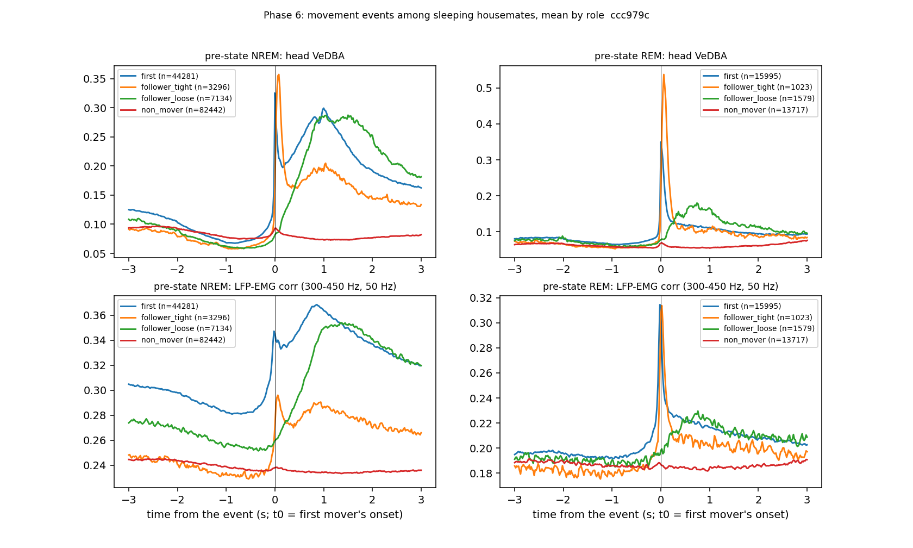

# Internal sleep schedule — Phase 6: sleep-perturbation event library + LFP-EMG (cohort 2026c)

Plan Amendment 10 (before results). Driver `ephys/sleep_schedule.py phase6` → `ephys/sleep_events.py` (commit ccc979c); library `D:\Field2026_analysis_out\2026c\sleep_events_20261008_1721` (README.md there). LFP-EMG: `D:\Field2026_analysis_out\2026c\emg_from_lfp` (168 sessions). **Technical ledger.**

## Definitions

```
Phase 6 of the internal-schedule analysis: a library of sleep-perturbation events, with the LFP-EMG of every
participant (plan Amendment 10, written before results).
Called by `python ephys/sleep_schedule.py phase6 [--emg-root <dir>/<SFxx>/<s>.EMGFromLFP50Hz.npz]`.

The user, 2026-10-08: "movement but not awakening is very good, this will be a special window … group movement in REM and
in NREM; how often does this happen; separate such windows for future use: (1) disruption after which the animal wakes,
(2) disruption after which it does not".

Timeline. Everything lives on the field-PC clock:
- FINAL 1-s scores, cut at 09-11 19:40;
- WISER zone per second (house_1 / house_2 = wiser_rois.json + 14 in; field; unknown);
- head VeDBA at 50 Hz from make_imu, invalid samples blanked.

Movement onset (as Phase 5c):
- per animal, theta = median + 8 * 1.4826 * MAD of VeDBA in scored-NREM seconds;
- onset = the first 50-Hz sample >= theta after >= 1 s below it;
- an "asleep onset" is one whose second is scored NREM or REM.

Movement events, per house (source = movement):
- Seed: an asleep onset of an animal in the house, with no onset of any animal in that house, in any state, during the
  2 s before. The next seed must come more than 1 s after the previous one.
- Members: the animals in the house at the seed second.
- Movers: members with an asleep onset in [t0, t0 + 1 s]. role = first (the seed) or follower (with its lag).
  Other members are non_mover if asleep, awake if not.
- type:
  - group = >= 2 movers;
  - solo = 1 mover and >= 1 other member asleep;
  - alone = no other member asleep.
- Followers are split by lag (role_detail):
  - follower_tight = <= 0.1 s, the Phase-5c peak, 6-10x chance;
  - follower_loose = 0.1-1 s, ~2x chance.
- Chance level per event (null_tight / null_any): the same follower test (an asleep housemate's onset after 2 s
  without one) in windows shifted by -47 / -31 / +31 / +47 s, averaged. Coupled events above chance per co-sleep hour
  = (observed share - chance share) x seeds / co-sleep hours.

Sound candidates (source = sound; UNVALIDATED until the user's listening check):
- Level jump J(t) = max over b0-b2 (50 Hz-20 kHz) of [b_max_db(t) - median of b_max_db over t-60..t-20 s].
- The microphone is the house's own in-house mic: MIC02 = house_1, MIC01 = house_2.
- Event = J >= 20 dB after a second below 20 dB, while every member is asleep over t-10..t and no member had an onset
  in the 5 s before.
- Members who move in [t0, t0 + 2 s] get role moved_after_sound; the others get non_mover / awake.
- J is per second, so a member's movement inside the same second may have made the sound (column move_same_second).

Handling (battery rounds, Phase-0 gap table; usable gaps caused by a logged or inferred round). The gap itself is
unobserved, so this source has only pre / post:
- before the stop: the last scored state and the composition of the last 10 min;
- after the restart: latency to the first NREM run >= 60 s, latency to the first REM, wake share of the first 10 min.

Per participant (outcome only for members asleep at t0):
- state at +10 / +30 / +60 s;
- class30 = the first state change within 30 s: stay / to_REM / to_NREM / wake / unknown;
- woke30 / woke60 = any scored WAKE within 30 / 60 s;
- the first wake: latency, duration (run of WAKE, capped at 1 h, censored at unknown), and
  wake_kind = MA (< 40 s, Watson 2016) or long (>= 40 s);
- scenario = woke (wake within 60 s) or not_woken;
- follow-up: the state composition +1..+10 min.

Complete flags:
- imu_ok = the IMU is valid (>= 90 % of the 50-Hz samples) over t0-2..t0+2 s;
- state_ok = the score is known over t0-60..t0+60 s.

Pointers:
- the logger session and its 50-Hz IMU index i (amp_sample = 400 i);
- the LFP sample (= amp_sample / 16) and the storage LFP path;
- the fast EMG bin j (= i);
- the house cameras (inside CH08 / CH07, outside CH05 / CH06), the house mic and CH01, as file + offset (s). The file
  names are field-PC time.

Controls:
- random co-sleep seconds (>= 2 members asleep, every member's IMU valid, scores known);
- the same outcome fields, and the same all / some / none event classes.

Rates: complete events per co-sleep hour (the same co-sleep seconds), by type and seed state.

LFP-EMG (fast product of ephys/emg_from_lfp.py, 50 Hz, 300-450 Hz):
- per participant, dcorr = mean corr over [-0.1, +0.5] s minus mean over [-2, -1] s; dlog_rms the same for the band
  amplitude;
- burst = dcorr above the 95th percentile of the same statistic at 200 random asleep times of that session (null).
- Passive-jolt control (a jolt could put motion artefact into the LFP):
  - (b) compare roles within terciles of the peak head VeDBA over 0..+0.5 s, i.e. at a matched movement size;
  - (c) per role, the half-maximum and peak times of the mean VeDBA and mean EMG-corr traces. Muscle activity
    leading the head acceleration is the active signature.
```

Co-sleep seconds (>= 2 members asleep, every member's IMU valid): house_1 48.3 h, house_2 96.6 h. Events: 61288 (60631 movement, 657 sound candidates); participants 231683; handling rounds 94.

## Rates: complete movement events per co-sleep hour

| house | type | seed_state | events | cosleep_h | per_cosleep_h |
|---|---|---|---|---|---|
| 1 | alone | NREM | 1818 | 48.282 | 37.654 |
| 1 | alone | REM | 280 | 48.282 | 5.799 |
| 1 | group | NREM | 1400 | 48.282 | 28.996 |
| 1 | group | REM | 597 | 48.282 | 12.365 |
| 1 | solo | NREM | 6821 | 48.282 | 141.274 |
| 1 | solo | REM | 3806 | 48.282 | 78.829 |
| 2 | alone | NREM | 3443 | 96.562 | 35.656 |
| 2 | alone | REM | 407 | 96.562 | 4.215 |
| 2 | group | NREM | 5070 | 96.562 | 52.505 |
| 2 | group | REM | 1664 | 96.562 | 17.232 |
| 2 | solo | NREM | 16274 | 96.562 | 168.534 |
| 2 | solo | REM | 6884 | 96.562 | 71.291 |

## Group events vs chance (seeds with >= 1 asleep housemate; chance = the same follower test at +-31 / +-47 s)

| house | seed_state | seeds_with_asleep_mates | follower_0.1s | chance_0.1s | follower_1s | chance_1s | ratio_0.1s | above_chance_per_cosleep_h_0.1s | ratio_1s | above_chance_per_cosleep_h_1s |
|---|---|---|---|---|---|---|---|---|---|---|
| 1 | NREM | 8221 | 0.056 | 0.006 | 0.17 | 0.05 | 9.279 | 8.445 | 3.44 | 20.567 |
| 1 | REM | 4403 | 0.062 | 0.008 | 0.136 | 0.053 | 7.914 | 4.976 | 2.549 | 7.513 |
| 2 | NREM | 21344 | 0.081 | 0.012 | 0.238 | 0.086 | 6.725 | 15.252 | 2.767 | 33.533 |
| 2 | REM | 8548 | 0.084 | 0.011 | 0.195 | 0.082 | 7.901 | 6.467 | 2.374 | 9.973 |

## Event level: of the asleep participants (>= 2 per event), none / some / all woke within 60 s

| what | events | all_stay_asleep | some_wake | all_wake |
|---|---|---|---|---|
| movement alone, seed in NREM | 0.0 | nan | nan | nan |
| movement alone, seed in REM | 0.0 | nan | nan | nan |
| movement group, seed in NREM | 6460.0 | 0.474 | 0.437 | 0.088 |
| movement group, seed in REM | 2261.0 | 0.33 | 0.561 | 0.109 |
| movement solo, seed in NREM | 23095.0 | 0.524 | 0.393 | 0.083 |
| movement solo, seed in REM | 10690.0 | 0.375 | 0.501 | 0.124 |
| sound candidate | 539.0 | 0.523 | 0.369 | 0.108 |
| control (random co-sleep second) | 39955.0 | 0.553 | 0.361 | 0.086 |

## Participant level, by role and pre-state

| source | role_detail | pre_state | n | animals | woke30 | woke60 | MA | long_wake | stay30 | to_REM30 | to_NREM30 | wake30 |
|---|---|---|---|---|---|---|---|---|---|---|---|---|
| movement | first | NREM | 44281 | 6 | 0.1766446105553172 | 0.2888371987985818 | 0.194 | 0.095 | 0.776 | 0.053 | 0.0 | 0.171 |
| movement | first | REM | 15995 | 6 | 0.3132854016880275 | 0.5403563613629259 | 0.385 | 0.155 | 0.625 | 0.0 | 0.068 | 0.307 |
| movement | follower_loose | NREM | 7134 | 6 | 0.14115503223997758 | 0.23423044575273338 | 0.167 | 0.067 | 0.822 | 0.041 | 0.0 | 0.137 |
| movement | follower_loose | REM | 1579 | 6 | 0.331222292590247 | 0.5497150094996833 | 0.399 | 0.151 | 0.584 | 0.0 | 0.093 | 0.323 |
| movement | follower_tight | NREM | 3296 | 6 | 0.13561893203883496 | 0.24423543689320387 | 0.181 | 0.064 | 0.816 | 0.054 | 0.0 | 0.13 |
| movement | follower_tight | REM | 1023 | 6 | 0.3225806451612903 | 0.5581622678396871 | 0.398 | 0.16 | 0.611 | 0.0 | 0.068 | 0.321 |
| movement | non_mover | NREM | 82442 | 6 | 0.1072875476092283 | 0.20319739938380924 | 0.147 | 0.056 | 0.839 | 0.059 | 0.0 | 0.102 |
| movement | non_mover | REM | 13717 | 6 | 0.30990741415761464 | 0.5411533134067216 | 0.393 | 0.148 | 0.604 | 0.0 | 0.094 | 0.302 |
| sound | moved_after_sound | NREM | 145 | 6 | 0.13793103448275862 | 0.18620689655172415 | 0.124 | 0.062 | 0.793 | 0.076 | 0.0 | 0.131 |
| sound | moved_after_sound | REM | 105 | 6 | 0.3047619047619048 | 0.5142857142857142 | 0.381 | 0.133 | 0.629 | 0.0 | 0.067 | 0.305 |
| sound | non_mover | NREM | 1199 | 6 | 0.13928273561301086 | 0.2285237698081735 | 0.162 | 0.067 | 0.826 | 0.041 | 0.0 | 0.133 |
| sound | non_mover | REM | 247 | 6 | 0.29959514170040485 | 0.4939271255060729 | 0.364 | 0.13 | 0.623 | 0.0 | 0.085 | 0.291 |
| control | control | NREM | 94528 | 6 | 0.10400093094109682 | 0.19505331753554503 | 0.142 | 0.053 | 0.835 | 0.065 | 0.0 | 0.099 |
| control | control | REM | 19833 | 6 | 0.27892905763122067 | 0.49800836988856956 | 0.375 | 0.123 | 0.647 | 0.0 | 0.081 | 0.272 |

## Per animal: woke within 60 s, by role, vs random co-sleep seconds

| animal | pre_state | control_woke60 | control_n | first_n | first_woke60 | follower_tight_n | follower_tight_woke60 | follower_loose_n | follower_loose_woke60 | non_mover_n | non_mover_woke60 |
|---|---|---|---|---|---|---|---|---|---|---|---|
| SF07 | NREM | 0.181 | 14552 | 7830 | 0.276 | 264 | 0.174 | 1216 | 0.229 | 15652 | 0.182 |
| SF07 | REM | 0.487 | 2349 | 2161 | 0.526 | 47 | 0.383 | 205 | 0.59 | 2059 | 0.514 |
| SF08 | NREM | 0.188 | 19316 | 8722 | 0.286 | 604 | 0.207 | 1416 | 0.225 | 13856 | 0.205 |
| SF08 | REM | 0.481 | 4852 | 3118 | 0.497 | 172 | 0.593 | 342 | 0.561 | 2651 | 0.543 |
| SF09 | NREM | 0.253 | 12830 | 7554 | 0.326 | 670 | 0.29 | 1284 | 0.268 | 15559 | 0.244 |
| SF09 | REM | 0.557 | 2137 | 3254 | 0.602 | 181 | 0.613 | 300 | 0.563 | 2122 | 0.589 |
| SF10 | NREM | 0.164 | 19299 | 8513 | 0.254 | 656 | 0.227 | 1329 | 0.178 | 16371 | 0.165 |
| SF10 | REM | 0.488 | 4298 | 3197 | 0.532 | 232 | 0.522 | 335 | 0.516 | 3085 | 0.52 |
| SF11 | NREM | 0.256 | 7080 | 3573 | 0.341 | 357 | 0.294 | 590 | 0.3 | 7398 | 0.279 |
| SF11 | REM | 0.626 | 1533 | 1645 | 0.601 | 140 | 0.657 | 142 | 0.634 | 1335 | 0.673 |
| SF12 | NREM | 0.184 | 21451 | 8089 | 0.283 | 745 | 0.25 | 1299 | 0.242 | 13606 | 0.184 |
| SF12 | REM | 0.461 | 4664 | 2620 | 0.5 | 251 | 0.506 | 255 | 0.482 | 2465 | 0.475 |

## LFP-EMG by role (movement events)

| role_detail | pre_state | n | animals | dcorr_mean | dcorr_median | dlog_rms_mean | burst_share |
|---|---|---|---|---|---|---|---|
| first | NREM | 44281 | 6 | 0.047 | 0.025 | 0.02 | 0.244 |
| first | REM | 15995 | 6 | 0.045 | 0.033 | 0.027 | 0.237 |
| follower_loose | NREM | 7134 | 6 | 0.01 | 0.007 | 0.0 | 0.112 |
| follower_loose | REM | 1579 | 6 | 0.018 | 0.011 | 0.013 | 0.123 |
| follower_tight | NREM | 3296 | 6 | 0.037 | 0.018 | 0.005 | 0.183 |
| follower_tight | REM | 1023 | 6 | 0.048 | 0.033 | 0.037 | 0.234 |
| non_mover | NREM | 82442 | 6 | -0.005 | -0.002 | -0.004 | 0.042 |
| non_mover | REM | 13717 | 6 | -0.002 | -0.001 | -0.001 | 0.031 |

### Matched movement size (terciles of the peak head VeDBA over 0..0.5 s)

| pre_state | vedba_tercile | role_detail | n | peak_vedba_median | dcorr_median | burst_share |
|---|---|---|---|---|---|---|
| NREM | low | first | 12653 | 0.27399998903274536 | 0.009 | 0.111 |
| NREM | low | follower_loose | 4590 | 0.18299999833106995 | 0.002 | 0.069 |
| NREM | low | follower_tight | 645 | 0.2759999930858612 | 0.004 | 0.088 |
| NREM | low | non_mover | 77232 | 0.10100000351667404 | -0.002 | 0.03 |
| NREM | mid | first | 15321 | 0.3659999966621399 | 0.024 | 0.22 |
| NREM | mid | follower_loose | 1396 | 0.36000001430511475 | 0.015 | 0.16 |
| NREM | mid | follower_tight | 1148 | 0.37400001287460327 | 0.017 | 0.13 |
| NREM | mid | non_mover | 1169 | 0.382999986410141 | -0.022 | 0.101 |
| NREM | high | first | 16307 | 0.7710000276565552 | 0.049 | 0.371 |
| NREM | high | follower_loose | 1148 | 0.7099999785423279 | 0.026 | 0.226 |
| NREM | high | follower_tight | 1503 | 0.7870000004768372 | 0.03 | 0.265 |
| NREM | high | non_mover | 3921 | 1.0759999752044678 | 0.014 | 0.259 |
| REM | low | first | 5329 | 0.27300000190734863 | 0.018 | 0.13 |
| REM | low | follower_loose | 1064 | 0.18299999833106995 | 0.006 | 0.074 |
| REM | low | follower_tight | 162 | 0.2759999930858612 | 0.016 | 0.142 |
| REM | low | non_mover | 13229 | 0.10199999809265137 | -0.001 | 0.027 |
| REM | mid | first | 5969 | 0.36000001430511475 | 0.032 | 0.214 |
| REM | mid | follower_loose | 301 | 0.35899999737739563 | 0.014 | 0.156 |
| REM | mid | follower_tight | 306 | 0.375 | 0.019 | 0.137 |
| REM | mid | non_mover | 141 | 0.3889999985694885 | -0.003 | 0.071 |
| REM | high | first | 4697 | 0.7429999709129333 | 0.06 | 0.389 |
| REM | high | follower_loose | 214 | 0.8169999718666077 | 0.049 | 0.322 |
| REM | high | follower_tight | 555 | 0.9079999923706055 | 0.047 | 0.314 |
| REM | high | non_mover | 308 | 0.824999988079071 | 0.009 | 0.185 |

### Timing of the mean traces (half-maximum and peak, s from t0; 20-ms grid)

| role_detail | pre_state | n | vedba_halfmax_s | vedba_peak_s | emg_corr_halfmax_s | emg_corr_peak_s |
|---|---|---|---|---|---|---|
| first | NREM | 44281 | 0.0 | 0.0 | -0.04 | 0.86 |
| first | REM | 15995 | 0.0 | 0.0 | -0.04 | -0.02 |
| follower_loose | NREM | 7134 | 0.48 | 0.98 | 0.6 | 1.0 |
| follower_loose | REM | 1579 | 0.28 | 0.74 | 0.18 | 0.76 |
| follower_tight | NREM | 3296 | 0.02 | 0.08 | 0.0 | 0.06 |
| follower_tight | REM | 1023 | 0.02 | 0.06 | -0.02 | 0.02 |
| non_mover | NREM | 82442 | -0.02 | 0.02 | nan | nan |
| non_mover | REM | 13717 | -0.02 | 0.02 | -0.06 | -0.04 |



## Handling (battery rounds)

| event_id | source | animal | kind | cause | t_stop | t_restart | gap_min | house_before | last_state | pre10_W | pre10_N | pre10_R | post_first_NREM60_min | post_first_REM_min | post10_W | post10_known |
|---|---|---|---|---|---|---|---|---|---|---|---|---|---|---|---|---|
| H_0001 | handling | SF07 | morning | round_inferred | 2026-09-01 06:36:22.795000 | 2026-09-01 07:50:52.875000 | 74.5 | 3 | WAKE | 0.46 | 0.54 | 0.0 | 12.12 | 31.3 | 1.0 | 1.0 |
| H_0002 | handling | SF07 | evening | round_inferred | 2026-09-01 18:19:41.875000 | 2026-09-01 19:29:12.215000 | 69.5 | 2 | WAKE | 0.88 | 0.12 | 0.0 | nan | nan | 1.0 | 1.0 |
| H_0003 | handling | SF07 | morning | round_logged | 2026-09-02 07:33:56.215000 | 2026-09-02 08:24:18.755000 | 50.4 | 2 | WAKE | 0.73 | 0.27 | 0.0 | 2.98 | 13.48 | 0.3 | 1.0 |
| H_0004 | handling | SF07 | evening | round_logged | 2026-09-02 18:12:47.755000 | 2026-09-02 19:00:47.109000 | 48.0 | 2 | REM | 0.06 | 0.74 | 0.2 | 3.53 | nan | 0.42 | 1.0 |
| H_0005 | handling | SF07 | evening | round_inferred | 2026-09-03 16:46:43.355000 | 2026-09-03 17:51:44.375000 | 65.0 | 2 | NREM | 0.17 | 0.66 | 0.17 | 1.55 | 58.12 | 0.53 | 1.0 |
| H_0006 | handling | SF07 | morning | round_logged | 2026-09-04 07:30:43.375000 | 2026-09-04 08:09:36.435000 | 38.9 | 2 | NREM | 0.1 | 0.78 | 0.12 | 1.68 | 8.3 | 0.06 | 1.0 |
| H_0007 | handling | SF07 | morning | round_logged | 2026-09-05 08:35:36.406000 | 2026-09-05 09:33:10.289000 | 57.6 | 2 | NREM | 0.04 | 0.96 | 0.0 | 9.63 | 51.05 | 0.93 | 1.0 |
| H_0008 | handling | SF07 | evening | round_logged | 2026-09-05 18:00:12.469000 | 2026-09-05 18:47:32.855000 | 47.3 | 2 | NREM | 0.12 | 0.76 | 0.12 | 3.13 | nan | 0.26 | 1.0 |
| H_0009 | handling | SF07 | morning | round_logged | 2026-09-06 06:54:07.855000 | 2026-09-06 07:54:26.615000 | 60.3 | 2 | REM | 0.19 | 0.79 | 0.02 | 5.35 | 40.13 | 0.39 | 1.0 |
| H_0010 | handling | SF07 | evening | round_logged | 2026-09-07 16:54:16.369000 | 2026-09-07 17:48:41.816000 | 54.4 | 2 | NREM | 0.02 | 0.88 | 0.09 | 0.0 | 30.85 | 0.0 | 1.0 |
| H_0011 | handling | SF07 | morning | round_logged | 2026-09-08 06:21:05.816000 | 2026-09-08 07:15:13.175000 | 54.1 | 2 | NREM | 0.6 | 0.4 | 0.0 | 0.6 | 58.48 | 0.06 | 1.0 |
| H_0012 | handling | SF07 | evening | round_logged | 2026-09-08 18:55:53.175000 | 2026-09-08 19:37:33.435000 | 41.7 | 2 | NREM | 0.18 | 0.79 | 0.04 | nan | nan | 1.0 | 1.0 |
| H_0013 | handling | SF07 | morning | round_logged | 2026-09-09 08:16:07.435000 | 2026-09-09 09:03:31.016000 | 47.4 | 2 | NREM | 0.11 | 0.68 | 0.21 | 0.0 | 39.38 | 0.3 | 1.0 |
| H_0014 | handling | SF07 | evening | round_logged | 2026-09-09 17:55:28.016000 | 2026-09-09 18:38:02.795000 | 42.6 | 2 | NREM | 0.31 | 0.62 | 0.07 | 2.55 | 8.82 | 0.37 | 1.0 |
| H_0015 | handling | SF07 | morning | round_logged | 2026-09-10 07:17:29.795000 | 2026-09-10 08:23:51.495000 | 66.4 | 2 | NREM | 0.14 | 0.8 | 0.06 | 0.18 | 10.4 | 0.16 | 1.0 |
| H_0016 | handling | SF08 | evening | round_inferred | 2026-09-01 18:20:26.697000 | 2026-09-01 19:31:09.475000 | 70.7 | 1 | NREM | 0.24 | 0.76 | 0.0 | nan | 17.65 | 1.0 | 1.0 |
| H_0017 | handling | SF08 | morning | round_logged | 2026-09-02 07:30:10.475000 | 2026-09-02 08:27:48.094000 | 57.6 | 2 | NREM | 0.4 | 0.33 | 0.27 | 0.0 | 6.72 | 0.01 | 1.0 |
| H_0018 | handling | SF08 | evening | round_logged | 2026-09-02 18:20:22.094000 | 2026-09-02 19:02:41.916000 | 42.3 | 3 | WAKE | 0.61 | 0.39 | 0.0 | 2.15 | nan | 0.27 | 1.0 |
| H_0019 | handling | SF08 | morning | round_inferred | 2026-09-03 06:44:38.916000 | 2026-09-03 07:53:52.907000 | 69.2 | 2 | REM | 0.5 | 0.41 | 0.09 | 2.27 | 10.38 | 0.23 | 1.0 |
| H_0020 | handling | SF08 | evening | round_logged | 2026-09-03 15:58:02.907000 | 2026-09-03 17:54:53.625000 | 116.8 | 1 | REM | 0.1 | 0.88 | 0.02 | 0.0 | 32.2 | 0.34 | 1.0 |
| H_0021 | handling | SF08 | morning | round_logged | 2026-09-04 07:33:40.625000 | 2026-09-04 08:12:05.535000 | 38.4 | 2 | NREM | 0.12 | 0.83 | 0.06 | 0.0 | 5.45 | 0.0 | 1.0 |
| H_0022 | handling | SF08 | evening | round_logged | 2026-09-04 19:30:30.535000 | 2026-09-04 20:20:56.765000 | 50.4 | 1 | WAKE | 1.0 | 0.0 | 0.0 | nan | nan | 0.95 | 1.0 |
| H_0023 | handling | SF08 | morning | round_logged | 2026-09-05 08:37:12.765000 | 2026-09-05 09:35:34.819000 | 58.4 | 2 | NREM | 0.31 | 0.69 | 0.0 | 9.95 | nan | 0.85 | 1.0 |
| H_0024 | handling | SF08 | evening | round_logged | 2026-09-05 18:03:40.819000 | 2026-09-05 18:51:04.563000 | 47.4 | 1 | REM | 0.09 | 0.72 | 0.19 | 7.8 | nan | 0.7 | 1.0 |
| H_0025 | handling | SF08 | morning | round_logged | 2026-09-06 06:55:32.563000 | 2026-09-06 07:59:27.555000 | 63.9 | 2 | WAKE | 0.78 | 0.22 | 0.0 | 0.0 | 10.62 | 0.03 | 1.0 |
| H_0026 | handling | SF08 | evening | round_logged | 2026-09-06 19:02:27.555000 | 2026-09-06 19:43:33.465000 | 41.1 | 2 | NREM | 0.32 | 0.68 | 0.0 | 2.1 | nan | 0.45 | 1.0 |
| H_0027 | handling | SF08 | morning | round_logged | 2026-09-07 08:07:56.465000 | 2026-09-07 08:55:34.719000 | 47.6 | 2 | REM | 0.07 | 0.88 | 0.04 | 0.0 | 42.37 | 0.1 | 1.0 |
| H_0028 | handling | SF08 | evening | round_logged | 2026-09-07 16:55:46.719000 | 2026-09-07 17:51:13.385000 | 55.4 | 2 | NREM | 0.07 | 0.93 | 0.0 | 0.58 | 0.0 | 0.13 | 1.0 |
| H_0029 | handling | SF08 | morning | round_logged | 2026-09-08 06:30:01.385000 | 2026-09-08 07:17:54.325000 | 47.9 | 2 | NREM | 0.48 | 0.32 | 0.2 | 0.68 | 9.0 | 0.07 | 1.0 |
| H_0030 | handling | SF08 | evening | round_logged | 2026-09-08 18:54:14.325000 | 2026-09-08 19:39:58.035000 | 45.7 | 1 | WAKE | 1.0 | 0.0 | 0.0 | nan | nan | 1.0 | 1.0 |
| H_0031 | handling | SF08 | morning | round_logged | 2026-09-09 08:17:49.035000 | 2026-09-09 09:06:08.006000 | 48.3 | 2 | NREM | 0.02 | 0.98 | 0.0 | 0.0 | 46.47 | 0.1 | 1.0 |
| H_0032 | handling | SF08 | morning | round_logged | 2026-09-10 07:21:41.554000 | 2026-09-10 08:26:29.685000 | 64.8 | 2 | NREM | 0.03 | 0.97 | 0.0 | 0.0 | 7.0 | 0.1 | 1.0 |
| H_0033 | handling | SF08 | morning | round_logged | 2026-09-11 08:07:25.604000 | 2026-09-11 09:19:31.245000 | 72.1 | 2 | NREM | 0.2 | 0.8 | 0.0 | 0.0 | 7.23 | 0.18 | 1.0 |
| H_0034 | handling | SF09 | evening | round_inferred | 2026-09-01 18:21:12.964000 | 2026-09-01 19:33:30.365000 | 72.3 | 2 | WAKE | 0.32 | 0.55 | 0.13 | nan | nan | 1.0 | 1.0 |
| H_0035 | handling | SF09 | morning | round_logged | 2026-09-02 07:29:24.365000 | 2026-09-02 08:30:15.335000 | 60.8 | 2 | NREM | 0.41 | 0.46 | 0.13 | 0.55 | 8.08 | 0.16 | 1.0 |
| H_0036 | handling | SF09 | evening | round_logged | 2026-09-02 18:13:56.335000 | 2026-09-02 19:05:08.575000 | 51.2 | 2 | NREM | 0.11 | 0.66 | 0.22 | 0.0 | nan | 0.49 | 1.0 |
| H_0037 | handling | SF09 | morning | round_logged | 2026-09-03 06:46:38.575000 | 2026-09-03 07:56:55.297000 | 70.3 | 2 | NREM | 0.1 | 0.86 | 0.04 | 0.0 | 14.73 | 0.02 | 1.0 |
| H_0038 | handling | SF09 | evening | round_logged | 2026-09-03 16:39:42.297000 | 2026-09-03 17:58:40.384000 | 79.0 | 2 | REM | 0.04 | 0.87 | 0.08 | 0.0 | 1.75 | 0.57 | 1.0 |
| H_0039 | handling | SF09 | morning | round_logged | 2026-09-04 07:14:19.384000 | 2026-09-04 08:14:26.496000 | 60.1 | 2 | WAKE | 0.06 | 0.83 | 0.11 | 0.0 | 31.5 | 0.72 | 1.0 |
| H_0040 | handling | SF09 | evening | round_inferred | 2026-09-04 19:32:33.496000 | 2026-09-04 20:23:24.405000 | 50.8 | 1 | WAKE | 1.0 | 0.0 | 0.0 | 7.23 | nan | 0.78 | 1.0 |
| H_0041 | handling | SF09 | morning | round_logged | 2026-09-05 08:38:40.405000 | 2026-09-05 09:47:05.608000 | 68.4 | 2 | REM | 0.16 | 0.54 | 0.3 | 0.0 | 34.0 | 0.81 | 1.0 |
| H_0042 | handling | SF09 | evening | round_logged | 2026-09-05 18:05:03.608000 | 2026-09-05 18:54:22.206000 | 49.3 | 2 | WAKE | 0.43 | 0.42 | 0.15 | 3.22 | 8.98 | 0.26 | 1.0 |
| H_0043 | handling | SF09 | morning | round_logged | 2026-09-06 06:58:57.206000 | 2026-09-06 08:02:16.656000 | 63.3 | 2 | NREM | 0.08 | 0.92 | 0.0 | 0.0 | 24.8 | 0.07 | 1.0 |
| H_0044 | handling | SF09 | evening | round_logged | 2026-09-06 19:05:16.656000 | 2026-09-06 19:46:34.836000 | 41.3 | 2 | NREM | 0.48 | 0.52 | 0.0 | nan | nan | 0.92 | 1.0 |
| H_0045 | handling | SF09 | morning | round_logged | 2026-09-07 08:09:18.836000 | 2026-09-07 08:58:41.028000 | 49.4 | 2 | NREM | 0.11 | 0.89 | 0.0 | 4.68 | 31.22 | 0.64 | 1.0 |
| H_0046 | handling | SF09 | evening | round_logged | 2026-09-07 16:57:04.028000 | 2026-09-07 17:54:35.676000 | 57.5 | 2 | NREM | 0.08 | 0.52 | 0.41 | 1.05 | 0.0 | 0.29 | 1.0 |
| H_0047 | handling | SF09 | morning | round_logged | 2026-09-08 06:25:37.676000 | 2026-09-08 07:20:57.385000 | 55.3 | 2 | WAKE | 0.77 | 0.23 | 0.0 | 0.67 | 15.67 | 0.05 | 1.0 |
| H_0048 | handling | SF09 | evening | round_logged | 2026-09-08 18:57:22.385000 | 2026-09-08 19:43:12.545000 | 45.8 | 2 | NREM | 0.22 | 0.73 | 0.05 | nan | nan | 0.98 | 1.0 |
| H_0049 | handling | SF09 | morning | round_logged | 2026-09-09 08:19:07.545000 | 2026-09-09 09:08:35.027000 | 49.5 | 2 | NREM | 0.04 | 0.96 | 0.0 | 0.0 | 37.78 | 0.46 | 1.0 |
| H_0050 | handling | SF09 | evening | round_logged | 2026-09-09 17:59:03.027000 | 2026-09-09 18:42:48.375000 | 43.8 | 2 | WAKE | 0.55 | 0.26 | 0.2 | 1.17 | nan | 0.24 | 1.0 |
| H_0051 | handling | SF09 | morning | round_logged | 2026-09-10 07:20:21.375000 | 2026-09-10 08:28:58.156000 | 68.6 | 2 | NREM | 0.09 | 0.91 | 0.0 | 4.73 | 34.95 | 0.59 | 1.0 |
| H_0052 | handling | SF09 | morning | round_inferred | 2026-09-11 08:08:50.017000 | 2026-09-11 09:22:24.167000 | 73.6 | 2 | NREM | 0.21 | 0.79 | 0.0 | 0.0 | 37.13 | 0.47 | 1.0 |
| H_0053 | handling | SF10 | evening | round_inferred | 2026-09-01 18:21:53.036000 | 2026-09-01 19:35:54.435000 | 74.0 | 1 | NREM | 0.1 | 0.67 | 0.23 | nan | nan | 1.0 | 1.0 |
| H_0054 | handling | SF10 | morning | round_logged | 2026-09-02 07:26:26.435000 | 2026-09-02 08:32:47.835000 | 66.4 | 1 | WAKE | 0.34 | 0.58 | 0.08 | 0.0 | 3.43 | 0.34 | 1.0 |
| H_0055 | handling | SF10 | evening | round_logged | 2026-09-02 18:15:06.835000 | 2026-09-02 19:07:11.525000 | 52.1 | 2 | NREM | 0.57 | 0.43 | 0.0 | 0.0 | nan | 0.55 | 1.0 |
| H_0056 | handling | SF10 | morning | round_logged | 2026-09-03 06:47:57.525000 | 2026-09-03 07:59:20.109000 | 71.4 | 2 | WAKE | 1.0 | 0.0 | 0.0 | 0.0 | 45.15 | 0.26 | 1.0 |
| H_0057 | handling | SF10 | evening | round_logged | 2026-09-03 16:53:07.109000 | 2026-09-03 18:02:22.843000 | 69.3 | 1 | WAKE | 0.53 | 0.26 | 0.21 | 2.77 | 36.1 | 0.39 | 1.0 |
| H_0058 | handling | SF10 | morning | round_logged | 2026-09-04 07:23:56.843000 | 2026-09-04 08:17:30.895000 | 53.6 | 2 | NREM | 0.22 | 0.62 | 0.16 | 0.0 | 51.93 | 0.37 | 1.0 |
| H_0059 | handling | SF10 | evening | round_logged | 2026-09-04 19:34:40.895000 | 2026-09-04 20:26:20.386000 | 51.7 | 2 | WAKE | 1.0 | 0.0 | 0.0 | nan | nan | 1.0 | 1.0 |
| H_0060 | handling | SF10 | morning | round_logged | 2026-09-05 06:56:33.386000 | 2026-09-05 09:39:27.479000 | 162.9 | 2 | WAKE | 0.16 | 0.77 | 0.07 | 0.0 | 34.38 | 0.27 | 1.0 |
| H_0061 | handling | SF10 | evening | round_logged | 2026-09-05 18:06:43.479000 | 2026-09-05 18:57:09.365000 | 50.4 | 1 | NREM | 0.33 | 0.47 | 0.2 | 0.0 | 29.73 | 0.3 | 1.0 |
| H_0062 | handling | SF10 | morning | round_logged | 2026-09-06 07:00:19.599000 | 2026-09-06 08:04:49.175000 | 64.5 | 2 | NREM | 0.08 | 0.92 | 0.0 | 0.0 | 22.32 | 0.32 | 1.0 |
| H_0063 | handling | SF10 | evening | round_logged | 2026-09-06 19:06:50.175000 | 2026-09-06 19:49:21.983000 | 42.5 | 2 | WAKE | 0.17 | 0.74 | 0.09 | nan | nan | 1.0 | 1.0 |
| H_0064 | handling | SF10 | morning | round_logged | 2026-09-07 08:12:25.983000 | 2026-09-07 09:01:35.869000 | 49.2 | 2 | REM | 0.0 | 0.75 | 0.25 | 1.58 | 49.43 | 0.55 | 1.0 |
| H_0065 | handling | SF10 | evening | round_logged | 2026-09-07 16:59:54.869000 | 2026-09-07 17:57:44.885000 | 57.8 | 1 | WAKE | 0.98 | 0.02 | 0.0 | 0.0 | 2.37 | 0.48 | 1.0 |
| H_0066 | handling | SF10 | morning | round_logged | 2026-09-08 06:26:55.885000 | 2026-09-08 07:23:52.245000 | 56.9 | 2 | WAKE | 0.44 | 0.56 | 0.0 | 0.0 | 13.12 | 0.0 | 1.0 |
| H_0067 | handling | SF10 | evening | round_logged | 2026-09-08 18:58:42.245000 | 2026-09-08 19:45:50.363000 | 47.1 | 2 | NREM | 0.85 | 0.15 | 0.0 | 0.78 | nan | 0.75 | 1.0 |
| H_0068 | handling | SF10 | morning | round_logged | 2026-09-09 08:20:31.363000 | 2026-09-09 09:11:05.736000 | 50.6 | 2 | NREM | 0.13 | 0.75 | 0.13 | 15.93 | 26.55 | 0.81 | 1.0 |
| H_0069 | handling | SF10 | evening | round_logged | 2026-09-09 18:00:30.736000 | 2026-09-09 18:45:17.395000 | 44.8 | 2 | WAKE | 1.0 | 0.0 | 0.0 | 0.0 | 3.52 | 0.48 | 1.0 |
| H_0070 | handling | SF10 | morning | round_logged | 2026-09-10 07:18:45.395000 | 2026-09-10 08:31:57.853000 | 73.2 | 2 | NREM | 0.04 | 0.96 | 0.0 | 0.97 | 41.63 | 0.65 | 1.0 |
| H_0071 | handling | SF10 | morning | round_logged | 2026-09-11 08:14:49.775000 | 2026-09-11 09:24:41.104000 | 69.9 | 2 | NREM | 0.23 | 0.77 | 0.0 | 0.0 | 28.3 | 0.7 | 1.0 |
| H_0072 | handling | SF11 | evening | round_inferred | 2026-09-01 18:22:40.035000 | 2026-09-01 19:37:49.076000 | 75.2 | 2 | NREM | 0.73 | 0.27 | 0.0 | nan | nan | 1.0 | 1.0 |
| H_0073 | handling | SF11 | morning | round_logged | 2026-09-02 07:27:35.076000 | 2026-09-02 08:35:34.755000 | 68.0 | 0 | WAKE | 0.54 | 0.43 | 0.04 | 0.0 | 2.25 | 0.66 | 1.0 |
| H_0074 | handling | SF11 | evening | round_logged | 2026-09-02 18:14:17.755000 | 2026-09-02 19:08:52.526000 | 54.6 | 2 | NREM | 0.8 | 0.2 | 0.0 | 0.35 | nan | 0.8 | 1.0 |
| H_0075 | handling | SF11 | morning | round_logged | 2026-09-03 06:53:37.526000 | 2026-09-03 08:01:59.850000 | 68.4 | 2 | NREM | 0.12 | 0.88 | 0.0 | 0.0 | 2.1 | 0.26 | 1.0 |
| H_0076 | handling | SF11 | evening | round_logged | 2026-09-03 15:54:50.850000 | 2026-09-03 18:07:00.416000 | 132.2 | 2 | WAKE | 0.24 | 0.5 | 0.26 | 19.22 | 4.1 | 0.77 | 1.0 |
| H_0077 | handling | SF11 | morning | round_logged | 2026-09-04 07:56:56.416000 | 2026-09-04 08:20:50.456000 | 23.9 | 0 | WAKE | 1.0 | 0.0 | 0.0 | 1.2 | 36.02 | 0.8 | 1.0 |
| H_0078 | handling | SF11 | evening | round_logged | 2026-09-04 19:38:10.425000 | 2026-09-04 20:28:56.246000 | 50.8 | 1 | WAKE | 1.0 | 0.0 | 0.0 | nan | nan | 0.95 | 1.0 |
| H_0079 | handling | SF11 | morning | round_logged | 2026-09-05 08:42:43.246000 | 2026-09-05 09:42:05.930000 | 59.4 | 2 | NREM | 0.08 | 0.66 | 0.25 | 1.13 | 41.25 | 0.37 | 1.0 |
| H_0080 | handling | SF11 | evening | round_logged | 2026-09-05 18:08:20.499000 | 2026-09-05 18:59:31.246000 | 51.2 | 2 | REM | 0.39 | 0.56 | 0.05 | 0.0 | 2.02 | 0.59 | 1.0 |
| H_0081 | handling | SF11 | morning | round_logged | 2026-09-06 07:01:55.246000 | 2026-09-06 08:07:35.254000 | 65.7 | 2 | REM | 0.13 | 0.82 | 0.05 | 0.0 | 1.4 | 0.53 | 1.0 |
| H_0082 | handling | SF12 | evening | round_inferred | 2026-09-01 18:23:35.683000 | 2026-09-01 19:56:21.144000 | 92.8 | 1 | NREM | 0.89 | 0.11 | 0.0 | nan | nan | 1.0 | 1.0 |
| H_0083 | handling | SF12 | morning | round_logged | 2026-09-02 07:37:23.144000 | 2026-09-02 08:37:48.804000 | 60.4 | 3 | WAKE | 0.59 | 0.41 | 0.0 | 0.0 | 37.35 | 0.88 | 1.0 |
| H_0084 | handling | SF12 | morning | round_logged | 2026-09-03 06:51:38.142000 | 2026-09-03 08:09:24.473000 | 77.8 | 2 | REM | 0.08 | 0.78 | 0.14 | 0.0 | 34.67 | 0.67 | 1.0 |
| H_0085 | handling | SF12 | evening | round_logged | 2026-09-03 16:55:26.473000 | 2026-09-03 18:09:35.835000 | 74.2 | 1 | WAKE | 0.18 | 0.75 | 0.07 | 15.65 | 31.6 | 0.86 | 1.0 |
| H_0086 | handling | SF12 | morning | round_logged | 2026-09-04 06:59:34.835000 | 2026-09-04 08:28:36.973000 | 89.0 | 2 | NREM | 0.14 | 0.78 | 0.08 | 8.67 | 36.4 | 0.84 | 1.0 |
| H_0087 | handling | SF12 | evening | round_inferred | 2026-09-04 19:39:49.973000 | 2026-09-04 20:31:30.725000 | 51.7 | 2 | WAKE | 0.99 | 0.01 | 0.0 | nan | nan | 0.98 | 1.0 |
| H_0088 | handling | SF12 | morning | round_logged | 2026-09-05 08:34:13.725000 | 2026-09-05 09:44:54.579000 | 70.7 | 2 | WAKE | 0.23 | 0.49 | 0.28 | 0.0 | 30.77 | 0.52 | 1.0 |
| H_0089 | handling | SF12 | evening | round_logged | 2026-09-05 18:01:54.579000 | 2026-09-05 19:02:40.835000 | 60.8 | 1 | WAKE | 0.36 | 0.31 | 0.33 | 0.17 | nan | 0.81 | 1.0 |
| H_0090 | handling | SF12 | morning | round_logged | 2026-09-06 06:56:56.835000 | 2026-09-06 08:09:51.055000 | 72.9 | 2 | NREM | 0.02 | 0.73 | 0.25 | 0.0 | 24.18 | 0.74 | 1.0 |
| H_0091 | handling | SF12 | evening | round_logged | 2026-09-06 19:09:32.055000 | 2026-09-06 19:55:02.355000 | 45.5 | 2 | WAKE | 0.57 | 0.3 | 0.13 | nan | nan | 1.0 | 1.0 |
| H_0092 | handling | SF12 | morning | round_logged | 2026-09-07 08:14:06.355000 | 2026-09-07 09:04:39.409000 | 50.6 | 2 | NREM | 0.0 | 0.99 | 0.01 | 1.13 | nan | 0.78 | 1.0 |
| H_0093 | handling | SF12 | evening | round_logged | 2026-09-08 19:00:33.615000 | 2026-09-08 19:48:24.915000 | 47.9 | 1 | WAKE | 0.52 | 0.48 | 0.0 | nan | nan | 0.9 | 1.0 |
| H_0094 | handling | SF12 | morning | round_logged | 2026-09-09 08:21:58.915000 | 2026-09-09 09:13:53.804000 | 51.9 | 2 | NREM | 0.03 | 0.84 | 0.13 | 12.7 | 30.1 | 0.89 | 1.0 |

