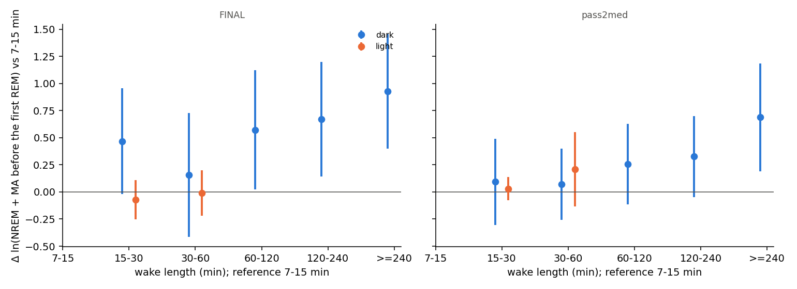
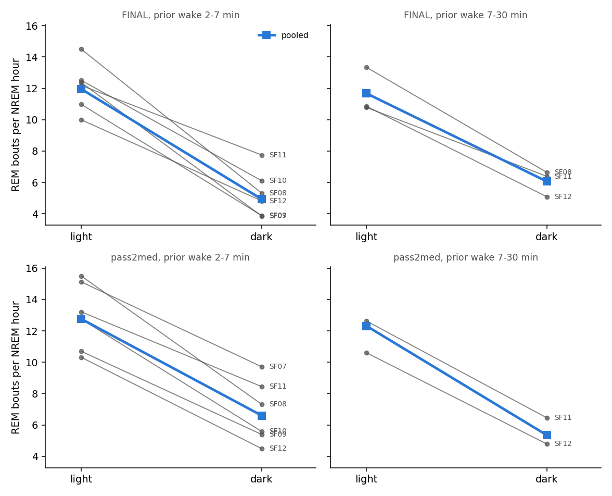
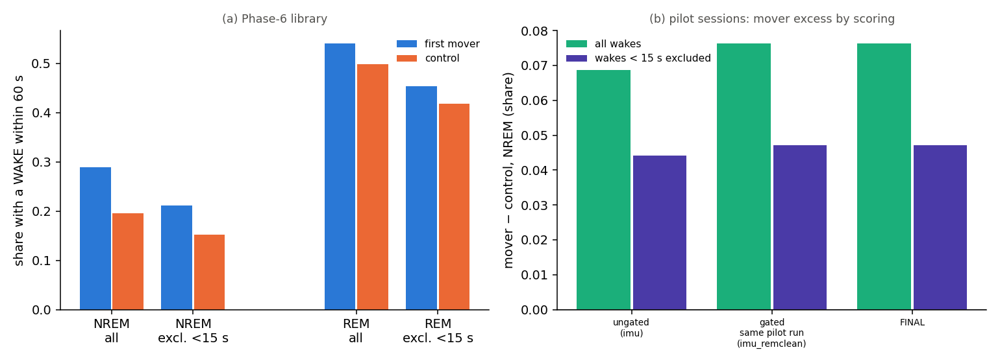

# Sleep behaviour explore — Step A: the reproduction gate (cohort 2026c)

Plan: [implementation_plan/2026-10-08-sleep-behaviour-explore.md](../../../../implementation_plan/2026-10-08-sleep-behaviour-explore.md) (sections 1, 3 and 5 Step A; the pass rules are the plan's, unchanged). Logic audit reproduced: [docs/methods/sleep_logic_audit_2026-10-08.md](../../../../docs/methods/sleep_logic_audit_2026-10-08.md) (Q2, Q4, Q5). Driver `ephys/sleep_explore.py stepA` (commit 0332a4a+dirty); bulk `D:\Field2026_analysis_out\2026c\sleep_explore_A_20261008_2131`; parts a1, a2, a3, a4, a5; runtime 7.5 min.

**Status: reproduction gate; claim statuses are changed in the claim audit, not here.** Inputs: the scored 1-s states (FINAL and pass2med), NOAA light, the Phase-0 gap table, the Phase-6 event library, the ungated pilot scores. No LFP features. Everything from 2026-09-11 19:40 is cut.

## Verdicts

| part | claim | verdict | key |
|---|---|---|---|
| A1 | #6a a wake ≥ 7 min is not resumed | PASS | FINAL: OLS N_pre -0.021 [-0.053, +0.011], rats 6/6, Cox N_pre -0.005 [-0.083, +0.072], held-out Δ -0.55 % | pass2med: OLS N_pre -0.012 [-0.049, +0.026], rats 6/6, Cox N_pre +0.043 [-0.025, +0.110], held-out Δ -0.95 % |
| A2 | #6b graded only at night | PASS | FINAL: dark +0.23 [+0.10, +0.37], light -0.21 [-0.48, +0.06] | pass2med: dark +0.14 [+0.04, +0.24], light -0.00 [-0.16, +0.16] | caveat: pass2med: the censored Cox does not confirm the dark slope (-0.029 [-0.166, +0.107]); only 4/6 rats have a positive dark slope |
| A3 | #14b night REM-entry ratio at matched prior wake | PARTIAL | FINAL: ratio 2-7 0.41 (6/6 rats), 7-30 0.52 (3/3) | pass2med: ratio 2-7 0.52 (6/6 rats), 7-30 0.43 (2/2) |
| A4 | #10 morning REM payback (day-demeaned) | PASS | FINAL: 1 h +0.04 (p 0.664), 3 h -0.06 (p 0.872) | pass2med: 1 h +0.34 (p 0.000), 3 h +0.96 (p 0.000) |
| A5 | #28b / #29a movement raises waking beyond the scorer's rules | PASS | library NREM excess +0.094 → +0.059 excl. < 15 s (ratio 0.63); pilot ungated / FINAL excess ratio 0.90 (FINAL only, by nature) |

## Definitions

Time is field-PC local time. States per second: $s_t \in \{0\ \text{unknown}, 1\ \text{WAKE}, 3\ \text{NREM}, 5\ \text{REM}\}$. Animals $a$; blocks $k$ = day-half blocks of `sleep_cycles_v2.build_records` (record start 06–18 h → D, else N); 22 blocks.

- **Record.** Sessions of an animal joined across splits ≤ 60 s (unknown seconds in between); FINAL exclusions and the cut at 2026-09-11 19:40 (`sleep_schedule.included_sessions`). Same session set under both scorings.
- **Scorings.** FINAL = `states_1s_final` (per-session thresholds, `imu_remclean` + one substitution); pass2med = `states_1s_pass2med` (`pass2med_remclean`, fixed per-animal thresholds), the check for contrasts whose two sides are different sessions (plan section 1).
- **Bout.** A maximal run of one state value, $[a, b)$ in seconds; length $d = b - a$ (s).
- **Dark.** $\text{dark}(t) = \neg[\text{sunrise}(t) \le t < \text{sunset}(t)]$, NOAA times at 42.45 N, 76.47 W, EDT (`sleep_quant.sun_times`). Never clock hours.
- **Harmonics.** $(\sin, \cos)(2\pi j h / 24)$, $j = 1, 2$, $h$ = clock hour (decimal) of the stated time.
- **MA (microarousal).** A WAKE bout with $d < 40$ s whose neighbours are both NREM (Watson et al. 2016).

### A1 / A2
- **Long wake.** A WAKE bout $[a_w, b_w)$ with $d = b_w - a_w \ge 420$ s (7 min) whose next bout is NREM, inside a record. `left_cens` = it starts at the record start or after an unknown epoch ($d$ is then a lower bound; kept, as in Phase 2).
- **N_pre** (s). $N_{pre} = \sum_{t \in [e_R, a_w)} \mathbb{1}[s_t = 3]$, $e_R$ = end of the last REM bout before the wake that follows a known epoch; NREM seconds only (MAs not counted), intervening wakes of any length are skipped. Anchor $= 1$ if such a REM exists in the record, else 0 and $N_{pre} = 0$ (the Phase-2 B1b definition).
- **T** (s, the post-wake NREM time). From $b_w$, bouts are followed in order: NREM and MA seconds are summed; other WAKE bouts of 40–419 s are passed without counting. Stop at the first REM onset (event $= 1$) or censor (event $= 0$) at an unknown epoch, the next long wake, or the record end. $T$ is the summed time at the stop. Other WAKE bouts < 420 s that are not MAs (40–419 s, or < 40 s next to REM) are passed without counting and do not censor.
- **Cox model (A1 i).** $h(T \mid x) = h_{0,a}(T)\exp(\beta^\top x)$, strata = animal, Efron ties, $x = [\ln d, \ln(1+N_{pre}), \text{anchor}, \text{harmonics at } b_w, \text{dark}(b_w)]$. A negative $\beta$ = a lower REM hazard per NREM second = REM later. 95 % CI $= \hat\beta \pm 1.96\,\widehat{se}$, $\widehat{se}$ from the cluster-robust sandwich $H^{-1}(\sum_k U_k U_k^\top)H^{-1}\,G/(G-1)$ over blocks ($U_k$ = summed score residuals of block $k$, $G$ = blocks); model-based SEs in the CSV. Binary covariates with < 10 sleeps in their minority class are dropped from a fit (separation). Also reported: the logic audit's specification (the same without dark). In A2 the per-phase fits drop dark (constant within a phase).
- **OLS (A1 ii, B1b-style).** Events only: $\ln T = \alpha_a + \beta_d \ln d + \beta_N \ln(1+N_{pre}) + \gamma\,\text{anchor} + \text{harmonics} + \varepsilon$; SEs clustered by block. A positive $\beta_d$ = more NREM needed after longer wakes. Full resumption predicts $\beta_N \approx -0.3$ (plan); no resumption $\beta_N \approx 0$.
- **Resumption benchmark.** For each sleep $i$ a requirement $Y_i$ is drawn from the observed event times $\{T_j : \text{event}_j = 1\}$; world *resume*: anchored sleeps draw $Y_i > N_{pre,i}$ and $T_i^* = Y_i - N_{pre,i}$ (the residual of a total that continues across the wake); world *restart*: $T_i^* = Y_i$. Observed censoring times $C_i$ are kept ($C_i = \infty$ for observed events); $T_i^{sim} = \min(T_i^*, C_i)$. The Cox and OLS models are refitted; median and 2.5–97.5 % of $\hat\beta_N$ over 100 replicates. It translates the plan's −0.3 to the Cox scale.
- **RESUME / RESTART counters (A1 iii).** At each 10-s NREM step $j$ of an anchored post-long-wake stretch (from $b_w$ to the stop of $T$): RESTART $= n_r + e$, $n_r$ = NREM s from $b_w$ to the bout start; RESUME $= N_{pre} + n_r + e$ (= the NREM since the last REM, pausing over wakes; equal to `record_steps_s`'s $N_{since}$, checked); $e$ = elapsed s in the bout. Hazard spec (identical for both): multinomial logit stay / REM / WAKE per step on spline($\ln(\text{elapsed}+5)$), harmonics, linear experiment day, animal, L1 (ln wake before the bout, after-REM, after-unknown, wake share of the last 10 min), ln REM_pre, anchor, $\ln d$ of the long wake, dark at the step, and a cubic spline (4 knots) of $\ln(1 + \text{counter})$.
- **Δ (held-out).** Forward chaining over the day-half blocks (train on blocks $1..k-1$, test block $k$, $k \ge 7$); $\Delta = 100 \times (\overline{\ell}_{RESTART} - \overline{\ell}_{RESUME}) / \overline{\ell}_{RESUME}$, $\ell$ = per-step log loss, step-weighted over folds; 95 % CI by bootstrap over folds (2000). Negative = RESTART predicts better. Animals better = per-animal pooled Δ < 0; holds = CI < 0 and ≥ 5/6 animals.
- **A2 ranges and bins.** Phase at $b_w$. Plan ranges: dark $7 \le d < 240$ min, light $7 \le d < 30$ min. Bins (min): 7–15 (reference), 15–30, 30–60, 60–120, 120–240, ≥ 240; bin dummies replace $\ln d$ in the OLS / Cox (bins with ≥ 3 events). KM median $T$ = Kaplan–Meier median of $T$ with censoring.

### A3
- **SLEEP episode.** A maximal stretch of a record with no WAKE bout > 120 s and no unknown epoch, trimmed to its first and last NREM/REM second, kept if ≥ 20 min (Watson 2016; `sleep_schedule_phase3.episodes_of`). Phase = dark at its onset.
- **Prior wake** (s). The WAKE bout ending at the episode onset, if > 120 s and not left-censored (it must follow a known epoch inside the record). Bins: 2–7 min $[120, 420)$ s, 7–30 min $[420, 1800)$ s.
- **Post-handling exclusion.** Episodes with onset in $[g_{end}, g_{end} + 3\,\text{h})$ of a Phase-0 gap of the same animal with cause `round_logged` or `round_inferred` are dropped (plan section 3).
- **REM rate.** Per phase $p$: $\lambda_p = \sum_i n_{R,i} / \sum_i N_i$, $n_{R,i}$ = REM bouts in episode $i$, $N_i$ = its NREM hours. Pooled ratio $= \lambda_{dark} / \lambda_{light}$ (< 1 = fewer REM entries per NREM hour at night). Per-episode mean ratio = ratio of the means of $n_{R,i}/N_i$ (the logic audit's 5.0 vs 11.7 used this). GLM rate ratio $= e^{\beta}$ from Poisson $n_{R,i} \sim \text{dark} + \ln \text{dur}_i + \text{animal}$, offset $\ln N_i$, SEs by block. Per-animal ratio for animals with ≥ 3 episodes in each phase.
- **First-REM latency** (wall s from the onset to the first REM onset: NREM, MAs and wakes ≤ 120 s; censored at the episode end). Cox with dark, ln prior wake, ln duration, animal strata, SEs by block; HR < 1 = later first REM at night. Per animal: first-REM rate ratio = $(\sum e_i / \sum L_i)_{dark} / (\sum e_i / \sum L_i)_{light}$ ($e_i$ = first REM observed, $L_i$ = latency or censored time, s; exponential MLE); < 1 = later first REM at night.

### A4
- **10-min bins** (`phase2.bins10`): recorded, REM, NREM s and REM onsets per 10 min of a record; REM bouts not touching unknown epochs give the durations.
- **Baselines (plan section 3).** Leave-one-block-out GLMs as `phase2.baselines` with design $[1, \text{harmonics}, \text{day}, \text{dark}, \text{dark} \times \text{day}, \text{animal}]$: binomial REM and NREM share (weights = recorded s), Poisson REM onsets (offset ln recorded 10-min units), OLS on ln REM bout duration (smearing). dark at the bin midpoint; day = days since the release (2026-08-30 19:00). Phase 2's baselines (no dark terms) are shown for comparison.
- **Windows** (`phase2.comp_windows`): A = the 3 h before a usable battery-round gap (cause `round_logged` / `round_inferred`, ≤ 180 min, ≥ 1 h recorded on both sides), B = the first 1 h / 3 h after it; each ≥ 80 % recorded. Kind = the gap's Phase-0 kind (morning: gap start 05:00–11:00; evening: 15:30–21:30).
- **Debt / payback** (min; s for durations). $\text{debt}_{REM} = E[\text{REM}_A] - \text{REM}_A$, $\text{pay}_{REM} = \text{REM}_B - E[\text{REM}_B]$; the same for NREM; $\text{pay}_{n}$ = REM onsets in B minus expected; $\text{pay}_{dur}$ = mean REM bout duration in B minus expected. Positive slope of pay on debt = more REM after a larger shortfall.
- **Models.** OLS with animal fixed effects, SEs clustered by the block of window A. Day-demeaned: each variable minus its mean over the windows of the same calendar day (gap start date) before fitting. NREM debt partialled: $\text{pay}_{REM} \sim \text{debt}_{REM} + \text{debt}_{NREM}$. Per-animal slopes for animals with ≥ 4 + (number of predictors) windows.

### A5
- **woke60.** For a participant asleep (NREM or REM) at second $t_0$: $\mathbb{1}[\exists u \in [1, 60]: s_{t_0+u} = 1]$ (`sleep_events.outcome`); wake latency = the first such $u$ (s).
- **First mover / control** (Phase-6 library). First mover = the seed of a movement event (role `first`), IMU valid, scores known over $t_0 \pm 60$ s, asleep at $t_0$. Control = a random co-sleep second of an asleep member (role `control`), scores known over $\pm 60$ s.
- **Exclusion (< 15 s).** Participants whose first wake begins at $u < 15$ s are removed from numerator and denominator, in movers and controls alike: $\text{woke60}_{excl} = \#\{\text{woke}, u \ge 15\} / \#\{\text{not woke or } u \ge 15\}$.
- **Mover excess** $= \text{woke60}_{mover} - \text{woke60}_{control}$ (share); 95 % CI normal approximation $\pm 1.96\sqrt{p_1(1-p_1)/n_1 + p_0(1-p_0)/n_0}$. Ratio = excess after the exclusion / excess with all wakes.
- **Pilot sessions (A5 b).** Sessions scored with the ungated `imu` variant (`useEMG_NREM = False`, no REM-clean rules); the same session's FINAL states and the gated `imu_remclean` states of the same pilot run. 1-s arrays from the scorer timestamps (index = timestamp − 1, as in `build_records`). Participant second $= \lfloor \text{amp\_sample} / 20000 \rfloor + \delta$, $\delta \in \{-2..2\}$ per session = the shift that best reproduces the library's pre-state from the session's FINAL states (the library placed states on the field-PC second grid; the shift absorbs the sub-second session-start offset). Within-session controls: up to 3000 random seconds per session (common to all scorings; $60 \le t < n - 601$), kept where asleep and known over $\pm 60$ s under that scoring.

## A1 — #6a: a wake ≥ 7 min is not resumed

**Plan pass rule (A1, quoted):** "N_pre ≈ 0 with CI excluding −0.15 (resumption predicts ≈ −0.3), ≥ 5/6 rats → #6a Established (scoped)." Operationalised: the OLS coefficient of ln(1+N_pre) (events, SEs by block) has its 95 % CI above −0.15 and includes 0 (or |coef| < 0.05); ≥ 5 animals have a per-animal OLS coefficient > −0.15; on both scorings. Supporting (not in the rule; they can only flag a contradiction): the Cox coefficient against the simulated full-resumption value, and the held-out RESTART vs RESUME comparison (a contradiction = a significant resumption-direction Cox effect, or RESTART significantly worse held out). PASS = the rule on both scorings and no contradiction.

Data: post-long-wake sleeps per scoring — FINAL 524 (reached REM 313, anchored 74 %, ends: rem 313, wake_ge_7min 185, record_end 17, unknown 9; long wakes starting at the record start or after an unknown epoch: 32, of which 11 remain in the ≥ 3-h subset); pass2med 549 (reached REM 333, anchored 77 %, ends: rem 333, wake_ge_7min 194, record_end 12, unknown 10; long wakes starting at the record start or after an unknown epoch: 29, of which 7 remain in the ≥ 3-h subset)

### (i) Cox model (time = NREM + MA seconds after the wake; animal strata; SEs clustered by block)

| scores | subset | term | coef | ci_lo | ci_hi | p | HR | n | events | clusters |
|---|---|---|---|---|---|---|---|---|---|---|
| FINAL | all | l_d | -0.17 | -0.342 | 0.002 | 0.052 | 0.844 | 524 | 313 | 21 |
| FINAL | all | l_npre | -0.005 | -0.083 | 0.072 | 0.892 | 0.995 | 524 | 313 | 21 |
| FINAL | all | anchor | 0.478 | -0.038 | 0.994 | 0.07 | 1.613 | 524 | 313 | 21 |
| FINAL | all | darkf | -1.446 | -2.248 | -0.643 | 0.0 | 0.236 | 524 | 313 | 21 |
| FINAL | all (logic-audit spec: no dark term) | l_d | -0.287 | -0.423 | -0.15 | 0.0 | 0.751 | 524 | 313 | 21 |
| FINAL | all (logic-audit spec: no dark term) | l_npre | -0.019 | -0.092 | 0.055 | 0.616 | 0.981 | 524 | 313 | 21 |
| FINAL | all (logic-audit spec: no dark term) | anchor | 0.532 | 0.017 | 1.046 | 0.043 | 1.702 | 524 | 313 | 21 |
| FINAL | wake ends >= 3 h after the record start | l_d | -0.309 | -0.453 | -0.165 | 0.0 | 0.734 | 366 | 213 | 21 |
| FINAL | wake ends >= 3 h after the record start | l_npre | -0.035 | -0.123 | 0.053 | 0.432 | 0.965 | 366 | 213 | 21 |
| FINAL | wake ends >= 3 h after the record start | anchor | 0.769 | -0.062 | 1.601 | 0.07 | 2.159 | 366 | 213 | 21 |
| FINAL | wake ends >= 3 h after the record start | darkf | -1.322 | -2.097 | -0.546 | 0.001 | 0.267 | 366 | 213 | 21 |
| pass2med | all | l_d | -0.103 | -0.215 | 0.008 | 0.069 | 0.902 | 549 | 333 | 22 |
| pass2med | all | l_npre | 0.043 | -0.025 | 0.11 | 0.214 | 1.043 | 549 | 333 | 22 |
| pass2med | all | anchor | -0.056 | -0.455 | 0.344 | 0.785 | 0.946 | 549 | 333 | 22 |
| pass2med | all | darkf | -1.701 | -2.403 | -0.998 | 0.0 | 0.183 | 549 | 333 | 22 |
| pass2med | all (logic-audit spec: no dark term) | l_d | -0.242 | -0.354 | -0.131 | 0.0 | 0.785 | 549 | 333 | 22 |
| pass2med | all (logic-audit spec: no dark term) | l_npre | 0.023 | -0.041 | 0.087 | 0.488 | 1.023 | 549 | 333 | 22 |
| pass2med | all (logic-audit spec: no dark term) | anchor | -0.032 | -0.415 | 0.35 | 0.868 | 0.968 | 549 | 333 | 22 |
| pass2med | wake ends >= 3 h after the record start | l_d | -0.131 | -0.253 | -0.01 | 0.035 | 0.877 | 381 | 226 | 21 |
| pass2med | wake ends >= 3 h after the record start | l_npre | 0.012 | -0.076 | 0.099 | 0.797 | 1.012 | 381 | 226 | 21 |
| pass2med | wake ends >= 3 h after the record start | anchor | 0.342 | -0.48 | 1.163 | 0.415 | 1.407 | 381 | 226 | 21 |
| pass2med | wake ends >= 3 h after the record start | darkf | -1.354 | -2.333 | -0.375 | 0.007 | 0.258 | 381 | 226 | 21 |

### (ii) The plan's literal rule on the OLS scale (events only; B1b covariates; animal FE; SEs by block)

| scores | subset | term | n_events | coef | ci_lo | ci_hi | p |
|---|---|---|---|---|---|---|---|
| FINAL | all | l_npre | 313 | -0.021 | -0.053 | 0.011 | 0.202 |
| FINAL | all | l_d | 313 | 0.26 | 0.142 | 0.377 | 0.0 |
| FINAL | all (+ dark) | l_npre | 313 | -0.024 | -0.056 | 0.007 | 0.132 |
| FINAL | wake ends >= 3 h after the record start | l_npre | 213 | -0.005 | -0.043 | 0.033 | 0.798 |
| FINAL | wake ends >= 3 h after the record start | l_d | 213 | 0.256 | 0.137 | 0.374 | 0.0 |
| FINAL | wake ends >= 3 h after the record start (+ dark) | l_npre | 213 | -0.01 | -0.046 | 0.026 | 0.597 |
| pass2med | all | l_npre | 333 | -0.012 | -0.049 | 0.026 | 0.538 |
| pass2med | all | l_d | 333 | 0.179 | 0.1 | 0.259 | 0.0 |
| pass2med | all (+ dark) | l_npre | 333 | -0.015 | -0.054 | 0.025 | 0.471 |
| pass2med | wake ends >= 3 h after the record start | l_npre | 226 | -0.001 | -0.044 | 0.042 | 0.961 |
| pass2med | wake ends >= 3 h after the record start | l_d | 226 | 0.157 | 0.066 | 0.248 | 0.001 |
| pass2med | wake ends >= 3 h after the record start (+ dark) | l_npre | 226 | -0.004 | -0.049 | 0.042 | 0.872 |

Per-animal coefficients (OLS on events with ≥ 15 events; Cox without strata with ≥ 15 sleeps and ≥ 5 events; per-animal Cox covariates: ln d, ln(1+N_pre), anchor, dark, sin1, cos1):

| scores | subset | animal | events | ols_l_npre | ols_l_d | episodes | episode_events | cox_l_npre | cox_l_d |
|---|---|---|---|---|---|---|---|---|---|
| FINAL | all | SF07 | 51 | 0.002 | 0.278 | 92 | 51 | 0.048 | 0.03 |
| FINAL | all | SF08 | 61 | -0.019 | 0.35 | 106 | 61 | -0.161 | -0.396 |
| FINAL | all | SF09 | 42 | -0.062 | 0.078 | 79 | 42 | 0.125 | 0.126 |
| FINAL | all | SF10 | 60 | -0.006 | 0.376 | 92 | 60 | -0.028 | -0.293 |
| FINAL | all | SF11 | 41 | -0.031 | 0.193 | 63 | 41 | 0.068 | -0.305 |
| FINAL | all | SF12 | 58 | -0.025 | 0.124 | 92 | 58 | 0.162 | -0.009 |
| FINAL | wake ends >= 3 h after the record start | SF07 | 32 | 0.022 | 0.267 | 61 | 32 | 0.012 | -0.374 |
| FINAL | wake ends >= 3 h after the record start | SF08 | 44 | 0.01 | 0.302 | 77 | 44 | -0.216 | -0.5 |
| FINAL | wake ends >= 3 h after the record start | SF09 | 27 | 0.042 | 0.193 | 51 | 27 | -0.033 | -0.09 |
| FINAL | wake ends >= 3 h after the record start | SF10 | 40 | 0.035 | 0.465 | 68 | 40 | -0.036 | -0.683 |
| FINAL | wake ends >= 3 h after the record start | SF11 | 29 | -0.051 | 0.131 | 44 | 29 | 0.002 | -0.251 |
| FINAL | wake ends >= 3 h after the record start | SF12 | 41 | -0.027 | 0.117 | 65 | 41 | 0.097 | 0.008 |
| pass2med | all | SF07 | 55 | 0.003 | 0.203 | 100 | 55 | 0.145 | -0.305 |
| pass2med | all | SF08 | 69 | -0.004 | 0.33 | 106 | 69 | -0.039 | -0.412 |
| pass2med | all | SF09 | 48 | -0.035 | 0.06 | 89 | 48 | 0.143 | 0.263 |
| pass2med | all | SF10 | 62 | -0.022 | 0.226 | 93 | 62 | 0.087 | -0.418 |
| pass2med | all | SF11 | 40 | -0.075 | 0.217 | 62 | 40 | 0.107 | -0.172 |
| pass2med | all | SF12 | 59 | -0.011 | 0.101 | 99 | 59 | 0.102 | 0.255 |
| pass2med | wake ends >= 3 h after the record start | SF07 | 35 | 0.057 | 0.234 | 67 | 35 | -0.124 | -0.527 |
| pass2med | wake ends >= 3 h after the record start | SF08 | 50 | 0.01 | 0.324 | 76 | 50 | -0.016 | -0.472 |
| pass2med | wake ends >= 3 h after the record start | SF09 | 30 | -0.021 | -0.033 | 59 | 30 | nan | nan |
| pass2med | wake ends >= 3 h after the record start | SF10 | 41 | -0.023 | 0.168 | 68 | 41 | 0.099 | -0.395 |
| pass2med | wake ends >= 3 h after the record start | SF11 | 28 | -0.058 | 0.194 | 42 | 28 | 0.01 | -0.071 |
| pass2med | wake ends >= 3 h after the record start | SF12 | 42 | -0.018 | 0.106 | 69 | 42 | 0.116 | 0.13 |

Simulated benchmark (same sleeps, same censoring times, event times redrawn from the observed post-wake distribution; 'resume' = the post-wake requirement is the residual of a total drawn > N_pre; 'restart' = independent of N_pre):

| scores | world | ols_median | ols_lo | ols_hi | cox_median | cox_lo | cox_hi | reps |
|---|---|---|---|---|---|---|---|---|
| FINAL | restart | -0.001 | -0.044 | 0.033 | -0.002 | -0.054 | 0.059 | 100 |
| FINAL | resume | -0.143 | -0.191 | -0.106 | 0.094 | 0.051 | 0.143 | 100 |
| pass2med | restart | -0.001 | -0.029 | 0.028 | -0.002 | -0.048 | 0.049 | 100 |
| pass2med | resume | -0.201 | -0.239 | -0.16 | 0.217 | 0.159 | 0.271 | 100 |

Reproduction of the Phase-2 B1b table (k = 1; `wake_to_kth_rem` + `b1b_fit` on the same records):

| scores | term | phase2_b1b_n | phase2_b1b_coef | this_n | this_coef |
|---|---|---|---|---|---|
| FINAL | l_d | 313 | 0.26 | 313 | 0.26 |
| FINAL | l_npre | 313 | -0.021 | 313 | -0.021 |
| pass2med | l_d | 333 | 0.179 | 333 | 0.179 |
| pass2med | l_npre | 333 | -0.012 | 333 | -0.012 |

### (iii) Forward-chained held-out comparison of the two counters (same hazard spec)

Δ = held-out log-loss change of RESTART relative to RESUME (negative = RESTART better); forward chaining over the day-half blocks (first test block = block 7).

| scores | subset | stretches | n_steps | n_rem | delta_pct | ci_lo_pct | ci_hi_pct | folds_better | folds | animals_better | animals | holds | n_since_equals_resume_share |
|---|---|---|---|---|---|---|---|---|---|---|---|---|---|
| FINAL | anchored post-long-wake stretches | 387 | 15900 | 134 | -0.555 | -1.045 | 0.023 | 12 | 15 | 5 | 6 | False | 1.0 |
| FINAL | wake ends >= 3 h after the record start | 324 | 13943 | 110 | -0.498 | -1.19 | 0.295 | 10 | 15 | 4 | 6 | False | nan |
| pass2med | anchored post-long-wake stretches | 420 | 17466 | 145 | -0.951 | -1.738 | -0.194 | 11 | 15 | 5 | 6 | True | 1.0 |
| pass2med | wake ends >= 3 h after the record start | 351 | 15231 | 120 | -0.872 | -2.037 | 0.202 | 11 | 15 | 5 | 6 | False | nan |

### Verdict A1

- **FINAL:** OLS ln(1+N_pre) -0.021 [-0.053, +0.011] → literal rule met; animals with a per-animal coefficient > −0.15: 6/6 → met. The simulated full-resumption value on the OLS scale is -0.143 (the plan assumed ≈ −0.3); the OLS CI lower bound lies above half of it (-0.072). Supporting: Cox ln(1+N_pre) -0.005 [-0.083, +0.072] vs the simulated full-resumption value +0.094 — the CI excludes it (not half of it). Held out, RESTART vs RESUME Δ = -0.555 % [-1.045, +0.023], animals better 5/6.
- **pass2med:** OLS ln(1+N_pre) -0.012 [-0.049, +0.026] → literal rule met; animals with a per-animal coefficient > −0.15: 6/6 → met. The simulated full-resumption value on the OLS scale is -0.201 (the plan assumed ≈ −0.3); the OLS CI lower bound lies above half of it (-0.101). Supporting: Cox ln(1+N_pre) +0.043 [-0.025, +0.110] vs the simulated full-resumption value +0.217 — the CI excludes it (not half of it). Held out, RESTART vs RESUME Δ = -0.951 % [-1.738, -0.194], animals better 5/6.

**A1 verdict: PASS.**

## A2 — #6b: graded with wake length only at night

**Plan pass rule (A2, quoted):** "Dark slope > 0 with CI > 0 and light CI including 0 → #6b stays 'night only'. Any light dose effect → #6b re-scoped." Slope = OLS coefficient of ln d on ln(NREM + MA before the first REM) (events), in the plan's ranges (dark 7 min–4 h, light 7–30 min), phase at the wake end; both scorings. The Cox coefficient has the opposite sign convention (negative = REM later).

### ln d slopes by phase

| scores | phase | wakes | sleeps | events | median_d_min | ols_ln_d | ols_ci_lo | ols_ci_hi | ols_p | animals_positive | animals | cox_ln_d | cox_ci_lo | cox_ci_hi | cox_p |
|---|---|---|---|---|---|---|---|---|---|---|---|---|---|---|---|
| FINAL | dark | plan range 7-240 min | 291 | 122 | 72.95 | 0.233 | 0.096 | 0.37 | 0.001 | 6 | 6 | -0.235 | -0.405 | -0.065 | 0.007 |
| FINAL | dark | all wake lengths | 306 | 132 | 77.592 | 0.24 | 0.121 | 0.359 | 0.0 | 6 | 6 | -0.268 | -0.445 | -0.091 | 0.003 |
| FINAL | light | plan range 7-30 min | 210 | 176 | 13.508 | -0.209 | -0.476 | 0.058 | 0.125 | 1 | 6 | 0.161 | -0.387 | 0.709 | 0.565 |
| FINAL | light | all wake lengths | 218 | 181 | 13.742 | -0.166 | -0.381 | 0.05 | 0.132 | 1 | 6 | 0.114 | -0.36 | 0.588 | 0.637 |
| pass2med | dark | plan range 7-240 min | 317 | 140 | 67.25 | 0.141 | 0.04 | 0.242 | 0.006 | 4 | 6 | -0.029 | -0.166 | 0.107 | 0.672 |
| pass2med | dark | all wake lengths | 328 | 148 | 69.292 | 0.165 | 0.059 | 0.272 | 0.002 | 4 | 6 | -0.088 | -0.214 | 0.037 | 0.169 |
| pass2med | light | plan range 7-30 min | 213 | 178 | 13.117 | -0.002 | -0.161 | 0.156 | 0.977 | 2 | 6 | -0.108 | -0.553 | 0.336 | 0.633 |
| pass2med | light | all wake lengths | 221 | 185 | 13.35 | 0.037 | -0.116 | 0.191 | 0.634 | 3 | 6 | -0.055 | -0.418 | 0.308 | 0.768 |

Pooled interaction model (events, all wake lengths): `l_d` = the light slope, `ld_x_dark` = dark minus light:

| scores | term | coef | se | ci_lo | ci_hi | p |
|---|---|---|---|---|---|---|
| FINAL | l_d | -0.187 | 0.127 | -0.436 | 0.063 | 0.143 |
| FINAL | ld_x_dark | 0.481 | 0.132 | 0.221 | 0.74 | 0.0 |
| FINAL | darkf | -2.903 | 0.963 | -4.79 | -1.015 | 0.003 |
| pass2med | l_d | -0.008 | 0.066 | -0.137 | 0.121 | 0.907 |
| pass2med | ld_x_dark | 0.171 | 0.081 | 0.012 | 0.33 | 0.035 |
| pass2med | darkf | -0.795 | 0.653 | -2.074 | 0.484 | 0.223 |

### Categorical wake-length bins (reference 7–15 min; with N_pre, anchor, 2-harmonic hour, animal)

| scores | phase | bin_min | vs | ols_coef | ols_ci_lo | ols_ci_hi | cox_coef | cox_ci_lo | cox_ci_hi |
|---|---|---|---|---|---|---|---|---|---|
| FINAL | dark | 15-30 | 7-15 | 0.467 | -0.021 | 0.954 | -0.013 | -0.603 | 0.577 |
| FINAL | dark | 30-60 | 7-15 | 0.158 | -0.413 | 0.729 | -0.095 | -0.892 | 0.701 |
| FINAL | dark | 60-120 | 7-15 | 0.572 | 0.023 | 1.121 | -0.126 | -0.701 | 0.448 |
| FINAL | dark | 120-240 | 7-15 | 0.672 | 0.144 | 1.201 | -0.652 | -1.236 | -0.068 |
| FINAL | dark | >=240 | 7-15 | 0.927 | 0.4 | 1.454 | -0.87 | -1.705 | -0.034 |
| FINAL | light | 15-30 | 7-15 | -0.072 | -0.252 | 0.109 | 0.029 | -0.303 | 0.362 |
| FINAL | light | 30-60 | 7-15 | -0.01 | -0.219 | 0.199 | nan | nan | nan |
| pass2med | dark | 15-30 | 7-15 | 0.093 | -0.303 | 0.49 | 0.008 | -0.916 | 0.932 |
| pass2med | dark | 30-60 | 7-15 | 0.072 | -0.256 | 0.4 | 0.004 | -0.767 | 0.774 |
| pass2med | dark | 60-120 | 7-15 | 0.256 | -0.116 | 0.628 | 0.089 | -0.506 | 0.684 |
| pass2med | dark | 120-240 | 7-15 | 0.328 | -0.046 | 0.701 | -0.07 | -0.529 | 0.389 |
| pass2med | dark | >=240 | 7-15 | 0.688 | 0.192 | 1.183 | -0.698 | -1.484 | 0.088 |
| pass2med | light | 15-30 | 7-15 | 0.031 | -0.077 | 0.139 | -0.235 | -0.536 | 0.066 |
| pass2med | light | 30-60 | 7-15 | 0.21 | -0.135 | 0.554 | nan | nan | nan |

Counts per bin and phase:

| scores | phase | bin_min | sleeps | reached_rem | share_rem | animals | median_T_min_events | km_median_T_min |
|---|---|---|---|---|---|---|---|---|
| FINAL | dark | 7-15 | 39 | 14 | 0.359 | 6 | 9.65 | 21.45 |
| FINAL | dark | 15-30 | 36 | 15 | 0.417 | 6 | 15.583 | 16.217 |
| FINAL | dark | 30-60 | 44 | 17 | 0.386 | 6 | 14.733 | 21.6 |
| FINAL | dark | 60-120 | 93 | 41 | 0.441 | 6 | 17.7 | 20.917 |
| FINAL | dark | 120-240 | 79 | 35 | 0.443 | 6 | 21.733 | 24.05 |
| FINAL | dark | >=240 | 15 | 10 | 0.667 | 5 | 24.708 | 25.283 |
| FINAL | light | 7-15 | 127 | 108 | 0.85 | 6 | 11.05 | 11.233 |
| FINAL | light | 15-30 | 83 | 68 | 0.819 | 6 | 11.383 | 12.233 |
| FINAL | light | 30-60 | 8 | 5 | 0.625 | 5 | 13.083 | 13.083 |
| pass2med | dark | 7-15 | 38 | 16 | 0.421 | 6 | 18.775 | 21.933 |
| pass2med | dark | 15-30 | 45 | 16 | 0.356 | 6 | 17.9 | 19.133 |
| pass2med | dark | 30-60 | 62 | 27 | 0.435 | 6 | 18.233 | 19.033 |
| pass2med | dark | 60-120 | 96 | 41 | 0.427 | 6 | 19.583 | 21.317 |
| pass2med | dark | 120-240 | 76 | 40 | 0.526 | 6 | 21.342 | 22.417 |
| pass2med | dark | >=240 | 11 | 8 | 0.727 | 4 | 24.725 | 25.367 |
| pass2med | light | 7-15 | 127 | 109 | 0.858 | 6 | 10.867 | 11.083 |
| pass2med | light | 15-30 | 86 | 69 | 0.802 | 6 | 11.517 | 11.917 |
| pass2med | light | 30-60 | 8 | 7 | 0.875 | 4 | 10.433 | 10.433 |

### Verdict A2

- **FINAL:** dark (7 min–4 h) ln d slope +0.233 [+0.096, +0.370] (n 122 events, 6/6 rats positive; Cox -0.235 [-0.405, -0.065]); light (7–30 min) -0.209 [-0.476, +0.058] (n 176, 1/6 positive; Cox +0.161 [-0.387, +0.709]) → rule met.
- **pass2med:** dark (7 min–4 h) ln d slope +0.141 [+0.040, +0.242] (n 140 events, 4/6 rats positive; Cox -0.029 [-0.166, +0.107]); light (7–30 min) -0.002 [-0.161, +0.156] (n 178, 2/6 positive; Cox -0.108 [-0.553, +0.336]) → rule met. Caveat (not in the rule): the censored Cox does not confirm the dark slope (-0.029 [-0.166, +0.107]); only 4/6 rats have a positive dark slope.

**A2 verdict: PASS** (#6b stays night only, by the letter of the rule); caveat — pass2med: the censored Cox does not confirm the dark slope (-0.029 [-0.166, +0.107]); only 4/6 rats have a positive dark slope.

## A3 — #14b: the night's REM-entry rate at matched prior wake

**Plan pass rule (A3, quoted):** "Night ratio ≤ 0.6 in both bins, ≥ 5/6 rats, both scorings → #14b Established." Operationalised: the pooled ratio (sum of REM bouts / sum of NREM hours, dark over light) ≤ 0.6 in the 2–7-min and the 7–30-min bins, and ≥ 5 animals with a per-animal ratio < 1 among animals with ≥ 3 episodes in each phase (≥ 5 such animals needed), on both scorings. Per-animal ratios ≤ 0.6 are counted too (the strict reading).

### Main table (post-round 3 h excluded)

| scores | prior_wake | subset | n_dark | animals_dark | rate_dark | mean_ep_rate_dark | km_median_lat_min_dark | n_light | animals_light | rate_light | mean_ep_rate_light | km_median_lat_min_light | ratio_pooled | ratio_mean_ep | glm_rr | glm_rr_lo | glm_rr_hi | glm_p | cox_HR_dark | cox_HR_lo | cox_HR_hi | cox_p | animals_qualifying | animals_ratio_lt1 | animals_ratio_le06 | animals_later_first_rem |
|---|---|---|---|---|---|---|---|---|---|---|---|---|---|---|---|---|---|---|---|---|---|---|---|---|---|---|
| FINAL | 2-7 min | primary: post-round 3 h excluded | 49 | 6 | 4.925 | 5.258 | 13.017 | 221 | 6 | 11.955 | 11.843 | 8.783 | 0.412 | 0.444 | 0.423 | 0.338 | 0.529 | 0.0 | 0.406 | 0.252 | 0.653 | 0.0 | 6 | 6 | 5 | 6 |
| FINAL | 7-30 min | primary: post-round 3 h excluded | 14 | 4 | 6.055 | 6.156 | 13.5 | 57 | 6 | 11.679 | 11.148 | 11.817 | 0.518 | 0.552 | 0.565 | 0.435 | 0.733 | 0.0 | 0.561 | 0.349 | 0.9 | 0.017 | 3 | 3 | 3 | 3 |
| pass2med | 2-7 min | primary: post-round 3 h excluded | 40 | 6 | 6.594 | 5.992 | 13.7 | 209 | 6 | 12.761 | 12.49 | 8.8 | 0.517 | 0.48 | 0.512 | 0.409 | 0.639 | 0.0 | 0.322 | 0.233 | 0.445 | 0.0 | 6 | 6 | 4 | 6 |
| pass2med | 7-30 min | primary: post-round 3 h excluded | 22 | 6 | 5.343 | 5.071 | 19.583 | 63 | 6 | 12.315 | 11.959 | 12.317 | 0.434 | 0.424 | 0.483 | 0.363 | 0.642 | 0.0 | 0.242 | 0.147 | 0.398 | 0.0 | 2 | 2 | 2 | 2 |

### Per animal

| scores | prior_wake | animal | n_dark | n_light | rate_dark | rate_light | ratio | first_rem_rate_ratio |
|---|---|---|---|---|---|---|---|---|
| FINAL | 2-7 min | SF07 | 3 | 34 | 3.847 | 12.371 | 0.311 | 0.333 |
| FINAL | 2-7 min | SF08 | 7 | 31 | 5.312 | 14.5 | 0.366 | 0.361 |
| FINAL | 2-7 min | SF09 | 12 | 53 | 3.88 | 10.977 | 0.353 | 0.318 |
| FINAL | 2-7 min | SF10 | 8 | 36 | 6.1 | 12.516 | 0.487 | 0.519 |
| FINAL | 2-7 min | SF11 | 6 | 31 | 7.746 | 12.188 | 0.636 | 0.745 |
| FINAL | 2-7 min | SF12 | 13 | 36 | 4.815 | 9.993 | 0.482 | 0.579 |
| FINAL | 7-30 min | SF07 | 1 | 6 | nan | nan | nan | nan |
| FINAL | 7-30 min | SF08 | 3 | 15 | 6.636 | 13.343 | 0.497 | 0.792 |
| FINAL | 7-30 min | SF09 | 0 | 4 | nan | nan | nan | nan |
| FINAL | 7-30 min | SF10 | 0 | 10 | nan | nan | nan | nan |
| FINAL | 7-30 min | SF11 | 6 | 8 | 6.382 | 10.781 | 0.592 | 0.984 |
| FINAL | 7-30 min | SF12 | 4 | 14 | 5.078 | 10.858 | 0.468 | 0.489 |
| pass2med | 2-7 min | SF07 | 3 | 27 | 9.71 | 15.126 | 0.642 | 0.322 |
| pass2med | 2-7 min | SF08 | 12 | 31 | 7.31 | 15.505 | 0.471 | 0.463 |
| pass2med | 2-7 min | SF09 | 7 | 56 | 5.387 | 10.697 | 0.504 | 0.594 |
| pass2med | 2-7 min | SF10 | 4 | 29 | 5.578 | 12.749 | 0.438 | 0.629 |
| pass2med | 2-7 min | SF11 | 5 | 29 | 8.443 | 13.216 | 0.639 | 0.877 |
| pass2med | 2-7 min | SF12 | 9 | 37 | 4.483 | 10.314 | 0.435 | 0.274 |
| pass2med | 7-30 min | SF07 | 2 | 8 | nan | nan | nan | nan |
| pass2med | 7-30 min | SF08 | 1 | 14 | nan | nan | nan | nan |
| pass2med | 7-30 min | SF09 | 2 | 5 | nan | nan | nan | nan |
| pass2med | 7-30 min | SF10 | 2 | 13 | nan | nan | nan | nan |
| pass2med | 7-30 min | SF11 | 7 | 8 | 6.448 | 12.631 | 0.51 | 0.738 |
| pass2med | 7-30 min | SF12 | 8 | 15 | 4.779 | 10.604 | 0.451 | 0.497 |

### Sensitivity

| scores | prior_wake | subset | n_dark | n_light | rate_dark | rate_light | ratio_pooled | ratio_mean_ep | glm_rr | cox_HR_dark | animals_qualifying | animals_ratio_lt1 |
|---|---|---|---|---|---|---|---|---|---|---|---|---|
| FINAL | 2-7 min | sensitivity: + post-probe-move 3 h excluded | 49 | 210 | 4.925 | 12.369 | 0.398 | 0.44 | 0.41 | 0.376 | 6 | 6 |
| FINAL | 2-7 min | sensitivity: no post-handling exclusion | 53 | 291 | 4.768 | 11.788 | 0.405 | 0.429 | 0.418 | 0.37 | 6 | 6 |
| FINAL | 7-30 min | sensitivity: + post-probe-move 3 h excluded | 14 | 54 | 6.055 | 11.575 | 0.523 | 0.555 | 0.566 | 0.516 | 3 | 3 |
| FINAL | 7-30 min | sensitivity: no post-handling exclusion | 14 | 98 | 6.055 | 10.914 | 0.555 | 0.587 | 0.586 | 0.613 | 3 | 3 |
| pass2med | 2-7 min | sensitivity: + post-probe-move 3 h excluded | 40 | 198 | 6.594 | 12.891 | 0.512 | 0.476 | 0.502 | 0.318 | 6 | 6 |
| pass2med | 2-7 min | sensitivity: no post-handling exclusion | 44 | 286 | 6.378 | 12.165 | 0.524 | 0.468 | 0.526 | 0.271 | 6 | 6 |
| pass2med | 7-30 min | sensitivity: + post-probe-move 3 h excluded | 22 | 60 | 5.343 | 12.308 | 0.434 | 0.424 | 0.475 | 0.231 | 2 | 2 |
| pass2med | 7-30 min | sensitivity: no post-handling exclusion | 24 | 103 | 5.154 | 11.502 | 0.448 | 0.432 | 0.496 | 0.231 | 3 | 3 |

### Verdict A3

- **FINAL, prior wake 2-7 min:** dark 4.92 vs light 11.95 REM bouts per NREM h (n 49 / 221) → pooled ratio 0.41 (per-episode mean ratio 0.44; GLM rate ratio 0.42 [0.34, 0.53]); per-animal ratio < 1 in 6/6 qualifying animals (≤ 0.6 in 5/6); first-REM latency Cox HR dark 0.41 [0.25, 0.65], KM median 13.0 vs 8.8 min → size met, rats met.
- **FINAL, prior wake 7-30 min:** dark 6.05 vs light 11.68 REM bouts per NREM h (n 14 / 57) → pooled ratio 0.52 (per-episode mean ratio 0.55; GLM rate ratio 0.56 [0.44, 0.73]); per-animal ratio < 1 in 3/3 qualifying animals (≤ 0.6 in 3/3); first-REM latency Cox HR dark 0.56 [0.35, 0.90], KM median 13.5 vs 11.8 min → size met, rats cannot be met (3 animals qualify).
- **pass2med, prior wake 2-7 min:** dark 6.59 vs light 12.76 REM bouts per NREM h (n 40 / 209) → pooled ratio 0.52 (per-episode mean ratio 0.48; GLM rate ratio 0.51 [0.41, 0.64]); per-animal ratio < 1 in 6/6 qualifying animals (≤ 0.6 in 4/6); first-REM latency Cox HR dark 0.32 [0.23, 0.45], KM median 13.7 vs 8.8 min → size met, rats met.
- **pass2med, prior wake 7-30 min:** dark 5.34 vs light 12.32 REM bouts per NREM h (n 22 / 63) → pooled ratio 0.43 (per-episode mean ratio 0.42; GLM rate ratio 0.48 [0.36, 0.64]); per-animal ratio < 1 in 2/2 qualifying animals (≤ 0.6 in 2/2); first-REM latency Cox HR dark 0.24 [0.15, 0.40], KM median 19.6 vs 12.3 min → size met, rats cannot be met (2 animals qualify).

**A3 verdict: PARTIAL.**

## A4 — #10: REM payback across battery rounds

**Plan pass rule (A4, quoted):** "REM-debt slope > 0.2 with p < 0.05 at 1 and 3 h, day-demeaned → #10 stays Candidate (strong) (promotion needs step D)." Applied to morning rounds, `pay_rem ~ debt_rem + animal`, day-demeaned, on the fixed-threshold scoring (`pass2med_remclean`: the two sides of a round are different sessions, plan section 1); FINAL reported alongside. Baselines with phase × experiment day (plan section 3).

Windows (usable battery-round gaps, ≥ 80 % recorded on both sides):

| scores | baseline | kind | B_h | windows |
|---|---|---|---|---|
| FINAL | phase x day (plan) | evening | 1 | 44 |
| FINAL | phase x day (plan) | evening | 3 | 44 |
| FINAL | phase x day (plan) | morning | 1 | 49 |
| FINAL | phase x day (plan) | morning | 3 | 49 |
| FINAL | common linear day (Phase 2) | evening | 1 | 44 |
| FINAL | common linear day (Phase 2) | evening | 3 | 44 |
| FINAL | common linear day (Phase 2) | morning | 1 | 49 |
| FINAL | common linear day (Phase 2) | morning | 3 | 49 |
| pass2med | phase x day (plan) | evening | 1 | 44 |
| pass2med | phase x day (plan) | evening | 3 | 44 |
| pass2med | phase x day (plan) | morning | 1 | 49 |
| pass2med | phase x day (plan) | morning | 3 | 49 |
| pass2med | common linear day (Phase 2) | evening | 1 | 44 |
| pass2med | common linear day (Phase 2) | evening | 3 | 44 |
| pass2med | common linear day (Phase 2) | morning | 1 | 49 |
| pass2med | common linear day (Phase 2) | morning | 3 | 49 |

### Slopes with the phase × day baselines

| scores | baseline | kind | B_h | outcome | predictors | day_demeaned | n_windows | clusters | slope | ci_lo | ci_hi | p | animals_positive | animals | mean_x | mean_y |
|---|---|---|---|---|---|---|---|---|---|---|---|---|---|---|---|---|
| FINAL | phase x day (plan) | morning | 1 | pay_rem | debt_rem | False | 49 | 12 | 0.087 | -0.1 | 0.273 | 0.362 | 5 | 6 | 0.137 | -2.32 |
| FINAL | phase x day (plan) | morning | 1 | pay_rem | debt_rem | True | 49 | 12 | 0.04 | -0.141 | 0.221 | 0.664 | 3 | 6 | 0.137 | -2.32 |
| FINAL | phase x day (plan) | morning | 1 | pay_rem | debt_rem + debt_nrem | False | 49 | 12 | 0.065 | -0.061 | 0.19 | 0.312 | 3 | 5 | 0.137 | -2.32 |
| FINAL | phase x day (plan) | morning | 1 | pay_rem | debt_rem + debt_nrem | True | 49 | 12 | 0.04 | -0.149 | 0.229 | 0.676 | 3 | 5 | 0.137 | -2.32 |
| FINAL | phase x day (plan) | morning | 1 | pay_rem_n | debt_rem | False | 49 | 12 | 0.127 | -0.097 | 0.351 | 0.266 | 4 | 6 | 0.137 | -1.876 |
| FINAL | phase x day (plan) | morning | 1 | pay_rem_n | debt_rem | True | 49 | 12 | 0.064 | -0.169 | 0.296 | 0.592 | 3 | 6 | 0.137 | -1.876 |
| FINAL | phase x day (plan) | morning | 1 | pay_rem_dur | debt_rem | False | 47 | 12 | -3.54 | -8.599 | 1.519 | 0.17 | 2 | 6 | 0.137 | 8.911 |
| FINAL | phase x day (plan) | morning | 1 | pay_rem_dur | debt_rem | True | 47 | 12 | -2.909 | -8.22 | 2.401 | 0.283 | 2 | 6 | 0.137 | 8.911 |
| FINAL | phase x day (plan) | morning | 1 | pay_nrem | debt_nrem | False | 49 | 12 | 0.13 | -0.007 | 0.268 | 0.064 | 5 | 6 | -7.603 | -6.674 |
| FINAL | phase x day (plan) | morning | 1 | pay_nrem | debt_nrem | True | 49 | 12 | 0.045 | -0.115 | 0.206 | 0.578 | 5 | 6 | -7.603 | -6.674 |
| FINAL | phase x day (plan) | morning | 3 | pay_rem | debt_rem | False | 49 | 12 | 0.174 | -0.568 | 0.915 | 0.646 | 4 | 6 | 0.137 | 0.292 |
| FINAL | phase x day (plan) | morning | 3 | pay_rem | debt_rem | True | 49 | 12 | -0.062 | -0.819 | 0.694 | 0.872 | 2 | 6 | 0.137 | 0.292 |
| FINAL | phase x day (plan) | morning | 3 | pay_rem | debt_rem + debt_nrem | False | 49 | 12 | 0.119 | -0.442 | 0.68 | 0.677 | 3 | 5 | 0.137 | 0.292 |
| FINAL | phase x day (plan) | morning | 3 | pay_rem | debt_rem + debt_nrem | True | 49 | 12 | -0.055 | -0.797 | 0.687 | 0.884 | 3 | 5 | 0.137 | 0.292 |
| FINAL | phase x day (plan) | morning | 3 | pay_rem_n | debt_rem | False | 49 | 12 | 0.13 | -0.583 | 0.843 | 0.72 | 4 | 6 | 0.137 | 0.341 |
| FINAL | phase x day (plan) | morning | 3 | pay_rem_n | debt_rem | True | 49 | 12 | -0.146 | -0.74 | 0.449 | 0.631 | 3 | 6 | 0.137 | 0.341 |
| FINAL | phase x day (plan) | morning | 3 | pay_rem_dur | debt_rem | False | 49 | 12 | -0.262 | -2.063 | 1.54 | 0.776 | 2 | 6 | 0.137 | 1.55 |
| FINAL | phase x day (plan) | morning | 3 | pay_rem_dur | debt_rem | True | 49 | 12 | -0.003 | -1.185 | 1.18 | 0.996 | 4 | 6 | 0.137 | 1.55 |
| FINAL | phase x day (plan) | morning | 3 | pay_nrem | debt_nrem | False | 49 | 12 | 0.168 | -0.049 | 0.384 | 0.129 | 5 | 6 | -7.603 | -3.639 |
| FINAL | phase x day (plan) | morning | 3 | pay_nrem | debt_nrem | True | 49 | 12 | 0.086 | -0.148 | 0.321 | 0.472 | 4 | 6 | -7.603 | -3.639 |
| FINAL | phase x day (plan) | evening | 1 | pay_rem | debt_rem | False | 44 | 9 | 0.033 | -0.041 | 0.106 | 0.38 | 5 | 6 | -3.636 | -0.774 |
| FINAL | phase x day (plan) | evening | 1 | pay_rem | debt_rem | True | 44 | 9 | 0.029 | -0.059 | 0.118 | 0.516 | 3 | 6 | -3.636 | -0.774 |
| FINAL | phase x day (plan) | evening | 1 | pay_rem | debt_rem + debt_nrem | False | 44 | 9 | 0.033 | -0.045 | 0.111 | 0.41 | 4 | 5 | -3.636 | -0.774 |
| FINAL | phase x day (plan) | evening | 1 | pay_rem | debt_rem + debt_nrem | True | 44 | 9 | 0.014 | -0.081 | 0.109 | 0.772 | 3 | 5 | -3.636 | -0.774 |
| FINAL | phase x day (plan) | evening | 1 | pay_rem_n | debt_rem | False | 44 | 9 | 0.001 | -0.059 | 0.06 | 0.979 | 2 | 6 | -3.636 | -0.706 |
| FINAL | phase x day (plan) | evening | 1 | pay_rem_n | debt_rem | True | 44 | 9 | -0.008 | -0.084 | 0.067 | 0.833 | 3 | 6 | -3.636 | -0.706 |
| FINAL | phase x day (plan) | evening | 1 | pay_rem_dur | debt_rem | False | 16 | 5 | 1.855 | 0.052 | 3.658 | 0.044 | 0 | 0 | -3.636 | -3.459 |
| FINAL | phase x day (plan) | evening | 1 | pay_rem_dur | debt_rem | True | 16 | 5 | 1.663 | -0.082 | 3.407 | 0.062 | 0 | 0 | -3.636 | -3.459 |
| FINAL | phase x day (plan) | evening | 1 | pay_nrem | debt_nrem | False | 44 | 9 | 0.173 | -0.017 | 0.363 | 0.074 | 5 | 6 | -7.158 | -4.875 |
| FINAL | phase x day (plan) | evening | 1 | pay_nrem | debt_nrem | True | 44 | 9 | -0.005 | -0.187 | 0.178 | 0.96 | 4 | 6 | -7.158 | -4.875 |
| FINAL | phase x day (plan) | evening | 3 | pay_rem | debt_rem | False | 44 | 9 | 0.05 | -0.024 | 0.123 | 0.188 | 5 | 6 | -3.636 | -1.46 |
| FINAL | phase x day (plan) | evening | 3 | pay_rem | debt_rem | True | 44 | 9 | 0.039 | -0.068 | 0.145 | 0.478 | 4 | 6 | -3.636 | -1.46 |
| FINAL | phase x day (plan) | evening | 3 | pay_rem | debt_rem + debt_nrem | False | 44 | 9 | 0.05 | -0.025 | 0.124 | 0.195 | 5 | 5 | -3.636 | -1.46 |
| FINAL | phase x day (plan) | evening | 3 | pay_rem | debt_rem + debt_nrem | True | 44 | 9 | 0.015 | -0.097 | 0.128 | 0.789 | 3 | 5 | -3.636 | -1.46 |
| FINAL | phase x day (plan) | evening | 3 | pay_rem_n | debt_rem | False | 44 | 9 | 0.006 | -0.053 | 0.066 | 0.839 | 3 | 6 | -3.636 | -1.462 |
| FINAL | phase x day (plan) | evening | 3 | pay_rem_n | debt_rem | True | 44 | 9 | 0.002 | -0.085 | 0.09 | 0.956 | 3 | 6 | -3.636 | -1.462 |
| FINAL | phase x day (plan) | evening | 3 | pay_rem_dur | debt_rem | False | 19 | 7 | 1.184 | -1.112 | 3.48 | 0.312 | 1 | 1 | -3.636 | 3.582 |
| FINAL | phase x day (plan) | evening | 3 | pay_rem_dur | debt_rem | True | 19 | 7 | 0.985 | -0.478 | 2.448 | 0.187 | 0 | 1 | -3.636 | 3.582 |
| FINAL | phase x day (plan) | evening | 3 | pay_nrem | debt_nrem | False | 44 | 9 | 0.114 | -0.453 | 0.682 | 0.693 | 4 | 6 | -7.158 | -11.12 |
| FINAL | phase x day (plan) | evening | 3 | pay_nrem | debt_nrem | True | 44 | 9 | 0.013 | -0.244 | 0.269 | 0.923 | 3 | 6 | -7.158 | -11.12 |
| pass2med | phase x day (plan) | morning | 1 | pay_rem | debt_rem | False | 49 | 12 | 0.397 | 0.23 | 0.565 | 0.0 | 6 | 6 | -0.695 | -2.831 |
| pass2med | phase x day (plan) | morning | 1 | pay_rem | debt_rem | True | 49 | 12 | 0.335 | 0.175 | 0.496 | 0.0 | 5 | 6 | -0.695 | -2.831 |
| pass2med | phase x day (plan) | morning | 1 | pay_rem | debt_rem + debt_nrem | False | 49 | 12 | 0.374 | 0.168 | 0.581 | 0.0 | 5 | 5 | -0.695 | -2.831 |
| pass2med | phase x day (plan) | morning | 1 | pay_rem | debt_rem + debt_nrem | True | 49 | 12 | 0.32 | 0.129 | 0.512 | 0.001 | 3 | 5 | -0.695 | -2.831 |
| pass2med | phase x day (plan) | morning | 1 | pay_rem_n | debt_rem | False | 49 | 12 | 0.263 | 0.148 | 0.378 | 0.0 | 5 | 6 | -0.695 | -2.395 |
| pass2med | phase x day (plan) | morning | 1 | pay_rem_n | debt_rem | True | 49 | 12 | 0.182 | 0.029 | 0.336 | 0.02 | 4 | 6 | -0.695 | -2.395 |
| pass2med | phase x day (plan) | morning | 1 | pay_rem_dur | debt_rem | False | 48 | 12 | 0.897 | -5.168 | 6.962 | 0.772 | 4 | 6 | -0.695 | 6.938 |
| pass2med | phase x day (plan) | morning | 1 | pay_rem_dur | debt_rem | True | 48 | 12 | 0.34 | -7.946 | 8.626 | 0.936 | 4 | 6 | -0.695 | 6.938 |
| pass2med | phase x day (plan) | morning | 1 | pay_nrem | debt_nrem | False | 49 | 12 | 0.163 | 0.033 | 0.293 | 0.014 | 5 | 6 | -9.155 | -7.611 |
| pass2med | phase x day (plan) | morning | 1 | pay_nrem | debt_nrem | True | 49 | 12 | 0.167 | -0.005 | 0.339 | 0.057 | 5 | 6 | -9.155 | -7.611 |
| pass2med | phase x day (plan) | morning | 3 | pay_rem | debt_rem | False | 49 | 12 | 0.743 | 0.461 | 1.026 | 0.0 | 4 | 6 | -0.695 | -0.804 |
| pass2med | phase x day (plan) | morning | 3 | pay_rem | debt_rem | True | 49 | 12 | 0.961 | 0.47 | 1.451 | 0.0 | 5 | 6 | -0.695 | -0.804 |
| pass2med | phase x day (plan) | morning | 3 | pay_rem | debt_rem + debt_nrem | False | 49 | 12 | 0.594 | -0.009 | 1.197 | 0.054 | 2 | 5 | -0.695 | -0.804 |
| pass2med | phase x day (plan) | morning | 3 | pay_rem | debt_rem + debt_nrem | True | 49 | 12 | 0.893 | 0.288 | 1.498 | 0.004 | 5 | 5 | -0.695 | -0.804 |
| pass2med | phase x day (plan) | morning | 3 | pay_rem_n | debt_rem | False | 49 | 12 | 0.438 | 0.018 | 0.858 | 0.041 | 4 | 6 | -0.695 | -0.595 |
| pass2med | phase x day (plan) | morning | 3 | pay_rem_n | debt_rem | True | 49 | 12 | 0.238 | -0.234 | 0.709 | 0.323 | 4 | 6 | -0.695 | -0.595 |
| pass2med | phase x day (plan) | morning | 3 | pay_rem_dur | debt_rem | False | 49 | 12 | 0.846 | -0.275 | 1.966 | 0.139 | 3 | 6 | -0.695 | 0.295 |
| pass2med | phase x day (plan) | morning | 3 | pay_rem_dur | debt_rem | True | 49 | 12 | 2.222 | 0.727 | 3.717 | 0.004 | 4 | 6 | -0.695 | 0.295 |
| pass2med | phase x day (plan) | morning | 3 | pay_nrem | debt_nrem | False | 49 | 12 | 0.318 | 0.181 | 0.456 | 0.0 | 6 | 6 | -9.155 | -5.28 |
| pass2med | phase x day (plan) | morning | 3 | pay_nrem | debt_nrem | True | 49 | 12 | 0.238 | 0.071 | 0.405 | 0.005 | 5 | 6 | -9.155 | -5.28 |
| pass2med | phase x day (plan) | evening | 1 | pay_rem | debt_rem | False | 44 | 9 | 0.056 | 0.014 | 0.099 | 0.01 | 5 | 6 | -2.491 | -0.706 |
| pass2med | phase x day (plan) | evening | 1 | pay_rem | debt_rem | True | 44 | 9 | 0.041 | -0.024 | 0.105 | 0.214 | 5 | 6 | -2.491 | -0.706 |
| pass2med | phase x day (plan) | evening | 1 | pay_rem | debt_rem + debt_nrem | False | 44 | 9 | 0.041 | -0.008 | 0.09 | 0.101 | 4 | 5 | -2.491 | -0.706 |
| pass2med | phase x day (plan) | evening | 1 | pay_rem | debt_rem + debt_nrem | True | 44 | 9 | 0.034 | -0.053 | 0.121 | 0.442 | 4 | 5 | -2.491 | -0.706 |
| pass2med | phase x day (plan) | evening | 1 | pay_rem_n | debt_rem | False | 44 | 9 | 0.043 | 0.02 | 0.066 | 0.0 | 5 | 6 | -2.491 | -0.714 |
| pass2med | phase x day (plan) | evening | 1 | pay_rem_n | debt_rem | True | 44 | 9 | 0.023 | -0.046 | 0.093 | 0.513 | 4 | 6 | -2.491 | -0.714 |
| pass2med | phase x day (plan) | evening | 1 | pay_rem_dur | debt_rem | False | 16 | 4 | -1.623 | -4.715 | 1.468 | 0.303 | 0 | 0 | -2.491 | 2.842 |
| pass2med | phase x day (plan) | evening | 1 | pay_rem_dur | debt_rem | True | 16 | 4 | -1.056 | -2.897 | 0.785 | 0.261 | 0 | 0 | -2.491 | 2.842 |
| pass2med | phase x day (plan) | evening | 1 | pay_nrem | debt_nrem | False | 44 | 9 | 0.312 | 0.114 | 0.51 | 0.002 | 6 | 6 | -7.675 | -4.292 |
| pass2med | phase x day (plan) | evening | 1 | pay_nrem | debt_nrem | True | 44 | 9 | 0.07 | -0.064 | 0.205 | 0.306 | 4 | 6 | -7.675 | -4.292 |
| pass2med | phase x day (plan) | evening | 3 | pay_rem | debt_rem | False | 44 | 9 | 0.089 | 0.015 | 0.163 | 0.018 | 5 | 6 | -2.491 | -1.402 |
| pass2med | phase x day (plan) | evening | 3 | pay_rem | debt_rem | True | 44 | 9 | 0.063 | -0.059 | 0.186 | 0.311 | 4 | 6 | -2.491 | -1.402 |
| pass2med | phase x day (plan) | evening | 3 | pay_rem | debt_rem + debt_nrem | False | 44 | 9 | 0.079 | -0.013 | 0.171 | 0.093 | 4 | 5 | -2.491 | -1.402 |
| pass2med | phase x day (plan) | evening | 3 | pay_rem | debt_rem + debt_nrem | True | 44 | 9 | 0.047 | -0.096 | 0.189 | 0.522 | 2 | 5 | -2.491 | -1.402 |
| pass2med | phase x day (plan) | evening | 3 | pay_rem_n | debt_rem | False | 44 | 9 | 0.06 | 0.006 | 0.114 | 0.028 | 4 | 6 | -2.491 | -1.577 |
| pass2med | phase x day (plan) | evening | 3 | pay_rem_n | debt_rem | True | 44 | 9 | 0.034 | -0.058 | 0.126 | 0.469 | 5 | 6 | -2.491 | -1.577 |
| pass2med | phase x day (plan) | evening | 3 | pay_rem_dur | debt_rem | False | 21 | 7 | 0.444 | -2.29 | 3.179 | 0.75 | 0 | 1 | -2.491 | 8.831 |
| pass2med | phase x day (plan) | evening | 3 | pay_rem_dur | debt_rem | True | 21 | 7 | 0.499 | -2.267 | 3.265 | 0.724 | 0 | 1 | -2.491 | 8.831 |
| pass2med | phase x day (plan) | evening | 3 | pay_nrem | debt_nrem | False | 44 | 9 | 0.305 | -0.275 | 0.886 | 0.303 | 5 | 6 | -7.675 | -10.951 |
| pass2med | phase x day (plan) | evening | 3 | pay_nrem | debt_nrem | True | 44 | 9 | 0.092 | -0.169 | 0.354 | 0.488 | 4 | 6 | -7.675 | -10.951 |

### The same with the Phase-2 baselines (one common linear day term), for comparison

| scores | baseline | kind | B_h | outcome | predictors | day_demeaned | n_windows | clusters | slope | ci_lo | ci_hi | p | animals_positive | animals | mean_x | mean_y |
|---|---|---|---|---|---|---|---|---|---|---|---|---|---|---|---|---|
| FINAL | common linear day (Phase 2) | morning | 1 | pay_rem | debt_rem | False | 49 | 12 | 0.215 | 0.06 | 0.371 | 0.007 | 6 | 6 | 0.24 | -2.04 |
| FINAL | common linear day (Phase 2) | morning | 1 | pay_rem | debt_rem | True | 49 | 12 | 0.062 | -0.094 | 0.218 | 0.437 | 3 | 6 | 0.24 | -2.04 |
| FINAL | common linear day (Phase 2) | morning | 1 | pay_rem | debt_rem + debt_nrem | False | 49 | 12 | 0.106 | 0.019 | 0.193 | 0.017 | 3 | 5 | 0.24 | -2.04 |
| FINAL | common linear day (Phase 2) | morning | 1 | pay_rem | debt_rem + debt_nrem | True | 49 | 12 | 0.063 | -0.091 | 0.218 | 0.422 | 3 | 5 | 0.24 | -2.04 |
| FINAL | common linear day (Phase 2) | morning | 3 | pay_rem | debt_rem | False | 49 | 12 | 0.532 | -0.082 | 1.147 | 0.09 | 4 | 6 | 0.24 | 0.171 |
| FINAL | common linear day (Phase 2) | morning | 3 | pay_rem | debt_rem | True | 49 | 12 | 0.01 | -0.64 | 0.661 | 0.975 | 2 | 6 | 0.24 | 0.171 |
| FINAL | common linear day (Phase 2) | morning | 3 | pay_rem | debt_rem + debt_nrem | False | 49 | 12 | 0.295 | -0.239 | 0.829 | 0.279 | 4 | 5 | 0.24 | 0.171 |
| FINAL | common linear day (Phase 2) | morning | 3 | pay_rem | debt_rem + debt_nrem | True | 49 | 12 | 0.021 | -0.581 | 0.623 | 0.946 | 3 | 5 | 0.24 | 0.171 |
| pass2med | common linear day (Phase 2) | morning | 1 | pay_rem | debt_rem | False | 49 | 12 | 0.4 | 0.26 | 0.541 | 0.0 | 6 | 6 | -0.551 | -2.523 |
| pass2med | common linear day (Phase 2) | morning | 1 | pay_rem | debt_rem | True | 49 | 12 | 0.316 | 0.184 | 0.448 | 0.0 | 5 | 6 | -0.551 | -2.523 |
| pass2med | common linear day (Phase 2) | morning | 1 | pay_rem | debt_rem + debt_nrem | False | 49 | 12 | 0.365 | 0.177 | 0.553 | 0.0 | 5 | 5 | -0.551 | -2.523 |
| pass2med | common linear day (Phase 2) | morning | 1 | pay_rem | debt_rem + debt_nrem | True | 49 | 12 | 0.3 | 0.14 | 0.46 | 0.0 | 5 | 5 | -0.551 | -2.523 |
| pass2med | common linear day (Phase 2) | morning | 3 | pay_rem | debt_rem | False | 49 | 12 | 0.821 | 0.616 | 1.026 | 0.0 | 4 | 6 | -0.551 | -0.924 |
| pass2med | common linear day (Phase 2) | morning | 3 | pay_rem | debt_rem | True | 49 | 12 | 0.89 | 0.543 | 1.238 | 0.0 | 5 | 6 | -0.551 | -0.924 |
| pass2med | common linear day (Phase 2) | morning | 3 | pay_rem | debt_rem + debt_nrem | False | 49 | 12 | 0.709 | 0.4 | 1.017 | 0.0 | 2 | 5 | -0.551 | -0.924 |
| pass2med | common linear day (Phase 2) | morning | 3 | pay_rem | debt_rem + debt_nrem | True | 49 | 12 | 0.816 | 0.367 | 1.264 | 0.0 | 5 | 5 | -0.551 | -0.924 |

### Verdict A4

- **FINAL, morning, B = 1 h:** day-demeaned REM-debt slope +0.040 [-0.141, +0.221], p 0.6637, n 49, rats positive 3/6; with NREM debt partialled +0.040 [-0.149, +0.229], p 0.6760 → NOT met.
- **FINAL, morning, B = 3 h:** day-demeaned REM-debt slope -0.062 [-0.819, +0.694], p 0.8721, n 49, rats positive 2/6; with NREM debt partialled -0.055 [-0.797, +0.687], p 0.8843 → NOT met.
- **pass2med, morning, B = 1 h:** day-demeaned REM-debt slope +0.335 [+0.175, +0.496], p 0.0000, n 49, rats positive 5/6; with NREM debt partialled +0.320 [+0.129, +0.512], p 0.0011 → met.
- **pass2med, morning, B = 3 h:** day-demeaned REM-debt slope +0.961 [+0.470, +1.451], p 0.0001, n 49, rats positive 5/6; with NREM debt partialled +0.893 [+0.288, +1.498], p 0.0038 → met.

**A4 verdict: PASS** — met on the fixed thresholds (the scoring the claim is scoped to); FINAL does not meet it.

## A5 — #28b / #29a: de-circularising the movement → wake contrast

**Plan pass rule (A5, quoted):** "Mover excess (vs control) remains ≥ half its size under (a) → 'movement raises waking' kept with the caveat; otherwise it is definitional and is withdrawn." (a) = the library, wakes beginning < 15 s after the onset excluded (from movers and controls alike); (b) = the pilot sessions re-read under the ungated scoring; (c) = a full ungated rescore only if (a) and (b) disagree (a user decision; not run here). Applied to NREM (the pre-state of #29a's 71 % vs 80.5 %); REM reported.

Caveat (plan section 1): the scorer's head-movement rules (`imu_nremgate`: movement + slow wave = WAKE; `imu_remclean`: REM with ≥ 3 of 5 s of head movement = WAKE) can turn a movement into a scored wake by construction.

### (a) Phase-6 library: first movers vs random co-sleep controls

| pre_state | mover_n | mover_woke60 | control_n | control_woke60 | excess_all | mover_early_share | control_early_share | mover_n_excl15 | mover_woke60_excl15 | control_n_excl15 | control_woke60_excl15 | excess_excl15 | excess_all_lo | excess_all_hi | excess_excl15_lo | excess_excl15_hi | ratio_excl15_to_all |
|---|---|---|---|---|---|---|---|---|---|---|---|---|---|---|---|---|---|
| NREM | 44281 | 0.289 | 94528 | 0.195 | 0.094 | 0.099 | 0.051 | 39913 | 0.211 | 89714 | 0.152 | 0.059 | 0.089 | 0.099 | 0.055 | 0.064 | 0.631 |
| REM | 15995 | 0.54 | 19833 | 0.498 | 0.042 | 0.158 | 0.137 | 13473 | 0.454 | 17120 | 0.418 | 0.036 | 0.032 | 0.053 | 0.025 | 0.047 | 0.847 |

Per animal:

| animal | pre_state | mover_n | mover_woke60 | control_n | control_woke60 | excess_all | mover_n_excl15 | mover_woke60_excl15 | control_woke60_excl15 | excess_excl15 | ratio_excl15_to_all |
|---|---|---|---|---|---|---|---|---|---|---|---|
| SF07 | NREM | 7830 | 0.276 | 14552 | 0.181 | 0.096 | 7088 | 0.201 | 0.139 | 0.061 | 0.64 |
| SF07 | REM | 2161 | 0.526 | 2349 | 0.487 | 0.039 | 1821 | 0.438 | 0.408 | 0.029 | 0.747 |
| SF08 | NREM | 8722 | 0.286 | 19316 | 0.188 | 0.098 | 7857 | 0.207 | 0.146 | 0.061 | 0.627 |
| SF08 | REM | 3118 | 0.497 | 4852 | 0.481 | 0.016 | 2643 | 0.406 | 0.399 | 0.007 | 0.446 |
| SF09 | NREM | 7554 | 0.326 | 12830 | 0.253 | 0.073 | 6750 | 0.246 | 0.201 | 0.045 | 0.614 |
| SF09 | REM | 3254 | 0.602 | 2137 | 0.557 | 0.045 | 2669 | 0.514 | 0.469 | 0.046 | 1.022 |
| SF10 | NREM | 8513 | 0.254 | 19299 | 0.164 | 0.09 | 7786 | 0.184 | 0.128 | 0.056 | 0.627 |
| SF10 | REM | 3197 | 0.532 | 4298 | 0.488 | 0.044 | 2723 | 0.451 | 0.41 | 0.041 | 0.918 |
| SF11 | NREM | 3573 | 0.341 | 7080 | 0.256 | 0.085 | 3144 | 0.251 | 0.199 | 0.052 | 0.614 |
| SF11 | REM | 1645 | 0.601 | 1533 | 0.626 | -0.025 | 1342 | 0.51 | 0.543 | -0.032 | 1.29 |
| SF12 | NREM | 8089 | 0.283 | 21451 | 0.184 | 0.099 | 7288 | 0.204 | 0.143 | 0.061 | 0.615 |
| SF12 | REM | 2620 | 0.5 | 4664 | 0.461 | 0.038 | 2275 | 0.424 | 0.391 | 0.033 | 0.861 |

NREM per animal: excess > 0 with all wakes in 6/6, after the exclusion in 6/6; ratio ≥ 0.5 in 6/6.

### (b) Pilot sessions scored without the movement rules

Sessions with an ungated score: 4 (the task named 7; only these exist under `D:\3rd_rat_spikes\analysis\sleep\imu`): SF07 15_20260902_082418.755, SF07 9_20260901_192912.215, SF08 6_20260910_082629.685, SF10 9_20260902_083247.835.

| animal | session | participants | first_movers |
|---|---|---|---|
| SF07 | 15_20260902_082418.755 | 2195 | 538 |
| SF07 | 9_20260901_192912.215 | 15 | 0 |
| SF08 | 6_20260910_082629.685 | 1993 | 392 |
| SF10 | 9_20260902_083247.835 | 2214 | 727 |

Second mapping (participant second = amp_sample / 20 000 + a per-session shift δ): 15_20260902_082418.755 δ = +1 s (99.8 %); 9_20260901_192912.215 δ = +2 s (100.0 %); 6_20260910_082629.685 δ = +1 s (99.8 %); 9_20260902_083247.835 δ = +1 s (99.6 %). With it, the FINAL pre-state agrees with the library for 99.7 % of participants and woke60 for 99.9 % of the asleep ones.

Seconds with the same state as FINAL, per session: 15_20260902_082418.755: gated pilot = FINAL in 100.00 %, ungated = FINAL in 98.21 %; 9_20260901_192912.215: gated pilot = FINAL in 100.00 %, ungated = FINAL in 99.80 %; 6_20260910_082629.685: gated pilot = FINAL in 100.00 %, ungated = FINAL in 97.57 %; 9_20260902_083247.835: gated pilot = FINAL in 100.00 %, ungated = FINAL in 98.24 %.

First movers' pre-state, FINAL (rows) vs ungated (columns):

| FINAL \ ungated | NREM | REM | WAKE |
|---|---|---|---|
| NREM | 1149 | 0 | 0 |
| REM | 0 | 503 | 0 |
| WAKE | 0 | 2 | 3 |

Mover excess per scoring (controls = random seconds of the same sessions asleep under that scoring; 'same participants' = asleep in the same state under FINAL and ungated):

| scoring | set | pre_state | mover_n | mover_woke60 | control_n | control_woke60 | excess_all | excess_all_lo | excess_all_hi | mover_woke60_excl15 | control_woke60_excl15 | excess_excl15 |
|---|---|---|---|---|---|---|---|---|---|---|---|---|
| ungated (imu) | own asleep set per scoring | NREM | 1146 | 0.243 | 5763 | 0.175 | 0.069 | 0.042 | 0.095 | 0.175 | 0.131 | 0.044 |
| ungated (imu) | own asleep set per scoring | REM | 502 | 0.355 | 1547 | 0.324 | 0.03 | -0.018 | 0.078 | 0.303 | 0.254 | 0.049 |
| gated, same pilot run (imu_remclean) | own asleep set per scoring | NREM | 1146 | 0.274 | 5750 | 0.198 | 0.076 | 0.048 | 0.104 | 0.199 | 0.152 | 0.047 |
| gated, same pilot run (imu_remclean) | own asleep set per scoring | REM | 500 | 0.49 | 1373 | 0.459 | 0.031 | -0.02 | 0.082 | 0.418 | 0.379 | 0.039 |
| FINAL | own asleep set per scoring | NREM | 1146 | 0.274 | 5750 | 0.198 | 0.076 | 0.048 | 0.104 | 0.199 | 0.152 | 0.047 |
| FINAL | own asleep set per scoring | REM | 500 | 0.49 | 1373 | 0.459 | 0.031 | -0.02 | 0.082 | 0.418 | 0.379 | 0.039 |
| ungated (imu) | same participants (NREM under FINAL and ungated) | NREM | 1146 | 0.243 | 5750 | 0.173 | 0.07 | 0.043 | 0.097 | 0.175 | 0.131 | 0.044 |
| gated, same pilot run (imu_remclean) | same participants (NREM under FINAL and ungated) | NREM | 1146 | 0.274 | 5750 | 0.198 | 0.076 | 0.048 | 0.104 | 0.199 | 0.152 | 0.047 |
| FINAL | same participants (NREM under FINAL and ungated) | NREM | 1146 | 0.274 | 5750 | 0.198 | 0.076 | 0.048 | 0.104 | 0.199 | 0.152 | 0.047 |
| ungated (imu) | same participants (REM under FINAL and ungated) | REM | 500 | 0.354 | 1373 | 0.3 | 0.054 | 0.006 | 0.102 | 0.302 | 0.254 | 0.048 |
| gated, same pilot run (imu_remclean) | same participants (REM under FINAL and ungated) | REM | 500 | 0.49 | 1373 | 0.459 | 0.031 | -0.02 | 0.082 | 0.418 | 0.379 | 0.039 |
| FINAL | same participants (REM under FINAL and ungated) | REM | 500 | 0.49 | 1373 | 0.459 | 0.031 | -0.02 | 0.082 | 0.418 | 0.379 | 0.039 |

### Verdict A5

- (a) NREM: mover 0.289 vs control 0.195 (excess +0.094 [+0.089, +0.099]); wakes < 15 s excluded: 0.211 vs 0.152 (excess +0.059 [+0.055, +0.064]) → ratio 0.63 (≥ 0.5).
- (b) NREM mover excess, ungated / FINAL on the pilot sessions: 0.90 (≥ 0.5).

**A5 verdict: PASS** — the mover excess survives both de-circularising checks; "movement raises waking" kept with the caveat.

## Deviations from the plan and the task, and notes

- A5 (b): the task named 7 ungated pilot sessions; only 4 exist (`D:\3rd_rat_spikes\analysis\sleep\imu`: SF07 15_20260902_082418.755, SF07 9_20260901_192912.215, SF08 6_20260910_082629.685, SF10 9_20260902_083247.835). The gated `imu_remclean` scores of the same pilot run are added as a third scoring so that the movement rules are isolated from session-to-session differences between the local pilot and the server's FINAL run.
- A1: the plan's −0.15 / −0.3 numbers are on the OLS scale; the Cox scale has no stated threshold, so a simulated full-resumption benchmark gives the Cox-scale reference (supporting evidence, not the rule). The Cox SEs are a block-clustered sandwich computed here (statsmodels 0.14.6 returns NaN for grouped PHReg SEs).
- A1 (iii): restricted to anchored stretches (a REM earlier in the record), where the two counters differ by N_pre; unanchored stretches have no N_pre.
- A1: long wakes starting at the record start or after an unknown epoch are kept (Phase-2 definition, flagged `left_cens`; counts in the A1 data line); the 'wake ends ≥ 3 h after the record start' sensitivity removes most of them.
- A3: a prior wake that starts at the record start or after an unknown epoch is treated as unknown (not binned); Phase 3's table binned it by its observed length.
- A3 / A1 '≥ 5/6 rats' operationalised as stated in each section (direction counts; strict counts reported).
- A4: the dark term of the baselines is evaluated at the 10-min bin midpoint; windows pooled over `round_logged` and `round_inferred` gaps.

