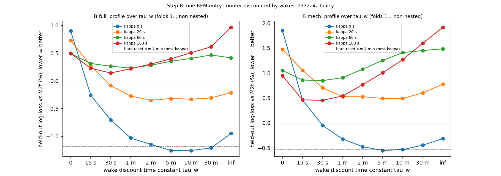
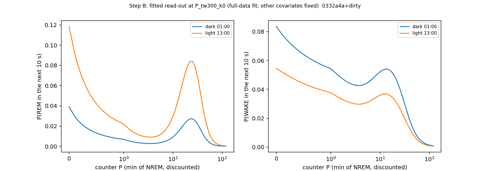

# Sleep-behaviour explore — Step B: the minimal scheduler model (one REM-entry counter + a day/night gate), cohort 2026c

Plan [implementation_plan/2026-10-08-sleep-behaviour-explore.md](../../../../implementation_plan/2026-10-08-sleep-behaviour-explore.md) §4-§5 (pass rules written before results). Driver `ephys/sleep_model.py stepB` (commit 0332a4a+dirty); bulk `D:\Field2026_analysis_out\2026c\sleep_explore_B_20261008_2116`. Runtime 224 min. **Technical ledger.**

## Reading (main session, 2026-10-09; statuses in the claim audit, #32–#36)

1. **One counter is enough, and it is better than the feature model.** P = NREM accumulated since the last REM, emptied
   by REM, discounted during wake. B-full beats M2t held out:
   - FINAL: −1.07 % [−2.26, −0.20], 13/15 folds, 6/6 rats;
   - pass2med: −0.51 % [−0.64, −0.38], 15/15 folds, 6/6 rats.
   A single counter + the clock, without the L1 current-state terms (B-mech), ties M2t (−0.32 %, n.s.). Without any
   history (gate-only) the model is 2.2 % worse.
2. **Each REM bout empties the counter completely.** κ = 0 (full discharge) was chosen in 14/15 folds; partial discharge
   is clearly worse (non-nested profile, best κ = 20 s: −0.33 % vs −1.26 % vs M2t). A discharge that grows with the REM
   bout's length is not better than a constant one (H6: +0.11 %, 0/15 folds).
3. **During wake the counter is forgotten on a time scale of ~5–10 min.**
   - The τ_w profile is lowest at 5–10 min (FINAL and pass2med); the nested choice was 5 or 10 min in every fold; the
     leave-one-animal-out minimum is 5 or 10 min for all six rats (interior: PASS).
   - Erasing at every wake (MAs included) is clearly worse: −1.61 % / −1.58 %, 6/6 both scorings.
4. **Pre-registered rule "beats hard reset and pause": FAIL on FINAL** (−0.04 %, −0.12 %, n.s.). On pass2med the
   discount beats the pause (−0.45 %, 15/15, 6/6) but not the reset (−0.01 %).
5. **Post-hoc diagnosis** ([ephys_spikes_sleep_explore_B_diag_2026c.md](ephys_spikes_sleep_explore_B_diag_2026c.md),
   added after these results) — the variants differ only after wakes, so the comparison was split by what happened since
   the last REM:
   - **after a wake ≥ 7 min:** a reset beats a pause, −0.59 % (FINAL) / −0.61 % (pass2med), 6/6 rats both; the
     discount ties the reset;
   - **after a 2–7-min wake:** on FINAL the discount beats both the reset (−0.31 %, 6/6) and the pause (−0.35 %, 5/6),
     i.e. part of the count survives; on pass2med no difference;
   - **after short wakes only:** no differences.
   The overall comparison could not separate them because the post-wake stretches are a small share of the 120 k steps.
6. **The night needs no step once the counter is in.** A dark step on top of the smooth 2-harmonic clock adds nothing
   (+0.05 %, 2/6). The night/day difference is carried by the smooth daily curve (Step C tests this at the transitions).
7. **Elapsed wall-clock time since the last REM adds information beyond the NREM count** (H19: −0.36 % [−0.67, −0.13],
   13/15 folds, 6/6; FINAL only).
8. **Fragmentation is absorbed.** frag60 adds nothing beyond the counter + the recent wake share (H24: −0.01 %, n.s.).
   The earlier borderline #17 is explained by the counter.

## Definitions

```
Step B of the sleep-behaviour explore (plan implementation_plan/2026-10-08-sleep-behaviour-explore.md §4-§5, written
before results): the minimal scheduler model — one REM-entry counter P with a wake discount, read through a day/night
gate — held out by forward chaining against the feature model M2t, a hard reset, a pause and a gate-only model.

Usage:  python ephys/sleep_model.py stepB [--scorings final pass2med] [--workers 15] [--smoke]
        python ephys/sleep_model.py --selftest

Definitions (1-s scored states: 0 unknown, 1 WAKE, 3 NREM, 5 REM; records = sessions joined across splits <= 60 s;
everything from 2026-09-11 19:40 excluded; 10-s NREM steps as Phases 1-3):
  counter P (minutes), per record, from its bouts in order, starting at 0 at the record start:
      NREM bout of length n s      P <- P + n / 60   (within the bout, at a step with `elapsed` s: P_t = P_start + elapsed / 60)
      WAKE bout of length d s      P <- P * exp(-d / tau_w)        (any wake, microarousals included)
      REM bout of length r s       P <- P * exp(-r / kappa)        (discharge phi(r) = 1 - exp(-r / kappa); kappa = 0: P <- 0)
      unknown run                  P unchanged (frozen)
    variants: tau_w in {0, 15 s, 30 s, 1, 2, 5, 10, 30 min, inf} (0 = every wake erases P; inf = a wake pauses P);
              kappa in {0 (full discharge), 20, 60, 180 s};
              reset    = P <- 0 after a wake >= 420 s, unchanged after shorter wakes (the hard-reset hypothesis);
              pause    = tau_w = inf;
              const    = discharge by a constant fraction phi0 in {0.5, 0.8, 0.95, 1} independent of the REM length (H6).
  hazard per 10-s NREM step: multinomial logit over stay / REM / WAKE (sklearn LogisticRegression, C = 1e4) with
      base     B-spline of ln(elapsed + 5) (4 knots), sin / cos (2 pi k h / 24) for k = 1, 2, linear experiment day,
               dark (NOAA sunset-to-sunrise at the step), has_anchor (a REM seen earlier in the record), animal intercepts;
      L1       ln(1 + preceding wake), previous bout REM, previous bout unknown, wake share of the last 10 min (as M2t);
      history  'P'   = B-spline of ln(1 + P_t);
               'M2t' = B-spline of ln(1 + n_since + elapsed) + ln(1 + wake since the last REM) + ln REM_pre (Phase 2 C2);
               none  = gate-only.
      B-full = base + L1 + P;  B-mech = base + P (no L1);  M2t here = base + L1 + 'M2t' (Phase 2's M2t + dark).
  validation: forward chaining over the day-half blocks (train on all earlier blocks, test the next; the first 6 blocks
      only train). Grid parameters are chosen by NESTED forward chaining: for test fold k the grid point with the lowest
      step-weighted held-out log-loss over folds 1..k-1 is used; fold 0 therefore has no choice and is dropped from every
      comparison. Delta = held-out log-loss change in % of the smaller model, 95 % CI by bootstrap over folds;
      holds = CI < 0 and >= 5 / 6 animals better (Phase 1-3 rule).
  pass rules (plan §5 Step B): B-full not worse than M2t by more than 0.1 %; B-full beats reset and pause (holds);
      B-full beats gate-only by at least 0.5 %; the tau_w profile minimum is interior (30 s - 10 min) and stable when one
      animal is left out (refit without it). Inside step B: H6 (kappa vs a constant discharge fraction), H19 (a wall-clock
      time-since-REM spline on top of B-full), H24 (fragmentation frag60 on top of B-full + w60).
  frag60 = number of wake bouts >= 40 s ending in the 60 min before the bout start; w60 = wake share of recorded seconds
      in the same 60 min; t_since = wall seconds since the end of the last REM (bout start) + elapsed.
```

## Data

- final: 179668 NREM steps, 3880 REM ends, 7442 WAKE ends; 15 test folds (fold 0 is used only to start the nested choice).
- pass2med: 185090 NREM steps, 4219 REM ends, 7513 WAKE ends; 15 test folds (fold 0 is used only to start the nested choice).

## Verdicts against the plan's pass rules (FINAL scores)

| criterion | pass | numbers |
|---|---|---|
| B-full not worse than M2t by > 0.1 % | True | delta -1.071 % |
| B-full beats hard reset (holds) | False | delta -0.041 % [-0.165, +0.107], animals 4/6 |
| B-full beats pause (holds) | False | delta -0.123 % [-0.390, +0.241], animals 4/6 |
| B-full beats gate-only by >= 0.5 % | True | delta -2.173 % |
| tau_w profile minimum interior (30 s - 10 min) and LOAO-stable | True | chosen tau_w (mode over folds) 600 s; LOAO argmins SF07 300, SF08 300, SF09 300, SF10 600, SF11 600, SF12 600 |

## Held-out comparisons

| scores | comparison | subset | n_steps | n_rem | delta_pct | ci_lo_pct | ci_hi_pct | folds_better | folds | animals_better | animals | holds |
|---|---|---|---|---|---|---|---|---|---|---|---|---|
| final | B vs M2t | B-full vs M2t (pass: delta <= +0.1 %) | 122735 | 2544 | -1.0708 | -2.2545 | -0.1964 | 13 | 15 | 6 | 6 | True |
| final | B vs reset | B-full vs hard reset at wakes >= 7 min | 122735 | 2544 | -0.0407 | -0.1651 | 0.1072 | 8 | 15 | 4 | 6 | False |
| final | B vs pause | B-full vs pause (tau_w = inf) | 122735 | 2544 | -0.1228 | -0.3896 | 0.241 | 10 | 15 | 4 | 6 | False |
| final | B vs everywake | B-full vs reset at every wake (tau_w = 0) | 122735 | 2544 | -1.6056 | -2.2115 | -0.9799 | 14 | 15 | 6 | 6 | True |
| final | B vs gate | B-full vs gate-only (pass: <= -0.5 %) | 122735 | 2544 | -2.1727 | -3.0705 | -1.3083 | 14 | 15 | 6 | 6 | True |
| final | M2t vs gate | M2t vs gate-only (reference) | 122735 | 2544 | -1.1138 | -1.5183 | -0.6816 | 14 | 15 | 6 | 6 | True |
| final | B vs nodark | dark step needed once P is in (B-full vs no dark) | 122735 | 2544 | 0.0497 | -0.0321 | 0.1315 | 6 | 15 | 2 | 6 | False |
| final | B vs const | H6: REM discharge grows with REM length (kappa) vs constant fraction | 122735 | 2544 | 0.1114 | 0.0 | 0.3549 | 0 | 15 | 0 | 6 | False |
| final | H19 vs B | H19: + wall-clock time since REM on top of B-full | 122735 | 2544 | -0.3618 | -0.6724 | -0.1279 | 13 | 15 | 6 | 6 | True |
| final | H24 vs H24base | H24: + frag60 on top of B-full + w60 | 122735 | 2544 | -0.0112 | -0.1045 | 0.0936 | 9 | 15 | 3 | 6 | False |
| final | mech_B vs mech_reset | B-mech vs reset (no L1) | 122735 | 2544 | 0.2048 | -0.1156 | 0.7003 | 7 | 15 | 1 | 6 | False |
| final | mech_B vs mech_pause | B-mech vs pause (no L1) | 122735 | 2544 | -0.2022 | -0.4255 | 0.0063 | 11 | 15 | 4 | 6 | False |
| final | mech_B vs gate_mech | B-mech vs gate-only (no L1) | 122735 | 2544 | -2.2581 | -2.9743 | -1.4528 | 15 | 15 | 6 | 6 | True |
| final | mech_B vs M2t | B-mech (one counter, no L1) vs M2t | 122735 | 2544 | -0.3228 | -1.4532 | 0.7049 | 8 | 15 | 2 | 6 | False |
| pass2med | B vs M2t | B-full vs M2t (pass: delta <= +0.1 %) | 123304 | 2666 | -0.5067 | -0.6429 | -0.3752 | 15 | 15 | 6 | 6 | True |
| pass2med | B vs reset | B-full vs hard reset at wakes >= 7 min | 123304 | 2666 | -0.0138 | -0.0686 | 0.0337 | 8 | 15 | 3 | 6 | False |
| pass2med | B vs pause | B-full vs pause (tau_w = inf) | 123304 | 2666 | -0.4492 | -0.8584 | -0.2106 | 15 | 15 | 6 | 6 | True |
| pass2med | B vs everywake | B-full vs reset at every wake (tau_w = 0) | 123304 | 2666 | -1.5757 | -1.851 | -1.2819 | 15 | 15 | 6 | 6 | True |
| pass2med | B vs gate | B-full vs gate-only (pass: <= -0.5 %) | 123304 | 2666 | -1.969 | -2.2121 | -1.676 | 15 | 15 | 6 | 6 | True |
| pass2med | M2t vs gate | M2t vs gate-only (reference) | 123304 | 2666 | -1.4697 | -1.735 | -1.1379 | 14 | 15 | 6 | 6 | True |



## Chosen grid point per fold (nested forward chaining)

| fold | chosen_B | chosen_reset | chosen_pause | chosen_everywake | chosen_const | chosen_mech_B | chosen_mech_reset | chosen_mech_pause |
|---|---|---|---|---|---|---|---|---|
| 0 | None | None | None | None | None | None | None | None |
| 1 | B:P_tw600_k60 | B:R7_k60 | B:P_twinf_k0 | B:P_tw0_k20 | B:Pc_tw600_f95 | Bm:P_tw600_k60 | Bm:R7_k0 | Bm:P_twinf_k180 |
| 2 | B:P_tw300_k0 | B:R7_k0 | B:P_twinf_k0 | B:P_tw0_k180 | B:Pc_tw300_f100 | Bm:P_tw300_k0 | Bm:R7_k0 | Bm:P_twinf_k0 |
| 3 | B:P_tw300_k0 | B:R7_k0 | B:P_twinf_k0 | B:P_tw0_k180 | B:Pc_tw300_f100 | Bm:P_tw300_k0 | Bm:R7_k0 | Bm:P_twinf_k0 |
| 4 | B:P_tw300_k0 | B:R7_k0 | B:P_twinf_k0 | B:P_tw0_k180 | B:Pc_tw300_f100 | Bm:P_tw300_k0 | Bm:R7_k0 | Bm:P_twinf_k0 |
| 5 | B:P_tw300_k0 | B:R7_k0 | B:P_twinf_k0 | B:P_tw0_k180 | B:Pc_tw300_f100 | Bm:P_tw300_k0 | Bm:R7_k0 | Bm:P_twinf_k0 |
| 6 | B:P_tw300_k0 | B:R7_k0 | B:P_twinf_k0 | B:P_tw0_k180 | B:Pc_tw300_f100 | Bm:P_tw300_k0 | Bm:R7_k0 | Bm:P_twinf_k0 |
| 7 | B:P_tw600_k0 | B:R7_k0 | B:P_twinf_k0 | B:P_tw0_k180 | B:Pc_tw600_f100 | Bm:P_tw300_k0 | Bm:R7_k0 | Bm:P_twinf_k0 |
| 8 | B:P_tw600_k0 | B:R7_k0 | B:P_twinf_k0 | B:P_tw0_k180 | B:Pc_tw600_f100 | Bm:P_tw300_k0 | Bm:R7_k0 | Bm:P_twinf_k0 |
| 9 | B:P_tw600_k0 | B:R7_k0 | B:P_twinf_k0 | B:P_tw0_k180 | B:Pc_tw600_f100 | Bm:P_tw300_k0 | Bm:R7_k0 | Bm:P_twinf_k0 |
| 10 | B:P_tw600_k0 | B:R7_k0 | B:P_twinf_k0 | B:P_tw0_k180 | B:Pc_tw600_f100 | Bm:P_tw300_k0 | Bm:R7_k0 | Bm:P_twinf_k0 |
| 11 | B:P_tw600_k0 | B:R7_k0 | B:P_twinf_k0 | B:P_tw0_k180 | B:Pc_tw600_f100 | Bm:P_tw300_k0 | Bm:R7_k0 | Bm:P_twinf_k0 |
| 12 | B:P_tw600_k0 | B:R7_k0 | B:P_twinf_k0 | B:P_tw0_k180 | B:Pc_tw600_f100 | Bm:P_tw300_k0 | Bm:R7_k0 | Bm:P_twinf_k0 |
| 13 | B:P_tw600_k0 | B:R7_k0 | B:P_twinf_k0 | B:P_tw0_k180 | B:Pc_tw600_f100 | Bm:P_tw300_k0 | Bm:R7_k0 | Bm:P_twinf_k0 |
| 14 | B:P_tw600_k0 | B:R7_k0 | B:P_twinf_k0 | B:P_tw0_k180 | B:Pc_tw600_f100 | Bm:P_tw300_k0 | Bm:R7_k0 | Bm:P_twinf_k0 |
| 15 | B:P_tw600_k0 | B:R7_k0 | B:P_twinf_k0 | B:P_tw0_k60 | B:Pc_tw600_f100 | Bm:P_tw300_k0 | Bm:R7_k0 | Bm:P_twinf_k0 |

## Leave-one-animal-out tau_w profile (refit without the animal; B-full, kappa 0 s)

| tau_w_s | SF07 | SF08 | SF09 | SF10 | SF11 | SF12 |
|---|---|---|---|---|---|---|
| 0.0 | 0.25108 | 0.24761 | 0.24456 | 0.25381 | 0.24569 | 0.24962 |
| 15.0 | 0.24823 | 0.2452 | 0.24186 | 0.25131 | 0.24323 | 0.24726 |
| 30.0 | 0.24723 | 0.24422 | 0.24047 | 0.2498 | 0.24191 | 0.24618 |
| 60.0 | 0.24658 | 0.24335 | 0.23959 | 0.24901 | 0.24107 | 0.2452 |
| 120.0 | 0.24646 | 0.24324 | 0.23926 | 0.24876 | 0.24084 | 0.24505 |
| 300.0 | 0.24634 | 0.24281 | 0.23904 | 0.24843 | 0.24058 | 0.24472 |
| 600.0 | 0.24637 | 0.24295 | 0.23906 | 0.24831 | 0.24048 | 0.24458 |
| 1800.0 | 0.24647 | 0.243 | 0.23918 | 0.24835 | 0.24056 | 0.2449 |
| inf | 0.247 | 0.2433 | 0.23962 | 0.24898 | 0.241 | 0.24514 |

| left_out | argmin_tau_w_s |
|---|---|
| SF07 | 300.0 |
| SF08 | 300.0 |
| SF09 | 300.0 |
| SF10 | 600.0 |
| SF11 | 600.0 |
| SF12 | 600.0 |

## Read-out of the counter (full-data fit at P_tw300_k0; description)



## Profile table (non-nested, folds 1..)

| scores | model | variant | mode | tau_w_s | kappa_s | ll | delta_vs_M2t_pct |
|---|---|---|---|---|---|---|---|
| final | B-full | P_tw0_k0 | disc | 0.0 | 0.0 | 0.2489 | 0.9015 |
| final | B-mech | P_tw0_k0 | disc | 0.0 | 0.0 | 0.2512 | 1.8462 |
| final | B-full | P_tw0_k20 | disc | 0.0 | 20.0 | 0.2484 | 0.7277 |
| final | B-mech | P_tw0_k20 | disc | 0.0 | 20.0 | 0.2503 | 1.4693 |
| final | B-full | P_tw0_k60 | disc | 0.0 | 60.0 | 0.2478 | 0.4919 |
| final | B-mech | P_tw0_k60 | disc | 0.0 | 60.0 | 0.2492 | 1.0499 |
| final | B-full | P_tw0_k180 | disc | 0.0 | 180.0 | 0.2479 | 0.4961 |
| final | B-mech | P_tw0_k180 | disc | 0.0 | 180.0 | 0.249 | 0.9472 |
| final | B-full | P_tw15_k0 | disc | 15.0 | 0.0 | 0.246 | -0.2584 |
| final | B-mech | P_tw15_k0 | disc | 15.0 | 0.0 | 0.2478 | 0.4614 |
| final | B-full | P_tw15_k20 | disc | 15.0 | 20.0 | 0.2473 | 0.2733 |
| final | B-mech | P_tw15_k20 | disc | 15.0 | 20.0 | 0.2492 | 1.0562 |
| final | B-full | P_tw15_k60 | disc | 15.0 | 60.0 | 0.2474 | 0.3133 |
| final | B-mech | P_tw15_k60 | disc | 15.0 | 60.0 | 0.2488 | 0.8602 |
| final | B-full | P_tw15_k180 | disc | 15.0 | 180.0 | 0.2472 | 0.2259 |
| final | B-mech | P_tw15_k180 | disc | 15.0 | 180.0 | 0.2478 | 0.4621 |
| final | B-full | P_tw30_k0 | disc | 30.0 | 0.0 | 0.2449 | -0.7057 |
| final | B-mech | P_tw30_k0 | disc | 30.0 | 0.0 | 0.2465 | -0.049 |
| final | B-full | P_tw30_k20 | disc | 30.0 | 20.0 | 0.2464 | -0.0868 |
| final | B-mech | P_tw30_k20 | disc | 30.0 | 20.0 | 0.2484 | 0.7035 |
| final | B-full | P_tw30_k60 | disc | 30.0 | 60.0 | 0.2473 | 0.2632 |
| final | B-mech | P_tw30_k60 | disc | 30.0 | 60.0 | 0.2487 | 0.8471 |
| final | B-full | P_tw30_k180 | disc | 30.0 | 180.0 | 0.247 | 0.1412 |
| final | B-mech | P_tw30_k180 | disc | 30.0 | 180.0 | 0.2478 | 0.4529 |
| final | B-full | P_tw60_k0 | disc | 60.0 | 0.0 | 0.2441 | -1.0324 |
| final | B-mech | P_tw60_k0 | disc | 60.0 | 0.0 | 0.2458 | -0.3227 |
| final | B-full | P_tw60_k20 | disc | 60.0 | 20.0 | 0.246 | -0.2745 |
| final | B-mech | P_tw60_k20 | disc | 60.0 | 20.0 | 0.2479 | 0.5261 |
| final | B-full | P_tw60_k60 | disc | 60.0 | 60.0 | 0.2472 | 0.2301 |
| final | B-mech | P_tw60_k60 | disc | 60.0 | 60.0 | 0.2489 | 0.907 |
| final | B-full | P_tw60_k180 | disc | 60.0 | 180.0 | 0.2472 | 0.2191 |
| final | B-mech | P_tw60_k180 | disc | 60.0 | 180.0 | 0.248 | 0.5393 |
| final | B-full | P_tw120_k0 | disc | 120.0 | 0.0 | 0.2438 | -1.1452 |
| final | B-mech | P_tw120_k0 | disc | 120.0 | 0.0 | 0.2455 | -0.475 |
| final | B-full | P_tw120_k20 | disc | 120.0 | 20.0 | 0.2458 | -0.3493 |
| final | B-mech | P_tw120_k20 | disc | 120.0 | 20.0 | 0.2479 | 0.5247 |
| final | B-full | P_tw120_k60 | disc | 120.0 | 60.0 | 0.2473 | 0.2812 |
| final | B-mech | P_tw120_k60 | disc | 120.0 | 60.0 | 0.2493 | 1.0771 |
| final | B-full | P_tw120_k180 | disc | 120.0 | 180.0 | 0.2474 | 0.3027 |
| final | B-mech | P_tw120_k180 | disc | 120.0 | 180.0 | 0.2485 | 0.7663 |
| final | B-full | P_tw300_k0 | disc | 300.0 | 0.0 | 0.2435 | -1.2554 |
| final | B-mech | P_tw300_k0 | disc | 300.0 | 0.0 | 0.2453 | -0.5516 |
| final | B-full | P_tw300_k20 | disc | 300.0 | 20.0 | 0.2458 | -0.3189 |
| final | B-mech | P_tw300_k20 | disc | 300.0 | 20.0 | 0.2478 | 0.4909 |
| final | B-full | P_tw300_k60 | disc | 300.0 | 60.0 | 0.2475 | 0.3524 |
| final | B-mech | P_tw300_k60 | disc | 300.0 | 60.0 | 0.2497 | 1.2529 |
| final | B-full | P_tw300_k180 | disc | 300.0 | 180.0 | 0.2476 | 0.3968 |
| final | B-mech | P_tw300_k180 | disc | 300.0 | 180.0 | 0.2491 | 1.0043 |
| final | B-full | P_tw600_k0 | disc | 600.0 | 0.0 | 0.2435 | -1.2549 |
| final | B-mech | P_tw600_k0 | disc | 600.0 | 0.0 | 0.2453 | -0.5332 |
| final | B-full | P_tw600_k20 | disc | 600.0 | 20.0 | 0.2458 | -0.3314 |
| final | B-mech | P_tw600_k20 | disc | 600.0 | 20.0 | 0.2478 | 0.4916 |
| final | B-full | P_tw600_k60 | disc | 600.0 | 60.0 | 0.2476 | 0.4036 |
| final | B-mech | P_tw600_k60 | disc | 600.0 | 60.0 | 0.2501 | 1.4092 |
| final | B-full | P_tw600_k180 | disc | 600.0 | 180.0 | 0.2479 | 0.5056 |
| final | B-mech | P_tw600_k180 | disc | 600.0 | 180.0 | 0.2498 | 1.2673 |
| final | B-full | P_tw1800_k0 | disc | 1800.0 | 0.0 | 0.2437 | -1.21 |
| final | B-mech | P_tw1800_k0 | disc | 1800.0 | 0.0 | 0.2455 | -0.4454 |
| final | B-full | P_tw1800_k20 | disc | 1800.0 | 20.0 | 0.2459 | -0.3075 |
| final | B-mech | P_tw1800_k20 | disc | 1800.0 | 20.0 | 0.2481 | 0.6012 |
| final | B-full | P_tw1800_k60 | disc | 1800.0 | 60.0 | 0.2478 | 0.4662 |
| final | B-mech | P_tw1800_k60 | disc | 1800.0 | 60.0 | 0.2502 | 1.4494 |
| final | B-full | P_tw1800_k180 | disc | 1800.0 | 180.0 | 0.2481 | 0.6136 |
| final | B-mech | P_tw1800_k180 | disc | 1800.0 | 180.0 | 0.2506 | 1.5988 |
| final | B-full | P_twinf_k0 | disc | inf | 0.0 | 0.2443 | -0.9491 |
| final | B-mech | P_twinf_k0 | disc | inf | 0.0 | 0.2459 | -0.3132 |
| final | B-full | P_twinf_k20 | disc | inf | 20.0 | 0.2461 | -0.2114 |
| final | B-mech | P_twinf_k20 | disc | inf | 20.0 | 0.2486 | 0.7762 |
| final | B-full | P_twinf_k60 | disc | inf | 60.0 | 0.2477 | 0.4138 |
| final | B-mech | P_twinf_k60 | disc | inf | 60.0 | 0.2503 | 1.4839 |
| final | B-full | P_twinf_k180 | disc | inf | 180.0 | 0.249 | 0.9654 |
| final | B-mech | P_twinf_k180 | disc | inf | 180.0 | 0.2514 | 1.9152 |
| final | B-full | R7_k0 | reset | nan | 0.0 | 0.2437 | -1.1863 |
| final | B-mech | R7_k0 | reset | nan | 0.0 | 0.2453 | -0.5265 |
| final | B-full | R7_k20 | reset | nan | 20.0 | 0.2459 | -0.279 |
| final | B-mech | R7_k20 | reset | nan | 20.0 | 0.2481 | 0.606 |
| final | B-full | R7_k60 | reset | nan | 60.0 | 0.2479 | 0.5095 |
| final | B-mech | R7_k60 | reset | nan | 60.0 | 0.2501 | 1.4122 |
| final | B-full | R7_k180 | reset | nan | 180.0 | 0.2485 | 0.7754 |
| final | B-mech | R7_k180 | reset | nan | 180.0 | 0.2503 | 1.4704 |
| pass2med | B-full | P_tw0_k0 | disc | 0.0 | 0.0 | 0.2513 | 1.5286 |
| pass2med | B-full | P_tw0_k20 | disc | 0.0 | 20.0 | 0.2508 | 1.3237 |
| pass2med | B-full | P_tw0_k60 | disc | 0.0 | 60.0 | 0.2504 | 1.1558 |
| pass2med | B-full | P_tw0_k180 | disc | 0.0 | 180.0 | 0.2502 | 1.0801 |
| pass2med | B-full | P_tw15_k0 | disc | 15.0 | 0.0 | 0.2486 | 0.4295 |
| pass2med | B-full | P_tw15_k20 | disc | 15.0 | 20.0 | 0.2499 | 0.9825 |
| pass2med | B-full | P_tw15_k60 | disc | 15.0 | 60.0 | 0.2503 | 1.1162 |
| pass2med | B-full | P_tw15_k180 | disc | 15.0 | 180.0 | 0.2501 | 1.0325 |
| pass2med | B-full | P_tw30_k0 | disc | 30.0 | 0.0 | 0.2475 | 0.0162 |
| pass2med | B-full | P_tw30_k20 | disc | 30.0 | 20.0 | 0.2491 | 0.6502 |
| pass2med | B-full | P_tw30_k60 | disc | 30.0 | 60.0 | 0.2499 | 0.9829 |
| pass2med | B-full | P_tw30_k180 | disc | 30.0 | 180.0 | 0.25 | 0.9938 |
| pass2med | B-full | P_tw60_k0 | disc | 60.0 | 0.0 | 0.2468 | -0.3028 |
| pass2med | B-full | P_tw60_k20 | disc | 60.0 | 20.0 | 0.2486 | 0.4269 |
| pass2med | B-full | P_tw60_k60 | disc | 60.0 | 60.0 | 0.2498 | 0.915 |
| pass2med | B-full | P_tw60_k180 | disc | 60.0 | 180.0 | 0.25 | 1.0092 |
| pass2med | B-full | P_tw120_k0 | disc | 120.0 | 0.0 | 0.2464 | -0.461 |
| pass2med | B-full | P_tw120_k20 | disc | 120.0 | 20.0 | 0.2484 | 0.3632 |
| pass2med | B-full | P_tw120_k60 | disc | 120.0 | 60.0 | 0.2499 | 0.9505 |
| pass2med | B-full | P_tw120_k180 | disc | 120.0 | 180.0 | 0.25 | 0.9964 |
| pass2med | B-full | P_tw300_k0 | disc | 300.0 | 0.0 | 0.2462 | -0.5129 |
| pass2med | B-full | P_tw300_k20 | disc | 300.0 | 20.0 | 0.2485 | 0.4045 |
| pass2med | B-full | P_tw300_k60 | disc | 300.0 | 60.0 | 0.2498 | 0.9391 |
| pass2med | B-full | P_tw300_k180 | disc | 300.0 | 180.0 | 0.2499 | 0.9572 |
| pass2med | B-full | P_tw600_k0 | disc | 600.0 | 0.0 | 0.2463 | -0.5037 |
| pass2med | B-full | P_tw600_k20 | disc | 600.0 | 20.0 | 0.2485 | 0.4043 |
| pass2med | B-full | P_tw600_k60 | disc | 600.0 | 60.0 | 0.2499 | 0.9462 |
| pass2med | B-full | P_tw600_k180 | disc | 600.0 | 180.0 | 0.25 | 0.992 |
| pass2med | B-full | P_tw1800_k0 | disc | 1800.0 | 0.0 | 0.2464 | -0.458 |
| pass2med | B-full | P_tw1800_k20 | disc | 1800.0 | 20.0 | 0.2486 | 0.4475 |
| pass2med | B-full | P_tw1800_k60 | disc | 1800.0 | 60.0 | 0.2499 | 0.9708 |
| pass2med | B-full | P_tw1800_k180 | disc | 1800.0 | 180.0 | 0.25 | 1.0108 |
| pass2med | B-full | P_twinf_k0 | disc | inf | 0.0 | 0.247 | -0.2236 |
| pass2med | B-full | P_twinf_k20 | disc | inf | 20.0 | 0.2489 | 0.5742 |
| pass2med | B-full | P_twinf_k60 | disc | inf | 60.0 | 0.2501 | 1.0589 |
| pass2med | B-full | P_twinf_k180 | disc | inf | 180.0 | 0.2502 | 1.1041 |
| pass2med | B-full | R7_k0 | reset | nan | 0.0 | 0.2463 | -0.493 |
| pass2med | B-full | R7_k20 | reset | nan | 20.0 | 0.2485 | 0.3949 |
| pass2med | B-full | R7_k60 | reset | nan | 60.0 | 0.2498 | 0.9359 |
| pass2med | B-full | R7_k180 | reset | nan | 180.0 | 0.2501 | 1.0389 |

