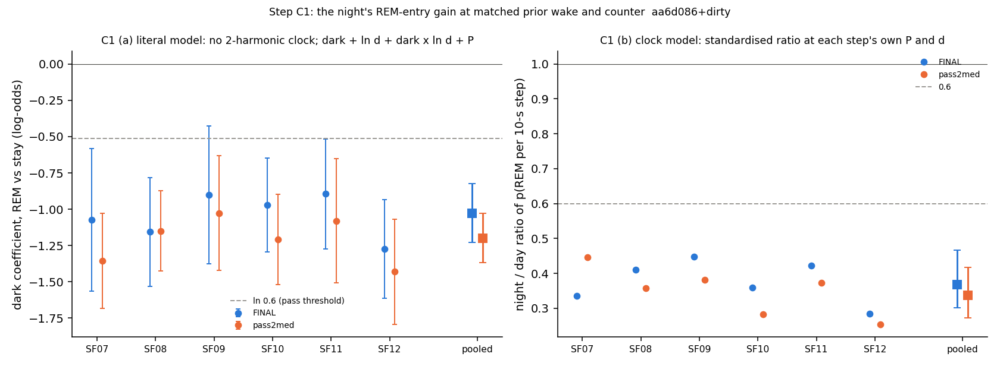
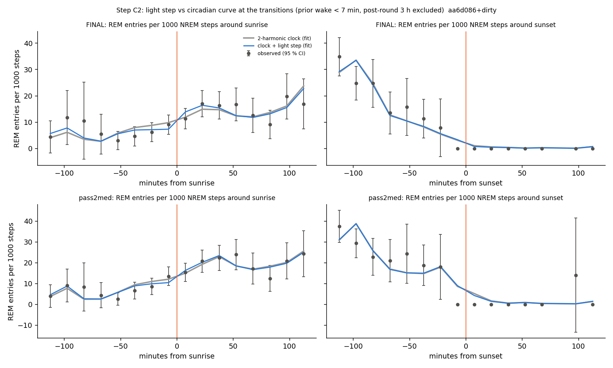
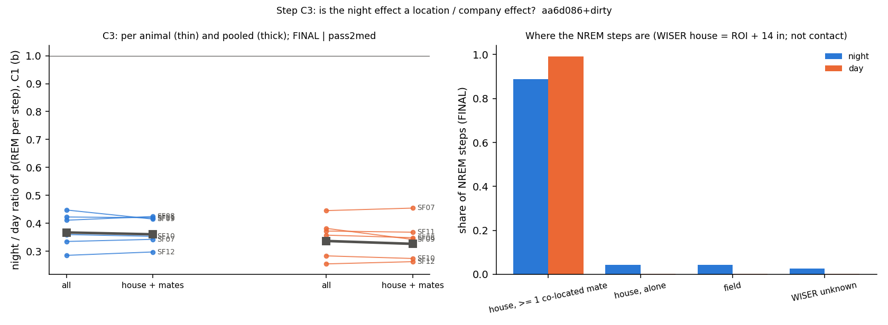
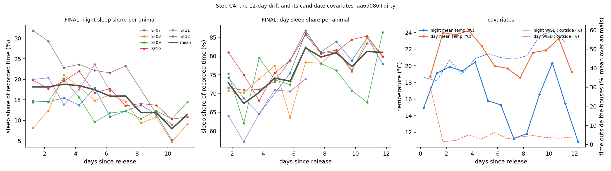

# Sleep behaviour explore — Step C: day vs night, matched (cohort 2026c)

Plan: [implementation_plan/2026-10-08-sleep-behaviour-explore.md](../../../../implementation_plan/2026-10-08-sleep-behaviour-explore.md) (sections 1, 3, 4 and 5 Step C; the pass rules are the plan's, unchanged). Builds on Step B ([ephys_spikes_sleep_explore_B_2026c.md](ephys_spikes_sleep_explore_B_2026c.md)) and Step A ([ephys_spikes_sleep_explore_A_2026c.md](ephys_spikes_sleep_explore_A_2026c.md)). Driver `ephys/sleep_explore_c.py stepC` (commit aa6d086+dirty, file uncommitted at run time); bulk `D:\Field2026_analysis_out\2026c\sleep_explore_C_20261009_0121`; parts c1, c2, c3, c4; runtime 13.7 min.

**Status: exploration step; claim statuses are changed in the claim audit, not here.** Inputs: the scored 1-s states (FINAL and pass2med_remclean), NOAA light, the Phase-0 gap table, WISER default tracks (house / field / co-located housemates), the weather console. No LFP features. Everything from 2026-09-11 19:40 is cut. The sleep states come from the scorer, whose EMG is the head IMU; no claim here links movement to state.

## Verdicts

| part | question | verdict | FINAL | pass2med |
|---|---|---|---|---|
| C1 (a) | night = a gain independent of the prior wake (plan's literal model) | PASS | dark -1.028 (OR 0.36); rats < 0 6/6 | dark -1.199 (OR 0.30); rats < 0 6/6 |
| C1 (b) (added) | night/day ratio at matched P and d, 2-harmonic clock model | PASS | ratio 0.37; rats < 1 6/6 | ratio 0.34; rats < 1 6/6 |
| C2 | a light step beyond the 2-harmonic clock at the transitions (light-driven) | FAIL | Δ +0.158 % [-0.106, +0.417], 2/6 | Δ +0.023 % [-0.133, +0.262], 3/6 |
| C3 | the night effect is not a location / company effect (abs. change ≤ 0.1) | PASS | (b) change -0.018; (a) change -0.028 | (b) change -0.031; (a) change -0.017 |
| C4 | the 12-day drift is environmental (weather + activity) | FAIL (adaptation / unexplained) | day R²w 0.45, day p 0.128; night R²w 0.34, day p 0.015 | day R²w 0.39, day p 0.058; night R²w 0.47, day p 0.003 |

## Data

- FINAL: 179668 NREM steps (44648 in the 3 h after battery rounds, excluded), 3880 REM ends, 7442 WAKE ends; 129 records; animals SF07, SF08, SF09, SF10, SF11, SF12.
- pass2med: 185090 NREM steps (45234 in the 3 h after battery rounds, excluded), 4219 REM ends, 7513 WAKE ends; 129 records; animals SF07, SF08, SF09, SF10, SF11, SF12.

- P = `P_tw600_k0` (τ_w = 600 s, κ = 0 s): the grid point chosen most often over the folds by Step B's nested forward chaining (FINAL); chosen per fold: B:P_tw600_k60, B:P_tw300_k0, B:P_tw300_k0, B:P_tw300_k0, B:P_tw300_k0, B:P_tw300_k0, B:P_tw600_k0, B:P_tw600_k0, B:P_tw600_k0, B:P_tw600_k0, B:P_tw600_k0, B:P_tw600_k0, B:P_tw600_k0, B:P_tw600_k0, B:P_tw600_k0. Sensitivities: pause `P_twinf_k0`, hard reset >= 7 min `R7_k0`.

## Definitions

Time is field-PC local time. States per second $s_t \in \{0\ \text{unknown}, 1\ \text{WAKE}, 3\ \text{NREM}, 5\ \text{REM}\}$. Records, scorings, the cut at 2026-09-11 19:40, light (NOAA sunrise–sunset, `sleep_quant.sun_times`; never clock hours) and the day-half blocks are those of Steps A and B.

### The step model (shared by C1–C3; Step B's machinery)
- **NREM step.** Every 10 s of every NREM bout (`sleep_schedule.record_steps_s`); outcome $y \in \{$stay, REM, WAKE$\}$ = what follows the bout if it ends inside the step. History is taken at the bout start; elapsed $e$ = s since the bout start.
- **Counter P** (min). Step B's REM-entry count at the step: $P_t = P_{\text{bout start}} + e/60$; NREM adds 1/60 per s, a wake of length $d$ multiplies P by $e^{-d/\tau_w}$, a REM bout of length $r$ by $e^{-r/\kappa}$, unknown epochs freeze it (`sleep_model.counter_starts`). $(\tau_w, \kappa)$ = the grid point chosen most often by Step B's nested forward chaining (FINAL; stated in the Data section). Sensitivities: pause ($\tau_w = \infty$, same $\kappa$) and hard reset at wakes ≥ 7 min (`R7`, same $\kappa$).
- **d** (s). Length of the WAKE bout that precedes the step's NREM bout (0 if the preceding bout is REM or unknown); $\ln d$ in the text means $\ln(1 + d)$.
- **Multinomial hazard.** $\Pr(y = j \mid x) = e^{\eta_j} / (1 + e^{\eta_R} + e^{\eta_W})$, $\eta_{stay} = 0$; $\eta_j = \alpha_j + x^\top\beta_j$; fitted by Newton–Raphson with an L2 penalty $10^{-4}\lVert\beta\rVert^2/2$ (intercepts free; the same as Step B's sklearn $C = 10^4$). A coefficient on REM vs stay is a log-odds ratio of entering REM in the next 10 s rather than staying in NREM; negative = REM less likely.
- **Terms.** elapsed = cubic B-spline of $\ln(e + 5)$ (4 knots); hist = cubic B-spline of $\ln(1 + P_t)$ (4 knots); T_day = days since the release (2026-08-30 19:00), z-scored; has_anchor (a REM earlier in the record); L1 without its ln d = previous bout REM, previous bout unknown, wake share of the last 10 min (z-scored); $\ell = \ln(1+d) - \overline{\ln(1+d)}$ (centred on the fitted steps' mean, unscaled); dark ∈ {0, 1} at the step, unscaled; clock = $(\sin, \cos)(2\pi k h/24)$, $k = 1, 2$, $h$ = clock hour of the step; animal intercepts.
- **Cluster-robust CI.** $\hat V = H^{-1}\big(\sum_g U_g U_g^\top\big)H^{-1}\,G/(G-1)$ over day-half blocks $g$ ($U_g$ = summed per-step scores of block $g$, $H$ = penalised information); 95 % CI $= \hat\beta \pm 1.96\,\widehat{se}$; linear combinations $w^\top\hat\beta$ with $\widehat{se} = \sqrt{w^\top \hat V w}$.
- **Post-round exclusion.** Steps in $[g_{end}, g_{end} + 3\,\text{h})$ of a Phase-0 gap of the same animal with cause `round_logged` / `round_inferred` are dropped from every fit (plan section 3); the counters still run through them.
- **Held out (Δ).** Forward chaining over the day-half blocks (train on all earlier blocks, test the next; the first 6 blocks only train; `sleep_model.folds_of`); per-step log loss $-\ln \hat p(y)$; $\Delta = 100(\bar\ell_{hi} - \bar\ell_{lo})/\bar\ell_{lo}$ (step-weighted over folds); 95 % CI by bootstrap over folds (2000); animals better = per-animal pooled Δ < 0; **holds** = CI < 0 and ≥ 5/6 animals (`sleep_schedule_phase2.compare`).

### C1
- **(a) literal model (plan).** $\eta_R = \alpha_a + \text{elapsed} + \text{hist} + \text{T\_day} + \text{has\_anchor} + \text{L1}_{-d} + \beta_\ell \ell + \beta_{dark}\,\text{dark} + \beta_{d\ell}\,\text{dark}\cdot\ell$ (no 2-harmonic clock); the same terms for $\eta_W$. $\beta_{dark}$ = the log-odds ratio of REM entry, dark vs light, at the mean $\ell$ and the same P; $\beta_{d\ell}$ = the night ramp (how much more a longer prior wake lowers REM entry at night). Dark at a given $d$: $\beta_{dark} + \beta_{d\ell}(\ln(1+d) - \overline{\ln(1+d)})$. Per animal: the same model fitted to the animal alone.
- **(b) clock model (added; Step B found the night effect in the smooth clock).** (a) + the 2-harmonic clock; with $\beta_{d\ell} = 0$ it is Step B's B-full.
- **Standardised night / day ratio (b).** For each step $i$ (its own P, d, L1, elapsed, T_day, anchor, animal), $\bar p_i^{night} = \frac1K\sum_k \hat p_{REM}(x_i; h = h_k^{night}, \text{dark} = 1)$ and $\bar p_i^{day}$ likewise with the day clocks; $h_k^{\phi}$ = the $(k - \frac12)/K$ quantiles ($K = 24$) of the clock hour among the fitted steps of phase $\phi$ (the empirical night / day clock). $\hat\rho = \sum_i \bar p_i^{night} / \sum_i \bar p_i^{day}$: < 1 = fewer REM entries per NREM step at night at matched P and d. 95 % CI: 2.5–97.5 % of $\hat\rho$ over 300 parameter vectors drawn from $N(\hat\beta, \hat V)$. Per animal: per-animal fits. Also standardised over sub-sets of steps (after 2–7-min wakes, after MAs, after REM / unknown) with the same fit. For rare events $\ln\hat\rho$ is close to a log-odds.

### C2
- **Transition steps.** NREM steps with $|t - \text{sunrise}| \le 120$ min (dawn) or $|t - \text{sunset}| \le 120$ min (dusk) of the same date, $d < 420$ s, post-round 3 h excluded.
- **Models** (multinomial, same engine): clock = elapsed + hist + T_day + has_anchor + L1$_{-d}$ + 2-harmonic clock + animal; step = clock + dark (the light step: 0 → 1 at sunset, 1 → 0 at sunrise); lnd = clock + $\ell$; step_lnd = clock + dark + $\ell$. Held out on the transition steps (trained on the transition steps of earlier blocks; sensitivity: trained on all NREM steps of earlier blocks). Δ per transition from the same predictions.
- **Empirical hazard.** Per 15-min bin of minutes from sunrise / sunset: REM ends / steps, SE $\sqrt{h(1-h)/n}$; with the mean full-fit prediction of the clock and step models.

### C3
- **Zone** per second (WISER default tracks, `mic_wake_pilot.load_zone` with the `m_off_animal` fixes removed): the median position of the second, forward-filled over gaps ≤ 30 s, in house_1 / house_2 = the ROI rectangle + 14 in, else field; unknown = no position. A house is 'same house', never body contact.
- **Company.** $n_{coloc}$ = other tagged animals in the same house at the step's second (0 if the animal is not in a house); $n_{mates}$ = those with a known scored state (Phase 5); mates_asleep = share of them in NREM / REM (0 if none). House-with-mates step = in a house with $n_{coloc} \ge 1$.
- **Group model.** B-full + loc_field + loc_unknown (vs house) + $n_{coloc}$ + mates_asleep + dark·$(n_{coloc} - \bar n)$ (raw units, centred). Group size effect by phase: light $\beta_n$, dark $\beta_n + \beta_{dn}$ (per mate), on REM vs stay and WAKE vs stay; per-animal signs from per-animal fits.
- **Restriction test.** C1 (b) $\ln\hat\rho$ and C1 (a) $\beta_{dark}$ refitted on house-with-mates steps only; change = restricted − all steps.

### C4
- **Animal-day.** For night_of date $D$: night = [sunset($D$), sunrise($D$+1)), day = [sunrise($D$+1), sunset($D$+1)) (as Phase 3b); kept if ≥ 50 % recorded. Sleep share (%) = (NREM + REM s) / recorded s × 100; NREM min per recorded h = NREM s / recorded s × 60.
- **Covariates.** day = days from the release to the period midpoint; temp_C = mean outdoor temperature over the period (console, NWS KITH inside the 09-02/03 uplink hole; ≥ 50 % of 5-min samples); rain_mm = $\sum \text{rate}\,(5/60)$ over the period's console samples (mm); outside_pct = share of WISER-known seconds of the period in the field zone (≥ 50 % known).
- **Models.** OLS $y_{a,D} = \alpha_a + \gamma^\top z_{a,D} + \varepsilon$, SEs clustered by night_of date, t(G − 1) inference. $R^2_{within}(z) = 1 - SSR(z)/SSR(\text{animal FE only})$ = the share of the within-animal variation explained by $z$. Sets: weather (temp, rain), weather + activity (+ outside_pct), day, full (all four).

## C1 — the night's REM-entry gain, independent of the prior wake?

**Plan pass rule (C1, quoted):** "Pass for 'the night is a gain independent of the prior wake': the dark coefficient on REM vs stay is ≤ ln 0.6 with ln d and P in the model, ≥ 5/6 rats, same sign on `pass2med`. dark × ln d is reported as the night-only ramp." Operationalised on form (a) (the plan's literal model, without the 2-harmonic clock): the pooled FINAL coefficient (at the mean ln(1+d)) ≤ ln 0.6 = −0.511, ≥ 5 of 6 per-animal coefficients < 0 (the strict count ≤ ln 0.6 is reported too, as in A3), and the pooled pass2med coefficient < 0. PARTIAL = the direction holds (CI < 0, ≥ 5/6 rats, same sign) but not the size.

**Form (b) is added, not in the plan:** Step B found that the dark step adds nothing once the 2-harmonic clock and P are in (+0.05 %, n.s.); the night effect is carried by the smooth clock. (b) therefore reads the night / day contrast from the whole clock (harmonics + step) as a standardised ratio at each step's own P and d. The analogous rule (ratio ≤ 0.6, ≥ 5/6 rats < 1, pass2med < 1) is applied to it for orientation only; it is not a plan rule.

For reference, Step A3's model-free matched-episode ratios (REM bouts per NREM hour, dark / light, after 2–7-min wakes) were 0.41 (FINAL) and 0.52 (pass2med), 6/6 rats < 1.

### Coefficients (pooled; cluster-robust CI by block)

Main models; every model and term (also the sensitivities below) is in `ephys_spikes_sleep_explore_C_c1_coef_2026c.csv`.

| scores | model | equation | term | coef | se | ci_lo | ci_hi | p | n_steps | n_rem |
|---|---|---|---|---|---|---|---|---|---|---|
| FINAL | b | REM vs stay | dark | -0.721 | 0.148 | -1.01 | -0.431 | 0.0 | 135020 | 2939 |
| FINAL | b | REM vs stay | lnd | -0.117 | 0.025 | -0.166 | -0.068 | 0.0 | 135020 | 2939 |
| FINAL | b | REM vs stay | dark_x_lnd | -0.063 | 0.027 | -0.116 | -0.01 | 0.019 | 135020 | 2939 |
| FINAL | b | REM vs stay | dark at d = 0 (after REM / unknown) | -0.516 | 0.18 | -0.869 | -0.163 | 0.004 | 135020 | 2939 |
| FINAL | b | REM vs stay | dark at d = 20 s (MA) | -0.708 | 0.148 | -0.999 | -0.417 | 0.0 | 135020 | 2939 |
| FINAL | b | REM vs stay | dark at d = 3 min | -0.844 | 0.151 | -1.14 | -0.548 | 0.0 | 135020 | 2939 |
| FINAL | b | REM vs stay | dark at d = 15 min | -0.946 | 0.167 | -1.272 | -0.619 | 0.0 | 135020 | 2939 |
| FINAL | b | REM vs stay | dark at d = 60 min | -1.033 | 0.187 | -1.401 | -0.666 | 0.0 | 135020 | 2939 |
| FINAL | b | WAKE vs stay | dark | 0.439 | 0.12 | 0.204 | 0.674 | 0.0 | 135020 | 2939 |
| FINAL | b | WAKE vs stay | lnd | 0.091 | 0.019 | 0.055 | 0.128 | 0.0 | 135020 | 2939 |
| FINAL | b | WAKE vs stay | dark_x_lnd | -0.078 | 0.026 | -0.129 | -0.027 | 0.003 | 135020 | 2939 |
| FINAL | b_Bfull | REM vs stay | dark | -0.723 | 0.148 | -1.013 | -0.434 | 0.0 | 135020 | 2939 |
| FINAL | b_Bfull | REM vs stay | lnd | -0.129 | 0.022 | -0.172 | -0.086 | 0.0 | 135020 | 2939 |
| FINAL | b_Bfull | WAKE vs stay | dark | 0.392 | 0.115 | 0.166 | 0.617 | 0.001 | 135020 | 2939 |
| FINAL | b_Bfull | WAKE vs stay | lnd | 0.042 | 0.014 | 0.014 | 0.069 | 0.003 | 135020 | 2939 |
| FINAL | a | REM vs stay | dark | -1.028 | 0.103 | -1.231 | -0.826 | 0.0 | 135020 | 2939 |
| FINAL | a | REM vs stay | lnd | -0.136 | 0.027 | -0.19 | -0.082 | 0.0 | 135020 | 2939 |
| FINAL | a | REM vs stay | dark_x_lnd | -0.055 | 0.03 | -0.113 | 0.003 | 0.063 | 135020 | 2939 |
| FINAL | a | REM vs stay | dark at d = 0 (after REM / unknown) | -0.85 | 0.163 | -1.17 | -0.53 | 0.0 | 135020 | 2939 |
| FINAL | a | REM vs stay | dark at d = 20 s (MA) | -1.017 | 0.105 | -1.224 | -0.811 | 0.0 | 135020 | 2939 |
| FINAL | a | REM vs stay | dark at d = 3 min | -1.136 | 0.1 | -1.331 | -0.94 | 0.0 | 135020 | 2939 |
| FINAL | a | REM vs stay | dark at d = 15 min | -1.224 | 0.12 | -1.459 | -0.989 | 0.0 | 135020 | 2939 |
| FINAL | a | REM vs stay | dark at d = 60 min | -1.3 | 0.147 | -1.589 | -1.011 | 0.0 | 135020 | 2939 |
| FINAL | a | WAKE vs stay | dark | 0.357 | 0.044 | 0.27 | 0.444 | 0.0 | 135020 | 2939 |
| FINAL | a | WAKE vs stay | lnd | 0.088 | 0.018 | 0.052 | 0.123 | 0.0 | 135020 | 2939 |
| FINAL | a | WAKE vs stay | dark_x_lnd | -0.078 | 0.026 | -0.128 | -0.028 | 0.002 | 135020 | 2939 |
| pass2med | b | REM vs stay | dark | -0.588 | 0.111 | -0.806 | -0.369 | 0.0 | 139856 | 3249 |
| pass2med | b | REM vs stay | lnd | -0.105 | 0.027 | -0.157 | -0.052 | 0.0 | 139856 | 3249 |
| pass2med | b | REM vs stay | dark_x_lnd | -0.129 | 0.044 | -0.216 | -0.042 | 0.004 | 139856 | 3249 |
| pass2med | b | REM vs stay | dark at d = 0 (after REM / unknown) | -0.175 | 0.206 | -0.579 | 0.228 | 0.395 | 139856 | 3249 |
| pass2med | b | REM vs stay | dark at d = 20 s (MA) | -0.567 | 0.114 | -0.79 | -0.344 | 0.0 | 139856 | 3249 |
| pass2med | b | REM vs stay | dark at d = 3 min | -0.844 | 0.119 | -1.078 | -0.611 | 0.0 | 139856 | 3249 |
| pass2med | b | REM vs stay | dark at d = 15 min | -1.051 | 0.164 | -1.373 | -0.728 | 0.0 | 139856 | 3249 |
| pass2med | b | REM vs stay | dark at d = 60 min | -1.229 | 0.215 | -1.65 | -0.807 | 0.0 | 139856 | 3249 |
| pass2med | b | WAKE vs stay | dark | 0.493 | 0.113 | 0.272 | 0.714 | 0.0 | 139856 | 3249 |
| pass2med | b | WAKE vs stay | lnd | 0.044 | 0.017 | 0.009 | 0.078 | 0.012 | 139856 | 3249 |
| pass2med | b | WAKE vs stay | dark_x_lnd | -0.023 | 0.025 | -0.072 | 0.025 | 0.346 | 139856 | 3249 |
| pass2med | b_Bfull | REM vs stay | dark | -0.568 | 0.124 | -0.81 | -0.325 | 0.0 | 139856 | 3249 |
| pass2med | b_Bfull | REM vs stay | lnd | -0.124 | 0.025 | -0.172 | -0.076 | 0.0 | 139856 | 3249 |
| pass2med | b_Bfull | WAKE vs stay | dark | 0.481 | 0.114 | 0.257 | 0.704 | 0.0 | 139856 | 3249 |
| pass2med | b_Bfull | WAKE vs stay | lnd | 0.028 | 0.017 | -0.005 | 0.062 | 0.097 | 139856 | 3249 |
| pass2med | a | REM vs stay | dark | -1.199 | 0.087 | -1.369 | -1.029 | 0.0 | 139856 | 3249 |
| pass2med | a | REM vs stay | lnd | -0.112 | 0.026 | -0.163 | -0.061 | 0.0 | 139856 | 3249 |
| pass2med | a | REM vs stay | dark_x_lnd | -0.121 | 0.045 | -0.209 | -0.032 | 0.008 | 139856 | 3249 |
| pass2med | a | REM vs stay | dark at d = 0 (after REM / unknown) | -0.813 | 0.187 | -1.179 | -0.446 | 0.0 | 139856 | 3249 |
| pass2med | a | REM vs stay | dark at d = 20 s (MA) | -1.18 | 0.089 | -1.354 | -1.006 | 0.0 | 139856 | 3249 |
| pass2med | a | REM vs stay | dark at d = 3 min | -1.44 | 0.108 | -1.651 | -1.229 | 0.0 | 139856 | 3249 |
| pass2med | a | REM vs stay | dark at d = 15 min | -1.634 | 0.163 | -1.954 | -1.314 | 0.0 | 139856 | 3249 |
| pass2med | a | REM vs stay | dark at d = 60 min | -1.801 | 0.219 | -2.231 | -1.371 | 0.0 | 139856 | 3249 |
| pass2med | a | WAKE vs stay | dark | 0.275 | 0.055 | 0.167 | 0.382 | 0.0 | 139856 | 3249 |
| pass2med | a | WAKE vs stay | lnd | 0.04 | 0.017 | 0.006 | 0.074 | 0.02 | 139856 | 3249 |
| pass2med | a | WAKE vs stay | dark_x_lnd | -0.025 | 0.024 | -0.073 | 0.023 | 0.312 | 139856 | 3249 |

### Night / day ratios (b)

| scores | model | subset | ratio | ci_lo | ci_hi | ln_ratio | ln_ratio_se | p_rem_night | p_rem_day | n_steps |
|---|---|---|---|---|---|---|---|---|---|---|
| FINAL | b | all NREM steps (post-round 3 h excluded) | 0.367 | 0.302 | 0.466 | -1.002 | 0.107 | 0.009 | 0.025 | 135020 |
| FINAL | b | steps after a 2-7-min wake | 0.307 | nan | nan | -1.18 | nan | nan | nan | 8419 |
| FINAL | b | steps after a wake < 40 s (MA) | 0.359 | nan | nan | -1.024 | nan | nan | nan | 88574 |
| FINAL | b | steps after REM / unknown (d = 0) | 0.442 | nan | nan | -0.817 | nan | nan | nan | 8671 |
| FINAL | b_Bfull | all NREM steps (post-round 3 h excluded) | 0.353 | 0.289 | 0.431 | -1.041 | 0.104 | 0.009 | 0.025 | 135020 |
| FINAL | b_darkxday | all NREM steps (post-round 3 h excluded) | 0.375 | nan | nan | -0.982 | nan | 0.009 | 0.025 | 135020 |
| FINAL | b@pause | all NREM steps (post-round 3 h excluded) | 0.353 | nan | nan | -1.042 | nan | 0.009 | 0.025 | 135020 |
| FINAL | b@hard reset >= 7 min | all NREM steps (post-round 3 h excluded) | 0.372 | nan | nan | -0.989 | nan | 0.009 | 0.025 | 135020 |
| pass2med | b | all NREM steps (post-round 3 h excluded) | 0.337 | 0.273 | 0.417 | -1.088 | 0.109 | 0.009 | 0.028 | 139856 |
| pass2med | b | steps after a 2-7-min wake | 0.228 | nan | nan | -1.48 | nan | nan | nan | 7142 |
| pass2med | b | steps after a wake < 40 s (MA) | 0.315 | nan | nan | -1.154 | nan | nan | nan | 93881 |
| pass2med | b | steps after REM / unknown (d = 0) | 0.474 | nan | nan | -0.746 | nan | nan | nan | 9614 |
| pass2med | b_Bfull | all NREM steps (post-round 3 h excluded) | 0.317 | 0.264 | 0.375 | -1.147 | 0.093 | 0.009 | 0.028 | 139856 |
| pass2med | b_darkxday | all NREM steps (post-round 3 h excluded) | 0.36 | nan | nan | -1.021 | nan | 0.01 | 0.028 | 139856 |
| pass2med | b@pause | all NREM steps (post-round 3 h excluded) | 0.317 | nan | nan | -1.148 | nan | 0.009 | 0.028 | 139856 |
| pass2med | b@hard reset >= 7 min | all NREM steps (post-round 3 h excluded) | 0.34 | nan | nan | -1.08 | nan | 0.009 | 0.028 | 139856 |

### Per animal

| scores | animal | model | ok | dark_coef | dark_ci_lo | dark_ci_hi | n_steps | n_rem | dark_x_lnd | ratio |
|---|---|---|---|---|---|---|---|---|---|---|
| FINAL | SF07 | a | True | -1.072 | -1.564 | -0.581 | 23054 | 576 | 0.022 | nan |
| FINAL | SF07 | b | True | -0.664 | -1.459 | 0.131 | 23054 | 576 | 0.023 | 0.335 |
| FINAL | SF08 | a | True | -1.157 | -1.532 | -0.782 | 23721 | 500 | -0.351 | nan |
| FINAL | SF08 | b | True | -0.292 | -1.252 | 0.667 | 23721 | 500 | -0.405 | 0.411 |
| FINAL | SF09 | a | True | -0.901 | -1.376 | -0.426 | 24662 | 463 | -0.145 | nan |
| FINAL | SF09 | b | True | -0.239 | -1.112 | 0.634 | 24662 | 463 | -0.149 | 0.448 |
| FINAL | SF10 | a | True | -0.971 | -1.294 | -0.649 | 25267 | 605 | 0.057 | nan |
| FINAL | SF10 | b | True | -1.138 | -1.906 | -0.371 | 25267 | 605 | 0.046 | 0.36 |
| FINAL | SF11 | a | True | -0.895 | -1.274 | -0.516 | 13457 | 326 | -0.07 | nan |
| FINAL | SF11 | b | True | -0.898 | -1.922 | 0.126 | 13457 | 326 | -0.064 | 0.423 |
| FINAL | SF12 | a | True | -1.275 | -1.615 | -0.935 | 24859 | 469 | -0.063 | nan |
| FINAL | SF12 | b | True | -0.989 | -1.649 | -0.329 | 24859 | 469 | -0.072 | 0.285 |
| pass2med | SF07 | a | True | -1.356 | -1.683 | -1.028 | 24132 | 714 | -0.389 | nan |
| pass2med | SF07 | b | True | -0.615 | -1.396 | 0.166 | 24132 | 714 | -0.392 | 0.445 |
| pass2med | SF08 | a | True | -1.15 | -1.424 | -0.875 | 24141 | 560 | -0.221 | nan |
| pass2med | SF08 | b | True | -0.316 | -0.836 | 0.203 | 24141 | 560 | -0.201 | 0.358 |
| pass2med | SF09 | a | True | -1.027 | -1.422 | -0.633 | 25122 | 477 | -0.062 | nan |
| pass2med | SF09 | b | True | -0.256 | -0.865 | 0.354 | 25122 | 477 | -0.051 | 0.382 |
| pass2med | SF10 | a | True | -1.209 | -1.518 | -0.899 | 26272 | 638 | -0.001 | nan |
| pass2med | SF10 | b | True | -0.806 | -1.72 | 0.108 | 26272 | 638 | 0.004 | 0.284 |
| pass2med | SF11 | a | True | -1.08 | -1.507 | -0.653 | 14772 | 383 | -0.087 | nan |
| pass2med | SF11 | b | True | -1.003 | -2.149 | 0.142 | 14772 | 383 | -0.086 | 0.372 |
| pass2med | SF12 | a | True | -1.431 | -1.792 | -1.071 | 25417 | 477 | -0.105 | nan |
| pass2med | SF12 | b | True | -0.989 | -1.755 | -0.222 | 25417 | 477 | -0.114 | 0.255 |

### Sensitivities: P with a pause or a hard reset, + dark × day, no interaction

| scores | model | coef | ci_lo | ci_hi |
|---|---|---|---|---|
| FINAL | a | -1.028 | -1.231 | -0.826 |
| FINAL | a_nointer | -1.031 | -1.233 | -0.83 |
| FINAL | a_darkxday | -1.005 | -1.202 | -0.809 |
| FINAL | a@pause | -1.067 | -1.291 | -0.842 |
| FINAL | a@hard reset >= 7 min | -1.019 | -1.215 | -0.822 |
| pass2med | a | -1.199 | -1.369 | -1.029 |
| pass2med | a_nointer | -1.159 | -1.343 | -0.976 |
| pass2med | a_darkxday | -1.133 | -1.272 | -0.993 |
| pass2med | a@pause | -1.259 | -1.412 | -1.106 |
| pass2med | a@hard reset >= 7 min | -1.193 | -1.361 | -1.026 |

| scores | model | ratio | ci_lo | ci_hi | ln_ratio |
|---|---|---|---|---|---|
| FINAL | b | 0.367 | 0.302 | 0.466 | -1.002 |
| FINAL | b_Bfull | 0.353 | 0.289 | 0.431 | -1.041 |
| FINAL | b_darkxday | 0.375 | nan | nan | -0.982 |
| FINAL | b@pause | 0.353 | nan | nan | -1.042 |
| FINAL | b@hard reset >= 7 min | 0.372 | nan | nan | -0.989 |
| pass2med | b | 0.337 | 0.273 | 0.417 | -1.088 |
| pass2med | b_Bfull | 0.317 | 0.264 | 0.375 | -1.147 |
| pass2med | b_darkxday | 0.36 | nan | nan | -1.021 |
| pass2med | b@pause | 0.317 | nan | nan | -1.148 |
| pass2med | b@hard reset >= 7 min | 0.34 | nan | nan | -1.08 |

### Held out (forward chaining; post-round 3 h excluded)

| scores | comparison | subset | n_steps | n_rem | delta_pct | ci_lo_pct | ci_hi_pct | folds_better | folds | animals_better | animals | holds |
|---|---|---|---|---|---|---|---|---|---|---|---|---|
| FINAL | Bfull_dxl vs Bfull | B-full + dark x ln(1+d) vs B-full | 90854 | 1867 | -0.019 | -0.054 | 0.011 | 10 | 15 | 3 | 6 | False |
| FINAL | Bfull_dxl vs a | (b) clock model vs (a) literal model (no 2-harmonic clock) | 90854 | 1867 | -0.043 | -0.266 | 0.26 | 12 | 15 | 4 | 6 | False |
| pass2med | Bfull_dxl vs Bfull | B-full + dark x ln(1+d) vs B-full | 91186 | 1979 | 0.009 | -0.014 | 0.033 | 5 | 15 | 2 | 6 | False |
| pass2med | Bfull_dxl vs a | (b) clock model vs (a) literal model (no 2-harmonic clock) | 91186 | 1979 | -0.281 | -0.517 | -0.113 | 14 | 15 | 5 | 6 | True |

### Verdict C1

- **FINAL, (a) literal:** dark -1.028 [-1.231, -0.826] (odds ratio 0.36; threshold ln 0.6 = -0.511); per animal dark < 0 in 6/6, ≤ ln 0.6 in 6/6; night ramp dark × ln(1+d) -0.055 [-0.113, +0.003] → size met, rats met.
- **pass2med, (a) literal:** dark -1.199 [-1.369, -1.029] (odds ratio 0.30; threshold ln 0.6 = -0.511); per animal dark < 0 in 6/6, ≤ ln 0.6 in 6/6; night ramp dark × ln(1+d) -0.121 [-0.209, -0.032] → size met, rats met.

**C1 (a) verdict (plan rule): PASS.**

- **FINAL, (b) clock model:** night / day ratio 0.37 [0.30, 0.47] (ln -1.002); per animal < 1 in 6/6, ≤ 0.6 in 6/6; within sub-sets: steps after a 2-7-min wake 0.31; steps after a wake < 40 s (MA) 0.36; steps after REM / unknown (d = 0) 0.44.
- **pass2med, (b) clock model:** night / day ratio 0.34 [0.27, 0.42] (ln -1.088); per animal < 1 in 6/6, ≤ 0.6 in 6/6; within sub-sets: steps after a 2-7-min wake 0.23; steps after a wake < 40 s (MA) 0.32; steps after REM / unknown (d = 0) 0.47.

**C1 (b) (added, orientation only): PASS.**

## C2 — light step vs circadian curve vs prior wake at the transitions

**Plan pass rule (C2, quoted):** "Pass for 'light-driven': the step improves held-out log-loss on the transition hours (holds)." Applied to the clock vs clock + light-step comparison on the transition steps (trained on transition steps), both scorings. The plan's data are 'episodes starting within ±2 h of sunset and of sunrise, prior wake < 7 min, P at onset'; here every NREM step inside the ±2-h windows with a preceding wake < 7 min is used (the step model is the plan's estimation unit; the episode onset would keep only the first bout of each episode). The 3 h after a battery round are excluded, which removes much of the morning just after sunrise (rounds are morning / evening); counts below.

Steps per transition and side (post-round excluded):

| scores | transition | side | steps |
|---|---|---|---|
| FINAL | dawn | dark | 8015 |
| FINAL | dawn | light | 13381 |
| FINAL | dusk | dark | 543 |
| FINAL | dusk | light | 8250 |
| pass2med | dawn | dark | 9074 |
| pass2med | dawn | light | 13895 |
| pass2med | dusk | dark | 638 |
| pass2med | dusk | light | 8020 |

Sparse side(s): FINAL dusk dark side 543 steps; pass2med dusk dark side 638 steps. After sunset the animals are mostly awake (and the evening rounds' 3-h exclusion falls there), so the dusk step is estimated from few dark-side NREM steps; the dawn transition carries most of the test.

### Held out

| scores | train | steps_subset | comparison | subset | n_steps | n_rem | delta_pct | ci_lo_pct | ci_hi_pct | folds_better | folds | animals_better | animals | holds |
|---|---|---|---|---|---|---|---|---|---|---|---|---|---|---|
| FINAL | transition steps only | both transitions | step vs clock | + light step vs 2-harmonic clock (pass rule) | 22469 | 318 | 0.158 | -0.106 | 0.417 | 6 | 14 | 2 | 6 | False |
| FINAL | transition steps only | both transitions | lnd vs clock | + ln(1+d) vs 2-harmonic clock | 22469 | 318 | 0.018 | -0.155 | 0.237 | 10 | 14 | 4 | 6 | False |
| FINAL | transition steps only | both transitions | step_lnd vs lnd | + light step on top of clock + ln(1+d) | 22469 | 318 | 0.161 | -0.115 | 0.428 | 7 | 14 | 2 | 6 | False |
| FINAL | transition steps only | dawn (+-2 h of sunrise) | step vs clock | + light step vs 2-harmonic clock (pass rule) | 15611 | 165 | 0.127 | -0.282 | 0.505 | 5 | 8 | 4 | 6 | False |
| FINAL | transition steps only | dawn (+-2 h of sunrise) | lnd vs clock | + ln(1+d) vs 2-harmonic clock | 15611 | 165 | -0.054 | -0.227 | 0.191 | 6 | 8 | 3 | 6 | False |
| FINAL | transition steps only | dawn (+-2 h of sunrise) | step_lnd vs lnd | + light step on top of clock + ln(1+d) | 15611 | 165 | 0.106 | -0.316 | 0.491 | 6 | 8 | 4 | 6 | False |
| FINAL | transition steps only | dusk (+-2 h of sunset) | step vs clock | + light step vs 2-harmonic clock (pass rule) | 6523 | 153 | 0.222 | 0.051 | 0.421 | 1 | 6 | 1 | 6 | False |
| FINAL | transition steps only | dusk (+-2 h of sunset) | lnd vs clock | + ln(1+d) vs 2-harmonic clock | 6523 | 153 | 0.143 | -0.154 | 0.417 | 4 | 6 | 3 | 6 | False |
| FINAL | transition steps only | dusk (+-2 h of sunset) | step_lnd vs lnd | + light step on top of clock + ln(1+d) | 6523 | 153 | 0.267 | 0.055 | 0.459 | 1 | 6 | 1 | 6 | False |
| FINAL | all NREM steps (sensitivity) | both transitions | step vs clock | + light step vs 2-harmonic clock (pass rule) | 22469 | 318 | 0.077 | -0.372 | 0.49 | 8 | 14 | 3 | 6 | False |
| FINAL | all NREM steps (sensitivity) | both transitions | lnd vs clock | + ln(1+d) vs 2-harmonic clock | 22469 | 318 | -0.018 | -0.176 | 0.148 | 6 | 14 | 3 | 6 | False |
| FINAL | all NREM steps (sensitivity) | both transitions | step_lnd vs lnd | + light step on top of clock + ln(1+d) | 22469 | 318 | 0.054 | -0.407 | 0.487 | 7 | 14 | 3 | 6 | False |
| pass2med | transition steps only | both transitions | step vs clock | + light step vs 2-harmonic clock (pass rule) | 22591 | 399 | 0.023 | -0.133 | 0.262 | 8 | 14 | 3 | 6 | False |
| pass2med | transition steps only | both transitions | lnd vs clock | + ln(1+d) vs 2-harmonic clock | 22591 | 399 | 0.019 | -0.088 | 0.175 | 8 | 14 | 3 | 6 | False |
| pass2med | transition steps only | both transitions | step_lnd vs lnd | + light step on top of clock + ln(1+d) | 22591 | 399 | 0.013 | -0.153 | 0.261 | 8 | 14 | 3 | 6 | False |
| pass2med | transition steps only | dawn (+-2 h of sunrise) | step vs clock | + light step vs 2-harmonic clock (pass rule) | 15996 | 233 | -0.161 | -0.295 | -0.013 | 7 | 8 | 5 | 6 | True |
| pass2med | transition steps only | dawn (+-2 h of sunrise) | lnd vs clock | + ln(1+d) vs 2-harmonic clock | 15996 | 233 | 0.025 | -0.117 | 0.289 | 4 | 8 | 3 | 6 | False |
| pass2med | transition steps only | dawn (+-2 h of sunrise) | step_lnd vs lnd | + light step on top of clock + ln(1+d) | 15996 | 233 | -0.182 | -0.328 | -0.023 | 7 | 8 | 5 | 6 | True |
| pass2med | transition steps only | dusk (+-2 h of sunset) | step vs clock | + light step vs 2-harmonic clock (pass rule) | 6391 | 166 | 0.318 | 0.11 | 0.608 | 1 | 7 | 0 | 6 | False |
| pass2med | transition steps only | dusk (+-2 h of sunset) | lnd vs clock | + ln(1+d) vs 2-harmonic clock | 6391 | 166 | 0.014 | -0.146 | 0.135 | 4 | 7 | 3 | 6 | False |
| pass2med | transition steps only | dusk (+-2 h of sunset) | step_lnd vs lnd | + light step on top of clock + ln(1+d) | 6391 | 166 | 0.326 | 0.114 | 0.62 | 1 | 7 | 0 | 6 | False |
| pass2med | all NREM steps (sensitivity) | both transitions | step vs clock | + light step vs 2-harmonic clock (pass rule) | 22591 | 399 | -0.023 | -0.35 | 0.39 | 8 | 14 | 3 | 6 | False |
| pass2med | all NREM steps (sensitivity) | both transitions | lnd vs clock | + ln(1+d) vs 2-harmonic clock | 22591 | 399 | 0.031 | -0.06 | 0.159 | 6 | 14 | 2 | 6 | False |
| pass2med | all NREM steps (sensitivity) | both transitions | step_lnd vs lnd | + light step on top of clock + ln(1+d) | 22591 | 399 | -0.043 | -0.392 | 0.392 | 8 | 14 | 3 | 6 | False |

### Empirical hazard per 15-min bin

| scores | transition | bin | n | hazard | pred_clock | pred_step | se |
|---|---|---|---|---|---|---|---|
| FINAL | sunrise | -112.5 | 454 | 0.00441 | 0.00412 | 0.0057 | 0.00311 |
| FINAL | sunrise | -97.5 | 424 | 0.01179 | 0.00618 | 0.00782 | 0.00524 |
| FINAL | sunrise | -82.5 | 189 | 0.01058 | 0.00351 | 0.00401 | 0.00744 |
| FINAL | sunrise | -67.5 | 366 | 0.00546 | 0.00275 | 0.00281 | 0.00385 |
| FINAL | sunrise | -52.5 | 991 | 0.00303 | 0.00587 | 0.00561 | 0.00175 |
| FINAL | sunrise | -37.5 | 1295 | 0.00463 | 0.00798 | 0.00704 | 0.00189 |
| FINAL | sunrise | -22.5 | 1769 | 0.00622 | 0.0088 | 0.00717 | 0.00187 |
| FINAL | sunrise | -7.5 | 2527 | 0.0091 | 0.00984 | 0.00736 | 0.00189 |
| FINAL | sunrise | 7.5 | 2893 | 0.01141 | 0.01192 | 0.01391 | 0.00197 |
| FINAL | sunrise | 22.5 | 2588 | 0.017 | 0.01493 | 0.01643 | 0.00254 |
| FINAL | sunrise | 37.5 | 2258 | 0.01639 | 0.01475 | 0.01541 | 0.00267 |
| FINAL | sunrise | 52.5 | 1611 | 0.01676 | 0.0124 | 0.0125 | 0.0032 |
| FINAL | sunrise | 67.5 | 1111 | 0.0126 | 0.01205 | 0.01181 | 0.00335 |
| FINAL | sunrise | 82.5 | 1204 | 0.00914 | 0.01369 | 0.01316 | 0.00274 |
| FINAL | sunrise | 97.5 | 1008 | 0.01984 | 0.01618 | 0.01557 | 0.00439 |
| FINAL | sunrise | 112.5 | 708 | 0.01695 | 0.02378 | 0.02279 | 0.00485 |
| FINAL | sunset | -112.5 | 2410 | 0.03485 | 0.02888 | 0.02922 | 0.00374 |
| FINAL | sunset | -97.5 | 2302 | 0.02476 | 0.03358 | 0.03346 | 0.00324 |
| FINAL | sunset | -82.5 | 1131 | 0.02476 | 0.02462 | 0.02415 | 0.00462 |
| FINAL | sunset | -67.5 | 813 | 0.01353 | 0.01278 | 0.01254 | 0.00405 |
| FINAL | sunset | -52.5 | 507 | 0.01578 | 0.01051 | 0.01045 | 0.00553 |
| FINAL | sunset | -37.5 | 796 | 0.01131 | 0.0082 | 0.00842 | 0.00375 |
| FINAL | sunset | -22.5 | 253 | 0.00791 | 0.00546 | 0.00567 | 0.00557 |
| FINAL | sunset | -7.5 | 38 | 0.0 | 0.00314 | 0.00337 | 0.0 |
| FINAL | sunset | 7.5 | 108 | 0.0 | 0.00109 | 0.00078 | 0.0 |
| FINAL | sunset | 22.5 | 13 | 0.0 | 0.00064 | 0.00048 | 0.0 |
| FINAL | sunset | 37.5 | 1 | 0.0 | 0.00044 | 0.00036 | 0.0 |
| FINAL | sunset | 52.5 | 49 | 0.0 | 0.00018 | 0.00016 | 0.0 |
| FINAL | sunset | 67.5 | 5 | 0.0 | 0.00033 | 0.0003 | 0.0 |
| FINAL | sunset | 97.5 | 67 | 0.0 | 0.00012 | 0.00013 | 0.0 |
| FINAL | sunset | 112.5 | 300 | 0.0 | 0.0007 | 0.00078 | 0.0 |
| pass2med | sunrise | -112.5 | 508 | 0.00394 | 0.00382 | 0.00464 | 0.00278 |
| pass2med | sunrise | -97.5 | 551 | 0.00907 | 0.00776 | 0.00883 | 0.00404 |
| pass2med | sunrise | -82.5 | 238 | 0.0084 | 0.00248 | 0.00272 | 0.00592 |
| pass2med | sunrise | -67.5 | 454 | 0.00441 | 0.00255 | 0.00262 | 0.00311 |
| pass2med | sunrise | -52.5 | 1150 | 0.00261 | 0.00583 | 0.00576 | 0.0015 |
| pass2med | sunrise | -37.5 | 1508 | 0.00663 | 0.00945 | 0.00891 | 0.00209 |
| pass2med | sunrise | -22.5 | 2086 | 0.00863 | 0.01101 | 0.00992 | 0.00203 |
| pass2med | sunrise | -7.5 | 2579 | 0.01357 | 0.01213 | 0.01048 | 0.00228 |
| pass2med | sunrise | 7.5 | 3053 | 0.01539 | 0.01506 | 0.01636 | 0.00223 |
| pass2med | sunrise | 22.5 | 2694 | 0.02079 | 0.01931 | 0.02028 | 0.00275 |
| pass2med | sunrise | 37.5 | 2325 | 0.02237 | 0.02296 | 0.0235 | 0.00307 |
| pass2med | sunrise | 52.5 | 1670 | 0.02395 | 0.01848 | 0.01855 | 0.00374 |
| pass2med | sunrise | 67.5 | 1163 | 0.0172 | 0.01693 | 0.01672 | 0.00381 |
| pass2med | sunrise | 82.5 | 1200 | 0.0125 | 0.01836 | 0.01792 | 0.00321 |
| pass2med | sunrise | 97.5 | 1052 | 0.02091 | 0.02019 | 0.01979 | 0.00441 |
| pass2med | sunrise | 112.5 | 738 | 0.02439 | 0.02567 | 0.02509 | 0.00568 |
| pass2med | sunset | -112.5 | 2371 | 0.03754 | 0.0309 | 0.03111 | 0.0039 |
| pass2med | sunset | -97.5 | 2280 | 0.02939 | 0.03887 | 0.03877 | 0.00354 |
| pass2med | sunset | -82.5 | 1093 | 0.02287 | 0.02592 | 0.02572 | 0.00452 |
| pass2med | sunset | -67.5 | 760 | 0.02105 | 0.01702 | 0.01683 | 0.00521 |
| pass2med | sunset | -52.5 | 452 | 0.02434 | 0.01523 | 0.01513 | 0.00725 |
| pass2med | sunset | -37.5 | 745 | 0.01879 | 0.01482 | 0.01503 | 0.00497 |
| pass2med | sunset | -22.5 | 278 | 0.01799 | 0.01793 | 0.0182 | 0.00797 |
| pass2med | sunset | -7.5 | 41 | 0.0 | 0.00866 | 0.00902 | 0.0 |
| pass2med | sunset | 7.5 | 130 | 0.0 | 0.00519 | 0.00426 | 0.0 |
| pass2med | sunset | 22.5 | 22 | 0.0 | 0.00169 | 0.00144 | 0.0 |
| pass2med | sunset | 37.5 | 9 | 0.0 | 0.00062 | 0.00055 | 0.0 |
| pass2med | sunset | 52.5 | 66 | 0.0 | 0.00096 | 0.00088 | 0.0 |
| pass2med | sunset | 67.5 | 25 | 0.0 | 0.00047 | 0.00045 | 0.0 |
| pass2med | sunset | 97.5 | 71 | 0.01408 | 0.00029 | 0.0003 | 0.01398 |
| pass2med | sunset | 112.5 | 315 | 0.0 | 0.00141 | 0.00153 | 0.0 |

### Verdict C2

- **FINAL:** 30189 transition steps over all blocks (451 REM ends); light step vs clock Δ +0.158 % [-0.106, +0.417], animals better 2/6 → does not hold.
- **pass2med:** 31627 transition steps over all blocks (575 REM ends); light step vs clock Δ +0.023 % [-0.133, +0.262], animals better 3/6 → does not hold.
  - FINAL, not in the rule: dawn only Δ +0.127 % [-0.282, +0.505], 4/6; dusk only Δ +0.222 % [+0.051, +0.421], 1/6 (the step makes prediction worse: CI > 0); trained on all NREM steps Δ +0.077 % [-0.372, +0.490], 3/6.
  - pass2med, not in the rule: dawn only Δ -0.161 % [-0.295, -0.013], 5/6 (holds); dusk only Δ +0.318 % [+0.110, +0.608], 0/6 (the step makes prediction worse: CI > 0); trained on all NREM steps Δ -0.023 % [-0.350, +0.390], 3/6.

**C2 verdict: FAIL.**

## C3 — where and with whom (WISER)

**Plan pass rule (C3, quoted):** "Pass for 'the gain is not a location / company effect': the dark coefficient changes by ≤ 0.1 when restricted. Group size is reported with sign counts; 'huddling' is never claimed." Restriction = NREM steps in a house with ≥ 1 co-located tagged animal (WISER). Applied to both C1 quantities: the (a) dark coefficient (the plan's) and the (b) ln night / day ratio (the task's reading after Step B); PASS needs |change| ≤ 0.1 for both on both scorings, PARTIAL some. Two numbers outside the rule are reported in the verdict lines: a stricter restriction (all known co-located mates asleep) and the all-step ratio with location and group terms in the model. Caveats: WISER house = ROI + 14 in with ~4–7 in jitter: 'in the same house', never contact; only tagged animals count (SF11 is untagged after 09-07 08:20, so group sizes after it are lower bounds); video is not in yet.

### Where the NREM steps are, by phase

| scores | phase | where | steps | share | rem_per_1000_steps | wake_per_1000_steps | mean_n_coloc |
|---|---|---|---|---|---|---|---|
| FINAL | night | house, >= 1 co-located mate | 25887 | 0.887 | 6.876 | 63.43 | 3.052 |
| FINAL | night | house, alone | 1243 | 0.043 | 7.241 | 41.03 | 0.0 |
| FINAL | night | field | 1263 | 0.043 | 5.542 | 83.927 | 0.0 |
| FINAL | night | WISER unknown | 778 | 0.027 | 14.139 | 82.262 | 0.0 |
| FINAL | day | house, >= 1 co-located mate | 105053 | 0.992 | 25.835 | 37.619 | 2.915 |
| FINAL | day | house, alone | 247 | 0.002 | 24.291 | 56.68 | 0.0 |
| FINAL | day | field | 270 | 0.003 | 18.519 | 48.148 | 0.0 |
| FINAL | day | WISER unknown | 279 | 0.003 | 32.258 | 39.427 | 0.0 |
| pass2med | night | house, >= 1 co-located mate | 29191 | 0.886 | 7.674 | 56.593 | 3.076 |
| pass2med | night | house, alone | 1299 | 0.039 | 6.928 | 32.333 | 0.0 |
| pass2med | night | field | 1487 | 0.045 | 6.052 | 85.407 | 0.0 |
| pass2med | night | WISER unknown | 976 | 0.03 | 14.344 | 72.746 | 0.0 |
| pass2med | day | house, >= 1 co-located mate | 106023 | 0.992 | 27.984 | 37.284 | 2.903 |
| pass2med | day | house, alone | 285 | 0.003 | 31.579 | 28.07 | 0.0 |
| pass2med | day | field | 281 | 0.003 | 21.352 | 32.028 | 0.0 |
| pass2med | day | WISER unknown | 314 | 0.003 | 35.032 | 31.847 | 0.0 |

### Restriction to house-with-mates sleep

| scores | quantity | all_steps | all_ci | house_with_mates | house_with_mates_ci | change | n_all | n_house_with_mates |
|---|---|---|---|---|---|---|---|---|
| FINAL | (b) ln night/day ratio of p(REM per step) | -1.002 | [-1.197, -0.763] | -1.02 | [-1.252, -0.783] | -0.018 | 135020 | 130940 |
| FINAL | (a) dark coefficient, REM vs stay | -1.028 | [-1.231, -0.826] | -1.056 | [-1.271, -0.842] | -0.028 | 135020 | 130940 |
| FINAL | sensitivity: (b) ln ratio, house with mates, all known mates asleep | -1.002 | [-1.197, -0.763] | -0.924 | [-1.207, -0.634] | 0.077 | 135020 | 73591 |
| FINAL | sensitivity: (a) dark coefficient, house with mates, all known mates asleep | -1.028 | [-1.231, -0.826] | -0.938 | [-1.168, -0.708] | 0.09 | 135020 | 73591 |
| pass2med | (b) ln night/day ratio of p(REM per step) | -1.088 | [-1.299, -0.876] | -1.119 | [-1.365, -0.917] | -0.031 | 139856 | 135214 |
| pass2med | (a) dark coefficient, REM vs stay | -1.199 | [-1.369, -1.029] | -1.216 | [-1.396, -1.037] | -0.017 | 139856 | 135214 |
| pass2med | sensitivity: (b) ln ratio, house with mates, all known mates asleep | -1.088 | [-1.299, -0.876] | -0.983 | [-1.194, -0.755] | 0.105 | 139856 | 79338 |
| pass2med | sensitivity: (a) dark coefficient, house with mates, all known mates asleep | -1.199 | [-1.369, -1.029] | -1.066 | [-1.300, -0.832] | 0.133 | 139856 | 79338 |

| scores | quantity | value |
|---|---|---|
| FINAL | (b) ln ratio, all-step model, standardised over house-with-mates steps | -1.0 |
| FINAL | (b) ln ratio, all steps, model + location + group terms | -0.916 |
| pass2med | (b) ln ratio, all-step model, standardised over house-with-mates steps | -1.086 |
| pass2med | (b) ln ratio, all steps, model + location + group terms | -1.032 |

Per animal (house-with-mates fits; the all-step per-animal ratios are in C1):

| scores | animal | ratio_house_with_mates | n_steps | n_rem |
|---|---|---|---|---|
| FINAL | SF07 | 0.343 | 22764 | 572 |
| FINAL | SF08 | 0.424 | 23358 | 498 |
| FINAL | SF09 | 0.415 | 23843 | 454 |
| FINAL | SF10 | 0.353 | 24633 | 595 |
| FINAL | SF11 | 0.42 | 12376 | 309 |
| FINAL | SF12 | 0.298 | 23966 | 464 |
| pass2med | SF07 | 0.454 | 23732 | 710 |
| pass2med | SF08 | 0.349 | 23720 | 554 |
| pass2med | SF09 | 0.342 | 24188 | 466 |
| pass2med | SF10 | 0.274 | 25598 | 626 |
| pass2med | SF11 | 0.368 | 13498 | 362 |
| pass2med | SF12 | 0.263 | 24478 | 473 |

### Group size by phase (B-full + location + group; descriptive coefficients per mate; per-animal signs)

| scores | equation | term | coef | se | ci_lo | ci_hi | p | animals_positive | animals |
|---|---|---|---|---|---|---|---|---|---|
| FINAL | REM vs stay | n_coloc, light | -0.012 | 0.02 | -0.051 | 0.028 | 0.563 | 4 | 6 |
| FINAL | REM vs stay | n_coloc, dark | -0.054 | 0.068 | -0.188 | 0.08 | 0.428 | 2 | 6 |
| FINAL | REM vs stay | n_coloc dark - light | -0.042 | 0.069 | -0.178 | 0.093 | 0.539 | 2 | 6 |
| FINAL | REM vs stay | mates_asleep | 0.602 | 0.086 | 0.434 | 0.77 | 0.0 | 6 | 6 |
| FINAL | REM vs stay | location field (vs house) | 0.747 | 0.275 | 0.208 | 1.287 | 0.007 | 3 | 6 |
| FINAL | REM vs stay | location unknown (vs house) | 0.753 | 0.124 | 0.509 | 0.997 | 0.0 | 5 | 6 |
| FINAL | REM vs stay | dark (at mean n_coloc) | -0.515 | 0.155 | -0.818 | -0.211 | 0.001 | 1 | 6 |
| FINAL | WAKE vs stay | n_coloc, light | 0.05 | 0.017 | 0.016 | 0.083 | 0.004 | 5 | 6 |
| FINAL | WAKE vs stay | n_coloc, dark | 0.094 | 0.027 | 0.042 | 0.146 | 0.0 | 5 | 6 |
| FINAL | WAKE vs stay | n_coloc dark - light | 0.044 | 0.035 | -0.024 | 0.113 | 0.202 | 3 | 6 |
| FINAL | WAKE vs stay | mates_asleep | -0.915 | 0.072 | -1.056 | -0.773 | 0.0 | 0 | 6 |
| FINAL | WAKE vs stay | location field (vs house) | 0.03 | 0.151 | -0.265 | 0.326 | 0.84 | 4 | 6 |
| FINAL | WAKE vs stay | location unknown (vs house) | -0.175 | 0.108 | -0.388 | 0.037 | 0.106 | 2 | 6 |
| FINAL | WAKE vs stay | dark (at mean n_coloc) | 0.091 | 0.104 | -0.114 | 0.295 | 0.386 | 5 | 6 |
| pass2med | REM vs stay | n_coloc, light | 0.007 | 0.013 | -0.019 | 0.032 | 0.615 | 4 | 6 |
| pass2med | REM vs stay | n_coloc, dark | -0.033 | 0.046 | -0.123 | 0.057 | 0.471 | 3 | 6 |
| pass2med | REM vs stay | n_coloc dark - light | -0.04 | 0.046 | -0.13 | 0.05 | 0.389 | 4 | 6 |
| pass2med | REM vs stay | mates_asleep | 0.647 | 0.067 | 0.515 | 0.78 | 0.0 | 6 | 6 |
| pass2med | REM vs stay | location field (vs house) | 0.665 | 0.139 | 0.392 | 0.937 | 0.0 | 4 | 6 |
| pass2med | REM vs stay | location unknown (vs house) | 0.873 | 0.139 | 0.6 | 1.147 | 0.0 | 6 | 6 |
| pass2med | REM vs stay | dark (at mean n_coloc) | -0.385 | 0.123 | -0.626 | -0.145 | 0.002 | 1 | 6 |
| pass2med | WAKE vs stay | n_coloc, light | 0.083 | 0.024 | 0.035 | 0.131 | 0.001 | 6 | 6 |
| pass2med | WAKE vs stay | n_coloc, dark | 0.103 | 0.038 | 0.029 | 0.177 | 0.006 | 5 | 6 |
| pass2med | WAKE vs stay | n_coloc dark - light | 0.02 | 0.045 | -0.067 | 0.107 | 0.651 | 3 | 6 |
| pass2med | WAKE vs stay | mates_asleep | -1.031 | 0.082 | -1.192 | -0.871 | 0.0 | 0 | 6 |
| pass2med | WAKE vs stay | location field (vs house) | -0.009 | 0.15 | -0.304 | 0.286 | 0.952 | 3 | 6 |
| pass2med | WAKE vs stay | location unknown (vs house) | -0.131 | 0.082 | -0.291 | 0.029 | 0.109 | 0 | 6 |
| pass2med | WAKE vs stay | dark (at mean n_coloc) | 0.194 | 0.121 | -0.042 | 0.431 | 0.108 | 5 | 6 |

### Held out: location and group terms

| scores | comparison | subset | n_steps | n_rem | delta_pct | ci_lo_pct | ci_hi_pct | folds_better | folds | animals_better | animals | holds |
|---|---|---|---|---|---|---|---|---|---|---|---|---|
| FINAL | loc vs Bfull | + location (field / unknown vs house) on B-full | 90854 | 1867 | -0.021 | -0.05 | -0.002 | 12 | 15 | 6 | 6 | True |
| FINAL | group vs loc | + group terms (n_coloc, n_coloc x dark, mates_asleep) on B-full + location | 90854 | 1867 | -0.699 | -0.964 | -0.47 | 14 | 15 | 6 | 6 | True |
| pass2med | loc vs Bfull | + location (field / unknown vs house) on B-full | 91186 | 1979 | -0.002 | -0.029 | 0.03 | 8 | 15 | 4 | 6 | False |
| pass2med | group vs loc | + group terms (n_coloc, n_coloc x dark, mates_asleep) on B-full + location | 91186 | 1979 | -0.954 | -1.286 | -0.646 | 15 | 15 | 6 | 6 | True |

### Verdict C3

- **FINAL:** (b) ln ratio all steps -1.002 [-1.197, -0.763] → house-with-mates -1.020 [-1.252, -0.783], change -0.018 (≤ 0.1); (a) dark coefficient -1.028 → -1.056, change -0.028 (≤ 0.1); steps 135020 → 130940 (97 % of the NREM steps are house-with-mates, so this restriction can only remove a small minority). Not in the rule: the stricter restriction (all known co-located mates asleep, 73591 steps) changes (b) by +0.077 and (a) by +0.090; adding location + group terms (n_coloc, n_coloc × dark, mates_asleep) to the all-step model moves (b) to -0.916 (change +0.086); the mates' own sleep state is itself lower at night, so this adjustment partly re-expresses the shared night rather than isolating company.
- **pass2med:** (b) ln ratio all steps -1.088 [-1.299, -0.876] → house-with-mates -1.119 [-1.365, -0.917], change -0.031 (≤ 0.1); (a) dark coefficient -1.199 → -1.216, change -0.017 (≤ 0.1); steps 139856 → 135214 (97 % of the NREM steps are house-with-mates, so this restriction can only remove a small minority). Not in the rule: the stricter restriction (all known co-located mates asleep, 79338 steps) changes (b) by +0.105 and (a) by +0.133; adding location + group terms (n_coloc, n_coloc × dark, mates_asleep) to the all-step model moves (b) to -1.032 (change +0.057); the mates' own sleep state is itself lower at night, so this adjustment partly re-expresses the shared night rather than isolating company.

**C3 verdict: PASS.**

## C4 — the 12-day drift

**Plan pass rule (C4, quoted):** "Pass for 'environmental': R² > 0.5 from weather + activity, with the day term n.s. Otherwise 'adaptation / unexplained'. Description, not regulation." R² is read as the within-animal R² (the share of the variation left after animal fixed effects that weather + activity explain); the total R² with the animal effects is reported alongside. Day term n.s. = p ≥ 0.05 in the full model (cluster by date, t(G − 1)). Primary outcome = sleep share (the plan's); NREM min per recorded h reported. Both periods (night, day) and both scorings must pass for PASS. Caveat: time outside the houses is partly the same thing as being awake (an animal outside is awake), so 'activity' explains sleep share partly by construction; the weather-only R² is the cleaner number.

Animal-days (≥ 50 % recorded):

| scores | period | animal_days | sleep_share_mean | temp_mean | rain_mm_total | outside_mean |
|---|---|---|---|---|---|---|
| FINAL | day | 59 | 76.02 | 21.78 | 126.65 | 3.65 |
| FINAL | night | 57 | 15.55 | 17.23 | 214.9 | 46.55 |
| pass2med | day | 59 | 77.02 | 21.78 | 126.65 | 3.65 |
| pass2med | night | 57 | 17.63 | 17.23 | 214.9 | 46.55 |

### Models

| scores | period | outcome | n_animal_days | dates | animals | R2_animal_FE | R2_weather | R2within_weather | R2_weather_activity | R2within_weather_activity | R2_day | R2within_day | day_alone_coef | day_alone_p | R2_full | R2within_full | temp_C_coef | temp_C_lo | temp_C_hi | temp_C_p | rain_mm_coef | rain_mm_lo | rain_mm_hi | rain_mm_p | outside_pct_coef | outside_pct_lo | outside_pct_hi | outside_pct_p | day_coef | day_lo | day_hi | day_p | animals_day_coef_neg | animals_fit |
|---|---|---|---|---|---|---|---|---|---|---|---|---|---|---|---|---|---|---|---|---|---|---|---|---|---|---|---|---|---|---|---|---|---|---|
| FINAL | day | sleep_share_pct | 53 | 10 | 6 | 0.312 | 0.593 | 0.408 | 0.619 | 0.446 | 0.536 | 0.326 | 1.033 | 0.007 | 0.645 | 0.484 | -0.442 | -1.475 | 0.591 | 0.358 | -0.644 | -1.131 | -0.157 | 0.015 | -1.04 | -1.996 | -0.085 | 0.036 | 0.499 | -0.174 | 1.173 | 0.128 | 1 | 5 |
| FINAL | day | nrem_min_per_h | 53 | 10 | 6 | 0.291 | 0.659 | 0.519 | 0.686 | 0.558 | 0.604 | 0.441 | 0.717 | 0.001 | 0.732 | 0.622 | -0.437 | -1.28 | 0.406 | 0.271 | -0.354 | -0.627 | -0.082 | 0.016 | -0.642 | -1.479 | 0.194 | 0.116 | 0.384 | 0.083 | 0.686 | 0.018 | 0 | 5 |
| FINAL | night | sleep_share_pct | 50 | 10 | 6 | 0.418 | 0.427 | 0.016 | 0.615 | 0.339 | 0.644 | 0.388 | -0.862 | 0.006 | 0.677 | 0.444 | -0.29 | -0.76 | 0.18 | 0.196 | 0.034 | -0.237 | 0.304 | 0.786 | -0.097 | -0.3 | 0.106 | 0.309 | -0.776 | -1.359 | -0.193 | 0.015 | 5 | 5 |
| FINAL | night | nrem_min_per_h | 50 | 10 | 6 | 0.395 | 0.4 | 0.009 | 0.604 | 0.346 | 0.622 | 0.375 | -0.471 | 0.007 | 0.664 | 0.445 | -0.189 | -0.45 | 0.072 | 0.136 | 0.031 | -0.117 | 0.178 | 0.651 | -0.06 | -0.163 | 0.043 | 0.219 | -0.418 | -0.729 | -0.107 | 0.014 | 5 | 5 |
| pass2med | day | sleep_share_pct | 53 | 10 | 6 | 0.311 | 0.557 | 0.356 | 0.581 | 0.392 | 0.595 | 0.413 | 0.833 | 0.023 | 0.667 | 0.516 | 0.149 | -0.714 | 1.012 | 0.705 | -0.409 | -1.117 | 0.3 | 0.224 | -0.779 | -1.699 | 0.141 | 0.088 | 0.642 | -0.026 | 1.31 | 0.058 | 0 | 5 |
| pass2med | day | nrem_min_per_h | 53 | 10 | 6 | 0.347 | 0.642 | 0.451 | 0.657 | 0.475 | 0.766 | 0.642 | 0.625 | 0.0 | 0.817 | 0.719 | 0.084 | -0.367 | 0.535 | 0.683 | -0.204 | -0.474 | 0.067 | 0.122 | -0.426 | -0.922 | 0.069 | 0.083 | 0.541 | 0.29 | 0.793 | 0.001 | 0 | 5 |
| pass2med | night | sleep_share_pct | 50 | 10 | 6 | 0.342 | 0.428 | 0.131 | 0.654 | 0.474 | 0.721 | 0.575 | -1.272 | 0.0 | 0.747 | 0.615 | 0.101 | -0.333 | 0.534 | 0.612 | -0.151 | -0.33 | 0.027 | 0.087 | -0.09 | -0.316 | 0.137 | 0.394 | -1.087 | -1.682 | -0.491 | 0.003 | 5 | 5 |
| pass2med | night | nrem_min_per_h | 50 | 10 | 6 | 0.327 | 0.416 | 0.132 | 0.657 | 0.491 | 0.721 | 0.585 | -0.717 | 0.0 | 0.75 | 0.629 | 0.057 | -0.192 | 0.307 | 0.618 | -0.086 | -0.179 | 0.008 | 0.068 | -0.057 | -0.174 | 0.061 | 0.303 | -0.601 | -0.925 | -0.277 | 0.002 | 5 | 5 |

### Verdict C4

- **FINAL, day sleep share:** within-animal R² weather 0.41, weather + activity 0.45, day alone 0.33 (day +1.03 pp/day, p 0.007); full model day +0.50 [-0.17, +1.17] pp/day, p 0.128; total R² with animal FE 0.62 → not environmental.
- **FINAL, night sleep share:** within-animal R² weather 0.02, weather + activity 0.34, day alone 0.39 (day -0.86 pp/day, p 0.006); full model day -0.78 [-1.36, -0.19] pp/day, p 0.015; total R² with animal FE 0.62 → not environmental.
- **pass2med, day sleep share:** within-animal R² weather 0.36, weather + activity 0.39, day alone 0.41 (day +0.83 pp/day, p 0.023); full model day +0.64 [-0.03, +1.31] pp/day, p 0.058; total R² with animal FE 0.58 → not environmental.
- **pass2med, night sleep share:** within-animal R² weather 0.13, weather + activity 0.47, day alone 0.58 (day -1.27 pp/day, p 0.000); full model day -1.09 [-1.68, -0.49] pp/day, p 0.003; total R² with animal FE 0.65 → not environmental.
- Reading R² as the total R² with the animal intercepts (which alone give 0.31–0.42) instead: FINAL day passes; FINAL night fails; pass2med day passes; pass2med night fails → that reading would give PARTIAL. The verdict uses the within-animal reading.

**C4 verdict: FAIL (adaptation / unexplained).**

## Deviations from the plan and notes

- Written as `ephys/sleep_explore_c.py stepC` (a separate file) instead of a `stepC` command inside `ephys/sleep_explore.py`, so that stepA's file, CLI and selftest stay untouched.
- C1 (b) and C3's (b) ratio are additions (Step B found the night effect in the 2-harmonic clock, not in a step); the plan's rule is judged on (a).
- C1 / C3 coefficients come from full-data fits with cluster-robust SEs by day-half block (the task allowed bootstrap over blocks or cluster SEs); the (b) ratio CI is a parametric draw from that covariance.
- The multinomial is fitted by an in-file Newton solver with the same L2 penalty as Step B's sklearn engine (C = 1e4), for speed and for the cluster sandwich; held-out comparisons here use the same solver.
- P's grid point was chosen by Step B using all folds; C2 / C3 held-out comparisons share it on both sides, so the comparison is fair, but Δ is not nested.
- C2 uses NREM steps (with the prior-wake and P definitions of the step model) instead of episode onsets; see C2.
- C3 group size = WISER co-location of tagged animals (n_coloc); Phase 5's n_mates (known state) and mates_asleep enter the group model as in Phase 5.
- C4: R² read within animals (see C4); rain = integrated console rain rate, from console samples only (a period with < 50 % console samples, e.g. inside the 09-02/03 uplink hole, has no rain value and is dropped); temperature = the period's own mean (night temperature for the night outcome, day temperature for the day outcome); activity = WISER time outside the houses.

