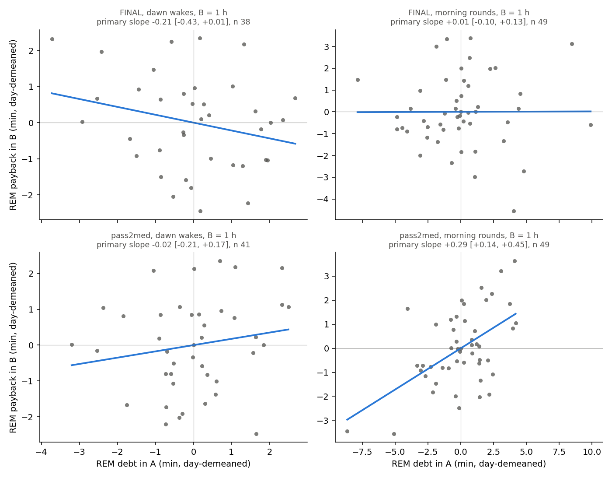

# Sleep behaviour explore — Step D1: natural dawn wakes, and the two measurement functions (cohort 2026c)

Plan: [implementation_plan/2026-10-08-sleep-behaviour-explore.md](../../../../implementation_plan/2026-10-08-sleep-behaviour-explore.md) (sections 1, 3, 5 Step D and Step E (vi); the pass rules are the plan's, unchanged). Driver `ephys/sleep_explore_d.py stepD1` (commit 191d92c+dirty); bulk `D:\Field2026_analysis_out\2026c\sleep_explore_D1_20261009_0802`; scorings FINAL, pass2med; runtime 1.6 min. Step A report: [ephys_spikes_sleep_explore_A_2026c.md](ephys_spikes_sleep_explore_A_2026c.md).

**Status: Step D1 only.** D1 is the first half of the plan's Step D rule for "a slow REM deficit exists" (D1 slope > 0.2, p < 0.05, ≥ 4/4 rats AND the D2 simulated slope < 0.1); D2 (the step-B model simulated without D) is run by the main session with `payback_from_records`. Claim statuses change in the claim audit, not here. Inputs: the scored 1-s states (FINAL, pass2med), NOAA light, the Phase-0 gap table. No LFP features. Everything from 2026-09-11 19:40 is cut.

## Verdict

**D1 (natural dawn wakes, pass2med, the plan's rule): NOT MET** — 1 h: NOT MET; 3 h: INCONCLUSIVE.

- Primary model (day-demeaned, pay_rem ~ debt_rem + debt_nrem + onset + animal FE), B = 1 h, pass2med: -0.022 [-0.213, +0.169], p 0.8233, n 41 windows, 4/6 rats positive. Without the covariates: +0.147 [-0.091, +0.385], p 0.2262.
- The same model on the morning ROUND windows (B = 1 h, pass2med): +0.294 [+0.135, +0.454], p 0.0003 (A4's specification without covariates: +0.335 [+0.175, +0.496], p 0.0000). The round payback survives the NREM-debt and main-sleep-onset covariates; the dawn-wake slope is not significant with or without them.
- Sensitivities (not in the rule), pass2med, 1 h, primary model: 10-min-bin windows -0.174 [-0.422, +0.073], p 0.1677; window A including the wake -0.029 [-0.354, +0.296], p 0.8606. Exact-second vs 10-min-bin windows (pass2med, 1 h): debt r = 0.99, payback r = 0.86.
- Power caveat: the dawn-wake debts are small. Window A lies in the dark, where 3 h hold only 1.5 min of expected REM (rounds 7.6 min); the day-demeaned REM debt has SD 1.30 min vs 2.46 min for the morning rounds. The primary CI excludes the 0.2 threshold; the covariate-free CI reaches the round slope (+0.34).
- `payback_from_records` reproduces A4 exactly on the real data (table below: max |Δ slope| 7.9e-13, every window count and per-animal sign equal, both scorings, both baselines).
- `budget_from_records` reproduces the #13 drift check: with the Phase-3b (common-day) baselines the per-animal-night deviations equal Phase 3b's to 1.4e-11 min per recorded h and the slopes equal `check_drift.py`'s; with the plan's phase × day baselines (the function's default, what Step E (vi) will use) the day-FE slope is ≈ 0 for both quantities and scorings (FINAL NREM -0.12 [-0.53, +0.29], p 0.5553; FINAL REM -0.36 [-1.82, +1.09], p 0.6185; pass2med NREM -0.10 [-0.31, +0.11], p 0.3435; pass2med REM -0.03 [-0.96, +0.89], p 0.9411). **The day term matters for Step E (vi):** with a linear day term instead of day fixed effects, NREM stays ≈ 0 but REM is negative (FINAL NREM +0.31 [-0.06, +0.67], p 0.0994; FINAL REM -1.16 [-1.74, -0.58], p 0.0001; pass2med NREM -0.06 [-0.31, +0.19], p 0.6279; pass2med REM -0.49 [-0.96, -0.02], p 0.0398); apply the same term to the observed and the simulated records.
- Runtime per call (this PC, one process): payback 2.9 s cold / 1.3 s with `bins=`; budget 1.6 s cold / 0.04 s with `bins=`; `baseline_bins` 1.6 s.

Rule per horizon (the primary model; `role` says which rows decide: the round rows apply D1's rule to the morning rounds only for comparison — A4's own rule had no per-rat condition and is met on pass2med):

| scores | windows | role | B_h | rule | detail | slope | ci_lo | ci_hi | p | n_windows | rats_qualifying | rats_positive |
|---|---|---|---|---|---|---|---|---|---|---|---|---|
| FINAL | dawn wakes | D1, reported | 1 | NOT MET | slope -0.213 (<= 0.2), p 0.0583 (>= 0.05), rats positive 2/6 (not all) | -0.213 | -0.434 | 0.008 | 0.058 | 38 | 6 | 2 |
| FINAL | dawn wakes | D1, reported | 3 | INCONCLUSIVE | 9 windows, 2 rats with >= 3 windows (needs >= 10 and >= 4) | nan | nan | nan | nan | 9 | 2 | 0 |
| FINAL | morning rounds | comparison (D1 rule applied to rounds) | 1 | NOT MET | slope +0.015 (<= 0.2), p 0.7994 (>= 0.05), rats positive 3/6 (not all) | 0.015 | -0.098 | 0.127 | 0.799 | 49 | 6 | 3 |
| FINAL | morning rounds | comparison (D1 rule applied to rounds) | 3 | NOT MET | slope -0.115 (<= 0.2), p 0.7099 (>= 0.05), rats positive 2/6 (not all) | -0.115 | -0.722 | 0.491 | 0.71 | 49 | 6 | 2 |
| pass2med | dawn wakes | D1 verdict | 1 | NOT MET | slope -0.022 (<= 0.2), p 0.8233 (>= 0.05), rats positive 4/6 (not all) | -0.022 | -0.213 | 0.169 | 0.823 | 41 | 6 | 4 |
| pass2med | dawn wakes | D1 verdict | 3 | INCONCLUSIVE | 9 windows, 2 rats with >= 3 windows (needs >= 10 and >= 4) | nan | nan | nan | nan | 9 | 2 | 2 |
| pass2med | morning rounds | comparison (D1 rule applied to rounds) | 1 | NOT MET | slope +0.294 (> 0.2), p 0.0003 (< 0.05), rats positive 5/6 (not all) | 0.294 | 0.135 | 0.454 | 0.0 | 49 | 6 | 5 |
| pass2med | morning rounds | comparison (D1 rule applied to rounds) | 3 | NOT MET | slope +0.862 (> 0.2), p 0.0050 (< 0.05), rats positive 5/6 (not all) | 0.862 | 0.26 | 1.463 | 0.005 | 49 | 6 | 5 |

## Definitions

Time is field-PC local time. States per second: $s_t \in \{0\ \text{unknown}, 1\ \text{WAKE}, 3\ \text{NREM}, 5\ \text{REM}\}$. Animals $a$; blocks $k$ = day-half blocks of `sleep_cycles_v2.build_records` (record start 06–18 h → D, else N).

- **Record.** Sessions of an animal joined across splits ≤ 60 s (unknown seconds in between); FINAL exclusions and the cut at 2026-09-11 19:40 (`sleep_schedule.included_sessions`). Same session set under both scorings.
- **Scorings.** FINAL = `states_1s_final`; pass2med = `states_1s_pass2med` (`pass2med_remclean`, fixed per-animal thresholds), the scoring claim #10 is scoped to (plan section 1: the two sides of a round or a wake are compared against different parts of the record).
- **Bout.** A maximal run of one state value, $[a, b)$ in seconds of the record; length $d = b - a$.
- **Dark.** $\text{dark}(t) = \neg[\text{sunrise}(t) \le t < \text{sunset}(t)]$, NOAA times at the field site (`sleep_quant.sun_times`).
- **Harmonics.** $(\sin, \cos)(2\pi j h / 24)$, $j = 1, 2$, $h$ = clock hour (decimal).

### Shared by the three measurements
- **10-min bins** (`sleep_schedule_phase2.bins10`). Bin $i$ of a record covers its seconds $[600i, 600i + 600)$ (the trailing < 10 min is not binned): $\text{rec}_i$ = known seconds, $\text{REM}_i$, $\text{NREM}_i$ = seconds in the state, $\text{on}_i$ = REM onsets (a REM second whose predecessor in the bin is a known non-REM second). REM bouts whose neighbours are known give the durations $\text{dur}_j$.
- **Baselines, phase × day** (plan section 3; `sleep_explore.baselines_d`). Leave-one-block-out (bins of block $k$ are predicted from a fit on all other blocks): $\text{logit}\,\pi^{X}_i = x_i^\top\beta_X$ for $X \in \{\text{REM}, \text{NREM}\}$, binomial on the share $X_i/\text{rec}_i$ with weights $\text{rec}_i$; $\ln E[\text{on}_i] = x_i^\top\beta_o + \ln(\text{rec}_i/600)$ (Poisson); $\ln \text{dur}_j = x_j^\top\beta_d + \varepsilon_j$ (OLS, smearing factor $\overline{e^{\hat\varepsilon}}$). $x = [1, \text{harmonics}, \text{day}, \text{dark}, \text{dark} \times \text{day}, \text{animal dummies}]$, day = days since 2026-08-30 19:00, dark at the bin midpoint (bout onset for durations). Expected: $E[X_i] = \text{rec}_i\,\hat\pi^X_i$, $E[\text{on}_i]$, $E[\text{dur}]_i$. **Common day** (Phase 2, `phase2.baselines`): the same without dark and dark × day.
- **Engine.** `numpy` = the same GLMs by iteratively reweighted least squares in numpy (started as statsmodels, converged on the coefficients to $10^{-10}$); `statsmodels` = the original functions. Their equality is checked below.
- **Debt and payback** (min; s for durations). For a pair of windows (A before, B after): $\text{debt}_{REM} = \sum_A E[\text{REM}] - \sum_A \text{REM}$, $\text{pay}_{REM} = \sum_B \text{REM} - \sum_B E[\text{REM}]$; the same for NREM; $\text{pay}_n$ = REM onsets in B minus expected; $\text{pay}_{dur}$ = mean REM bout duration in B minus the onset-weighted expected duration. A positive slope of pay on debt = more REM after a larger shortfall.
- **Pay models.** OLS $\text{pay}_w = \alpha_{a(w)} + \beta\,\text{debt}_w [+ \gamma\,\text{debt}_{NREM,w} + \delta\,\text{onset}_w] + \varepsilon_w$ with animal fixed effects $\alpha_a$, SEs clustered by the block of window A (`sleep_explore.ols`; HC1 if clustering fails), 95 % CI $= \hat\beta \pm 1.96\,\widehat{se}$. **Day-demeaned**: every variable minus its mean over the windows of the same calendar day (round: gap-start date; dawn wake: wake-start date) before the fit. Fits need ≥ 10 windows.

### `payback_from_records` (= Step A's A4)
- **Round windows** (`phase2.comp_windows`, across-gap branch). For each usable Phase-0 gap $[g_s, g_e)$ (≤ 180 min, ≥ 1 h recorded on both sides) with cause `round_logged` / `round_inferred`: A = $[g_s - 3\,\text{h}, g_s)$, B = $[g_e, g_e + h)$, $h \in \{1, 3\}$ h; a window sums the animal's bins whose start $t$ satisfies $t_0 \le t \le t_1 - 1$ s (any record) and is kept if $\sum \text{rec} \ge 0.8\,(t_1 - t_0)$. Kind = the gap's Phase-0 kind (morning: gap start 05:00–11:00; evening: 15:30–21:30). Outcomes: pay_rem, pay_rem_n, pay_rem_dur on debt_rem; pay_rem on debt_rem + debt_nrem; pay_nrem on debt_nrem; raw and day-demeaned (`sleep_explore.pay_models`). Per-animal signs: per-animal OLS with all the model's predictors, animals with ≥ 4 + k windows.

### `budget_from_records` (= plan Step E vi)
- **Periods.** Night of day $d$ = $[\text{sunset}_d, \text{sunrise}_{d+1})$, the following day = $[\text{sunrise}_{d+1}, \text{sunset}_{d+1})$; a period sums the animal's bins whose start lies in it (as Phase 3b). Coverage = recorded s / period s. Deviation rate $\text{dev}^X = (\sum X - \sum E[X]) / \max(\sum \text{rec}, 1) \times 60$ (min per recorded hour), $X \in$ {REM, NREM}. Animal-nights kept with coverage ≥ 0.5 in both periods.
- **Models** for $y = \text{dev}^X_{day}$, $x = \text{dev}^X_{night}$: (1) within animal $y_{a,d} = \alpha_a + \beta x_{a,d} + \varepsilon$, SEs clustered by night; (2) + a linear experiment-day term, SEs clustered by night; (3) + night fixed effects $\mu_d$ (model-based SEs, as `check_drift.py`). A negative $\beta$ = a night with more than expected is followed by a day with less. Per-animal: simple slope of $y$ on $x$ (≥ 4 nights; for (3) on night-demeaned $x, y$). Drift: $\text{dev} = \alpha_a + \beta\,\text{day} + \varepsilon$ for each period, clustered by night.

### D1: natural dawn wakes
- **Dawn wake.** A WAKE bout $[a, b)$ with $b - a \ge 1800$ s whose end clock hour is in $[5, 9)$ (plan D1, 05:00–09:00), **inside a record**: $a > 0$, $s_{a-1} \ne 0$, $b < n$, $s_b \ne 0$ (known on both sides). **Natural**: no Phase-0 gap of the same animal with cause `round_logged`, `round_inferred` or `probe_move` (handling) overlapping $[t_a - 3\,\text{h}, t_a)$, i.e. $g_e > t_a - 3$ h and $g_s < t_a$.
- **Dawn windows (exact seconds).** A = $[a - 10800, a)$, B = $[b, b + 3600h)$, $h \in \{1, 3\}$, in seconds of the wake's record (seconds outside the record are unrecorded); kept if ≥ 80 % of the window is recorded. Observed = seconds in the state; expected $= \sum_{t \in \text{window}, s_t \ne 0} \hat\pi_{i(t)}$ with $\hat\pi_i = E[X_i]/\text{rec}_i$ of the second's bin $i(t)$ (bins with nothing recorded and the trailing < 10 min take the neighbouring bin's rate); onsets counted at seconds whose predecessor is also in the window; expected onsets $\sum \hat r_{i(t)}$ ($\hat r_i = E[\text{on}_i]/\text{rec}_i$); expected duration $\sum \hat r\,\widehat{\text{dur}} / \sum \hat r$. Block = the record's block.
- **Main-sleep onset.** The first Watson SLEEP episode (no WAKE bout > 120 s and no unknown epoch inside, trimmed to its first and last sleep second, ≥ 20 min; `phase3.episodes_of`) that starts at or after the wake end $b$; $\text{onset}_h$ = its start in decimal clock hours, latency $= (\text{start} - b)/60$ min. Round windows: the first SLEEP episode of the record that starts at the gap end (record start within 5 s of $g_e$); latency from $g_e$. Windows without an onset in the record are dropped from the models that use it.
- **D1 model (plan).** $\text{pay}_{REM} = \alpha_a + \beta\,\text{debt}_{REM} + \gamma\,\text{debt}_{NREM} + \delta\,\text{onset}_h + \varepsilon$, SEs clustered by block; primary = day-demeaned; also without the covariates, and raw. Per-animal: the **simple** slope of $\text{pay}_{REM}$ on $\text{debt}_{REM}$ (rats with ≥ 3 windows; the plan's rats rule) on the same (day-demeaned) data; the **partial** slope with all predictors for rats with ≥ 7 windows (reported only).
- **D1 pass rule (plan, quoted):** \"D1 slope > 0.2 with p < 0.05 and ≥ 4/4 rats with windows\" — operationalised (task): $\hat\beta > 0.2$, $p < 0.05$, at least 4 rats with ≥ 3 windows and all of them with a positive per-animal slope; per horizon (1 h, 3 h; A4 required both). **Inconclusive** when the horizon has < 10 windows or < 4 rats with ≥ 3 windows. The verdict is on pass2med; FINAL is reported.
- **Sensitivity: A includes the wake.** A = $[b - 10800, b)$ (the wake and the time before it), so the REM missed during the wake counts as debt (not in the rule).
- **Sensitivity: 10-min-bin windows.** The same wakes with the round-window rule above (bins of the animal whose start lies in $[t_0, t_1 - 1\,\text{s}]$, any record, ≥ 80 % recorded) instead of exact seconds (not in the rule). Agreement = Pearson $r$ of debt and of payback between the two window versions over the same wakes.
- **Debt spread (power).** $\text{SD}$ over windows of $\text{debt}_{REM}$ and of the day-demeaned $\text{debt}_{REM}$ (min); with the same residual noise, the slope's SE scales as $1/\text{SD}$.
- **role** (verdict table). `D1 verdict` = the dawn rows on pass2med; `D1, reported` = FINAL; `comparison` = D1's rule applied to the morning round windows (A4's own rule had no per-rat condition); `sensitivity` = not in the rule.

## D1 — natural dawn wakes

**Plan (Step D, D1, quoted):** "Natural wakes ≥ 30 min ending 05:00–09:00 without a round; the same debt / payback regression as #10 (fixed thresholds), with NREM debt and the main-sleep onset time as covariates." Pass for "a slow REM deficit exists": "D1 slope > 0.2 with p < 0.05 and ≥ 4/4 rats with windows; and the D2 slope < 0.1."

### Data

Funnel (counts of wakes; the B columns count wakes with a complete A and B window):

| scores | WAKE bouts >= 30 min | ending 05:00-09:00 | inside a record | no round within 3 h | and no probe move (natural) | A >= 80 % recorded | B 1 h >= 80 % | B 3 h >= 80 % | main-sleep onset found |
|---|---|---|---|---|---|---|---|---|---|
| FINAL | 251 | 47 | 46 | 46 | 46 | 46 | 39 | 9 | 42 |
| pass2med | 263 | 46 | 46 | 46 | 46 | 46 | 41 | 9 | 43 |

The dawn wakes (pass2med, natural, with an A window) are long night wakes: length median 165 min (range 30–288); start 00:47 – 05:14 (median 03:10); end 05:06 – 06:27 (median 05:43); sunrise on these days 06:30 – 06:40. Window A therefore lies in the dark and B straddles sunrise. The 3-h B windows are cut by the morning battery round (records end at the round), which leaves few complete 3-h windows.

| scores | windows | B_h | n | animals | sd_debt_rem | sd_debt_rem_day_demeaned | per animal | median_wake_min | median_end_or_gap_end_h | onset_found | median_onset_h | median_onset_latency_min | mean_debt_rem | mean_pay_rem | mean_debt_nrem | mean_A_rem_min | mean_A_e_rem_min |
|---|---|---|---|---|---|---|---|---|---|---|---|---|---|---|---|---|---|
| FINAL | dawn wakes | 1 | 39 | 6 | 1.862 | 1.609 | SF07 6, SF08 8, SF09 7, SF10 7, SF11 3, SF12 8 | 165.8 | 5.809 | 38 | 6.291 | 16.233 | -0.618 | 0.187 | -7.074 | 1.954 | 1.337 |
| FINAL | dawn wakes | 3 | 9 | 5 | 1.151 | 0.93 | SF07 1, SF08 3, SF09 1, SF10 1, SF12 3 | 196.633 | 5.675 | 9 | 6.134 | 18.917 | -0.306 | 2.161 | -14.055 | 1.309 | 1.003 |
| FINAL | morning rounds | 1 | 49 | 6 | 3.485 | 3.251 | SF07 8, SF08 10, SF09 10, SF10 9, SF11 5, SF12 7 | nan | 8.477 | 49 | 8.927 | 26.267 | 0.137 | -2.32 | -7.603 | 6.689 | 6.826 |
| FINAL | morning rounds | 3 | 49 | 6 | 3.485 | 3.251 | SF07 8, SF08 10, SF09 10, SF10 9, SF11 5, SF12 7 | nan | 8.477 | 49 | 8.927 | 26.267 | 0.137 | 0.292 | -7.603 | 6.689 | 6.826 |
| FINAL | dawn wakes, A includes the wake (sensitivity) | 1 | 39 | 6 | 1.562 | 1.434 | SF07 6, SF08 8, SF09 7, SF10 7, SF11 3, SF12 8 | 165.8 | 5.809 | 38 | 6.291 | 16.233 | 0.891 | 0.187 | 20.123 | 1.029 | 1.92 |
| FINAL | dawn wakes, A includes the wake (sensitivity) | 3 | 9 | 5 | 1.102 | 1.036 | SF07 1, SF08 3, SF09 1, SF10 1, SF12 3 | 196.633 | 5.675 | 9 | 6.134 | 18.917 | 1.054 | 2.161 | 20.842 | 0.561 | 1.615 |
| FINAL | dawn wakes, 10-min-bin windows (sensitivity) | 1 | 37 | 6 | 1.874 | 1.586 | SF07 4, SF08 8, SF09 7, SF10 7, SF11 3, SF12 8 | 158.2 | 5.803 | 36 | 6.253 | 16.233 | -0.547 | 0.365 | -6.427 | 1.945 | 1.398 |
| FINAL | dawn wakes, 10-min-bin windows (sensitivity) | 3 | 6 | 4 | 1.338 | 1.072 | SF07 1, SF08 2, SF09 1, SF12 2 | 156.958 | 5.375 | 6 | 5.861 | 20.267 | -0.235 | 0.092 | -14.769 | 1.428 | 1.193 |
| pass2med | dawn wakes | 1 | 41 | 6 | 1.748 | 1.301 | SF07 6, SF08 9, SF09 8, SF10 7, SF11 4, SF12 7 | 165.0 | 5.717 | 41 | 6.169 | 10.5 | -0.365 | 0.111 | -5.168 | 1.828 | 1.463 |
| pass2med | dawn wakes | 3 | 9 | 5 | 1.127 | 0.702 | SF07 1, SF08 3, SF09 1, SF10 1, SF12 3 | 144.783 | 5.573 | 9 | 5.87 | 17.083 | -0.005 | 4.096 | -5.022 | 1.2 | 1.195 |
| pass2med | morning rounds | 1 | 49 | 6 | 3.166 | 2.46 | SF07 8, SF08 10, SF09 10, SF10 9, SF11 5, SF12 7 | nan | 8.477 | 49 | 8.918 | 25.883 | -0.695 | -2.831 | -9.155 | 8.271 | 7.576 |
| pass2med | morning rounds | 3 | 49 | 6 | 3.166 | 2.46 | SF07 8, SF08 10, SF09 10, SF10 9, SF11 5, SF12 7 | nan | 8.477 | 49 | 8.918 | 25.883 | -0.695 | -0.804 | -9.155 | 8.271 | 7.576 |
| pass2med | dawn wakes, A includes the wake (sensitivity) | 1 | 41 | 6 | 1.497 | 1.353 | SF07 6, SF08 9, SF09 8, SF10 7, SF11 4, SF12 7 | 165.0 | 5.717 | 41 | 6.169 | 10.5 | 1.151 | 0.111 | 21.721 | 1.005 | 2.156 |
| pass2med | dawn wakes, A includes the wake (sensitivity) | 3 | 9 | 5 | 1.072 | 1.003 | SF07 1, SF08 3, SF09 1, SF10 1, SF12 3 | 144.783 | 5.573 | 9 | 5.87 | 17.083 | 1.264 | 4.096 | 23.245 | 0.594 | 1.859 |
| pass2med | dawn wakes, 10-min-bin windows (sensitivity) | 1 | 38 | 6 | 1.788 | 1.335 | SF07 5, SF08 8, SF09 7, SF10 7, SF11 4, SF12 7 | 140.633 | 5.682 | 38 | 6.192 | 15.05 | -0.333 | 0.331 | -4.845 | 1.882 | 1.549 |
| pass2med | dawn wakes, 10-min-bin windows (sensitivity) | 3 | 7 | 5 | 1.213 | 0.66 | SF07 1, SF08 2, SF09 1, SF10 1, SF12 2 | 107.5 | 5.378 | 7 | 5.849 | 21.75 | 0.026 | 3.836 | -4.66 | 1.336 | 1.362 |

### Models (dawn windows; the primary row is day-demeaned with both covariates)

| scores | windows | B_h | outcome | predictors | day_demeaned | n_windows | animals_with_windows | clusters | slope | ci_lo | ci_hi | p | coef_debt_nrem | p_debt_nrem | coef_onset_h | p_onset_h | rats_qualifying | rats_positive | rats_partial | rats_partial_positive |
|---|---|---|---|---|---|---|---|---|---|---|---|---|---|---|---|---|---|---|---|---|
| FINAL | dawn wakes | 1 | pay_rem | debt_rem | False | 39 | 6 | 10 | 0.028 | -0.223 | 0.279 | 0.827 | nan | nan | nan | nan | 6 | 2 | 5 | 2 |
| FINAL | dawn wakes | 1 | pay_rem | debt_rem | True | 39 | 6 | 10 | -0.045 | -0.358 | 0.268 | 0.777 | nan | nan | nan | nan | 6 | 3 | 5 | 3 |
| FINAL | dawn wakes | 1 | pay_rem | debt_rem + debt_nrem | False | 39 | 6 | 10 | -0.057 | -0.282 | 0.167 | 0.616 | 0.016 | 0.246 | nan | nan | 6 | 2 | 5 | 2 |
| FINAL | dawn wakes | 1 | pay_rem | debt_rem + debt_nrem | True | 39 | 6 | 10 | -0.065 | -0.308 | 0.179 | 0.604 | 0.008 | 0.778 | nan | nan | 6 | 3 | 5 | 2 |
| FINAL | dawn wakes | 1 | pay_rem | debt_rem + debt_nrem + onset_h | False | 38 | 6 | 10 | -0.166 | -0.38 | 0.048 | 0.129 | 0.022 | 0.164 | -0.757 | 0.042 | 6 | 2 | 3 | 0 |
| FINAL | dawn wakes | 1 | pay_rem | debt_rem + debt_nrem + onset_h | True | 38 | 6 | 10 | -0.213 | -0.434 | 0.008 | 0.058 | 0.004 | 0.875 | -0.541 | 0.386 | 6 | 2 | 3 | 0 |
| FINAL | dawn wakes | 1 | pay_nrem | debt_nrem | False | 39 | 6 | 10 | -0.109 | -0.25 | 0.032 | 0.131 | nan | nan | nan | nan | 6 | 0 | 5 | 0 |
| FINAL | dawn wakes | 1 | pay_nrem | debt_nrem | True | 39 | 6 | 10 | -0.088 | -0.315 | 0.14 | 0.45 | nan | nan | nan | nan | 6 | 2 | 5 | 2 |
| FINAL | dawn wakes | 3 | pay_rem | debt_rem | False | 9 | 5 | 3 | nan | nan | nan | nan | nan | nan | nan | nan | 2 | 1 | 0 | 0 |
| FINAL | dawn wakes | 3 | pay_rem | debt_rem | True | 9 | 5 | 3 | nan | nan | nan | nan | nan | nan | nan | nan | 2 | 0 | 0 | 0 |
| FINAL | dawn wakes | 3 | pay_rem | debt_rem + debt_nrem | False | 9 | 5 | 3 | nan | nan | nan | nan | nan | nan | nan | nan | 2 | 1 | 0 | 0 |
| FINAL | dawn wakes | 3 | pay_rem | debt_rem + debt_nrem | True | 9 | 5 | 3 | nan | nan | nan | nan | nan | nan | nan | nan | 2 | 0 | 0 | 0 |
| FINAL | dawn wakes | 3 | pay_rem | debt_rem + debt_nrem + onset_h | False | 9 | 5 | 3 | nan | nan | nan | nan | nan | nan | nan | nan | 2 | 1 | 0 | 0 |
| FINAL | dawn wakes | 3 | pay_rem | debt_rem + debt_nrem + onset_h | True | 9 | 5 | 3 | nan | nan | nan | nan | nan | nan | nan | nan | 2 | 0 | 0 | 0 |
| FINAL | dawn wakes | 3 | pay_nrem | debt_nrem | False | 9 | 5 | 3 | nan | nan | nan | nan | nan | nan | nan | nan | 2 | 1 | 0 | 0 |
| FINAL | dawn wakes | 3 | pay_nrem | debt_nrem | True | 9 | 5 | 3 | nan | nan | nan | nan | nan | nan | nan | nan | 2 | 0 | 0 | 0 |
| pass2med | dawn wakes | 1 | pay_rem | debt_rem | False | 41 | 6 | 11 | 0.154 | -0.152 | 0.459 | 0.325 | nan | nan | nan | nan | 6 | 5 | 5 | 5 |
| pass2med | dawn wakes | 1 | pay_rem | debt_rem | True | 41 | 6 | 11 | 0.147 | -0.091 | 0.385 | 0.226 | nan | nan | nan | nan | 6 | 4 | 5 | 4 |
| pass2med | dawn wakes | 1 | pay_rem | debt_rem + debt_nrem | False | 41 | 6 | 11 | 0.073 | -0.23 | 0.377 | 0.637 | 0.013 | 0.43 | nan | nan | 6 | 5 | 5 | 3 |
| pass2med | dawn wakes | 1 | pay_rem | debt_rem + debt_nrem | True | 41 | 6 | 11 | 0.098 | -0.174 | 0.369 | 0.481 | 0.015 | 0.556 | nan | nan | 6 | 4 | 5 | 4 |
| pass2med | dawn wakes | 1 | pay_rem | debt_rem + debt_nrem + onset_h | False | 41 | 6 | 11 | 0.072 | -0.141 | 0.285 | 0.507 | 0.012 | 0.442 | -1.978 | 0.0 | 6 | 5 | 4 | 1 |
| pass2med | dawn wakes | 1 | pay_rem | debt_rem + debt_nrem + onset_h | True | 41 | 6 | 11 | -0.022 | -0.213 | 0.169 | 0.823 | 0.017 | 0.456 | -1.635 | 0.0 | 6 | 4 | 4 | 3 |
| pass2med | dawn wakes | 1 | pay_nrem | debt_nrem | False | 41 | 6 | 11 | -0.073 | -0.23 | 0.083 | 0.357 | nan | nan | nan | nan | 6 | 2 | 5 | 1 |
| pass2med | dawn wakes | 1 | pay_nrem | debt_nrem | True | 41 | 6 | 11 | -0.017 | -0.217 | 0.183 | 0.869 | nan | nan | nan | nan | 6 | 2 | 5 | 1 |
| pass2med | dawn wakes | 3 | pay_rem | debt_rem | False | 9 | 5 | 3 | nan | nan | nan | nan | nan | nan | nan | nan | 2 | 2 | 0 | 0 |
| pass2med | dawn wakes | 3 | pay_rem | debt_rem | True | 9 | 5 | 3 | nan | nan | nan | nan | nan | nan | nan | nan | 2 | 2 | 0 | 0 |
| pass2med | dawn wakes | 3 | pay_rem | debt_rem + debt_nrem | False | 9 | 5 | 3 | nan | nan | nan | nan | nan | nan | nan | nan | 2 | 2 | 0 | 0 |
| pass2med | dawn wakes | 3 | pay_rem | debt_rem + debt_nrem | True | 9 | 5 | 3 | nan | nan | nan | nan | nan | nan | nan | nan | 2 | 2 | 0 | 0 |
| pass2med | dawn wakes | 3 | pay_rem | debt_rem + debt_nrem + onset_h | False | 9 | 5 | 3 | nan | nan | nan | nan | nan | nan | nan | nan | 2 | 2 | 0 | 0 |
| pass2med | dawn wakes | 3 | pay_rem | debt_rem + debt_nrem + onset_h | True | 9 | 5 | 3 | nan | nan | nan | nan | nan | nan | nan | nan | 2 | 2 | 0 | 0 |
| pass2med | dawn wakes | 3 | pay_nrem | debt_nrem | False | 9 | 5 | 3 | nan | nan | nan | nan | nan | nan | nan | nan | 2 | 1 | 0 | 0 |
| pass2med | dawn wakes | 3 | pay_nrem | debt_nrem | True | 9 | 5 | 3 | nan | nan | nan | nan | nan | nan | nan | nan | 2 | 0 | 0 | 0 |

### The morning round windows with the same covariates (comparison)

| scores | windows | B_h | outcome | predictors | day_demeaned | n_windows | animals_with_windows | clusters | slope | ci_lo | ci_hi | p | coef_debt_nrem | p_debt_nrem | coef_onset_h | p_onset_h | rats_qualifying | rats_positive | rats_partial | rats_partial_positive |
|---|---|---|---|---|---|---|---|---|---|---|---|---|---|---|---|---|---|---|---|---|
| FINAL | morning rounds | 1 | pay_rem | debt_rem | False | 49 | 6 | 12 | 0.087 | -0.1 | 0.273 | 0.362 | nan | nan | nan | nan | 6 | 5 | 6 | 5 |
| FINAL | morning rounds | 1 | pay_rem | debt_rem | True | 49 | 6 | 12 | 0.04 | -0.141 | 0.221 | 0.664 | nan | nan | nan | nan | 6 | 3 | 6 | 3 |
| FINAL | morning rounds | 1 | pay_rem | debt_rem + debt_nrem | False | 49 | 6 | 12 | 0.065 | -0.061 | 0.19 | 0.312 | 0.036 | 0.127 | nan | nan | 6 | 5 | 5 | 3 |
| FINAL | morning rounds | 1 | pay_rem | debt_rem + debt_nrem | True | 49 | 6 | 12 | 0.04 | -0.149 | 0.229 | 0.676 | 0.001 | 0.97 | nan | nan | 6 | 3 | 5 | 3 |
| FINAL | morning rounds | 1 | pay_rem | debt_rem + debt_nrem + onset_h | False | 49 | 6 | 12 | 0.051 | -0.112 | 0.214 | 0.541 | 0.018 | 0.509 | -0.67 | 0.446 | 6 | 5 | 5 | 4 |
| FINAL | morning rounds | 1 | pay_rem | debt_rem + debt_nrem + onset_h | True | 49 | 6 | 12 | 0.015 | -0.098 | 0.127 | 0.799 | -0.005 | 0.739 | -6.138 | 0.016 | 6 | 3 | 5 | 4 |
| FINAL | morning rounds | 1 | pay_nrem | debt_nrem | False | 49 | 6 | 12 | 0.13 | -0.007 | 0.268 | 0.064 | nan | nan | nan | nan | 6 | 5 | 6 | 5 |
| FINAL | morning rounds | 1 | pay_nrem | debt_nrem | True | 49 | 6 | 12 | 0.045 | -0.115 | 0.206 | 0.578 | nan | nan | nan | nan | 6 | 5 | 6 | 5 |
| FINAL | morning rounds | 3 | pay_rem | debt_rem | False | 49 | 6 | 12 | 0.174 | -0.568 | 0.915 | 0.646 | nan | nan | nan | nan | 6 | 4 | 6 | 4 |
| FINAL | morning rounds | 3 | pay_rem | debt_rem | True | 49 | 6 | 12 | -0.062 | -0.819 | 0.694 | 0.872 | nan | nan | nan | nan | 6 | 2 | 6 | 2 |
| FINAL | morning rounds | 3 | pay_rem | debt_rem + debt_nrem | False | 49 | 6 | 12 | 0.119 | -0.442 | 0.68 | 0.677 | 0.089 | 0.05 | nan | nan | 6 | 4 | 5 | 3 |
| FINAL | morning rounds | 3 | pay_rem | debt_rem + debt_nrem | True | 49 | 6 | 12 | -0.055 | -0.797 | 0.687 | 0.884 | 0.025 | 0.617 | nan | nan | 6 | 2 | 5 | 3 |
| FINAL | morning rounds | 3 | pay_rem | debt_rem + debt_nrem + onset_h | False | 49 | 6 | 12 | 0.059 | -0.62 | 0.738 | 0.864 | 0.011 | 0.822 | -2.905 | 0.101 | 6 | 4 | 5 | 3 |
| FINAL | morning rounds | 3 | pay_rem | debt_rem + debt_nrem + onset_h | True | 49 | 6 | 12 | -0.115 | -0.722 | 0.491 | 0.71 | 0.012 | 0.743 | -14.314 | 0.059 | 6 | 2 | 5 | 3 |
| FINAL | morning rounds | 3 | pay_nrem | debt_nrem | False | 49 | 6 | 12 | 0.168 | -0.049 | 0.384 | 0.129 | nan | nan | nan | nan | 6 | 5 | 6 | 5 |
| FINAL | morning rounds | 3 | pay_nrem | debt_nrem | True | 49 | 6 | 12 | 0.086 | -0.148 | 0.321 | 0.472 | nan | nan | nan | nan | 6 | 4 | 6 | 4 |
| pass2med | morning rounds | 1 | pay_rem | debt_rem | False | 49 | 6 | 12 | 0.397 | 0.23 | 0.565 | 0.0 | nan | nan | nan | nan | 6 | 6 | 6 | 6 |
| pass2med | morning rounds | 1 | pay_rem | debt_rem | True | 49 | 6 | 12 | 0.335 | 0.175 | 0.496 | 0.0 | nan | nan | nan | nan | 6 | 5 | 6 | 5 |
| pass2med | morning rounds | 1 | pay_rem | debt_rem + debt_nrem | False | 49 | 6 | 12 | 0.374 | 0.168 | 0.581 | 0.0 | 0.008 | 0.825 | nan | nan | 6 | 6 | 5 | 5 |
| pass2med | morning rounds | 1 | pay_rem | debt_rem + debt_nrem | True | 49 | 6 | 12 | 0.32 | 0.129 | 0.512 | 0.001 | 0.018 | 0.462 | nan | nan | 6 | 5 | 5 | 3 |
| pass2med | morning rounds | 1 | pay_rem | debt_rem + debt_nrem + onset_h | False | 49 | 6 | 12 | 0.371 | 0.158 | 0.584 | 0.001 | 0.002 | 0.944 | -0.156 | 0.818 | 6 | 6 | 5 | 2 |
| pass2med | morning rounds | 1 | pay_rem | debt_rem + debt_nrem + onset_h | True | 49 | 6 | 12 | 0.294 | 0.135 | 0.454 | 0.0 | 0.002 | 0.918 | -4.988 | 0.041 | 6 | 5 | 5 | 4 |
| pass2med | morning rounds | 1 | pay_nrem | debt_nrem | False | 49 | 6 | 12 | 0.163 | 0.033 | 0.293 | 0.014 | nan | nan | nan | nan | 6 | 5 | 6 | 5 |
| pass2med | morning rounds | 1 | pay_nrem | debt_nrem | True | 49 | 6 | 12 | 0.167 | -0.005 | 0.339 | 0.057 | nan | nan | nan | nan | 6 | 5 | 6 | 5 |
| pass2med | morning rounds | 3 | pay_rem | debt_rem | False | 49 | 6 | 12 | 0.743 | 0.461 | 1.026 | 0.0 | nan | nan | nan | nan | 6 | 4 | 6 | 4 |
| pass2med | morning rounds | 3 | pay_rem | debt_rem | True | 49 | 6 | 12 | 0.961 | 0.47 | 1.451 | 0.0 | nan | nan | nan | nan | 6 | 5 | 6 | 5 |
| pass2med | morning rounds | 3 | pay_rem | debt_rem + debt_nrem | False | 49 | 6 | 12 | 0.594 | -0.009 | 1.197 | 0.054 | 0.05 | 0.51 | nan | nan | 6 | 4 | 5 | 2 |
| pass2med | morning rounds | 3 | pay_rem | debt_rem + debt_nrem | True | 49 | 6 | 12 | 0.893 | 0.288 | 1.498 | 0.004 | 0.081 | 0.026 | nan | nan | 6 | 5 | 5 | 5 |
| pass2med | morning rounds | 3 | pay_rem | debt_rem + debt_nrem + onset_h | False | 49 | 6 | 12 | 0.591 | -0.05 | 1.231 | 0.071 | 0.044 | 0.457 | -0.158 | 0.918 | 6 | 4 | 5 | 2 |
| pass2med | morning rounds | 3 | pay_rem | debt_rem + debt_nrem + onset_h | True | 49 | 6 | 12 | 0.862 | 0.26 | 1.463 | 0.005 | 0.061 | 0.031 | -6.003 | 0.063 | 6 | 5 | 5 | 5 |
| pass2med | morning rounds | 3 | pay_nrem | debt_nrem | False | 49 | 6 | 12 | 0.318 | 0.181 | 0.456 | 0.0 | nan | nan | nan | nan | 6 | 6 | 6 | 6 |
| pass2med | morning rounds | 3 | pay_nrem | debt_nrem | True | 49 | 6 | 12 | 0.238 | 0.071 | 0.405 | 0.005 | nan | nan | nan | nan | 6 | 5 | 6 | 5 |

### Per animal (primary model, day-demeaned; simple = pay_rem on debt_rem, the rats rule; partial = all predictors)

| scores | windows | B_h | animal | n_windows | simple_slope | partial_slope |
|---|---|---|---|---|---|---|
| FINAL | dawn wakes | 1 | SF07 | 6 | 0.211 | nan |
| FINAL | dawn wakes | 1 | SF08 | 8 | -0.48 | -0.808 |
| FINAL | dawn wakes | 1 | SF09 | 7 | -0.177 | -0.186 |
| FINAL | dawn wakes | 1 | SF10 | 6 | 0.158 | nan |
| FINAL | dawn wakes | 1 | SF11 | 3 | -0.725 | nan |
| FINAL | dawn wakes | 1 | SF12 | 8 | -0.25 | -0.063 |
| FINAL | dawn wakes | 3 | SF07 | 1 | nan | nan |
| FINAL | dawn wakes | 3 | SF08 | 3 | -0.354 | nan |
| FINAL | dawn wakes | 3 | SF09 | 1 | nan | nan |
| FINAL | dawn wakes | 3 | SF10 | 1 | nan | nan |
| FINAL | dawn wakes | 3 | SF12 | 3 | -4.876 | nan |
| FINAL | morning rounds | 1 | SF07 | 8 | 0.038 | 0.095 |
| FINAL | morning rounds | 1 | SF08 | 10 | -0.183 | 0.171 |
| FINAL | morning rounds | 1 | SF09 | 10 | 0.269 | 0.155 |
| FINAL | morning rounds | 1 | SF10 | 9 | 0.012 | 0.089 |
| FINAL | morning rounds | 1 | SF11 | 5 | -0.132 | nan |
| FINAL | morning rounds | 1 | SF12 | 7 | -0.058 | -0.093 |
| FINAL | morning rounds | 3 | SF07 | 8 | -0.033 | 0.356 |
| FINAL | morning rounds | 3 | SF08 | 10 | -0.957 | -0.154 |
| FINAL | morning rounds | 3 | SF09 | 10 | 0.742 | 0.892 |
| FINAL | morning rounds | 3 | SF10 | 9 | 0.472 | 0.23 |
| FINAL | morning rounds | 3 | SF11 | 5 | -1.288 | nan |
| FINAL | morning rounds | 3 | SF12 | 7 | -0.399 | -0.506 |
| pass2med | dawn wakes | 1 | SF07 | 6 | 0.362 | nan |
| pass2med | dawn wakes | 1 | SF08 | 9 | 0.226 | 0.046 |
| pass2med | dawn wakes | 1 | SF09 | 8 | -0.0 | -0.211 |
| pass2med | dawn wakes | 1 | SF10 | 7 | 0.122 | 0.406 |
| pass2med | dawn wakes | 1 | SF11 | 4 | -0.39 | nan |
| pass2med | dawn wakes | 1 | SF12 | 7 | 0.679 | 0.788 |
| pass2med | dawn wakes | 3 | SF07 | 1 | nan | nan |
| pass2med | dawn wakes | 3 | SF08 | 3 | 2.774 | nan |
| pass2med | dawn wakes | 3 | SF09 | 1 | nan | nan |
| pass2med | dawn wakes | 3 | SF10 | 1 | nan | nan |
| pass2med | dawn wakes | 3 | SF12 | 3 | 1.461 | nan |
| pass2med | morning rounds | 1 | SF07 | 8 | 0.005 | 0.04 |
| pass2med | morning rounds | 1 | SF08 | 10 | 0.498 | 0.491 |
| pass2med | morning rounds | 1 | SF09 | 10 | 0.358 | 0.397 |
| pass2med | morning rounds | 1 | SF10 | 9 | 0.358 | 0.326 |
| pass2med | morning rounds | 1 | SF11 | 5 | -0.047 | nan |
| pass2med | morning rounds | 1 | SF12 | 7 | 0.081 | -0.002 |
| pass2med | morning rounds | 3 | SF07 | 8 | 0.71 | 0.332 |
| pass2med | morning rounds | 3 | SF08 | 10 | 1.531 | 1.571 |
| pass2med | morning rounds | 3 | SF09 | 10 | 0.592 | 0.797 |
| pass2med | morning rounds | 3 | SF10 | 9 | 1.047 | 0.772 |
| pass2med | morning rounds | 3 | SF11 | 5 | -1.434 | nan |
| pass2med | morning rounds | 3 | SF12 | 7 | 1.527 | 1.055 |

### Sensitivity: window A includes the wake (not in the rule)

A = the 3 h before the wake END, so REM missed during the wake counts as debt (debt then mostly measures the wake's own expected REM).

| scores | windows | B_h | outcome | predictors | day_demeaned | n_windows | animals_with_windows | clusters | slope | ci_lo | ci_hi | p | coef_debt_nrem | p_debt_nrem | coef_onset_h | p_onset_h | rats_qualifying | rats_positive | rats_partial | rats_partial_positive |
|---|---|---|---|---|---|---|---|---|---|---|---|---|---|---|---|---|---|---|---|---|
| FINAL | dawn wakes, A includes the wake (sensitivity) | 1 | pay_rem | debt_rem | False | 39 | 6 | 10 | 0.073 | -0.385 | 0.53 | 0.755 | nan | nan | nan | nan | 6 | 3 | 5 | 3 |
| FINAL | dawn wakes, A includes the wake (sensitivity) | 1 | pay_rem | debt_rem | True | 39 | 6 | 10 | -0.084 | -0.532 | 0.364 | 0.714 | nan | nan | nan | nan | 6 | 2 | 5 | 2 |
| FINAL | dawn wakes, A includes the wake (sensitivity) | 1 | pay_rem | debt_rem + debt_nrem | False | 39 | 6 | 10 | 0.334 | 0.037 | 0.631 | 0.028 | -0.056 | 0.006 | nan | nan | 6 | 3 | 5 | 4 |
| FINAL | dawn wakes, A includes the wake (sensitivity) | 1 | pay_rem | debt_rem + debt_nrem | True | 39 | 6 | 10 | 0.166 | -0.059 | 0.392 | 0.148 | -0.051 | 0.018 | nan | nan | 6 | 2 | 5 | 3 |
| FINAL | dawn wakes, A includes the wake (sensitivity) | 1 | pay_rem | debt_rem + debt_nrem + onset_h | False | 38 | 6 | 10 | 0.177 | -0.364 | 0.717 | 0.522 | -0.049 | 0.04 | -0.662 | 0.151 | 6 | 2 | 3 | 2 |
| FINAL | dawn wakes, A includes the wake (sensitivity) | 1 | pay_rem | debt_rem + debt_nrem + onset_h | True | 38 | 6 | 10 | -0.104 | -0.41 | 0.202 | 0.506 | -0.032 | 0.18 | -0.844 | 0.227 | 6 | 0 | 3 | 1 |
| FINAL | dawn wakes, A includes the wake (sensitivity) | 1 | pay_nrem | debt_nrem | False | 39 | 6 | 10 | 0.044 | -0.189 | 0.278 | 0.71 | nan | nan | nan | nan | 6 | 4 | 5 | 3 |
| FINAL | dawn wakes, A includes the wake (sensitivity) | 1 | pay_nrem | debt_nrem | True | 39 | 6 | 10 | -0.073 | -0.281 | 0.134 | 0.489 | nan | nan | nan | nan | 6 | 3 | 5 | 2 |
| FINAL | dawn wakes, A includes the wake (sensitivity) | 3 | pay_rem | debt_rem | False | 9 | 5 | 3 | nan | nan | nan | nan | nan | nan | nan | nan | 2 | 0 | 0 | 0 |
| FINAL | dawn wakes, A includes the wake (sensitivity) | 3 | pay_rem | debt_rem | True | 9 | 5 | 3 | nan | nan | nan | nan | nan | nan | nan | nan | 2 | 0 | 0 | 0 |
| FINAL | dawn wakes, A includes the wake (sensitivity) | 3 | pay_rem | debt_rem + debt_nrem | False | 9 | 5 | 3 | nan | nan | nan | nan | nan | nan | nan | nan | 2 | 0 | 0 | 0 |
| FINAL | dawn wakes, A includes the wake (sensitivity) | 3 | pay_rem | debt_rem + debt_nrem | True | 9 | 5 | 3 | nan | nan | nan | nan | nan | nan | nan | nan | 2 | 0 | 0 | 0 |
| FINAL | dawn wakes, A includes the wake (sensitivity) | 3 | pay_rem | debt_rem + debt_nrem + onset_h | False | 9 | 5 | 3 | nan | nan | nan | nan | nan | nan | nan | nan | 2 | 0 | 0 | 0 |
| FINAL | dawn wakes, A includes the wake (sensitivity) | 3 | pay_rem | debt_rem + debt_nrem + onset_h | True | 9 | 5 | 3 | nan | nan | nan | nan | nan | nan | nan | nan | 2 | 0 | 0 | 0 |
| FINAL | dawn wakes, A includes the wake (sensitivity) | 3 | pay_nrem | debt_nrem | False | 9 | 5 | 3 | nan | nan | nan | nan | nan | nan | nan | nan | 2 | 2 | 0 | 0 |
| FINAL | dawn wakes, A includes the wake (sensitivity) | 3 | pay_nrem | debt_nrem | True | 9 | 5 | 3 | nan | nan | nan | nan | nan | nan | nan | nan | 2 | 2 | 0 | 0 |
| pass2med | dawn wakes, A includes the wake (sensitivity) | 1 | pay_rem | debt_rem | False | 41 | 6 | 11 | -0.029 | -0.47 | 0.412 | 0.898 | nan | nan | nan | nan | 6 | 3 | 5 | 3 |
| pass2med | dawn wakes, A includes the wake (sensitivity) | 1 | pay_rem | debt_rem | True | 41 | 6 | 11 | -0.117 | -0.587 | 0.354 | 0.627 | nan | nan | nan | nan | 6 | 1 | 5 | 1 |
| pass2med | dawn wakes, A includes the wake (sensitivity) | 1 | pay_rem | debt_rem + debt_nrem | False | 41 | 6 | 11 | 0.18 | -0.243 | 0.603 | 0.404 | -0.039 | 0.002 | nan | nan | 6 | 3 | 5 | 4 |
| pass2med | dawn wakes, A includes the wake (sensitivity) | 1 | pay_rem | debt_rem + debt_nrem | True | 41 | 6 | 11 | 0.144 | -0.223 | 0.511 | 0.441 | -0.039 | 0.005 | nan | nan | 6 | 1 | 5 | 3 |
| pass2med | dawn wakes, A includes the wake (sensitivity) | 1 | pay_rem | debt_rem + debt_nrem + onset_h | False | 41 | 6 | 11 | 0.15 | -0.229 | 0.528 | 0.439 | -0.046 | 0.005 | -2.148 | 0.0 | 6 | 3 | 4 | 3 |
| pass2med | dawn wakes, A includes the wake (sensitivity) | 1 | pay_rem | debt_rem + debt_nrem + onset_h | True | 41 | 6 | 11 | -0.029 | -0.354 | 0.296 | 0.861 | -0.039 | 0.015 | -2.108 | 0.011 | 6 | 1 | 4 | 2 |
| pass2med | dawn wakes, A includes the wake (sensitivity) | 1 | pay_nrem | debt_nrem | False | 41 | 6 | 11 | 0.106 | -0.107 | 0.318 | 0.33 | nan | nan | nan | nan | 6 | 6 | 5 | 5 |
| pass2med | dawn wakes, A includes the wake (sensitivity) | 1 | pay_nrem | debt_nrem | True | 41 | 6 | 11 | 0.014 | -0.2 | 0.227 | 0.9 | nan | nan | nan | nan | 6 | 4 | 5 | 3 |
| pass2med | dawn wakes, A includes the wake (sensitivity) | 3 | pay_rem | debt_rem | False | 9 | 5 | 3 | nan | nan | nan | nan | nan | nan | nan | nan | 2 | 2 | 0 | 0 |
| pass2med | dawn wakes, A includes the wake (sensitivity) | 3 | pay_rem | debt_rem | True | 9 | 5 | 3 | nan | nan | nan | nan | nan | nan | nan | nan | 2 | 2 | 0 | 0 |
| pass2med | dawn wakes, A includes the wake (sensitivity) | 3 | pay_rem | debt_rem + debt_nrem | False | 9 | 5 | 3 | nan | nan | nan | nan | nan | nan | nan | nan | 2 | 2 | 0 | 0 |
| pass2med | dawn wakes, A includes the wake (sensitivity) | 3 | pay_rem | debt_rem + debt_nrem | True | 9 | 5 | 3 | nan | nan | nan | nan | nan | nan | nan | nan | 2 | 2 | 0 | 0 |
| pass2med | dawn wakes, A includes the wake (sensitivity) | 3 | pay_rem | debt_rem + debt_nrem + onset_h | False | 9 | 5 | 3 | nan | nan | nan | nan | nan | nan | nan | nan | 2 | 2 | 0 | 0 |
| pass2med | dawn wakes, A includes the wake (sensitivity) | 3 | pay_rem | debt_rem + debt_nrem + onset_h | True | 9 | 5 | 3 | nan | nan | nan | nan | nan | nan | nan | nan | 2 | 2 | 0 | 0 |
| pass2med | dawn wakes, A includes the wake (sensitivity) | 3 | pay_nrem | debt_nrem | False | 9 | 5 | 3 | nan | nan | nan | nan | nan | nan | nan | nan | 2 | 2 | 0 | 0 |
| pass2med | dawn wakes, A includes the wake (sensitivity) | 3 | pay_nrem | debt_nrem | True | 9 | 5 | 3 | nan | nan | nan | nan | nan | nan | nan | nan | 2 | 2 | 0 | 0 |

### Sensitivity: 10-min-bin windows (not in the rule)

The same wakes with `comp_windows`-style windows (bins aligned to the record start; A may hold up to 10 min of the wake, B may start up to 10 min late). Against the exact-second windows (1 h): FINAL debt r = 0.98, payback r = 0.90; pass2med debt r = 0.99, payback r = 0.86.

| scores | windows | B_h | outcome | predictors | day_demeaned | n_windows | animals_with_windows | clusters | slope | ci_lo | ci_hi | p | coef_debt_nrem | p_debt_nrem | coef_onset_h | p_onset_h | rats_qualifying | rats_positive | rats_partial | rats_partial_positive |
|---|---|---|---|---|---|---|---|---|---|---|---|---|---|---|---|---|---|---|---|---|
| FINAL | dawn wakes, 10-min-bin windows (sensitivity) | 1 | pay_rem | debt_rem | False | 37 | 6 | 10 | -0.011 | -0.325 | 0.303 | 0.945 | nan | nan | nan | nan | 6 | 2 | 4 | 1 |
| FINAL | dawn wakes, 10-min-bin windows (sensitivity) | 1 | pay_rem | debt_rem | True | 37 | 6 | 10 | -0.245 | -0.62 | 0.13 | 0.2 | nan | nan | nan | nan | 6 | 2 | 4 | 1 |
| FINAL | dawn wakes, 10-min-bin windows (sensitivity) | 1 | pay_rem | debt_rem + debt_nrem | False | 37 | 6 | 10 | -0.236 | -0.52 | 0.049 | 0.105 | 0.038 | 0.023 | nan | nan | 6 | 2 | 4 | 1 |
| FINAL | dawn wakes, 10-min-bin windows (sensitivity) | 1 | pay_rem | debt_rem + debt_nrem | True | 37 | 6 | 10 | -0.269 | -0.544 | 0.006 | 0.055 | 0.009 | 0.782 | nan | nan | 6 | 2 | 4 | 1 |
| FINAL | dawn wakes, 10-min-bin windows (sensitivity) | 1 | pay_rem | debt_rem + debt_nrem + onset_h | False | 36 | 6 | 10 | -0.372 | -0.717 | -0.027 | 0.035 | 0.047 | 0.01 | -0.852 | 0.059 | 6 | 2 | 3 | 0 |
| FINAL | dawn wakes, 10-min-bin windows (sensitivity) | 1 | pay_rem | debt_rem + debt_nrem + onset_h | True | 36 | 6 | 10 | -0.46 | -0.818 | -0.103 | 0.012 | 0.006 | 0.848 | -0.425 | 0.617 | 6 | 1 | 3 | 0 |
| FINAL | dawn wakes, 10-min-bin windows (sensitivity) | 1 | pay_nrem | debt_nrem | False | 37 | 6 | 10 | -0.143 | -0.296 | 0.011 | 0.068 | nan | nan | nan | nan | 6 | 1 | 4 | 1 |
| FINAL | dawn wakes, 10-min-bin windows (sensitivity) | 1 | pay_nrem | debt_nrem | True | 37 | 6 | 10 | -0.052 | -0.354 | 0.25 | 0.738 | nan | nan | nan | nan | 6 | 3 | 4 | 2 |
| FINAL | dawn wakes, 10-min-bin windows (sensitivity) | 3 | pay_rem | debt_rem | False | 6 | 4 | 2 | nan | nan | nan | nan | nan | nan | nan | nan | 0 | 0 | 0 | 0 |
| FINAL | dawn wakes, 10-min-bin windows (sensitivity) | 3 | pay_rem | debt_rem | True | 6 | 4 | 2 | nan | nan | nan | nan | nan | nan | nan | nan | 0 | 0 | 0 | 0 |
| FINAL | dawn wakes, 10-min-bin windows (sensitivity) | 3 | pay_rem | debt_rem + debt_nrem | False | 6 | 4 | 2 | nan | nan | nan | nan | nan | nan | nan | nan | 0 | 0 | 0 | 0 |
| FINAL | dawn wakes, 10-min-bin windows (sensitivity) | 3 | pay_rem | debt_rem + debt_nrem | True | 6 | 4 | 2 | nan | nan | nan | nan | nan | nan | nan | nan | 0 | 0 | 0 | 0 |
| FINAL | dawn wakes, 10-min-bin windows (sensitivity) | 3 | pay_rem | debt_rem + debt_nrem + onset_h | False | 6 | 4 | 2 | nan | nan | nan | nan | nan | nan | nan | nan | 0 | 0 | 0 | 0 |
| FINAL | dawn wakes, 10-min-bin windows (sensitivity) | 3 | pay_rem | debt_rem + debt_nrem + onset_h | True | 6 | 4 | 2 | nan | nan | nan | nan | nan | nan | nan | nan | 0 | 0 | 0 | 0 |
| FINAL | dawn wakes, 10-min-bin windows (sensitivity) | 3 | pay_nrem | debt_nrem | False | 6 | 4 | 2 | nan | nan | nan | nan | nan | nan | nan | nan | 0 | 0 | 0 | 0 |
| FINAL | dawn wakes, 10-min-bin windows (sensitivity) | 3 | pay_nrem | debt_nrem | True | 6 | 4 | 2 | nan | nan | nan | nan | nan | nan | nan | nan | 0 | 0 | 0 | 0 |
| pass2med | dawn wakes, 10-min-bin windows (sensitivity) | 1 | pay_rem | debt_rem | False | 38 | 6 | 10 | 0.107 | -0.314 | 0.529 | 0.618 | nan | nan | nan | nan | 6 | 4 | 5 | 4 |
| pass2med | dawn wakes, 10-min-bin windows (sensitivity) | 1 | pay_rem | debt_rem | True | 38 | 6 | 10 | 0.013 | -0.311 | 0.337 | 0.936 | nan | nan | nan | nan | 6 | 4 | 5 | 3 |
| pass2med | dawn wakes, 10-min-bin windows (sensitivity) | 1 | pay_rem | debt_rem + debt_nrem | False | 38 | 6 | 10 | -0.098 | -0.561 | 0.366 | 0.679 | 0.029 | 0.043 | nan | nan | 6 | 4 | 4 | 2 |
| pass2med | dawn wakes, 10-min-bin windows (sensitivity) | 1 | pay_rem | debt_rem + debt_nrem | True | 38 | 6 | 10 | -0.051 | -0.392 | 0.291 | 0.771 | 0.015 | 0.477 | nan | nan | 6 | 4 | 4 | 1 |
| pass2med | dawn wakes, 10-min-bin windows (sensitivity) | 1 | pay_rem | debt_rem + debt_nrem + onset_h | False | 38 | 6 | 10 | -0.117 | -0.343 | 0.109 | 0.309 | 0.028 | 0.038 | -2.266 | 0.0 | 6 | 4 | 4 | 1 |
| pass2med | dawn wakes, 10-min-bin windows (sensitivity) | 1 | pay_rem | debt_rem + debt_nrem + onset_h | True | 38 | 6 | 10 | -0.174 | -0.422 | 0.073 | 0.168 | 0.019 | 0.329 | -1.521 | 0.011 | 6 | 4 | 4 | 2 |
| pass2med | dawn wakes, 10-min-bin windows (sensitivity) | 1 | pay_nrem | debt_nrem | False | 38 | 6 | 10 | -0.085 | -0.227 | 0.057 | 0.239 | nan | nan | nan | nan | 6 | 0 | 5 | 0 |
| pass2med | dawn wakes, 10-min-bin windows (sensitivity) | 1 | pay_nrem | debt_nrem | True | 38 | 6 | 10 | -0.062 | -0.297 | 0.172 | 0.601 | nan | nan | nan | nan | 6 | 2 | 5 | 1 |
| pass2med | dawn wakes, 10-min-bin windows (sensitivity) | 3 | pay_rem | debt_rem | False | 7 | 5 | 2 | nan | nan | nan | nan | nan | nan | nan | nan | 0 | 0 | 0 | 0 |
| pass2med | dawn wakes, 10-min-bin windows (sensitivity) | 3 | pay_rem | debt_rem | True | 7 | 5 | 2 | nan | nan | nan | nan | nan | nan | nan | nan | 0 | 0 | 0 | 0 |
| pass2med | dawn wakes, 10-min-bin windows (sensitivity) | 3 | pay_rem | debt_rem + debt_nrem | False | 7 | 5 | 2 | nan | nan | nan | nan | nan | nan | nan | nan | 0 | 0 | 0 | 0 |
| pass2med | dawn wakes, 10-min-bin windows (sensitivity) | 3 | pay_rem | debt_rem + debt_nrem | True | 7 | 5 | 2 | nan | nan | nan | nan | nan | nan | nan | nan | 0 | 0 | 0 | 0 |
| pass2med | dawn wakes, 10-min-bin windows (sensitivity) | 3 | pay_rem | debt_rem + debt_nrem + onset_h | False | 7 | 5 | 2 | nan | nan | nan | nan | nan | nan | nan | nan | 0 | 0 | 0 | 0 |
| pass2med | dawn wakes, 10-min-bin windows (sensitivity) | 3 | pay_rem | debt_rem + debt_nrem + onset_h | True | 7 | 5 | 2 | nan | nan | nan | nan | nan | nan | nan | nan | 0 | 0 | 0 | 0 |
| pass2med | dawn wakes, 10-min-bin windows (sensitivity) | 3 | pay_nrem | debt_nrem | False | 7 | 5 | 2 | nan | nan | nan | nan | nan | nan | nan | nan | 0 | 0 | 0 | 0 |
| pass2med | dawn wakes, 10-min-bin windows (sensitivity) | 3 | pay_nrem | debt_nrem | True | 7 | 5 | 2 | nan | nan | nan | nan | nan | nan | nan | nan | 0 | 0 | 0 | 0 |

Sensitivity rules (primary model):

| scores | windows | role | B_h | rule | detail | slope | ci_lo | ci_hi | p | n_windows | rats_qualifying | rats_positive |
|---|---|---|---|---|---|---|---|---|---|---|---|---|
| FINAL | dawn wakes, A includes the wake (sensitivity) | sensitivity | 1 | NOT MET | slope -0.104 (<= 0.2), p 0.5060 (>= 0.05), rats positive 0/6 (not all) | -0.104 | -0.41 | 0.202 | 0.506 | 38 | 6 | 0 |
| FINAL | dawn wakes, A includes the wake (sensitivity) | sensitivity | 3 | INCONCLUSIVE | 9 windows, 2 rats with >= 3 windows (needs >= 10 and >= 4) | nan | nan | nan | nan | 9 | 2 | 0 |
| FINAL | dawn wakes, 10-min-bin windows (sensitivity) | sensitivity | 1 | NOT MET | slope -0.460 (<= 0.2), p 0.0116 (< 0.05), rats positive 1/6 (not all) | -0.46 | -0.818 | -0.103 | 0.012 | 36 | 6 | 1 |
| FINAL | dawn wakes, 10-min-bin windows (sensitivity) | sensitivity | 3 | INCONCLUSIVE | 6 windows, 0 rats with >= 3 windows (needs >= 10 and >= 4) | nan | nan | nan | nan | 6 | 0 | 0 |
| pass2med | dawn wakes, A includes the wake (sensitivity) | sensitivity | 1 | NOT MET | slope -0.029 (<= 0.2), p 0.8606 (>= 0.05), rats positive 1/6 (not all) | -0.029 | -0.354 | 0.296 | 0.861 | 41 | 6 | 1 |
| pass2med | dawn wakes, A includes the wake (sensitivity) | sensitivity | 3 | INCONCLUSIVE | 9 windows, 2 rats with >= 3 windows (needs >= 10 and >= 4) | nan | nan | nan | nan | 9 | 2 | 2 |
| pass2med | dawn wakes, 10-min-bin windows (sensitivity) | sensitivity | 1 | NOT MET | slope -0.174 (<= 0.2), p 0.1677 (>= 0.05), rats positive 4/6 (not all) | -0.174 | -0.422 | 0.073 | 0.168 | 38 | 6 | 4 |
| pass2med | dawn wakes, 10-min-bin windows (sensitivity) | sensitivity | 3 | INCONCLUSIVE | 7 windows, 0 rats with >= 3 windows (needs >= 10 and >= 4) | nan | nan | nan | nan | 7 | 0 | 0 |



Figure: REM payback in B (1 h) against REM debt in A, both day-demeaned, one dot per window; the line is the simple least-squares fit for display; the title gives the primary model's slope (with NREM debt and onset, animal FE).

### Verdict D1

- **FINAL, dawn wakes, B = 1 h:** primary slope -0.213 [-0.434, +0.008], p 0.0583, n 38 windows, rats with ≥ 3 windows 6 (positive 2) → **NOT MET** (slope -0.213 (<= 0.2), p 0.0583 (>= 0.05), rats positive 2/6 (not all)).
- **FINAL, dawn wakes, B = 3 h:** primary slope n/a, n 9 windows, rats with ≥ 3 windows 2 (positive 0) → **INCONCLUSIVE** (9 windows, 2 rats with >= 3 windows (needs >= 10 and >= 4)).
- **FINAL, morning rounds, B = 1 h:** primary slope +0.015 [-0.098, +0.127], p 0.7994, n 49 windows, rats with ≥ 3 windows 6 (positive 3) → **NOT MET** (slope +0.015 (<= 0.2), p 0.7994 (>= 0.05), rats positive 3/6 (not all)).
- **FINAL, morning rounds, B = 3 h:** primary slope -0.115 [-0.722, +0.491], p 0.7099, n 49 windows, rats with ≥ 3 windows 6 (positive 2) → **NOT MET** (slope -0.115 (<= 0.2), p 0.7099 (>= 0.05), rats positive 2/6 (not all)).
- **pass2med, dawn wakes, B = 1 h:** primary slope -0.022 [-0.213, +0.169], p 0.8233, n 41 windows, rats with ≥ 3 windows 6 (positive 4) → **NOT MET** (slope -0.022 (<= 0.2), p 0.8233 (>= 0.05), rats positive 4/6 (not all)).
- **pass2med, dawn wakes, B = 3 h:** primary slope n/a, n 9 windows, rats with ≥ 3 windows 2 (positive 2) → **INCONCLUSIVE** (9 windows, 2 rats with >= 3 windows (needs >= 10 and >= 4)).
- **pass2med, morning rounds, B = 1 h:** primary slope +0.294 [+0.135, +0.454], p 0.0003, n 49 windows, rats with ≥ 3 windows 6 (positive 5) → **NOT MET** (slope +0.294 (> 0.2), p 0.0003 (< 0.05), rats positive 5/6 (not all)).
- **pass2med, morning rounds, B = 3 h:** primary slope +0.862 [+0.260, +1.463], p 0.0050, n 49 windows, rats with ≥ 3 windows 6 (positive 5) → **NOT MET** (slope +0.862 (> 0.2), p 0.0050 (< 0.05), rats positive 5/6 (not all)).

**D1 verdict (pass2med; the claim is scoped to fixed thresholds): NOT MET.** FINAL is reported above, not used for the verdict.

## Reproduction: the functions measure what Step A and Phase 3b measured

### `payback_from_records` = A4

The function's table against Step A's A4 CSV (`ephys_spikes_sleep_explore_A_a4_payback_2026c.csv`), matched on kind × B_h × outcome × predictors × day_demeaned:

| scores | this | A4_baseline | rows_A4 | rows_this | rows_matched | max_abs_d_slope | max_abs_d_ci | max_abs_d_p | n_windows_equal | animal_signs_equal |
|---|---|---|---|---|---|---|---|---|---|---|
| FINAL | numpy engine, phase x day | phase x day (plan) | 40 | 40 | 40 | 0.0 | 0.0 | 0.0 | True | True |
| FINAL | statsmodels engine, phase x day | phase x day (plan) | 40 | 40 | 40 | 0.0 | 0.0 | 0.0 | True | True |
| FINAL | numpy engine, common day | common linear day (Phase 2) | 40 | 40 | 40 | 0.0 | 0.0 | 0.0 | True | True |
| pass2med | numpy engine, phase x day | phase x day (plan) | 40 | 40 | 40 | 0.0 | 0.0 | 0.0 | True | True |
| pass2med | statsmodels engine, phase x day | phase x day (plan) | 40 | 40 | 40 | 0.0 | 0.0 | 0.0 | True | True |
| pass2med | numpy engine, common day | common linear day (Phase 2) | 40 | 40 | 40 | 0.0 | 0.0 | 0.0 | True | True |

Window sums against Step A's saved windows (`a4_windows_<scoring>_phasexday.csv.gz` in the Step A run folder):

| scores | windows_A4_run | windows_this | max_abs_diff_window_sums | blocks_and_kinds_equal |
|---|---|---|---|---|
| FINAL | 186 | 186 | 1e-10 | True |
| pass2med | 186 | 186 | 1e-10 | True |

Key A4 numbers as returned by `payback_from_records` (morning, pay_rem ~ debt_rem, day-demeaned, phase × day): FINAL 1 h +0.0401 [-0.141, +0.221] (p 0.66366, 3/6 rats positive); FINAL 3 h -0.0622 [-0.819, +0.694] (p 0.87206, 2/6 rats positive); pass2med 1 h +0.3355 [+0.175, +0.496] (p 0.00004, 5/6 rats positive); pass2med 3 h +0.9607 [+0.470, +1.451] (p 0.00012, 5/6 rats positive). Step A reported pass2med +0.34 (1 h) / +0.96 (3 h), p ≤ 1e-4, 5/6; FINAL n.s.

### `budget_from_records` = the #13 drift check (logic audit, `check_drift.py`)

Per-animal-night deviations with the Phase-3b baselines (common linear day) against Phase 3b's `budget_days_*.csv`:

| scores | animal_nights_phase3b | matched | max_abs_diff |
|---|---|---|---|
| FINAL | 78 | 78 | 0.0 |
| pass2med | 78 | 78 | 0.0 |

NREM / REM slopes of the day deviation on the night deviation (min per recorded h; coverage ≥ 0.5 both): `check_drift.py`'s numbers, this function with the same (common-day) baselines, and with the plan's phase × day baselines (the default; Step E (vi)):

| scores | quantity | model | check_drift (logic audit) | this, common day | common day CI | this, phase x day (default) | phase x day CI | phase x day p | n animal-nights |
|---|---|---|---|---|---|---|---|---|---|
| FINAL | NREM | within animal | -0.33 | -0.327 | [-0.71, +0.06] | 0.279 | [-0.14, +0.70] | 0.192 | 56 |
| FINAL | NREM | within animal + linear day | 0.28 | 0.276 | [-0.04, +0.59] | 0.305 | [-0.06, +0.67] | 0.099 | 56 |
| FINAL | NREM | within animal + day FE | -0.17 | -0.174 | [-0.57, +0.23] | -0.121 | [-0.53, +0.29] | 0.555 | 56 |
| FINAL | REM | within animal | -0.87 | -0.865 | [-1.71, -0.02] | -1.166 | [-1.80, -0.53] | 0.0 | 56 |
| FINAL | REM | within animal + linear day | -0.85 | -0.853 | [-1.57, -0.14] | -1.157 | [-1.74, -0.58] | 0.0 | 56 |
| FINAL | REM | within animal + day FE | -0.49 | -0.493 | [-1.93, +0.94] | -0.361 | [-1.82, +1.09] | 0.618 | 56 |
| pass2med | NREM | within animal | -0.56 | -0.562 | [-0.85, -0.28] | -0.068 | [-0.32, +0.18] | 0.591 | 56 |
| pass2med | NREM | within animal + linear day | -0.06 | -0.061 | [-0.29, +0.16] | -0.062 | [-0.31, +0.19] | 0.628 | 56 |
| pass2med | NREM | within animal + day FE | -0.12 | -0.115 | [-0.32, +0.09] | -0.1 | [-0.31, +0.11] | 0.344 | 56 |
| pass2med | REM | within animal | -0.41 | -0.407 | [-1.34, +0.53] | -0.563 | [-1.26, +0.13] | 0.113 | 56 |
| pass2med | REM | within animal + linear day | -0.3 | -0.298 | [-0.75, +0.15] | -0.492 | [-0.96, -0.02] | 0.04 | 56 |
| pass2med | REM | within animal + day FE | -0.2 | -0.199 | [-1.10, +0.70] | -0.034 | [-0.96, +0.89] | 0.941 | 56 |

All rows of the function's output (both baselines; drift rows included):

| label | baseline | quantity | model | x | y | n_animal_days | animals | slope | ci_lo | ci_hi | p | animals_negative | animals_with_slope |
|---|---|---|---|---|---|---|---|---|---|---|---|---|---|
| FINAL | phase_x_day | NREM | within animal | night_NREM_rate_dev | day_NREM_rate_dev | 56 | 6 | 0.279 | -0.14 | 0.698 | 0.192 | 2 | 6 |
| FINAL | phase_x_day | NREM | within animal + linear day | night_NREM_rate_dev | day_NREM_rate_dev | 56 | 6 | 0.305 | -0.058 | 0.668 | 0.099 | 2 | 6 |
| FINAL | phase_x_day | NREM | within animal + day FE | night_NREM_rate_dev | day_NREM_rate_dev | 56 | 6 | -0.121 | -0.533 | 0.291 | 0.555 | 5 | 6 |
| FINAL | phase_x_day | NREM | drift: night deviation | day | night_NREM_rate_dev | 56 | 6 | 0.066 | -0.246 | 0.378 | 0.678 | 1 | 6 |
| FINAL | phase_x_day | NREM | drift: day deviation | day | day_NREM_rate_dev | 56 | 6 | -0.168 | -0.596 | 0.261 | 0.443 | 4 | 6 |
| FINAL | phase_x_day | REM | within animal | night_REM_rate_dev | day_REM_rate_dev | 56 | 6 | -1.166 | -1.803 | -0.53 | 0.0 | 5 | 6 |
| FINAL | phase_x_day | REM | within animal + linear day | night_REM_rate_dev | day_REM_rate_dev | 56 | 6 | -1.157 | -1.736 | -0.578 | 0.0 | 5 | 6 |
| FINAL | phase_x_day | REM | within animal + day FE | night_REM_rate_dev | day_REM_rate_dev | 56 | 6 | -0.361 | -1.818 | 1.095 | 0.618 | 4 | 6 |
| FINAL | phase_x_day | REM | drift: night deviation | day | night_REM_rate_dev | 56 | 6 | 0.016 | -0.012 | 0.044 | 0.265 | 1 | 6 |
| FINAL | phase_x_day | REM | drift: day deviation | day | day_REM_rate_dev | 56 | 6 | -0.023 | -0.197 | 0.151 | 0.793 | 3 | 6 |
| FINAL | common_day | NREM | within animal | night_NREM_rate_dev | day_NREM_rate_dev | 56 | 6 | -0.327 | -0.714 | 0.059 | 0.097 | 5 | 6 |
| FINAL | common_day | NREM | within animal + linear day | night_NREM_rate_dev | day_NREM_rate_dev | 56 | 6 | 0.276 | -0.044 | 0.595 | 0.091 | 5 | 6 |
| FINAL | common_day | NREM | within animal + day FE | night_NREM_rate_dev | day_NREM_rate_dev | 56 | 6 | -0.174 | -0.574 | 0.226 | 0.384 | 5 | 6 |
| FINAL | common_day | NREM | drift: night deviation | day | night_NREM_rate_dev | 56 | 6 | -0.799 | -1.109 | -0.489 | 0.0 | 6 | 6 |
| FINAL | common_day | NREM | drift: day deviation | day | day_NREM_rate_dev | 56 | 6 | 0.624 | 0.151 | 1.097 | 0.01 | 0 | 6 |
| FINAL | common_day | REM | within animal | night_REM_rate_dev | day_REM_rate_dev | 56 | 6 | -0.865 | -1.706 | -0.025 | 0.044 | 4 | 6 |
| FINAL | common_day | REM | within animal + linear day | night_REM_rate_dev | day_REM_rate_dev | 56 | 6 | -0.853 | -1.565 | -0.14 | 0.019 | 4 | 6 |
| FINAL | common_day | REM | within animal + day FE | night_REM_rate_dev | day_REM_rate_dev | 56 | 6 | -0.493 | -1.926 | 0.94 | 0.491 | 4 | 6 |
| FINAL | common_day | REM | drift: night deviation | day | night_REM_rate_dev | 56 | 6 | -0.056 | -0.078 | -0.033 | 0.0 | 6 | 6 |
| FINAL | common_day | REM | drift: day deviation | day | day_REM_rate_dev | 56 | 6 | 0.05 | -0.108 | 0.208 | 0.536 | 2 | 6 |
| pass2med | phase_x_day | NREM | within animal | night_NREM_rate_dev | day_NREM_rate_dev | 56 | 6 | -0.068 | -0.315 | 0.179 | 0.591 | 3 | 6 |
| pass2med | phase_x_day | NREM | within animal + linear day | night_NREM_rate_dev | day_NREM_rate_dev | 56 | 6 | -0.062 | -0.314 | 0.19 | 0.628 | 3 | 6 |
| pass2med | phase_x_day | NREM | within animal + day FE | night_NREM_rate_dev | day_NREM_rate_dev | 56 | 6 | -0.1 | -0.312 | 0.111 | 0.344 | 4 | 6 |
| pass2med | phase_x_day | NREM | drift: night deviation | day | night_NREM_rate_dev | 56 | 6 | 0.018 | -0.216 | 0.252 | 0.881 | 2 | 6 |
| pass2med | phase_x_day | NREM | drift: day deviation | day | day_NREM_rate_dev | 56 | 6 | -0.124 | -0.454 | 0.207 | 0.462 | 4 | 6 |
| pass2med | phase_x_day | REM | within animal | night_REM_rate_dev | day_REM_rate_dev | 56 | 6 | -0.563 | -1.26 | 0.134 | 0.113 | 5 | 6 |
| pass2med | phase_x_day | REM | within animal + linear day | night_REM_rate_dev | day_REM_rate_dev | 56 | 6 | -0.492 | -0.961 | -0.023 | 0.04 | 5 | 6 |
| pass2med | phase_x_day | REM | within animal + day FE | night_REM_rate_dev | day_REM_rate_dev | 56 | 6 | -0.034 | -0.96 | 0.892 | 0.941 | 3 | 6 |
| pass2med | phase_x_day | REM | drift: night deviation | day | night_REM_rate_dev | 56 | 6 | 0.015 | -0.017 | 0.048 | 0.344 | 1 | 6 |
| pass2med | phase_x_day | REM | drift: day deviation | day | day_REM_rate_dev | 56 | 6 | -0.039 | -0.192 | 0.114 | 0.614 | 4 | 6 |
| pass2med | common_day | NREM | within animal | night_NREM_rate_dev | day_NREM_rate_dev | 56 | 6 | -0.562 | -0.848 | -0.276 | 0.0 | 6 | 6 |
| pass2med | common_day | NREM | within animal + linear day | night_NREM_rate_dev | day_NREM_rate_dev | 56 | 6 | -0.061 | -0.285 | 0.163 | 0.593 | 6 | 6 |
| pass2med | common_day | NREM | within animal + day FE | night_NREM_rate_dev | day_NREM_rate_dev | 56 | 6 | -0.115 | -0.316 | 0.086 | 0.254 | 3 | 6 |
| pass2med | common_day | NREM | drift: night deviation | day | night_NREM_rate_dev | 56 | 6 | -0.95 | -1.222 | -0.679 | 0.0 | 6 | 6 |
| pass2med | common_day | NREM | drift: day deviation | day | day_NREM_rate_dev | 56 | 6 | 0.775 | 0.463 | 1.087 | 0.0 | 0 | 6 |
| pass2med | common_day | REM | within animal | night_REM_rate_dev | day_REM_rate_dev | 56 | 6 | -0.407 | -1.341 | 0.527 | 0.393 | 4 | 6 |
| pass2med | common_day | REM | within animal + linear day | night_REM_rate_dev | day_REM_rate_dev | 56 | 6 | -0.298 | -0.747 | 0.151 | 0.193 | 4 | 6 |
| pass2med | common_day | REM | within animal + day FE | night_REM_rate_dev | day_REM_rate_dev | 56 | 6 | -0.199 | -1.095 | 0.698 | 0.657 | 3 | 6 |
| pass2med | common_day | REM | drift: night deviation | day | night_REM_rate_dev | 56 | 6 | -0.059 | -0.077 | -0.04 | 0.0 | 6 | 6 |
| pass2med | common_day | REM | drift: day deviation | day | day_REM_rate_dev | 56 | 6 | 0.036 | -0.1 | 0.172 | 0.606 | 3 | 6 |

Reading: the common-day rows reproduce the logic audit's numbers to the printed precision. With the phase × day baselines the night and day drifts are absorbed by the baseline itself (NREM drift rows: FINAL night +0.07, day -0.17; pass2med night +0.02, day -0.12 min per recorded h per day) and the within-animal NREM slope is already small (FINAL +0.28; pass2med -0.07). The within-animal REM slope is not (FINAL -1.17 [-1.80, -0.53], p 0.0003; pass2med -0.56 [-1.26, +0.13], p 0.1134) and survives a linear day term; only night fixed effects remove it. With day fixed effects every slope is ≈ 0 — the measurement Step E (vi) compares a no-budget model against.

### Runtime per call

| scores | function | mode | calls | median_s |
|---|---|---|---|---|
| FINAL | baseline_bins (phase x day) | - | 3 | 1.56 |
| FINAL | payback_from_records | cold (bins + baselines inside) | 3 | 2.82 |
| FINAL | payback_from_records | warm (bins= passed) | 3 | 1.24 |
| FINAL | budget_from_records | cold (bins + baselines inside) | 3 | 1.49 |
| FINAL | budget_from_records | warm (bins= passed) | 3 | 0.04 |
| FINAL | dawn_payback_from_records | warm (bins= passed) | 3 | 1.08 |
| FINAL | payback_from_records, engine='statsmodels' | cold (bins + baselines inside) | 1 | 5.27 |
| pass2med | baseline_bins (phase x day) | - | 3 | 1.52 |
| pass2med | payback_from_records | cold (bins + baselines inside) | 3 | 2.94 |
| pass2med | payback_from_records | warm (bins= passed) | 3 | 1.31 |
| pass2med | budget_from_records | cold (bins + baselines inside) | 3 | 1.57 |
| pass2med | budget_from_records | warm (bins= passed) | 3 | 0.04 |
| pass2med | dawn_payback_from_records | warm (bins= passed) | 3 | 1.13 |
| pass2med | payback_from_records, engine='statsmodels' | cold (bins + baselines inside) | 1 | 5.39 |

`cold` = the call computes the 10-min bins and the leave-one-block-out baselines itself; `warm` = `bins=baseline_bins(recs)` passed (compute it once per simulated replicate and pass it to both functions).

## The functions (for the main session)

```python
import sys; sys.path.insert(0, 'ephys'); from sleep_explore_d import (baseline_bins, payback_from_records,
                                                                     budget_from_records, dawn_payback_from_records)
bins = baseline_bins(recs)                                   # (B, RB); phase x day baselines; engine='numpy'
T = payback_from_records(recs, gaps, 'rep 17', bins=bins)    # = A4
U = budget_from_records(recs, 'rep 17', bins=bins)           # = Step E (vi)
V = dawn_payback_from_records(recs, gaps, 'rep 17', bins=bins)  # = D1
```

- `recs`: list of dicts as `sleep_cycles_v2.build_records` (keys used: animal, start, state, record_id, block); simulated records keep animals, starts and lengths and replace `state` (int8: 0 unknown, 1 WAKE, 3 NREM, 5 REM). `gaps`: the Phase-0 gap table (animal, gap_start, gap_end, kind, usable, cause).
- `payback_from_records(recs, gaps, label, *, baseline='phase_x_day', bins=None, engine='numpy', return_windows=False)` → columns `label, baseline, kind, B_h, outcome, predictors, day_demeaned, n_windows, clusters, slope, ci_lo, ci_hi, p, animals_positive, animals, mean_x, mean_y`; the D2 number is the row kind = morning, outcome = pay_rem, predictors = debt_rem, day_demeaned = True, B_h = 1 and 3.
- `budget_from_records(recs, label, *, baseline='phase_x_day', bins=None, engine='numpy', coverage=0.5, return_days=False)` → columns `label, baseline, quantity, model, x, y, n_animal_days, animals, slope, ci_lo, ci_hi, p, animals_negative, animals_with_slope`; models 'within animal', 'within animal + linear day', 'within animal + day FE', 'drift: night deviation', 'drift: day deviation'; the (vi) number is quantity = NREM (and REM), model = 'within animal + day FE'.
- `dawn_payback_from_records(recs, gaps, label, *, bins=None, engine='numpy', return_windows=False)` → `label` + `fit_pay` columns (`B_h, outcome, predictors, day_demeaned, n_windows, animals_with_windows, clusters, slope, se, ci_lo, ci_hi, p, coef_*, p_*, rats_qualifying, rats_positive, rats_partial, rats_partial_positive, mean_x, mean_y`); `d1_rule(row)` applies the plan's rule to a row.
- All deterministic; nothing is written or printed; statsmodels warnings are suppressed inside.

## Deviations from the plan and the task, and notes

- D1 windows are cut at the exact second (the expected amounts still come from the same 10-min bin baselines). The bins are aligned to each record's start, which coincides with the gap end for a round but not with a natural wake; bin windows would put up to 10 min of the wake into A and start B up to 10 min late.
- "Without a round" is read as no handling: rounds and probe moves (a probe move is handled too). Probe moves removed FINAL 0, pass2med 0 dawn wake(s) beyond the rounds.
- The dawn windows are confined to the wake's own record (seconds before its start are unrecorded); a round ends every record, so a 3-h B window after a dawn wake is usually cut by the morning round (counts in the funnel).
- The plan's rats rule (≥ 3 windows per rat) cannot carry a three-predictor per-animal fit, so the per-animal sign is the simple slope of pay_rem on debt_rem on the same day-demeaned data; partial slopes are reported for rats with ≥ 7 windows.
- Both horizons (1 h, 3 h) are tested, as A4 did; a horizon without enough windows is INCONCLUSIVE, not failed.
- Windows whose record has no SLEEP episode ≥ 20 min after the wake (or the gap) are dropped from the models with the onset covariate only.
- `budget_from_records` uses the plan's phase × day baselines by default (section 3, "every expected-amount baseline that compares windows on either side of dawn or dusk"); the #13 numbers were computed with Phase 3b's common-day baselines, reproduced with `baseline='common_day'`. SEs follow `check_drift.py` (clustered by night; model-based with day fixed effects).
- The baselines are fitted by a numpy IRLS (`engine='numpy'`, the default) for speed; the statsmodels path (`engine='statsmodels'`, the original `baselines_d` / `baselines`) gives the same table (reproduction table).
- The round windows are built by a vectorised copy of `comp_windows`' across-gap branch (`round_windows`), checked against the original in the selftest and against Step A's saved windows here; `comp_windows` itself also builds the hourly within-record windows, which A4 discards and which took most of its time.

