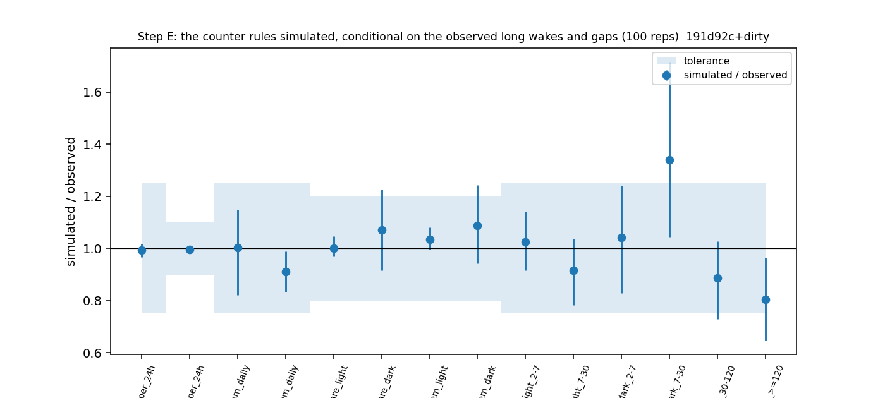

# Sleep-behaviour explore — Step E: the generative scheduler model (cohort 2026c)

Plan [implementation_plan/2026-10-08-sleep-behaviour-explore.md](../../../../implementation_plan/2026-10-08-sleep-behaviour-explore.md) §4-§5 (pass rules written before results). Driver `ephys/sleep_sim.py stepE` (commit 191d92c+dirty); bulk `D:\Field2026_analysis_out\2026c\sleep_explore_E_20261009_0743`; 100 replicates; runtime 2 min. **Technical ledger.**

## Reading (main session, 2026-10-09; with Steps D1 / D2 and the held-out part of E; claims #40–#43)

**The rules simulated:**
- a REM-entry count (NREM since the last REM, emptied by REM, × exp(−d/10 min) over a wake);
- the smooth daily clock;
- a brief arousal before REM.

Conditional on the observed long wakes and gaps, these reproduce the sleep of the six rats:

| check | result |
|---|---|
| (i) daily REM | 1.683 vs 1.694 h per 24 h, and its day-to-day SD 0.343 vs 0.342 h (FINAL; pass2med 1.739 vs 1.768, SD 0.323 vs 0.294) |
| (i) daily NREM | −0.5 % / −0.2 % |
| (iii) REM share of sleep, day / night | 17.4 / 7.3 % vs 17.4 / 6.8 % |
| (iii) REM bouts per NREM h | 11.8 / 4.4 vs 11.4 / 4.0 |
| (iv) first-REM latencies by prior wake and phase | 5/6 cells within ±25 % (the failing cell: night after 7–30-min wakes, FINAL only, 14 episodes) |
| total | **27 of 28 checks pass: 13/14 FINAL, 14/14 pass2med** (`ephys_spikes_sleep_explore_E_checks_2026c.csv`; "on each scoring" was a wording error, corrected 2026-10-09) |

- **v1 → v2 (a correction made after the first run, stated in the definitions).** The first simulator sent every short
  wake into NREM and produced ~13 % too little REM (daily REM −12 %, day REM rate −13 %). 12–15 % of REM bouts start
  right after a wake of ≤ 10 s (the scorer's brief arousal before REM). v2 samples each short wake together with the
  state that followed it. All numbers above are v2.
- **Post-hoc variant + wall-clock time since REM** (`…_E_h19_checks_2026c.csv`). Also 27 of 28 checks pass (both scorings together). It brings
  the first-REM latencies after long night wakes closer: 30–120 min −11 % → −3 %, ≥ 2 h −19 % → −17 % (FINAL).
- **(ii) the carry-over curve** ([D2E report](ephys_spikes_sleep_explore_D2E_2026c.md)). Simulated, the gain of
  pre-wake history keeps the observed sign in every wake bin where the observed CI excludes 0:
  - < 40 s: −0.30 vs −0.47 % (FINAL);
  - 40–120 s: −0.24 vs −0.33 %;
  - 7–30 min (pass2med): +0.12 vs +0.61 %.
  Short wakes keep the history; long ones lose it. **PASS.**
- **(vi) the night → next-day pattern** with day fixed effects. NREM observed −0.12 / −0.10, simulated −0.13 / −0.09;
  REM within the simulated range. The model has no daily budget and produces the same pattern. **PASS.**
- **D2, the morning-round REM payback.** The observed day-demeaned slope on pass2med (+0.34 per min of debt at 1 h,
  +0.96 at 3 h, p < 1e-4) lies far outside the simulated distribution without a REM deficit: +0.005 [−0.23, +0.28] at
  1 h, +0.01 [−0.51, +0.54] at 3 h. The rules do not produce the payback.
- **D1** ([report](ephys_spikes_sleep_explore_D1_2026c.md)). Natural dawn wakes (long night wakes ending 05:00–09:00,
  no handling) show NO payback: −0.02 [−0.21, +0.17] at 1 h, 41 windows. The same model on the morning rounds gives
  +0.29 (p 0.0003). Power is low: 3 h of night carry ~1.5 min of expected REM, and the debt SD is half the rounds'.
- **The plan's rule for "a slow REM deficit exists"** (D1 > 0.2 AND D2 < 0.1) is **not met** (D1 fails). The payback
  is real and beyond the rules, but so far it is seen only across HANDLED interruptions.
- **Held out** ([E held-out report](ephys_spikes_sleep_explore_E_heldout_2026c.md)):
  - the counter beats a 2nd-order semi-Markov "momentum" model: −2.27 % (FINAL) / −1.81 % (pass2med), 6/6, also
    after wakes;
  - momentum adds a little on FINAL only (−0.13 %);
  - an NREM homeostat S adds nothing on either scoring (+0.06 / +0.01 %) and is left out.

## Definitions

```
Step E of the sleep-behaviour explore (plan implementation_plan/2026-10-08-sleep-behaviour-explore.md §4-§5, written
before results): the generative scheduler model — simulate sleep from the fitted rules, conditional on the observed long
wakes and gaps, and check whether the rules alone reproduce the data. Also produces the simulated records that Step D2
(the morning payback without a REM-deficit variable) is measured on.

Usage:  python ephys/sleep_sim.py stepE [--scorings final pass2med] [--reps 100] [--workers 8]
        python ephys/sleep_sim.py --selftest

Definitions:
  conditioning   every observed record keeps its start, length, unknown runs and wake bouts >= 420 s ("forced" blocks,
                 i.e. the observed activity pattern); everything else ("free" time = the observed sleep with its short
                 wakes) is simulated. A free stretch starts in NREM. A simulated bout that reaches a forced block is cut
                 there.
  rules (all fitted on all included NREM / REM steps of the scoring; sklearn multinomial logit, C = 1e4):
    NREM step (10 s from the bout start): stay / REM / WAKE with Step B's B-full spec at the counter P_tw600_k0
      (P = NREM minutes since the last REM, emptied at REM, x exp(-d / 600 s) over any wake, frozen over unknown;
      base: spline ln(elapsed + 5), 2-harmonic clock, linear day, dark (NOAA), has_anchor, animal; L1: ln(1 + preceding
      wake), previous bout REM / unknown, wake share of the last 10 min).
    REM step (10 s): stay / NREM / WAKE with spline ln(elapsed + 5), 2-harmonic clock, linear day, dark, animal (no
      history: #14).
    short wake (< 420 s): its length AND the state that follows it (NREM or REM) drawn together from the observed short
      wakes of the same animal, light phase and preceding state (NREM or REM). (Correction after the first run: 12-15 % of
      REM bouts start right after a wake of <= 10 s — the scorer's brief arousal before REM; v1 sent every short wake to
      NREM and under-produced REM by ~13 %.)
    exit within a 10-s step j: the bout lasts 10 j + U{1..10} s (the data's last step is partial).
  replicates     R independent simulations of every record (seeded); the observed records are the reference.
  checks (plan Step E; observed and simulated go through the same code):
    (i)   per animal: REM and NREM hours per 24 h of known time; across animal-days (calendar days, >= 50 % known):
          the SD of the daily REM and NREM hours. Pass: simulated mean within +-25 % (REM) / +-10 % (NREM) of the
          observed, and the simulated SD within +-25 % of the observed SD.
    (iii) Watson SLEEP episodes (>= 20 min; split at wake > 120 s or unknown), phase = light / dark at onset (NOAA):
          mean REM share of sleep and mean REM bouts per NREM hour by phase. Pass: within +-20 %.
    (iv)  first-REM latency (s from onset; Kaplan-Meier median, censored at the episode end) by the wake before the
          episode (2-7, 7-30, 30-120, >= 120 min) and phase, cells with >= 10 episodes. Pass: within +-25 %.
    (ii)  the carry-over curve (Phase 2 B1: held-out gain of pre-wake history by wake bin) on a few replicates: sign and
          order as observed.
    (v) / D2 the morning-round REM payback slope (sleep_explore_d.payback_from_records) on the simulated records.
    (vi)  the night -> next-day deviation slope with day fixed effects (sleep_explore_d.budget_from_records) ~ 0.
```

## Checks (i), (iii), (iv): simulated vs observed

| scores | check | metric | observed | sim_mean | sim_2.5% | sim_97.5% | rel_diff | tolerance | pass |
|---|---|---|---|---|---|---|---|---|---|
| final | (i) | rem_h_per_24h | 1.6942 | 1.6832 | 1.6396 | 1.7256 | -0.0065 | 0.25 | True |
| final | (i) | nrem_h_per_24h | 9.4636 | 9.4196 | 9.3518 | 9.4814 | -0.0047 | 0.1 | True |
| final | (i) | sd_rem_daily | 0.3416 | 0.3427 | 0.2802 | 0.3926 | 0.0031 | 0.25 | True |
| final | (i) | sd_nrem_daily | 1.1026 | 1.0039 | 0.9202 | 1.0897 | -0.0895 | 0.25 | True |
| final | (iii) | rem_share_light | 0.1737 | 0.1739 | 0.1684 | 0.182 | 0.0011 | 0.2 | True |
| final | (iii) | rem_share_dark | 0.0682 | 0.073 | 0.0625 | 0.0835 | 0.0703 | 0.2 | True |
| final | (iii) | rem_per_h_nrem_light | 11.4096 | 11.8029 | 11.3648 | 12.3273 | 0.0345 | 0.2 | True |
| final | (iii) | rem_per_h_nrem_dark | 4.0351 | 4.3866 | 3.7992 | 5.0187 | 0.0871 | 0.2 | True |
| final | (iv) | lat_med_light_2-7 | 528.0 | 541.11 | 483.475 | 603.1 | 0.0248 | 0.25 | True |
| final | (iv) | lat_med_light_7-30 | 779.0 | 712.86 | 609.85 | 807.4 | -0.0849 | 0.25 | True |
| final | (iv) | lat_med_dark_2-7 | 899.0 | 936.78 | 743.9 | 1114.625 | 0.042 | 0.25 | True |
| final | (iv) | lat_med_dark_7-30 | 810.0 | 1085.3 | 845.75 | 1390.1 | 0.3399 | 0.25 | False |
| final | (iv) | lat_med_dark_30-120 | 1370.0 | 1213.76 | 998.525 | 1408.775 | -0.114 | 0.25 | True |
| final | (iv) | lat_med_dark_>=120 | 1593.0 | 1283.19 | 1031.95 | 1535.775 | -0.1945 | 0.25 | True |
| pass2med | (i) | rem_h_per_24h | 1.7679 | 1.7387 | 1.6861 | 1.8127 | -0.0165 | 0.25 | True |
| pass2med | (i) | nrem_h_per_24h | 9.7844 | 9.7673 | 9.683 | 9.8362 | -0.0017 | 0.1 | True |
| pass2med | (i) | sd_rem_daily | 0.2944 | 0.3234 | 0.2736 | 0.3876 | 0.0986 | 0.25 | True |
| pass2med | (i) | sd_nrem_daily | 0.8998 | 0.9803 | 0.9 | 1.0528 | 0.0894 | 0.25 | True |
| pass2med | (iii) | rem_share_light | 0.1783 | 0.1745 | 0.1668 | 0.1841 | -0.0215 | 0.2 | True |
| pass2med | (iii) | rem_share_dark | 0.0669 | 0.0693 | 0.0616 | 0.0783 | 0.0361 | 0.2 | True |
| pass2med | (iii) | rem_per_h_nrem_light | 11.911 | 12.0454 | 11.361 | 12.7075 | 0.0113 | 0.2 | True |
| pass2med | (iii) | rem_per_h_nrem_dark | 4.2137 | 4.5338 | 4.1194 | 4.9531 | 0.0759 | 0.2 | True |
| pass2med | (iv) | lat_med_light_2-7 | 535.0 | 548.41 | 492.0 | 620.575 | 0.0251 | 0.25 | True |
| pass2med | (iv) | lat_med_light_7-30 | 771.0 | 699.15 | 633.95 | 774.2 | -0.0932 | 0.25 | True |
| pass2med | (iv) | lat_med_dark_2-7 | 1115.0 | 927.84 | 705.475 | 1176.625 | -0.1679 | 0.25 | True |
| pass2med | (iv) | lat_med_dark_7-30 | 1316.0 | 1097.7 | 806.725 | 1365.575 | -0.1659 | 0.25 | True |
| pass2med | (iv) | lat_med_dark_30-120 | 1348.0 | 1160.31 | 976.9 | 1374.05 | -0.1392 | 0.25 | True |
| pass2med | (iv) | lat_med_dark_>=120 | 1486.0 | 1160.11 | 916.475 | 1359.125 | -0.2193 | 0.25 | True |



