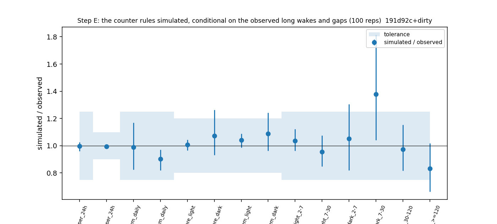

# Sleep-behaviour explore — Step E: the generative scheduler model (cohort 2026c) — POST HOC variant + wall-clock time since REM (H19)

Plan [implementation_plan/2026-10-08-sleep-behaviour-explore.md](../../../../implementation_plan/2026-10-08-sleep-behaviour-explore.md) §4-§5 (pass rules written before results). Driver `ephys/sleep_sim.py stepE` (commit 191d92c+dirty); bulk `D:\Field2026_analysis_out\2026c\sleep_explore_E_h19_20261009_0745`; 100 replicates; runtime 3 min. **Technical ledger.**

## Definitions

```
Step E of the sleep-behaviour explore (plan implementation_plan/2026-10-08-sleep-behaviour-explore.md §4-§5, written
before results): the generative scheduler model — simulate sleep from the fitted rules, conditional on the observed long
wakes and gaps, and check whether the rules alone reproduce the data. Also produces the simulated records that Step D2
(the morning payback without a REM-deficit variable) is measured on.

Usage:  python ephys/sleep_sim.py stepE [--scorings final pass2med] [--reps 100] [--workers 8]
        python ephys/sleep_sim.py --selftest

Definitions:
  conditioning   every observed record keeps its start, length, unknown runs and wake bouts >= 420 s ("forced" blocks,
                 i.e. the observed activity pattern); everything else ("free" time = the observed sleep with its short
                 wakes) is simulated. A free stretch starts in NREM. A simulated bout that reaches a forced block is cut
                 there.
  rules (all fitted on all included NREM / REM steps of the scoring; sklearn multinomial logit, C = 1e4):
    NREM step (10 s from the bout start): stay / REM / WAKE with Step B's B-full spec at the counter P_tw600_k0
      (P = NREM minutes since the last REM, emptied at REM, x exp(-d / 600 s) over any wake, frozen over unknown;
      base: spline ln(elapsed + 5), 2-harmonic clock, linear day, dark (NOAA), has_anchor, animal; L1: ln(1 + preceding
      wake), previous bout REM / unknown, wake share of the last 10 min).
    REM step (10 s): stay / NREM / WAKE with spline ln(elapsed + 5), 2-harmonic clock, linear day, dark, animal (no
      history: #14).
    short wake (< 420 s): its length AND the state that follows it (NREM or REM) drawn together from the observed short
      wakes of the same animal, light phase and preceding state (NREM or REM). (Correction after the first run: 12-15 % of
      REM bouts start right after a wake of <= 10 s — the scorer's brief arousal before REM; v1 sent every short wake to
      NREM and under-produced REM by ~13 %.)
    exit within a 10-s step j: the bout lasts 10 j + U{1..10} s (the data's last step is partial).
  replicates     R independent simulations of every record (seeded); the observed records are the reference.
  checks (plan Step E; observed and simulated go through the same code):
    (i)   per animal: REM and NREM hours per 24 h of known time; across animal-days (calendar days, >= 50 % known):
          the SD of the daily REM and NREM hours. Pass: simulated mean within +-25 % (REM) / +-10 % (NREM) of the
          observed, and the simulated SD within +-25 % of the observed SD.
    (iii) Watson SLEEP episodes (>= 20 min; split at wake > 120 s or unknown), phase = light / dark at onset (NOAA):
          mean REM share of sleep and mean REM bouts per NREM hour by phase. Pass: within +-20 %.
    (iv)  first-REM latency (s from onset; Kaplan-Meier median, censored at the episode end) by the wake before the
          episode (2-7, 7-30, 30-120, >= 120 min) and phase, cells with >= 10 episodes. Pass: within +-25 %.
    (ii)  the carry-over curve (Phase 2 B1: held-out gain of pre-wake history by wake bin) on a few replicates: sign and
          order as observed.
    (v) / D2 the morning-round REM payback slope (sleep_explore_d.payback_from_records) on the simulated records.
    (vi)  the night -> next-day deviation slope with day fixed effects (sleep_explore_d.budget_from_records) ~ 0.
```

## Checks (i), (iii), (iv): simulated vs observed

| scores | check | metric | observed | sim_mean | sim_2.5% | sim_97.5% | rel_diff | tolerance | pass |
|---|---|---|---|---|---|---|---|---|---|
| final | (i) | rem_h_per_24h | 1.6942 | 1.6901 | 1.628 | 1.7371 | -0.0024 | 0.25 | True |
| final | (i) | nrem_h_per_24h | 9.4636 | 9.4165 | 9.3445 | 9.4977 | -0.005 | 0.1 | True |
| final | (i) | sd_rem_daily | 0.3416 | 0.3375 | 0.2822 | 0.3995 | -0.012 | 0.25 | True |
| final | (i) | sd_nrem_daily | 1.1026 | 0.995 | 0.905 | 1.071 | -0.0976 | 0.25 | True |
| final | (iii) | rem_share_light | 0.1737 | 0.1748 | 0.1677 | 0.1812 | 0.0062 | 0.2 | True |
| final | (iii) | rem_share_dark | 0.0682 | 0.0732 | 0.0634 | 0.0862 | 0.0737 | 0.2 | True |
| final | (iii) | rem_per_h_nrem_light | 11.4096 | 11.8926 | 11.2712 | 12.4072 | 0.0423 | 0.2 | True |
| final | (iii) | rem_per_h_nrem_dark | 4.0351 | 4.397 | 3.8811 | 5.0172 | 0.0897 | 0.2 | True |
| final | (iv) | lat_med_light_2-7 | 528.0 | 547.01 | 508.425 | 592.575 | 0.036 | 0.25 | True |
| final | (iv) | lat_med_light_7-30 | 779.0 | 743.35 | 660.425 | 837.675 | -0.0458 | 0.25 | True |
| final | (iv) | lat_med_dark_2-7 | 899.0 | 946.42 | 736.025 | 1174.2 | 0.0527 | 0.25 | True |
| final | (iv) | lat_med_dark_7-30 | 810.0 | 1115.84 | 843.1 | 1470.2 | 0.3776 | 0.25 | False |
| final | (iv) | lat_med_dark_30-120 | 1370.0 | 1335.18 | 1120.625 | 1578.925 | -0.0254 | 0.25 | True |
| final | (iv) | lat_med_dark_>=120 | 1593.0 | 1327.27 | 1057.425 | 1623.05 | -0.1668 | 0.25 | True |
| pass2med | (i) | rem_h_per_24h | 1.7679 | 1.7339 | 1.6647 | 1.8051 | -0.0192 | 0.25 | True |
| pass2med | (i) | nrem_h_per_24h | 9.7844 | 9.7736 | 9.6983 | 9.8361 | -0.0011 | 0.1 | True |
| pass2med | (i) | sd_rem_daily | 0.2944 | 0.3267 | 0.2736 | 0.3833 | 0.1097 | 0.25 | True |
| pass2med | (i) | sd_nrem_daily | 0.8998 | 0.9766 | 0.9024 | 1.0524 | 0.0853 | 0.25 | True |
| pass2med | (iii) | rem_share_light | 0.1783 | 0.1748 | 0.1663 | 0.184 | -0.0198 | 0.2 | True |
| pass2med | (iii) | rem_share_dark | 0.0669 | 0.0691 | 0.0625 | 0.078 | 0.0338 | 0.2 | True |
| pass2med | (iii) | rem_per_h_nrem_light | 11.911 | 12.0829 | 11.4845 | 12.6477 | 0.0144 | 0.2 | True |
| pass2med | (iii) | rem_per_h_nrem_dark | 4.2137 | 4.5291 | 4.1196 | 4.9686 | 0.0748 | 0.2 | True |
| pass2med | (iv) | lat_med_light_2-7 | 535.0 | 560.21 | 518.475 | 605.575 | 0.0471 | 0.25 | True |
| pass2med | (iv) | lat_med_light_7-30 | 771.0 | 730.57 | 665.9 | 807.525 | -0.0524 | 0.25 | True |
| pass2med | (iv) | lat_med_dark_2-7 | 1115.0 | 941.71 | 753.475 | 1171.8 | -0.1554 | 0.25 | True |
| pass2med | (iv) | lat_med_dark_7-30 | 1316.0 | 1157.01 | 916.4 | 1469.6 | -0.1208 | 0.25 | True |
| pass2med | (iv) | lat_med_dark_30-120 | 1348.0 | 1335.97 | 1117.5 | 1588.925 | -0.0089 | 0.25 | True |
| pass2med | (iv) | lat_med_dark_>=120 | 1486.0 | 1273.53 | 1042.7 | 1540.05 | -0.143 | 0.25 | True |



