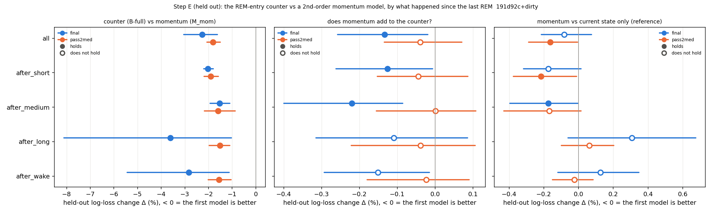
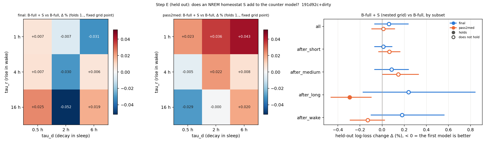

# Sleep behaviour explore — Step E (held-out part): the counter vs momentum, and an NREM homeostat S (cohort 2026c)

Plan: [implementation_plan/2026-10-08-sleep-behaviour-explore.md](../../../../implementation_plan/2026-10-08-sleep-behaviour-explore.md) (sections 1, 3, 4 and 5 Steps B and E; the pass rules are the plan's, unchanged). Builds on Step B ([ephys_spikes_sleep_explore_B_2026c.md](ephys_spikes_sleep_explore_B_2026c.md)) and its post-hoc split ([ephys_spikes_sleep_explore_B_diag_2026c.md](ephys_spikes_sleep_explore_B_diag_2026c.md)). Driver `ephys/sleep_model_e.py heldout` (commit 191d92c+dirty; file uncommitted at run time); bulk `D:\Field2026_analysis_out\2026c\sleep_explore_E_heldout_20261009_0750`; scorings final, pass2med; runtime 32.7 min (final 17.7 min, pass2med 15.0 min).

**Status: exploration step; claim statuses are changed in the claim audit, not here.** Only the held-out comparisons of Step E are here; the generative simulation checks (i)–(vi) are a separate part. Inputs: the scored 1-s states (FINAL = primary, pass2med_remclean = the check). No LFP features. Everything from 2026-09-11 19:40 is cut. The sleep states come from the scorer, whose EMG is the head IMU; no claim here links movement to state.

## Verdicts

| part | scores | rule | verdict | all steps | after wakes |
|---|---|---|---|---|---|
| 1 | final | B-full beats M_mom held out (holds) on all NREM steps AND after wakes (after_long ∪ after_medium) | PASS | Δ -2.273 % [-3.051, -1.626], folds 15/15, rats 6/6 — holds | Δ -2.831 % [-5.443, -1.119], folds 14/15, rats 6/6 — holds |
| 1b | final | momentum adds to the counter: B-full + momentum beats B-full (holds) | momentum ADDS | Δ -0.134 % [-0.258, -0.019], folds 10/15, rats 5/6 — holds | Δ -0.151 % [-0.294, -0.015], folds 9/15, rats 4/6 |
| 2 | final | S adds to the counter model: B-full + S (nested grid) beats B-full (holds) | FAIL (S left out of the generative model) | Δ +0.062 % [-0.068, +0.236], folds 8/15, rats 3/6 | Δ +0.180 % [-0.100, +0.562], folds 7/15, rats 4/6 |
| 1 | pass2med | B-full beats M_mom held out (holds) on all NREM steps AND after wakes (after_long ∪ after_medium) | PASS | Δ -1.805 % [-2.064, -1.505], folds 14/15, rats 6/6 — holds | Δ -1.549 % [-2.017, -1.046], folds 14/15, rats 6/6 — holds |
| 1b | pass2med | momentum adds to the counter: B-full + momentum beats B-full (holds) | momentum adds nothing that holds | Δ -0.039 % [-0.134, +0.070], folds 10/15, rats 3/6 | Δ -0.024 % [-0.180, +0.090], folds 6/15, rats 3/6 |
| 2 | pass2med | S adds to the counter model: B-full + S (nested grid) beats B-full (holds) | FAIL (S left out of the generative model) | Δ +0.012 % [-0.093, +0.113], folds 9/15, rats 3/6 | Δ -0.131 % [-0.289, +0.023], folds 10/15, rats 4/6 |

Per since-REM class:

| part | scores | after_long | after_medium | after_short |
|---|---|---|---|---|
| 1 | final | Δ -3.615 % [-8.119, -1.036], folds 14/14, rats 6/6 — holds | Δ -1.525 % [-1.928, -1.098], folds 13/15, rats 6/6 — holds | Δ -2.030 % [-2.199, -1.794], folds 15/15, rats 6/6 — holds |
| 1b | final | Δ -0.109 % [-0.315, +0.086], folds 8/14, rats 4/6 | Δ -0.220 % [-0.400, -0.086], folds 10/15, rats 5/6 — holds | Δ -0.126 % [-0.262, -0.007], folds 7/15, rats 5/6 — holds |
| 2 | final | Δ +0.239 % [-0.172, +0.841], folds 6/14, rats 3/6 | Δ +0.086 % [-0.067, +0.239], folds 5/15, rats 2/6 | Δ +0.011 % [-0.067, +0.090], folds 8/15, rats 3/6 |
| 1 | pass2med | Δ -1.518 % [-1.971, -1.104], folds 15/15, rats 6/6 — holds | Δ -1.602 % [-2.167, -0.873], folds 9/14, rats 6/6 — holds | Δ -1.901 % [-2.182, -1.587], folds 14/15, rats 6/6 — holds |
| 1b | pass2med | Δ -0.038 % [-0.222, +0.106], folds 8/15, rats 4/6 | Δ +0.001 % [-0.156, +0.107], folds 6/14, rats 3/6 | Δ -0.045 % [-0.153, +0.086], folds 9/15, rats 4/6 |
| 2 | pass2med | Δ -0.294 % [-0.463, -0.099], folds 12/15, rats 6/6 — holds | Δ +0.146 % [+0.002, +0.330], folds 3/14, rats 1/6 | Δ +0.065 % [-0.031, +0.163], folds 6/15, rats 0/6 |

## Reading (written after the run by the agent that ran it; statuses belong in the claim audit)

1. **The counter beats momentum held out, on both scorings, in every since-REM class (plan rule: PASS).**
   - All NREM steps: FINAL −2.27 % [−3.05, −1.63], 15/15 folds, 6/6 rats; pass2med −1.81 % [−2.06, −1.51], 14/15, 6/6.
   - After wakes (≥ 2 min since the last REM): FINAL −2.83 % [−5.44, −1.12], 6/6; pass2med −1.55 % [−2.02, −1.05], 6/6.
     The margin holds after long, medium and short wakes alike. It is larger after wakes than after short wakes on
     FINAL (−2.83 vs −2.03 %) but not on pass2med (−1.55 vs −1.90 %): the counter's advantage is general, not
     specific to post-wake sleep.
   - Robust to the counter's key: with τ_w chosen per fold (5 or 10 min) −2.25 % / −1.81 %; against the literal
     momentum model (one prev2 slope) −2.28 % / −1.86 %.
   - Largest right after a REM bout (prev1 = REM: −5.3 % / −5.0 %, 6/6), where the counter is empty and momentum is not.
     The only place momentum does better is the first NREM bout after an unknown run or at the record start (856 /
     707 steps, 7 REM ends): there the counter has no history.
   - Two bouts of history add little to the current-state model (M_mom vs gate −0.08 %, n.s. / −0.16 %, holds),
     whereas the counter adds ~2 % (B-full vs gate −2.36 % / −1.97 %, 6/6).
2. **Momentum adds a small, scoring-dependent residual beyond the counter.**
   - B-full + momentum vs B-full: FINAL −0.13 % [−0.26, −0.02], 5/6 (holds); pass2med −0.04 % [−0.13, +0.07], 3/6
     (does not hold). Not robust across scorings.
   - On FINAL the gain sits in the NREM after a REM bout (prev1 = REM −0.72 %, 5/6, holds; pass2med −0.51 %, n.s.).
   - The full-data coefficients (description; dummy / log-duration pairs are collinear, so single terms are not
     interpretable alone) point to the WAKE side: a longer preceding REM bout goes with more waking from the following
     NREM (l1_R on WAKE vs stay +0.17 [+0.09, +0.24] / +0.26 [+0.18, +0.34] per SD). A longer NREM two bouts back goes
     with more REM entry beyond P (l2_N +0.17 / +0.13 per SD).
   - Reading: momentum does not replace the counter. At most, a REM-length → waking term is a candidate for the WAKE
     hazard (FINAL only held out; not a pass).
3. **An NREM homeostat S adds nothing held out (plan rule: FAIL on both scorings) → S is left out of the generative
   model.**
   - B-full + S (nested grid) vs B-full: FINAL +0.06 % [−0.07, +0.24], 3/6; pass2med +0.01 % [−0.09, +0.11], 3/6.
   - The profile is flat: every grid point lies within ±0.06 % of B-full and none holds. The nested choice wanders on
     FINAL (six different grid points over 15 folds); pass2med picks τ_r 16 h / τ_d 0.5 h in 14/15 folds. Plan §4
     expected τ_r / τ_d to be flat.
   - One subset holds: pass2med after_long −0.29 % (6/6). FINAL after_long has the opposite sign (+0.24 %), and this is
     one of ten subset tests, so it is not evidence.
   - In the full-data fits S's REM-vs-stay coefficient is negative at every grid point (−0.09 to −0.43 per SD; CI
     excludes 0 in 17 of the 18 scoring × grid fits, all but FINAL `S_r1_d6`; 6/6 rats < 0 at each scoring's modal
     point): higher S, i.e. more recent wake, goes with less REM entry at the same P. Its WAKE-vs-stay
     sign flips between scorings: FINAL +0.11 [+0.03, +0.19] at `S_r1_d6`; pass2med −0.07 [−0.12, −0.02] at
     `S_r16_d0.5`. A homeostat that drives waking would keep its sign. In-sample significance is not a held-out gain;
     the pre-registered rule is the held-out one.

## Data

- final: 179668 NREM steps, 3880 REM ends, 7442 WAKE ends; 129 records; animals SF07, SF08, SF09, SF10, SF11, SF12; since-REM classes (steps): after_short 118332, after_medium 20728, after_long 40608; 15 test folds (fold 0 only starts the nested choices).
- pass2med: 185090 NREM steps, 4219 REM ends, 7513 WAKE ends; 129 records; animals SF07, SF08, SF09, SF10, SF11, SF12; since-REM classes (steps): after_short 127954, after_medium 17645, after_long 39491; 15 test folds (fold 0 only starts the nested choices).

- Counter P = `P_tw600_k0` (τ_w = 600 s, κ = 0) for both scorings: the grid point chosen most often by Step B's nested forward chaining on FINAL (folds 7–15; 300 s in folds 2–6, 600 s with κ = 60 s in fold 1). **Noted:** fixing it uses a choice made with all of Step B's folds, i.e. partly with later test blocks; the same base enters every comparison except B-full vs M_mom, where it could favour the counter, so that comparison is repeated with the per-fold nested choice τ_w ∈ {300, 600} s, κ = 0 (row 'B-full (nested tau_w 5 / 10 min) vs M_mom'). pass2med uses FINAL's key, as in Steps B-diag and C.

## Definitions

Time is field-PC local time. States per second $s_t \in \{0\ \text{unknown}, 1\ \text{WAKE}, 3\ \text{NREM}, 5\ \text{REM}\}$. A **bout** is a maximal run of one state (unknown runs included). Records, scorings, the cut, light (NOAA sunrise–sunset) and the day-half blocks are those of Steps A–C.

### The step model (Step B's, imported unchanged)

- **NREM step.** Every 10 s of every NREM bout; outcome $y \in \{$stay, REM, WAKE$\}$ = the state that follows the bout if the bout ends inside the step. History is taken at the bout start; elapsed $e$ = s since the bout start.
- **Multinomial hazard.** $\Pr(y = j \mid x) = e^{\eta_j} / (1 + e^{\eta_R} + e^{\eta_W})$, $\eta_{stay} = 0$, $\eta_j = \alpha_j + x^\top \beta_j$; sklearn multinomial logistic regression, $C = 10^4$ (`sleep_model.fit_eval`). A coefficient on REM vs stay is the log-odds ratio of entering REM rather than staying in NREM in the next 10 s.
- **base** = cubic B-spline of $\ln(e + 5)$ (4 knots) + $(\sin, \cos)(2\pi k h / 24)$, $k = 1, 2$ ($h$ = clock hour) + experiment day + has_anchor (a REM earlier in the record) + dark (NOAA sunset → sunrise) + animal intercepts; linear terms z-scored on the training steps.
- **L1** (current state) = $\ln(1 + d)$ ($d$ = length in s of the WAKE bout just before the NREM bout, 0 otherwise), previous bout REM, previous bout unknown (or record start), wake share of the last 10 min.
- **Counter P** (min). $P$ rises by $1/60$ per NREM second, is multiplied by $e^{-d/\tau_w}$ over a wake of length $d$ and set to 0 by a REM bout ($\kappa = 0$); unknown epochs freeze it; at a step $P_t = P_{start} + e/60$ (`sleep_model.counter_starts`). Enters as a cubic B-spline of $\ln(1 + P_t)$ (4 knots).
- **B-full** = base + L1 + spline $\ln(1 + P_t)$ (Step B's model; $\tau_w = 600$ s). **gate** = base + L1 (no history).

### Part 1: momentum (a 2nd-order semi-Markov alternative; Stephenson 2025)

For NREM bout $i$: prev1 = bout $i-1$ (WAKE, REM or unknown; never NREM, since bouts are maximal; 'none' at the record start), prev2 = bout $i-2$ (NREM, WAKE, REM, unknown, or none if $i < 2$); $\delta_1, \delta_2$ = their lengths (s).
- **momentum terms** $m$: $\mathbb 1[\text{prev2} = c]$ for $c \in$ {WAKE, REM, unknown, none} (reference NREM); $\ln(1 + \delta_2)\,\mathbb 1[\text{prev2} = c]$ for $c \in$ {NREM, WAKE, REM, unknown}; $\ln(1 + \delta_1)\,\mathbb 1[\text{prev1} = c]$ for $c \in$ {REM, unknown} (for a WAKE prev1 this is L1's $\ln(1 + d)$; L1 also holds the prev1 type dummies). All z-scored, linear, in both equations.
- **M_mom** = base + L1 + $m$ — the current-state terms extended to two bouts back, with no counter. **B-full + momentum** = B-full + $m$. **M_mom_lit** (sensitivity, the task's literal list) = base + L1 + prev2 dummies + one $\ln(1 + \delta_2)$ for every prev2 type + the two prev1 terms. *Choice stated here:* the main $m$ lets the prev2 log duration have a slope per prev2 type, so an NREM and a wake duration are not forced to share one (this gives momentum more room, never less).

### Part 2: the NREM homeostat S (plan section 4)

- **S** (0–1, dimensionless), per second, exact exponential updates: WAKE $S_{t+1} = 1 - (1 - S_t)\,e^{-1/\tau_r}$ (rises towards 1 with time constant $\tau_r$); NREM or REM $S_{t+1} = S_t\,e^{-1/\tau_d}$ (decays towards 0 with $\tau_d$); unknown $S_{t+1} = S_t$ (frozen).
- **Start.** Each record starts at its animal's mean $\bar S_a$ = the mean of S over all recorded (non-unknown) seconds of the animal's records in a first pass started at 0.5 (two passes). *Noted:* $\bar S_a$ uses all of the animal's records (test blocks included); it is one number per animal and grid point.
- **At an NREM step** $S_t = S_{start}\,e^{-e/\tau_d}$ ($S_{start}$ = S at the bout start), entered as one z-scored linear term; a coefficient is per SD of $S_t$ on the training steps (SD in the coefficient table).
- **Grid** $\tau_r \in$ {1, 4, 16} h × $\tau_d \in$ {0.5, 2, 6} h. **B-full + S** = B-full + $S_t$; the grid point is chosen per test fold by nested forward chaining (the lowest step-weighted held-out log loss over the earlier folds, as Step B; fold 0 only starts the choice). The **profile** = each grid point fixed over folds 1.., Δ vs B-full.
- **Coefficients** (description): full-data fit of B-full + S at the modal chosen grid point (the grid point chosen in most test folds; a tie goes to the tied point with the lowest profile Δ) and pooled at every grid point), multinomial logit by Newton–Raphson with the same L2 penalty ($10^{-4}\lVert\beta\rVert^2/2$; `sleep_explore_c.mnl_fit`), reference-coded (REM vs stay, WAKE vs stay); cluster-robust 95 % CI $\hat\beta \pm 1.96\,\widehat{se}$, $\hat V = H^{-1}(\sum_g U_g U_g^\top) H^{-1} G/(G-1)$ over the day-half blocks $g$; per animal: the same model fitted to the animal alone (signs).

### Held out, subsets and verdict rules

- **Δ.** Forward chaining over the day-half blocks (train on all earlier blocks, test the next; the first 6 blocks only train); per-step log loss $\ell = -\ln \hat p(y)$; per fold the mean over the test steps of the subset; $\Delta = 100\,(\bar\ell_{hi} - \bar\ell_{lo}) / \bar\ell_{lo}$ (step-weighted over folds 1..), < 0 = the first-named model is better; 95 % CI by bootstrap over folds (2000); rats better = per-animal pooled Δ < 0; **holds** = CI < 0 and ≥ 5/6 rats (`sleep_schedule_phase2.compare`).
- **since-REM class** at the NREM bout start (`sleep_model_diag.since_rem_class`): after_long = a wake ≥ 420 s occurred since the last REM (or the record start if no REM yet); after_medium = a 120–419-s wake, none longer; after_short = only wakes < 120 s or none; **after_wake** = after_long ∪ after_medium. Supplementary split by the prev1 type (WAKE / REM / unknown or none). The nested S choice is made on all steps and applied in every subset.
- **Part 1 rule** (plan Step E: 'the model must beat momentum held out, especially on bouts after wakes'), operationalised here before the run: PASS = B-full vs M_mom holds on all NREM steps **and** on the after_wake steps (FINAL; pass2med as the check). Whether momentum adds anything beyond the counter is read from B-full + momentum vs B-full (holds = it adds).
- **Part 2 rule** (the task): PASS = B-full + S vs B-full holds on all NREM steps; otherwise S is left out of the generative model.

## Part 1 — the counter vs momentum (held out)

### Main comparisons by since-REM class

| comparison | subset | scores | steps | REM ends | Δ % [95 % CI] | folds better | rats better | holds |
|---|---|---|---|---|---|---|---|---|
| B-full (counter) vs M_mom (momentum) | all | final | 122735 | 2544 | -2.273 % [-3.051, -1.626] | 15/15 | 6/6 | yes |
| B-full (counter) vs M_mom (momentum) | all | pass2med | 123304 | 2666 | -1.805 % [-2.064, -1.505] | 14/15 | 6/6 | yes |
| B-full (counter) vs M_mom (momentum) | after_short | final | 84610 | 2137 | -2.030 % [-2.199, -1.794] | 15/15 | 6/6 | yes |
| B-full (counter) vs M_mom (momentum) | after_short | pass2med | 89122 | 2256 | -1.901 % [-2.182, -1.587] | 14/15 | 6/6 | yes |
| B-full (counter) vs M_mom (momentum) | after_medium | final | 13628 | 233 | -1.525 % [-1.928, -1.098] | 13/15 | 6/6 | yes |
| B-full (counter) vs M_mom (momentum) | after_medium | pass2med | 12211 | 220 | -1.602 % [-2.167, -0.873] | 9/14 | 6/6 | yes |
| B-full (counter) vs M_mom (momentum) | after_long | final | 24497 | 174 | -3.615 % [-8.119, -1.036] | 14/14 | 6/6 | yes |
| B-full (counter) vs M_mom (momentum) | after_long | pass2med | 21971 | 190 | -1.518 % [-1.971, -1.104] | 15/15 | 6/6 | yes |
| B-full (counter) vs M_mom (momentum) | after_wake | final | 38125 | 407 | -2.831 % [-5.443, -1.119] | 14/15 | 6/6 | yes |
| B-full (counter) vs M_mom (momentum) | after_wake | pass2med | 34182 | 410 | -1.549 % [-2.017, -1.046] | 14/15 | 6/6 | yes |
| B-full + momentum vs B-full | all | final | 122735 | 2544 | -0.134 % [-0.258, -0.019] | 10/15 | 5/6 | yes |
| B-full + momentum vs B-full | all | pass2med | 123304 | 2666 | -0.039 % [-0.134, +0.070] | 10/15 | 3/6 | no |
| B-full + momentum vs B-full | after_short | final | 84610 | 2137 | -0.126 % [-0.262, -0.007] | 7/15 | 5/6 | yes |
| B-full + momentum vs B-full | after_short | pass2med | 89122 | 2256 | -0.045 % [-0.153, +0.086] | 9/15 | 4/6 | no |
| B-full + momentum vs B-full | after_medium | final | 13628 | 233 | -0.220 % [-0.400, -0.086] | 10/15 | 5/6 | yes |
| B-full + momentum vs B-full | after_medium | pass2med | 12211 | 220 | +0.001 % [-0.156, +0.107] | 6/14 | 3/6 | no |
| B-full + momentum vs B-full | after_long | final | 24497 | 174 | -0.109 % [-0.315, +0.086] | 8/14 | 4/6 | no |
| B-full + momentum vs B-full | after_long | pass2med | 21971 | 190 | -0.038 % [-0.222, +0.106] | 8/15 | 4/6 | no |
| B-full + momentum vs B-full | after_wake | final | 38125 | 407 | -0.151 % [-0.294, -0.015] | 9/15 | 4/6 | no |
| B-full + momentum vs B-full | after_wake | pass2med | 34182 | 410 | -0.024 % [-0.180, +0.090] | 6/15 | 3/6 | no |

### References and sensitivities

| comparison | subset | scores | steps | REM ends | Δ % [95 % CI] | folds better | rats better | holds |
|---|---|---|---|---|---|---|---|---|
| M_mom vs gate (base + L1; does momentum add to the current state?) | all | final | 122735 | 2544 | -0.083 % [-0.214, +0.075] | 9/15 | 5/6 | no |
| M_mom vs gate (base + L1; does momentum add to the current state?) | all | pass2med | 123304 | 2666 | -0.164 % [-0.287, -0.006] | 11/15 | 5/6 | yes |
| M_mom vs gate (base + L1; does momentum add to the current state?) | after_short | final | 84610 | 2137 | -0.174 % [-0.317, +0.014] | 11/15 | 5/6 | no |
| M_mom vs gate (base + L1; does momentum add to the current state?) | after_short | pass2med | 89122 | 2256 | -0.216 % [-0.376, -0.011] | 10/15 | 5/6 | yes |
| M_mom vs gate (base + L1; does momentum add to the current state?) | after_medium | final | 13628 | 233 | -0.174 % [-0.396, -0.003] | 9/15 | 5/6 | yes |
| M_mom vs gate (base + L1; does momentum add to the current state?) | after_medium | pass2med | 12211 | 220 | -0.168 % [-0.430, +0.015] | 10/14 | 3/6 | no |
| M_mom vs gate (base + L1; does momentum add to the current state?) | after_long | final | 24497 | 174 | +0.307 % [-0.060, +0.675] | 6/14 | 3/6 | no |
| M_mom vs gate (base + L1; does momentum add to the current state?) | after_long | pass2med | 21971 | 190 | +0.061 % [-0.099, +0.204] | 7/15 | 2/6 | no |
| M_mom vs gate (base + L1; does momentum add to the current state?) | after_wake | final | 38125 | 407 | +0.126 % [-0.120, +0.348] | 7/15 | 4/6 | no |
| M_mom vs gate (base + L1; does momentum add to the current state?) | after_wake | pass2med | 34182 | 410 | -0.024 % [-0.151, +0.084] | 8/15 | 3/6 | no |
| B-full vs gate (reference) | all | final | 122735 | 2544 | -2.355 % [-3.153, -1.684] | 15/15 | 6/6 | yes |
| B-full vs gate (reference) | all | pass2med | 123304 | 2666 | -1.966 % [-2.224, -1.657] | 15/15 | 6/6 | yes |
| B-full vs gate (reference) | after_short | final | 84610 | 2137 | -2.201 % [-2.395, -1.932] | 14/15 | 6/6 | yes |
| B-full vs gate (reference) | after_short | pass2med | 89122 | 2256 | -2.113 % [-2.378, -1.811] | 15/15 | 6/6 | yes |
| B-full vs gate (reference) | after_medium | final | 13628 | 233 | -1.696 % [-2.233, -1.237] | 13/15 | 6/6 | yes |
| B-full vs gate (reference) | after_medium | pass2med | 12211 | 220 | -1.767 % [-2.340, -1.139] | 10/14 | 6/6 | yes |
| B-full vs gate (reference) | after_long | final | 24497 | 174 | -3.319 % [-7.642, -0.960] | 14/14 | 6/6 | yes |
| B-full vs gate (reference) | after_long | pass2med | 21971 | 190 | -1.458 % [-1.862, -1.149] | 15/15 | 6/6 | yes |
| B-full vs gate (reference) | after_wake | final | 38125 | 407 | -2.708 % [-5.223, -1.113] | 14/15 | 6/6 | yes |
| B-full vs gate (reference) | after_wake | pass2med | 34182 | 410 | -1.572 % [-2.006, -1.155] | 15/15 | 6/6 | yes |
| B-full (nested tau_w 5 / 10 min) vs M_mom | all | final | 122735 | 2544 | -2.250 % [-3.031, -1.589] | 15/15 | 6/6 | yes |
| B-full (nested tau_w 5 / 10 min) vs M_mom | all | pass2med | 123304 | 2666 | -1.808 % [-2.057, -1.520] | 15/15 | 6/6 | yes |
| B-full (nested tau_w 5 / 10 min) vs M_mom | after_short | final | 84610 | 2137 | -2.042 % [-2.209, -1.802] | 15/15 | 6/6 | yes |
| B-full (nested tau_w 5 / 10 min) vs M_mom | after_short | pass2med | 89122 | 2256 | -1.885 % [-2.149, -1.581] | 14/15 | 6/6 | yes |
| B-full (nested tau_w 5 / 10 min) vs M_mom | after_medium | final | 13628 | 233 | -1.591 % [-1.983, -1.145] | 13/15 | 6/6 | yes |
| B-full (nested tau_w 5 / 10 min) vs M_mom | after_medium | pass2med | 12211 | 220 | -1.556 % [-2.169, -0.855] | 9/14 | 6/6 | yes |
| B-full (nested tau_w 5 / 10 min) vs M_mom | after_long | final | 24497 | 174 | -3.411 % [-7.885, -0.825] | 13/14 | 6/6 | yes |
| B-full (nested tau_w 5 / 10 min) vs M_mom | after_long | pass2med | 21971 | 190 | -1.631 % [-2.115, -1.243] | 15/15 | 6/6 | yes |
| B-full (nested tau_w 5 / 10 min) vs M_mom | after_wake | final | 38125 | 407 | -2.728 % [-5.345, -1.003] | 13/15 | 6/6 | yes |
| B-full (nested tau_w 5 / 10 min) vs M_mom | after_wake | pass2med | 34182 | 410 | -1.604 % [-2.091, -1.121] | 15/15 | 6/6 | yes |
| B-full vs M_mom_lit (one ln(1 + dur prev2)) | all | final | 122735 | 2544 | -2.281 % [-3.080, -1.639] | 15/15 | 6/6 | yes |
| B-full vs M_mom_lit (one ln(1 + dur prev2)) | all | pass2med | 123304 | 2666 | -1.856 % [-2.111, -1.567] | 15/15 | 6/6 | yes |
| B-full vs M_mom_lit (one ln(1 + dur prev2)) | after_short | final | 84610 | 2137 | -2.054 % [-2.225, -1.832] | 14/15 | 6/6 | yes |
| B-full vs M_mom_lit (one ln(1 + dur prev2)) | after_short | pass2med | 89122 | 2256 | -1.950 % [-2.213, -1.661] | 14/15 | 6/6 | yes |
| B-full vs M_mom_lit (one ln(1 + dur prev2)) | after_medium | final | 13628 | 233 | -1.638 % [-2.120, -1.144] | 13/15 | 6/6 | yes |
| B-full vs M_mom_lit (one ln(1 + dur prev2)) | after_medium | pass2med | 12211 | 220 | -1.729 % [-2.259, -1.032] | 9/14 | 6/6 | yes |
| B-full vs M_mom_lit (one ln(1 + dur prev2)) | after_long | final | 24497 | 174 | -3.500 % [-7.966, -1.012] | 14/14 | 6/6 | yes |
| B-full vs M_mom_lit (one ln(1 + dur prev2)) | after_long | pass2med | 21971 | 190 | -1.529 % [-1.964, -1.134] | 15/15 | 6/6 | yes |
| B-full vs M_mom_lit (one ln(1 + dur prev2)) | after_wake | final | 38125 | 407 | -2.801 % [-5.422, -1.108] | 14/15 | 6/6 | yes |
| B-full vs M_mom_lit (one ln(1 + dur prev2)) | after_wake | pass2med | 34182 | 410 | -1.603 % [-2.072, -1.107] | 14/15 | 6/6 | yes |

### Supplementary: by the type of the bout just before (prev1)

| comparison | subset | scores | steps | REM ends | Δ % [95 % CI] | folds better | rats better | holds |
|---|---|---|---|---|---|---|---|---|
| B-full (counter) vs M_mom (momentum) | prev1_wake | final | 113287 | 2002 | -1.958 % [-2.813, -1.316] | 15/15 | 6/6 | yes |
| B-full (counter) vs M_mom (momentum) | prev1_wake | pass2med | 115404 | 2147 | -1.523 % [-1.797, -1.240] | 14/15 | 6/6 | yes |
| B-full (counter) vs M_mom (momentum) | prev1_rem | final | 8592 | 535 | -5.338 % [-7.065, -4.188] | 13/14 | 6/6 | yes |
| B-full (counter) vs M_mom (momentum) | prev1_rem | pass2med | 7193 | 512 | -5.040 % [-5.951, -4.216] | 14/14 | 6/6 | yes |
| B-full (counter) vs M_mom (momentum) | prev1_unknown_or_none | final | 856 | 7 | +2.045 % [+0.361, +3.975] | 4/12 | 0/6 | no |
| B-full (counter) vs M_mom (momentum) | prev1_unknown_or_none | pass2med | 707 | 7 | +3.463 % [+1.897, +5.707] | 1/13 | 0/6 | no |
| B-full + momentum vs B-full | prev1_wake | final | 113287 | 2002 | -0.068 % [-0.188, +0.028] | 8/15 | 4/6 | no |
| B-full + momentum vs B-full | prev1_wake | pass2med | 115404 | 2147 | +0.009 % [-0.085, +0.087] | 8/15 | 2/6 | no |
| B-full + momentum vs B-full | prev1_rem | final | 8592 | 535 | -0.720 % [-1.069, -0.215] | 10/14 | 5/6 | yes |
| B-full + momentum vs B-full | prev1_rem | pass2med | 7193 | 512 | -0.507 % [-1.143, +0.189] | 9/14 | 5/6 | no |
| B-full + momentum vs B-full | prev1_unknown_or_none | final | 856 | 7 | -0.577 % [-1.242, +0.117] | 6/12 | 5/6 | no |
| B-full + momentum vs B-full | prev1_unknown_or_none | pass2med | 707 | 7 | -0.705 % [-1.361, -0.133] | 8/13 | 5/6 | yes |
| B-full + S (nested grid) vs B-full | prev1_wake | final | 113287 | 2002 | +0.076 % [-0.041, +0.222] | 8/15 | 2/6 | no |
| B-full + S (nested grid) vs B-full | prev1_wake | pass2med | 115404 | 2147 | +0.009 % [-0.125, +0.131] | 8/15 | 2/6 | no |
| B-full + S (nested grid) vs B-full | prev1_rem | final | 8592 | 535 | -0.053 % [-0.508, +0.491] | 9/14 | 4/6 | no |
| B-full + S (nested grid) vs B-full | prev1_rem | pass2med | 7193 | 512 | +0.072 % [-0.204, +0.459] | 5/14 | 2/6 | no |
| B-full + S (nested grid) vs B-full | prev1_unknown_or_none | final | 856 | 7 | -0.217 % [-0.629, +0.156] | 7/12 | 4/6 | no |
| B-full + S (nested grid) vs B-full | prev1_unknown_or_none | pass2med | 707 | 7 | -0.500 % [-0.815, -0.203] | 9/13 | 5/6 | yes |

### Momentum coefficients (full-data fits; description; per SD; cluster-robust 95 % CI by block)

**final**

| model | term | equation | coef [95 % CI] | p |
|---|---|---|---|---|
| B+mom | m2_W | REM vs stay | -0.025 [-0.154, +0.104] | 0.7044 |
| B+mom | m2_W | WAKE vs stay | -0.013 [-0.150, +0.125] | 0.8556 |
| B+mom | m2_R | REM vs stay | +0.194 [+0.037, +0.352] | 0.0157 |
| B+mom | m2_R | WAKE vs stay | -0.247 [-0.345, -0.149] | 0.0 |
| B+mom | m2_U | REM vs stay | -0.219 [-0.284, -0.155] | 0.0 |
| B+mom | m2_U | WAKE vs stay | -0.107 [-0.274, +0.060] | 0.2093 |
| B+mom | m2_none | REM vs stay | +0.052 [-0.034, +0.137] | 0.2353 |
| B+mom | m2_none | WAKE vs stay | -0.025 [-0.070, +0.021] | 0.2872 |
| B+mom | l2_N | REM vs stay | +0.174 [+0.056, +0.292] | 0.0038 |
| B+mom | l2_N | WAKE vs stay | -0.086 [-0.141, -0.031] | 0.0021 |
| B+mom | l2_W | REM vs stay | +0.011 [-0.092, +0.114] | 0.8331 |
| B+mom | l2_W | WAKE vs stay | -0.012 [-0.155, +0.130] | 0.8675 |
| B+mom | l2_R | REM vs stay | -0.104 [-0.228, +0.019] | 0.0986 |
| B+mom | l2_R | WAKE vs stay | +0.163 [+0.073, +0.253] | 0.0004 |
| B+mom | l2_U | REM vs stay | +0.185 [+0.122, +0.249] | 0.0 |
| B+mom | l2_U | WAKE vs stay | +0.104 [-0.059, +0.267] | 0.2122 |
| B+mom | l1_R | REM vs stay | +0.037 [-0.059, +0.134] | 0.4516 |
| B+mom | l1_R | WAKE vs stay | +0.165 [+0.087, +0.244] | 0.0 |
| B+mom | l1_U | REM vs stay | +0.045 [+0.016, +0.074] | 0.0024 |
| B+mom | l1_U | WAKE vs stay | +0.003 [-0.012, +0.018] | 0.7305 |
| M_mom | m2_W | REM vs stay | +0.040 [-0.093, +0.173] | 0.5527 |
| M_mom | m2_W | WAKE vs stay | -0.011 [-0.143, +0.121] | 0.8702 |
| M_mom | m2_R | REM vs stay | +0.565 [+0.376, +0.754] | 0.0 |
| M_mom | m2_R | WAKE vs stay | -0.215 [-0.313, -0.117] | 0.0 |
| M_mom | m2_U | REM vs stay | -0.210 [-0.275, -0.145] | 0.0 |
| M_mom | m2_U | WAKE vs stay | -0.108 [-0.271, +0.056] | 0.1958 |
| M_mom | m2_none | REM vs stay | +0.178 [+0.092, +0.263] | 0.0 |
| M_mom | m2_none | WAKE vs stay | -0.016 [-0.062, +0.029] | 0.4859 |
| M_mom | l2_N | REM vs stay | +0.402 [+0.294, +0.510] | 0.0 |
| M_mom | l2_N | WAKE vs stay | -0.106 [-0.152, -0.060] | 0.0 |
| M_mom | l2_W | REM vs stay | -0.005 [-0.107, +0.096] | 0.9191 |
| M_mom | l2_W | WAKE vs stay | -0.017 [-0.157, +0.122] | 0.8076 |
| M_mom | l2_R | REM vs stay | -0.133 [-0.273, +0.007] | 0.0624 |
| M_mom | l2_R | WAKE vs stay | +0.153 [+0.062, +0.245] | 0.0011 |
| M_mom | l2_U | REM vs stay | +0.202 [+0.161, +0.243] | 0.0 |
| M_mom | l2_U | WAKE vs stay | +0.106 [-0.051, +0.264] | 0.1866 |
| M_mom | l1_R | REM vs stay | +0.022 [-0.095, +0.139] | 0.7104 |
| M_mom | l1_R | WAKE vs stay | +0.167 [+0.088, +0.246] | 0.0 |
| M_mom | l1_U | REM vs stay | +0.039 [+0.011, +0.066] | 0.006 |
| M_mom | l1_U | WAKE vs stay | +0.003 [-0.012, +0.019] | 0.6566 |

**pass2med**

| model | term | equation | coef [95 % CI] | p |
|---|---|---|---|---|
| B+mom | m2_W | REM vs stay | +0.028 [-0.047, +0.103] | 0.4643 |
| B+mom | m2_W | WAKE vs stay | -0.017 [-0.132, +0.098] | 0.7695 |
| B+mom | m2_R | REM vs stay | +0.167 [-0.012, +0.346] | 0.068 |
| B+mom | m2_R | WAKE vs stay | -0.179 [-0.271, -0.088] | 0.0001 |
| B+mom | m2_U | REM vs stay | +0.011 [-0.063, +0.084] | 0.78 |
| B+mom | m2_U | WAKE vs stay | -0.015 [-0.110, +0.080] | 0.7573 |
| B+mom | m2_none | REM vs stay | +0.010 [-0.095, +0.115] | 0.847 |
| B+mom | m2_none | WAKE vs stay | -0.013 [-0.064, +0.038] | 0.6201 |
| B+mom | l2_N | REM vs stay | +0.133 [+0.033, +0.234] | 0.0093 |
| B+mom | l2_N | WAKE vs stay | -0.069 [-0.145, +0.006] | 0.0727 |
| B+mom | l2_W | REM vs stay | -0.079 [-0.156, -0.002] | 0.0444 |
| B+mom | l2_W | WAKE vs stay | +0.004 [-0.099, +0.108] | 0.9328 |
| B+mom | l2_R | REM vs stay | -0.066 [-0.192, +0.060] | 0.3043 |
| B+mom | l2_R | WAKE vs stay | +0.134 [+0.047, +0.222] | 0.0025 |
| B+mom | l2_U | REM vs stay | -0.001 [-0.077, +0.074] | 0.9787 |
| B+mom | l2_U | WAKE vs stay | +0.025 [-0.075, +0.124] | 0.6263 |
| B+mom | l1_R | REM vs stay | +0.057 [-0.033, +0.148] | 0.2132 |
| B+mom | l1_R | WAKE vs stay | +0.259 [+0.180, +0.338] | 0.0 |
| B+mom | l1_U | REM vs stay | +0.043 [+0.006, +0.080] | 0.0242 |
| B+mom | l1_U | WAKE vs stay | -0.005 [-0.024, +0.013] | 0.5857 |
| M_mom | m2_W | REM vs stay | +0.080 [-0.008, +0.169] | 0.0753 |
| M_mom | m2_W | WAKE vs stay | -0.018 [-0.137, +0.100] | 0.7628 |
| M_mom | m2_R | REM vs stay | +0.530 [+0.334, +0.726] | 0.0 |
| M_mom | m2_R | WAKE vs stay | -0.155 [-0.250, -0.059] | 0.0015 |
| M_mom | m2_U | REM vs stay | +0.028 [-0.101, +0.156] | 0.67 |
| M_mom | m2_U | WAKE vs stay | -0.012 [-0.100, +0.076] | 0.7879 |
| M_mom | m2_none | REM vs stay | +0.089 [-0.009, +0.187] | 0.0751 |
| M_mom | m2_none | WAKE vs stay | -0.007 [-0.059, +0.044] | 0.7831 |
| M_mom | l2_N | REM vs stay | +0.362 [+0.262, +0.462] | 0.0 |
| M_mom | l2_N | WAKE vs stay | -0.082 [-0.144, -0.019] | 0.0101 |
| M_mom | l2_W | REM vs stay | -0.087 [-0.174, -0.001] | 0.0481 |
| M_mom | l2_W | WAKE vs stay | +0.003 [-0.103, +0.110] | 0.9502 |
| M_mom | l2_R | REM vs stay | -0.095 [-0.248, +0.057] | 0.2197 |
| M_mom | l2_R | WAKE vs stay | +0.127 [+0.036, +0.217] | 0.0062 |
| M_mom | l2_U | REM vs stay | -0.006 [-0.132, +0.120] | 0.9264 |
| M_mom | l2_U | WAKE vs stay | +0.023 [-0.068, +0.114] | 0.6255 |
| M_mom | l1_R | REM vs stay | +0.018 [-0.078, +0.114] | 0.7112 |
| M_mom | l1_R | WAKE vs stay | +0.258 [+0.175, +0.341] | 0.0 |
| M_mom | l1_U | REM vs stay | +0.034 [-0.001, +0.070] | 0.0593 |
| M_mom | l1_U | WAKE vs stay | -0.006 [-0.025, +0.013] | 0.5332 |

## Part 2 — does an NREM homeostat S add to the counter model? (held out)

### B-full + S (nested grid) vs B-full by since-REM class

| comparison | subset | scores | steps | REM ends | Δ % [95 % CI] | folds better | rats better | holds |
|---|---|---|---|---|---|---|---|---|
| B-full + S (nested grid) vs B-full | all | final | 122735 | 2544 | +0.062 % [-0.068, +0.236] | 8/15 | 3/6 | no |
| B-full + S (nested grid) vs B-full | all | pass2med | 123304 | 2666 | +0.012 % [-0.093, +0.113] | 9/15 | 3/6 | no |
| B-full + S (nested grid) vs B-full | after_short | final | 84610 | 2137 | +0.011 % [-0.067, +0.090] | 8/15 | 3/6 | no |
| B-full + S (nested grid) vs B-full | after_short | pass2med | 89122 | 2256 | +0.065 % [-0.031, +0.163] | 6/15 | 0/6 | no |
| B-full + S (nested grid) vs B-full | after_medium | final | 13628 | 233 | +0.086 % [-0.067, +0.239] | 5/15 | 2/6 | no |
| B-full + S (nested grid) vs B-full | after_medium | pass2med | 12211 | 220 | +0.146 % [+0.002, +0.330] | 3/14 | 1/6 | no |
| B-full + S (nested grid) vs B-full | after_long | final | 24497 | 174 | +0.239 % [-0.172, +0.841] | 6/14 | 3/6 | no |
| B-full + S (nested grid) vs B-full | after_long | pass2med | 21971 | 190 | -0.294 % [-0.463, -0.099] | 12/15 | 6/6 | yes |
| B-full + S (nested grid) vs B-full | after_wake | final | 38125 | 407 | +0.180 % [-0.100, +0.562] | 7/15 | 4/6 | no |
| B-full + S (nested grid) vs B-full | after_wake | pass2med | 34182 | 410 | -0.131 % [-0.289, +0.023] | 10/15 | 4/6 | no |

### Profile over the grid (each grid point fixed, folds 1..; Δ vs B-full)

| scores | tau_r_h | tau_d_h | Δ % [95 % CI] | folds better | rats better | holds |
|---|---|---|---|---|---|---|
| final | 1.0 | 0.5 | +0.007 % [-0.096, +0.115] | 7/15 | 4/6 | no |
| final | 1.0 | 2.0 | -0.007 % [-0.066, +0.060] | 9/15 | 3/6 | no |
| final | 1.0 | 6.0 | -0.031 % [-0.093, +0.018] | 7/15 | 3/6 | no |
| final | 4.0 | 0.5 | +0.007 % [-0.119, +0.149] | 10/15 | 3/6 | no |
| final | 4.0 | 2.0 | -0.030 % [-0.147, +0.064] | 9/15 | 4/6 | no |
| final | 4.0 | 6.0 | +0.006 % [-0.082, +0.090] | 8/15 | 3/6 | no |
| final | 16.0 | 0.5 | +0.025 % [-0.106, +0.209] | 8/15 | 4/6 | no |
| final | 16.0 | 2.0 | -0.052 % [-0.157, +0.041] | 11/15 | 4/6 | no |
| final | 16.0 | 6.0 | +0.019 % [-0.060, +0.081] | 8/15 | 0/6 | no |
| pass2med | 1.0 | 0.5 | +0.023 % [-0.071, +0.092] | 8/15 | 2/6 | no |
| pass2med | 1.0 | 2.0 | +0.036 % [-0.041, +0.103] | 7/15 | 2/6 | no |
| pass2med | 1.0 | 6.0 | +0.043 % [-0.067, +0.155] | 7/15 | 2/6 | no |
| pass2med | 4.0 | 0.5 | -0.005 % [-0.126, +0.104] | 10/15 | 3/6 | no |
| pass2med | 4.0 | 2.0 | +0.022 % [-0.085, +0.119] | 8/15 | 3/6 | no |
| pass2med | 4.0 | 6.0 | +0.008 % [-0.089, +0.097] | 7/15 | 3/6 | no |
| pass2med | 16.0 | 0.5 | -0.029 % [-0.112, +0.036] | 9/15 | 3/6 | no |
| pass2med | 16.0 | 2.0 | -0.000 % [-0.066, +0.060] | 7/15 | 3/6 | no |
| pass2med | 16.0 | 6.0 | +0.020 % [-0.056, +0.094] | 7/15 | 2/6 | no |

### Grid point chosen per fold (nested forward chaining) and the B-full nested τ_w

| scores | fold | n_test | chosen_S | chosen_B_nested |
|---|---|---|---|---|
| final | 0 | 3496 |  |  |
| final | 1 | 13823 | S_r4_d0.5 | B |
| final | 2 | 6320 | S_r16_d0.5 | B300 |
| final | 3 | 11639 | S_r4_d6 | B300 |
| final | 4 | 4650 | S_r4_d6 | B300 |
| final | 5 | 16722 | S_r4_d6 | B300 |
| final | 6 | 4297 | S_r4_d6 | B300 |
| final | 7 | 12772 | S_r4_d2 | B |
| final | 8 | 14671 | S_r4_d2 | B |
| final | 9 | 4717 | S_r1_d6 | B |
| final | 10 | 10824 | S_r1_d6 | B |
| final | 11 | 3118 | S_r1_d6 | B |
| final | 12 | 7708 | S_r1_d6 | B |
| final | 13 | 2493 | S_r1_d6 | B |
| final | 14 | 8950 | S_r1_d6 | B |
| final | 15 | 31 | S_r16_d2 | B |
| pass2med | 0 | 3585 |  |  |
| pass2med | 1 | 13801 | S_r4_d0.5 | B300 |
| pass2med | 2 | 6737 | S_r16_d0.5 | B300 |
| pass2med | 3 | 11566 | S_r16_d0.5 | B300 |
| pass2med | 4 | 5062 | S_r16_d0.5 | B300 |
| pass2med | 5 | 15821 | S_r16_d0.5 | B300 |
| pass2med | 6 | 4369 | S_r16_d0.5 | B |
| pass2med | 7 | 12620 | S_r16_d0.5 | B |
| pass2med | 8 | 14512 | S_r16_d0.5 | B300 |
| pass2med | 9 | 5011 | S_r16_d0.5 | B300 |
| pass2med | 10 | 10851 | S_r16_d0.5 | B300 |
| pass2med | 11 | 3418 | S_r16_d0.5 | B300 |
| pass2med | 12 | 8003 | S_r16_d0.5 | B300 |
| pass2med | 13 | 2607 | S_r16_d0.5 | B300 |
| pass2med | 14 | 8904 | S_r16_d0.5 | B300 |
| pass2med | 15 | 22 | S_r16_d0.5 | B300 |

### S coefficients (full-data fits; per SD of S_t; cluster-robust 95 % CI by block)

**final** — pooled at every grid point; modal chosen grid point `S_r1_d6`

| term | equation | coef [95 % CI] | p | sd_term |
|---|---|---|---|---|
| S_r1_d0.5 | REM vs stay | -0.341 [-0.465, -0.216] | 0.0 | 0.217 |
| S_r1_d0.5 | WAKE vs stay | +0.010 [-0.076, +0.096] | 0.8176 | 0.217 |
| S_r1_d2 | REM vs stay | -0.133 [-0.240, -0.025] | 0.0154 | 0.2199 |
| S_r1_d2 | WAKE vs stay | +0.104 [+0.011, +0.197] | 0.0278 | 0.2199 |
| S_r1_d6 | REM vs stay | -0.085 [-0.176, +0.005] | 0.0643 | 0.1443 |
| S_r1_d6 | WAKE vs stay | +0.108 [+0.026, +0.190] | 0.01 | 0.1443 |
| S_r4_d0.5 | REM vs stay | -0.425 [-0.549, -0.301] | 0.0 | 0.1455 |
| S_r4_d0.5 | WAKE vs stay | -0.030 [-0.110, +0.050] | 0.4615 | 0.1455 |
| S_r4_d2 | REM vs stay | -0.219 [-0.349, -0.089] | 0.001 | 0.2082 |
| S_r4_d2 | WAKE vs stay | +0.073 [-0.030, +0.176] | 0.1646 | 0.2082 |
| S_r4_d6 | REM vs stay | -0.153 [-0.274, -0.032] | 0.0134 | 0.1769 |
| S_r4_d6 | WAKE vs stay | +0.102 [+0.008, +0.197] | 0.0339 | 0.1769 |
| S_r16_d0.5 | REM vs stay | -0.325 [-0.437, -0.214] | 0.0 | 0.0648 |
| S_r16_d0.5 | WAKE vs stay | -0.003 [-0.075, +0.068] | 0.927 | 0.0648 |
| S_r16_d2 | REM vs stay | -0.157 [-0.255, -0.058] | 0.0018 | 0.1275 |
| S_r16_d2 | WAKE vs stay | +0.077 [-0.011, +0.164] | 0.0864 | 0.1275 |
| S_r16_d6 | REM vs stay | -0.126 [-0.228, -0.024] | 0.015 | 0.1273 |
| S_r16_d6 | WAKE vs stay | +0.097 [+0.005, +0.190] | 0.039 | 0.1273 |

Per animal at `S_r1_d6` (the same model fitted to each animal alone): REM vs stay: 6/6 < 0, 0/6 > 0; WAKE vs stay: 1/6 < 0, 5/6 > 0

| animal | equation | coef | ci_lo | ci_hi |
|---|---|---|---|---|
| SF07 | REM vs stay | -0.036 | -0.267 | 0.195 |
| SF07 | WAKE vs stay | 0.127 | -0.022 | 0.275 |
| SF08 | REM vs stay | -0.019 | -0.179 | 0.142 |
| SF08 | WAKE vs stay | 0.141 | 0.017 | 0.266 |
| SF09 | REM vs stay | -0.059 | -0.224 | 0.105 |
| SF09 | WAKE vs stay | 0.198 | 0.063 | 0.333 |
| SF10 | REM vs stay | -0.089 | -0.271 | 0.093 |
| SF10 | WAKE vs stay | 0.053 | -0.108 | 0.214 |
| SF11 | REM vs stay | -0.072 | -0.275 | 0.132 |
| SF11 | WAKE vs stay | -0.06 | -0.191 | 0.071 |
| SF12 | REM vs stay | -0.193 | -0.375 | -0.012 |
| SF12 | WAKE vs stay | 0.078 | -0.07 | 0.226 |

**pass2med** — pooled at every grid point; modal chosen grid point `S_r16_d0.5`

| term | equation | coef [95 % CI] | p | sd_term |
|---|---|---|---|---|
| S_r1_d0.5 | REM vs stay | -0.347 [-0.471, -0.222] | 0.0 | 0.2128 |
| S_r1_d0.5 | WAKE vs stay | -0.065 [-0.119, -0.011] | 0.0179 | 0.2128 |
| S_r1_d2 | REM vs stay | -0.192 [-0.299, -0.086] | 0.0004 | 0.2139 |
| S_r1_d2 | WAKE vs stay | -0.052 [-0.125, +0.021] | 0.1644 | 0.2139 |
| S_r1_d6 | REM vs stay | -0.160 [-0.263, -0.057] | 0.0022 | 0.1384 |
| S_r1_d6 | WAKE vs stay | -0.070 [-0.149, +0.009] | 0.0822 | 0.1384 |
| S_r4_d0.5 | REM vs stay | -0.422 [-0.539, -0.305] | 0.0 | 0.1398 |
| S_r4_d0.5 | WAKE vs stay | -0.102 [-0.152, -0.051] | 0.0001 | 0.1398 |
| S_r4_d2 | REM vs stay | -0.261 [-0.391, -0.131] | 0.0001 | 0.203 |
| S_r4_d2 | WAKE vs stay | -0.084 [-0.160, -0.008] | 0.0311 | 0.203 |
| S_r4_d6 | REM vs stay | -0.209 [-0.356, -0.063] | 0.0052 | 0.1737 |
| S_r4_d6 | WAKE vs stay | -0.084 [-0.165, -0.003] | 0.0428 | 0.1737 |
| S_r16_d0.5 | REM vs stay | -0.334 [-0.438, -0.231] | 0.0 | 0.0608 |
| S_r16_d0.5 | WAKE vs stay | -0.068 [-0.118, -0.018] | 0.0079 | 0.0608 |
| S_r16_d2 | REM vs stay | -0.186 [-0.280, -0.092] | 0.0001 | 0.1225 |
| S_r16_d2 | WAKE vs stay | -0.026 [-0.088, +0.037] | 0.4211 | 0.1225 |
| S_r16_d6 | REM vs stay | -0.159 [-0.277, -0.042] | 0.008 | 0.124 |
| S_r16_d6 | WAKE vs stay | -0.027 [-0.097, +0.044] | 0.4541 | 0.124 |

Per animal at `S_r16_d0.5` (the same model fitted to each animal alone): REM vs stay: 6/6 < 0, 0/6 > 0; WAKE vs stay: 6/6 < 0, 0/6 > 0

| animal | equation | coef | ci_lo | ci_hi |
|---|---|---|---|---|
| SF07 | REM vs stay | -0.231 | -0.38 | -0.081 |
| SF07 | WAKE vs stay | -0.124 | -0.237 | -0.012 |
| SF08 | REM vs stay | -0.299 | -0.456 | -0.142 |
| SF08 | WAKE vs stay | -0.047 | -0.155 | 0.061 |
| SF09 | REM vs stay | -0.381 | -0.588 | -0.174 |
| SF09 | WAKE vs stay | -0.117 | -0.205 | -0.03 |
| SF10 | REM vs stay | -0.365 | -0.583 | -0.146 |
| SF10 | WAKE vs stay | -0.176 | -0.314 | -0.037 |
| SF11 | REM vs stay | -0.508 | -0.729 | -0.287 |
| SF11 | WAKE vs stay | -0.063 | -0.199 | 0.073 |
| SF12 | REM vs stay | -0.545 | -0.781 | -0.31 |
| SF12 | WAKE vs stay | -0.062 | -0.175 | 0.052 |

### Start values of S per animal (two-pass mean)

| scores | grid | SF07 | SF08 | SF09 | SF10 | SF11 | SF12 |
|---|---|---|---|---|---|---|---|
| final | S_r16_d0.5 | 0.172 | 0.196 | 0.165 | 0.154 | 0.171 | 0.15 |
| final | S_r16_d2 | 0.334 | 0.35 | 0.327 | 0.311 | 0.344 | 0.298 |
| final | S_r16_d6 | 0.458 | 0.466 | 0.455 | 0.44 | 0.473 | 0.432 |
| final | S_r1_d0.5 | 0.459 | 0.486 | 0.477 | 0.442 | 0.471 | 0.408 |
| final | S_r1_d2 | 0.632 | 0.655 | 0.658 | 0.618 | 0.676 | 0.605 |
| final | S_r1_d6 | 0.75 | 0.77 | 0.776 | 0.743 | 0.791 | 0.742 |
| final | S_r4_d0.5 | 0.29 | 0.317 | 0.289 | 0.266 | 0.28 | 0.244 |
| final | S_r4_d2 | 0.467 | 0.487 | 0.472 | 0.443 | 0.482 | 0.422 |
| final | S_r4_d6 | 0.592 | 0.607 | 0.602 | 0.575 | 0.616 | 0.566 |
| pass2med | S_r16_d0.5 | 0.156 | 0.186 | 0.157 | 0.147 | 0.156 | 0.143 |
| pass2med | S_r16_d2 | 0.321 | 0.344 | 0.32 | 0.303 | 0.325 | 0.291 |
| pass2med | S_r16_d6 | 0.45 | 0.464 | 0.452 | 0.435 | 0.459 | 0.428 |
| pass2med | S_r1_d0.5 | 0.439 | 0.477 | 0.467 | 0.429 | 0.439 | 0.398 |
| pass2med | S_r1_d2 | 0.618 | 0.655 | 0.652 | 0.61 | 0.646 | 0.601 |
| pass2med | S_r1_d6 | 0.741 | 0.773 | 0.774 | 0.738 | 0.77 | 0.743 |
| pass2med | S_r4_d0.5 | 0.27 | 0.305 | 0.279 | 0.256 | 0.257 | 0.235 |
| pass2med | S_r4_d2 | 0.452 | 0.481 | 0.464 | 0.434 | 0.457 | 0.415 |
| pass2med | S_r4_d6 | 0.582 | 0.606 | 0.597 | 0.569 | 0.596 | 0.562 |

## Deviations from the plan and notes

- Only the held-out part of Step E is here (task scope); the simulation checks (i)–(vi) are not run in this module.
- B-full's counter is fixed at `P_tw600_k0` (see Data); the momentum comparison is repeated with a per-fold nested τ_w.
- The task listed the prev2 types as WAKE / REM / unknown / none; prev2 is most often NREM (prev1 never is), so NREM is the reference level, and ln(1 + dur prev2) is entered per prev2 type (the literal single-slope version is the sensitivity M_mom_lit).
- The 'especially after wakes' clause of the plan's Step-E rule has no number in the plan; it is read as 'holds on the after_wake steps' (written in Definitions before the run).
- Held out on all NREM steps, no post-round exclusion (as Step B; plan section 3 restricts that exclusion to day / night contrasts).
- S's start value per animal uses all of the animal's records (one number per animal and grid point), stated in Definitions.
- Bulk: per-step held-out log losses `heldout_steps_<scores>.npz` (keys `te_<fold>`, `ll_<fold>__<spec>`) and per-fold tables `folds_by_subset_<scores>.csv` in the run folder.
- Figures regenerated after the run from the saved CSVs with corrected legend handles (no refit; the numbers are the run's). The Reading section was written after the run by the agent that ran it.
