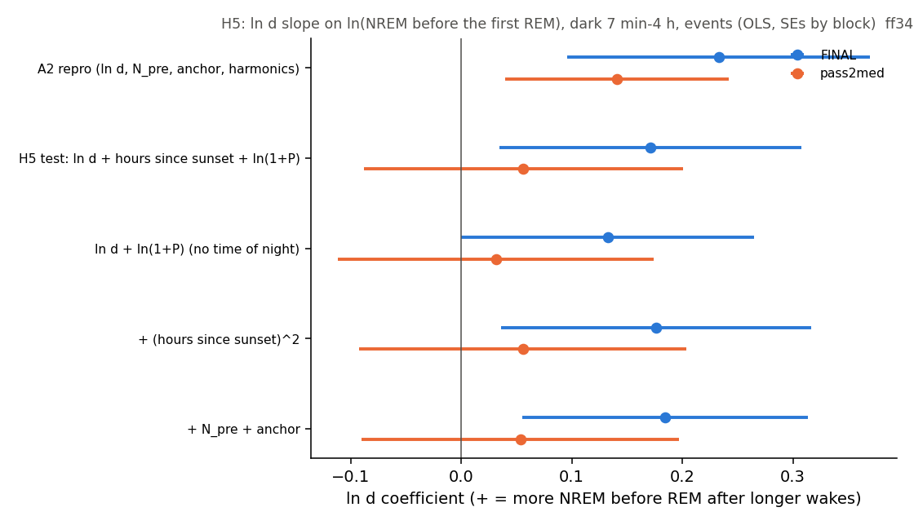
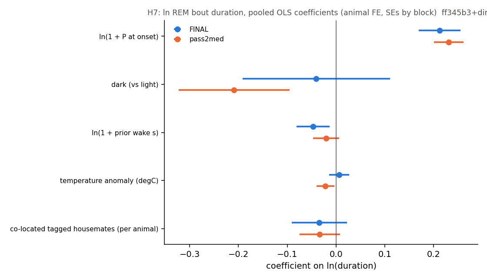
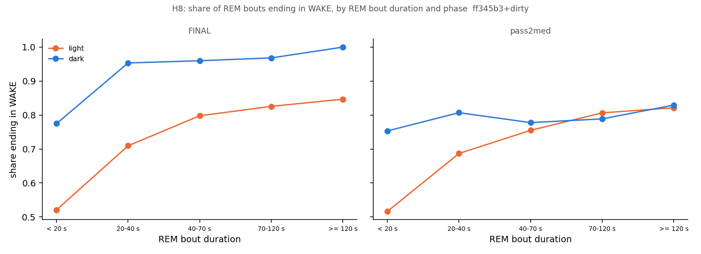
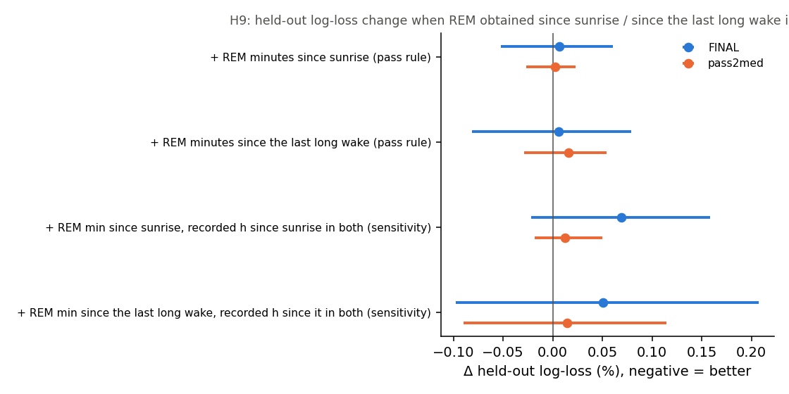
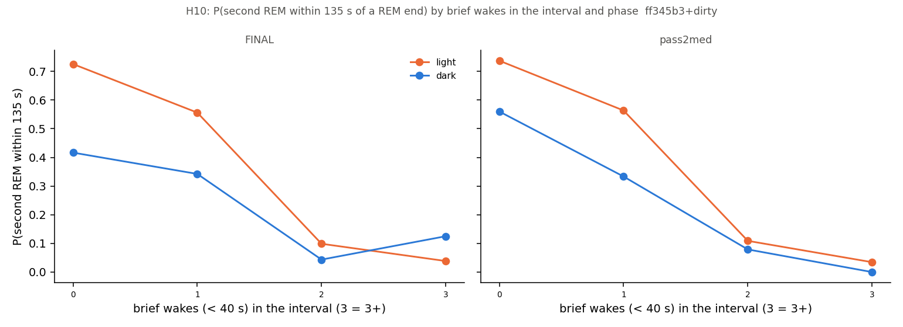
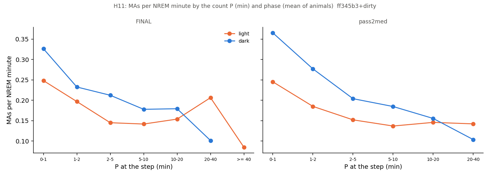
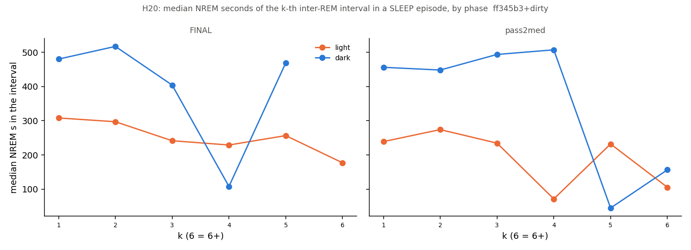
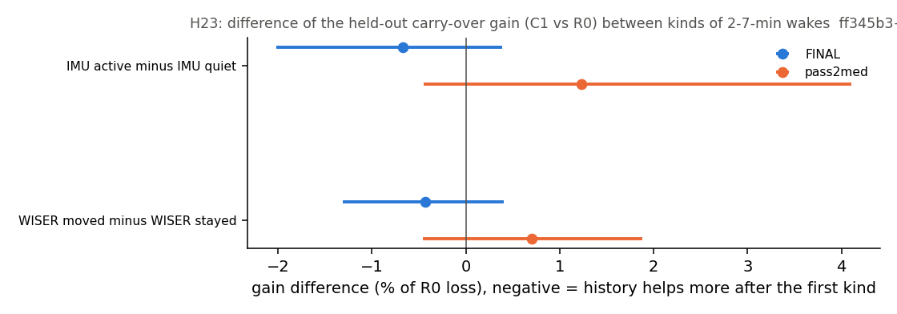

# Sleep behaviour explore — Step F, sequence-only batch (F1): H5, H7, H8, H9, H10, H11, H20, H23 (cohort 2026c)

Plan: [implementation_plan/2026-10-08-sleep-behaviour-explore.md](../../../../implementation_plan/2026-10-08-sleep-behaviour-explore.md) (section 5, the Step F table — hypothesis, test and pass rule written before results and used unchanged; section 9 Amendment 1, the batch split). Builds on Steps A–E ([A](ephys_spikes_sleep_explore_A_2026c.md), [B](ephys_spikes_sleep_explore_B_2026c.md), [C](ephys_spikes_sleep_explore_C_2026c.md), [E](ephys_spikes_sleep_explore_E_2026c.md)) and the [claim audit](ephys_spikes_sleep_schedule_claim_audit_2026c.md) (#32–#43). Driver `ephys/sleep_explore_f1.py run` (commit ff345b3+dirty; file uncommitted at run time); bulk `D:\Field2026_analysis_out\2026c\sleep_explore_F1_20261009_1233`; parts h5, h7, h8, h9, h10, h11, h20, h23; runtime 26.0 min.

**Status: exploration step (technical ledger); claim numbers and statuses belong in the claim audit, not here.** Inputs: the scored 1-s states (FINAL and pass2med), NOAA light, the Phase-0 gap table; H7 also the weather console and Step C's WISER zones; H23 also the WISER default tracks and the head-IMU seconds cache. No LFP features. Everything from 2026-09-11 19:40 is cut. The scorer's EMG is the head IMU; a claim that links IMU movement to a scored state carries that caveat.

## Verdicts at a glance

> **Reading note (main session, 2026-10-10):** "H7 HOLDS" means a named predictor of REM duration holds (the count, #48),
> i.e. REM duration is NOT unregulated; "H20 HOLDS" is the pooled slope only — within episodes no shortening (#53). Read
> the claim audit, not this table, for the claims.

| H | hypothesis | verdict |
|---|---|---|
| H5 | night ramp is time of night, not wake length | INCONCLUSIVE |
| H7 | REM bout duration is unregulated | HOLDS |
| H8 | REM exits differ by phase | HOLDS |
| H9 | no daily REM quota | HOLDS |
| H10 | sequential REMs rarer at night beyond interruptions | HOLDS |
| H11 | MA rate rises with P | DOES NOT HOLD |
| H20 | inter-REM intervals shorten within an episode | HOLDS |
| H23 | 2-7-min wakes are two kinds (quiet vs active) | DOES NOT HOLD |

The full verdict table (pass rule, both scorings, key numbers, reading) is at the end of the report.

## Data

- FINAL: 129 records, 179668 NREM steps (post-round 3 h: 44648), 3880 REM ends, 7442 WAKE ends.
- pass2med: 129 records, 185090 NREM steps (post-round 3 h: 45234), 4219 REM ends, 7513 WAKE ends.

## Definitions

Time is field-PC local time. States per second $s_t \in \{0\ \text{unknown}, 1\ \text{WAKE}, 3\ \text{NREM}, 5\ \text{REM}\}$. Records (sessions of an animal joined across splits ≤ 60 s; FINAL exclusions; cut at 2026-09-11 19:40), the two scorings, the day-half blocks (22; block of the record start) and light are those of Steps A–C. **FINAL** = `states_1s_final` (per-session thresholds); **pass2med** = `states_1s_pass2med` (fixed per-animal thresholds).

### Shared
- **Bout.** A maximal run of one state value $[a, b)$ (s); length $b - a$.
- **Dark.** $\text{dark}(t) = \neg[\text{sunrise}(t) \le t < \text{sunset}(t)]$, NOAA times at the field site (`sleep_quant.sun_times`); never clock hours. **Harmonics** $(\sin, \cos)(2\pi j h/24)$, $j = 1, 2$, $h$ = clock hour.
- **Counter P** (min; Step B's `P_tw600_k0`, the grid point chosen most often and used in Steps C–E). Along a record's bouts: NREM of length $n$: $P \leftarrow P + n/60$; WAKE of length $d$ (any, MAs included): $P \leftarrow P\,e^{-d/600\,\text{s}}$; REM: $P \leftarrow 0$ (κ = 0, full discharge); unknown: $P$ frozen; $P = 0$ at the record start. At a 10-s NREM step with elapsed $e$ s in its bout: $P_t = P_{\text{bout start}} + e/60$. *P at onset* of a bout = $P$ just before it.
- **MA.** A WAKE bout with $d < 40$ s whose neighbours are both NREM (Watson 2016). **Brief wake** = any WAKE bout $< 40$ s (MAs, and the brief arousals between REM and NREM or before REM).
- **Post-round exclusion** (plan §3, day/night contrasts). Units whose time (stated per part) lies in $[g_{end}, g_{end} + 3\,\text{h})$ of a Phase-0 gap of the same animal with cause `round_logged` / `round_inferred` are dropped. Applied in H7, H8, H10, H11, H20 (all contain a phase contrast); H5 uses Step A2's data unchanged (sensitivity with the exclusion); H9 and H23 use Step B's / Phase 2's held-out set-up unchanged (no exclusion).
- **Cluster-robust CI.** Coefficients from OLS / logistic GLMs / multinomial fits with SEs clustered by day-half block ($\hat V = H^{-1}(\sum_g U_g U_g^\top)H^{-1}$ with the small-sample factor; statsmodels' cluster option for OLS / GLM, `sleep_explore_c.mnl_fit` for multinomials); 95 % CI $= \hat\beta \pm 1.96\,\widehat{se}$. Animal fixed effects (intercepts) unless stated. Per-animal estimates refit the model on the animal alone (no fixed effects).
- **Held-out Δ (H9, H23).** Forward chaining over the day-half blocks (train on all earlier blocks, test the next; the first 6 blocks only train); per-step log loss $\ell = -\ln \hat p(y)$; $\Delta = 100\,(\bar\ell_{hi} - \bar\ell_{lo})/\bar\ell_{lo}$ (step-weighted over folds); 95 % CI by bootstrap over folds (2000); animals better = per-animal pooled Δ < 0; **holds** = CI < 0 and ≥ 5/6 animals (`sleep_schedule_phase2.compare`).
- **Verdict.** HOLDS = the plan's pass rule is met on both scorings; DOES NOT HOLD = met on neither; INCONCLUSIVE = met on one only (or, H7, a predictor is significant somewhere without meeting 'holds'). The verdict is against the table's pass rule as written; what a met rule means is stated per hypothesis.

### H5
- **Long wake, T, N_pre** — Step A1 / A2 unchanged (`sleep_explore.post_wake_table`): a WAKE bout $[a_w, b_w)$ with $d \ge 420$ s followed by NREM; $T$ = NREM + MA seconds from $b_w$ to the first REM onset (event), censored at an unknown epoch, the next wake ≥ 7 min or the record end; dark at $b_w$; range dark $7\,\text{min} \le d < 4$ h (A2).
- **P at onset** $P_{on}$ = the counter at $b_w$ (the post-wake NREM bout start): $P_{\text{before}}\,e^{-d/600}$.
- **Hours since sunset** $h_{ss} = (b_w - \text{sunset}_{\text{last}})/3600$, the most recent NOAA sunset before $b_w$.
- **Model (pass rule).** Events only: $\ln T = \alpha_a + \beta_d \ln d + \beta_h h_{ss} + \beta_P \ln(1+P_{on}) + \varepsilon$; $\beta_d > 0$ = more NREM needed before REM after longer wakes at the same time of night and the same count. Supporting: the censored Cox $h(T) = h_{0,a}(T)\exp(\beta^\top x)$ with the same $x$ (negative = REM later), Step A2's model reproduced, $+h_{ss}^2$, $+\ln(1+N_{pre})$ + anchor, and the post-round-excluded subset.

### H7
- **Complete REM bout.** A REM bout $[a, b)$ with known states on both sides inside its record; duration $r = b - a$ (s).
- **Prior wake** $d$ (s): the most recent WAKE bout > 120 s before $a$ (the wake that started the current SLEEP stretch); undefined (bout dropped from models with $\ln d$) if an unknown epoch or the record start comes first.
- **Temperature anomaly** (°C, Phase 4): outdoor temperature minus its 2-harmonic daily fit over the cohort, nearest 5-min sample within 15 min of $a$ (`sleep_schedule_temp.weather_anomaly` / `join_weather`); missing before 08-31.
- **Group size** $n_{coloc}$: other tagged animals in the same WISER house at second $a$ (0 if not in a house; Step C's per-second zones = ROI + 14 in, re-read from Step C's cache); nuisance dummies field / unknown location (vs house).
- **Model (pass rule).** $\ln r = \alpha_a + \beta_P \ln(1+P_{on}) + \beta_D\,\text{dark}(a) + \beta_d \ln(1+d) + \beta_T\,\text{temp\_anom} + \beta_n n_{coloc} + \gamma_1 \text{field} + \gamma_2 \text{unknown} + \varepsilon$; $100(e^{\beta} - 1)$ = % change of the bout duration per unit. Per predictor: **holds** = pooled CI excludes 0 with the same sign on both scorings and ≥ 5/6 rats (per-animal fits, ≥ 30 bouts) share that sign on both; **n.s.** = CI includes 0 on both; else **partial**. Post-round exclusion by $a$.

### H8
- **Exit.** For a complete REM bout followed by NREM or WAKE: exitW = 1 if the next bout is WAKE (brief: < 40 s). Duration bins (s): < 20 s, 20-40 s, 40-70 s, 70-120 s, >= 120 s; phase = dark at $a$.
- **Mantel–Haenszel odds ratio** over strata $k$ (animal × duration bin): $OR_{MH} = \sum_k (a_k d_k/n_k) / \sum_k (b_k c_k/n_k)$, $a$ = dark & WAKE exit, $b$ = dark & NREM exit, $c$ = light & WAKE, $d$ = light & NREM; > 1 = REM ends in WAKE more often at night at matched REM duration. CI: 2.5–97.5 % over 1000 block bootstrap resamples. Logistic exitW ~ dark + duration-bin dummies + animal (SEs by block) alongside. Per animal: MH over duration bins (≥ 5 bouts per phase), with 0.5 added to the four cells of a stratum that has both phases and a zero cell (an animal whose dark REM bouts all end in WAKE has an infinite raw OR; `MH_OR_raw` is shown uncorrected).
- **Pass rule as applied:** ≥ 5 of the 6 rats' per-animal $\ln OR_{MH}$ share one sign, on both scorings, the same sign.

### H9
- **REM minutes since sunrise** $R_{sr}(t)$ = REM seconds / 60 recorded for the animal in $[\text{sunrise}_{\text{last}}, t)$ on its whole timeline (all records; unknown seconds contribute 0); **recorded hours since sunrise** $K_{sr}(t)$ = known seconds / 3600 in the same span.
- **REM minutes since the last long wake** $R_{lw}(t)$ = REM minutes since the end of the last WAKE run ≥ 7 min or unknown run ≥ 10 min (a gap) on the timeline; $K_{lw}(t)$ = recorded hours since then.
- **Models.** Step B's B-full at `P_tw600_k0` (spline $\ln(e+5)$, spline $\ln(1+P_t)$, 2-harmonic clock, day, anchor, dark, L1, animal; sklearn multinomial, C = 1e4) + the column(s) (z-scored), forward chaining over all 16 test folds (the key is fixed, no nested choice). Pass rule: Δ (B-full + $R$) vs B-full has a CI that includes 0 (or lies above 0) for both $R_{sr}$ and $R_{lw}$. Sensitivity: with $K$ in both models. Full-data multinomial coefficients per SD (REM vs stay; a negative coefficient = less REM entry after more REM, the direction a quota predicts).

### H10
- **REM ends.** A REM bout ending at $e$ followed by NREM or a WAKE bout < 40 s, with $[e, e + 135]$ known and inside the record; phase = dark at $e$; post-round exclusion by $e$.
- **Second REM** $Y = 1$ if a REM onset falls in $(e, e + 135]$ s. **Interval** $[e, w)$, $w$ = that onset if $Y = 1$, else $e + 135$. **Brief-wake count** $n_{bw}$ = WAKE bouts < 40 s starting in $[e, w)$ (incl. an arousal right after the REM); $n_{MA}$ = those flanked by NREM (Watson MAs); $n_{W40}$ = WAKE bouts ≥ 40 s starting in $[e, w)$.
- **Models.** Logistic $\Pr(Y=1) = \text{logit}^{-1}(\alpha_a + \beta\,\text{dark} [+ \gamma n_{bw}])$, SEs by block. Pass rule as applied: the dark coefficient with $n_{bw}$ in the model has a CI excluding 0 with the same sign as without it, on both scorings. Landmark sensitivity (fixed exposure): among REM ends without a REM onset in $(e, e + 45]$, $Y$ = onset in $(e + 45, e + 135]$ ~ dark + 1[a brief wake starts in $[e, e + 45)$].

### H11
- **MA step outcome.** Per 10-s NREM step (Step B's steps): $y_{MA} = 1$ if the NREM bout ends in this step with an MA (WAKE < 40 s followed by NREM). Reference outcome $y_{pre}$: ends in a brief wake < 40 s followed by REM.
- **Model (pass rule).** Per phase (dark at the step): logistic $\Pr(y_{MA}=1) = \text{logit}^{-1}(\alpha_a + \beta \ln(1+P_t))$, SEs by block; $\beta > 0$ = more MAs per NREM minute at a higher count. Pass: $\beta$ CI > 0 and ≥ 5/6 per-animal slopes > 0, in each phase, on both scorings. Sensitivity: + spline of elapsed time in the bout + day + 2-harmonic clock. Description: MAs per NREM minute $= \#\text{MA} / (\#\text{steps} \times 10/60)$ per $P$ bin (min: 0-1, 1-2, 2-5, 5-10, 10-20, 20-40, >= 40), mean of animals (cells ≥ 30 steps). Post-round exclusion by the step time.

### H20
- **SLEEP episode** (Watson 2016, `episodes_of`): split at WAKE > 120 s and unknown epochs, trimmed to sleep, ≥ 20 min; episodes starting in a post-round 3 h are dropped. REM bouts $R_1..R_m$ in order.
- **k-th interval** ($k = 1..m-1$): from the end of $R_k$ to the onset of $R_{k+1}$; $I_k$ = NREM seconds in it (the count's units; under `P_tw600_k0` the count is 0 at every interval start, so every interval starts at the same P). The last interval (after $R_m$, to the episode end) is censored. Phase = dark at the end of $R_k$.
- **Model (pass rule).** Completed intervals with $I_k > 0$: $\ln I_k = \alpha_a + \beta_k k + \beta_D\,\text{dark} + \varepsilon$, SEs by block; $\beta_k < 0$ = shorter in later cycles. Pass: $\beta_k$ CI < 0 and ≥ 5/6 per-animal slopes < 0 (animals with ≥ 15 intervals), both scorings. Supporting: episode fixed effects; + $\ln r_k$ + clock; wall-clock interval; episodes with ≥ 4 REM bouts; Cox on $I_k$ censored at the episode end; and the step model: B-full + $k$ (number of REM onsets since the episode start) on NREM steps after the episode's first REM — the REM-vs-stay coefficient of $k$ at the same $P_t$ and clock (+ = REM entry more likely in later cycles).

### H23
- **Post-wake steps and the carry-over gain** (Phase 2 B1 unchanged): NREM steps whose bout follows a WAKE bout ($d > 0$). R0 = elapsed spline + 2-harmonic clock + day + [ln(1+d), fW10] + animal; C1 = R0 + spline $\ln(1+N_{since})$ + $\ln(1 + W_{pre})$ + [ln REM_pre, anchor] (pre-wake history). Fitted per fold on ALL post-wake steps (forward chaining); the gain = Δ C1 vs R0 evaluated on the test steps after 2–7-min wakes ($120 \le d < 420$ s), per kind.
- **IMU active share** of a wake $[a_w, b_w)$: share of IMU-ok seconds in state active / locomoting (IMU seconds cache, field-PC second = UTC − 4 h); known if ≥ 50 % of the wake's seconds are IMU-ok. **IMU quiet / active** = share ≤ / > its median over the 2–7-min wakes of the scoring (outcome-blind split).
- **WISER excursion** (in): reference = median default-track position over the 30 s before the wake (≥ 10 s with positions); excursion = max over 5-s blocks in the wake of the distance of the block median from the reference; known if ≥ 50 % of the wake's seconds have a position. **WISER moved / stayed** = excursion ≥ / < 14 in (the minimum resolvable distance). Net displacement (30 s after vs before) reported.
- **Gain difference.** Per fold, $g_{kind} = \overline{\ell_{C1} - \ell_{R0}}$ over the kind's steps (nats); difference $g_{active} - g_{quiet}$ (and moved − stayed), step-weighted over folds with both kinds, in % of the mean R0 loss of the 2–7-min steps; 95 % CI by bootstrap over folds. Negative = pre-wake history helps more after the active / moved kind. Pass rule as applied: the CI excludes 0 for a split, on both scorings (two splits are tested; multiplicity is stated).

## H5 — the night ramp: time of night or wake length?

**Hypothesis (plan):** "The night ramp (#6b) is time of night, not wake length." **Test:** "within dark: latency ~ ln d + hours since sunset, P at onset." **Pass rule (quoted):** "ln d stays with CI > 0". A met rule means the wake length keeps its own association at the same time of night and the same count (i.e. the ramp is not explained by time of night alone); a rule not met means ln d no longer carries the ramp once time of night is in.

| scores | subset | model | method | term | n | coef | ci_lo | ci_hi | p |
|---|---|---|---|---|---|---|---|---|---|
| FINAL | dark, 7 min-4 h (A2 range) | A2 repro (ln d, N_pre, anchor, harmonics) | OLS on events (+ = more NREM before REM) | l_d | 122 | 0.233 | 0.096 | 0.37 | 0.001 |
| FINAL | dark, 7 min-4 h (A2 range) | H5 test: ln d + hours since sunset + ln(1+P) | OLS on events (+ = more NREM before REM) | l_d | 122 | 0.171 | 0.035 | 0.308 | 0.014 |
| FINAL | dark, 7 min-4 h (A2 range) | H5 test: ln d + hours since sunset + ln(1+P) | OLS on events (+ = more NREM before REM) | hss | 122 | 0.042 | -0.012 | 0.097 | 0.13 |
| FINAL | dark, 7 min-4 h (A2 range) | H5 test: ln d + hours since sunset + ln(1+P) | OLS on events (+ = more NREM before REM) | l_P | 122 | -0.424 | -0.916 | 0.068 | 0.091 |
| FINAL | dark, 7 min-4 h (A2 range) | ln d + ln(1+P) (no time of night) | OLS on events (+ = more NREM before REM) | l_d | 122 | 0.132 | 0.0 | 0.264 | 0.05 |
| FINAL | dark, 7 min-4 h (A2 range) | ln d + ln(1+P) (no time of night) | OLS on events (+ = more NREM before REM) | l_P | 122 | -0.422 | -0.874 | 0.03 | 0.067 |
| FINAL | dark, 7 min-4 h (A2 range) | + (hours since sunset)^2 | OLS on events (+ = more NREM before REM) | l_d | 122 | 0.177 | 0.036 | 0.317 | 0.014 |
| FINAL | dark, 7 min-4 h (A2 range) | + (hours since sunset)^2 | OLS on events (+ = more NREM before REM) | hss | 122 | 0.036 | -0.038 | 0.111 | 0.338 |
| FINAL | dark, 7 min-4 h (A2 range) | + (hours since sunset)^2 | OLS on events (+ = more NREM before REM) | l_P | 122 | -0.42 | -0.92 | 0.079 | 0.099 |
| FINAL | dark, 7 min-4 h (A2 range) | + N_pre + anchor | OLS on events (+ = more NREM before REM) | l_d | 122 | 0.184 | 0.055 | 0.313 | 0.005 |
| FINAL | dark, 7 min-4 h (A2 range) | + N_pre + anchor | OLS on events (+ = more NREM before REM) | hss | 122 | 0.07 | -0.002 | 0.141 | 0.055 |
| FINAL | dark, 7 min-4 h (A2 range) | + N_pre + anchor | OLS on events (+ = more NREM before REM) | l_P | 122 | -0.391 | -0.908 | 0.126 | 0.138 |
| FINAL | dark, 7 min-4 h (A2 range) | H5 test: ln d + hours since sunset + ln(1+P) | Cox, censored (- = REM later) | l_d | 291 | -0.013 | -0.309 | 0.282 | 0.93 |
| FINAL | dark, 7 min-4 h (A2 range) | H5 test: ln d + hours since sunset + ln(1+P) | Cox, censored (- = REM later) | hss | 291 | 0.039 | -0.037 | 0.114 | 0.314 |
| FINAL | dark, 7 min-4 h (A2 range) | H5 test: ln d + hours since sunset + ln(1+P) | Cox, censored (- = REM later) | l_P | 291 | 1.284 | 0.124 | 2.444 | 0.03 |
| FINAL | dark, 7 min-4 h, wake end not in post-round 3 h | A2 repro (ln d, N_pre, anchor, harmonics) | OLS on events (+ = more NREM before REM) | l_d | 110 | 0.22 | 0.094 | 0.346 | 0.001 |
| FINAL | dark, 7 min-4 h, wake end not in post-round 3 h | H5 test: ln d + hours since sunset + ln(1+P) | OLS on events (+ = more NREM before REM) | l_d | 110 | 0.089 | -0.031 | 0.208 | 0.145 |
| FINAL | dark, 7 min-4 h, wake end not in post-round 3 h | H5 test: ln d + hours since sunset + ln(1+P) | OLS on events (+ = more NREM before REM) | hss | 110 | 0.028 | -0.014 | 0.07 | 0.19 |
| FINAL | dark, 7 min-4 h, wake end not in post-round 3 h | H5 test: ln d + hours since sunset + ln(1+P) | OLS on events (+ = more NREM before REM) | l_P | 110 | -0.548 | -1.125 | 0.028 | 0.062 |
| FINAL | dark, 7 min-4 h, wake end not in post-round 3 h | ln d + ln(1+P) (no time of night) | OLS on events (+ = more NREM before REM) | l_d | 110 | 0.059 | -0.064 | 0.182 | 0.35 |
| FINAL | dark, 7 min-4 h, wake end not in post-round 3 h | ln d + ln(1+P) (no time of night) | OLS on events (+ = more NREM before REM) | l_P | 110 | -0.57 | -1.146 | 0.006 | 0.052 |
| FINAL | dark, 7 min-4 h, wake end not in post-round 3 h | + (hours since sunset)^2 | OLS on events (+ = more NREM before REM) | l_d | 110 | 0.083 | -0.029 | 0.195 | 0.147 |
| FINAL | dark, 7 min-4 h, wake end not in post-round 3 h | + (hours since sunset)^2 | OLS on events (+ = more NREM before REM) | hss | 110 | -0.013 | -0.065 | 0.038 | 0.612 |
| FINAL | dark, 7 min-4 h, wake end not in post-round 3 h | + (hours since sunset)^2 | OLS on events (+ = more NREM before REM) | l_P | 110 | -0.591 | -1.126 | -0.055 | 0.031 |
| FINAL | dark, 7 min-4 h, wake end not in post-round 3 h | + N_pre + anchor | OLS on events (+ = more NREM before REM) | l_d | 110 | 0.094 | -0.039 | 0.228 | 0.167 |
| FINAL | dark, 7 min-4 h, wake end not in post-round 3 h | + N_pre + anchor | OLS on events (+ = more NREM before REM) | hss | 110 | 0.051 | -0.01 | 0.112 | 0.103 |
| FINAL | dark, 7 min-4 h, wake end not in post-round 3 h | + N_pre + anchor | OLS on events (+ = more NREM before REM) | l_P | 110 | -0.55 | -1.215 | 0.114 | 0.104 |
| FINAL | dark, 7 min-4 h, wake end not in post-round 3 h | H5 test: ln d + hours since sunset + ln(1+P) | Cox, censored (- = REM later) | l_d | 251 | 0.05 | -0.225 | 0.325 | 0.723 |
| FINAL | dark, 7 min-4 h, wake end not in post-round 3 h | H5 test: ln d + hours since sunset + ln(1+P) | Cox, censored (- = REM later) | hss | 251 | 0.022 | -0.043 | 0.087 | 0.509 |
| FINAL | dark, 7 min-4 h, wake end not in post-round 3 h | H5 test: ln d + hours since sunset + ln(1+P) | Cox, censored (- = REM later) | l_P | 251 | 1.424 | 0.255 | 2.594 | 0.017 |
| pass2med | dark, 7 min-4 h (A2 range) | A2 repro (ln d, N_pre, anchor, harmonics) | OLS on events (+ = more NREM before REM) | l_d | 140 | 0.141 | 0.04 | 0.242 | 0.006 |
| pass2med | dark, 7 min-4 h (A2 range) | H5 test: ln d + hours since sunset + ln(1+P) | OLS on events (+ = more NREM before REM) | l_d | 140 | 0.056 | -0.088 | 0.201 | 0.444 |
| pass2med | dark, 7 min-4 h (A2 range) | H5 test: ln d + hours since sunset + ln(1+P) | OLS on events (+ = more NREM before REM) | hss | 140 | 0.031 | 0.001 | 0.061 | 0.044 |
| pass2med | dark, 7 min-4 h (A2 range) | H5 test: ln d + hours since sunset + ln(1+P) | OLS on events (+ = more NREM before REM) | l_P | 140 | -0.299 | -0.514 | -0.085 | 0.006 |
| pass2med | dark, 7 min-4 h (A2 range) | ln d + ln(1+P) (no time of night) | OLS on events (+ = more NREM before REM) | l_d | 140 | 0.031 | -0.112 | 0.174 | 0.668 |
| pass2med | dark, 7 min-4 h (A2 range) | ln d + ln(1+P) (no time of night) | OLS on events (+ = more NREM before REM) | l_P | 140 | -0.266 | -0.46 | -0.072 | 0.007 |
| pass2med | dark, 7 min-4 h (A2 range) | + (hours since sunset)^2 | OLS on events (+ = more NREM before REM) | l_d | 140 | 0.056 | -0.092 | 0.204 | 0.461 |
| pass2med | dark, 7 min-4 h (A2 range) | + (hours since sunset)^2 | OLS on events (+ = more NREM before REM) | hss | 140 | 0.03 | -0.01 | 0.069 | 0.139 |
| pass2med | dark, 7 min-4 h (A2 range) | + (hours since sunset)^2 | OLS on events (+ = more NREM before REM) | l_P | 140 | -0.301 | -0.515 | -0.087 | 0.006 |
| pass2med | dark, 7 min-4 h (A2 range) | + N_pre + anchor | OLS on events (+ = more NREM before REM) | l_d | 140 | 0.054 | -0.09 | 0.197 | 0.465 |
| pass2med | dark, 7 min-4 h (A2 range) | + N_pre + anchor | OLS on events (+ = more NREM before REM) | hss | 140 | 0.038 | 0.009 | 0.068 | 0.012 |
| pass2med | dark, 7 min-4 h (A2 range) | + N_pre + anchor | OLS on events (+ = more NREM before REM) | l_P | 140 | -0.368 | -0.62 | -0.116 | 0.004 |
| pass2med | dark, 7 min-4 h (A2 range) | H5 test: ln d + hours since sunset + ln(1+P) | Cox, censored (- = REM later) | l_d | 317 | 0.295 | 0.113 | 0.478 | 0.002 |
| pass2med | dark, 7 min-4 h (A2 range) | H5 test: ln d + hours since sunset + ln(1+P) | Cox, censored (- = REM later) | hss | 317 | 0.03 | -0.043 | 0.102 | 0.42 |
| pass2med | dark, 7 min-4 h (A2 range) | H5 test: ln d + hours since sunset + ln(1+P) | Cox, censored (- = REM later) | l_P | 317 | 1.657 | 0.961 | 2.352 | 0.0 |
| pass2med | dark, 7 min-4 h, wake end not in post-round 3 h | A2 repro (ln d, N_pre, anchor, harmonics) | OLS on events (+ = more NREM before REM) | l_d | 128 | 0.144 | 0.041 | 0.248 | 0.006 |
| pass2med | dark, 7 min-4 h, wake end not in post-round 3 h | H5 test: ln d + hours since sunset + ln(1+P) | OLS on events (+ = more NREM before REM) | l_d | 128 | 0.065 | -0.081 | 0.211 | 0.384 |
| pass2med | dark, 7 min-4 h, wake end not in post-round 3 h | H5 test: ln d + hours since sunset + ln(1+P) | OLS on events (+ = more NREM before REM) | hss | 128 | 0.037 | 0.003 | 0.071 | 0.033 |
| pass2med | dark, 7 min-4 h, wake end not in post-round 3 h | H5 test: ln d + hours since sunset + ln(1+P) | OLS on events (+ = more NREM before REM) | l_P | 128 | -0.284 | -0.512 | -0.057 | 0.014 |
| pass2med | dark, 7 min-4 h, wake end not in post-round 3 h | ln d + ln(1+P) (no time of night) | OLS on events (+ = more NREM before REM) | l_d | 128 | 0.033 | -0.118 | 0.185 | 0.667 |
| pass2med | dark, 7 min-4 h, wake end not in post-round 3 h | ln d + ln(1+P) (no time of night) | OLS on events (+ = more NREM before REM) | l_P | 128 | -0.261 | -0.464 | -0.059 | 0.011 |
| pass2med | dark, 7 min-4 h, wake end not in post-round 3 h | + (hours since sunset)^2 | OLS on events (+ = more NREM before REM) | l_d | 128 | 0.067 | -0.083 | 0.217 | 0.381 |
| pass2med | dark, 7 min-4 h, wake end not in post-round 3 h | + (hours since sunset)^2 | OLS on events (+ = more NREM before REM) | hss | 128 | 0.041 | -0.014 | 0.095 | 0.143 |
| pass2med | dark, 7 min-4 h, wake end not in post-round 3 h | + (hours since sunset)^2 | OLS on events (+ = more NREM before REM) | l_P | 128 | -0.279 | -0.504 | -0.054 | 0.015 |
| pass2med | dark, 7 min-4 h, wake end not in post-round 3 h | + N_pre + anchor | OLS on events (+ = more NREM before REM) | l_d | 128 | 0.054 | -0.092 | 0.2 | 0.469 |
| pass2med | dark, 7 min-4 h, wake end not in post-round 3 h | + N_pre + anchor | OLS on events (+ = more NREM before REM) | hss | 128 | 0.041 | 0.005 | 0.077 | 0.024 |
| pass2med | dark, 7 min-4 h, wake end not in post-round 3 h | + N_pre + anchor | OLS on events (+ = more NREM before REM) | l_P | 128 | -0.365 | -0.619 | -0.111 | 0.005 |
| pass2med | dark, 7 min-4 h, wake end not in post-round 3 h | H5 test: ln d + hours since sunset + ln(1+P) | Cox, censored (- = REM later) | l_d | 273 | 0.271 | 0.112 | 0.43 | 0.001 |
| pass2med | dark, 7 min-4 h, wake end not in post-round 3 h | H5 test: ln d + hours since sunset + ln(1+P) | Cox, censored (- = REM later) | hss | 273 | -0.005 | -0.074 | 0.063 | 0.878 |
| pass2med | dark, 7 min-4 h, wake end not in post-round 3 h | H5 test: ln d + hours since sunset + ln(1+P) | Cox, censored (- = REM later) | l_P | 273 | 1.662 | 1.122 | 2.201 | 0.0 |

Per animal (OLS of the H5 model, ≥ 10 events):

| scores | animal | events | ln_d | hss | l_P |
|---|---|---|---|---|---|
| FINAL | SF07 | 16 | 0.283 | 0.001 | 0.242 |
| FINAL | SF08 | 20 | 0.476 | 0.129 | 0.511 |
| FINAL | SF09 | 17 | 0.059 | -0.006 | 0.541 |
| FINAL | SF10 | 27 | -0.0 | 0.056 | -1.362 |
| FINAL | SF11 | 17 | 0.171 | 0.006 | -0.059 |
| FINAL | SF12 | 25 | -0.004 | 0.001 | -0.378 |
| pass2med | SF07 | 20 | 0.158 | 0.005 | -0.208 |
| pass2med | SF08 | 26 | 0.698 | 0.145 | 1.563 |
| pass2med | SF09 | 23 | -0.102 | -0.018 | -0.13 |
| pass2med | SF10 | 28 | 0.086 | 0.043 | -0.354 |
| pass2med | SF11 | 16 | -0.014 | -0.02 | -0.408 |
| pass2med | SF12 | 27 | -0.116 | 0.005 | -0.406 |

- **FINAL:** ln d +0.171 [+0.035, +0.308] with hours since sunset +0.042 [-0.012, +0.097] per h and ln(1+P) in the model (n 122 events of 291 sleeps; r(ln d, h_ss) = -0.31); Step A2's slope reproduced +0.233 [+0.096, +0.370]; 4/6 rats with ln d > 0; censored Cox ln d -0.013 [-0.309, +0.282] (negative = REM later) → rule met.
- **pass2med:** ln d +0.056 [-0.088, +0.201] with hours since sunset +0.031 [+0.001, +0.061] per h and ln(1+P) in the model (n 140 events of 317 sleeps; r(ln d, h_ss) = -0.35); Step A2's slope reproduced +0.141 [+0.040, +0.242]; 3/6 rats with ln d > 0; censored Cox ln d +0.295 [+0.113, +0.478] (negative = REM later) → rule NOT met.

*Implementation notes and deviations (stated before the run unless marked):* data = Step A2's post-long-wake table unchanged (no post-round exclusion, as A2), dark 7 min–4 h; P at onset = the counter `P_tw600_k0` at the post-wake NREM bout start; the primary estimate is the events-only OLS that carries #6b's slope (A2), the censored Cox is supporting. The hypothesis line and the pass column point in opposite directions; the verdict follows the pass column.

**H5 verdict: INCONCLUSIVE** (pass rule not met on every scoring).

Reading: ln d keeps CI > 0 at the same hours since sunset and P on FINAL only. FINAL: ln d +0.17 [+0.03, +0.31] with time of night and P (A2 alone +0.23 [+0.10, +0.37]; with P but no time of night +0.13 [+0.00, +0.26]; post-round sleeps excluded +0.09 [-0.03, +0.21]); hours since sunset +0.042 [-0.012, +0.097] per h; pass2med: ln d +0.06 [-0.09, +0.20] with time of night and P (A2 alone +0.14 [+0.04, +0.24]; with P but no time of night +0.03 [-0.11, +0.17]; post-round sleeps excluded +0.06 [-0.08, +0.21]); hours since sunset +0.031 [+0.001, +0.061] per h.

## H7 — is REM bout duration related to the count, phase, prior wake, temperature or group size?

**Hypothesis (plan):** "REM bout duration is unregulated (the planned C3 never run)." **Test:** "ln REM duration ~ P at onset + dark + ln d + temperature + group size." **Pass rule (quoted):** "all n.s. (scoped negative) or a named predictor holds".

Bouts:

| scores | complete_rem_bouts | post_round_dropped | median_dur_s_light | median_dur_s_dark | prior_wake_known_share | temp_known_share | entered_from_wake_share | in_house_share |
|---|---|---|---|---|---|---|---|---|
| FINAL | 4525 | 1070 | 52.0 | 58.0 | 0.961 | 1.0 | 0.155 | 0.99 |
| pass2med | 4824 | 1088 | 51.0 | 47.5 | 0.959 | 1.0 | 0.136 | 0.989 |

Bouts per model: FINAL: H7 (plan): P + dark + ln d + temperature + group size 3321, without ln d (all bouts with temperature) 3455, + experiment day + 2-harmonic clock 3321, + entered from a wake 3321, POST HOC: bouts with P at onset >= 1 min (no REM fragments right after a REM) 1934; pass2med: H7 (plan): P + dark + ln d + temperature + group size 3581, without ln d (all bouts with temperature) 3736, + experiment day + 2-harmonic clock 3581, + entered from a wake 3581, POST HOC: bouts with P at onset >= 1 min (no REM fragments right after a REM) 2043

Pooled coefficients (OLS on ln duration; % per unit = 100(e^β − 1)):

| scores | model | term | label | n_bouts | coef | ci_lo | ci_hi | p |
|---|---|---|---|---|---|---|---|---|
| FINAL | H7 (plan): P + dark + ln d + temperature + group size | l_P | ln(1 + P at onset) | 3321 | 0.2123 | 0.1698 | 0.2547 | 0.0 |
| FINAL | H7 (plan): P + dark + ln d + temperature + group size | darkf | dark (vs light) | 3321 | -0.0405 | -0.1918 | 0.1107 | 0.5996 |
| FINAL | H7 (plan): P + dark + ln d + temperature + group size | l_dprior | ln(1 + prior wake s) | 3321 | -0.0469 | -0.0808 | -0.0129 | 0.0069 |
| FINAL | H7 (plan): P + dark + ln d + temperature + group size | temp_anom | temperature anomaly (degC) | 3321 | 0.0064 | -0.0137 | 0.0265 | 0.5332 |
| FINAL | H7 (plan): P + dark + ln d + temperature + group size | n_coloc | co-located tagged housemates (per animal) | 3321 | -0.0343 | -0.0912 | 0.0227 | 0.2385 |
| FINAL | without ln d (all bouts with temperature) | l_P | ln(1 + P at onset) | 3455 | 0.2105 | 0.1695 | 0.2515 | 0.0 |
| FINAL | without ln d (all bouts with temperature) | darkf | dark (vs light) | 3455 | -0.0932 | -0.2248 | 0.0383 | 0.1649 |
| FINAL | without ln d (all bouts with temperature) | temp_anom | temperature anomaly (degC) | 3455 | 0.0067 | -0.0104 | 0.0238 | 0.4405 |
| FINAL | without ln d (all bouts with temperature) | n_coloc | co-located tagged housemates (per animal) | 3455 | -0.0272 | -0.0815 | 0.027 | 0.3254 |
| FINAL | + experiment day + 2-harmonic clock | l_P | ln(1 + P at onset) | 3321 | 0.2087 | 0.1632 | 0.2543 | 0.0 |
| FINAL | + experiment day + 2-harmonic clock | darkf | dark (vs light) | 3321 | 0.0752 | -0.1304 | 0.2808 | 0.4733 |
| FINAL | + experiment day + 2-harmonic clock | l_dprior | ln(1 + prior wake s) | 3321 | -0.039 | -0.0697 | -0.0083 | 0.0128 |
| FINAL | + experiment day + 2-harmonic clock | temp_anom | temperature anomaly (degC) | 3321 | 0.0009 | -0.0273 | 0.0292 | 0.9475 |
| FINAL | + experiment day + 2-harmonic clock | n_coloc | co-located tagged housemates (per animal) | 3321 | -0.0416 | -0.1018 | 0.0185 | 0.1745 |
| FINAL | + entered from a wake | l_P | ln(1 + P at onset) | 3321 | 0.1663 | 0.128 | 0.2047 | 0.0 |
| FINAL | + entered from a wake | darkf | dark (vs light) | 3321 | -0.0174 | -0.1736 | 0.1388 | 0.8272 |
| FINAL | + entered from a wake | l_dprior | ln(1 + prior wake s) | 3321 | -0.0441 | -0.078 | -0.0102 | 0.0107 |
| FINAL | + entered from a wake | temp_anom | temperature anomaly (degC) | 3321 | 0.0077 | -0.013 | 0.0284 | 0.4651 |
| FINAL | + entered from a wake | n_coloc | co-located tagged housemates (per animal) | 3321 | -0.0314 | -0.0908 | 0.028 | 0.3004 |
| FINAL | + entered from a wake | from_wake | entered from a wake | 3321 | -0.3272 | -0.4638 | -0.1906 | 0.0 |
| FINAL | POST HOC: bouts with P at onset >= 1 min (no REM fragments right after a REM) | l_P | ln(1 + P at onset) | 1934 | 0.1795 | 0.1199 | 0.2391 | 0.0 |
| FINAL | POST HOC: bouts with P at onset >= 1 min (no REM fragments right after a REM) | darkf | dark (vs light) | 1934 | 0.0021 | -0.1676 | 0.1719 | 0.9803 |
| FINAL | POST HOC: bouts with P at onset >= 1 min (no REM fragments right after a REM) | l_dprior | ln(1 + prior wake s) | 1934 | -0.0745 | -0.1141 | -0.0348 | 0.0002 |
| FINAL | POST HOC: bouts with P at onset >= 1 min (no REM fragments right after a REM) | temp_anom | temperature anomaly (degC) | 1934 | 0.0001 | -0.0304 | 0.0305 | 0.9953 |
| FINAL | POST HOC: bouts with P at onset >= 1 min (no REM fragments right after a REM) | n_coloc | co-located tagged housemates (per animal) | 1934 | -0.0455 | -0.1142 | 0.0233 | 0.1953 |
| pass2med | H7 (plan): P + dark + ln d + temperature + group size | l_P | ln(1 + P at onset) | 3581 | 0.2313 | 0.2011 | 0.2615 | 0.0 |
| pass2med | H7 (plan): P + dark + ln d + temperature + group size | darkf | dark (vs light) | 3581 | -0.209 | -0.3225 | -0.0955 | 0.0003 |
| pass2med | H7 (plan): P + dark + ln d + temperature + group size | l_dprior | ln(1 + prior wake s) | 3581 | -0.0206 | -0.0472 | 0.006 | 0.1284 |
| pass2med | H7 (plan): P + dark + ln d + temperature + group size | temp_anom | temperature anomaly (degC) | 3581 | -0.0218 | -0.0399 | -0.0038 | 0.0175 |
| pass2med | H7 (plan): P + dark + ln d + temperature + group size | n_coloc | co-located tagged housemates (per animal) | 3581 | -0.0334 | -0.0751 | 0.0083 | 0.117 |
| pass2med | without ln d (all bouts with temperature) | l_P | ln(1 + P at onset) | 3736 | 0.2301 | 0.2007 | 0.2595 | 0.0 |
| pass2med | without ln d (all bouts with temperature) | darkf | dark (vs light) | 3736 | -0.2425 | -0.3288 | -0.1561 | 0.0 |
| pass2med | without ln d (all bouts with temperature) | temp_anom | temperature anomaly (degC) | 3736 | -0.0189 | -0.0352 | -0.0026 | 0.0229 |
| pass2med | without ln d (all bouts with temperature) | n_coloc | co-located tagged housemates (per animal) | 3736 | -0.0312 | -0.0718 | 0.0094 | 0.132 |
| pass2med | + experiment day + 2-harmonic clock | l_P | ln(1 + P at onset) | 3581 | 0.2277 | 0.1961 | 0.2592 | 0.0 |
| pass2med | + experiment day + 2-harmonic clock | darkf | dark (vs light) | 3581 | -0.0907 | -0.2846 | 0.1032 | 0.3591 |
| pass2med | + experiment day + 2-harmonic clock | l_dprior | ln(1 + prior wake s) | 3581 | -0.015 | -0.0451 | 0.0151 | 0.3274 |
| pass2med | + experiment day + 2-harmonic clock | temp_anom | temperature anomaly (degC) | 3581 | -0.014 | -0.0317 | 0.0036 | 0.1197 |
| pass2med | + experiment day + 2-harmonic clock | n_coloc | co-located tagged housemates (per animal) | 3581 | -0.0489 | -0.0805 | -0.0173 | 0.0024 |
| pass2med | + entered from a wake | l_P | ln(1 + P at onset) | 3581 | 0.1773 | 0.1431 | 0.2115 | 0.0 |
| pass2med | + entered from a wake | darkf | dark (vs light) | 3581 | -0.1715 | -0.2897 | -0.0534 | 0.0044 |
| pass2med | + entered from a wake | l_dprior | ln(1 + prior wake s) | 3581 | -0.0189 | -0.0446 | 0.0068 | 0.1493 |
| pass2med | + entered from a wake | temp_anom | temperature anomaly (degC) | 3581 | -0.0213 | -0.0397 | -0.0028 | 0.024 |
| pass2med | + entered from a wake | n_coloc | co-located tagged housemates (per animal) | 3581 | -0.0284 | -0.0716 | 0.0147 | 0.1966 |
| pass2med | + entered from a wake | from_wake | entered from a wake | 3581 | -0.4304 | -0.5801 | -0.2808 | 0.0 |
| pass2med | POST HOC: bouts with P at onset >= 1 min (no REM fragments right after a REM) | l_P | ln(1 + P at onset) | 2043 | 0.2241 | 0.1739 | 0.2743 | 0.0 |
| pass2med | POST HOC: bouts with P at onset >= 1 min (no REM fragments right after a REM) | darkf | dark (vs light) | 2043 | -0.169 | -0.3301 | -0.0078 | 0.0399 |
| pass2med | POST HOC: bouts with P at onset >= 1 min (no REM fragments right after a REM) | l_dprior | ln(1 + prior wake s) | 2043 | -0.0402 | -0.0735 | -0.0069 | 0.018 |
| pass2med | POST HOC: bouts with P at onset >= 1 min (no REM fragments right after a REM) | temp_anom | temperature anomaly (degC) | 2043 | -0.0237 | -0.0459 | -0.0014 | 0.037 |
| pass2med | POST HOC: bouts with P at onset >= 1 min (no REM fragments right after a REM) | n_coloc | co-located tagged housemates (per animal) | 2043 | -0.0417 | -0.0967 | 0.0134 | 0.1381 |

Per animal (≥ 30 bouts; the plan model):

| scores | animal | bouts | l_P | darkf | l_dprior | temp_anom | n_coloc |
|---|---|---|---|---|---|---|---|
| FINAL | SF07 | 635 | 0.145 | -0.221 | -0.099 | 0.027 | -0.067 |
| FINAL | SF08 | 640 | 0.333 | -0.234 | -0.019 | -0.004 | -0.049 |
| FINAL | SF09 | 548 | 0.192 | -0.012 | -0.02 | 0.006 | 0.037 |
| FINAL | SF10 | 619 | 0.21 | -0.183 | -0.002 | -0.011 | -0.047 |
| FINAL | SF11 | 340 | 0.078 | 0.174 | -0.034 | -0.019 | -0.085 |
| FINAL | SF12 | 539 | 0.214 | 0.145 | -0.112 | 0.037 | -0.01 |
| pass2med | SF07 | 746 | 0.214 | -0.099 | -0.023 | -0.022 | -0.073 |
| pass2med | SF08 | 723 | 0.376 | -0.494 | -0.044 | -0.034 | -0.021 |
| pass2med | SF09 | 548 | 0.187 | -0.117 | -0.044 | -0.007 | -0.025 |
| pass2med | SF10 | 646 | 0.182 | -0.287 | 0.006 | -0.03 | -0.059 |
| pass2med | SF11 | 380 | 0.073 | 0.16 | -0.048 | -0.043 | -0.068 |
| pass2med | SF12 | 538 | 0.246 | -0.188 | 0.029 | 0.004 | 0.018 |

Status per predictor (holds / n.s. / partial, both scorings):

| term | label | FINAL_coef | FINAL_ci | FINAL_pct_per_unit | FINAL_rats_same_sign | pass2med_coef | pass2med_ci | pass2med_pct_per_unit | pass2med_rats_same_sign | status |
|---|---|---|---|---|---|---|---|---|---|---|
| l_P | ln(1 + P at onset) | 0.212 | [+0.170, +0.255] | 23.648 | 6/6 | 0.231 | [+0.201, +0.262] | 26.021 | 6/6 | holds |
| darkf | dark (vs light) | -0.041 | [-0.192, +0.111] | -3.971 | 4/6 | -0.209 | [-0.323, -0.096] | -18.861 | 5/6 | partial |
| l_dprior | ln(1 + prior wake s) | -0.047 | [-0.081, -0.013] | -4.578 | 6/6 | -0.021 | [-0.047, +0.006] | -2.041 | 4/6 | partial |
| temp_anom | temperature anomaly (degC) | 0.006 | [-0.014, +0.027] | 0.642 | 3/6 | -0.022 | [-0.040, -0.004] | -2.16 | 5/6 | partial |
| n_coloc | co-located tagged housemates (per animal) | -0.034 | [-0.091, +0.023] | -3.367 | 5/6 | -0.033 | [-0.075, +0.008] | -3.282 | 5/6 | n.s. |

Caveat: the scorer requires REM ≥ 7 s and turns REM with ≥ 3 of 5 s of head movement into WAKE (`imu_remclean`, both scorings), so a REM bout's end can be set by head movement; group size is WISER same-house (ROI + 14 in), not contact.

*Implementation notes and deviations (stated before the run unless marked):* 'ln d' read as the prior wake of the SLEEP stretch (the last wake > 120 s; the plan's matched-prior-wake definition); 'temperature' as Phase 4's temperature anomaly; location dummies (field / unknown vs house) added as nuisance terms because group size is 0 by construction outside a house; the 'P at onset ≥ 1 min' row was added after the first (scratch) run and does not enter the verdict.

**H7 verdict: HOLDS** — named predictor(s): ln(1 + P at onset).

Reading: ln(1 + P at onset): holds, FINAL +23.6 % per unit (6/6 rats), pass2med +26.0 % per unit (6/6 rats); dark (vs light): partial (CI excludes 0 on pass2med; FINAL -0.041 [-0.192, +0.111], pass2med -0.209 [-0.323, -0.096]); ln(1 + prior wake s): partial (CI excludes 0 on FINAL; FINAL -0.047 [-0.081, -0.013], pass2med -0.021 [-0.047, +0.006]); temperature anomaly (degC): partial (CI excludes 0 on pass2med; FINAL +0.006 [-0.014, +0.027], pass2med -0.022 [-0.040, -0.004]); co-located tagged housemates (per animal): n.s.; post hoc, bouts with P at onset >= 1 min: ln(1+P) FINAL +0.180 [+0.120, +0.239], pass2med +0.224 [+0.174, +0.274].

## H8 — do REM exits differ by phase at matched REM duration?

**Hypothesis (plan):** "REM exits differ by phase." **Test:** "share of REM bouts ending in WAKE vs NREM, night vs day, matched duration." **Pass rule (quoted):** "≥ 5/6 same sign".

| scores | model | term | coef | ci_lo | ci_hi | OR | n_bouts | p |
|---|---|---|---|---|---|---|---|---|
| FINAL | Mantel-Haenszel OR (strata animal x duration bin), CI by block bootstrap | dark | 1.74 | 1.157 | 2.721 | 5.698 | 3455 | nan |
| FINAL | logistic exit WAKE ~ dark + duration bins + animal (SEs by block) | dark | 1.618 | 0.973 | 2.263 | 5.042 | 3455 | 0.0 |
| FINAL | logistic exit WAKE ~ dark + animal (NOT duration-matched; reference) | dark | 1.561 | 0.828 | 2.294 | 4.765 | 3455 | 0.0 |
| FINAL | among WAKE exits: brief (< 40 s) ~ dark + duration bins + animal | dark | -0.376 | -0.57 | -0.181 | 0.687 | 2584 | 0.0 |
| pass2med | Mantel-Haenszel OR (strata animal x duration bin), CI by block bootstrap | dark | 0.369 | -0.064 | 1.011 | 1.446 | 3736 | nan |
| pass2med | logistic exit WAKE ~ dark + duration bins + animal (SEs by block) | dark | 0.364 | -0.151 | 0.878 | 1.439 | 3736 | 0.166 |
| pass2med | logistic exit WAKE ~ dark + animal (NOT duration-matched; reference) | dark | 0.315 | -0.191 | 0.822 | 1.371 | 3736 | 0.222 |
| pass2med | among WAKE exits: brief (< 40 s) ~ dark + duration bins + animal | dark | -0.092 | -0.417 | 0.232 | 0.912 | 2673 | 0.577 |

Share ending in WAKE by duration bin and phase:

| scores | dur_bin | bouts | share_wake | share_brief_wake | phase |
|---|---|---|---|---|---|
| FINAL | < 20 s | 718 | 0.521 | 0.393 | light |
| FINAL | < 20 s | 40 | 0.775 | 0.45 | dark |
| FINAL | 20-40 s | 599 | 0.71 | 0.566 | light |
| FINAL | 20-40 s | 43 | 0.953 | 0.558 | dark |
| FINAL | 40-70 s | 658 | 0.798 | 0.565 | light |
| FINAL | 40-70 s | 50 | 0.96 | 0.62 | dark |
| FINAL | 70-120 s | 665 | 0.826 | 0.577 | light |
| FINAL | 70-120 s | 63 | 0.968 | 0.714 | dark |
| FINAL | >= 120 s | 581 | 0.847 | 0.623 | light |
| FINAL | >= 120 s | 38 | 1.0 | 0.579 | dark |
| pass2med | < 20 s | 788 | 0.516 | 0.407 | light |
| pass2med | < 20 s | 73 | 0.753 | 0.438 | dark |
| pass2med | 20-40 s | 658 | 0.687 | 0.544 | light |
| pass2med | 20-40 s | 57 | 0.807 | 0.614 | dark |
| pass2med | 40-70 s | 698 | 0.755 | 0.583 | light |
| pass2med | 40-70 s | 54 | 0.778 | 0.704 | dark |
| pass2med | 70-120 s | 708 | 0.806 | 0.593 | light |
| pass2med | 70-120 s | 71 | 0.789 | 0.69 | dark |
| pass2med | >= 120 s | 588 | 0.821 | 0.624 | light |
| pass2med | >= 120 s | 41 | 0.829 | 0.463 | dark |

Per animal (MH over duration bins):

| scores | animal | bouts_dark | bouts_light | share_wake_dark | share_wake_light | MH_OR_raw | MH_OR | ln_OR |
|---|---|---|---|---|---|---|---|---|
| FINAL | SF07 | 28 | 612 | 0.643 | 0.57 | 1.687 | 1.524 | 0.421 |
| FINAL | SF08 | 37 | 633 | 0.946 | 0.716 | 6.608 | 3.586 | 1.277 |
| FINAL | SF09 | 34 | 542 | 1.0 | 0.83 | nan | 2.706 | 0.995 |
| FINAL | SF10 | 42 | 626 | 0.976 | 0.732 | 16.236 | 5.412 | 1.689 |
| FINAL | SF11 | 47 | 302 | 0.979 | 0.914 | 4.009 | 1.542 | 0.433 |
| FINAL | SF12 | 46 | 506 | 0.978 | 0.749 | 15.417 | 4.753 | 1.559 |
| pass2med | SF07 | 37 | 717 | 0.541 | 0.469 | 1.286 | 1.262 | 0.233 |
| pass2med | SF08 | 65 | 691 | 0.862 | 0.718 | 3.224 | 2.68 | 0.986 |
| pass2med | SF09 | 38 | 529 | 1.0 | 0.894 | nan | 2.121 | 0.752 |
| pass2med | SF10 | 50 | 650 | 0.72 | 0.711 | 1.116 | 1.116 | 0.11 |
| pass2med | SF11 | 55 | 353 | 0.745 | 0.807 | 0.684 | 0.684 | -0.38 |
| pass2med | SF12 | 51 | 500 | 0.824 | 0.776 | 1.319 | 1.213 | 0.193 |

- **FINAL:** per-animal MH ln OR > 0 (more WAKE exits at night) in 6/6, < 0 in 0/6; pooled MH OR 5.70 [3.18, 15.19], logistic OR 5.04 [2.65, 9.61] (3455 bouts) → rule met.
- **pass2med:** per-animal MH ln OR > 0 (more WAKE exits at night) in 5/6, < 0 in 1/6; pooled MH OR 1.45 [0.94, 2.75], logistic OR 1.44 [0.86, 2.41] (3736 bouts) → rule met.

Caveat: an exit to WAKE can be produced by the scorer's REM-clean rule (≥ 3 of 5 s of head movement → WAKE).

*Implementation notes and deviations (stated before the run unless marked):* 'matched duration' = 5 strata of REM bout duration within animal (Mantel–Haenszel), logistic model alongside; '≥ 5/6 same sign' applied to the per-animal MH log odds ratios, which carry a 0.5 continuity correction in strata with a zero cell (corrected after the first scratch run: an animal whose dark REM bouts all ended in WAKE had an infinite OR and was dropped from the sign count).

**H8 verdict: HOLDS** (more WAKE exits at night).

Reading: at matched REM duration, REM bouts end in WAKE more often at night in >= 5/6 rats on every scoring; FINAL: WAKE exits light 0.73 vs dark 0.94, pooled MH OR 5.70 [3.18, 15.19], rats > 1: 6/6 (incl. SF09: every dark REM bout ended in WAKE, infinite raw OR, counted through the continuity correction); pass2med: WAKE exits light 0.71 vs dark 0.79, pooled MH OR 1.45 [0.94, 2.75] (CI includes 1), rats > 1: 5/6 (incl. SF09: every dark REM bout ended in WAKE, infinite raw OR, counted through the continuity correction).

## H9 — a daily REM quota?

**Hypothesis (plan):** "There is no daily REM quota." **Test:** "add 'REM minutes since sunrise' (and since the last long wake) to step B." **Pass rule (quoted):** "adds nothing (CI includes 0)". Applied to both terms, on both scorings; a CI entirely above 0 (worse) also counts as adding nothing.

Distribution over NREM steps (min / h): FINAL: rem_sr median 42.7 (90 % 92.4), rec_sr median 6.0 (90 % 15.7), rem_lw median 7.0 (90 % 35.2), rec_lw median 1.1 (90 % 4.0) | pass2med: rem_sr median 45.7 (90 % 95.1), rec_sr median 6.1 (90 % 16.1), rem_lw median 7.3 (90 % 34.8), rec_lw median 1.0 (90 % 3.9)

| scores | subset | comparison | n_steps | n_rem | delta_pct | ci_lo_pct | ci_hi_pct | folds_better | folds | animals_better | animals | holds |
|---|---|---|---|---|---|---|---|---|---|---|---|---|
| FINAL | + REM minutes since sunrise (pass rule) | B+rem_sr vs B | 126231 | 2588 | 0.007 | -0.052 | 0.061 | 10 | 16 | 2 | 6 | False |
| FINAL | + REM minutes since the last long wake (pass rule) | B+rem_lw vs B | 126231 | 2588 | 0.006 | -0.081 | 0.079 | 8 | 16 | 2 | 6 | False |
| FINAL | + REM min since sunrise, recorded h since sunrise in both (sensitivity) | B+rec_sr+rem_sr vs B+rec_sr | 126231 | 2588 | 0.069 | -0.021 | 0.159 | 6 | 16 | 0 | 6 | False |
| FINAL | + REM min since the last long wake, recorded h since it in both (sensitivity) | B+rec_lw+rem_lw vs B+rec_lw | 126231 | 2588 | 0.051 | -0.097 | 0.208 | 11 | 16 | 3 | 6 | False |
| pass2med | + REM minutes since sunrise (pass rule) | B+rem_sr vs B | 126889 | 2714 | 0.002 | -0.027 | 0.023 | 9 | 16 | 2 | 6 | False |
| pass2med | + REM minutes since the last long wake (pass rule) | B+rem_lw vs B | 126889 | 2714 | 0.016 | -0.029 | 0.054 | 6 | 16 | 3 | 6 | False |
| pass2med | + REM min since sunrise, recorded h since sunrise in both (sensitivity) | B+rec_sr+rem_sr vs B+rec_sr | 126889 | 2714 | 0.012 | -0.018 | 0.05 | 7 | 16 | 2 | 6 | False |
| pass2med | + REM min since the last long wake, recorded h since it in both (sensitivity) | B+rec_lw+rem_lw vs B+rec_lw | 126889 | 2714 | 0.015 | -0.09 | 0.114 | 9 | 16 | 2 | 6 | False |

Full-data multinomial coefficients (per SD of the added column; cluster-robust CI by block):

| scores | model | term | equation | sd | coef | ci_lo | ci_hi | p |
|---|---|---|---|---|---|---|---|---|
| FINAL | B+rem_sr | rem_sr | REM vs stay | 32.1027 | 0.0043 | -0.072 | 0.0805 | 0.9126 |
| FINAL | B+rem_sr | rem_sr | WAKE vs stay | 32.1027 | 0.014 | -0.0371 | 0.065 | 0.5917 |
| FINAL | B+rem_lw | rem_lw | REM vs stay | 16.3924 | 0.035 | -0.0024 | 0.0724 | 0.0668 |
| FINAL | B+rem_lw | rem_lw | WAKE vs stay | 16.3924 | -0.0251 | -0.0693 | 0.0192 | 0.2669 |
| FINAL | B+rec_sr | rec_sr | REM vs stay | 5.3178 | 0.1436 | -0.0242 | 0.3114 | 0.0935 |
| FINAL | B+rec_sr | rec_sr | WAKE vs stay | 5.3178 | 0.0847 | -0.0437 | 0.213 | 0.196 |
| FINAL | B+rec_sr+rem_sr | rec_sr | REM vs stay | 5.3178 | 0.2439 | -0.0083 | 0.4962 | 0.058 |
| FINAL | B+rec_sr+rem_sr | rec_sr | WAKE vs stay | 5.3178 | 0.196 | 0.0683 | 0.3238 | 0.0026 |
| FINAL | B+rec_sr+rem_sr | rem_sr | REM vs stay | 32.1027 | -0.0988 | -0.2143 | 0.0167 | 0.0935 |
| FINAL | B+rec_sr+rem_sr | rem_sr | WAKE vs stay | 32.1027 | -0.1036 | -0.185 | -0.0223 | 0.0125 |
| FINAL | B+rec_lw | rec_lw | REM vs stay | 1.7444 | 0.0559 | 0.0062 | 0.1056 | 0.0274 |
| FINAL | B+rec_lw | rec_lw | WAKE vs stay | 1.7444 | -0.0051 | -0.043 | 0.0327 | 0.7897 |
| FINAL | B+rec_lw+rem_lw | rec_lw | REM vs stay | 1.7444 | 0.2235 | 0.0318 | 0.4152 | 0.0223 |
| FINAL | B+rec_lw+rem_lw | rec_lw | WAKE vs stay | 1.7444 | 0.1597 | 0.0591 | 0.2603 | 0.0019 |
| FINAL | B+rec_lw+rem_lw | rem_lw | REM vs stay | 16.3924 | -0.1747 | -0.3358 | -0.0136 | 0.0335 |
| FINAL | B+rec_lw+rem_lw | rem_lw | WAKE vs stay | 16.3924 | -0.1799 | -0.2928 | -0.0671 | 0.0018 |
| pass2med | B+rem_sr | rem_sr | REM vs stay | 32.9061 | 0.0538 | -0.0512 | 0.1589 | 0.3152 |
| pass2med | B+rem_sr | rem_sr | WAKE vs stay | 32.9061 | 0.0268 | -0.0429 | 0.0966 | 0.4507 |
| pass2med | B+rem_lw | rem_lw | REM vs stay | 15.9276 | 0.0273 | -0.0068 | 0.0613 | 0.1162 |
| pass2med | B+rem_lw | rem_lw | WAKE vs stay | 15.9276 | 0.016 | -0.0302 | 0.0622 | 0.496 |
| pass2med | B+rec_sr | rec_sr | REM vs stay | 5.4735 | 0.2143 | 0.0893 | 0.3393 | 0.0008 |
| pass2med | B+rec_sr | rec_sr | WAKE vs stay | 5.4735 | 0.0522 | -0.0562 | 0.1607 | 0.3454 |
| pass2med | B+rec_sr+rem_sr | rec_sr | REM vs stay | 5.4735 | 0.3942 | 0.131 | 0.6573 | 0.0033 |
| pass2med | B+rec_sr+rem_sr | rec_sr | WAKE vs stay | 5.4735 | 0.0989 | -0.0424 | 0.2402 | 0.17 |
| pass2med | B+rec_sr+rem_sr | rem_sr | REM vs stay | 32.9061 | -0.1655 | -0.3502 | 0.0192 | 0.0791 |
| pass2med | B+rec_sr+rem_sr | rem_sr | WAKE vs stay | 32.9061 | -0.0412 | -0.1298 | 0.0474 | 0.362 |
| pass2med | B+rec_lw | rec_lw | REM vs stay | 1.7135 | 0.0631 | 0.0234 | 0.1028 | 0.0019 |
| pass2med | B+rec_lw | rec_lw | WAKE vs stay | 1.7135 | 0.0234 | -0.0194 | 0.0662 | 0.284 |
| pass2med | B+rec_lw+rem_lw | rec_lw | REM vs stay | 1.7135 | 0.5529 | 0.4136 | 0.6922 | 0.0 |
| pass2med | B+rec_lw+rem_lw | rec_lw | WAKE vs stay | 1.7135 | 0.1176 | 0.0525 | 0.1828 | 0.0004 |
| pass2med | B+rec_lw+rem_lw | rem_lw | REM vs stay | 15.9276 | -0.5034 | -0.6329 | -0.374 | 0.0 |
| pass2med | B+rec_lw+rem_lw | rem_lw | WAKE vs stay | 15.9276 | -0.1011 | -0.175 | -0.0272 | 0.0073 |

- **FINAL:** + REM minutes since sunrise Δ +0.007 % [-0.052, +0.061], 10/16 folds, 2/6 rats; + REM minutes since the last long wake Δ +0.006 % [-0.081, +0.079], 8/16 folds, 2/6 rats → rule met (714 s).
- **pass2med:** + REM minutes since sunrise Δ +0.002 % [-0.027, +0.023], 9/16 folds, 2/6 rats; + REM minutes since the last long wake Δ +0.016 % [-0.029, +0.054], 6/16 folds, 3/6 rats → rule met (596 s).

*Implementation notes and deviations (stated before the run unless marked):* Step B's B-full at the fixed key `P_tw600_k0` (no nested choice), so all 16 forward-chaining test folds are used (Step B dropped fold 0 only for its nested choice); the rule is applied to both added terms; the recorded-hours rows are a sensitivity.

**H9 verdict: HOLDS** — REM obtained since sunrise or since the last long wake adds nothing to the count model held out.

Reading: neither term improves held-out prediction on either scoring; full-data REM-vs-stay coefficients per SD (negative = the direction a quota predicts): FINAL rem_sr +0.004 [-0.072, +0.081]; FINAL rem_lw +0.035 [-0.002, +0.072]; pass2med rem_sr +0.054 [-0.051, +0.159]; pass2med rem_lw +0.027 [-0.007, +0.061].

## H10 — are sequential REMs rarer at night beyond the interruptions?

**Hypothesis (plan):** "Sequential cycles are rarer at night through the gain, not through interruptions." **Test:** "second REM within 135 s vs MA count in the interval, by phase." **Pass rule (quoted):** "phase effect survives the MA count".

| scores | model | term | n | events | coef | ci_lo | ci_hi | p |
|---|---|---|---|---|---|---|---|---|
| FINAL | M0: dark + animal | darkf | 2736 | 1435 | -0.98 | -1.349 | -0.611 | 0.0 |
| FINAL | M1 (pass rule): dark + brief-wake count in the interval | darkf | 2736 | 1435 | -0.795 | -1.167 | -0.423 | 0.0 |
| FINAL | M1 (pass rule): dark + brief-wake count in the interval | n_brief | 2736 | 1435 | -1.26 | -1.391 | -1.129 | 0.0 |
| FINAL | M1b: dark + Watson MA count (NREM-NREM) + exit arousal | darkf | 2736 | 1435 | -0.94 | -1.299 | -0.58 | 0.0 |
| FINAL | M1b: dark + Watson MA count (NREM-NREM) + exit arousal | n_ma | 2736 | 1435 | -2.734 | -2.969 | -2.498 | 0.0 |
| FINAL | M1b: dark + Watson MA count (NREM-NREM) + exit arousal | exit_brief | 2736 | 1435 | -0.645 | -0.804 | -0.486 | 0.0 |
| FINAL | M1c: dark + brief-wake count + wakes >= 40 s in the interval | darkf | 2736 | 1435 | -0.568 | -1.014 | -0.122 | 0.013 |
| FINAL | M1c: dark + brief-wake count + wakes >= 40 s in the interval | n_brief | 2736 | 1435 | -1.38 | -1.516 | -1.245 | 0.0 |
| FINAL | M1c: dark + brief-wake count + wakes >= 40 s in the interval | n_w40 | 2736 | 1435 | -5.212 | -6.507 | -3.917 | 0.0 |
| FINAL | M1d: M1 + ln REM duration | darkf | 2736 | 1435 | -0.803 | -1.181 | -0.424 | 0.0 |
| FINAL | M1d: M1 + ln REM duration | n_brief | 2736 | 1435 | -1.331 | -1.474 | -1.188 | 0.0 |
| FINAL | M1d: M1 + ln REM duration | l_rem | 2736 | 1435 | 0.205 | 0.066 | 0.343 | 0.004 |
| FINAL | L0 landmark: dark + animal | darkf | 1609 | 308 | -0.567 | -1.021 | -0.114 | 0.014 |
| FINAL | L1 landmark: dark + brief wake in [e, e + 45 s) | darkf | 1609 | 308 | -0.553 | -1.007 | -0.099 | 0.017 |
| FINAL | L1 landmark: dark + brief wake in [e, e + 45 s) | brief_45 | 1609 | 308 | -0.155 | -0.324 | 0.013 | 0.071 |
| pass2med | M0: dark + animal | darkf | 3094 | 1644 | -0.868 | -1.241 | -0.496 | 0.0 |
| pass2med | M1 (pass rule): dark + brief-wake count in the interval | darkf | 3094 | 1644 | -0.882 | -1.251 | -0.512 | 0.0 |
| pass2med | M1 (pass rule): dark + brief-wake count in the interval | n_brief | 3094 | 1644 | -1.293 | -1.426 | -1.161 | 0.0 |
| pass2med | M1b: dark + Watson MA count (NREM-NREM) + exit arousal | darkf | 3094 | 1644 | -0.922 | -1.296 | -0.549 | 0.0 |
| pass2med | M1b: dark + Watson MA count (NREM-NREM) + exit arousal | n_ma | 3094 | 1644 | -2.909 | -3.166 | -2.651 | 0.0 |
| pass2med | M1b: dark + Watson MA count (NREM-NREM) + exit arousal | exit_brief | 3094 | 1644 | -0.63 | -0.792 | -0.469 | 0.0 |
| pass2med | M1c: dark + brief-wake count + wakes >= 40 s in the interval | darkf | 3094 | 1644 | -0.807 | -1.165 | -0.45 | 0.0 |
| pass2med | M1c: dark + brief-wake count + wakes >= 40 s in the interval | n_brief | 3094 | 1644 | -1.431 | -1.57 | -1.292 | 0.0 |
| pass2med | M1c: dark + brief-wake count + wakes >= 40 s in the interval | n_w40 | 3094 | 1644 | -6.134 | -8.195 | -4.073 | 0.0 |
| pass2med | M1d: M1 + ln REM duration | darkf | 3094 | 1644 | -0.876 | -1.268 | -0.484 | 0.0 |
| pass2med | M1d: M1 + ln REM duration | n_brief | 3094 | 1644 | -1.371 | -1.492 | -1.25 | 0.0 |
| pass2med | M1d: M1 + ln REM duration | l_rem | 3094 | 1644 | 0.23 | 0.146 | 0.314 | 0.0 |
| pass2med | L0 landmark: dark + animal | darkf | 1816 | 366 | -0.631 | -1.117 | -0.145 | 0.011 |
| pass2med | L1 landmark: dark + brief wake in [e, e + 45 s) | darkf | 1816 | 366 | -0.632 | -1.118 | -0.146 | 0.011 |
| pass2med | L1 landmark: dark + brief wake in [e, e + 45 s) | brief_45 | 1816 | 366 | 0.027 | -0.172 | 0.225 | 0.792 |

Rates by phase and brief-wake count:

| scores | brief_wakes_in_interval (3 = 3+) | rem_ends | p_second_rem | phase |
|---|---|---|---|---|
| FINAL | 0 | 707 | 0.726 | light |
| FINAL | 1 | 1519 | 0.556 | light |
| FINAL | 2 | 304 | 0.099 | light |
| FINAL | 3 | 52 | 0.038 | light |
| FINAL | 0 | 12 | 0.417 | dark |
| FINAL | 1 | 111 | 0.342 | dark |
| FINAL | 2 | 23 | 0.043 | dark |
| FINAL | 3 | 8 | 0.125 | dark |
| pass2med | 0 | 826 | 0.737 | light |
| pass2med | 1 | 1627 | 0.564 | light |
| pass2med | 2 | 349 | 0.109 | light |
| pass2med | 3 | 58 | 0.034 | light |
| pass2med | 0 | 50 | 0.56 | dark |
| pass2med | 1 | 141 | 0.333 | dark |
| pass2med | 2 | 38 | 0.079 | dark |
| pass2med | 3 | 5 | 0.0 | dark |

Per animal (logistic, no FE):

| scores | animal | n | n_dark | p_dark | p_light | brief_per_end_dark | brief_per_end_light | dark_M0 | dark_M1 |
|---|---|---|---|---|---|---|---|---|---|
| FINAL | SF07 | 545 | 18 | 0.333 | 0.588 | 0.611 | 0.721 | -1.05 | -1.371 |
| FINAL | SF08 | 555 | 19 | 0.474 | 0.588 | 1.158 | 0.841 | -0.46 | -0.181 |
| FINAL | SF09 | 432 | 23 | 0.217 | 0.516 | 1.13 | 1.017 | -1.345 | -1.241 |
| FINAL | SF10 | 556 | 29 | 0.241 | 0.501 | 1.345 | 0.869 | -1.149 | -0.813 |
| FINAL | SF11 | 207 | 31 | 0.323 | 0.489 | 1.161 | 1.08 | -0.696 | -0.644 |
| FINAL | SF12 | 441 | 34 | 0.235 | 0.501 | 1.382 | 0.961 | -1.184 | -0.778 |
| pass2med | SF07 | 689 | 31 | 0.419 | 0.603 | 0.871 | 0.637 | -0.745 | -0.611 |
| pass2med | SF08 | 640 | 45 | 0.422 | 0.605 | 0.978 | 0.857 | -0.74 | -0.67 |
| pass2med | SF09 | 415 | 27 | 0.222 | 0.49 | 1.148 | 1.142 | -1.212 | -1.236 |
| pass2med | SF10 | 607 | 42 | 0.238 | 0.503 | 0.976 | 0.873 | -1.174 | -1.209 |
| pass2med | SF11 | 307 | 47 | 0.426 | 0.538 | 0.872 | 0.958 | -0.454 | -0.687 |
| pass2med | SF12 | 436 | 42 | 0.238 | 0.495 | 1.143 | 0.987 | -1.143 | -1.101 |

- **FINAL:** second REM within 135 s: light 0.538 vs dark 0.292 (2736 REM ends, 154 dark); brief wakes per interval light 0.89 vs dark 1.18; dark log-odds -0.980 [-1.349, -0.611] → with the brief-wake count -0.795 [-1.167, -0.423] (count -1.260 per wake); per-animal dark < 0 with the count: 6/6 → rule met.
- **pass2med:** second REM within 135 s: light 0.548 vs dark 0.333 (3094 REM ends, 234 dark); brief wakes per interval light 0.88 vs dark 0.99; dark log-odds -0.868 [-1.241, -0.496] → with the brief-wake count -0.882 [-1.251, -0.512] (count -1.293 per wake); per-animal dark < 0 with the count: 6/6 → rule met.

Caveat: the scorer does not allow REM after a wake > 10 s, so a brief wake of 11–39 s forces NREM before the next REM; the count's coefficient is partly built in. The count is measured over an interval that ends at the second REM, so longer exposure accompanies Y = 0 (the landmark rows fix the exposure).

*Implementation notes and deviations (stated before the run unless marked):* 'MA count' = brief wakes (< 40 s) in the interval, including the arousal right after a REM bout; the Watson-MA count, + longer wakes, + REM duration and a fixed-exposure landmark version are sensitivity rows; 'survives' = the dark coefficient keeps a CI excluding 0 with the same sign as without the count.

**H10 verdict: HOLDS** — the night's lower rate of a second REM within 135 s remains with the brief-wake count in the model.

Reading: a second REM within 135 s is less likely at night also at the same number of brief wakes in the interval (log-odds; FINAL: dark -0.98 [-1.35, -0.61] → -0.80 [-1.17, -0.42] with the count (landmark -0.55 [-1.01, -0.10]); pass2med: dark -0.87 [-1.24, -0.50] → -0.88 [-1.25, -0.51] with the count (landmark -0.63 [-1.12, -0.15])).

## H11 — does the MA rate rise with the count P?

**Hypothesis (plan):** "MA rate rises with P (pre-REM fragility)." **Test:** "MAs per NREM min ~ P, by phase." **Pass rule (quoted):** "slope > 0, ≥ 5/6" — applied per phase: pooled slope CI > 0 and ≥ 5/6 per-animal slopes > 0, on both scorings.

| scores | phase | outcome | model | n_steps | events | coef | ci_lo | ci_hi | p |
|---|---|---|---|---|---|---|---|---|---|
| FINAL | light | MA (WAKE < 40 s then NREM) | logit ~ ln(1+P) + animal (pass rule) | 105849 | 2834 | -0.2382 | -0.2823 | -0.1941 | 0.0 |
| FINAL | light | MA (WAKE < 40 s then NREM) | + elapsed-in-bout spline + day + 2-harmonic clock | 105849 | 2834 | -0.0947 | -0.1437 | -0.0456 | 0.0002 |
| FINAL | light | brief wake < 40 s then REM (reference) | logit ~ ln(1+P) + animal (pass rule) | 105849 | 113 | -0.1771 | -0.428 | 0.0737 | 0.1664 |
| FINAL | dark | MA (WAKE < 40 s then NREM) | logit ~ ln(1+P) + animal (pass rule) | 29171 | 992 | -0.2471 | -0.3655 | -0.1287 | 0.0 |
| FINAL | dark | MA (WAKE < 40 s then NREM) | + elapsed-in-bout spline + day + 2-harmonic clock | 29171 | 992 | -0.1279 | -0.2306 | -0.0251 | 0.0147 |
| FINAL | dark | brief wake < 40 s then REM (reference) | logit ~ ln(1+P) + animal (pass rule) | 29171 | 12 | 0.2814 | -0.4991 | 1.0618 | 0.4798 |
| pass2med | light | MA (WAKE < 40 s then NREM) | logit ~ ln(1+P) + animal (pass rule) | 106903 | 2897 | -0.2575 | -0.3139 | -0.2011 | 0.0 |
| pass2med | light | MA (WAKE < 40 s then NREM) | + elapsed-in-bout spline + day + 2-harmonic clock | 106903 | 2897 | -0.0715 | -0.1347 | -0.0082 | 0.0268 |
| pass2med | light | brief wake < 40 s then REM (reference) | logit ~ ln(1+P) + animal (pass rule) | 106903 | 99 | -0.4089 | -0.7827 | -0.035 | 0.0321 |
| pass2med | dark | MA (WAKE < 40 s then NREM) | logit ~ ln(1+P) + animal (pass rule) | 32953 | 1108 | -0.3506 | -0.4634 | -0.2378 | 0.0 |
| pass2med | dark | MA (WAKE < 40 s then NREM) | + elapsed-in-bout spline + day + 2-harmonic clock | 32953 | 1108 | -0.2056 | -0.3232 | -0.0881 | 0.0006 |
| pass2med | dark | brief wake < 40 s then REM (reference) | logit ~ ln(1+P) + animal (pass rule) | 32953 | 20 | 0.3132 | -0.0919 | 0.7183 | 0.1297 |

MAs per NREM minute by P bin:

| scores | P_bin | ma_per_nrem_min | animals | steps | mas | phase |
|---|---|---|---|---|---|---|
| FINAL | 0-1 | 0.2481 | 6 | 14914 | 601 | light |
| FINAL | 1-2 | 0.1968 | 6 | 11407 | 369 | light |
| FINAL | 2-5 | 0.145 | 6 | 30747 | 735 | light |
| FINAL | 5-10 | 0.1418 | 6 | 32947 | 756 | light |
| FINAL | 10-20 | 0.1539 | 6 | 12710 | 322 | light |
| FINAL | 20-40 | 0.2064 | 5 | 893 | 26 | light |
| FINAL | >= 40 | 0.0849 | 2 | 2231 | 25 | light |
| FINAL | 0-1 | 0.3262 | 6 | 2687 | 148 | dark |
| FINAL | 1-2 | 0.2325 | 6 | 2500 | 98 | dark |
| FINAL | 2-5 | 0.2122 | 6 | 6844 | 240 | dark |
| FINAL | 5-10 | 0.1778 | 6 | 8849 | 260 | dark |
| FINAL | 10-20 | 0.1793 | 6 | 7392 | 226 | dark |
| FINAL | 20-40 | 0.1014 | 6 | 896 | 20 | dark |
| pass2med | 0-1 | 0.2452 | 6 | 15826 | 634 | light |
| pass2med | 1-2 | 0.185 | 6 | 11754 | 364 | light |
| pass2med | 2-5 | 0.152 | 6 | 31502 | 789 | light |
| pass2med | 5-10 | 0.1369 | 6 | 34153 | 781 | light |
| pass2med | 10-20 | 0.1458 | 6 | 13072 | 315 | light |
| pass2med | 20-40 | 0.1422 | 5 | 596 | 14 | light |
| pass2med | 0-1 | 0.3652 | 6 | 3015 | 184 | dark |
| pass2med | 1-2 | 0.2769 | 6 | 2797 | 130 | dark |
| pass2med | 2-5 | 0.2039 | 6 | 7428 | 249 | dark |
| pass2med | 5-10 | 0.1847 | 6 | 9790 | 297 | dark |
| pass2med | 10-20 | 0.1554 | 6 | 8921 | 228 | dark |
| pass2med | 20-40 | 0.1036 | 6 | 1002 | 20 | dark |

Per animal:

| scores | phase | animal | n_steps | mas | slope_l_P |
|---|---|---|---|---|---|
| FINAL | light | SF07 | 18812 | 413 | -0.2871 |
| FINAL | light | SF08 | 18803 | 453 | -0.2421 |
| FINAL | light | SF09 | 19943 | 654 | -0.1798 |
| FINAL | light | SF10 | 19854 | 460 | -0.1749 |
| FINAL | light | SF11 | 9789 | 341 | -0.2783 |
| FINAL | light | SF12 | 18648 | 513 | -0.2842 |
| FINAL | dark | SF07 | 4242 | 153 | -0.2892 |
| FINAL | dark | SF08 | 4918 | 178 | -0.2292 |
| FINAL | dark | SF09 | 4719 | 167 | 0.0083 |
| FINAL | dark | SF10 | 5413 | 161 | -0.3475 |
| FINAL | dark | SF11 | 3668 | 115 | -0.235 |
| FINAL | dark | SF12 | 6211 | 218 | -0.3433 |
| pass2med | light | SF07 | 19197 | 433 | -0.2853 |
| pass2med | light | SF08 | 18622 | 477 | -0.3193 |
| pass2med | light | SF09 | 19917 | 702 | -0.1915 |
| pass2med | light | SF10 | 20098 | 452 | -0.2747 |
| pass2med | light | SF11 | 10474 | 313 | -0.2084 |
| pass2med | light | SF12 | 18595 | 520 | -0.2815 |
| pass2med | dark | SF07 | 4935 | 174 | -0.3174 |
| pass2med | dark | SF08 | 5519 | 200 | -0.442 |
| pass2med | dark | SF09 | 5205 | 206 | -0.1855 |
| pass2med | dark | SF10 | 6174 | 142 | -0.5207 |
| pass2med | dark | SF11 | 4298 | 167 | -0.2255 |
| pass2med | dark | SF12 | 6822 | 219 | -0.4157 |

- **FINAL:** light slope -0.238 [-0.282, -0.194] per ln(1+P), 0/6 rats > 0 (2834 MAs) → not met; dark slope -0.247 [-0.365, -0.129] per ln(1+P), 1/6 rats > 0 (992 MAs) → not met.
- **pass2med:** light slope -0.258 [-0.314, -0.201] per ln(1+P), 0/6 rats > 0 (2897 MAs) → not met; dark slope -0.351 [-0.463, -0.238] per ln(1+P), 0/6 rats > 0 (1108 MAs) → not met.

Note: P grows with the elapsed time inside a bout; the sensitivity row adds a spline of the elapsed time, day and the clock. Brief wakes followed by REM are not MAs (Watson) and are shown as a reference outcome.

*Implementation notes and deviations (stated before the run unless marked):* 'by phase' = separate fits per phase, the rule applied in each; MA = Watson MA (WAKE < 40 s between NREM bouts).

**H11 verdict: DOES NOT HOLD.**

Reading: the MA rate per NREM minute falls with P in both phases on both scorings (highest at a low count), also with elapsed time in the bout, day and clock in the model; FINAL light -0.238 [-0.282, -0.194] → -0.095 [-0.144, -0.046] with the covariates; FINAL dark -0.247 [-0.365, -0.129] → -0.128 [-0.231, -0.025] with the covariates; pass2med light -0.258 [-0.314, -0.201] → -0.071 [-0.135, -0.008] with the covariates; pass2med dark -0.351 [-0.463, -0.238] → -0.206 [-0.323, -0.088] with the covariates.

## H20 — do inter-REM intervals shorten within a SLEEP episode?

**Hypothesis (plan):** "Inter-REM intervals shorten within a sleep episode (ultradian progression)." **Test:** "k-th interval ~ k at matched P and phase." **Pass rule (quoted):** "slope < 0, ≥ 5/6" — applied as pooled k slope CI < 0 and ≥ 5/6 per-animal slopes < 0, on both scorings. Matched P: every interval starts at P = 0 (κ = 0) and is measured in NREM seconds, the count's units.

| scores | model | term | n | method | coef | ci_lo | ci_hi | p |
|---|---|---|---|---|---|---|---|---|
| FINAL | OLS ln NREM interval ~ k + dark + animal (pass rule) | k | 1958 | OLS (- = shorter in later cycles) | -0.0123 | -0.0221 | -0.0026 | 0.013 |
| FINAL | OLS, episode fixed effects (within episode) | k | 1958 | OLS (- = shorter in later cycles) | -0.0006 | -0.0163 | 0.0151 | 0.9403 |
| FINAL | OLS + ln REM_k duration + 2-harmonic clock | k | 1958 | OLS (- = shorter in later cycles) | -0.0064 | -0.0151 | 0.0022 | 0.1455 |
| FINAL | OLS, wall-clock interval | k | 1958 | OLS (- = shorter in later cycles) | -0.015 | -0.0253 | -0.0047 | 0.0042 |
| FINAL | OLS, episodes with >= 4 REM bouts only | k | 1818 | OLS (- = shorter in later cycles) | -0.0078 | -0.0174 | 0.0019 | 0.1154 |
| FINAL | Cox, censored at the episode end (animal strata) | k | 2679 | Cox (+ = REM sooner in later cycles) | 0.0082 | 0.0006 | 0.0157 | 0.0349 |
| pass2med | OLS ln NREM interval ~ k + dark + animal (pass rule) | k | 2317 | OLS (- = shorter in later cycles) | -0.0093 | -0.0152 | -0.0034 | 0.002 |
| pass2med | OLS, episode fixed effects (within episode) | k | 2317 | OLS (- = shorter in later cycles) | -0.0013 | -0.0109 | 0.0083 | 0.7939 |
| pass2med | OLS + ln REM_k duration + 2-harmonic clock | k | 2317 | OLS (- = shorter in later cycles) | -0.0062 | -0.012 | -0.0003 | 0.0382 |
| pass2med | OLS, wall-clock interval | k | 2317 | OLS (- = shorter in later cycles) | -0.0113 | -0.0179 | -0.0047 | 0.0007 |
| pass2med | OLS, episodes with >= 4 REM bouts only | k | 2185 | OLS (- = shorter in later cycles) | -0.0068 | -0.0123 | -0.0013 | 0.0157 |
| pass2med | Cox, censored at the episode end (animal strata) | k | 3053 | Cox (+ = REM sooner in later cycles) | 0.0059 | 0.0004 | 0.0115 | 0.0363 |

By k and phase (completed intervals):

| scores | phase | k (6 = 6+) | intervals | median_nrem_s | mean_ln_nrem | median_wall_s |
|---|---|---|---|---|---|---|
| FINAL | dark | 1 | 55 | 480.0 | 5.5 | 577.0 |
| FINAL | dark | 2 | 24 | 517.0 | 5.7 | 558.5 |
| FINAL | dark | 3 | 9 | 404.0 | 5.9 | 534.0 |
| FINAL | dark | 4 | 3 | 108.0 | 4.5 | 158.0 |
| FINAL | dark | 5 | 3 | 469.0 | 5.3 | 595.0 |
| FINAL | light | 1 | 259 | 308.0 | 5.0 | 354.0 |
| FINAL | light | 2 | 229 | 297.0 | 4.9 | 360.0 |
| FINAL | light | 3 | 196 | 241.5 | 4.8 | 287.5 |
| FINAL | light | 4 | 177 | 229.0 | 4.8 | 255.0 |
| FINAL | light | 5 | 136 | 256.5 | 4.8 | 297.5 |
| FINAL | light | 6 | 867 | 177.0 | 4.7 | 215.0 |
| pass2med | dark | 1 | 63 | 456.0 | 5.4 | 526.0 |
| pass2med | dark | 2 | 34 | 448.0 | 5.3 | 488.5 |
| pass2med | dark | 3 | 18 | 493.5 | 5.5 | 520.5 |
| pass2med | dark | 4 | 8 | 507.0 | 5.0 | 530.5 |
| pass2med | dark | 5 | 5 | 45.0 | 4.5 | 45.0 |
| pass2med | dark | 6 | 10 | 156.5 | 4.6 | 186.0 |
| pass2med | light | 1 | 265 | 239.0 | 4.9 | 291.0 |
| pass2med | light | 2 | 252 | 274.0 | 4.9 | 309.0 |
| pass2med | light | 3 | 228 | 234.5 | 4.8 | 286.5 |
| pass2med | light | 4 | 200 | 71.5 | 4.5 | 103.5 |
| pass2med | light | 5 | 184 | 232.0 | 4.9 | 256.5 |
| pass2med | light | 6 | 1050 | 105.5 | 4.6 | 136.0 |

Per animal:

| scores | animal | intervals | max_k | slope_k | ci_lo | ci_hi |
|---|---|---|---|---|---|---|
| FINAL | SF07 | 359 | 38 | -0.0089 | -0.0303 | 0.0124 |
| FINAL | SF08 | 360 | 31 | -0.0083 | -0.0376 | 0.021 |
| FINAL | SF09 | 290 | 31 | -0.0288 | -0.064 | 0.0065 |
| FINAL | SF10 | 433 | 37 | -0.0156 | -0.034 | 0.0029 |
| FINAL | SF11 | 188 | 23 | -0.0282 | -0.0841 | 0.0278 |
| FINAL | SF12 | 328 | 31 | 0.0011 | -0.0294 | 0.0316 |
| pass2med | SF07 | 492 | 35 | 0.0075 | -0.0109 | 0.0258 |
| pass2med | SF08 | 416 | 38 | -0.0112 | -0.0354 | 0.013 |
| pass2med | SF09 | 325 | 27 | -0.0291 | -0.0723 | 0.0142 |
| pass2med | SF10 | 473 | 38 | -0.0155 | -0.0339 | 0.0028 |
| pass2med | SF11 | 273 | 20 | -0.0526 | -0.1033 | -0.0019 |
| pass2med | SF12 | 338 | 20 | -0.0019 | -0.0454 | 0.0416 |

Step model (B-full + k on NREM steps after the episode's first REM; multinomial, SEs by block; per SD-free unit = one cycle):

| scores | n_steps | n_rem | k_REM_vs_stay | ci_lo | ci_hi | k_WAKE_vs_stay | wake_ci_lo | wake_ci_hi | animals_pos | animals |
|---|---|---|---|---|---|---|---|---|---|---|
| FINAL | 82281 | 2303 | -0.0016 | -0.0044 | 0.0013 | 0.0004 | -0.0071 | 0.0079 | 2 | 6 |
| pass2med | 91612 | 2647 | -0.0026 | -0.0085 | 0.0032 | 0.0028 | -0.0037 | 0.0094 | 2 | 6 |

- **FINAL:** k slope on ln NREM interval -0.0123 [-0.0221, -0.0026] per cycle (1958 completed intervals in 393 episodes), 5/6 rats < 0; within-episode -0.0006 [-0.0163, +0.0151]; Cox k +0.008 [+0.001, +0.016]; step model at matched P and clock: k on REM entry -0.002 [-0.004, +0.001] → rule met.
- **pass2med:** k slope on ln NREM interval -0.0093 [-0.0152, -0.0034] per cycle (2317 completed intervals in 413 episodes), 5/6 rats < 0; within-episode -0.0013 [-0.0109, +0.0083]; Cox k +0.006 [+0.000, +0.011]; step model at matched P and clock: k on REM entry -0.003 [-0.008, +0.003] → rule met.

*Implementation notes and deviations (stated before the run unless marked):* 'at matched P': every inter-REM interval starts at P = 0 under the chosen counter (κ = 0) and is measured in NREM seconds; the primary model has animal (not episode) fixed effects, fixed before the run; the within-episode model and a step-level model with the full P spline and the clock are supporting.

**H20 verdict: HOLDS.**

Reading: the pooled slope meets the rule, but within episodes (episode fixed effects) and at the same count and clock (step model) k has no detectable association: the shorter intervals at high k come from episodes with many REM bouts having shorter intervals, not from a shortening inside an episode (within episode: FINAL -0.0006 [-0.0163, +0.0151]; pass2med -0.0013 [-0.0109, +0.0083]; step model k on REM entry: FINAL -0.0016 [-0.0044, +0.0013]; pass2med -0.0026 [-0.0085, +0.0032]).

## H23 — are the 2–7-min wakes two kinds for the carry-over of history?

**Hypothesis (plan):** "The 2–7-min wakes are two kinds (quiet vs active)." **Test:** "split by WISER displacement / IMU activity during the wake; carry-over gain per kind." **Pass rule (quoted):** "carry-over differs, CI excludes 0".

Wakes per kind (2–7-min wakes followed by NREM):

| scores | kind_imu | kind_wiser | wakes | median_d_s | median_active_share | median_excursion_in | median_net_in | dark_share |
|---|---|---|---|---|---|---|---|---|
| FINAL | IMU active | WISER moved | 120 | 215.5 | 0.87 | 17.48 | 10.9 | 0.31 |
| FINAL | IMU active | WISER stayed | 193 | 183.0 | 0.87 | 10.16 | 5.18 | 0.37 |
| FINAL | IMU quiet | WISER moved | 45 | 197.0 | 0.22 | 17.41 | 11.02 | 0.29 |
| FINAL | IMU quiet | WISER stayed | 267 | 172.0 | 0.07 | 7.23 | 3.94 | 0.15 |
| FINAL | IMU quiet | WISER unknown | 1 | 254.0 | 0.53 | nan | nan | 0.0 |
| FINAL | IMU unknown | WISER moved | 29 | 235.0 | 0.63 | 18.71 | 13.81 | 0.14 |
| FINAL | IMU unknown | WISER stayed | 40 | 164.5 | 0.88 | 9.53 | 4.58 | 0.1 |
| FINAL | IMU unknown | WISER unknown | 10 | 205.0 | nan | nan | nan | 0.8 |
| pass2med | IMU active | WISER moved | 94 | 225.0 | 0.91 | 18.65 | 10.21 | 0.31 |
| pass2med | IMU active | WISER stayed | 166 | 191.5 | 0.92 | 10.04 | 5.27 | 0.36 |
| pass2med | IMU quiet | WISER moved | 41 | 178.0 | 0.48 | 17.09 | 11.28 | 0.2 |
| pass2med | IMU quiet | WISER stayed | 218 | 169.0 | 0.09 | 8.01 | 4.24 | 0.16 |
| pass2med | IMU quiet | WISER unknown | 1 | 128.0 | 0.05 | nan | nan | 0.0 |
| pass2med | IMU unknown | WISER moved | 27 | 213.0 | 0.68 | 19.24 | 13.38 | 0.11 |
| pass2med | IMU unknown | WISER stayed | 33 | 170.0 | 0.96 | 8.81 | 4.13 | 0.12 |
| pass2med | IMU unknown | WISER unknown | 4 | 163.0 | nan | nan | nan | 0.75 |

Carry-over gain (C1 vs R0, held out) per kind (Δ < 0 = pre-wake history helps):

| scores | kind | wakes | n_steps | n_rem | delta_pct | ci_lo_pct | ci_hi_pct | folds_better | folds | animals_better | animals | holds |
|---|---|---|---|---|---|---|---|---|---|---|---|---|
| FINAL | all post-wake | nan | 116717 | 2043 | -0.396 | -0.583 | -0.225 | 13 | 15 | 5 | 6 | True |
| FINAL | all 2-7-min wakes | 416.0 | 6862 | 91 | -0.279 | -0.738 | 0.27 | 12 | 15 | 4 | 6 | False |
| FINAL | IMU active | 188.0 | 3343 | 24 | -0.472 | -0.954 | -0.087 | 12 | 15 | 5 | 6 | True |
| FINAL | IMU quiet | 182.0 | 2990 | 62 | -0.034 | -0.867 | 1.27 | 8 | 15 | 4 | 6 | False |
| FINAL | IMU unknown | 46.0 | 529 | 5 | -0.555 | -1.091 | 0.737 | 6 | 13 | 4 | 6 | False |
| FINAL | WISER moved | 92.0 | 1444 | 11 | -0.137 | -0.767 | 0.396 | 7 | 15 | 4 | 6 | False |
| FINAL | WISER stayed | 324.0 | 5418 | 80 | -0.318 | -0.81 | 0.303 | 11 | 15 | 4 | 6 | False |
| pass2med | all post-wake | nan | 118768 | 2189 | -0.298 | -0.42 | -0.159 | 12 | 15 | 5 | 6 | True |
| pass2med | all 2-7-min wakes | 363.0 | 6128 | 89 | -0.292 | -0.585 | 0.081 | 11 | 15 | 2 | 6 | False |
| pass2med | IMU active | 153.0 | 3031 | 26 | -0.28 | -0.665 | 0.151 | 8 | 14 | 3 | 6 | False |
| pass2med | IMU quiet | 168.0 | 2725 | 61 | -0.438 | -0.948 | 0.146 | 10 | 15 | 3 | 6 | False |
| pass2med | IMU unknown | 42.0 | 372 | 2 | 0.427 | -0.022 | 1.027 | 3 | 12 | 1 | 6 | False |
| pass2med | WISER moved | 85.0 | 1279 | 10 | 0.292 | -0.444 | 1.072 | 5 | 13 | 3 | 6 | False |
| pass2med | WISER stayed | 278.0 | 4849 | 79 | -0.454 | -0.824 | -0.003 | 11 | 15 | 4 | 6 | False |

Gain difference between kinds:

| scores | split | diff_nats | diff_pct | ci_lo_pct | ci_hi_pct | folds | folds_a_better |
|---|---|---|---|---|---|---|---|
| FINAL | IMU active minus IMU quiet | -0.002 | -0.669 | -2.016 | 0.388 | 15 | 9 |
| FINAL | WISER moved minus WISER stayed | -0.001 | -0.433 | -1.31 | 0.404 | 15 | 7 |
| pass2med | IMU active minus IMU quiet | 0.003 | 1.232 | -0.449 | 4.107 | 14 | 6 |
| pass2med | WISER moved minus WISER stayed | 0.002 | 0.702 | -0.458 | 1.883 | 13 | 6 |

- **FINAL:** 6862 steps after 2–7-min wakes (91 REM ends); gain all -0.28 % [-0.74, +0.27]; IMU active − quiet -0.67 % [-2.02, +0.39] (split at active share 0.55); WISER moved − stayed -0.43 % [-1.31, +0.40] → IMU split no difference, WISER split no difference (59 s).
- **pass2med:** 6128 steps after 2–7-min wakes (89 REM ends); gain all -0.29 % [-0.58, +0.08]; IMU active − quiet +1.23 % [-0.45, +4.11] (split at active share 0.71); WISER moved − stayed +0.70 % [-0.46, +1.88] → IMU split no difference, WISER split no difference (72 s).

Caveats: WISER default tracks (V3 for the implanted animals; ~4–7 in jitter; 14 in = the minimum resolvable distance; the WISER frame is an unverified offset frame — only distances are used); the IMU is the scorer's EMG, so a WAKE second with a still head was scored WAKE by its LFP rule; two splits were tested.

*Implementation notes and deviations (stated before the run unless marked):* two splits (IMU at the median active share, outcome-blind; WISER at 14 in) are both tested; HOLDS needs one split to differ on both scorings (not corrected for the two splits); the gain is Phase 2's C1 vs R0 fitted on all post-wake steps and evaluated on the steps after 2–7-min wakes.

**H23 verdict: DOES NOT HOLD**.

Reading: no gain difference between quiet and active (IMU) or moved and stayed (WISER) 2–7-min wakes on either scoring; IMU active share of these wakes, quartiles FINAL 0.08 / 0.55 / 0.87; pass2med 0.12 / 0.71 / 0.92; the gain after all 2–7-min wakes is FINAL -0.28 [-0.74, +0.27] %; pass2med -0.29 [-0.58, +0.08] %.

## Final verdict table (both scorings)

Pass rules quoted from the plan's Step F table; 'rule met' per scoring as operationalised in each section; HOLDS = met on both scorings, DOES NOT HOLD = met on neither, INCONCLUSIVE = met on one only (H7: a predictor significant somewhere without meeting 'holds'). A HOLDS verdict is not a claim status; claim numbers are assigned in the claim audit.

| H | hypothesis | pass_rule | FINAL | FINAL rule met | pass2med | pass2med rule met | verdict | reading |
|---|---|---|---|---|---|---|---|---|
| H5 | night ramp is time of night, not wake length | ln d stays with CI > 0 | ln d +0.171 [+0.035, +0.308] with hours since sunset +0.042 [-0.012, +0.097] per h and ln(1+P) in the model (n 122 events of 291 sleeps; r(ln d, h_ss) = -0.31) … | yes | ln d +0.056 [-0.088, +0.201] with hours since sunset +0.031 [+0.001, +0.061] per h and ln(1+P) in the model (n 140 events of 317 sleeps; r(ln d, h_ss) = -0.35) … | no | INCONCLUSIVE | ln d keeps CI > 0 at the same hours since sunset and P on FINAL only |
| H7 | REM bout duration is unregulated | all n.s. (scoped negative) or a named predictor holds | l_P +0.212 [+0.170, +0.255]; darkf -0.041 [-0.192, +0.111]; l_dprior -0.047 [-0.081, -0.013]; temp_anom +0.006 [-0.014, +0.027]; n_coloc -0.034 [-0.091, +0.023] | CI excludes 0: l_P, l_dprior | l_P +0.231 [+0.201, +0.262]; darkf -0.209 [-0.323, -0.096]; l_dprior -0.021 [-0.047, +0.006]; temp_anom -0.022 [-0.040, -0.004]; n_coloc -0.033 [-0.075, +0.008] | CI excludes 0: l_P, darkf, temp_anom | HOLDS | named predictor(s): ln(1 + P at onset) |
| H8 | REM exits differ by phase | ≥ 5/6 same sign | per-animal MH ln OR > 0 (more WAKE exits at night) in 6/6, < 0 in 0/6; pooled MH OR 5.70 [3.18, 15.19], logistic OR 5.04 [2.65, 9.61] (3455 bouts) → rule met. | yes | per-animal MH ln OR > 0 (more WAKE exits at night) in 5/6, < 0 in 1/6; pooled MH OR 1.45 [0.94, 2.75], logistic OR 1.44 [0.86, 2.41] (3736 bouts) → rule met. | yes | HOLDS | at matched REM duration, REM bouts end in WAKE more often at night in >= 5/6 rats on every scoring |
| H9 | no daily REM quota | adds nothing (CI includes 0) | + REM minutes since sunrise Δ +0.007 % [-0.052, +0.061], 10/16 folds, 2/6 rats; + REM minutes since the last long wake Δ +0.006 % [-0.081, +0.079], 8/16 folds, 2/6 rats → rule met (714 s). | yes | + REM minutes since sunrise Δ +0.002 % [-0.027, +0.023], 9/16 folds, 2/6 rats; + REM minutes since the last long wake Δ +0.016 % [-0.029, +0.054], 6/16 folds, 3/6 rats → rule met (596 s). | yes | HOLDS | neither term improves held-out prediction on either scoring |
| H10 | sequential REMs rarer at night beyond interruptions | phase effect survives the MA count | second REM within 135 s: light 0.538 vs dark 0.292 (2736 REM ends, 154 dark); brief wakes per interval light 0.89 vs dark 1.18 … | yes | second REM within 135 s: light 0.548 vs dark 0.333 (3094 REM ends, 234 dark); brief wakes per interval light 0.88 vs dark 0.99 … | yes | HOLDS | a second REM within 135 s is less likely at night also at the same number of brief wakes in the interval |
| H11 | MA rate rises with P | slope > 0, ≥ 5/6 (per phase) | light slope -0.238 [-0.282, -0.194] per ln(1+P), 0/6 rats > 0 (2834 MAs) → not met; dark slope -0.247 [-0.365, -0.129] per ln(1+P), 1/6 rats > 0 (992 MAs) → not met. | light no, dark no | light slope -0.258 [-0.314, -0.201] per ln(1+P), 0/6 rats > 0 (2897 MAs) → not met; dark slope -0.351 [-0.463, -0.238] per ln(1+P), 0/6 rats > 0 (1108 MAs) → not met. | light no, dark no | DOES NOT HOLD | the MA rate per NREM minute falls with P in both phases on both scorings (highest at a low count), also with elapsed time in the bout, day and clock in the model |
| H20 | inter-REM intervals shorten within an episode | slope < 0, ≥ 5/6 | k slope on ln NREM interval -0.0123 [-0.0221, -0.0026] per cycle (1958 completed intervals in 393 episodes), 5/6 rats < 0; within-episode -0.0006 [-0.0163, +0.0151]; Cox k +0.008 [+0.001, +0.016] … | yes | k slope on ln NREM interval -0.0093 [-0.0152, -0.0034] per cycle (2317 completed intervals in 413 episodes), 5/6 rats < 0; within-episode -0.0013 [-0.0109, +0.0083]; Cox k +0.006 [+0.000, +0.011] … | yes | HOLDS | the pooled slope meets the rule, but within episodes (episode fixed effects) and at the same count and clock (step model) k has no detectable association: the shorter intervals at high k come from episodes with many REM bouts having shorter intervals, not from a shortening inside an episode |
| H23 | 2-7-min wakes are two kinds (quiet vs active) | carry-over differs, CI excludes 0 | 6862 steps after 2–7-min wakes (91 REM ends); gain all -0.28 % [-0.74, +0.27]; IMU active − quiet -0.67 % [-2.02, +0.39] (split at active share 0.55) … | IMU no, WISER no | 6128 steps after 2–7-min wakes (89 REM ends); gain all -0.29 % [-0.58, +0.08]; IMU active − quiet +1.23 % [-0.45, +4.11] (split at active share 0.71) … | IMU no, WISER no | DOES NOT HOLD | no gain difference between quiet and active (IMU) or moved and stayed (WISER) 2–7-min wakes on either scoring |

## Deviations and notes, summary

Each section states its own implementation notes and deviations in place, just above its verdict line. Common to all: the post-round 3 h exclusion is applied in H7, H8, H10, H11 and H20 (phase contrasts), not in H5 (Step A2's data, sensitivity row), H9 or H23 (Step B / Phase 2 set-ups unchanged). Two changes were made after the first scratch run, both marked in their sections: the H8 per-animal continuity correction (a defect fix) and the H7 'P at onset ≥ 1 min' sensitivity row (not in the verdict).

