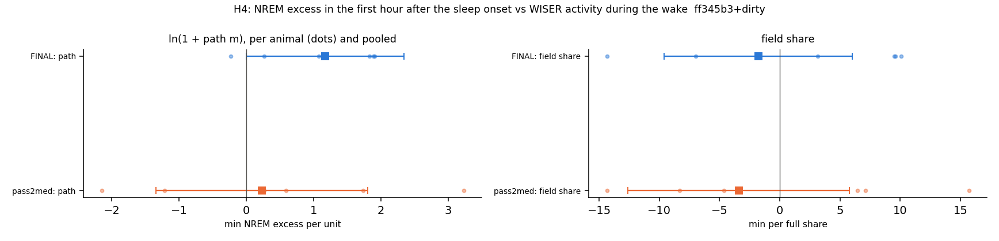
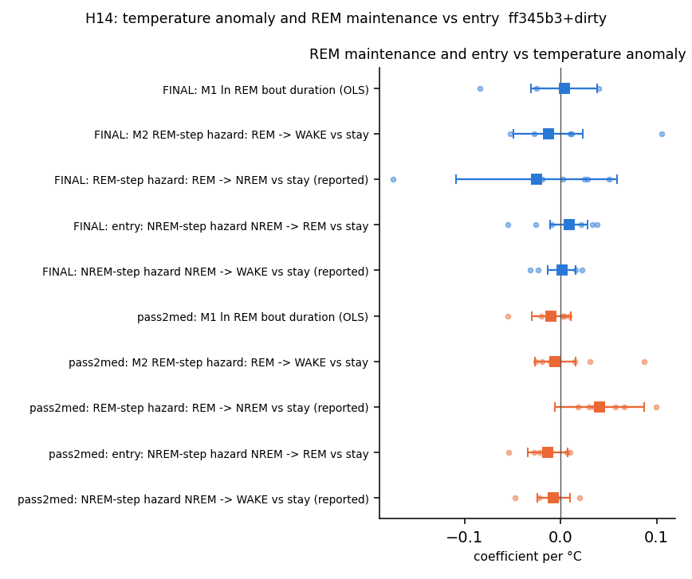
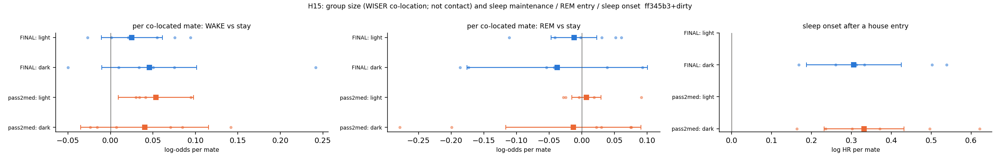
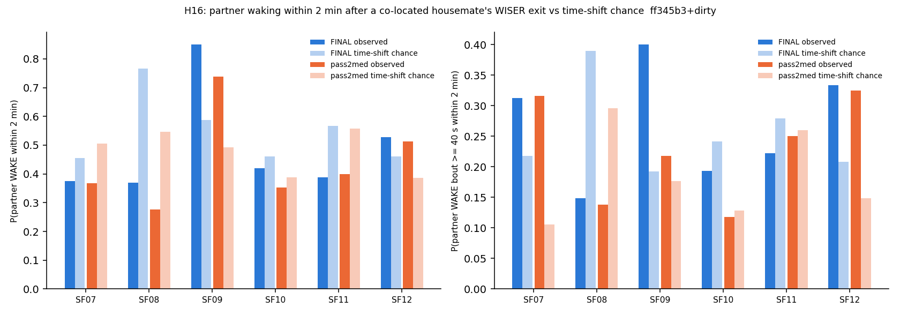
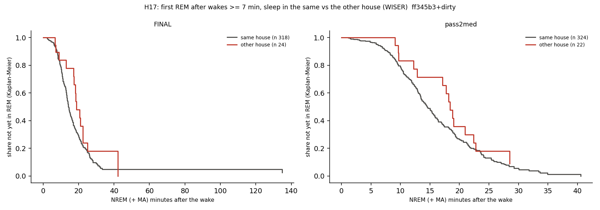
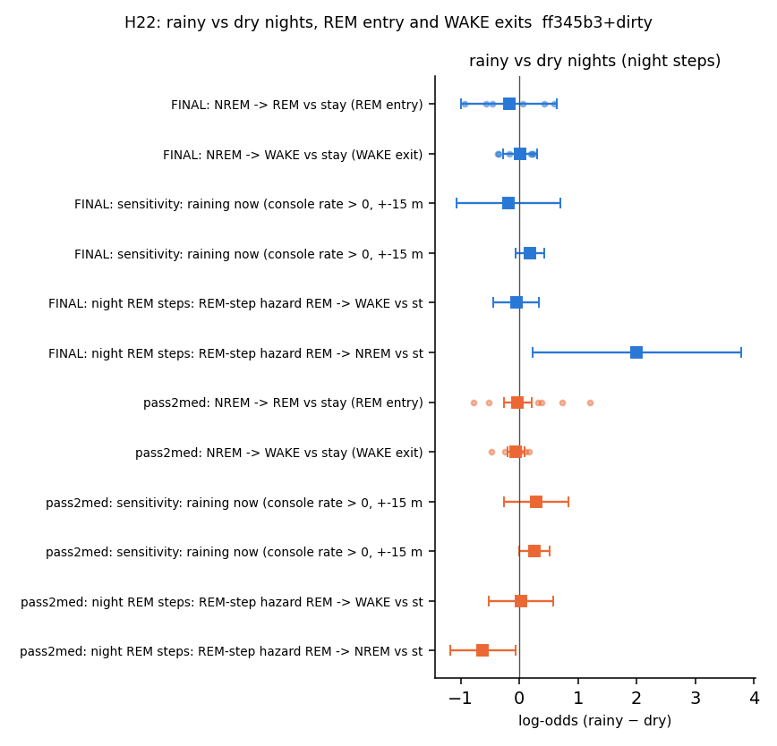
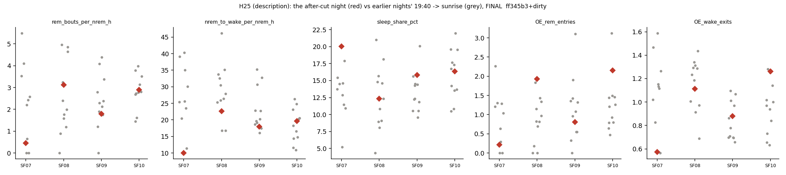

# Sleep behaviour explore — Step F: the WISER / environment / social batch (H4, H14, H15, H16, H17, H22, H25), cohort 2026c

Plan: [implementation_plan/2026-10-08-sleep-behaviour-explore.md](../../../../implementation_plan/2026-10-08-sleep-behaviour-explore.md) (§1 scope, §3 definitions, §5 Step F table — the pass rules are the plan's, quoted unchanged —, §9 Amendment 1 'F — WISER / environment / social batch'). Builds on Steps A–E ([C](ephys_spikes_sleep_explore_C_2026c.md) for the step engine, WISER zones and housemate terms). Driver `ephys/sleep_explore_f2.py run` (commit ff345b3+dirty, file uncommitted at run time); bulk `D:\Field2026_analysis_out\2026c\sleep_explore_F2_20261009_1225`; parts h4, h14, h15, h16, h17, h22, h25; runtime 6.2 min.

**Status: exploration step; a hypothesis gets a claim number only if it holds, and claim statuses are changed in the claim audit, not here.** Inputs (plan §1): scored 1-s states (FINAL and pass2med_remclean), NOAA light, the Phase-0 gap table, WISER default tracks (house / field / co-located tagged housemates), outdoor temperature and rain. No LFP features. The sleep states come from the scorer, whose EMG is the head IMU (sustained head movement is scored WAKE): any link between movement or disturbance and a scored WAKE carries that caveat. WISER: house = ROI + 14 in, ~4–7 in jitter, 'same house' is never body contact; SF11 untagged after 09-07; the five females (from 09-11 19:40) have no tags. Video is not in.

## Verdicts

| H | hypothesis | verdict | FINAL | pass2med |
|---|---|---|---|---|
| H4 | NREM after a wake follows the wake's activity (WISER distance / time in the field during the wake), not only its length | INCONCLUSIVE | met | not met |
| H14 | Warmth raises REM share through maintenance, not entry | DOES NOT HOLD | not met | not met |
| H15 | Group size changes sleep maintenance, not REM entry | INCONCLUSIVE | not met | met |
| H16 | A housemate leaving the house ends the partner's sleep | DOES NOT HOLD | not met | not met |
| H17 | Sleeping at a new site after a long wake delays REM | DOES NOT HOLD | not met | not met |
| H22 | Rain disturbs sleep | DOES NOT HOLD | not met | not met |
| H25 | The five females (from 09-11 19:40) change the gate or the arousability | DESCRIPTION ONLY | described | described |

## Data

- FINAL: 179668 NREM steps (44648 in the 3 h after battery rounds), 3880 REM ends, 7442 WAKE ends; 129 records; NREM steps with a temperature anomaly 179668; dark steps on rainy / dry nights 9100 / 19120.
- pass2med: 185090 NREM steps (45234 in the 3 h after battery rounds), 4219 REM ends, 7513 WAKE ends; 129 records; NREM steps with a temperature anomaly 185090; dark steps on rainy / dry nights 10168 / 21326.

- P = `P_tw600_k0` (Step B's modal grid point; τ_w = 600 s, κ = 0). WISER zone cache: `D:\Field2026_analysis_out\2026c\sleep_explore_C_20261009_0121\zone_per_second.npz` (Step C, re-read, not re-derived). Weather: field2026-sync console export / listener (NWS KITH in the 09-02/03 hole).
- Runtime: inputs 0.3 min, prep_final 0.2 min, prep_pass2med 0.2 min, h4 0.2 min, h14 1.6 min, h15 2.4 min, h16 0.1 min, h17 0.2 min, h22 0.7 min, h25 0.4 min, total 6.2 min.

## Definitions

Time = field-PC local time. States per second $s_t \in \{0\ \text{unknown}, 1\ \text{WAKE}, 3\ \text{NREM}, 5\ \text{REM}\}$; records = sessions joined across splits ≤ 60 s (`sleep_model.records_for`); everything from 2026-09-11 19:40 is cut (except H25, which describes only that period). Light = NOAA sunrise–sunset at the field (`sleep_quant.sun_times`); **dark** ∈ {0, 1} at the step / event time. Day-half **block** = the record's 06–18 h ('D') or 18–06 h ('N') half (events not tied to a record: the half of the event time). **Post-round exclusion** (plan §3): steps / events in $[g_{end}, g_{end} + 3\,\text{h})$ of a Phase-0 gap with cause `round_logged` / `round_inferred` of the same animal. **Scorings:** FINAL (`states_1s_final`) and pass2med (`states_1s_pass2med`, fixed per-animal thresholds); every test below compares different sessions (warm / cold, rainy / dry, active / quiet, after an exit / at shifted times), so both are run and a rule must be met on both.

### Shared estimation
- **NREM step model** (Step C's engine, `sleep_explore_c.mnl_fit`). Per 10-s NREM step, outcome $y \in$ {stay, REM, WAKE}; $\Pr(y = j) = e^{\eta_j}/(1 + e^{\eta_R} + e^{\eta_W})$, $\eta_j = \alpha_j + x^\top\beta_j$, Newton–Raphson with an L2 penalty $10^{-4}\lVert\beta\rVert^2/2$. **B-full** $x$ = cubic B-spline of $\ln(e + 5)$ ($e$ = s since the bout start), cubic B-spline of $\ln(1 + P_t)$ with the REM-entry count $P$ at `P_tw600_k0` (+1/60 per NREM s, ×$e^{-d/600}$ over a wake of $d$ s, emptied by REM, frozen over unknown), $(\sin, \cos)(2\pi k h/24)$, $k = 1, 2$, dark, $\ell = \ln(1 + d) - \overline{\ln(1+d)}$ ($d$ = the wake before the NREM bout, 0 after REM / unknown; **matched prior wake**), previous bout REM / unknown, wake share of the last 10 min, days since release (z), REM-anchor flag, animal intercepts. Added terms enter centred in raw units (coefficient = log-odds per unit). A coefficient on REM vs stay ($\beta_R$) is the log-odds ratio of entering REM in the next 10 s rather than staying in NREM; on WAKE vs stay ($\beta_W$) the same for waking.
- **REM step model.** Per 10-s step of every REM bout with a scored start (as `sleep_sim.rem_steps`): $y \in$ {stay, → NREM, → WAKE} (last step; censored if the exit is unscored), $x$ = spline $\ln(e + 5)$, 2-harmonic clock, days (z), dark, prior-wake bin of the bout (the last WAKE bout > 120 s before the onset with no unknown epoch between: 2–7, 7–30, 30–120 min, ≥ 2 h, reference 'none'), added term, animal intercepts; same engine.
- **Cluster-robust CI.** $\hat V = H^{-1}(\sum_g U_g U_g^\top)H^{-1}\,G/(G-1)$ over day-half blocks $g$ (multinomials, Cox, OLS alike); 95 % CI $= \hat\beta \pm 1.96\,\widehat{se}$; for a phase-specific effect $w^\top\hat\beta$ with $\widehat{se} = \sqrt{w^\top\hat V w}$.
- **Per-animal signs.** The same model fitted to each animal alone (no animal terms); count of animals whose estimate has the hypothesised sign (or the pooled sign when the rule has none). Estimates with $\widehat{se} > 10$ (an unidentified, penalised term) are treated as missing.
- **A term holds** = its pooled 95 % CI excludes 0 with the hypothesised sign AND ≥ 5 of the 6 rats have that sign in per-animal fits. **Held-out comparison holds** (plan §3) = forward chaining over the day-half blocks (train on all earlier blocks, test the next, the first 6 blocks only train); $\Delta = 100(\bar\ell_{+} - \bar\ell_{base})/\bar\ell_{base}$ (per-step log loss, step-weighted over folds), 95 % CI by bootstrap over folds; holds = CI < 0 and ≥ 5/6 animals better. The folds are the calendar blocks of all NREM steps; a comparison on a sub-set of steps (e.g. night steps) trains and tests on that sub-set within the same calendar folds.
- **Verdicts.** HOLDS = the pass rule is met on both scorings; INCONCLUSIVE = met on one scoring only, or not computable (too few events); DOES NOT HOLD = met on neither. H25 = DESCRIPTION ONLY.

### WISER (all parts that use it)
- **Zone** per second (Step C's cache `zone_per_second.npz`, re-read): the second's median default-track position (V3 for the implanted animals, B2 elsewhere; fixes flagged `m_off_animal` removed), forward-filled over gaps ≤ 30 s, in house_1 / house_2 = the ROI rectangle + 14 in, else field; unknown = no position. 'Same house' is never body contact; WISER jitter ~4–7 in. SF11 has no tag after 2026-09-07 08:20 (its zone is unknown, and it is never counted as a housemate after that); the five females released 2026-09-11 19:40 have no tags.
- **n_coloc** = other tagged animals in the same house at the second (0 when not in a house); **mates_asleep** = share of those with a scored state that are in NREM / REM (Step C3).
- **Position** per second (for H4's path): the second's median default-track position (in, unverified WISER frame), no forward fill.

### H4
- **Event** = a natural wake bout of $d \ge 120$ s inside a record (scored second before it), followed by NREM at $t_0$ (the sleep onset), with $[t_0, t_0 + 60\,\text{min})$ inside the record and ≥ 90 % scored; post-round events excluded; WISER zone known for ≥ 50 % of the wake's seconds.
- **NREM excess** $X = \sum_{t_0 \le t < t_0+3600} (\mathbb 1[s_t = \text{NREM}] - \hat q_t)/60$ (min), $\hat q_t$ = the expected NREM probability of second $t$ from the 10-min bin baselines with **phase × day** terms (plan §3 day baselines; `sleep_explore_d.baseline_bins('phase_x_day')`: leave-one-block-out binomial GLM on 2-harmonic clock + day + dark + dark × day + animal), 0 on unscored seconds. Positive = more NREM than expected for that time, day and animal. The window starts at a sleep onset, so part of $X$ is by construction (#31); a sensitivity adds the expected NREM $\sum \hat q_t/60$ as a covariate.
- **Activity during the wake** $[a, b)$: (i) **path** $L = \sum_k \lVert \bar{\mathbf x}_{k+1} - \bar{\mathbf x}_k\rVert\,\mathbb 1[\lVert\cdot\rVert \ge 7\,\text{in}]$ over consecutive 10-s bins with known median positions $\bar{\mathbf x}_k$ (displacements below the 7-in jitter floor per 10 s count as 0); used as $\ln(1 + L\,[\text{m}])$ (primary); (ii) **field share** = seconds in the field / seconds with a known zone (0–1).
- **Model (plan: 'NREM excess (1 h) ~ ln d + activity + dark, within night').** $X_i = \beta_d \ln d_i + \beta_A A_i + \beta_{dark}\,\text{dark}_i + \alpha_{animal} + \gamma_{night} + \varepsilon_i$, OLS, SEs clustered by block; **night** = the 24-h period [sunset $D$, sunset $D+1$) containing $t_0$ ('within night' read as night fixed effects: each event is compared with the other events of the same night and following day). Sensitivities: only events whose onset is dark (night FE, no dark term), no night FE (linear day), + expected NREM. Per animal: the same model with night FE.

### H14
- **Temperature anomaly** (°C) = outdoor temperature minus its 2-harmonic fit over the cohort (Phase 4, `sleep_schedule_temp.weather_anomaly`; console, NWS KITH inside the 09-02/03 uplink hole), joined to a time by the nearest 5-min sample within 15 min (none before 2026-08-31 00:00). Anomaly SD ≈ 3 °C. Only outdoor air was measured.
- **M1 REM bout duration:** complete REM bouts (scored start and exit), post-round excluded: $\ln r_i = \beta\,T_i + \text{clock} + \text{day} + \text{dark} + \text{prior-wake bin} + \alpha_{animal}$, OLS clustered by block; $T_i$ = anomaly at the onset. Hypothesised sign + (warmer → longer).
- **M2 REM → WAKE:** REM step model + $T$ at the bout onset; $\beta$ on → WAKE vs stay; hypothesised sign − (warmer → fewer REM → WAKE exits per REM step). → NREM vs stay reported.
- **Entry:** NREM step model B-full + $T$ (at the step); $\beta_R$ (REM vs stay) and the held-out comparison B-full + $T$ vs B-full on the same steps. **Entry null** = $\beta_R$'s CI includes 0 AND the held-out comparison does not hold.
- **Rule (plan: 'one holds, entry stays null'):** (M1 holds or M2 holds) and entry null, on each scoring.

### H15
- **Step model:** B-full + loc_field + loc_unknown (vs house) + $n_{coloc}$ + dark·$(n_{coloc} - \bar n)$. Group size per mate by phase: light $\beta_n$, dark $\beta_n + \beta_{dn}$, on WAKE vs stay (**maintenance**) and REM vs stay (**entry**). Sensitivity: + mates_asleep (Step C3's model). Held out: + $n_{coloc}$ terms on B-full + location.
- **Sleep-onset latency after a house entry** (secondary, in the plan's test but not its rule): entry = a field run ≥ 30 s followed by a house run ≥ 60 s (hysteresis against boundary jitter), the animal scored WAKE at the entry second; latency = s to the start of the first NREM bout ≥ 60 s; censored at the end of the stay (the first run of another zone or of unknown zone ≥ 30 s), an unscored second, or 4 h. Cox per phase at entry: $h(t) = h_{0,animal}(t)\,e^{\beta n_{coloc} + \gamma\,\text{day}}$ (Efron ties, animal strata, block clusters); $\beta > 0$ = falls asleep sooner with more mates.
- **Rule (plan: 'maintenance term holds, entry n.s.'):** the WAKE-vs-stay $n_{coloc}$ term holds in ≥ 1 phase (sign free: 'changes'), and the REM-vs-stay $n_{coloc}$ CI includes 0 in both phases, on each scoring.

### H16
- **Exit** of a tagged animal A: a house-$h$ run ≥ 60 s directly followed by a field run ≥ 30 s; $t_e$ = the first field second. **Partner** B (another tagged animal with a scored state) qualifies when it was in house $h$ for ≥ 80 % of $[t_e - 60, t_e)$ and at $t_e - 1$, asleep (NREM / REM) over $[t_e - 30, t_e)$, and scored over $[t_e, t_e + 120)$.
- **Outcome** $o = \mathbb 1[\exists t \in [t_e, t_e + 120): s^B_t = \text{WAKE}]$ (any WAKE, the plan's 'WAKE hazard 0–2 min'); secondary $o_{40}$ = a WAKE bout ≥ 40 s (not a microarousal) starts in that window.
- **Time-shift chance.** For each pair, $t' = t_e + \delta$, $\delta \in \pm\{5, 10, 15, 20, 30, 45, 60\}$ min; a shifted sample counts when B meets the partner condition at $t'$ (any house), ≥ 1 other tagged animal is in B's house at $t' - 1$, and no exit from that house falls within ±120 s of $t'$. $\hat c_i$ = the pair's mean $o$ over its samples. **Ratio** $\rho = \sum_i o_i / \sum_i \hat c_i$ over pairs with ≥ 1 sample (observed / chance-expected); per partner the same sums. 95 % CI: bootstrap over day-half blocks (2000).
- **Rule (plan: 'ratio > 1.5, ≥ 5/6'):** pooled $\rho > 1.5$ and ≥ 5 partners with $\rho_B > 1$ (the count with $\rho_B > 1.5$ is reported; as Step C1 read '≥ 5/6'), on each scoring.

### H17
- **Events** = Step A1's table (`sleep_explore.post_wake_table`): every WAKE bout ≥ 7 min followed by NREM in its record; $T$ = NREM + MA (< 40 s) time from the wake end to the first REM, censored at a wake ≥ 7 min, an unknown epoch or the record end; $N_{pre}$ = NREM since the last REM before the wake; anchor = a REM before.
- **Site** before = the modal zone over the sleep seconds (NREM / REM) with a known zone in the 10 min before the wake start; after = the same over the first 10 min after the wake end (up to the event / censoring point); each needs ≥ 60 such seconds. **Site change** = 1 if the two differ. Primary: both sites a house.
- **Model:** Cox $h(T) = h_{0,animal}(T)\exp(\beta\,\text{change} + \beta_d\ln d + \beta_N\ln(1 + N_{pre}) + \beta_a\text{anchor} + \text{clock} + \beta_{dark}\text{dark})$ ($\ln d$ = matched wake length), block clusters. **Delay** = $-\beta$ (> 0 = REM later at a new site; HR $= e^\beta < 1$). Sensitivities: strata animal × wake bin; field as a site; post-round excluded; OLS of $\ln T$ among events.
- **Rule (plan: 'site change CI > 0'):** the delay's CI > 0, on each scoring.

### H22
- **Night classes.** Per night_of date $D$ (the night [sunset $D$, sunrise $D+1$)): console rain $= \sum \text{rate}\cdot 5/60$ mm over its 5-min samples; **rainy** ≥ 1 mm, **dry** = 0 mm, both with ≥ 50 % console coverage; else unclassified (excluded).
- **Model:** the dark NREM steps of classified nights (post-round excluded), B-full without the (constant) dark step + rainy (0/1); $\beta_R$ (REM entry) and $\beta_W$ (WAKE exit); held out: + rainy vs B-full. Sensitivity: raining now (console rate > 0 at the nearest sample within 15 min). REM steps of the same nights: → WAKE / → NREM vs stay.
- **Rule (plan: 'holds'):** the held-out comparison holds (§3) AND the effect is a disturbance ($\beta_W$ CI > 0 or $\beta_R$ CI < 0), on each scoring.

### H25 (description only)
- **After-cut data:** sessions overlapping [2026-09-11 19:40, 2026-09-12 10:10) with the FINAL-score inclusion rules (SF12 excluded as noise, SF11 retired); windows night = [19:40, sunrise) and morning = [sunrise, 10:10). The same windows on every earlier night (2026-08-30 … 09-10) are the reference. The after-cut night, like most earlier windows, starts after an evening battery round.
- **Metrics per window:** sleep share = (NREM + REM)/scored s; REM share of sleep; REM bouts per NREM h; NREM → WAKE transitions per NREM h (all; microarousals < 40 s returning to NREM; wakes ≥ 40 s); mean REM bout s; **O/E** = observed REM entries (WAKE exits) / $\sum_t \hat p_{REM}$ ($\hat p_{WAKE}$) over the window's NREM steps, $\hat p$ from B-full fitted on all pre-cut NREM steps (in-sample for the earlier windows; the after-cut day term is extrapolated ~0.5 day).

## H4 — NREM after a wake follows the wake's activity (WISER distance / time in the field during the wake), not only its length

**Plan pass rule (Step F table, quoted):** "activity CI > 0, ≥ 5/6" (test: "NREM excess (1 h) ~ ln d + activity + dark, within night").

Read here as: the activity coefficient (primary activity = jitter-floored WISER path, ln(1 + m)) has a pooled CI > 0 and ≥ 5 of 6 per-animal coefficients > 0, on both scorings; 'within night' = night fixed effects (24-h periods starting at sunset). The time in the field (share of the wake) is the second activity measure, reported. The hour starts at a sleep onset (#31), so the excess is partly by construction; the sensitivity with the expected NREM as a covariate absorbs that part. Per-animal fits are made for the primary model only (the sensitivities show n/a). Caveat: WISER path inside a house is mostly below the 7-in floor; positions are in the unverified WISER frame (distances only).

### Events (natural wakes ≥ 2 min with a WISER zone for ≥ 50 % of the wake; post-round excluded)

| scores | phase | events | median_d_min | median_path_m | mean_field_share | mean_excess_min |
|---|---|---|---|---|---|---|
| FINAL | dark onset | 339 | 33.9 | 29.53 | 0.33 | 11.04 |
| FINAL | light onset | 396 | 3.62 | 0.21 | 0.0 | 1.49 |
| pass2med | dark onset | 348 | 37.01 | 40.6 | 0.37 | 10.74 |
| pass2med | light onset | 334 | 3.61 | 0.23 | 0.0 | 2.25 |

### Models

| scores | model | term | n | events | coef | ci_lo | ci_hi | p | pred_sign | animals_pred_sign | animals | ci_excl0_pred | holds_term | l_d_coef | l_d_ci | dark_coef |
|---|---|---|---|---|---|---|---|---|---|---|---|---|---|---|---|---|
| FINAL | primary: + dark, night FE, animal FE | ln(1 + path m), jitter-floored (primary) | 735 | 21 blocks | 1.171 | 0.003 | 2.339 | 0.049 | 1 | 5.0 | 6.0 | True | True | -0.259 | [-1.72, +1.21] | 7.241 |
| FINAL | night only (dark onsets), night FE | ln(1 + path m), jitter-floored (primary) | 339 | 12 blocks | 0.835 | -1.673 | 3.343 | 0.514 | 1 | nan | nan | False | None | -0.026 | [-3.50, +3.44] | nan |
| FINAL | no night FE (animal FE, day linear) | ln(1 + path m), jitter-floored (primary) | 735 | 21 blocks | 0.448 | -1.316 | 2.212 | 0.619 | 1 | nan | nan | False | None | 0.458 | [-1.51, +2.43] | 8.15 |
| FINAL | primary + expected NREM (onset conditioning) | ln(1 + path m), jitter-floored (primary) | 735 | 21 blocks | 1.077 | -0.105 | 2.258 | 0.074 | 1 | nan | nan | False | None | -0.199 | [-1.68, +1.28] | 6.231 |
| FINAL | primary: + dark, night FE, animal FE | share of the wake in the field | 735 | 21 blocks | -1.788 | -9.611 | 6.035 | 0.654 | 1 | 4.0 | 6.0 | False | False | 1.406 | [+0.34, +2.48] | 8.076 |
| FINAL | night only (dark onsets), night FE | share of the wake in the field | 339 | 12 blocks | -2.848 | -13.563 | 7.866 | 0.602 | 1 | nan | nan | False | None | 1.489 | [-0.21, +3.19] | nan |
| FINAL | no night FE (animal FE, day linear) | share of the wake in the field | 735 | 21 blocks | -3.179 | -11.293 | 4.934 | 0.443 | 1 | nan | nan | False | None | 1.389 | [+0.41, +2.37] | 8.813 |
| FINAL | primary + expected NREM (onset conditioning) | share of the wake in the field | 735 | 21 blocks | -2.463 | -10.965 | 6.038 | 0.57 | 1 | nan | nan | False | None | 1.383 | [+0.32, +2.45] | 6.289 |
| pass2med | primary: + dark, night FE, animal FE | ln(1 + path m), jitter-floored (primary) | 682 | 21 blocks | 0.231 | -1.339 | 1.8 | 0.773 | 1 | 4.0 | 6.0 | False | False | 1.264 | [-0.54, +3.07] | 6.182 |
| pass2med | night only (dark onsets), night FE | ln(1 + path m), jitter-floored (primary) | 348 | 12 blocks | -0.695 | -3.915 | 2.524 | 0.672 | 1 | nan | nan | False | None | 2.624 | [-1.65, +6.90] | nan |
| pass2med | no night FE (animal FE, day linear) | ln(1 + path m), jitter-floored (primary) | 682 | 21 blocks | -0.409 | -2.443 | 1.625 | 0.693 | 1 | nan | nan | False | None | 1.843 | [-0.38, +4.07] | 6.849 |
| pass2med | primary + expected NREM (onset conditioning) | ln(1 + path m), jitter-floored (primary) | 682 | 21 blocks | 0.399 | -1.145 | 1.943 | 0.613 | 1 | nan | nan | False | None | 1.192 | [-0.55, +2.94] | 8.201 |
| pass2med | primary: + dark, night FE, animal FE | share of the wake in the field | 682 | 21 blocks | -3.413 | -12.608 | 5.783 | 0.467 | 1 | 3.0 | 6.0 | False | False | 1.983 | [+1.05, +2.91] | 6.816 |
| pass2med | night only (dark onsets), night FE | share of the wake in the field | 348 | 12 blocks | -4.421 | -16.926 | 8.084 | 0.488 | 1 | nan | nan | False | None | 2.329 | [+0.71, +3.95] | nan |
| pass2med | no night FE (animal FE, day linear) | share of the wake in the field | 682 | 21 blocks | -4.318 | -13.358 | 4.722 | 0.349 | 1 | nan | nan | False | None | 1.866 | [+1.06, +2.67] | 7.283 |
| pass2med | primary + expected NREM (onset conditioning) | share of the wake in the field | 682 | 21 blocks | -2.91 | -12.142 | 6.323 | 0.537 | 1 | nan | nan | False | None | 2.029 | [+1.14, +2.92] | 8.372 |

### Per animal

| scores | activity | animal | events | coef | ci_lo | ci_hi | p |
|---|---|---|---|---|---|---|---|
| FINAL | l_path | SF07 | 103 | -0.23 | -3.669 | 3.21 | 0.896 |
| FINAL | l_path | SF08 | 144 | 1.904 | -0.846 | 4.654 | 0.175 |
| FINAL | l_path | SF09 | 155 | 0.261 | -2.412 | 2.935 | 0.848 |
| FINAL | l_path | SF10 | 100 | 1.073 | -2.569 | 4.716 | 0.564 |
| FINAL | l_path | SF11 | 103 | 1.89 | -1.023 | 4.803 | 0.203 |
| FINAL | l_path | SF12 | 130 | 1.831 | -0.877 | 4.538 | 0.185 |
| FINAL | field_share | SF07 | 103 | 3.147 | -7.535 | 13.828 | 0.564 |
| FINAL | field_share | SF08 | 144 | -6.979 | -18.687 | 4.73 | 0.243 |
| FINAL | field_share | SF09 | 155 | -14.365 | -23.829 | -4.901 | 0.003 |
| FINAL | field_share | SF10 | 100 | 10.087 | -7.157 | 27.33 | 0.252 |
| FINAL | field_share | SF11 | 103 | 9.593 | -7.318 | 26.504 | 0.266 |
| FINAL | field_share | SF12 | 130 | 9.517 | -3.545 | 22.58 | 0.153 |
| pass2med | l_path | SF07 | 95 | -1.217 | -4.417 | 1.983 | 0.456 |
| pass2med | l_path | SF08 | 138 | 1.731 | -1.519 | 4.981 | 0.297 |
| pass2med | l_path | SF09 | 139 | -2.146 | -4.98 | 0.689 | 0.138 |
| pass2med | l_path | SF10 | 97 | 3.229 | -0.149 | 6.607 | 0.061 |
| pass2med | l_path | SF11 | 85 | 0.588 | -2.75 | 3.927 | 0.73 |
| pass2med | l_path | SF12 | 128 | 0.268 | -2.989 | 3.525 | 0.872 |
| pass2med | field_share | SF07 | 95 | -4.653 | -14.297 | 4.991 | 0.344 |
| pass2med | field_share | SF08 | 138 | -8.331 | -20.424 | 3.762 | 0.177 |
| pass2med | field_share | SF09 | 139 | -14.365 | -22.704 | -6.026 | 0.001 |
| pass2med | field_share | SF10 | 97 | 15.702 | -2.031 | 33.435 | 0.083 |
| pass2med | field_share | SF11 | 85 | 6.456 | -9.833 | 22.745 | 0.437 |
| pass2med | field_share | SF12 | 128 | 7.125 | -5.401 | 19.652 | 0.265 |

### Verdict H4

- **FINAL:** path coefficient +1.171 [+0.003, +2.339] min of NREM excess per unit ln(1 + path m), rats > 0 5/6; ln d -0.26 [-1.72, +1.21]; dark +7.24; n 735. Field share (secondary): -1.788 [-9.611, +6.035] per full share, rats > 0 4/6 → primary rule met.
- **pass2med:** path coefficient +0.231 [-1.339, +1.800] min of NREM excess per unit ln(1 + path m), rats > 0 4/6; ln d +1.26 [-0.54, +3.07]; dark +6.18; n 682. Field share (secondary): -3.413 [-12.608, +5.783] per full share, rats > 0 3/6 → primary rule not met.

**H4: INCONCLUSIVE.**

## H14 — Warmth raises REM share through maintenance, not entry

**Plan pass rule (Step F table, quoted):** "one holds, entry stays null" (test: "REM bout duration and REM → WAKE exits ~ temperature anomaly").

Read here as: (M1 REM bout duration longer when warmer: CI > 0, ≥ 5/6 rats > 0, OR M2 fewer REM → WAKE exits per REM step when warmer: CI < 0, ≥ 5/6 rats < 0) AND REM entry null (REM-vs-stay CI includes 0 and the held-out comparison does not hold), on both scorings. Matched prior wake: ln(1 + d) in the NREM step model; prior-wake bins in the REM models. Context (claim audit): #22 warmer → higher REM share (Candidate), #23 temperature does not predict REM entry (Rejected for this range).

Counts: {"FINAL": {"bouts": 3455, "rem_steps": 24950, "nrem_steps": 135020}, "pass2med": {"bouts": 3736, "rem_steps": 26325, "nrem_steps": 139856}}.

### Terms

| scores | model | term | n | events | coef | ci_lo | ci_hi | p | pred_sign | animals_pred_sign | animals | ci_excl0_pred | holds_term |
|---|---|---|---|---|---|---|---|---|---|---|---|---|---|
| FINAL | M1 ln REM bout duration (OLS) | temp anomaly (per °C) | 3455 | 3455 bouts | 0.004 | -0.031 | 0.038 | 0.832 | 1 | 4 | 6 | False | False |
| FINAL | M2 REM-step hazard: REM -> WAKE vs stay | temp anomaly (per °C) | 24950 | 2584 REM -> WAKE | -0.013 | -0.049 | 0.023 | 0.486 | -1 | 3 | 6 | False | False |
| FINAL | REM-step hazard: REM -> NREM vs stay (reported) | temp anomaly (per °C) | 24950 | 871 REM -> NREM | -0.025 | -0.109 | 0.059 | 0.563 | 0 | 2 | 6 | False | False |
| FINAL | entry: NREM-step hazard NREM -> REM vs stay | temp anomaly (per °C) | 135020 | 2939 REM entries | 0.009 | -0.011 | 0.028 | 0.376 | 0 | 3 | 6 | False | False |
| FINAL | NREM-step hazard NREM -> WAKE vs stay (reported) | temp anomaly (per °C) | 135020 | 5853 WAKE exits | 0.001 | -0.013 | 0.016 | 0.846 | 0 | 3 | 6 | False | False |
| pass2med | M1 ln REM bout duration (OLS) | temp anomaly (per °C) | 3736 | 3736 bouts | -0.01 | -0.03 | 0.011 | 0.345 | 1 | 3 | 6 | False | False |
| pass2med | M2 REM-step hazard: REM -> WAKE vs stay | temp anomaly (per °C) | 26325 | 2673 REM -> WAKE | -0.006 | -0.026 | 0.015 | 0.606 | -1 | 3 | 6 | False | False |
| pass2med | REM-step hazard: REM -> NREM vs stay (reported) | temp anomaly (per °C) | 26325 | 1063 REM -> NREM | 0.041 | -0.006 | 0.087 | 0.084 | 0 | 6 | 6 | False | False |
| pass2med | entry: NREM-step hazard NREM -> REM vs stay | temp anomaly (per °C) | 139856 | 3249 REM entries | -0.014 | -0.034 | 0.007 | 0.201 | 0 | 4 | 6 | False | False |
| pass2med | NREM-step hazard NREM -> WAKE vs stay (reported) | temp anomaly (per °C) | 139856 | 5872 WAKE exits | -0.007 | -0.024 | 0.01 | 0.409 | 0 | 5 | 6 | False | False |

### Held out (entry)

| comparison | subset | n_steps | n_rem | delta_pct | ci_lo_pct | ci_hi_pct | folds_better | folds | animals_better | animals | holds | scores |
|---|---|---|---|---|---|---|---|---|---|---|---|---|
| temp vs base | entry: B-full + temp anomaly vs B-full (NREM steps, post-round excluded) | 90854 | 1867 | 0.0 | -0.184 | 0.138 | 4 | 15 | 2 | 6 | False | FINAL |
| temp vs base | entry: B-full + temp anomaly vs B-full (NREM steps, post-round excluded) | 91186 | 1979 | 0.028 | -0.022 | 0.091 | 9 | 15 | 3 | 6 | False | pass2med |

### Per animal

| scores | measure | animal | n | coef | se | ci_lo | ci_hi | p |
|---|---|---|---|---|---|---|---|---|
| FINAL | ln REM bout duration | SF07 | 640.0 | 0.007 | 0.023 | -0.038 | 0.052 | 0.762 |
| FINAL | ln REM bout duration | SF08 | 670.0 | 0.004 | 0.022 | -0.039 | 0.046 | 0.86 |
| FINAL | ln REM bout duration | SF09 | 576.0 | -0.025 | 0.024 | -0.071 | 0.021 | 0.287 |
| FINAL | ln REM bout duration | SF10 | 668.0 | 0.002 | 0.018 | -0.034 | 0.038 | 0.907 |
| FINAL | ln REM bout duration | SF11 | 349.0 | -0.084 | 0.042 | -0.167 | -0.001 | 0.047 |
| FINAL | ln REM bout duration | SF12 | 552.0 | 0.039 | 0.018 | 0.004 | 0.075 | 0.029 |
| FINAL | REM -> WAKE vs stay | SF07 | 3588.0 | -0.015 | 0.038 | -0.089 | 0.058 | 0.683 |
| FINAL | REM -> NREM vs stay | SF07 | 3588.0 | 0.05 | 0.068 | -0.083 | 0.184 | 0.459 |
| FINAL | REM -> WAKE vs stay | SF08 | 4959.0 | -0.052 | 0.022 | -0.096 | -0.009 | 0.018 |
| FINAL | REM -> NREM vs stay | SF08 | 4959.0 | 0.025 | 0.066 | -0.104 | 0.153 | 0.705 |
| FINAL | REM -> WAKE vs stay | SF09 | 3907.0 | 0.01 | 0.041 | -0.07 | 0.09 | 0.81 |
| FINAL | REM -> NREM vs stay | SF09 | 3907.0 | 0.028 | 0.108 | -0.184 | 0.24 | 0.798 |
| FINAL | REM -> WAKE vs stay | SF10 | 5076.0 | 0.011 | 0.016 | -0.019 | 0.042 | 0.467 |
| FINAL | REM -> NREM vs stay | SF10 | 5076.0 | -0.019 | 0.062 | -0.14 | 0.102 | 0.757 |
| FINAL | REM -> WAKE vs stay | SF11 | 2636.0 | 0.105 | 0.043 | 0.022 | 0.189 | 0.014 |
| FINAL | REM -> NREM vs stay | SF11 | 2636.0 | 0.002 | 0.125 | -0.242 | 0.247 | 0.985 |
| FINAL | REM -> WAKE vs stay | SF12 | 4784.0 | -0.027 | 0.039 | -0.103 | 0.048 | 0.48 |
| FINAL | REM -> NREM vs stay | SF12 | 4784.0 | -0.174 | 0.083 | -0.336 | -0.012 | 0.035 |
| FINAL | NREM -> REM vs stay (entry) | SF07 | nan | 0.038 | 0.031 | -0.023 | 0.099 | 0.219 |
| FINAL | NREM -> REM vs stay (entry) | SF08 | nan | -0.055 | 0.018 | -0.089 | -0.02 | 0.002 |
| FINAL | NREM -> REM vs stay (entry) | SF09 | nan | -0.009 | 0.027 | -0.062 | 0.043 | 0.73 |
| FINAL | NREM -> REM vs stay (entry) | SF10 | nan | 0.022 | 0.028 | -0.033 | 0.077 | 0.44 |
| FINAL | NREM -> REM vs stay (entry) | SF11 | nan | -0.025 | 0.054 | -0.132 | 0.081 | 0.64 |
| FINAL | NREM -> REM vs stay (entry) | SF12 | nan | 0.033 | 0.02 | -0.005 | 0.072 | 0.087 |
| pass2med | ln REM bout duration | SF07 | 754.0 | 0.004 | 0.019 | -0.033 | 0.04 | 0.839 |
| pass2med | ln REM bout duration | SF08 | 756.0 | 0.009 | 0.021 | -0.033 | 0.051 | 0.674 |
| pass2med | ln REM bout duration | SF09 | 567.0 | -0.01 | 0.02 | -0.049 | 0.028 | 0.6 |
| pass2med | ln REM bout duration | SF10 | 700.0 | -0.02 | 0.019 | -0.056 | 0.017 | 0.291 |
| pass2med | ln REM bout duration | SF11 | 408.0 | -0.055 | 0.042 | -0.138 | 0.028 | 0.193 |
| pass2med | ln REM bout duration | SF12 | 551.0 | 0.002 | 0.02 | -0.037 | 0.041 | 0.916 |
| pass2med | REM -> WAKE vs stay | SF07 | 3928.0 | 0.03 | 0.033 | -0.035 | 0.096 | 0.365 |
| pass2med | REM -> NREM vs stay | SF07 | 3928.0 | 0.018 | 0.048 | -0.077 | 0.113 | 0.704 |
| pass2med | REM -> WAKE vs stay | SF08 | 5345.0 | -0.019 | 0.02 | -0.058 | 0.02 | 0.345 |
| pass2med | REM -> NREM vs stay | SF08 | 5345.0 | 0.035 | 0.044 | -0.052 | 0.121 | 0.431 |
| pass2med | REM -> WAKE vs stay | SF09 | 4048.0 | -0.011 | 0.024 | -0.057 | 0.036 | 0.659 |
| pass2med | REM -> NREM vs stay | SF09 | 4048.0 | 0.067 | 0.071 | -0.073 | 0.207 | 0.351 |
| pass2med | REM -> WAKE vs stay | SF10 | 5203.0 | 0.015 | 0.022 | -0.027 | 0.058 | 0.485 |
| pass2med | REM -> NREM vs stay | SF10 | 5203.0 | 0.03 | 0.044 | -0.057 | 0.116 | 0.5 |
| pass2med | REM -> WAKE vs stay | SF11 | 2996.0 | 0.087 | 0.037 | 0.014 | 0.16 | 0.02 |
| pass2med | REM -> NREM vs stay | SF11 | 2996.0 | 0.1 | 0.104 | -0.105 | 0.304 | 0.339 |
| pass2med | REM -> WAKE vs stay | SF12 | 4805.0 | -0.026 | 0.025 | -0.074 | 0.022 | 0.288 |
| pass2med | REM -> NREM vs stay | SF12 | 4805.0 | 0.057 | 0.06 | -0.061 | 0.175 | 0.342 |
| pass2med | NREM -> REM vs stay (entry) | SF07 | nan | -0.014 | 0.018 | -0.049 | 0.021 | 0.423 |
| pass2med | NREM -> REM vs stay (entry) | SF08 | nan | -0.054 | 0.016 | -0.085 | -0.023 | 0.001 |
| pass2med | NREM -> REM vs stay (entry) | SF09 | nan | -0.021 | 0.029 | -0.079 | 0.036 | 0.465 |
| pass2med | NREM -> REM vs stay (entry) | SF10 | nan | 0.006 | 0.018 | -0.029 | 0.041 | 0.721 |
| pass2med | NREM -> REM vs stay (entry) | SF11 | nan | 0.01 | 0.038 | -0.064 | 0.083 | 0.8 |
| pass2med | NREM -> REM vs stay (entry) | SF12 | nan | -0.027 | 0.019 | -0.064 | 0.01 | 0.156 |

### Verdict H14

- **FINAL:** M1 ln REM duration per °C +0.004 [-0.031, +0.038] (rats > 0 4/6) → does not hold; M2 REM → WAKE per °C -0.013 [-0.049, +0.023] (rats < 0 3/6) → does not hold; entry REM vs stay per °C +0.009 [-0.011, +0.028] and held out Δ +0.000 % [-0.184, +0.138], 2/6 → entry null → rule not met.
- **pass2med:** M1 ln REM duration per °C -0.010 [-0.030, +0.011] (rats > 0 3/6) → does not hold; M2 REM → WAKE per °C -0.006 [-0.026, +0.015] (rats < 0 3/6) → does not hold; entry REM vs stay per °C -0.014 [-0.034, +0.007] and held out Δ +0.028 % [-0.022, +0.091], 3/6 → entry null → rule not met.

**H14: DOES NOT HOLD.**

## H15 — Group size changes sleep maintenance, not REM entry

**Plan pass rule (Step F table, quoted):** "maintenance term holds, entry n.s." (test: "NREM → WAKE hazard and sleep-onset latency ~ co-located housemates, by phase").

Read here as: the NREM → WAKE term of n_coloc (per co-located tagged mate) holds in at least one phase (CI excludes 0, ≥ 5/6 rats with the pooled sign) and the NREM → REM term's CI includes 0 in both phases, on both scorings; 'entry' = REM entry, as the hypothesis states. Sleep-onset latency (named in the test, not in the rule) is reported. Primary model without the mates' sleep state (group size as such); Step C3's model with mates_asleep is the sensitivity. Caveats: WISER co-location = 'same house', never contact; tagged animals only (SF11 untagged after 09-07 08:20 → group sizes after it are lower bounds); no body-contact claim is made. Context: Step C3 / #38.

### Terms

| scores | model | term | n | events | coef | ci_lo | ci_hi | p | pred_sign | animals_pred_sign | animals | ci_excl0_pred | holds_term |
|---|---|---|---|---|---|---|---|---|---|---|---|---|---|
| FINAL | B-full + location + n_coloc (x dark): NREM -> WAKE vs stay (maintenance) | n_coloc per mate, light | 135020 | 5853 WAKE exits | 0.025 | -0.011 | 0.061 | 0.17 | 0 | 5.0 | 6.0 | False | False |
| FINAL | B-full + location + n_coloc (x dark): NREM -> WAKE vs stay (maintenance) | n_coloc per mate, dark | 135020 | 5853 WAKE exits | 0.046 | -0.01 | 0.102 | 0.11 | 0 | 5.0 | 6.0 | False | False |
| FINAL | B-full + location + n_coloc (x dark): NREM -> REM vs stay (entry) | n_coloc per mate, light | 135020 | 2939 REM entries | -0.012 | -0.047 | 0.023 | 0.507 | 0 | 3.0 | 6.0 | False | False |
| FINAL | B-full + location + n_coloc (x dark): NREM -> REM vs stay (entry) | n_coloc per mate, dark | 135020 | 2939 REM entries | -0.037 | -0.176 | 0.101 | 0.595 | 0 | 4.0 | 6.0 | False | False |
| FINAL | + share of co-located mates asleep (Step C3's model; sensitivity): NREM -> WAKE vs stay (maintenance) | n_coloc per mate, light | 135020 | 5853 WAKE exits | 0.05 | 0.016 | 0.083 | 0.004 | 0 | nan | nan | True | None |
| FINAL | + share of co-located mates asleep (Step C3's model; sensitivity): NREM -> WAKE vs stay (maintenance) | n_coloc per mate, dark | 135020 | 5853 WAKE exits | 0.094 | 0.042 | 0.146 | 0.0 | 0 | nan | nan | True | None |
| FINAL | + share of co-located mates asleep (Step C3's model; sensitivity): NREM -> REM vs stay (entry) | n_coloc per mate, light | 135020 | 2939 REM entries | -0.012 | -0.051 | 0.028 | 0.563 | 0 | nan | nan | False | None |
| FINAL | + share of co-located mates asleep (Step C3's model; sensitivity): NREM -> REM vs stay (entry) | n_coloc per mate, dark | 135020 | 2939 REM entries | -0.054 | -0.188 | 0.08 | 0.428 | 0 | nan | nan | False | None |
| FINAL | sleep-onset latency after a house entry (Cox, animal strata): log HR of falling asleep | n_coloc per mate, light | 7 | 5 onsets / 7 entries | nan | nan | nan | nan | 0 | nan | nan | False | None |
| FINAL | sleep-onset latency after a house entry (Cox, animal strata): log HR of falling asleep | n_coloc per mate, dark | 619 | 113 onsets / 619 entries | 0.306 | 0.187 | 0.425 | 0.0 | 0 | 6.0 | 6.0 | True | None |
| pass2med | B-full + location + n_coloc (x dark): NREM -> WAKE vs stay (maintenance) | n_coloc per mate, light | 139856 | 5872 WAKE exits | 0.054 | 0.009 | 0.098 | 0.018 | 0 | 6.0 | 6.0 | True | True |
| pass2med | B-full + location + n_coloc (x dark): NREM -> WAKE vs stay (maintenance) | n_coloc per mate, dark | 139856 | 5872 WAKE exits | 0.04 | -0.035 | 0.116 | 0.295 | 0 | 4.0 | 6.0 | False | False |
| pass2med | B-full + location + n_coloc (x dark): NREM -> REM vs stay (entry) | n_coloc per mate, light | 139856 | 3249 REM entries | 0.007 | -0.016 | 0.029 | 0.549 | 0 | 3.0 | 6.0 | False | False |
| pass2med | B-full + location + n_coloc (x dark): NREM -> REM vs stay (entry) | n_coloc per mate, dark | 139856 | 3249 REM entries | -0.013 | -0.117 | 0.091 | 0.806 | 0 | 2.0 | 6.0 | False | False |
| pass2med | + share of co-located mates asleep (Step C3's model; sensitivity): NREM -> WAKE vs stay (maintenance) | n_coloc per mate, light | 139856 | 5872 WAKE exits | 0.083 | 0.035 | 0.131 | 0.001 | 0 | nan | nan | True | None |
| pass2med | + share of co-located mates asleep (Step C3's model; sensitivity): NREM -> WAKE vs stay (maintenance) | n_coloc per mate, dark | 139856 | 5872 WAKE exits | 0.103 | 0.029 | 0.177 | 0.006 | 0 | nan | nan | True | None |
| pass2med | + share of co-located mates asleep (Step C3's model; sensitivity): NREM -> REM vs stay (entry) | n_coloc per mate, light | 139856 | 3249 REM entries | 0.007 | -0.019 | 0.032 | 0.615 | 0 | nan | nan | False | None |
| pass2med | + share of co-located mates asleep (Step C3's model; sensitivity): NREM -> REM vs stay (entry) | n_coloc per mate, dark | 139856 | 3249 REM entries | -0.033 | -0.123 | 0.057 | 0.471 | 0 | nan | nan | False | None |
| pass2med | sleep-onset latency after a house entry (Cox, animal strata): log HR of falling asleep | n_coloc per mate, light | 5 | 3 onsets / 5 entries | nan | nan | nan | nan | 0 | nan | nan | False | None |
| pass2med | sleep-onset latency after a house entry (Cox, animal strata): log HR of falling asleep | n_coloc per mate, dark | 619 | 123 onsets / 619 entries | 0.332 | 0.232 | 0.432 | 0.0 | 0 | 6.0 | 6.0 | True | None |

### Held out

| comparison | subset | n_steps | n_rem | delta_pct | ci_lo_pct | ci_hi_pct | folds_better | folds | animals_better | animals | holds | scores |
|---|---|---|---|---|---|---|---|---|---|---|---|---|
| group vs loc | + n_coloc and n_coloc x dark on B-full + location (post-round excluded) | 90854 | 1867 | -0.004 | -0.05 | 0.027 | 7 | 15 | 2 | 6 | False | FINAL |
| group vs loc | + n_coloc and n_coloc x dark on B-full + location (post-round excluded) | 91186 | 1979 | -0.006 | -0.082 | 0.074 | 9 | 15 | 3 | 6 | False | pass2med |

### House entries (sleep-onset latency sample; post-round excluded)

| scores | phase | entries | onsets | mean_n_coloc |
|---|---|---|---|---|
| FINAL | dark | 619 | 113 | 1.651 |
| FINAL | light | 7 | 5 | 2.714 |
| pass2med | dark | 619 | 123 | 1.651 |
| pass2med | light | 5 | 3 | 3.0 |

### Per animal

| scores | equation | phase | animal | coef | se | ci_lo | ci_hi | p |
|---|---|---|---|---|---|---|---|---|
| FINAL | NREM -> WAKE vs stay (maintenance) | light | SF07 | 0.055 | 0.045 | -0.034 | 0.143 | 0.225 |
| FINAL | NREM -> WAKE vs stay (maintenance) | light | SF08 | 0.021 | 0.037 | -0.052 | 0.094 | 0.573 |
| FINAL | NREM -> WAKE vs stay (maintenance) | light | SF09 | 0.094 | 0.044 | 0.009 | 0.18 | 0.03 |
| FINAL | NREM -> WAKE vs stay (maintenance) | light | SF10 | 0.001 | 0.042 | -0.082 | 0.084 | 0.984 |
| FINAL | NREM -> WAKE vs stay (maintenance) | light | SF11 | 0.076 | 0.013 | 0.05 | 0.101 | 0.0 |
| FINAL | NREM -> WAKE vs stay (maintenance) | light | SF12 | -0.027 | 0.028 | -0.082 | 0.029 | 0.343 |
| FINAL | NREM -> WAKE vs stay (maintenance) | dark | SF07 | -0.05 | 0.057 | -0.161 | 0.061 | 0.376 |
| FINAL | NREM -> WAKE vs stay (maintenance) | dark | SF08 | 0.033 | 0.024 | -0.013 | 0.08 | 0.157 |
| FINAL | NREM -> WAKE vs stay (maintenance) | dark | SF09 | 0.05 | 0.052 | -0.052 | 0.152 | 0.335 |
| FINAL | NREM -> WAKE vs stay (maintenance) | dark | SF10 | 0.242 | 0.04 | 0.163 | 0.321 | 0.0 |
| FINAL | NREM -> WAKE vs stay (maintenance) | dark | SF11 | 0.01 | 0.043 | -0.076 | 0.095 | 0.827 |
| FINAL | NREM -> WAKE vs stay (maintenance) | dark | SF12 | 0.075 | 0.069 | -0.059 | 0.21 | 0.273 |
| FINAL | NREM -> REM vs stay (entry) | light | SF07 | -0.002 | 0.066 | -0.131 | 0.127 | 0.98 |
| FINAL | NREM -> REM vs stay (entry) | light | SF08 | 0.06 | 0.035 | -0.007 | 0.128 | 0.08 |
| FINAL | NREM -> REM vs stay (entry) | light | SF09 | 0.052 | 0.034 | -0.015 | 0.118 | 0.129 |
| FINAL | NREM -> REM vs stay (entry) | light | SF10 | -0.111 | 0.042 | -0.193 | -0.029 | 0.008 |
| FINAL | NREM -> REM vs stay (entry) | light | SF11 | 0.031 | 0.065 | -0.098 | 0.159 | 0.639 |
| FINAL | NREM -> REM vs stay (entry) | light | SF12 | -0.041 | 0.028 | -0.096 | 0.014 | 0.144 |
| FINAL | NREM -> REM vs stay (entry) | dark | SF07 | -0.054 | 0.13 | -0.308 | 0.2 | 0.676 |
| FINAL | NREM -> REM vs stay (entry) | dark | SF08 | -0.174 | 0.225 | -0.614 | 0.267 | 0.439 |
| FINAL | NREM -> REM vs stay (entry) | dark | SF09 | -0.042 | 0.161 | -0.357 | 0.273 | 0.793 |
| FINAL | NREM -> REM vs stay (entry) | dark | SF10 | 0.038 | 0.096 | -0.149 | 0.226 | 0.688 |
| FINAL | NREM -> REM vs stay (entry) | dark | SF11 | 0.093 | 0.087 | -0.077 | 0.263 | 0.285 |
| FINAL | NREM -> REM vs stay (entry) | dark | SF12 | -0.187 | 0.177 | -0.533 | 0.16 | 0.292 |
| FINAL | sleep onset after a house entry (Cox) | dark | SF07 | 0.333 | 0.176 | -0.012 | 0.678 | 0.059 |
| FINAL | sleep onset after a house entry (Cox) | dark | SF08 | 0.313 | 0.127 | 0.065 | 0.561 | 0.013 |
| FINAL | sleep onset after a house entry (Cox) | dark | SF09 | 0.539 | 0.179 | 0.188 | 0.889 | 0.003 |
| FINAL | sleep onset after a house entry (Cox) | dark | SF10 | 0.168 | 0.152 | -0.129 | 0.466 | 0.268 |
| FINAL | sleep onset after a house entry (Cox) | dark | SF11 | 0.502 | 0.286 | -0.059 | 1.063 | 0.079 |
| FINAL | sleep onset after a house entry (Cox) | dark | SF12 | 0.261 | 0.197 | -0.125 | 0.647 | 0.186 |
| pass2med | NREM -> WAKE vs stay (maintenance) | light | SF07 | 0.03 | 0.03 | -0.03 | 0.089 | 0.329 |
| pass2med | NREM -> WAKE vs stay (maintenance) | light | SF08 | 0.034 | 0.026 | -0.018 | 0.086 | 0.198 |
| pass2med | NREM -> WAKE vs stay (maintenance) | light | SF09 | 0.094 | 0.029 | 0.038 | 0.15 | 0.001 |
| pass2med | NREM -> WAKE vs stay (maintenance) | light | SF10 | 0.052 | 0.034 | -0.015 | 0.12 | 0.126 |
| pass2med | NREM -> WAKE vs stay (maintenance) | light | SF11 | 0.041 | 0.023 | -0.004 | 0.087 | 0.077 |
| pass2med | NREM -> WAKE vs stay (maintenance) | light | SF12 | 0.052 | 0.035 | -0.017 | 0.121 | 0.137 |
| pass2med | NREM -> WAKE vs stay (maintenance) | dark | SF07 | -0.024 | 0.062 | -0.145 | 0.097 | 0.697 |
| pass2med | NREM -> WAKE vs stay (maintenance) | dark | SF08 | 0.071 | 0.03 | 0.012 | 0.129 | 0.018 |
| pass2med | NREM -> WAKE vs stay (maintenance) | dark | SF09 | -0.016 | 0.103 | -0.218 | 0.187 | 0.879 |
| pass2med | NREM -> WAKE vs stay (maintenance) | dark | SF10 | 0.142 | 0.059 | 0.025 | 0.258 | 0.017 |
| pass2med | NREM -> WAKE vs stay (maintenance) | dark | SF11 | 0.007 | 0.072 | -0.134 | 0.147 | 0.925 |
| pass2med | NREM -> WAKE vs stay (maintenance) | dark | SF12 | 0.085 | 0.068 | -0.048 | 0.218 | 0.212 |
| pass2med | NREM -> REM vs stay (entry) | light | SF07 | -0.004 | 0.031 | -0.065 | 0.056 | 0.889 |
| pass2med | NREM -> REM vs stay (entry) | light | SF08 | 0.091 | 0.025 | 0.042 | 0.14 | 0.0 |
| pass2med | NREM -> REM vs stay (entry) | light | SF09 | 0.004 | 0.039 | -0.072 | 0.081 | 0.909 |
| pass2med | NREM -> REM vs stay (entry) | light | SF10 | -0.025 | 0.032 | -0.087 | 0.037 | 0.434 |
| pass2med | NREM -> REM vs stay (entry) | light | SF11 | 0.018 | 0.062 | -0.104 | 0.14 | 0.767 |
| pass2med | NREM -> REM vs stay (entry) | light | SF12 | -0.029 | 0.063 | -0.152 | 0.094 | 0.649 |
| pass2med | NREM -> REM vs stay (entry) | dark | SF07 | 0.075 | 0.083 | -0.088 | 0.237 | 0.367 |
| pass2med | NREM -> REM vs stay (entry) | dark | SF08 | -0.279 | 0.161 | -0.594 | 0.037 | 0.084 |
| pass2med | NREM -> REM vs stay (entry) | dark | SF09 | 0.03 | 0.109 | -0.184 | 0.245 | 0.783 |
| pass2med | NREM -> REM vs stay (entry) | dark | SF10 | 0.022 | 0.101 | -0.176 | 0.22 | 0.825 |
| pass2med | NREM -> REM vs stay (entry) | dark | SF11 | 0.076 | 0.095 | -0.11 | 0.261 | 0.423 |
| pass2med | NREM -> REM vs stay (entry) | dark | SF12 | -0.199 | 0.176 | -0.545 | 0.146 | 0.259 |
| pass2med | sleep onset after a house entry (Cox) | dark | SF07 | 0.372 | 0.153 | 0.071 | 0.672 | 0.015 |
| pass2med | sleep onset after a house entry (Cox) | dark | SF08 | 0.302 | 0.124 | 0.059 | 0.545 | 0.015 |
| pass2med | sleep onset after a house entry (Cox) | dark | SF09 | 0.496 | 0.157 | 0.189 | 0.804 | 0.002 |
| pass2med | sleep onset after a house entry (Cox) | dark | SF10 | 0.236 | 0.143 | -0.045 | 0.516 | 0.1 |
| pass2med | sleep onset after a house entry (Cox) | dark | SF11 | 0.621 | 0.31 | 0.014 | 1.228 | 0.045 |
| pass2med | sleep onset after a house entry (Cox) | dark | SF12 | 0.163 | 0.212 | -0.252 | 0.578 | 0.441 |

### Verdict H15

- **FINAL:** WAKE vs stay per co-located mate: light +0.025 [-0.011, +0.061] (5/6 rats same sign); dark +0.046 [-0.010, +0.102] (5/6 rats same sign) → maintenance does not hold; REM vs stay: light -0.012 [-0.047, +0.023]; dark -0.037 [-0.176, +0.101] → entry n.s.; held out (+ n_coloc terms) Δ -0.004 % [-0.050, +0.027], 2/6; sleep-onset latency (not in the rule) log HR per mate light n/a (5 onsets / 7 entries); dark +0.306 [+0.187, +0.425] (113 onsets / 619 entries) → rule not met.
- **pass2med:** WAKE vs stay per co-located mate: light +0.054 [+0.009, +0.098] (6/6 rats same sign, holds); dark +0.040 [-0.035, +0.116] (4/6 rats same sign) → maintenance holds; REM vs stay: light +0.007 [-0.016, +0.029]; dark -0.013 [-0.117, +0.091] → entry n.s.; held out (+ n_coloc terms) Δ -0.006 % [-0.082, +0.074], 3/6; sleep-onset latency (not in the rule) log HR per mate light n/a (3 onsets / 5 entries); dark +0.332 [+0.232, +0.432] (123 onsets / 619 entries) → rule met.

**H15: INCONCLUSIVE.**

## H16 — A housemate leaving the house ends the partner's sleep

**Plan pass rule (Step F table, quoted):** "ratio > 1.5, ≥ 5/6" (test: "partner WAKE hazard 0–2 min after a housemate exits (WISER) vs a time-shift chance").

Read here as: pooled observed / chance ratio of the partner's P(WAKE within 0–2 min) > 1.5 and ≥ 5 partners with a ratio > 1 (the count > 1.5 reported), on both scorings; the ratio with wakes ≥ 40 s (sleep-ending wakes, not microarousals) is reported. Caveats: the exit is a WISER zone change (ROI + 14 in, hysteresis 60 s house / 30 s field), not a seen departure; the partner's WAKE is scored from its own head IMU (the scorer turns sustained movement into WAKE), so a partner moved by the leaver is scored awake — the ratio cannot separate being jostled from waking; 'which housemate left' is the tag's identity, the body is not seen (video).

WISER exits per animal (all, before pairing):

| leaver | exits |
|---|---|
| SF07 | 188 |
| SF08 | 162 |
| SF09 | 148 |
| SF10 | 161 |
| SF11 | 109 |
| SF12 | 132 |

### Ratios

| scores | sample | outcome | pairs | observed | expected | p_obs | p_chance | ratio | ci_lo | ci_hi | partners | partners_ratio_gt1 | partners_ratio_gt1.5 | pairs_partner_REM |
|---|---|---|---|---|---|---|---|---|---|---|---|---|---|---|
| FINAL | all exits (primary) | woke | 148 | 72.0 | 80.782 | 0.486 | 0.546 | 0.891 | 0.721 | 1.053 | 6 | 2 | 0 | 11 |
| FINAL | all exits (primary) | woke_ge40 | 148 | 39.0 | 37.823 | 0.264 | 0.256 | 1.031 | 0.647 | 1.538 | 6 | 3 | 2 | 11 |
| FINAL | post-round 3 h excluded (sensitivity) | woke | 133 | 65.0 | 75.513 | 0.489 | 0.568 | 0.861 | 0.712 | 1.001 | 6 | 2 | 0 | 9 |
| FINAL | post-round 3 h excluded (sensitivity) | woke_ge40 | 133 | 37.0 | 36.163 | 0.278 | 0.272 | 1.023 | 0.639 | 1.507 | 6 | 3 | 2 | 9 |
| pass2med | all exits (primary) | woke | 162 | 71.0 | 75.393 | 0.438 | 0.465 | 0.942 | 0.748 | 1.15 | 6 | 2 | 0 | 11 |
| pass2med | all exits (primary) | woke_ge40 | 162 | 36.0 | 29.694 | 0.222 | 0.183 | 1.212 | 0.877 | 1.746 | 6 | 3 | 2 | 11 |
| pass2med | post-round 3 h excluded (sensitivity) | woke | 147 | 64.0 | 70.672 | 0.435 | 0.481 | 0.906 | 0.728 | 1.096 | 6 | 2 | 0 | 9 |
| pass2med | post-round 3 h excluded (sensitivity) | woke_ge40 | 147 | 35.0 | 28.233 | 0.238 | 0.192 | 1.24 | 0.897 | 1.788 | 6 | 3 | 2 | 9 |

### Per partner (primary sample)

| scores | outcome | partner | pairs | observed | expected | ratio | p_obs | p_chance |
|---|---|---|---|---|---|---|---|---|
| FINAL | woke | SF07 | 16.0 | 6.0 | 7.289 | 0.823 | 0.375 | 0.456 |
| FINAL | woke | SF08 | 27.0 | 10.0 | 20.694 | 0.483 | 0.37 | 0.766 |
| FINAL | woke | SF09 | 20.0 | 17.0 | 11.762 | 1.445 | 0.85 | 0.588 |
| FINAL | woke | SF10 | 31.0 | 13.0 | 14.27 | 0.911 | 0.419 | 0.46 |
| FINAL | woke | SF11 | 18.0 | 7.0 | 10.207 | 0.686 | 0.389 | 0.567 |
| FINAL | woke | SF12 | 36.0 | 19.0 | 16.56 | 1.147 | 0.528 | 0.46 |
| FINAL | woke_ge40 | SF07 | 16.0 | 5.0 | 3.485 | 1.435 | 0.312 | 0.218 |
| FINAL | woke_ge40 | SF08 | 27.0 | 4.0 | 10.517 | 0.38 | 0.148 | 0.39 |
| FINAL | woke_ge40 | SF09 | 20.0 | 8.0 | 3.847 | 2.08 | 0.4 | 0.192 |
| FINAL | woke_ge40 | SF10 | 31.0 | 6.0 | 7.476 | 0.803 | 0.194 | 0.241 |
| FINAL | woke_ge40 | SF11 | 18.0 | 4.0 | 5.019 | 0.797 | 0.222 | 0.279 |
| FINAL | woke_ge40 | SF12 | 36.0 | 12.0 | 7.479 | 1.604 | 0.333 | 0.208 |
| pass2med | woke | SF07 | 19.0 | 7.0 | 9.607 | 0.729 | 0.368 | 0.506 |
| pass2med | woke | SF08 | 29.0 | 8.0 | 15.853 | 0.505 | 0.276 | 0.547 |
| pass2med | woke | SF09 | 23.0 | 17.0 | 11.338 | 1.499 | 0.739 | 0.493 |
| pass2med | woke | SF10 | 34.0 | 12.0 | 13.179 | 0.911 | 0.353 | 0.388 |
| pass2med | woke | SF11 | 20.0 | 8.0 | 11.138 | 0.718 | 0.4 | 0.557 |
| pass2med | woke | SF12 | 37.0 | 19.0 | 14.278 | 1.331 | 0.514 | 0.386 |
| pass2med | woke_ge40 | SF07 | 19.0 | 6.0 | 2.001 | 2.998 | 0.316 | 0.105 |
| pass2med | woke_ge40 | SF08 | 29.0 | 4.0 | 8.575 | 0.466 | 0.138 | 0.296 |
| pass2med | woke_ge40 | SF09 | 23.0 | 5.0 | 4.066 | 1.23 | 0.217 | 0.177 |
| pass2med | woke_ge40 | SF10 | 34.0 | 4.0 | 4.376 | 0.914 | 0.118 | 0.129 |
| pass2med | woke_ge40 | SF11 | 20.0 | 5.0 | 5.194 | 0.963 | 0.25 | 0.26 |
| pass2med | woke_ge40 | SF12 | 37.0 | 12.0 | 5.481 | 2.189 | 0.324 | 0.148 |

### Verdict H16

- **FINAL:** 148 (exit, sleeping co-located partner) pairs from 900 WISER exits; P(WAKE within 2 min) observed 0.486 vs time-shift chance 0.546, ratio 0.89 [0.72, 1.05]; partners with ratio > 1: 2/6 (> 1.5: 0) → rule not met.
- **pass2med:** 162 (exit, sleeping co-located partner) pairs from 900 WISER exits; P(WAKE within 2 min) observed 0.438 vs time-shift chance 0.465, ratio 0.94 [0.75, 1.15]; partners with ratio > 1: 2/6 (> 1.5: 0) → rule not met.

**H16: DOES NOT HOLD.**

## H17 — Sleeping at a new site after a long wake delays REM

**Plan pass rule (Step F table, quoted):** "site change CI > 0" (test: "first-REM latency when the WISER house differs from the pre-wake site, matched wake length").

Read here as: the delay (= −log HR of REM entry for a change of house, Cox in NREM time with ln d, ln(1 + N_pre), anchor, clock, dark, animal strata) has a CI > 0, on both scorings. Matched wake length = ln d in the model (sensitivity: strata animal × wake bin). Caveat: site = WISER house (ROI + 14 in), the modal zone of 10 min of sleep; 'new' means the other house than before the wake, not a never-used site.

### Sample

| scores | events | both_houses | site_pre_known | site_post_known |
|---|---|---|---|---|
| FINAL | 524 | 342 | 453 | 479 |
| pass2med | 549 | 346 | 475 | 495 |

### Cox

| scores | model | n | events | n_change | n_same | HR | HR_lo | HR_hi | coef | ci_lo | ci_hi | p | HR_wakebin_strata | HR_wakebin_lo | HR_wakebin_hi | ols_lnT_site_change | ols_lnT_ci | dark_share_change | dark_share_same | median_d_min_change | median_d_min_same |
|---|---|---|---|---|---|---|---|---|---|---|---|---|---|---|---|---|---|---|---|---|---|
| FINAL | primary: both sites a house (house_1 / house_2) | 342 | 224 reach REM; 24 site changes | 24 | 318 | 1.356 | 0.74 | 2.482 | -0.304 | -0.909 | 0.301 | 0.324 | 1.511 | 0.731 | 3.124 | 0.027 | [-0.17, +0.22] | 0.667 | 0.531 | 32.758 | 20.6 |
| FINAL | sensitivity: field as a site too | 422 | 282 reach REM; 93 site changes | 93 | 329 | 1.277 | 0.775 | 2.106 | -0.245 | -0.745 | 0.255 | 0.338 | 1.495 | 0.905 | 2.469 | -0.021 | [-0.16, +0.12] | 0.473 | 0.547 | 21.3 | 21.417 |
| FINAL | sensitivity: post-round 3 h excluded | 290 | 186 reach REM; 13 site changes | 13 | 277 | 1.503 | 0.967 | 2.336 | -0.408 | -0.849 | 0.033 | 0.07 | 1.83 | 1.005 | 3.334 | 0.108 | [-0.09, +0.30] | 0.923 | 0.585 | 85.233 | 21.967 |
| pass2med | primary: both sites a house (house_1 / house_2) | 346 | 245 reach REM; 22 site changes | 22 | 324 | 0.893 | 0.478 | 1.669 | 0.113 | -0.512 | 0.738 | 0.723 | 1.014 | 0.605 | 1.699 | 0.054 | [-0.14, +0.25] | 0.636 | 0.543 | 32.042 | 20.267 |
| pass2med | sensitivity: field as a site too | 435 | 306 reach REM; 100 site changes | 100 | 335 | 1.013 | 0.674 | 1.522 | -0.013 | -0.42 | 0.395 | 0.952 | 1.176 | 0.78 | 1.773 | 0.012 | [-0.09, +0.11] | 0.51 | 0.558 | 23.708 | 21.033 |
| pass2med | sensitivity: post-round 3 h excluded | 294 | 205 reach REM; 13 site changes | 13 | 281 | 1.416 | 0.864 | 2.319 | -0.348 | -0.841 | 0.146 | 0.167 | 1.456 | 0.861 | 2.462 | 0.066 | [-0.17, +0.30] | 0.923 | 0.594 | 85.15 | 22.167 |

### Verdict H17

- **FINAL:** 342 post-wake sleeps with both sites a house (24 other house, 318 same); site-change HR of REM entry 1.36 [0.74, 2.48] → delay -0.304 [-0.909, +0.301]; with animal × wake-bin strata HR 1.51 [0.73, 3.12] → rule not met.
- **pass2med:** 346 post-wake sleeps with both sites a house (22 other house, 324 same); site-change HR of REM entry 0.89 [0.48, 1.67] → delay +0.113 [-0.512, +0.738]; with animal × wake-bin strata HR 1.01 [0.60, 1.70] → rule not met.

**H17: DOES NOT HOLD.**

## H22 — Rain disturbs sleep

**Plan pass rule (Step F table, quoted):** "holds" (test: "REM entry and WAKE exits, rainy vs dry nights, matched prior wake").

Read here as: adding 'rainy night' to B-full improves held-out prediction of the night NREM steps (plan §3 'holds': CI < 0, ≥ 5/6 rats better) AND the coefficients point to disturbance (WAKE exits up with CI > 0 or REM entry down with CI < 0), on both scorings. Matched prior wake: ln(1 + d) in the model. Only three nights are rainy (two of them in the test folds), so the held-out test rests on two nights. Context: #39 (the drift is not weather).

### Nights

| night_of | sunset | sunrise_next | console_cover | rain_mm | rain_min | class |
|---|---|---|---|---|---|---|
| 2026-08-29 | 08-29 19:47 | 08-30 06:27 | 0.0 | 0.0 | 0 | unclassified |
| 2026-08-30 | 08-30 19:45 | 08-31 06:28 | 0.607 | 0.0 | 0 | dry |
| 2026-08-31 | 08-31 19:44 | 09-01 06:29 | 0.999 | 6.0 | 115 | rainy |
| 2026-09-01 | 09-01 19:42 | 09-02 06:30 | 0.995 | 0.0 | 0 | dry |
| 2026-09-02 | 09-02 19:40 | 09-03 06:32 | 0.138 | 0.55 | 15 | unclassified |
| 2026-09-03 | 09-03 19:39 | 09-04 06:33 | 1.0 | 18.4 | 85 | rainy |
| 2026-09-04 | 09-04 19:37 | 09-05 06:34 | 0.997 | 0.0 | 0 | dry |
| 2026-09-05 | 09-05 19:35 | 09-06 06:35 | 1.0 | 0.0 | 0 | dry |
| 2026-09-06 | 09-06 19:33 | 09-07 06:36 | 1.0 | 0.0 | 0 | dry |
| 2026-09-07 | 09-07 19:32 | 09-08 06:37 | 1.0 | 0.0 | 0 | dry |
| 2026-09-08 | 09-08 19:30 | 09-09 06:38 | 0.996 | 0.0 | 0 | dry |
| 2026-09-09 | 09-09 19:28 | 09-10 06:39 | 0.999 | 13.7 | 125 | rainy |
| 2026-09-10 | 09-10 19:26 | 09-11 06:40 | 0.995 | 0.0 | 0 | dry |
| 2026-09-11 | 09-11 19:25 | 09-12 06:41 | 0.998 | 0.0 | 0 | dry |
| 2026-09-12 | 09-12 19:23 | 09-13 06:42 | 0.0 | 0.0 | 0 | unclassified |

Steps: {"FINAL": {"night_steps": 25982, "rainy_steps": 8787, "dry_steps": 17195, "rem_night_steps": 1530}, "pass2med": {"night_steps": 29005, "rainy_steps": 9811, "dry_steps": 19194, "rem_night_steps": 1685}}.

### Terms

| scores | model | term | n | events | coef | ci_lo | ci_hi | p | pred_sign | animals_pred_sign | animals | ci_excl0_pred | holds_term |
|---|---|---|---|---|---|---|---|---|---|---|---|---|---|
| FINAL | night NREM steps, B-full (no dark step) + rainy night: NREM -> REM vs stay (REM entry) | rainy vs dry night | 25982 | 176 REM entries | -0.177 | -0.995 | 0.642 | 0.672 | -1 | 3.0 | 6.0 | False | False |
| FINAL | night NREM steps, B-full (no dark step) + rainy night: NREM -> WAKE vs stay (WAKE exit) | rainy vs dry night | 25982 | 1598 WAKE exits | 0.016 | -0.278 | 0.31 | 0.915 | 1 | 3.0 | 6.0 | False | False |
| FINAL | sensitivity: raining now (console rate > 0, +-15 min): NREM -> REM vs stay | raining now | 25982 |  | -0.186 | -1.074 | 0.701 | 0.681 | 0 | nan | nan | False | None |
| FINAL | sensitivity: raining now (console rate > 0, +-15 min): NREM -> WAKE vs stay | raining now | 25982 |  | 0.176 | -0.068 | 0.42 | 0.158 | 0 | nan | nan | False | None |
| FINAL | night REM steps: REM-step hazard REM -> WAKE vs stay | rainy vs dry night | 1530 | 189 exits | -0.052 | -0.44 | 0.337 | 0.794 | 0 | nan | nan | False | None |
| FINAL | night REM steps: REM-step hazard REM -> NREM vs stay | rainy vs dry night | 1530 | 10 exits | 2.002 | 0.227 | 3.777 | 0.027 | 0 | nan | nan | True | None |
| pass2med | night NREM steps, B-full (no dark step) + rainy night: NREM -> REM vs stay (REM entry) | rainy vs dry night | 29005 | 212 REM entries | -0.025 | -0.265 | 0.215 | 0.837 | -1 | 2.0 | 6.0 | False | False |
| pass2med | night NREM steps, B-full (no dark step) + rainy night: NREM -> WAKE vs stay (WAKE exit) | rainy vs dry night | 29005 | 1619 WAKE exits | -0.058 | -0.199 | 0.083 | 0.421 | 1 | 3.0 | 6.0 | False | False |
| pass2med | sensitivity: raining now (console rate > 0, +-15 min): NREM -> REM vs stay | raining now | 29005 |  | 0.282 | -0.267 | 0.831 | 0.314 | 0 | nan | nan | False | None |
| pass2med | sensitivity: raining now (console rate > 0, +-15 min): NREM -> WAKE vs stay | raining now | 29005 |  | 0.252 | -0.008 | 0.513 | 0.057 | 0 | nan | nan | False | None |
| pass2med | night REM steps: REM-step hazard REM -> WAKE vs stay | rainy vs dry night | 1685 | 192 exits | 0.029 | -0.515 | 0.574 | 0.916 | 0 | nan | nan | False | None |
| pass2med | night REM steps: REM-step hazard REM -> NREM vs stay | rainy vs dry night | 1685 | 49 exits | -0.625 | -1.183 | -0.066 | 0.028 | 0 | nan | nan | True | None |

### Held out

| comparison | subset | n_steps | n_rem | delta_pct | ci_lo_pct | ci_hi_pct | folds_better | folds | animals_better | animals | holds | rainy_test_blocks | scores |
|---|---|---|---|---|---|---|---|---|---|---|---|---|---|
| rain vs base | night NREM steps: B-full + rainy night vs B-full (post-round excluded) | 16953 | 110 | 0.356 | -0.021 | 0.868 | 2 | 8 | 3 | 6 | False | 2026-09-03N, 2026-09-09N | FINAL |
| rain vs base | night NREM steps: B-full + rainy night vs B-full (post-round excluded) | 17954 | 131 | 0.034 | -0.03 | 0.131 | 3 | 8 | 2 | 6 | False | 2026-09-03N, 2026-09-09N | pass2med |

### Per animal

| scores | equation | animal | coef | se | ci_lo | ci_hi | p |
|---|---|---|---|---|---|---|---|
| FINAL | NREM -> REM vs stay (REM entry) | SF07 | 0.061 | 0.557 | -1.031 | 1.153 | 0.913 |
| FINAL | NREM -> REM vs stay (REM entry) | SF08 | -0.462 | 0.263 | -0.977 | 0.053 | 0.079 |
| FINAL | NREM -> REM vs stay (REM entry) | SF09 | -0.94 | 0.604 | -2.124 | 0.244 | 0.12 |
| FINAL | NREM -> REM vs stay (REM entry) | SF10 | 0.586 | 0.41 | -0.217 | 1.39 | 0.153 |
| FINAL | NREM -> REM vs stay (REM entry) | SF11 | -0.568 | 0.185 | -0.931 | -0.205 | 0.002 |
| FINAL | NREM -> REM vs stay (REM entry) | SF12 | 0.423 | 0.495 | -0.547 | 1.393 | 0.393 |
| FINAL | NREM -> WAKE vs stay (WAKE exit) | SF07 | 0.196 | 0.145 | -0.089 | 0.481 | 0.177 |
| FINAL | NREM -> WAKE vs stay (WAKE exit) | SF08 | -0.349 | 0.246 | -0.832 | 0.134 | 0.157 |
| FINAL | NREM -> WAKE vs stay (WAKE exit) | SF09 | 0.247 | 0.15 | -0.046 | 0.54 | 0.099 |
| FINAL | NREM -> WAKE vs stay (WAKE exit) | SF10 | -0.374 | 0.135 | -0.638 | -0.111 | 0.005 |
| FINAL | NREM -> WAKE vs stay (WAKE exit) | SF11 | -0.163 | 0.068 | -0.297 | -0.03 | 0.017 |
| FINAL | NREM -> WAKE vs stay (WAKE exit) | SF12 | 0.215 | 0.095 | 0.028 | 0.402 | 0.024 |
| pass2med | NREM -> REM vs stay (REM entry) | SF07 | 1.207 | 0.38 | 0.461 | 1.952 | 0.002 |
| pass2med | NREM -> REM vs stay (REM entry) | SF08 | 0.378 | 0.449 | -0.502 | 1.259 | 0.4 |
| pass2med | NREM -> REM vs stay (REM entry) | SF09 | -0.518 | 0.376 | -1.255 | 0.22 | 0.169 |
| pass2med | NREM -> REM vs stay (REM entry) | SF10 | 0.723 | 0.458 | -0.174 | 1.621 | 0.114 |
| pass2med | NREM -> REM vs stay (REM entry) | SF11 | -0.784 | 0.461 | -1.687 | 0.119 | 0.089 |
| pass2med | NREM -> REM vs stay (REM entry) | SF12 | 0.316 | 0.273 | -0.219 | 0.851 | 0.247 |
| pass2med | NREM -> WAKE vs stay (WAKE exit) | SF07 | 0.016 | 0.12 | -0.219 | 0.251 | 0.894 |
| pass2med | NREM -> WAKE vs stay (WAKE exit) | SF08 | -0.473 | 0.105 | -0.679 | -0.268 | 0.0 |
| pass2med | NREM -> WAKE vs stay (WAKE exit) | SF09 | 0.164 | 0.114 | -0.061 | 0.388 | 0.153 |
| pass2med | NREM -> WAKE vs stay (WAKE exit) | SF10 | -0.083 | 0.136 | -0.35 | 0.184 | 0.544 |
| pass2med | NREM -> WAKE vs stay (WAKE exit) | SF11 | -0.253 | 0.062 | -0.375 | -0.132 | 0.0 |
| pass2med | NREM -> WAKE vs stay (WAKE exit) | SF12 | 0.098 | 0.081 | -0.061 | 0.256 | 0.229 |

### Verdict H22

- **FINAL:** rainy vs dry night, REM entry -0.177 [-0.995, +0.642] (rats < 0 3/6), WAKE exit +0.016 [-0.278, +0.310] (rats > 0 3/6); held out Δ +0.356 % [-0.021, +0.868], 3/6 → does not hold; disturbance direction no → rule not met.
- **pass2med:** rainy vs dry night, REM entry -0.025 [-0.265, +0.215] (rats < 0 2/6), WAKE exit -0.058 [-0.199, +0.083] (rats > 0 3/6); held out Δ +0.034 % [-0.030, +0.131], 2/6 → does not hold; disturbance direction no → rule not met.

**H22: DOES NOT HOLD.**

## H25 — The five females (from 09-11 19:40) change the gate or the arousability

**Plan pass rule (Step F table, quoted):** "description only" (test: "descriptive, after-cut only").

**Description only, never pooled with the inference set.** One after-cut night per animal (n = 1 per animal) cannot separate the females from that night's weather, the 09-11 evening round, or the 12-day drift (#30); the earlier nights are a reference range, not a control. The females carry no WISER tags, so no co-location with them can be measured. Mechanism words ('gate', 'arousability') are the hypothesis's; the numbers below are REM-entry rates and WAKE-exit rates.

After-cut data: {"FINAL": {"animals": ["SF07", "SF08", "SF09", "SF10"], "after_cut_recorded_h": 57.75}, "pass2med": {"animals": ["SF07", "SF08", "SF09", "SF10"], "after_cut_recorded_h": 57.75}}.

### Mean over animals: after-cut night vs the earlier nights' mean (same clock window)

| scores | metric | after_cut | before_mean |
|---|---|---|---|
| FINAL | OE_rem_entries | 1.275 | 1.029 |
| FINAL | OE_wake_exits | 0.957 | 1.017 |
| FINAL | ma_per_nrem_h | 8.982 | 12.963 |
| FINAL | mean_rem_bout_s | 55.883 | 61.151 |
| FINAL | nrem_to_wake_per_nrem_h | 17.543 | 24.57 |
| FINAL | rem_bouts_per_nrem_h | 2.064 | 2.517 |
| FINAL | rem_share_of_sleep_pct | 3.5 | 3.692 |
| FINAL | sleep_share_pct | 16.137 | 13.68 |
| FINAL | wake_ge40_from_nrem_per_nrem_h | 8.412 | 11.431 |
| pass2med | OE_rem_entries | 1.585 | 1.065 |
| pass2med | OE_wake_exits | 1.066 | 0.985 |
| pass2med | ma_per_nrem_h | 9.432 | 12.371 |
| pass2med | mean_rem_bout_s | 67.225 | 57.184 |
| pass2med | nrem_to_wake_per_nrem_h | 18.394 | 21.934 |
| pass2med | rem_bouts_per_nrem_h | 2.304 | 2.896 |
| pass2med | rem_share_of_sleep_pct | 3.938 | 3.909 |
| pass2med | sleep_share_pct | 15.999 | 15.58 |
| pass2med | wake_ge40_from_nrem_per_nrem_h | 8.962 | 9.337 |

### How often the after-cut value lies outside the earlier nights' range

| scores | part | metric | animals | outside_range | animals_above_mean |
|---|---|---|---|---|---|
| FINAL | morning sunrise -> 10:10 | OE_rem_entries | 4 | 2 | 3 |
| FINAL | morning sunrise -> 10:10 | OE_wake_exits | 4 | 2 | 4 |
| FINAL | morning sunrise -> 10:10 | ma_per_nrem_h | 4 | 0 | 3 |
| FINAL | morning sunrise -> 10:10 | mean_rem_bout_s | 4 | 0 | 1 |
| FINAL | morning sunrise -> 10:10 | nrem_to_wake_per_nrem_h | 4 | 1 | 2 |
| FINAL | morning sunrise -> 10:10 | rem_bouts_per_nrem_h | 4 | 1 | 1 |
| FINAL | morning sunrise -> 10:10 | rem_share_of_sleep_pct | 4 | 1 | 0 |
| FINAL | morning sunrise -> 10:10 | sleep_share_pct | 4 | 1 | 3 |
| FINAL | morning sunrise -> 10:10 | wake_ge40_from_nrem_per_nrem_h | 4 | 1 | 1 |
| FINAL | night 19:40 -> sunrise | OE_rem_entries | 4 | 1 | 2 |
| FINAL | night 19:40 -> sunrise | OE_wake_exits | 4 | 0 | 2 |
| FINAL | night 19:40 -> sunrise | ma_per_nrem_h | 4 | 1 | 0 |
| FINAL | night 19:40 -> sunrise | mean_rem_bout_s | 4 | 0 | 2 |
| FINAL | night 19:40 -> sunrise | nrem_to_wake_per_nrem_h | 4 | 1 | 1 |
| FINAL | night 19:40 -> sunrise | rem_bouts_per_nrem_h | 4 | 0 | 2 |
| FINAL | night 19:40 -> sunrise | rem_share_of_sleep_pct | 4 | 0 | 2 |
| FINAL | night 19:40 -> sunrise | sleep_share_pct | 4 | 1 | 3 |
| FINAL | night 19:40 -> sunrise | wake_ge40_from_nrem_per_nrem_h | 4 | 2 | 1 |
| pass2med | morning sunrise -> 10:10 | OE_rem_entries | 4 | 1 | 3 |
| pass2med | morning sunrise -> 10:10 | OE_wake_exits | 4 | 3 | 4 |
| pass2med | morning sunrise -> 10:10 | ma_per_nrem_h | 4 | 0 | 3 |
| pass2med | morning sunrise -> 10:10 | mean_rem_bout_s | 4 | 0 | 2 |
| pass2med | morning sunrise -> 10:10 | nrem_to_wake_per_nrem_h | 4 | 1 | 3 |
| pass2med | morning sunrise -> 10:10 | rem_bouts_per_nrem_h | 4 | 1 | 1 |
| pass2med | morning sunrise -> 10:10 | rem_share_of_sleep_pct | 4 | 0 | 1 |
| pass2med | morning sunrise -> 10:10 | sleep_share_pct | 4 | 0 | 4 |
| pass2med | morning sunrise -> 10:10 | wake_ge40_from_nrem_per_nrem_h | 4 | 0 | 2 |
| pass2med | night 19:40 -> sunrise | OE_rem_entries | 4 | 1 | 3 |
| pass2med | night 19:40 -> sunrise | OE_wake_exits | 4 | 2 | 3 |
| pass2med | night 19:40 -> sunrise | ma_per_nrem_h | 4 | 2 | 0 |
| pass2med | night 19:40 -> sunrise | mean_rem_bout_s | 4 | 0 | 3 |
| pass2med | night 19:40 -> sunrise | nrem_to_wake_per_nrem_h | 4 | 1 | 1 |
| pass2med | night 19:40 -> sunrise | rem_bouts_per_nrem_h | 4 | 0 | 1 |
| pass2med | night 19:40 -> sunrise | rem_share_of_sleep_pct | 4 | 0 | 2 |
| pass2med | night 19:40 -> sunrise | sleep_share_pct | 4 | 0 | 3 |
| pass2med | night 19:40 -> sunrise | wake_ge40_from_nrem_per_nrem_h | 4 | 0 | 2 |

### Per animal

| scores | animal | part | metric | after_cut | before_mean | before_min | before_max | before_nights | after_rank_from_low | outside_range |
|---|---|---|---|---|---|---|---|---|---|---|
| FINAL | SF07 | morning sunrise -> 10:10 | sleep_share_pct | 84.462 | 74.096 | 59.962 | 82.615 | 11 | 12 | True |
| FINAL | SF07 | morning sunrise -> 10:10 | rem_share_of_sleep_pct | 0.35 | 11.586 | 0.656 | 18.61 | 11 | 1 | True |
| FINAL | SF07 | morning sunrise -> 10:10 | rem_bouts_per_nrem_h | 0.683 | 9.405 | 1.487 | 15.366 | 11 | 1 | True |
| FINAL | SF07 | morning sunrise -> 10:10 | nrem_to_wake_per_nrem_h | 10.592 | 12.278 | 5.546 | 18.61 | 11 | 5 | False |
| FINAL | SF07 | morning sunrise -> 10:10 | ma_per_nrem_h | 7.517 | 7.994 | 3.235 | 11.717 | 11 | 6 | False |
| FINAL | SF07 | morning sunrise -> 10:10 | wake_ge40_from_nrem_per_nrem_h | 3.075 | 4.189 | 2.29 | 8.342 | 11 | 5 | False |
| FINAL | SF07 | morning sunrise -> 10:10 | mean_rem_bout_s | 18.5 | 50.632 | 16.0 | 74.5 | 11 | 2 | False |
| FINAL | SF07 | morning sunrise -> 10:10 | OE_rem_entries | 0.21 | 1.153 | 0.269 | 1.869 | 11 | 1 | True |
| FINAL | SF07 | morning sunrise -> 10:10 | OE_wake_exits | 1.325 | 1.009 | 0.551 | 1.305 | 11 | 12 | True |
| FINAL | SF07 | night 19:40 -> sunrise | sleep_share_pct | 20.015 | 12.962 | 5.193 | 17.913 | 9 | 10 | True |
| FINAL | SF07 | night 19:40 -> sunrise | rem_share_of_sleep_pct | 0.214 | 2.665 | 0.0 | 6.787 | 9 | 3 | False |
| FINAL | SF07 | night 19:40 -> sunrise | rem_bouts_per_nrem_h | 0.454 | 2.33 | 0.0 | 5.482 | 9 | 3 | False |
| FINAL | SF07 | night 19:40 -> sunrise | nrem_to_wake_per_nrem_h | 9.994 | 27.894 | 11.425 | 40.312 | 9 | 1 | True |
| FINAL | SF07 | night 19:40 -> sunrise | ma_per_nrem_h | 4.997 | 14.581 | 5.441 | 22.785 | 9 | 1 | True |
| FINAL | SF07 | night 19:40 -> sunrise | wake_ge40_from_nrem_per_nrem_h | 4.997 | 13.237 | 5.985 | 21.144 | 9 | 1 | True |
| FINAL | SF07 | night 19:40 -> sunrise | mean_rem_bout_s | 17.0 | 52.203 | 12.667 | 137.0 | 7 | 2 | False |
| FINAL | SF07 | night 19:40 -> sunrise | OE_rem_entries | 0.213 | 0.893 | 0.0 | 2.267 | 9 | 3 | False |
| FINAL | SF07 | night 19:40 -> sunrise | OE_wake_exits | 0.574 | 1.126 | 0.565 | 1.587 | 9 | 2 | False |
| FINAL | SF08 | morning sunrise -> 10:10 | sleep_share_pct | 76.5 | 75.357 | 50.836 | 85.585 | 11 | 5 | False |
| FINAL | SF08 | morning sunrise -> 10:10 | rem_share_of_sleep_pct | 13.136 | 15.887 | 7.659 | 22.535 | 11 | 4 | False |
| FINAL | SF08 | morning sunrise -> 10:10 | rem_bouts_per_nrem_h | 6.058 | 8.693 | 4.915 | 14.45 | 11 | 3 | False |
| FINAL | SF08 | morning sunrise -> 10:10 | nrem_to_wake_per_nrem_h | 11.251 | 12.515 | 5.478 | 26.775 | 11 | 7 | False |
| FINAL | SF08 | morning sunrise -> 10:10 | ma_per_nrem_h | 8.222 | 7.735 | 3.662 | 15.359 | 11 | 8 | False |
| FINAL | SF08 | morning sunrise -> 10:10 | wake_ge40_from_nrem_per_nrem_h | 3.029 | 4.062 | 1.181 | 9.736 | 11 | 4 | False |
| FINAL | SF08 | morning sunrise -> 10:10 | mean_rem_bout_s | 89.857 | 84.396 | 46.0 | 143.667 | 11 | 7 | False |
| FINAL | SF08 | morning sunrise -> 10:10 | OE_rem_entries | 1.097 | 1.011 | 0.381 | 1.666 | 11 | 9 | False |
| FINAL | SF08 | morning sunrise -> 10:10 | OE_wake_exits | 1.054 | 0.963 | 0.482 | 1.631 | 11 | 8 | False |
| FINAL | SF08 | night 19:40 -> sunrise | sleep_share_pct | 12.334 | 12.525 | 4.323 | 21.005 | 11 | 7 | False |
| FINAL | SF08 | night 19:40 -> sunrise | rem_share_of_sleep_pct | 5.558 | 3.51 | 0.0 | 6.731 | 11 | 10 | False |
| FINAL | SF08 | night 19:40 -> sunrise | rem_bouts_per_nrem_h | 3.116 | 2.502 | 0.0 | 4.956 | 11 | 8 | False |
| FINAL | SF08 | night 19:40 -> sunrise | nrem_to_wake_per_nrem_h | 22.588 | 28.816 | 16.736 | 46.133 | 11 | 3 | False |
| FINAL | SF08 | night 19:40 -> sunrise | ma_per_nrem_h | 10.904 | 13.83 | 8.511 | 18.55 | 11 | 4 | False |
| FINAL | SF08 | night 19:40 -> sunrise | wake_ge40_from_nrem_per_nrem_h | 11.683 | 14.633 | 6.166 | 31.816 | 11 | 6 | False |
| FINAL | SF08 | night 19:40 -> sunrise | mean_rem_bout_s | 68.0 | 61.173 | 19.0 | 141.0 | 10 | 8 | False |
| FINAL | SF08 | night 19:40 -> sunrise | OE_rem_entries | 1.929 | 0.841 | 0.0 | 1.84 | 11 | 12 | True |
| FINAL | SF08 | night 19:40 -> sunrise | OE_wake_exits | 1.113 | 1.152 | 0.689 | 1.435 | 11 | 5 | False |
| FINAL | SF09 | morning sunrise -> 10:10 | sleep_share_pct | 89.56 | 76.554 | 66.291 | 91.443 | 11 | 11 | False |
| FINAL | SF09 | morning sunrise -> 10:10 | rem_share_of_sleep_pct | 11.113 | 12.536 | 4.739 | 16.778 | 11 | 4 | False |
| FINAL | SF09 | morning sunrise -> 10:10 | rem_bouts_per_nrem_h | 6.863 | 6.672 | 1.979 | 9.712 | 11 | 6 | False |
| FINAL | SF09 | morning sunrise -> 10:10 | nrem_to_wake_per_nrem_h | 14.449 | 14.008 | 6.127 | 23.309 | 11 | 8 | False |
| FINAL | SF09 | morning sunrise -> 10:10 | ma_per_nrem_h | 13.004 | 8.915 | 4.085 | 14.892 | 11 | 10 | False |
| FINAL | SF09 | morning sunrise -> 10:10 | wake_ge40_from_nrem_per_nrem_h | 1.445 | 4.756 | 1.532 | 8.169 | 11 | 1 | True |
| FINAL | SF09 | morning sunrise -> 10:10 | mean_rem_bout_s | 67.167 | 79.72 | 60.0 | 114.0 | 11 | 5 | False |
| FINAL | SF09 | morning sunrise -> 10:10 | OE_rem_entries | 0.945 | 0.917 | 0.54 | 1.305 | 11 | 7 | False |
| FINAL | SF09 | morning sunrise -> 10:10 | OE_wake_exits | 1.245 | 0.94 | 0.498 | 1.278 | 11 | 10 | False |
| FINAL | SF09 | night 19:40 -> sunrise | sleep_share_pct | 15.827 | 13.268 | 9.571 | 20.067 | 11 | 11 | False |
| FINAL | SF09 | night 19:40 -> sunrise | rem_share_of_sleep_pct | 3.981 | 3.666 | 0.0 | 7.037 | 11 | 8 | False |
| FINAL | SF09 | night 19:40 -> sunrise | rem_bouts_per_nrem_h | 1.791 | 2.393 | 0.0 | 4.391 | 11 | 4 | False |
| FINAL | SF09 | night 19:40 -> sunrise | nrem_to_wake_per_nrem_h | 17.91 | 23.225 | 16.101 | 35.257 | 11 | 3 | False |
| FINAL | SF09 | night 19:40 -> sunrise | ma_per_nrem_h | 11.343 | 12.856 | 4.264 | 20.238 | 11 | 6 | False |
| FINAL | SF09 | night 19:40 -> sunrise | wake_ge40_from_nrem_per_nrem_h | 5.97 | 10.218 | 4.807 | 16.199 | 11 | 2 | False |
| FINAL | SF09 | night 19:40 -> sunrise | mean_rem_bout_s | 83.333 | 62.052 | 24.5 | 143.0 | 10 | 10 | False |
| FINAL | SF09 | night 19:40 -> sunrise | OE_rem_entries | 0.806 | 1.144 | 0.0 | 3.107 | 11 | 5 | False |
| FINAL | SF09 | night 19:40 -> sunrise | OE_wake_exits | 0.88 | 0.84 | 0.657 | 1.095 | 11 | 8 | False |
| FINAL | SF10 | morning sunrise -> 10:10 | sleep_share_pct | 69.924 | 77.641 | 57.062 | 91.054 | 11 | 3 | False |
| FINAL | SF10 | morning sunrise -> 10:10 | rem_share_of_sleep_pct | 13.678 | 13.9 | 7.535 | 20.983 | 11 | 7 | False |
| FINAL | SF10 | morning sunrise -> 10:10 | rem_bouts_per_nrem_h | 7.688 | 8.097 | 3.852 | 11.94 | 11 | 6 | False |
| FINAL | SF10 | morning sunrise -> 10:10 | nrem_to_wake_per_nrem_h | 16.401 | 10.195 | 3.981 | 15.584 | 11 | 12 | True |
| FINAL | SF10 | morning sunrise -> 10:10 | ma_per_nrem_h | 11.276 | 6.566 | 2.226 | 12.407 | 11 | 11 | False |
| FINAL | SF10 | morning sunrise -> 10:10 | wake_ge40_from_nrem_per_nrem_h | 3.588 | 3.124 | 1.306 | 8.905 | 11 | 8 | False |
| FINAL | SF10 | morning sunrise -> 10:10 | mean_rem_bout_s | 74.2 | 75.284 | 50.0 | 98.5 | 11 | 6 | False |
| FINAL | SF10 | morning sunrise -> 10:10 | OE_rem_entries | 1.592 | 0.894 | 0.0 | 1.428 | 11 | 12 | True |
| FINAL | SF10 | morning sunrise -> 10:10 | OE_wake_exits | 1.701 | 0.997 | 0.467 | 1.344 | 11 | 12 | True |
| FINAL | SF10 | night 19:40 -> sunrise | sleep_share_pct | 16.371 | 15.965 | 10.477 | 21.964 | 11 | 6 | False |
| FINAL | SF10 | night 19:40 -> sunrise | rem_share_of_sleep_pct | 4.249 | 4.926 | 2.828 | 7.122 | 11 | 4 | False |
| FINAL | SF10 | night 19:40 -> sunrise | rem_bouts_per_nrem_h | 2.894 | 2.846 | 1.444 | 3.983 | 11 | 8 | False |
| FINAL | SF10 | night 19:40 -> sunrise | nrem_to_wake_per_nrem_h | 19.678 | 18.345 | 10.954 | 26.328 | 11 | 7 | False |
| FINAL | SF10 | night 19:40 -> sunrise | ma_per_nrem_h | 8.682 | 10.587 | 5.975 | 15.582 | 11 | 3 | False |
| FINAL | SF10 | night 19:40 -> sunrise | wake_ge40_from_nrem_per_nrem_h | 10.997 | 7.636 | 4.478 | 10.828 | 11 | 12 | True |
| FINAL | SF10 | night 19:40 -> sunrise | mean_rem_bout_s | 55.2 | 69.176 | 41.333 | 128.5 | 11 | 4 | False |
| FINAL | SF10 | night 19:40 -> sunrise | OE_rem_entries | 2.15 | 1.238 | 0.473 | 3.118 | 11 | 11 | False |
| FINAL | SF10 | night 19:40 -> sunrise | OE_wake_exits | 1.261 | 0.951 | 0.633 | 1.283 | 11 | 11 | False |
| pass2med | SF07 | morning sunrise -> 10:10 | sleep_share_pct | 76.913 | 76.846 | 59.732 | 84.104 | 11 | 5 | False |
| pass2med | SF07 | morning sunrise -> 10:10 | rem_share_of_sleep_pct | 8.818 | 12.199 | 7.754 | 16.395 | 11 | 2 | False |
| pass2med | SF07 | morning sunrise -> 10:10 | rem_bouts_per_nrem_h | 6.151 | 10.922 | 6.663 | 15.303 | 11 | 1 | True |
| pass2med | SF07 | morning sunrise -> 10:10 | nrem_to_wake_per_nrem_h | 14.352 | 11.605 | 5.543 | 16.101 | 11 | 10 | False |
| pass2med | SF07 | morning sunrise -> 10:10 | ma_per_nrem_h | 7.791 | 7.678 | 3.233 | 10.962 | 11 | 7 | False |
| pass2med | SF07 | morning sunrise -> 10:10 | wake_ge40_from_nrem_per_nrem_h | 6.561 | 3.876 | 1.676 | 8.328 | 11 | 10 | False |
| pass2med | SF07 | morning sunrise -> 10:10 | mean_rem_bout_s | 56.6 | 47.526 | 39.667 | 80.25 | 11 | 10 | False |
| pass2med | SF07 | morning sunrise -> 10:10 | OE_rem_entries | 0.872 | 1.213 | 0.655 | 1.967 | 11 | 3 | False |
| pass2med | SF07 | morning sunrise -> 10:10 | OE_wake_exits | 1.5 | 1.024 | 0.605 | 1.379 | 11 | 12 | True |
| pass2med | SF07 | night 19:40 -> sunrise | sleep_share_pct | 18.032 | 15.247 | 7.675 | 20.071 | 9 | 7 | False |
| pass2med | SF07 | night 19:40 -> sunrise | rem_share_of_sleep_pct | 4.486 | 2.974 | 0.0 | 5.299 | 9 | 9 | False |
| pass2med | SF07 | night 19:40 -> sunrise | rem_bouts_per_nrem_h | 3.161 | 2.495 | 0.0 | 4.215 | 9 | 7 | False |
| pass2med | SF07 | night 19:40 -> sunrise | nrem_to_wake_per_nrem_h | 14.75 | 24.58 | 19.174 | 33.777 | 9 | 1 | True |
| pass2med | SF07 | night 19:40 -> sunrise | ma_per_nrem_h | 7.375 | 13.368 | 10.04 | 16.561 | 9 | 1 | True |
| pass2med | SF07 | night 19:40 -> sunrise | wake_ge40_from_nrem_per_nrem_h | 7.375 | 11.1 | 6.591 | 17.645 | 9 | 2 | False |
| pass2med | SF07 | night 19:40 -> sunrise | mean_rem_bout_s | 53.5 | 45.587 | 29.5 | 80.5 | 8 | 7 | False |
| pass2med | SF07 | night 19:40 -> sunrise | OE_rem_entries | 1.953 | 0.909 | 0.0 | 1.579 | 9 | 10 | True |
| pass2med | SF07 | night 19:40 -> sunrise | OE_wake_exits | 0.906 | 1.121 | 0.94 | 1.306 | 9 | 1 | True |
| pass2med | SF08 | morning sunrise -> 10:10 | sleep_share_pct | 80.142 | 77.104 | 64.285 | 83.175 | 11 | 7 | False |
| pass2med | SF08 | morning sunrise -> 10:10 | rem_share_of_sleep_pct | 14.791 | 17.096 | 12.901 | 21.952 | 11 | 4 | False |
| pass2med | SF08 | morning sunrise -> 10:10 | rem_bouts_per_nrem_h | 7.58 | 9.864 | 4.941 | 15.661 | 11 | 4 | False |
| pass2med | SF08 | morning sunrise -> 10:10 | nrem_to_wake_per_nrem_h | 9.264 | 10.752 | 6.052 | 14.643 | 11 | 4 | False |
| pass2med | SF08 | morning sunrise -> 10:10 | ma_per_nrem_h | 6.317 | 7.209 | 4.237 | 11.587 | 11 | 5 | False |
| pass2med | SF08 | morning sunrise -> 10:10 | wake_ge40_from_nrem_per_nrem_h | 2.948 | 3.195 | 1.159 | 6.275 | 11 | 7 | False |
| pass2med | SF08 | morning sunrise -> 10:10 | mean_rem_bout_s | 82.444 | 82.413 | 57.9 | 144.444 | 11 | 8 | False |
| pass2med | SF08 | morning sunrise -> 10:10 | OE_rem_entries | 1.087 | 1.052 | 0.648 | 1.539 | 11 | 7 | False |
| pass2med | SF08 | morning sunrise -> 10:10 | OE_wake_exits | 0.947 | 0.911 | 0.626 | 1.239 | 11 | 6 | False |
| pass2med | SF08 | night 19:40 -> sunrise | sleep_share_pct | 12.79 | 14.345 | 4.533 | 24.104 | 11 | 6 | False |
| pass2med | SF08 | night 19:40 -> sunrise | rem_share_of_sleep_pct | 5.084 | 4.608 | 0.39 | 7.715 | 11 | 8 | False |
| pass2med | SF08 | night 19:40 -> sunrise | rem_bouts_per_nrem_h | 2.242 | 3.692 | 1.095 | 7.226 | 11 | 5 | False |
| pass2med | SF08 | night 19:40 -> sunrise | nrem_to_wake_per_nrem_h | 23.915 | 26.139 | 15.607 | 45.203 | 11 | 6 | False |
| pass2med | SF08 | night 19:40 -> sunrise | ma_per_nrem_h | 12.705 | 13.273 | 9.515 | 17.847 | 11 | 6 | False |
| pass2med | SF08 | night 19:40 -> sunrise | wake_ge40_from_nrem_per_nrem_h | 11.21 | 12.219 | 5.202 | 25.499 | 11 | 5 | False |
| pass2med | SF08 | night 19:40 -> sunrise | mean_rem_bout_s | 86.0 | 61.446 | 7.0 | 149.0 | 11 | 9 | False |
| pass2med | SF08 | night 19:40 -> sunrise | OE_rem_entries | 1.592 | 1.042 | 0.599 | 1.688 | 11 | 11 | False |
| pass2med | SF08 | night 19:40 -> sunrise | OE_wake_exits | 1.265 | 1.102 | 0.784 | 1.372 | 11 | 8 | False |
| pass2med | SF09 | morning sunrise -> 10:10 | sleep_share_pct | 80.286 | 77.282 | 73.573 | 84.624 | 11 | 10 | False |
| pass2med | SF09 | morning sunrise -> 10:10 | rem_share_of_sleep_pct | 10.735 | 12.755 | 8.638 | 16.923 | 11 | 3 | False |
| pass2med | SF09 | morning sunrise -> 10:10 | rem_bouts_per_nrem_h | 6.42 | 6.548 | 4.206 | 9.64 | 11 | 7 | False |
| pass2med | SF09 | morning sunrise -> 10:10 | nrem_to_wake_per_nrem_h | 20.062 | 13.287 | 8.368 | 18.075 | 11 | 12 | True |
| pass2med | SF09 | morning sunrise -> 10:10 | ma_per_nrem_h | 13.642 | 8.635 | 4.43 | 14.259 | 11 | 11 | False |
| pass2med | SF09 | morning sunrise -> 10:10 | wake_ge40_from_nrem_per_nrem_h | 5.617 | 4.345 | 1.358 | 7.675 | 11 | 9 | False |
| pass2med | SF09 | morning sunrise -> 10:10 | mean_rem_bout_s | 69.333 | 80.849 | 63.417 | 104.375 | 11 | 3 | False |
| pass2med | SF09 | morning sunrise -> 10:10 | OE_rem_entries | 0.933 | 0.907 | 0.586 | 1.27 | 11 | 6 | False |
| pass2med | SF09 | morning sunrise -> 10:10 | OE_wake_exits | 1.605 | 0.969 | 0.725 | 1.334 | 11 | 12 | True |
| pass2med | SF09 | night 19:40 -> sunrise | sleep_share_pct | 14.733 | 14.602 | 10.548 | 20.691 | 11 | 8 | False |
| pass2med | SF09 | night 19:40 -> sunrise | rem_share_of_sleep_pct | 2.668 | 3.476 | 1.949 | 5.384 | 11 | 4 | False |
| pass2med | SF09 | night 19:40 -> sunrise | rem_bouts_per_nrem_h | 1.265 | 2.474 | 0.862 | 4.024 | 11 | 2 | False |
| pass2med | SF09 | night 19:40 -> sunrise | nrem_to_wake_per_nrem_h | 19.613 | 22.966 | 15.811 | 35.349 | 11 | 6 | False |
| pass2med | SF09 | night 19:40 -> sunrise | ma_per_nrem_h | 9.49 | 14.382 | 10.06 | 23.256 | 11 | 1 | True |
| pass2med | SF09 | night 19:40 -> sunrise | wake_ge40_from_nrem_per_nrem_h | 10.123 | 8.542 | 2.497 | 16.474 | 11 | 8 | False |
| pass2med | SF09 | night 19:40 -> sunrise | mean_rem_bout_s | 78.0 | 62.955 | 21.5 | 139.0 | 11 | 10 | False |
| pass2med | SF09 | night 19:40 -> sunrise | OE_rem_entries | 0.898 | 1.105 | 0.433 | 2.54 | 11 | 6 | False |
| pass2med | SF09 | night 19:40 -> sunrise | OE_wake_exits | 0.957 | 0.859 | 0.606 | 1.167 | 11 | 9 | False |
| pass2med | SF10 | morning sunrise -> 10:10 | sleep_share_pct | 82.1 | 80.399 | 59.987 | 92.646 | 11 | 6 | False |
| pass2med | SF10 | morning sunrise -> 10:10 | rem_share_of_sleep_pct | 15.208 | 13.985 | 7.676 | 20.379 | 11 | 7 | False |
| pass2med | SF10 | morning sunrise -> 10:10 | rem_bouts_per_nrem_h | 9.332 | 7.836 | 3.87 | 12.227 | 11 | 8 | False |
| pass2med | SF10 | morning sunrise -> 10:10 | nrem_to_wake_per_nrem_h | 10.221 | 8.405 | 3.422 | 12.706 | 11 | 9 | False |
| pass2med | SF10 | morning sunrise -> 10:10 | ma_per_nrem_h | 7.555 | 5.807 | 1.72 | 11.414 | 11 | 9 | False |
| pass2med | SF10 | morning sunrise -> 10:10 | wake_ge40_from_nrem_per_nrem_h | 2.222 | 2.5 | 1.268 | 4.235 | 11 | 4 | False |
| pass2med | SF10 | morning sunrise -> 10:10 | mean_rem_bout_s | 69.19 | 78.182 | 66.857 | 103.5 | 11 | 4 | False |
| pass2med | SF10 | morning sunrise -> 10:10 | OE_rem_entries | 1.577 | 0.879 | 0.667 | 1.256 | 11 | 12 | True |
| pass2med | SF10 | morning sunrise -> 10:10 | OE_wake_exits | 1.369 | 0.973 | 0.462 | 1.296 | 11 | 12 | True |
| pass2med | SF10 | night 19:40 -> sunrise | sleep_share_pct | 18.44 | 18.125 | 10.709 | 25.948 | 11 | 7 | False |
| pass2med | SF10 | night 19:40 -> sunrise | rem_share_of_sleep_pct | 3.512 | 4.579 | 2.222 | 7.223 | 11 | 6 | False |
| pass2med | SF10 | night 19:40 -> sunrise | rem_bouts_per_nrem_h | 2.55 | 2.924 | 1.734 | 4.197 | 11 | 5 | False |
| pass2med | SF10 | night 19:40 -> sunrise | nrem_to_wake_per_nrem_h | 15.297 | 14.052 | 9.633 | 18.333 | 11 | 9 | False |
| pass2med | SF10 | night 19:40 -> sunrise | ma_per_nrem_h | 8.159 | 8.46 | 5.965 | 11.0 | 11 | 6 | False |
| pass2med | SF10 | night 19:40 -> sunrise | wake_ge40_from_nrem_per_nrem_h | 7.139 | 5.487 | 3.503 | 8.09 | 11 | 9 | False |
| pass2med | SF10 | night 19:40 -> sunrise | mean_rem_bout_s | 51.4 | 58.748 | 38.0 | 85.4 | 11 | 6 | False |
| pass2med | SF10 | night 19:40 -> sunrise | OE_rem_entries | 1.897 | 1.204 | 0.347 | 3.229 | 11 | 11 | False |
| pass2med | SF10 | night 19:40 -> sunrise | OE_wake_exits | 1.138 | 0.857 | 0.574 | 1.065 | 11 | 12 | True |

### Verdict H25

**H25: DESCRIPTION ONLY** (no test; see the tables).

## Final verdict table

| H | hypothesis | verdict | FINAL | pass2med |
|---|---|---|---|---|
| H4 | NREM after a wake follows the wake's activity (WISER distance / time in the field during the wake), not only its length | INCONCLUSIVE | met | not met |
| H14 | Warmth raises REM share through maintenance, not entry | DOES NOT HOLD | not met | not met |
| H15 | Group size changes sleep maintenance, not REM entry | INCONCLUSIVE | not met | met |
| H16 | A housemate leaving the house ends the partner's sleep | DOES NOT HOLD | not met | not met |
| H17 | Sleeping at a new site after a long wake delays REM | DOES NOT HOLD | not met | not met |
| H22 | Rain disturbs sleep | DOES NOT HOLD | not met | not met |
| H25 | The five females (from 09-11 19:40) change the gate or the arousability | DESCRIPTION ONLY | described | described |

## Deviations from the plan and notes

- Written as `ephys/sleep_explore_f2.py` (the task's file), not as parts of `ephys/sleep_explore.py` (plan §5 Step F says 'a separate short part of sleep_explore.py'); Step A's file stays untouched.
- Where the Step F table's wording leaves a choice open, the reading is stated in each section ('Read here as') and was fixed in the code before the run: H4 'within night' = night fixed effects, primary activity = path; H14 'holds' for a term = CI + ≥ 5/6 rats, 'entry stays null' = CI includes 0 and the held-out comparison does not hold; H15 'entry' = REM entry (the hypothesis's), sleep-onset latency reported outside the rule; H16 '≥ 5/6' = partners with a ratio > 1 (as Step C1 read '≥ 5/6'); H22 'holds' = the plan §3 held-out rule plus the disturbance direction.
- Both scorings must meet a rule (plan §1: FINAL alone is not used for contrasts whose two sides are different sessions).
- Code check before this run: two scratch runs into a scratch run folder (`sleep_explore_F2_scratch_*`, not reports). Changes after them, none of a test or rule: the held-out folds were switched to the calendar blocks (decided while the first scratch run was still at H4, before any H14 / H15 / H22 output), a crash in a text-formatting helper, and table / text formatting.
- H4 uses the phase × day baselines of Step A4 / D (plan §3), not Phase 3's common-day baselines behind #31; the hour must be ≥ 90 % scored; post-round events are excluded (plan §3).
- H14 / H22 REM steps exclude REM bouts whose start is unscored (left-truncated; `sleep_sim.rem_steps` keeps them).
- H17 uses Step A1's event table unchanged (NREM + MA time to the first REM, censoring as A1); the site needs WISER, so SF11 after 09-07 and wakes without 60 s of zoned sleep on both sides drop out.
- H25 uses sessions that start before the cut and run past it (records rebuilt without the cut); only seconds from 19:40 are described; SF12 is excluded (noise / contact failing) and SF11 retired.
- The multinomial engine and cluster-robust SEs are Step C's (`sleep_explore_c.mnl_fit`); held-out comparisons use forward chaining over the calendar day-half blocks of all NREM steps (`sleep_model.folds_of`'s blocks; a sub-set comparison such as H22's night steps keeps those calendar folds instead of re-counting 'the first 6 blocks' on the sub-set, which would have moved the 09-03 rainy night into the training-only blocks).

