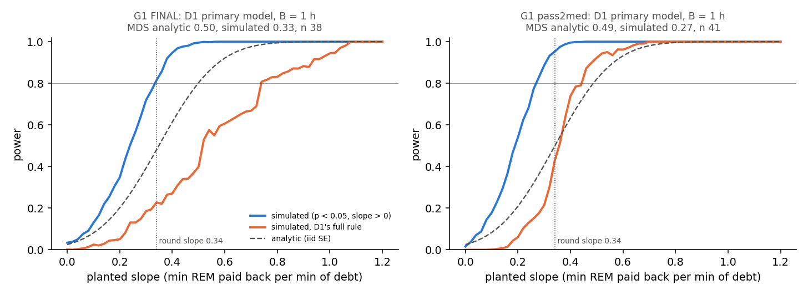
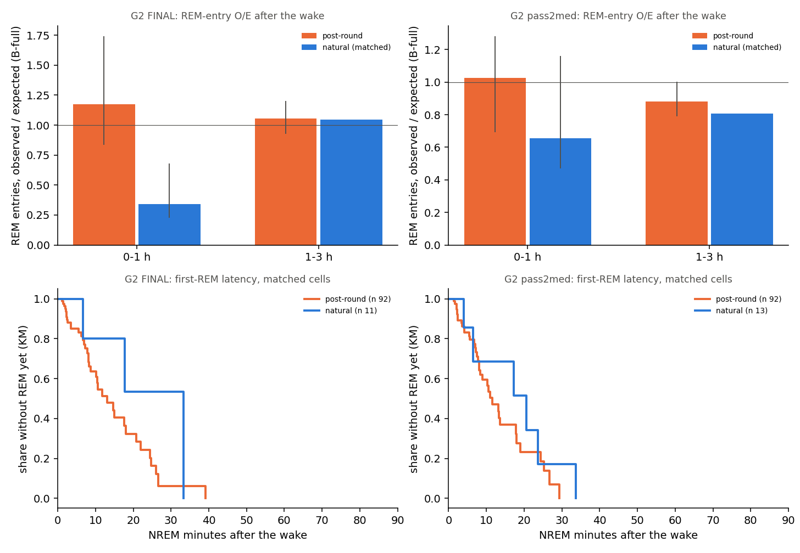
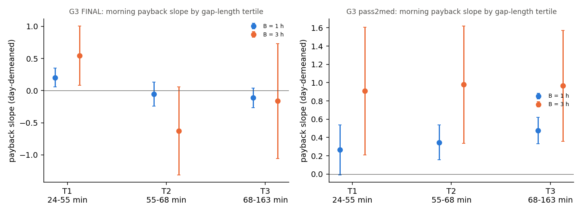
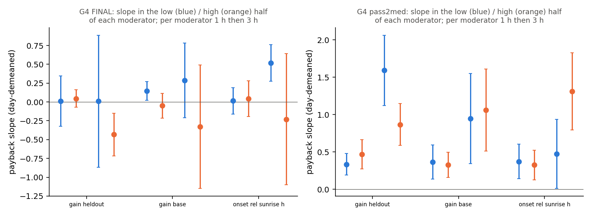

# Sleep behaviour explore — Amendment 1, part G: where does the REM repayment after morning rounds (#43) come from? (cohort 2026c)

Plan: [implementation_plan/2026-10-08-sleep-behaviour-explore.md](../../../../implementation_plan/2026-10-08-sleep-behaviour-explore.md), section 9 "G" (pass rules and the reading rule written before these results, unchanged; definitions as section 3). Driver `ephys/sleep_explore_g.py run` (commit ff345b3+dirty); bulk `D:\Field2026_analysis_out\2026c\sleep_explore_G_20261009_1233`; scorings FINAL, pass2med; parts g1, g2, g3, g4; runtime 0.4 min. Builds on [D1](ephys_spikes_sleep_explore_D1_2026c.md) (`sleep_explore_d.py`) and [A4](ephys_spikes_sleep_explore_A_2026c.md); the held-out per-step predictions come from the main session (S / S2b).

**Scope.** Claim #43 (Candidate): REM missed before a morning battery round is repaid afterwards (pass2med, day-demeaned slope +0.34 at 1 h, +0.96 at 3 h per min of debt); the count rules do not produce it; natural dawn wakes showed none (D1). Part G asks which of three sources the data favour: the handling itself (G2), the REM lost during the unrecorded round gap (G3), or dawn timing (G1); G4 asks whether the slope is larger where the held-out clock-only model predicts a higher REM-entry rate. Claim statuses change in the claim audit, not here. Inputs: the scored 1-s states, NOAA light, the Phase-0 gap table, the held-out per-step predictions. No LFP features. Everything from 2026-09-11 19:40 is cut.

## Verdict

- **G1 (dawn timing, D1's power):** UNINFORMATIVE (G1 stays open).
- **G2 (H18, handling-specific post-round sleep):** NOT MET — power-limited: at most 3 animals have matched natural wakes with held-out predictions in a window, so the rats condition (>= 5) could not be met.
- **G3 (the round's own sleep loss):** NOT MET.
- **G4 (the plan's "gate release" test):** PARTLY (1 h MET, 3 h NOT MET).
- **Reading rule:** #43 stays Candidate (power) — no row of the reading table applies.

- G1 (pass2med): D1's primary 1-h slope -0.022 [-0.213, +0.169] (n 41); MDS analytic 0.487 (iid SE 0.174; with the cluster SE 0.273), simulated 0.269; power at the round slope 0.34: analytic 0.50, simulated 0.95 (D1's full rule 0.43).
- G2 FINAL, 0-1 h: REM-entry O/E post-round 1.17 [0.84, 1.74] vs natural (matched) 0.34 [0.23, 0.68]; difference +0.83 [+0.35, +1.28], 0/3 animals negative → NOT MET; perturbation-blind: 1.17 vs 0.34, difference +0.83 [+0.34, +1.32].
- G2 FINAL, 1-3 h: REM-entry O/E post-round 1.06 [0.93, 1.20] vs natural (matched) 1.05 [1.05, 1.05]; difference +0.01 [-0.12, +0.15], 0/1 animals negative → NOT MET; perturbation-blind: 1.07 vs 1.08, difference -0.01 [-0.12, +0.13].
- G2 pass2med, 0-1 h: REM-entry O/E post-round 1.03 [0.69, 1.28] vs natural (matched) 0.66 [0.47, 1.16]; difference +0.37 [-0.19, +0.75], 1/3 animals negative → NOT MET; perturbation-blind: 0.93 vs 0.65, difference +0.28 [-0.38, +0.75].
- G2 pass2med, 1-3 h: REM-entry O/E post-round 0.88 [0.79, 1.00] vs natural (matched) 0.81 [0.81, 0.81]; difference +0.07 [-0.02, +0.19], 0/1 animals negative → NOT MET; perturbation-blind: 0.87 vs 0.81, difference +0.06 [-0.02, +0.16].
- G2 FINAL, Cox first-REM hazard (round vs natural, matched cells): HR 2.83 [0.43, 18.66], p 0.2801 (92 rounds, 11 natural wakes).
- G2 pass2med, Cox first-REM hazard (round vs natural, matched cells): HR 2.80 [1.01, 7.77], p 0.0475 (92 rounds, 13 natural wakes).
- G3 pass2med, morning, 1 h: pre-round debt slope +0.335 → +0.324 with the gap debt (fall 3 %); gap-debt slope +0.043 [-0.021, +0.108].
- G3 pass2med, morning, 3 h: pre-round debt slope +0.961 → +0.943 with the gap debt (fall 2 %); gap-debt slope +0.067 [-0.161, +0.294].
- G4 pass2med, 1 h, gain_heldout: interaction +0.058 [+0.008, +0.108] per unit (+0.114 per SD), n 37.
- G4 pass2med, 1 h, onset_rel_sunrise_h: interaction +0.037 [-0.127, +0.202] per unit (+0.028 per SD), n 49.
- G4 pass2med, 3 h, gain_heldout: interaction -0.074 [-0.168, +0.020] per unit (-0.178 per SD), n 37.
- G4 pass2med, 3 h, onset_rel_sunrise_h: interaction +0.700 [+0.322, +1.077] per unit (+0.523 per SD), n 49.

## Definitions

Time is field-PC local time. States per second: $s_t \in \{0\ \text{unknown}, 1\ \text{WAKE}, 3\ \text{NREM}, 5\ \text{REM}\}$. Animals $a$; blocks $k$ = day-half blocks of `sleep_cycles_v2.build_records` (record start 06–18 h → D, else N).

### Shared
- **Record.** Sessions of an animal joined across splits ≤ 60 s (`sleep_model.records_for`); FINAL exclusions and the cut at 2026-09-11 19:40. Same records under both scorings. **Scorings:** FINAL = `states_1s_final`; pass2med = `states_1s_pass2med` (fixed per-animal thresholds; the scoring #10 / #43 are scoped to). **Bout** = a maximal run of one state, $[a, b)$, length $b - a$.
- **Light.** $\text{dark}(t) = \neg[\text{sunrise}(t) \le t < \text{sunset}(t)]$, NOAA times (`sleep_quant.sun_times`).
- **Gaps** (Phase-0 table): the time between two consecutive records of an animal. Usable: ≤ 180 min with ≥ 1 h recorded on both sides. Round = cause `round_logged` or `round_inferred`; handling = a round or a `probe_move`. Kind: morning if the gap starts 05:00–11:00, evening 15:30–21:30, else other.
- **Round payback windows (A4 / #43; `sleep_explore_d.payback_from_records`).** For each usable round gap $[g_s, g_e)$: A = $[g_s - 3\,\text{h}, g_s)$, B = $[g_e, g_e + h)$, $h \in \{1, 3\}$ h, sums of the animal's 10-min bins (≥ 80 % recorded). Expected amounts from the phase × day baselines (leave-one-block-out binomial REM / NREM share with $x = [1, \sin/\cos(2\pi j\,\text{hour}/24)_{j=1,2}, \text{day}, \text{dark}, \text{dark}\times\text{day}, \text{animal}]$, day = days since 2026-08-30 19:00). $\text{debt}_{REM} = \sum_A E[\text{REM}] - \sum_A \text{REM}$, $\text{pay}_{REM} = \sum_B \text{REM} - \sum_B E[\text{REM}]$ (min); the same for NREM.
- **Pay model.** OLS $\text{pay}_w = \alpha_{a(w)} + \beta\,\text{debt}_w [+ \ldots] + \varepsilon_w$, animal fixed effects, SEs clustered by the block of window A (`sleep_explore.ols`), 95 % CI $= \hat\beta \pm 1.96\,\widehat{se}$, normal $p$. **Day-demeaned:** every variable minus its mean over the windows of the same calendar day (round: gap-start date; dawn wake: wake-start date). #43 = morning rounds, $\text{pay}_{REM} \sim \text{debt}_{REM}$, day-demeaned, pass2med.
- **Held-out per-step predictions** (the main session, `D:/Field2026_analysis_out/2026c/sleep_heldout_steps/`): one row per 10-s NREM step $s$ of the test blocks (forward chaining: a step in block $k$ is predicted by the fit on blocks $< k$; the first 6 blocks are never predicted). $y_s \in \{0\ \text{stay}, 1\ \text{REM}, 2\ \text{WAKE}\}$ = the transition at the end of the step. $\hat p_{REM,s}$ = B-full at `P_tw600_k0` (the REM-entry count with $\tau_w$ = 600 s, full discharge, + the clock terms (2-harmonic time of day, dark) and the step-B covariates); $\hat p^{pb}_{REM,s}$ = the same model trained without the 3 h after round gaps (perturbation-blind); $\hat p^{clock}_{REM,s}$ = the clock-only model without the counter (clock, elapsed-in-bout, day, dark, anchor and the L1 terms: preceding wake, previous bout REM / unknown, wake share of the last 10 min; step B's 'gate-only' + L1, per the folder's README).

### G1
- **D1 primary model** (Step D1, natural dawn wakes = WAKE bouts ≥ 30 min ending 05:00–09:00 inside a record, no handling in the 3 h before; A = the 3 h before the wake, B = the 1 h after it; exact-second windows): day-demeaned $\text{pay}_{REM} = \alpha_a + \beta\,\text{debt}_{REM} + \gamma\,\text{debt}_{NREM} + \delta\,\text{onset}_h + \varepsilon$, SEs clustered by block; $n$ windows, $k$ parameters, $G$ clusters.
- **Analytic MDS** (the plan: from the debt variance and the residual SD). $\tilde x$ = the day-demeaned REM debt residualised on the other columns (intercept, covariates, animal dummies; Frisch–Waugh); $\hat\sigma = \sqrt{\sum \hat\varepsilon^2/(n-k)}$; $\text{SE}_{iid} = \hat\sigma / \sqrt{\sum \tilde x_i^2} = \hat\sigma / (\text{SD}(\tilde x)\sqrt{n-1})$; $\text{MDS} = (z_{1-\alpha/2} + z_{0.80})\,\text{SE}_{iid} = 2.80\,\text{SE}_{iid}$ ($\alpha$ = 0.05 two-sided). Also with $t_{n-k}$ quantiles and with the fit's cluster-robust SE ($\text{MDS}_{cl}$). Analytic power at a true slope $\beta^*$: $\Phi(\beta^*/\text{SE} - z_{0.975})$.
- **Simulated MDS** (planting slopes into the real windows). $\hat m_0 = X\hat b - \hat\beta x$ (the fitted values without the debt term), $\hat\varepsilon$ = residuals; replicate $r$: $y^*_i = \hat m_{0,i} + \beta^* x_i + \hat\varepsilon_i v_{g(i)}$, $v_g \in \{-1, +1\}$ equiprobable per cluster (wild cluster bootstrap), refit with the same cluster-robust test; power$(\beta^*)$ = share of replicates with $p < 0.05$ and $\hat\beta > 0$; MDS$_{sim}$ = the smallest $\beta^*$ (linear interpolation on a grid of step 0.02) with power ≥ 0.80; 2000 replicates per grid point. Also the power of D1's full rule ($\hat\beta > 0.2$, $p < 0.05$, every rat with ≥ 3 windows with a positive simple slope).
- **G1 rule** (plan): informative iff the MDS ≤ 0.34 (the round slope); operationalised: the analytic MDS$_{iid}$ AND the simulated MDS ≤ 0.34. Positive = D1's slope > 0 with $p$ < 0.05.

### G2 (H18)
- **Post-round event.** Each usable round gap whose next record starts within 5 s of $g_e$; reference $t_0$ = the record start ($= g_e$). Matched wake length $d = (g_e - g_s) + f$, $f$ = seconds from the record start to its first NREM second (the gap is counted as wake: the animal was handled). Sensitivity: $d_{tot} = d$ + the WAKE bout that ended the previous record.
- **Natural wake event.** A WAKE bout $[a, b)$ with $b - a \ge 1800$ s inside a record (known seconds on both sides), with no handling gap of the animal overlapping $[t_a - 3\,\text{h}, t_a)$; $t_0$ = the wake end $t_b$; $d = b - a$.
- **Cells.** Kind = Phase 0's clock rule applied to the wake start (round: the gap start, = the Phase-0 kind; natural: $t_a$); bin = 30–120 min or ≥ 2 h (plan section 3 bins at ≥ 30 min); cell = kind × bin; events of kind other are not matched. Only cells with both groups are used (**matched cells**). Sensitivities: kind by the wake end; $d_{tot}$ bins.
- **First-REM latency in NREM time** (as Step A's A1): from the first NREM bout after $t_0$, $T$ = NREM + microarousal (wake < 40 s between NREM bouts) seconds until the first REM bout; censored at an unknown epoch, a wake ≥ 7 min or the record end; other wakes pause $T$. **Cox** (statsmodels PHReg, Efron ties): $h(T) = h_{0,a}(T)\exp(\beta_{round}\,\text{round} + \sum_c \gamma_c\,\text{cell}_c)$, animal strata, SEs clustered by block; $\beta_{round} < 0$ = a later first REM after rounds (H18's 'round term CI > 0' on the latency scale = CI of $\beta_{round}$ < 0). KM medians per group × cell (NREM min).
- **REM-entry O/E** (as S2). Windows $[t_0, t_0 + 1\,\text{h})$ and $[t_0 + 1\,\text{h}, t_0 + 3\,\text{h})$, the held-out NREM steps of the event's record with step time in the window: $O = \sum_s [y_s = 1]$, $E = \sum_s \hat p_{REM,s}$ ($E^{pb}$ with $\hat p^{pb}$). Per group and cell $c$: $O_{gc}, E_{gc}$ summed over events. $\text{O/E}_{round} = \sum_c O_{rc} / \sum_c E_{rc}$; $\text{O/E}_{natural} = \sum_c w_c\,O_{nc}/E_{nc}$ with $w_c = E_{rc}/\sum_{c'} E_{rc'}$ (standardised to the rounds' cell mix); $\Delta = \text{O/E}_{round} - \text{O/E}_{natural}$, over the matched cells with $E > 0$ in both groups. 95 % CI: percentile bootstrap over blocks (the event record's block; 2000 replicates). Per animal: the same $\Delta$ from the animal's events. Sensitivity: windows aligned at the first NREM second after $t_0$.
- **G2 rule** (plan, one window): $\Delta$'s CI < 0 and ≥ 5 animals with $\Delta < 0$, on both scorings, with $\hat p_{REM}$. Operationalised: applied to each window; G2 passes if one window meets it on both scorings. $\hat p^{pb}$ and the Cox term are reported.

### G3
- **Gap debt.** $\text{gapdebt}_{REM} = \sum_{m} \omega_m\,\hat\pi^{REM}(t_m)$ (min): the phase × day baseline REM share (the same binomial GLM, fitted leave-one-block-out without window A's block) at the midpoint $t_m$ of each minute $m$ of the gap, $\omega_m$ = the minute's length (1, or the last partial minute); the REM the animal would have had in the gap at the baseline rate, all counted as missed (no recording). $\text{gapdebt}_{NREM}$ likewise (reported).
- **Models** (morning rounds; evening reported): M0 $\text{pay}_{REM} \sim \text{debt}_{REM}$ (= #43), M1 $\text{pay}_{REM} \sim \text{debt}_{REM} + \text{gapdebt}_{REM}$, M2 $\text{pay}_{REM} \sim \text{gapdebt}_{REM}$; animal FE, clustered by block, raw and day-demeaned. $\text{fall} = 1 - \hat\beta_{debt}^{M1}/\hat\beta_{debt}^{M0}$.
- **G3 rule** (plan, per horizon, day-demeaned, pass2med): the gap-debt slope's CI > 0 AND fall ≥ 30 %. Operationalised: met at 1 h and 3 h = MET; at one = PARTLY (not a pass).
- **By gap-length tertile.** Tertile cut points of the gap length over the horizon's morning windows; one day-demeaned model $\text{pay}_{REM} \sim \sum_{k=1}^{3}\beta_k\,\text{debt}_{REM}[\text{tertile} = k] + [T2] + [T3]$ + animal FE.

### G4
- **Onset.** The first Watson SLEEP episode (no WAKE bout > 120 s or unknown epoch inside, ≥ 20 min; `phase3.episodes_of`) of the post-round record (`sleep_explore_d.round_onsets`); $\text{onset}_{sr}$ = its start minus NOAA sunrise of that date (h).
- **Predicted REM-entry gain.** $g^{clock}_w = \frac{360}{|S_w|}\sum_{s \in S_w}\hat p^{clock}_{REM,s}$, $S_w$ = the held-out NREM steps of the post-round record in window B: the clock-only model's REM entries per NREM hour during the payback window (windows in the first 6 blocks have none). Sensitivity, all windows: $g^{base}_w = \sum_B E[\text{on}] / (\sum_B E[\text{NREM}]/60)$, the phase × day baseline's expected REM onsets per expected NREM hour in B.
- **Interaction model.** $\text{pay}_{REM} = \alpha_a + \beta\,\text{debt}_{REM} + \gamma\,m + \delta\,\text{debt}_{REM}\,(m - \bar m) + \varepsilon$, animal FE, clustered by block; day-demeaned: $\text{pay}$, $\text{debt}$ and $m$ day-demeaned, the product of the day-demeaned debt and the globally centred $m$ (so $\delta$ = the change of the within-day payback slope per unit of $m$). Also the slopes in the halves of $m$ (median split, one model).
- **G4 rule** (plan): $\delta$'s CI > 0 for $g^{clock}$ (day-demeaned, pass2med); operationalised as G3: both horizons = MET, one = PARTLY.

### Reading rule (plan, section 9)

| result | reading |
|---|---|
| G2 pass, G3 fail | handling-specific |
| G3 pass | the round's sleep loss |
| G1 informative and positive | dawn timing |
| all fail | #43 stays Candidate (power) |

G4 has no row in the table; its own pass sentence is "a deficit released where the gate opens".

## Reproduction

The round windows reproduce #43 (A4, pass2med: +0.335 at 1 h, +0.961 at 3 h):

| scores | check | value | ci | n_windows |
|---|---|---|---|---|
| FINAL | #43 morning payback, B = 1 h (day-demeaned) | 0.04 | [-0.141, +0.221] | 49 |
| FINAL | #43 morning payback, B = 3 h (day-demeaned) | -0.062 | [-0.819, +0.694] | 49 |
| FINAL | D1 dawn-wake model refit (primary (D1): debt_rem + debt_nrem + onset_h, B = 1 h): slope / cluster SE vs D1's | -0.213 | D1 -0.2134; SE 0.1127 vs 0.1127 | 38 |
| FINAL | D1 dawn-wake model refit (covariate-free: debt_rem, B = 1 h): slope / cluster SE vs D1's | -0.045 | D1 -0.0452; SE 0.1597 vs 0.1597 | 39 |
| pass2med | #43 morning payback, B = 1 h (day-demeaned) | 0.335 | [+0.175, +0.496] | 49 |
| pass2med | #43 morning payback, B = 3 h (day-demeaned) | 0.961 | [+0.470, +1.451] | 49 |
| pass2med | D1 dawn-wake model refit (primary (D1): debt_rem + debt_nrem + onset_h, B = 1 h): slope / cluster SE vs D1's | -0.022 | D1 -0.0218; SE 0.0975 vs 0.0975 | 41 |
| pass2med | D1 dawn-wake model refit (covariate-free: debt_rem, B = 1 h): slope / cluster SE vs D1's | 0.147 | D1 +0.1469; SE 0.1214 vs 0.1214 | 41 |

Held-out step table (each step must sit on an NREM second of its record):

| steps | records | blocks | steps_on_nrem | steps_checked | steps_unknown_record | share_on_nrem | scores |
|---|---|---|---|---|---|---|---|
| 126231 | 86 | 16 | 126231 | 126231 | 0 | 1.0 | FINAL |
| 126889 | 87 | 16 | 126889 | 126889 | 0 | 1.0 | pass2med |

- FINAL: the file's `post_round` flag on the steps of the G2 windows (0–3 h): post-round events 32565 of 32565 steps flagged; natural-wake events 0 of 23996.
- pass2med: the file's `post_round` flag on the steps of the G2 windows (0–3 h): post-round events 32872 of 32872 steps flagged; natural-wake events 0 of 26015.

## G1 — dawn timing without handling: the power of D1

**Plan (quoted):** "D1 found no payback after natural dawn wakes (−0.02, 41 windows). Add its power: the minimal detectable slope (80 % power, α 0.05) from the windows' debt variance and residual SD. If that slope is > 0.34 (the observed round slope), D1 is uninformative and G1 stays open."

**Verdict (pass2med, primary model, B = 1 h): UNINFORMATIVE (G1 stays open).**

| scores | model | B_h | n_windows | clusters | rats_qualifying | d1_slope | ci_lo | ci_hi | p | sd_debt | sd_debt_resid | sigma_resid | se_iid | se_cl | mds_analytic_iid_z | mds_analytic_iid_t | mds_analytic_cl | mds_sim | mds_sim_d1_rule | power_at_round_slope_analytic_iid | power_at_round_slope_sim | power_at_round_slope_sim_d1_rule | type1_sim | verdict |
|---|---|---|---|---|---|---|---|---|---|---|---|---|---|---|---|---|---|---|---|---|---|---|---|---|
| FINAL | primary (D1): debt_rem + debt_nrem + onset_h | 1 | 38 | 10.0 | 6.0 | -0.213 | -0.434 | 0.008 | 0.058 | 1.51 | 1.23 | 1.331 | 0.178 | 0.113 | 0.498 | 0.516 | 0.316 | 0.334 | 0.739 | 0.481 | 0.814 | 0.228 | 0.068 | UNINFORMATIVE (G1 stays open) |
| FINAL | covariate-free: debt_rem | 1 | 39 | 10.0 | 6.0 | -0.045 | -0.358 | 0.268 | 0.777 | 1.609 | 1.388 | 1.384 | 0.162 | 0.16 | 0.453 | 0.468 | 0.447 | 0.391 | 0.748 | 0.556 | 0.628 | 0.235 | 0.162 | UNINFORMATIVE (G1 stays open) |
| FINAL | primary (D1), B = 3 h | 3 | 9 | nan | nan | nan | nan | nan | nan | nan | nan | nan | nan | nan | nan | nan | nan | nan | nan | nan | nan | nan | nan | INCONCLUSIVE |
| pass2med | primary (D1): debt_rem + debt_nrem + onset_h | 1 | 41 | 11.0 | 6.0 | -0.022 | -0.213 | 0.169 | 0.823 | 1.301 | 0.97 | 1.066 | 0.174 | 0.097 | 0.487 | 0.502 | 0.273 | 0.269 | 0.442 | 0.498 | 0.952 | 0.428 | 0.032 | UNINFORMATIVE (G1 stays open) |
| pass2med | covariate-free: debt_rem | 1 | 41 | 11.0 | 6.0 | 0.147 | -0.091 | 0.385 | 0.226 | 1.301 | 1.069 | 1.137 | 0.168 | 0.121 | 0.471 | 0.485 | 0.34 | 0.319 | 0.593 | 0.525 | 0.88 | 0.172 | 0.146 | UNINFORMATIVE (G1 stays open) |
| pass2med | primary (D1), B = 3 h | 3 | 9 | nan | nan | nan | nan | nan | nan | nan | nan | nan | nan | nan | nan | nan | nan | nan | nan | nan | nan | nan | nan | INCONCLUSIVE |

`type1_sim` = twice the simulated share of significant positive slopes at a planted 0 (the two-sided size of the cluster-robust test in these windows; nominal 0.05). The 3-h horizon has too few windows for a model (D1: INCONCLUSIVE), so it has no MDS.

**Reading.** The plan's formula (residual SD 1.07 min, SD of the residualised debt 0.97 min, n 41) gives SE 0.174 and an MDS of 0.49. D1's own test used the cluster-robust SE, 0.097 (44 % smaller; 11 block clusters), which gives an MDS of 0.27. The wild cluster bootstrap keeps each block's residuals together, so it reproduces the cluster-robust variance by construction (simulated slope SD at a planted 0: 0.080); its MDS (0.27) confirms the cluster-robust number, not the iid one. The two variance estimates disagree about 0.34: under D1's cluster-robust test the dawn windows would have detected a slope of 0.34 with power 0.95; under the plan's iid formula with power 0.50. Day-demeaning makes the residuals of one block partly cancel, which can make the clustered SE smaller than the iid one, and with 11 clusters the clustered SE is itself imprecise. Which one is right cannot be settled from 41 windows, so by the rule fixed before the results (both ≤ 0.34) D1 is not informative and G1 stays open. With D1's full rule (also slope > 0.2 and every rat positive) the power at 0.34 is 0.43.

**In-place deviations.** The plan names one MDS; two are reported (the plan's iid formula and D1's cluster-robust test), and G1 counts as informative only if both are ≤ 0.34 (fixed before the results). The simulation was meant as a check of the analytic number; as built it checks the cluster-robust version only (above).

Power by planted slope (selected grid points):

| scores | model | planted | power_sig | power_d1_rule | power_analytic_iid | power_analytic_cl | mean_slope | sd_slope |
|---|---|---|---|---|---|---|---|---|
| FINAL | primary (D1): debt_rem + debt_nrem + onset_h | 0.0 | 0.034 | 0.002 | 0.025 | 0.025 | 0.0 | 0.096 |
| FINAL | primary (D1): debt_rem + debt_nrem + onset_h | 0.1 | 0.13 | 0.025 | 0.081 | 0.142 | 0.103 | 0.095 |
| FINAL | primary (D1): debt_rem + debt_nrem + onset_h | 0.2 | 0.348 | 0.05 | 0.202 | 0.427 | 0.198 | 0.094 |
| FINAL | primary (D1): debt_rem + debt_nrem + onset_h | 0.3 | 0.72 | 0.186 | 0.392 | 0.759 | 0.302 | 0.094 |
| FINAL | primary (D1): debt_rem + debt_nrem + onset_h | 0.34 | 0.814 | 0.228 | 0.481 | 0.855 | 0.339 | 0.095 |
| FINAL | primary (D1): debt_rem + debt_nrem + onset_h | 0.4 | 0.947 | 0.27 | 0.614 | 0.944 | 0.397 | 0.095 |
| FINAL | primary (D1): debt_rem + debt_nrem + onset_h | 0.5 | 0.996 | 0.398 | 0.803 | 0.993 | 0.501 | 0.094 |
| FINAL | primary (D1): debt_rem + debt_nrem + onset_h | 0.6 | 1.0 | 0.606 | 0.921 | 1.0 | 0.602 | 0.096 |
| FINAL | primary (D1): debt_rem + debt_nrem + onset_h | 0.8 | 1.0 | 0.831 | 0.994 | 1.0 | 0.799 | 0.094 |
| FINAL | primary (D1): debt_rem + debt_nrem + onset_h | 1.0 | 1.0 | 0.944 | 1.0 | 1.0 | 1.002 | 0.095 |
| FINAL | covariate-free: debt_rem | 0.0 | 0.081 | 0.014 | 0.025 | 0.025 | 0.001 | 0.137 |
| FINAL | covariate-free: debt_rem | 0.1 | 0.21 | 0.075 | 0.09 | 0.091 | 0.101 | 0.137 |
| FINAL | covariate-free: debt_rem | 0.2 | 0.316 | 0.114 | 0.235 | 0.24 | 0.193 | 0.137 |
| FINAL | covariate-free: debt_rem | 0.3 | 0.484 | 0.192 | 0.458 | 0.468 | 0.297 | 0.141 |
| FINAL | covariate-free: debt_rem | 0.34 | 0.628 | 0.235 | 0.556 | 0.567 | 0.342 | 0.138 |
| FINAL | covariate-free: debt_rem | 0.4 | 0.832 | 0.346 | 0.696 | 0.707 | 0.402 | 0.14 |
| FINAL | covariate-free: debt_rem | 0.5 | 0.986 | 0.46 | 0.871 | 0.879 | 0.509 | 0.138 |
| FINAL | covariate-free: debt_rem | 0.6 | 1.0 | 0.514 | 0.96 | 0.964 | 0.604 | 0.14 |
| FINAL | covariate-free: debt_rem | 0.8 | 1.0 | 0.922 | 0.999 | 0.999 | 0.796 | 0.138 |
| FINAL | covariate-free: debt_rem | 1.0 | 1.0 | 1.0 | 1.0 | 1.0 | 1.001 | 0.138 |
| pass2med | primary (D1): debt_rem + debt_nrem + onset_h | 0.0 | 0.016 | 0.0 | 0.025 | 0.025 | 0.0 | 0.08 |
| pass2med | primary (D1): debt_rem + debt_nrem + onset_h | 0.1 | 0.178 | 0.001 | 0.083 | 0.175 | 0.099 | 0.085 |
| pass2med | primary (D1): debt_rem + debt_nrem + onset_h | 0.2 | 0.54 | 0.061 | 0.209 | 0.537 | 0.201 | 0.083 |
| pass2med | primary (D1): debt_rem + debt_nrem + onset_h | 0.3 | 0.886 | 0.215 | 0.407 | 0.868 | 0.299 | 0.085 |
| pass2med | primary (D1): debt_rem + debt_nrem + onset_h | 0.34 | 0.952 | 0.428 | 0.498 | 0.937 | 0.338 | 0.081 |
| pass2med | primary (D1): debt_rem + debt_nrem + onset_h | 0.4 | 0.996 | 0.739 | 0.634 | 0.984 | 0.4 | 0.084 |
| pass2med | primary (D1): debt_rem + debt_nrem + onset_h | 0.5 | 1.0 | 0.923 | 0.82 | 0.999 | 0.499 | 0.082 |
| pass2med | primary (D1): debt_rem + debt_nrem + onset_h | 0.6 | 1.0 | 0.962 | 0.932 | 1.0 | 0.6 | 0.082 |
| pass2med | primary (D1): debt_rem + debt_nrem + onset_h | 0.8 | 1.0 | 1.0 | 0.996 | 1.0 | 0.801 | 0.083 |
| pass2med | primary (D1): debt_rem + debt_nrem + onset_h | 1.0 | 1.0 | 1.0 | 1.0 | 1.0 | 0.996 | 0.083 |
| pass2med | covariate-free: debt_rem | 0.0 | 0.073 | 0.0 | 0.025 | 0.025 | -0.002 | 0.105 |
| pass2med | covariate-free: debt_rem | 0.1 | 0.209 | 0.006 | 0.086 | 0.128 | 0.098 | 0.105 |
| pass2med | covariate-free: debt_rem | 0.2 | 0.422 | 0.034 | 0.221 | 0.377 | 0.2 | 0.109 |
| pass2med | covariate-free: debt_rem | 0.3 | 0.72 | 0.128 | 0.43 | 0.695 | 0.302 | 0.11 |
| pass2med | covariate-free: debt_rem | 0.34 | 0.88 | 0.172 | 0.525 | 0.8 | 0.341 | 0.106 |
| pass2med | covariate-free: debt_rem | 0.4 | 0.985 | 0.234 | 0.663 | 0.909 | 0.396 | 0.107 |
| pass2med | covariate-free: debt_rem | 0.5 | 1.0 | 0.581 | 0.845 | 0.985 | 0.498 | 0.107 |
| pass2med | covariate-free: debt_rem | 0.6 | 1.0 | 0.84 | 0.946 | 0.999 | 0.603 | 0.11 |
| pass2med | covariate-free: debt_rem | 0.8 | 1.0 | 1.0 | 0.997 | 1.0 | 0.801 | 0.107 |
| pass2med | covariate-free: debt_rem | 1.0 | 1.0 | 1.0 | 1.0 | 1.0 | 1.001 | 0.108 |

## G2 — handling-specific post-round sleep (H18)

**Plan (quoted):** "Compared: post-round vs natural wakes of ≥ 30 min, matched on wake length bin and morning / evening. Measures: first-REM latency in NREM time (Cox, animal strata); REM-entry O/E (as S2) in the 0–1 h and 1–3 h after. Pass for 'handling delays REM beyond the wake it causes': post-round REM O/E below the natural-wake O/E (bootstrap CI of the difference < 0), ≥ 5/6 rats, both scorings."

**Verdict: NOT MET — power-limited: at most 3 animals have matched natural wakes with held-out predictions in a window, so the rats condition (>= 5) could not be met.**

Events (funnel):

| round_gaps | round_no_record | round_no_nrem | natural_ge30_inside | natural_handled | scores | rounds | naturals | rounds_ge30 | rounds_matched | naturals_matched | naturals_kind_other | naturals_matched_with_heldout_steps | rounds_matched_with_heldout_steps | naturals_any_clock_with_heldout_steps |
|---|---|---|---|---|---|---|---|---|---|---|---|---|---|---|
| 94 | 0 | 0 | 222 | 63 | FINAL | 94 | 159 | 93 | 92 | 11 | 148 | 3 | 61 | 83 |
| 94 | 0 | 0 | 240 | 68 | pass2med | 94 | 172 | 93 | 92 | 13 | 159 | 3 | 62 | 91 |

**Reading.**

- FINAL: 159 natural wakes ≥ 30 min (inside a record, no handling in the 3 h before); 148 start at hours with no round to match (21:30–05:00, 11:00–15:30); 11 are in matched cells, 3 of them with held-out steps in the 0–1 h window (rounds: 61 of 92; natural wakes of any clock time: 83).
- pass2med: 172 natural wakes ≥ 30 min (inside a record, no handling in the 3 h before); 159 start at hours with no round to match (21:30–05:00, 11:00–15:30); 13 are in matched cells, 3 of them with held-out steps in the 0–1 h window (rounds: 62 of 92; natural wakes of any clock time: 91).
- FINAL, 0–1 h: post-round O/E 1.17 vs matched natural 0.34 (3 natural REM entries); difference +0.83 [+0.35, +1.28]. Post hoc, matched on the wake-length bin only (any clock time; the expected counts already contain the clock terms): natural 0.92 (83 events, 84 REM entries), difference +0.27 [-0.20, +0.72], 2/6 animals negative; 1–3 h +0.12 [-0.72, +0.51], 2/6 negative.
- pass2med, 0–1 h: post-round O/E 1.03 vs matched natural 0.66 (6 natural REM entries); difference +0.37 [-0.19, +0.75]. Post hoc, matched on the wake-length bin only (any clock time; the expected counts already contain the clock terms): natural 1.05 (91 events, 110 REM entries), difference -0.02 [-0.60, +0.31], 4/6 animals negative; 1–3 h -0.07 [-0.58, +0.16], 3/6 negative.
- FINAL, Cox: HR 2.83 [0.43, 18.66] for rounds vs 11 matched natural wakes (HR > 1 = the first REM came sooner in NREM time after rounds; H18 predicted HR < 1); post hoc, bin only + dark at the wake end (most of these natural wakes end at night): HR 0.52 [0.21, 1.28] vs 159 natural wakes.
- pass2med, Cox: HR 2.80 [1.01, 7.77] for rounds vs 13 matched natural wakes (HR > 1 = the first REM came sooner in NREM time after rounds; H18 predicted HR < 1); post hoc, bin only + dark at the wake end (most of these natural wakes end at night): HR 0.43 [0.31, 0.59] vs 172 natural wakes.
- REM entry relative to the held-out model (O/E) is not lower after rounds than after natural long wakes, neither in the matched cells nor (post hoc) over all natural wakes of the same length bin. The first-REM latency depends on how the light phase is handled: in the matched cells (few natural wakes, few of them reaching REM before censoring) the first REM came sooner after rounds (HR FINAL 2.83 [0.43, 18.66]; pass2med 2.80 [1.01, 7.77]); over all natural wakes of the same bin with a dark step at the wake end (post hoc) it came later (HR FINAL 0.52 [0.21, 1.28]; pass2med 0.43 [0.31, 0.59]). The two latency comparisons point in opposite directions and the second is post hoc, so the latency does not settle H18 either way.
- The plan's matched natural side is small (most natural long wakes are at night, when no round happens), the 1–3 h natural window holds about one event, and the ≥ 5/6-rats condition could not be evaluated: G2 is power-limited. The post-hoc rows are not part of the rule.

**In-place deviations.** (i) The rounds' wake length counts the unrecorded gap as wake. (ii) Morning / evening is Phase 0's clock rule applied to the wake start (for rounds = the Phase-0 kind). (iii) The plan names two windows and no primary; G2 passes if one window meets the rule on both scorings (fixed before the results). (iv) The bin-only matching was added after seeing the small matched natural side; it is reported, not judged.

REM-entry O/E (expected `E` = B-full held out, the rule; `E_pb` = perturbation-blind; `E_gate` = clock-only; the sensitivities use `E`):

| scores | spec | window | expected | events_round | events_natural | O_round | E_round | oe_round | oe_round_lo | oe_round_hi | O_natural | E_natural | oe_natural_pooled | oe_natural_std | oe_natural_lo | oe_natural_hi | diff | diff_lo | diff_hi | animals_negative | animals | rule |
|---|---|---|---|---|---|---|---|---|---|---|---|---|---|---|---|---|---|---|---|---|---|---|
| FINAL | primary | 0-1 h | E | 61 | 3 | 155.0 | 129.589 | 1.174 | 0.837 | 1.743 | 3.0 | 7.381 | 0.406 | 0.34 | 0.225 | 0.679 | 0.835 | 0.355 | 1.283 | 0 | 3 | NOT MET |
| FINAL | primary | 1-3 h | E | 56 | 1 | 482.0 | 452.149 | 1.055 | 0.926 | 1.2 | 7.0 | 6.694 | 1.046 | 1.046 | 1.046 | 1.046 | 0.009 | -0.119 | 0.155 | 0 | 1 | NOT MET |
| FINAL | primary | 0-1 h | E_pb | 61 | 3 | 155.0 | 129.739 | 1.174 | 0.836 | 1.657 | 3.0 | 7.357 | 0.408 | 0.343 | 0.22 | 0.714 | 0.831 | 0.339 | 1.315 | 0 | 3 | NOT MET |
| FINAL | primary | 1-3 h | E_pb | 56 | 1 | 482.0 | 447.125 | 1.066 | 0.956 | 1.211 | 7.0 | 6.504 | 1.076 | 1.076 | 1.076 | 1.076 | -0.01 | -0.12 | 0.135 | 0 | 1 | NOT MET |
| FINAL | primary | 0-1 h | E_gate | 61 | 3 | 155.0 | 128.321 | 1.19 | 0.858 | 1.542 | 3.0 | 6.768 | 0.443 | 0.367 | 0.268 | 0.66 | 0.822 | 0.435 | 1.256 | 0 | 3 | NOT MET |
| FINAL | primary | 1-3 h | E_gate | 56 | 1 | 482.0 | 444.906 | 1.074 | 0.968 | 1.21 | 7.0 | 5.622 | 1.245 | 1.245 | 1.245 | 1.245 | -0.171 | -0.277 | -0.035 | 1 | 1 | NOT MET |
| FINAL | kind by wake end | 0-1 h | E | 61 | 35 | 151.0 | 129.441 | 1.167 | 0.805 | 1.603 | 45.0 | 83.631 | 0.538 | 0.673 | 0.046 | 1.76 | 0.493 | -0.579 | 1.191 | 2 | 4 | NOT MET |
| FINAL | kind by wake end | 1-3 h | E | 53 | 23 | 494.0 | 469.718 | 1.042 | 0.871 | 1.2 | 108.0 | 141.106 | 0.765 | 0.846 | 0.747 | 1.425 | 0.196 | -0.406 | 0.389 | 2 | 4 | NOT MET |
| FINAL | round wake incl. pre-gap wake | 0-1 h | E | 62 | 3 | 158.0 | 135.286 | 1.146 | 0.807 | 1.76 | 3.0 | 7.381 | 0.406 | 0.335 | 0.225 | 0.679 | 0.812 | 0.358 | 1.312 | 0 | 3 | NOT MET |
| FINAL | round wake incl. pre-gap wake | 1-3 h | E | 57 | 1 | 492.0 | 481.899 | 1.01 | 0.864 | 1.205 | 7.0 | 6.694 | 1.046 | 1.046 | 1.046 | 1.046 | -0.036 | -0.182 | 0.159 | 0 | 1 | NOT MET |
| FINAL | post hoc: bin only (any clock time) | 0-1 h | E | 62 | 83 | 157.0 | 132.141 | 1.188 | 0.928 | 1.522 | 84.0 | 124.506 | 0.675 | 0.916 | 0.64 | 1.324 | 0.272 | -0.203 | 0.721 | 2 | 6 | NOT MET |
| FINAL | post hoc: bin only (any clock time) | 1-3 h | E | 57 | 45 | 496.0 | 471.198 | 1.053 | 0.937 | 1.205 | 137.0 | 167.861 | 0.816 | 0.936 | 0.567 | 1.759 | 0.117 | -0.718 | 0.515 | 2 | 6 | NOT MET |
| FINAL | aligned at the first NREM | 0-1 h | E | 66 | 3 | 162.0 | 135.978 | 1.167 | 0.824 | 1.75 | 3.0 | 7.381 | 0.406 | 0.337 | 0.225 | 0.679 | 0.83 | 0.37 | 1.292 | 0 | 3 | NOT MET |
| FINAL | aligned at the first NREM | 1-3 h | E | 57 | 1 | 488.0 | 454.003 | 1.053 | 0.927 | 1.2 | 7.0 | 6.694 | 1.046 | 1.046 | 1.046 | 1.046 | 0.007 | -0.119 | 0.154 | 0 | 1 | NOT MET |
| pass2med | primary | 0-1 h | E | 62 | 3 | 161.0 | 155.699 | 1.025 | 0.693 | 1.283 | 6.0 | 8.964 | 0.669 | 0.656 | 0.47 | 1.161 | 0.369 | -0.187 | 0.754 | 1 | 3 | NOT MET |
| pass2med | primary | 1-3 h | E | 57 | 1 | 491.0 | 552.447 | 0.882 | 0.79 | 1.001 | 7.0 | 8.67 | 0.807 | 0.807 | 0.807 | 0.807 | 0.074 | -0.017 | 0.194 | 0 | 1 | NOT MET |
| pass2med | primary | 0-1 h | E_pb | 62 | 3 | 161.0 | 170.979 | 0.935 | 0.671 | 1.211 | 6.0 | 9.397 | 0.639 | 0.65 | 0.433 | 1.216 | 0.285 | -0.378 | 0.753 | 1 | 3 | NOT MET |
| pass2med | primary | 1-3 h | E_pb | 57 | 1 | 491.0 | 561.184 | 0.869 | 0.787 | 0.97 | 7.0 | 8.694 | 0.805 | 0.805 | 0.805 | 0.805 | 0.064 | -0.018 | 0.165 | 0 | 1 | NOT MET |
| pass2med | primary | 0-1 h | E_gate | 62 | 3 | 161.0 | 161.656 | 0.993 | 0.709 | 1.236 | 6.0 | 8.25 | 0.727 | 0.692 | 0.616 | 0.887 | 0.301 | -0.051 | 0.57 | 0 | 3 | NOT MET |
| pass2med | primary | 1-3 h | E_gate | 57 | 1 | 491.0 | 539.287 | 0.903 | 0.811 | 1.005 | 7.0 | 7.992 | 0.876 | 0.876 | 0.876 | 0.876 | 0.027 | -0.065 | 0.129 | 1 | 1 | NOT MET |
| pass2med | kind by wake end | 0-1 h | E | 62 | 35 | 158.0 | 155.296 | 1.017 | 0.664 | 1.271 | 63.0 | 97.71 | 0.645 | 0.827 | 0.208 | 1.282 | 0.19 | -0.335 | 0.785 | 2 | 5 | NOT MET |
| pass2med | kind by wake end | 1-3 h | E | 55 | 23 | 503.0 | 570.963 | 0.873 | 0.782 | 0.983 | 152.0 | 169.839 | 0.895 | 0.963 | 0.807 | 1.279 | -0.089 | -0.353 | 0.095 | 3 | 5 | NOT MET |
| pass2med | round wake incl. pre-gap wake | 0-1 h | E | 63 | 3 | 164.0 | 160.626 | 1.012 | 0.688 | 1.287 | 6.0 | 8.964 | 0.669 | 0.651 | 0.47 | 1.161 | 0.362 | -0.166 | 0.767 | 1 | 3 | NOT MET |
| pass2med | round wake incl. pre-gap wake | 1-3 h | E | 58 | 1 | 503.0 | 576.441 | 0.865 | 0.769 | 0.992 | 7.0 | 8.67 | 0.807 | 0.807 | 0.807 | 0.807 | 0.058 | -0.038 | 0.185 | 0 | 1 | NOT MET |
| pass2med | post hoc: bin only (any clock time) | 0-1 h | E | 63 | 91 | 163.0 | 158.852 | 1.026 | 0.785 | 1.252 | 110.0 | 140.525 | 0.783 | 1.049 | 0.785 | 1.562 | -0.023 | -0.603 | 0.307 | 4 | 6 | NOT MET |
| pass2med | post hoc: bin only (any clock time) | 1-3 h | E | 58 | 54 | 505.0 | 573.737 | 0.88 | 0.806 | 0.979 | 188.0 | 207.161 | 0.908 | 0.955 | 0.739 | 1.479 | -0.075 | -0.582 | 0.164 | 3 | 6 | NOT MET |
| pass2med | aligned at the first NREM | 0-1 h | E | 66 | 3 | 169.0 | 165.317 | 1.019 | 0.723 | 1.283 | 6.0 | 8.964 | 0.669 | 0.651 | 0.47 | 1.161 | 0.368 | -0.164 | 0.747 | 1 | 3 | NOT MET |
| pass2med | aligned at the first NREM | 1-3 h | E | 57 | 1 | 493.0 | 551.152 | 0.879 | 0.783 | 0.996 | 7.0 | 8.67 | 0.807 | 0.807 | 0.807 | 0.807 | 0.072 | -0.024 | 0.189 | 0 | 1 | NOT MET |

Per cell (primary, `E`):

| scores | window | expected | cell | O_round | E_round | oe_round | O_natural | E_natural | oe_natural | events_round | events_natural |
|---|---|---|---|---|---|---|---|---|---|---|---|
| FINAL | 0-1 h | E | evening | 30-120 min | 38.0 | 31.916 | 1.191 | 2.0 | 2.944 | 0.679 | 24 | 1 |
| FINAL | 0-1 h | E | evening | >= 2 h | 6.0 | 2.7 | 2.222 | 0.0 | 0.0 | nan | 1 | 0 |
| FINAL | 0-1 h | E | morning | 30-120 min | 111.0 | 94.973 | 1.169 | 1.0 | 4.437 | 0.225 | 36 | 2 |
| FINAL | 1-3 h | E | evening | 30-120 min | 12.0 | 7.106 | 1.689 | 0.0 | 0.0 | nan | 16 | 0 |
| FINAL | 1-3 h | E | evening | >= 2 h | 2.0 | 1.48 | 1.351 | 0.0 | 0.0 | nan | 4 | 0 |
| FINAL | 1-3 h | E | morning | 30-120 min | 468.0 | 443.563 | 1.055 | 7.0 | 6.694 | 1.046 | 36 | 1 |
| pass2med | 0-1 h | E | evening | 30-120 min | 48.0 | 41.002 | 1.171 | 3.0 | 2.584 | 1.161 | 25 | 1 |
| pass2med | 0-1 h | E | evening | >= 2 h | 5.0 | 3.557 | 1.406 | 0.0 | 0.0 | nan | 1 | 0 |
| pass2med | 0-1 h | E | morning | 30-120 min | 108.0 | 111.14 | 0.972 | 3.0 | 6.38 | 0.47 | 36 | 2 |
| pass2med | 1-3 h | E | evening | 30-120 min | 13.0 | 9.801 | 1.326 | 0.0 | 0.0 | nan | 18 | 0 |
| pass2med | 1-3 h | E | evening | >= 2 h | 2.0 | 2.775 | 0.721 | 0.0 | 0.0 | nan | 3 | 0 |
| pass2med | 1-3 h | E | morning | 30-120 min | 476.0 | 539.871 | 0.882 | 7.0 | 8.67 | 0.807 | 36 | 1 |

Per animal (primary, `E`):

| scores | window | animal | oe_round | oe_natural_std | diff | O_round | E_round | O_natural | E_natural |
|---|---|---|---|---|---|---|---|---|---|
| FINAL | 0-1 h | SF07 | nan | nan | nan | 20.0 | 29.296 | 0.0 | 0.0 |
| FINAL | 0-1 h | SF08 | 0.716 | 0.679 | 0.037 | 26.0 | 22.124 | 2.0 | 2.944 |
| FINAL | 0-1 h | SF09 | nan | nan | nan | 31.0 | 19.016 | 0.0 | 0.0 |
| FINAL | 0-1 h | SF10 | 1.28 | 0.0 | 1.28 | 41.0 | 27.63 | 0.0 | 2.477 |
| FINAL | 0-1 h | SF11 | nan | nan | nan | 19.0 | 10.802 | 0.0 | 0.0 |
| FINAL | 0-1 h | SF12 | 0.888 | 0.51 | 0.377 | 18.0 | 20.722 | 1.0 | 1.96 |
| FINAL | 1-3 h | SF07 | nan | nan | nan | 97.0 | 94.575 | 0.0 | 0.0 |
| FINAL | 1-3 h | SF08 | nan | nan | nan | 112.0 | 89.176 | 0.0 | 0.0 |
| FINAL | 1-3 h | SF09 | nan | nan | nan | 84.0 | 76.009 | 0.0 | 0.0 |
| FINAL | 1-3 h | SF10 | nan | nan | nan | 98.0 | 105.139 | 0.0 | 0.0 |
| FINAL | 1-3 h | SF11 | nan | nan | nan | 26.0 | 26.939 | 0.0 | 0.0 |
| FINAL | 1-3 h | SF12 | 1.076 | 1.046 | 0.03 | 65.0 | 60.311 | 7.0 | 6.694 |
| pass2med | 0-1 h | SF07 | nan | nan | nan | 27.0 | 31.847 | 0.0 | 0.0 |
| pass2med | 0-1 h | SF08 | 0.923 | 1.161 | -0.238 | 28.0 | 28.197 | 3.0 | 2.584 |
| pass2med | 0-1 h | SF09 | nan | nan | nan | 34.0 | 24.411 | 0.0 | 0.0 |
| pass2med | 0-1 h | SF10 | 1.026 | 0.48 | 0.546 | 41.0 | 36.083 | 2.0 | 4.163 |
| pass2med | 0-1 h | SF11 | nan | nan | nan | 16.0 | 13.255 | 0.0 | 0.0 |
| pass2med | 0-1 h | SF12 | 0.664 | 0.451 | 0.213 | 15.0 | 21.905 | 1.0 | 2.217 |
| pass2med | 1-3 h | SF07 | nan | nan | nan | 97.0 | 107.808 | 0.0 | 0.0 |
| pass2med | 1-3 h | SF08 | nan | nan | nan | 123.0 | 114.253 | 0.0 | 0.0 |
| pass2med | 1-3 h | SF09 | nan | nan | nan | 81.0 | 98.526 | 0.0 | 0.0 |
| pass2med | 1-3 h | SF10 | nan | nan | nan | 99.0 | 122.828 | 0.0 | 0.0 |
| pass2med | 1-3 h | SF11 | nan | nan | nan | 30.0 | 35.157 | 0.0 | 0.0 |
| pass2med | 1-3 h | SF12 | 0.829 | 0.807 | 0.021 | 61.0 | 73.875 | 7.0 | 8.67 |

First-REM latency, Cox (round vs natural, matched cells; HR < 1 = a later first REM after rounds):

| scores | spec | n | rounds | naturals | events | coef | se | HR | HR_lo | HR_hi | p | cells | terms_kept |
|---|---|---|---|---|---|---|---|---|---|---|---|---|---|
| FINAL | primary | 103 | 92 | 11 | 40 | 1.04 | 0.963 | 2.828 | 0.429 | 18.66 | 0.28 | evening | 30-120 min; evening | >= 2 h; morning | 30-120 min | round, c_evening_ge2h, c_morning_30to120min |
| FINAL | kind by wake end | 131 | 82 | 49 | 60 | 0.635 | 0.47 | 1.887 | 0.752 | 4.74 | 0.176 | evening | 30-120 min; morning | 30-120 min; morning | >= 2 h | round, c_morning_30to120min, c_morning_ge2h |
| FINAL | round wake incl. pre-gap wake | 104 | 93 | 11 | 40 | 1.035 | 0.962 | 2.815 | 0.427 | 18.566 | 0.282 | evening | 30-120 min; evening | >= 2 h; morning | 30-120 min | round, c_evening_ge2h, c_morning_30to120min |
| FINAL | post hoc: bin only (any clock time) | 252 | 93 | 159 | 108 | -0.658 | 0.463 | 0.518 | 0.209 | 1.284 | 0.155 | 30-120 min; >= 2 h | round, c_ge2h, dark_ref |
| pass2med | primary | 105 | 92 | 13 | 43 | 1.031 | 0.52 | 2.803 | 1.011 | 7.768 | 0.048 | evening | 30-120 min; evening | >= 2 h; morning | 30-120 min | round, c_evening_ge2h, c_morning_30to120min |
| pass2med | kind by wake end | 136 | 84 | 52 | 62 | 1.103 | 0.459 | 3.012 | 1.225 | 7.403 | 0.016 | evening | 30-120 min; morning | 30-120 min; morning | >= 2 h | round, c_morning_30to120min, c_morning_ge2h |
| pass2med | round wake incl. pre-gap wake | 106 | 93 | 13 | 43 | 1.031 | 0.519 | 2.803 | 1.013 | 7.756 | 0.047 | evening | 30-120 min; evening | >= 2 h; morning | 30-120 min | round, c_evening_ge2h, c_morning_30to120min |
| pass2med | post hoc: bin only (any clock time) | 265 | 93 | 172 | 117 | -0.854 | 0.166 | 0.426 | 0.308 | 0.589 | 0.0 | 30-120 min; >= 2 h | round, c_ge2h, dark_ref |

KM medians (NREM min to the first REM; primary cells):

| scores | group | cell | n | rem_reached | km_median_nrem_min | median_d_min |
|---|---|---|---|---|---|---|
| FINAL | natural | evening | 30-120 min | 7 | 1 | nan | 78.9 |
| FINAL | natural | evening | >= 2 h | 2 | 0 | nan | 131.733 |
| FINAL | natural | morning | 30-120 min | 2 | 2 | 17.7 | 50.5 |
| FINAL | round | evening | 30-120 min | 33 | 11 | 11.767 | 52.078 |
| FINAL | round | evening | >= 2 h | 11 | 5 | 26.067 | 226.517 |
| FINAL | round | morning | 30-120 min | 48 | 21 | 10.5 | 63.62 |
| pass2med | natural | evening | 30-120 min | 9 | 3 | 6.533 | 65.167 |
| pass2med | natural | evening | >= 2 h | 1 | 0 | nan | 128.183 |
| pass2med | natural | morning | 30-120 min | 3 | 3 | 23.583 | 33.65 |
| pass2med | round | evening | 30-120 min | 35 | 11 | 8.917 | 52.078 |
| pass2med | round | evening | >= 2 h | 9 | 4 | 26.75 | 194.455 |
| pass2med | round | morning | 30-120 min | 48 | 22 | 11.033 | 63.443 |

Per animal, Cox (no strata; animals with ≥ 3 events of each group):

| scores | animal | rounds | naturals | events | cox_round_coef |
|---|---|---|---|---|---|
| FINAL | SF07 | 15.0 | 1.0 | 6.0 | nan |
| FINAL | SF08 | 18.0 | 3.0 | 12.0 | nan |
| FINAL | SF09 | 19.0 | 2.0 | 7.0 | nan |
| FINAL | SF10 | 18.0 | 2.0 | 7.0 | nan |
| FINAL | SF11 | 9.0 | 1.0 | 5.0 | nan |
| FINAL | SF12 | 13.0 | 2.0 | 3.0 | nan |
| pass2med | SF07 | 15.0 | 1.0 | 6.0 | nan |
| pass2med | SF08 | 18.0 | 4.0 | 14.0 | nan |
| pass2med | SF09 | 19.0 | 2.0 | 7.0 | nan |
| pass2med | SF10 | 18.0 | 2.0 | 8.0 | nan |
| pass2med | SF11 | 9.0 | 2.0 | 5.0 | nan |
| pass2med | SF12 | 13.0 | 2.0 | 3.0 | nan |

## G3 — the round's own sleep loss

**Plan (quoted):** "Gap debt: the REM expected during the unrecorded gap (the phase × day baseline rate × gap duration) is added as a second debt term next to the 3-h pre-round debt. Pass for 'the payback is the round's sleep loss': the gap-debt slope > 0 (CI) AND the pre-round debt slope falls by ≥ 30 %. Also reported: the payback slope by gap-length tertile."

**Verdict (pass2med, morning rounds, day-demeaned): NOT MET.**

Gaps and debts (1-h window set):

| scores | kind | windows_1h | gap_min_median | gap_min_range | gap_debt_rem_mean | gap_debt_rem_sd | gap_debt_nrem_mean | debt_rem_mean | debt_rem_sd | gap_rem_share_mean |
|---|---|---|---|---|---|---|---|---|---|---|
| FINAL | morning | 49 | 60.428 | 24-163 | 6.553 | 2.548 | 39.657 | 0.137 | 3.485 | 0.104 |
| FINAL | evening | 44 | 51.192 | 41-132 | 4.028 | 3.173 | 24.215 | -3.636 | 5.749 | 0.064 |
| pass2med | morning | 49 | 60.428 | 24-163 | 7.048 | 2.635 | 40.765 | -0.695 | 3.166 | 0.112 |
| pass2med | evening | 44 | 51.192 | 41-132 | 4.385 | 3.478 | 24.194 | -2.491 | 4.978 | 0.07 |

Models (`b0` = M0 #43; `b1` = M1 with the gap debt; `b2` = gap debt alone):

| scores | kind | B_h | day_demeaned | n_windows | clusters | corr_debt_gapdebt | b0_debt | b0_debt_lo | b0_debt_hi | b1_debt | b1_debt_lo | b1_debt_hi | b1_gap | b1_gap_lo | b1_gap_hi | b1_gap_p | fall | b2_gap_only | b2_gap_only_lo | b2_gap_only_hi | rats_gap_positive | rats_gap |
|---|---|---|---|---|---|---|---|---|---|---|---|---|---|---|---|---|---|---|---|---|---|---|
| FINAL | morning | 1 | False | 49 | 12 | -0.01 | 0.087 | -0.1 | 0.273 | 0.077 | -0.08 | 0.234 | 0.144 | -0.216 | 0.503 | 0.433 | 0.114 | 0.155 | -0.236 | 0.545 | 5 | 5 |
| FINAL | morning | 1 | True | 49 | 12 | -0.022 | 0.04 | -0.141 | 0.221 | 0.037 | -0.13 | 0.204 | 0.148 | 0.042 | 0.254 | 0.006 | 0.079 | 0.151 | 0.041 | 0.26 | 4 | 5 |
| FINAL | morning | 3 | False | 49 | 12 | -0.01 | 0.174 | -0.568 | 0.915 | 0.151 | -0.533 | 0.834 | 0.337 | -0.346 | 1.021 | 0.333 | 0.133 | 0.359 | -0.421 | 1.139 | 4 | 5 |
| FINAL | morning | 3 | True | 49 | 12 | -0.022 | -0.062 | -0.819 | 0.694 | -0.071 | -0.799 | 0.658 | 0.411 | 0.014 | 0.808 | 0.042 | -0.141 | 0.406 | 0.015 | 0.797 | 5 | 5 |
| FINAL | evening | 1 | False | 44 | 9 | -0.026 | 0.033 | -0.041 | 0.106 | 0.037 | -0.037 | 0.111 | 0.112 | -0.012 | 0.236 | 0.076 | -0.118 | 0.108 | -0.02 | 0.236 | 3 | 5 |
| FINAL | evening | 1 | True | 44 | 9 | 0.099 | 0.029 | -0.059 | 0.118 | 0.028 | -0.065 | 0.122 | 0.393 | 0.361 | 0.424 | 0.0 | 0.035 | 0.394 | 0.356 | 0.431 | 3 | 5 |
| FINAL | evening | 3 | False | 44 | 9 | -0.026 | 0.05 | -0.024 | 0.123 | 0.047 | -0.029 | 0.124 | -0.068 | -0.203 | 0.067 | 0.323 | 0.048 | -0.073 | -0.207 | 0.061 | 1 | 5 |
| FINAL | evening | 3 | True | 44 | 9 | 0.099 | 0.039 | -0.068 | 0.145 | 0.038 | -0.072 | 0.148 | 0.123 | 0.068 | 0.179 | 0.0 | 0.008 | 0.124 | 0.061 | 0.188 | 2 | 5 |
| pass2med | morning | 1 | False | 49 | 12 | -0.018 | 0.397 | 0.23 | 0.565 | 0.393 | 0.225 | 0.561 | 0.145 | -0.147 | 0.437 | 0.331 | 0.01 | 0.162 | -0.186 | 0.51 | 5 | 5 |
| pass2med | morning | 1 | True | 49 | 12 | 0.22 | 0.335 | 0.175 | 0.496 | 0.324 | 0.167 | 0.481 | 0.043 | -0.021 | 0.108 | 0.19 | 0.034 | 0.174 | 0.062 | 0.287 | 3 | 5 |
| pass2med | morning | 3 | False | 49 | 12 | -0.018 | 0.743 | 0.461 | 1.026 | 0.733 | 0.415 | 1.05 | 0.383 | -0.168 | 0.935 | 0.173 | 0.014 | 0.416 | -0.212 | 1.043 | 4 | 5 |
| pass2med | morning | 3 | True | 49 | 12 | 0.22 | 0.961 | 0.47 | 1.451 | 0.943 | 0.463 | 1.423 | 0.067 | -0.161 | 0.294 | 0.566 | 0.018 | 0.448 | 0.174 | 0.723 | 4 | 5 |
| pass2med | evening | 1 | False | 44 | 9 | -0.112 | 0.056 | 0.014 | 0.099 | 0.064 | 0.018 | 0.111 | 0.095 | -0.022 | 0.211 | 0.112 | -0.141 | 0.083 | -0.035 | 0.201 | 3 | 5 |
| pass2med | evening | 1 | True | 44 | 9 | 0.066 | 0.041 | -0.024 | 0.105 | 0.036 | -0.029 | 0.1 | 0.275 | 0.222 | 0.327 | 0.0 | 0.131 | 0.28 | 0.225 | 0.334 | 3 | 5 |
| pass2med | evening | 3 | False | 44 | 9 | -0.112 | 0.089 | 0.015 | 0.163 | 0.082 | 0.002 | 0.163 | -0.082 | -0.219 | 0.056 | 0.244 | 0.077 | -0.097 | -0.227 | 0.033 | 3 | 5 |
| pass2med | evening | 3 | True | 44 | 9 | 0.066 | 0.063 | -0.059 | 0.186 | 0.063 | -0.062 | 0.187 | 0.031 | -0.044 | 0.107 | 0.417 | 0.01 | 0.04 | -0.041 | 0.121 | 2 | 5 |

Payback slope by gap-length tertile (day-demeaned, one model per horizon):

| scores | kind | B_h | tertile | gap_min_range | n_windows | slope | ci_lo | ci_hi | p | mean_gap_min | mean_debt_rem |
|---|---|---|---|---|---|---|---|---|---|---|---|
| FINAL | morning | 1 | 1 | 24-55 | 17 | 0.203 | 0.058 | 0.348 | 0.006 | 47.462 | -0.567 |
| FINAL | morning | 1 | 2 | 55-68 | 16 | -0.053 | -0.241 | 0.135 | 0.583 | 61.875 | 0.393 |
| FINAL | morning | 1 | 3 | 68-163 | 16 | -0.113 | -0.264 | 0.038 | 0.142 | 78.301 | 0.63 |
| FINAL | morning | 3 | 1 | 24-55 | 17 | 0.544 | 0.084 | 1.004 | 0.02 | 47.462 | -0.567 |
| FINAL | morning | 3 | 2 | 55-68 | 16 | -0.626 | -1.31 | 0.059 | 0.073 | 61.875 | 0.393 |
| FINAL | morning | 3 | 3 | 68-163 | 16 | -0.163 | -1.059 | 0.733 | 0.722 | 78.301 | 0.63 |
| FINAL | evening | 1 | 1 | 41-48 | 15 | 0.009 | -0.096 | 0.114 | 0.87 | 44.456 | -3.451 |
| FINAL | evening | 1 | 2 | 48-57 | 14 | 0.065 | -0.135 | 0.265 | 0.526 | 51.573 | -2.12 |
| FINAL | evening | 1 | 3 | 57-132 | 15 | 0.016 | -0.155 | 0.187 | 0.852 | 77.799 | -5.234 |
| FINAL | evening | 3 | 1 | 41-48 | 15 | -0.0 | -0.089 | 0.089 | 0.997 | 44.456 | -3.451 |
| FINAL | evening | 3 | 2 | 48-57 | 14 | 0.096 | -0.184 | 0.375 | 0.502 | 51.573 | -2.12 |
| FINAL | evening | 3 | 3 | 57-132 | 15 | 0.027 | -0.156 | 0.21 | 0.77 | 77.799 | -5.234 |
| pass2med | morning | 1 | 1 | 24-55 | 17 | 0.265 | -0.007 | 0.538 | 0.057 | 47.462 | -0.929 |
| pass2med | morning | 1 | 2 | 55-68 | 16 | 0.347 | 0.158 | 0.536 | 0.0 | 61.875 | -1.413 |
| pass2med | morning | 1 | 3 | 68-163 | 16 | 0.476 | 0.332 | 0.62 | 0.0 | 78.301 | 0.273 |
| pass2med | morning | 3 | 1 | 24-55 | 17 | 0.909 | 0.21 | 1.607 | 0.011 | 47.462 | -0.929 |
| pass2med | morning | 3 | 2 | 55-68 | 16 | 0.978 | 0.339 | 1.618 | 0.003 | 61.875 | -1.413 |
| pass2med | morning | 3 | 3 | 68-163 | 16 | 0.966 | 0.36 | 1.571 | 0.002 | 78.301 | 0.273 |
| pass2med | evening | 1 | 1 | 41-48 | 15 | 0.012 | -0.076 | 0.099 | 0.794 | 44.456 | -2.178 |
| pass2med | evening | 1 | 2 | 48-57 | 14 | 0.016 | -0.119 | 0.151 | 0.818 | 51.573 | -0.909 |
| pass2med | evening | 1 | 3 | 57-132 | 15 | 0.089 | -0.033 | 0.211 | 0.154 | 77.799 | -4.279 |
| pass2med | evening | 3 | 1 | 41-48 | 15 | 0.011 | -0.145 | 0.167 | 0.891 | 44.456 | -2.178 |
| pass2med | evening | 3 | 2 | 48-57 | 14 | -0.04 | -0.141 | 0.06 | 0.434 | 51.573 | -0.909 |
| pass2med | evening | 3 | 3 | 57-132 | 15 | 0.185 | -0.035 | 0.405 | 0.099 | 77.799 | -4.279 |

**Reading.**

- pass2med, 1 h: next to the gap debt the pre-round debt slope stays +0.34 → +0.32 (fall 3 %, needs ≥ 30 %); the gap-debt slope is +0.043 [-0.021, +0.108] (alone: +0.174 [+0.062, +0.287]; day-demeaned correlation of the two debts +0.22).
- pass2med, 3 h: next to the gap debt the pre-round debt slope stays +0.96 → +0.94 (fall 2 %, needs ≥ 30 %); the gap-debt slope is +0.067 [-0.161, +0.294] (alone: +0.448 [+0.174, +0.723]; day-demeaned correlation of the two debts +0.22).
- pass2med, 1 h, by gap-length tertile: T1 (24-55 min) +0.27 [-0.01, +0.54]; T2 (55-68 min) +0.35 [+0.16, +0.54]; T3 (68-163 min) +0.48 [+0.33, +0.62].
- pass2med, 3 h, by gap-length tertile: T1 (24-55 min) +0.91 [+0.21, +1.61]; T2 (55-68 min) +0.98 [+0.34, +1.62]; T3 (68-163 min) +0.97 [+0.36, +1.57].
- The payback slope barely changes when the REM expected during the gap is added, and it is present in every gap-length tertile; the gap's own REM loss, computed this way, does not account for it.

**In-place deviations.** The gap debt uses the baseline fitted without window A's block and counts the whole gap as REM-free; the verdict uses pass2med and needs both horizons (one = PARTLY), fixed before the results.

## G4 — the plan's "gate release" test

**Plan (quoted):** "For morning rounds only: the payback slope vs the clock time of the first post-round sleep onset relative to sunrise, and vs the model's predicted REM-entry gain at that time. Pass for 'a deficit released where the gate opens': a larger slope where the predicted gain is higher (interaction CI > 0). Reported with caution: n ≈ 49 windows."

**Verdict (pass2med, held-out gate gain, day-demeaned): PARTLY (1 h MET, 3 h NOT MET).**

Moderators (morning windows):

| scores | B_h | windows | with_onset | with_heldout_gain | onset_rel_sunrise_h_median | onset_rel_sunrise_h_range | gain_heldout_mean | gain_heldout_sd | gain_base_mean | gain_base_sd | corr_gain_heldout_onset | corr_gain_base_onset |
|---|---|---|---|---|---|---|---|---|---|---|---|---|
| FINAL | 1 | 49 | 49 | 37 | 2.3 | 0.64-4.06 | 4.459 | 2.266 | 8.405 | 1.115 | -0.132 | 0.205 |
| FINAL | 3 | 49 | 49 | 37 | 2.3 | 0.64-4.06 | 7.319 | 2.528 | 9.006 | 1.211 | -0.098 | 0.346 |
| pass2med | 1 | 49 | 49 | 37 | 2.303 | 0.64-3.82 | 5.406 | 1.962 | 8.989 | 1.741 | -0.184 | -0.001 |
| pass2med | 3 | 49 | 49 | 37 | 2.303 | 0.64-3.82 | 8.724 | 2.409 | 9.396 | 1.796 | -0.11 | 0.117 |

Interaction models:

| scores | moderator | B_h | day_demeaned | n_windows | clusters | mod_mean | mod_sd | slope_at_mean | slope_at_mean_lo | slope_at_mean_hi | interaction | interaction_lo | interaction_hi | interaction_p | interaction_per_sd | mod_main | mod_main_p |
|---|---|---|---|---|---|---|---|---|---|---|---|---|---|---|---|---|---|
| FINAL | gain_heldout | 1 | False | 37 | 9 | 4.459 | 2.266 | 0.056 | -0.196 | 0.307 | -0.022 | -0.107 | 0.063 | 0.612 | -0.05 | 0.112 | 0.666 |
| FINAL | gain_heldout | 1 | True | 37 | 9 | 4.459 | 2.266 | 0.027 | -0.234 | 0.288 | 0.015 | -0.056 | 0.087 | 0.677 | 0.034 | 0.019 | 0.955 |
| FINAL | gain_heldout | 3 | False | 37 | 9 | 7.319 | 2.528 | -0.14 | -0.653 | 0.374 | -0.093 | -0.188 | 0.001 | 0.053 | -0.236 | 0.433 | 0.195 |
| FINAL | gain_heldout | 3 | True | 37 | 9 | 7.319 | 2.528 | -0.217 | -0.891 | 0.456 | -0.057 | -0.22 | 0.107 | 0.497 | -0.143 | 0.587 | 0.472 |
| FINAL | gain_base | 1 | False | 49 | 12 | 8.405 | 1.115 | 0.08 | -0.037 | 0.198 | -0.061 | -0.275 | 0.152 | 0.573 | -0.068 | -0.643 | 0.111 |
| FINAL | gain_base | 1 | True | 49 | 12 | 8.405 | 1.115 | 0.073 | -0.024 | 0.169 | -0.108 | -0.208 | -0.007 | 0.036 | -0.12 | -0.504 | 0.614 |
| FINAL | gain_base | 3 | False | 49 | 12 | 9.006 | 1.211 | 0.142 | -0.313 | 0.597 | -0.141 | -0.754 | 0.472 | 0.652 | -0.171 | -2.05 | 0.046 |
| FINAL | gain_base | 3 | True | 49 | 12 | 9.006 | 1.211 | 0.108 | -0.231 | 0.447 | -0.344 | -0.648 | -0.039 | 0.027 | -0.416 | -3.427 | 0.277 |
| FINAL | onset_rel_sunrise_h | 1 | False | 49 | 12 | 2.409 | 0.754 | 0.105 | -0.079 | 0.289 | -0.108 | -0.406 | 0.19 | 0.477 | -0.082 | -0.862 | 0.284 |
| FINAL | onset_rel_sunrise_h | 1 | True | 49 | 12 | 2.409 | 0.754 | 0.071 | -0.061 | 0.203 | -0.103 | -0.257 | 0.052 | 0.192 | -0.078 | -5.865 | 0.019 |
| FINAL | onset_rel_sunrise_h | 3 | False | 49 | 12 | 2.409 | 0.754 | 0.402 | 0.015 | 0.789 | -0.687 | -1.498 | 0.124 | 0.097 | -0.518 | -2.459 | 0.211 |
| FINAL | onset_rel_sunrise_h | 3 | True | 49 | 12 | 2.409 | 0.754 | 0.382 | 0.128 | 0.636 | -0.935 | -1.12 | -0.749 | 0.0 | -0.705 | -12.235 | 0.023 |
| pass2med | gain_heldout | 1 | False | 37 | 9 | 5.406 | 1.962 | 0.429 | 0.225 | 0.634 | -0.014 | -0.094 | 0.066 | 0.734 | -0.027 | 0.013 | 0.961 |
| pass2med | gain_heldout | 1 | True | 37 | 9 | 5.406 | 1.962 | 0.407 | 0.25 | 0.564 | 0.058 | 0.008 | 0.108 | 0.024 | 0.114 | 0.148 | 0.321 |
| pass2med | gain_heldout | 3 | False | 37 | 9 | 8.724 | 2.409 | 0.842 | 0.683 | 1.001 | -0.124 | -0.21 | -0.037 | 0.005 | -0.298 | 0.33 | 0.299 |
| pass2med | gain_heldout | 3 | True | 37 | 9 | 8.724 | 2.409 | 0.998 | 0.824 | 1.173 | -0.074 | -0.168 | 0.02 | 0.124 | -0.178 | 0.999 | 0.001 |
| pass2med | gain_base | 1 | False | 49 | 12 | 8.989 | 1.741 | 0.37 | 0.131 | 0.609 | 0.008 | -0.086 | 0.102 | 0.869 | 0.014 | -0.197 | 0.396 |
| pass2med | gain_base | 1 | True | 49 | 12 | 8.989 | 1.741 | 0.327 | 0.158 | 0.496 | 0.011 | -0.051 | 0.073 | 0.727 | 0.019 | -0.689 | 0.001 |
| pass2med | gain_base | 3 | False | 49 | 12 | 9.396 | 1.796 | 0.433 | -0.219 | 1.085 | 0.14 | -0.113 | 0.393 | 0.277 | 0.252 | -0.984 | 0.426 |
| pass2med | gain_base | 3 | True | 49 | 12 | 9.396 | 1.796 | 0.812 | 0.424 | 1.2 | 0.166 | -0.031 | 0.363 | 0.098 | 0.298 | -2.518 | 0.013 |
| pass2med | onset_rel_sunrise_h | 1 | False | 49 | 12 | 2.409 | 0.747 | 0.308 | 0.099 | 0.517 | 0.127 | -0.066 | 0.321 | 0.198 | 0.095 | -0.188 | 0.777 |
| pass2med | onset_rel_sunrise_h | 1 | True | 49 | 12 | 2.409 | 0.747 | 0.278 | 0.095 | 0.461 | 0.037 | -0.127 | 0.202 | 0.655 | 0.028 | -5.056 | 0.047 |
| pass2med | onset_rel_sunrise_h | 3 | False | 49 | 12 | 2.409 | 0.747 | 0.435 | -0.089 | 0.96 | 0.415 | -0.353 | 1.183 | 0.289 | 0.31 | -0.744 | 0.625 |
| pass2med | onset_rel_sunrise_h | 3 | True | 49 | 12 | 2.409 | 0.747 | 0.582 | 0.185 | 0.98 | 0.7 | 0.322 | 1.077 | 0.0 | 0.523 | -7.772 | 0.024 |

Slopes in the halves of each moderator (day-demeaned):

| scores | moderator | B_h | half | n_windows | mod_range | slope | ci_lo | ci_hi | p |
|---|---|---|---|---|---|---|---|---|---|
| FINAL | gain_heldout | 1 | low | 19 | 0.89-3.96 | 0.012 | -0.321 | 0.346 | 0.943 |
| FINAL | gain_heldout | 1 | high | 18 | 4.12-10.55 | 0.046 | -0.071 | 0.164 | 0.44 |
| FINAL | gain_heldout | 3 | low | 19 | 3.80-6.63 | 0.011 | -0.865 | 0.888 | 0.98 |
| FINAL | gain_heldout | 3 | high | 18 | 6.71-15.25 | -0.434 | -0.719 | -0.148 | 0.003 |
| FINAL | gain_base | 1 | low | 25 | 6.30-8.34 | 0.145 | 0.02 | 0.269 | 0.023 |
| FINAL | gain_base | 1 | high | 24 | 8.34-11.03 | -0.048 | -0.212 | 0.117 | 0.568 |
| FINAL | gain_base | 3 | low | 25 | 6.93-8.88 | 0.286 | -0.211 | 0.783 | 0.259 |
| FINAL | gain_base | 3 | high | 24 | 8.94-11.73 | -0.331 | -1.151 | 0.489 | 0.429 |
| FINAL | onset_rel_sunrise_h | 1 | low | 25 | 0.64-2.30 | 0.014 | -0.161 | 0.19 | 0.873 |
| FINAL | onset_rel_sunrise_h | 1 | high | 24 | 2.38-4.06 | 0.045 | -0.192 | 0.283 | 0.708 |
| FINAL | onset_rel_sunrise_h | 3 | low | 25 | 0.64-2.30 | 0.519 | 0.278 | 0.76 | 0.0 |
| FINAL | onset_rel_sunrise_h | 3 | high | 24 | 2.38-4.06 | -0.229 | -1.1 | 0.641 | 0.606 |
| pass2med | gain_heldout | 1 | low | 19 | 2.06-5.05 | 0.333 | 0.189 | 0.477 | 0.0 |
| pass2med | gain_heldout | 1 | high | 18 | 5.14-9.77 | 0.468 | 0.274 | 0.662 | 0.0 |
| pass2med | gain_heldout | 3 | low | 19 | 4.59-8.14 | 1.591 | 1.12 | 2.063 | 0.0 |
| pass2med | gain_heldout | 3 | high | 18 | 8.93-13.24 | 0.867 | 0.585 | 1.149 | 0.0 |
| pass2med | gain_base | 1 | low | 25 | 5.68-8.79 | 0.364 | 0.134 | 0.594 | 0.002 |
| pass2med | gain_base | 1 | high | 24 | 8.87-12.99 | 0.326 | 0.159 | 0.494 | 0.0 |
| pass2med | gain_base | 3 | low | 25 | 6.12-9.18 | 0.946 | 0.342 | 1.551 | 0.002 |
| pass2med | gain_base | 3 | high | 24 | 9.21-13.50 | 1.062 | 0.513 | 1.611 | 0.0 |
| pass2med | onset_rel_sunrise_h | 1 | low | 25 | 0.64-2.30 | 0.373 | 0.142 | 0.603 | 0.002 |
| pass2med | onset_rel_sunrise_h | 1 | high | 24 | 2.37-3.82 | 0.326 | 0.128 | 0.525 | 0.001 |
| pass2med | onset_rel_sunrise_h | 3 | low | 25 | 0.64-2.30 | 0.472 | 0.009 | 0.936 | 0.046 |
| pass2med | onset_rel_sunrise_h | 3 | high | 24 | 2.37-3.82 | 1.311 | 0.796 | 1.826 | 0.0 |

**Reading.**

- gain_heldout: FINAL 1 h +0.015 [-0.056, +0.087] (n 37, 9 clusters); FINAL 3 h -0.057 [-0.220, +0.107] (n 37, 9 clusters); pass2med 1 h +0.058 [+0.008, +0.108] (n 37, 9 clusters); pass2med 3 h -0.074 [-0.168, +0.020] (n 37, 9 clusters).
- gain_base: FINAL 1 h -0.108 [-0.208, -0.007] (n 49, 12 clusters); FINAL 3 h -0.344 [-0.648, -0.039] (n 49, 12 clusters); pass2med 1 h +0.011 [-0.051, +0.073] (n 49, 12 clusters); pass2med 3 h +0.166 [-0.031, +0.363] (n 49, 12 clusters).
- onset_rel_sunrise_h: FINAL 1 h -0.103 [-0.257, +0.052] (n 49, 12 clusters); FINAL 3 h -0.935 [-1.120, -0.749] (n 49, 12 clusters); pass2med 1 h +0.037 [-0.127, +0.202] (n 49, 12 clusters); pass2med 3 h +0.700 [+0.322, +1.077] (n 49, 12 clusters).
- The interaction is not consistent: for the held-out rate its sign differs between the 1-h and 3-h horizons, the baseline rate (all 49 windows) does not repeat the 1-h result, and for the onset time the two scorings disagree in sign at 3 h. With 9–12 block clusters the clustered CIs are approximate. G4 is not passed (one horizon of two).

**In-place deviations.** The plan's "predicted REM-entry gain at that time" is read as the held-out clock-only model's mean per-step REM probability over the NREM steps of window B (× 360 per NREM hour); windows in the first 6 blocks have no held-out steps (n 37 of 49), so the baseline rate is the all-window sensitivity. The moderator is globally centred in the product and day-demeaned as a main effect.

## Reading rule

G1 UNINFORMATIVE (G1 stays open); G2 NOT MET — power-limited: at most 3 animals have matched natural wakes with held-out predictions in a window, so the rats condition (>= 5) could not be met; G3 NOT MET; G4 PARTLY (1 h MET, 3 h NOT MET).

**Outcome: #43 stays Candidate (power) — no row of the reading table applies.**

Applied as written: the 'G3 pass' row needs G3 to pass; the 'G2 pass, G3 fail' row needs G2 to pass; the 'G1 informative and positive' row needs D1 to be informative and its slope positive; when none holds, the last row applies. PARTLY (one horizon of two) and an uninformative G1 count as not passed. G4 has no row; its own pass sentence is quoted only if G4 passes.

What the four parts leave:

- Dawn timing (G1): open — D1's null is informative only under its cluster-robust SE (MDS 0.27), not under the plan's iid formula (MDS 0.49).
- Handling-specific REM-entry shortfall (G2): not seen in the REM-entry O/E; power-limited: at most 3 animals have matched natural wakes with held-out predictions in a window, so the rats condition (>= 5) could not be met; the first-REM latency comparisons disagree in sign between the matched and the post-hoc set.
- The round's own sleep loss (G3): not supported with the data in hand — adding the gap debt changes the pre-round slope by 3 % / 2 % (1 h / 3 h), and the slope is present in every gap-length tertile.
- G4: PARTLY (1 h MET, 3 h NOT MET); not consistent across horizons, moderators and scorings.

All rule rows (`role` = verdict decides; `reported` = shown only):

| part | scores | row | rule | detail | role |
|---|---|---|---|---|---|
| G1 | FINAL | primary (D1): debt_rem + debt_nrem + onset_h | UNINFORMATIVE (G1 stays open) | MDS analytic 0.498, simulated 0.334 (not both <= 0.34); D1 slope -0.213, p 0.0583 (not positive) | reported |
| G1 | FINAL | covariate-free: debt_rem | UNINFORMATIVE (G1 stays open) | MDS analytic 0.453, simulated 0.391 (not both <= 0.34); D1 slope -0.045, p 0.7769 (not positive) | reported |
| G1 | FINAL | primary (D1), B = 3 h | INCONCLUSIVE | 9 windows (< 10); no MDS | reported |
| G1 | pass2med | primary (D1): debt_rem + debt_nrem + onset_h | UNINFORMATIVE (G1 stays open) | MDS analytic 0.487, simulated 0.269 (not both <= 0.34); D1 slope -0.022, p 0.8233 (not positive) | verdict |
| G1 | pass2med | covariate-free: debt_rem | UNINFORMATIVE (G1 stays open) | MDS analytic 0.471, simulated 0.319 (not both <= 0.34); D1 slope +0.147, p 0.2262 (not positive) | reported |
| G1 | pass2med | primary (D1), B = 3 h | INCONCLUSIVE | 9 windows (< 10); no MDS | reported |
| G2 | FINAL | primary, 0-1 h, expected E | NOT MET | difference +0.835 [+0.355, +1.283] (CI not < 0), animals negative 0/3 (< 5) | verdict |
| G2 | FINAL | primary, 1-3 h, expected E | NOT MET | difference +0.009 [-0.119, +0.155] (CI not < 0), animals negative 0/1 (< 5) | verdict |
| G2 | FINAL | primary, 0-1 h, expected E_pb | NOT MET | difference +0.831 [+0.339, +1.315] (CI not < 0), animals negative 0/3 (< 5) | reported |
| G2 | FINAL | primary, 1-3 h, expected E_pb | NOT MET | difference -0.010 [-0.120, +0.135] (CI not < 0), animals negative 0/1 (< 5) | reported |
| G2 | FINAL | primary, 0-1 h, expected E_gate | NOT MET | difference +0.822 [+0.435, +1.256] (CI not < 0), animals negative 0/3 (< 5) | reported |
| G2 | FINAL | primary, 1-3 h, expected E_gate | NOT MET | difference -0.171 [-0.277, -0.035] (CI < 0), animals negative 1/1 (< 5) | reported |
| G2 | FINAL | kind by wake end, 0-1 h, expected E | NOT MET | difference +0.493 [-0.579, +1.191] (CI not < 0), animals negative 2/4 (< 5) | reported |
| G2 | FINAL | kind by wake end, 1-3 h, expected E | NOT MET | difference +0.196 [-0.406, +0.389] (CI not < 0), animals negative 2/4 (< 5) | reported |
| G2 | FINAL | round wake incl. pre-gap wake, 0-1 h, expected E | NOT MET | difference +0.812 [+0.358, +1.312] (CI not < 0), animals negative 0/3 (< 5) | reported |
| G2 | FINAL | round wake incl. pre-gap wake, 1-3 h, expected E | NOT MET | difference -0.036 [-0.182, +0.159] (CI not < 0), animals negative 0/1 (< 5) | reported |
| G2 | FINAL | post hoc: bin only (any clock time), 0-1 h, expected E | NOT MET | difference +0.272 [-0.203, +0.721] (CI not < 0), animals negative 2/6 (< 5) | reported |
| G2 | FINAL | post hoc: bin only (any clock time), 1-3 h, expected E | NOT MET | difference +0.117 [-0.718, +0.515] (CI not < 0), animals negative 2/6 (< 5) | reported |
| G2 | FINAL | aligned at the first NREM, 0-1 h, expected E | NOT MET | difference +0.830 [+0.370, +1.292] (CI not < 0), animals negative 0/3 (< 5) | reported |
| G2 | FINAL | aligned at the first NREM, 1-3 h, expected E | NOT MET | difference +0.007 [-0.119, +0.154] (CI not < 0), animals negative 0/1 (< 5) | reported |
| G2 | pass2med | primary, 0-1 h, expected E | NOT MET | difference +0.369 [-0.187, +0.754] (CI not < 0), animals negative 1/3 (< 5) | verdict |
| G2 | pass2med | primary, 1-3 h, expected E | NOT MET | difference +0.074 [-0.017, +0.194] (CI not < 0), animals negative 0/1 (< 5) | verdict |
| G2 | pass2med | primary, 0-1 h, expected E_pb | NOT MET | difference +0.285 [-0.378, +0.753] (CI not < 0), animals negative 1/3 (< 5) | reported |
| G2 | pass2med | primary, 1-3 h, expected E_pb | NOT MET | difference +0.064 [-0.018, +0.165] (CI not < 0), animals negative 0/1 (< 5) | reported |
| G2 | pass2med | primary, 0-1 h, expected E_gate | NOT MET | difference +0.301 [-0.051, +0.570] (CI not < 0), animals negative 0/3 (< 5) | reported |
| G2 | pass2med | primary, 1-3 h, expected E_gate | NOT MET | difference +0.027 [-0.065, +0.129] (CI not < 0), animals negative 1/1 (< 5) | reported |
| G2 | pass2med | kind by wake end, 0-1 h, expected E | NOT MET | difference +0.190 [-0.335, +0.785] (CI not < 0), animals negative 2/5 (< 5) | reported |
| G2 | pass2med | kind by wake end, 1-3 h, expected E | NOT MET | difference -0.089 [-0.353, +0.095] (CI not < 0), animals negative 3/5 (< 5) | reported |
| G2 | pass2med | round wake incl. pre-gap wake, 0-1 h, expected E | NOT MET | difference +0.362 [-0.166, +0.767] (CI not < 0), animals negative 1/3 (< 5) | reported |
| G2 | pass2med | round wake incl. pre-gap wake, 1-3 h, expected E | NOT MET | difference +0.058 [-0.038, +0.185] (CI not < 0), animals negative 0/1 (< 5) | reported |
| G2 | pass2med | post hoc: bin only (any clock time), 0-1 h, expected E | NOT MET | difference -0.023 [-0.603, +0.307] (CI not < 0), animals negative 4/6 (< 5) | reported |
| G2 | pass2med | post hoc: bin only (any clock time), 1-3 h, expected E | NOT MET | difference -0.075 [-0.582, +0.164] (CI not < 0), animals negative 3/6 (< 5) | reported |
| G2 | pass2med | aligned at the first NREM, 0-1 h, expected E | NOT MET | difference +0.368 [-0.164, +0.747] (CI not < 0), animals negative 1/3 (< 5) | reported |
| G2 | pass2med | aligned at the first NREM, 1-3 h, expected E | NOT MET | difference +0.072 [-0.024, +0.189] (CI not < 0), animals negative 0/1 (< 5) | reported |
| G3 | FINAL | morning, B = 1 h, day-demeaned | NOT MET | gap-debt slope +0.148 [+0.042, +0.254] (CI > 0); pre-round debt slope +0.040 -> +0.037 (fall 8 %, < 30 %) | reported |
| G3 | FINAL | morning, B = 3 h, day-demeaned | NOT MET | gap-debt slope +0.411 [+0.014, +0.808] (CI > 0); pre-round debt slope -0.062 -> -0.071 (fall -14 %, < 30 %) | reported |
| G3 | FINAL | evening, B = 1 h, day-demeaned | NOT MET | gap-debt slope +0.393 [+0.361, +0.424] (CI > 0); pre-round debt slope +0.029 -> +0.028 (fall 4 %, < 30 %) | reported |
| G3 | FINAL | evening, B = 3 h, day-demeaned | NOT MET | gap-debt slope +0.123 [+0.068, +0.179] (CI > 0); pre-round debt slope +0.039 -> +0.038 (fall 1 %, < 30 %) | reported |
| G3 | pass2med | morning, B = 1 h, day-demeaned | NOT MET | gap-debt slope +0.043 [-0.021, +0.108] (CI includes 0 or < 0); pre-round debt slope +0.335 -> +0.324 (fall 3 %, < 30 %) | verdict |
| G3 | pass2med | morning, B = 3 h, day-demeaned | NOT MET | gap-debt slope +0.067 [-0.161, +0.294] (CI includes 0 or < 0); pre-round debt slope +0.961 -> +0.943 (fall 2 %, < 30 %) | verdict |
| G3 | pass2med | evening, B = 1 h, day-demeaned | NOT MET | gap-debt slope +0.275 [+0.222, +0.327] (CI > 0); pre-round debt slope +0.041 -> +0.036 (fall 13 %, < 30 %) | reported |
| G3 | pass2med | evening, B = 3 h, day-demeaned | NOT MET | gap-debt slope +0.031 [-0.044, +0.107] (CI includes 0 or < 0); pre-round debt slope +0.063 -> +0.063 (fall 1 %, < 30 %) | reported |
| G4 | FINAL | gain_heldout, B = 1 h, day-demeaned | NOT MET | interaction +0.015 [-0.056, +0.087] per unit (CI not > 0), n 37 | reported |
| G4 | FINAL | gain_heldout, B = 3 h, day-demeaned | NOT MET | interaction -0.057 [-0.220, +0.107] per unit (CI not > 0), n 37 | reported |
| G4 | FINAL | gain_base, B = 1 h, day-demeaned | NOT MET | interaction -0.108 [-0.208, -0.007] per unit (CI not > 0), n 49 | reported |
| G4 | FINAL | gain_base, B = 3 h, day-demeaned | NOT MET | interaction -0.344 [-0.648, -0.039] per unit (CI not > 0), n 49 | reported |
| G4 | FINAL | onset_rel_sunrise_h, B = 1 h, day-demeaned | NOT MET | interaction -0.103 [-0.257, +0.052] per unit (CI not > 0), n 49 | reported |
| G4 | FINAL | onset_rel_sunrise_h, B = 3 h, day-demeaned | NOT MET | interaction -0.935 [-1.120, -0.749] per unit (CI not > 0), n 49 | reported |
| G4 | pass2med | gain_heldout, B = 1 h, day-demeaned | MET | interaction +0.058 [+0.008, +0.108] per unit (CI > 0), n 37 | verdict |
| G4 | pass2med | gain_heldout, B = 3 h, day-demeaned | NOT MET | interaction -0.074 [-0.168, +0.020] per unit (CI not > 0), n 37 | verdict |
| G4 | pass2med | gain_base, B = 1 h, day-demeaned | NOT MET | interaction +0.011 [-0.051, +0.073] per unit (CI not > 0), n 49 | reported |
| G4 | pass2med | gain_base, B = 3 h, day-demeaned | NOT MET | interaction +0.166 [-0.031, +0.363] per unit (CI not > 0), n 49 | reported |
| G4 | pass2med | onset_rel_sunrise_h, B = 1 h, day-demeaned | NOT MET | interaction +0.037 [-0.127, +0.202] per unit (CI not > 0), n 49 | reported |
| G4 | pass2med | onset_rel_sunrise_h, B = 3 h, day-demeaned | MET | interaction +0.700 [+0.322, +1.077] per unit (CI > 0), n 49 | reported |

## Runtime

| scores | part | seconds |
|---|---|---|
| FINAL | g1 | 1.6 |
| FINAL | g3 | 1.6 |
| FINAL | g4 | 0.5 |
| FINAL | g2 | 3.3 |
| pass2med | g1 | 1.5 |
| pass2med | g3 | 1.6 |
| pass2med | g4 | 0.5 |
| pass2med | g2 | 4.4 |

## Deviations from the plan and the task, and notes

- **G1.** "That slope" is computed two ways (analytic from the residualised debt spread and the residual SD, as the plan says, and by planting slopes into the real windows); G1 counts as informative only when both are ≤ 0.34. The power is for D1's primary model at B = 1 h (the row D1's −0.02 comes from); the 3-h horizon has 9 windows and no model. The simulation keeps the windows, the design and the residuals of the real data (wild cluster bootstrap, Rademacher signs per block) and uses D1's cluster-robust normal test; it therefore reproduces the cluster-robust variance by construction and checks the cluster-robust MDS, not the iid one.
- **G2, the round's wake length.** The unrecorded gap is counted as wake (the animal was handled) plus the recorded wake before the first NREM; the wake that ended the previous record is added in a sensitivity. The gap may hold some sleep before the animal was caught; nothing in the data shows it.
- **G2, morning / evening.** Phase 0's clock rule (05:00–11:00, 15:30–21:30) is applied to the wake START for both groups (for rounds this is the Phase-0 kind); the wake END is a sensitivity. Natural wakes starting at other hours have no round to match and are not used.
- **G2, windows.** As S2: rounds from the record start (= gap end), natural wakes from the wake end; a sensitivity aligns both at the first NREM second. The windows count every held-out NREM step of the record in the window, also after a later wake. Only test blocks have held-out predictions (the first 6 blocks never do), so the O/E part uses fewer events than the Cox part.
- **G2, natural wakes** exclude any wake with a round or a probe move ending < 3 h before its start (D1's rule); S2's natural wakes may differ in this detail.
- **G2, post hoc.** The first full run showed only 3 matched natural wakes with held-out steps in the 0–1 h window; a matching on the wake-length bin alone (any clock time) was then added as a reported row (O/E and Cox), not judged. The verdict text states when the rats condition could not be evaluated (fewer than 5 animals with matched data).
- **G2 rule.** The plan names two windows and no primary; the rule is applied per window and G2 passes if one window meets it on both scorings (stated before the results). The Cox term (H18's own test in the section 5 table) is reported, not part of the rule.
- **G3 / G4 horizons and scoring.** The verdict uses pass2med (the scoring #43 is established on); FINAL is reported. A pass needs both horizons (1 h and 3 h, as A4 required); one horizon = PARTLY, read as not passed.
- **G3, gap debt** uses the baseline fitted without window A's block (the fit that gives A's own expectation) and treats the whole gap as unrecorded REM-free time.
- **G4, gain.** The plan's "predicted REM-entry gain at that time" is read as the held-out clock-only model's mean per-step REM probability over the NREM steps of window B (× 360 = per NREM hour); it includes that model's elapsed-in-bout and anchor terms besides the clock. Windows in the first 6 blocks have no held-out steps, so n is smaller than 49; the baseline's expected REM-onset rate is the all-window sensitivity. Day-demeaning removes most of the between-day spread of the moderators; the interaction uses the globally centred moderator (definitions).
- No mechanism words beyond the plan's reading sentences.

