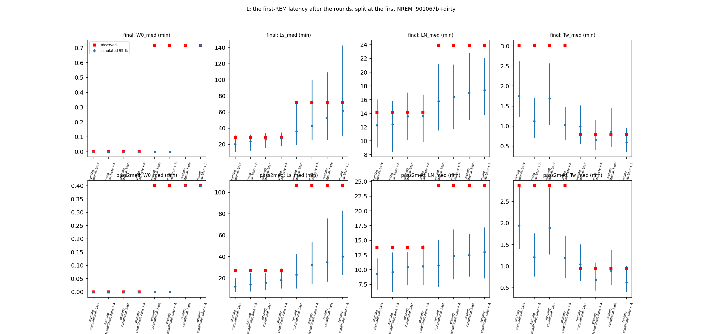

# Sleep-behaviour explore — L: where is the first-REM delay after the rounds? (cohort 2026c)

Plan [implementation_plan/2026-10-08-sleep-behaviour-explore.md](../../../../implementation_plan/2026-10-08-sleep-behaviour-explore.md) §12 Amendment 4 (rules written before results). Driver `ephys/sleep_perturb.py runL` (commit 901067b+dirty); bulk `D:\Field2026_analysis_out\2026c\sleep_explore_L_20261009_1707`; 100 replicates; runtime 4 min. **Technical ledger.**

## Reading (main session, 2026-10-09; claims #59–#61; #44, #56, #57 updated)

**Question (plan §12):** where is the first-REM delay after the rounds (#57) — the onset wait, after sleep onset, or the
first REM entry?

**Short answer.** Mostly in how the post-round recordings start. A recording starts when the rat is released into the
paddock, and half of them open with ~2 min scored NREM before the rat wakes, walks and later enters its house (corrected
2026-10-10, see the first bullet). When the observed states up to sleep onset are kept, the
model reproduces the latency after onset in the morning; in records that start awake it does so in the morning and the
evening (post-hoc subset). What remains is an evening delay on the NREM clock on fixed thresholds (pass2med). The model
does not mispredict the first REM entry specifically.

- **The record start (field record + counts, #59).**
  - **Corrected 2026-10-10 (the user, field operator):** the formal recording starts when the rat is released into the
    paddock (short indoor tests < 1 min are separate sessions). On 09-05 the rats then entered their houses on their own
    2.7–16.7 min after their Start (WISER). The first minutes of a post-round record are free behaviour after release,
    not handling. (The 2026-10-09 version read the field notes' "before placement" as "before the rat is put back into
    its house"; that was wrong.)
  - 49 / 94 (FINAL) and 51 / 94 (pass2med) post-round records begin with an NREM bout (median 133 s, IQR 65–328), and
    the first 10 min hold a median 5 min of WAKE.
  - That opening "NREM" falls in the first minutes after release, before the rat enters its house. It is unexplained:
    an edge effect of the scorer at the session start, or the rat settling or lying still in the field (head-IMU EMG).
    Round records open in NREM more often than other records (52 % vs 20 % on FINAL, 54 % vs 31 % on pass2med).
  - The onset wait W0 therefore has a KM median of ~0 (morning) and 0.4–0.7 min (evening).
- **L2 (pre-registered, all rounds):**
  - FINAL: the latency after onset is inside the conditional simulation for morning and evening, with and without the
    arousal ("onset / initialisation").
  - pass2med: above in both kinds without the arousal; with it, morning inside and evening above.
  - The scorings disagree.
- **Post-hoc subset, records that do not start in NREM** ([L post-hoc subset](ephys_spikes_sleep_explore_L_startawake_2026c.md); 19 / 18 morning, 26 / 25 evening rounds):
  - Everything is inside on FINAL.
  - On pass2med the morning is inside (W1 at the edge without A); the evening latency after onset is above without A
    (203.9 vs ≤ 199.2 min) and inside with it.
  - The morning "later first awakening after onset" of the full set (T_wake ~3 min vs ≤ 1.5–2.8) is inside in the
    subset. It came from the records that open in NREM.
- **What remains — the evening NREM clock (#60).**
  - After evening rounds the first REM needs more NREM than the model predicts on pass2med: L_N 24.3 min vs ≤ 16.1 / 17.2
    (all rounds), 26.2 vs ≤ 22.8 / 23.4 (subset), with and without the arousal.
  - FINAL: 23.9 vs ≤ 22.8 / 22.1 (all rounds, at the edge), inside in the subset (15.5–30.3).
- **Check 2 — no first-entry gap (#61).**
  - REM entry before vs after the record's first REM after a round: FINAL 1.16 [0.98, 1.49] vs 1.04 [0.90, 1.24];
    pass2med 0.81 [0.69, 0.99] vs 0.88 [0.78, 0.99].
  - Neither scoring shows a first-entry-specific shortfall. On pass2med both segments are ~15 % low, as after natural
    long wakes (0.85 / 0.87).
  - The waking excess sits before the first REM: WAKE O/E 1.51 [1.29, 1.73] (FINAL) and 1.48 [1.29, 1.72] (pass2med)
    before, 0.91 / 0.98 after.
  - After natural long wakes the first REM entry is below the model on FINAL (0.69 [0.49, 0.98]).
- **What this changes:**
  1. Every post-round clock so far (S2, S3, parts P / T, #44, #47, #56, #57) starts at the release into the paddock (the
     recording start); the rat enters its house on its own minutes later (3–17 min on 09-05). The "first-hour arousal"
     is post-release behaviour, including the walk into the house.
  2. The first-REM delay of #57 sits mostly in the records that open with scored NREM: the simulation continues that NREM,
     while the rat wakes and moves before it sleeps again. The claim that "the delay is REM-side" is withdrawn.
  3. The house entry (WISER) marks a different event, "back in the house"; a clock anchored there separates field
     behaviour after release from sleep in the house. Re-anchoring S2 / P / L at it is a proposed next step.

## Definitions

```
Part L of the sleep-behaviour explore (plan §12, Amendment 4, written before results): where is the first-REM delay
after the battery rounds (#57)? Check 1 splits the latency at the first NREM and simulates conditionally on the observed
pre-onset states; check 2 asks whether the held-out model mispredicts the first REM entry or all REM entries.

Usage:  python ephys/sleep_perturb.py runL [--scorings final pass2med] [--reps 100] [--workers 8]

Definitions (per post-round record, s from its start t0; rounds, records, scorings as parts S / P):
  t_N        start of the first NREM bout (sensitivity, observed split only: the first NREM bout >= 60 s).
  t_R        start of the first REM bout at or after t_N (censored at the record end).
  W0         t_N - t0, the onset wait.     L_s = t_R - t_N, the latency after sleep onset (wall clock; censored).
  in [t_N, min(t_R, end)):  N1 = NREM s (= L_N, the latency on the NREM clock; censored), W1 = WAKE s (awake after onset
             before the first REM), nW1 = WAKE bouts starting there, U1 = unknown s.
  T_wake     time from t_N to the start of the first WAKE bout after onset (any length; censored at the record end).
  summaries  per kind (morning / evening): KM medians of W0, L_s, L_N, T_wake; means over rounds of W1, nW1; observed vs
             100 simulated replicates (2.5-97.5 % of the replicate statistic).
  models     part P's generative base (sleep_sim v2 fitted with every post-round 3 h masked), without and with part P's
             cross-fitted one-phase arousal A (fitted on waking only, by date-parity halves).
  conditional simulation   every observed bout before t_N is a forced block; the simulation starts in NREM at t_N (as after
             any forced block); later long wakes and unknown runs are forced as usual. Only round records are simulated.
  L1   observed W0 vs the unconditional simulation (description).
  L2   conditional simulation: the observed L_s KM median inside the simulated 95 % range for morning AND evening rounds
       -> "the delay is sleep onset / initialisation"; later than the range on both scorings -> "after sleep onset". Read
       for the base and for base + A.
  L3   L_N, W1, nW1, T_wake observed vs the conditional simulation (description).
  F    S's forward-chained held-out steps (heldout_steps_<scoring>, perturbation-blind pb_rem / pb_wake): post-round steps
       (0-3 h) split at the record's first REM; natural long wakes (>= 30 min, 0-3 h after the wake end, not post-round)
       split at the first REM after the wake end (reference). O/E = sum [y = k] / sum p_k, block-bootstrap CI (2000).
       Gap at the first entry = post-round "before" REM O/E CI < 1 and "after" not below 1 (CI upper >= 1), both scorings.
```

## Verdicts

| scores | part | pass | verdict | numbers |
|---|---|---|---|---|
| final | L2 (base) | None | onset / initialisation | morning L_s obs 28.3 min vs 15.4-33.9 (inside); evening L_s obs 72.2 min vs 25.4-109.4 (inside) |
| final | L2 (base + A) | None | onset / initialisation | morning L_s obs 28.3 min vs 17.7-34.6 (inside); evening L_s obs 72.2 min vs 30.5-142.9 (inside) |
| final | F | False | no first-entry gap | natural wake, after the first REM: REM O/E 0.89 [0.81, 1.02]; natural wake, before the first REM: REM O/E 0.69 [0.49, 0.98]; round, after the first REM: REM O/E 1.04 [0.90, 1.24]; round, before the first REM: REM O/E 1.16 [0.98, 1.49] |
| pass2med | L2 (base) | None | after sleep onset | morning L_s obs 27.2 min vs 9.1-25.0 (above); evening L_s obs 106.1 min vs 16.8-75.6 (above) |
| pass2med | L2 (base + A) | None | mixed | morning L_s obs 27.2 min vs 10.3-29.1 (inside); evening L_s obs 106.1 min vs 23.2-82.9 (above) |
| pass2med | F | False | no first-entry gap | natural wake, after the first REM: REM O/E 0.87 [0.80, 0.93]; natural wake, before the first REM: REM O/E 0.85 [0.68, 1.02]; round, after the first REM: REM O/E 0.88 [0.78, 0.99]; round, before the first REM: REM O/E 0.81 [0.69, 0.99] |

## Rounds and arousal parameters

| scores | round_records | without_nrem | rem_before_first_nrem | a_half0 | tau_half0_s | a_half1 | tau_half1_s |
|---|---|---|---|---|---|---|---|
| final | 94 | 0 | 2 | 0.4727 | 1200.0 | 0.5512 | 2400.0 |
| pass2med | 94 | 0 | 2 | 0.4832 | 2400.0 | 0.6381 | 2400.0 |

## Check 1: the latency split, observed vs simulated

| scores | kind | variant | stat | observed | observed_nrem60 | sim_mean | sim_2.5% | sim_97.5% | side | rounds |
|---|---|---|---|---|---|---|---|---|---|---|
| final | morning | unconditional, base | W0_med | 0.0 | 0.0 | 0.0 | 0.0 | 0.0 | inside | 50 |
| final | morning | unconditional, base | Ls_med | 1699.0 | 1592.0 | 1219.63 | 644.65 | 1854.1 | inside | 50 |
| final | morning | unconditional, base | LN_med | 852.0 | 838.0 | 736.42 | 544.85 | 964.0 | inside | 50 |
| final | morning | unconditional, base | Tw_med | 181.0 | 239.0 | 105.03 | 74.0 | 157.25 | above | 50 |
| final | morning | unconditional, base | W1_mean | 756.5 | 704.84 | 599.49 | 482.41 | 727.35 | above | 50 |
| final | morning | unconditional, base | nW1_mean | 3.96 | 3.54 | 3.23 | 2.53 | 4.18 | inside | 50 |
| final | morning | unconditional, base + A | W0_med | 0.0 | 0.0 | 0.0 | 0.0 | 0.0 | inside | 50 |
| final | morning | unconditional, base + A | Ls_med | 1699.0 | 1592.0 | 1410.25 | 723.72 | 1928.75 | inside | 50 |
| final | morning | unconditional, base + A | LN_med | 852.0 | 838.0 | 745.14 | 505.78 | 950.17 | inside | 50 |
| final | morning | unconditional, base + A | Tw_med | 181.0 | 239.0 | 67.19 | 41.95 | 101.72 | above | 50 |
| final | morning | unconditional, base + A | W1_mean | 756.5 | 704.84 | 657.03 | 494.67 | 797.3 | inside | 50 |
| final | morning | unconditional, base + A | nW1_mean | 3.96 | 3.54 | 4.17 | 3.16 | 5.0 | inside | 50 |
| final | morning | conditional, base | W0_med | 0.0 | 0.0 | 0.0 | 0.0 | 0.0 | inside | 50 |
| final | morning | conditional, base | Ls_med | 1699.0 | 1592.0 | 1558.75 | 923.42 | 2035.52 | inside | 50 |
| final | morning | conditional, base | LN_med | 852.0 | 838.0 | 815.37 | 609.9 | 1024.0 | inside | 50 |
| final | morning | conditional, base | Tw_med | 181.0 | 239.0 | 101.57 | 61.95 | 154.2 | above | 50 |
| final | morning | conditional, base | W1_mean | 756.5 | 704.84 | 676.64 | 554.07 | 794.56 | inside | 50 |
| final | morning | conditional, base | nW1_mean | 3.96 | 3.54 | 3.55 | 2.83 | 4.31 | inside | 50 |
| final | morning | conditional, base + A | W0_med | 0.0 | 0.0 | 0.0 | 0.0 | 0.0 | inside | 50 |
| final | morning | conditional, base + A | Ls_med | 1699.0 | 1592.0 | 1632.74 | 1059.3 | 2076.15 | inside | 50 |
| final | morning | conditional, base + A | LN_med | 852.0 | 838.0 | 816.45 | 592.4 | 1005.0 | inside | 50 |
| final | morning | conditional, base + A | Tw_med | 181.0 | 239.0 | 61.59 | 39.48 | 88.52 | above | 50 |
| final | morning | conditional, base + A | W1_mean | 756.5 | 704.84 | 730.78 | 623.24 | 880.12 | inside | 50 |
| final | morning | conditional, base + A | nW1_mean | 3.96 | 3.54 | 4.5 | 3.57 | 5.42 | inside | 50 |
| final | evening | unconditional, base | W0_med | 43.0 | 213.0 | 0.0 | 0.0 | 0.0 | above | 44 |
| final | evening | unconditional, base | Ls_med | 4333.0 | 3394.0 | 2181.42 | 1145.97 | 4395.15 | inside | 44 |
| final | evening | unconditional, base | LN_med | 1434.0 | 1409.0 | 948.59 | 693.32 | 1269.22 | above | 44 |
| final | evening | unconditional, base | Tw_med | 47.0 | 159.0 | 59.15 | 33.48 | 91.1 | inside | 44 |
| final | evening | unconditional, base | W1_mean | 6782.91 | 5697.59 | 5710.29 | 3973.68 | 7633.84 | inside | 44 |
| final | evening | unconditional, base | nW1_mean | 10.82 | 10.23 | 7.49 | 5.37 | 9.73 | above | 44 |
| final | evening | unconditional, base + A | W0_med | 43.0 | 213.0 | 0.0 | 0.0 | 0.0 | above | 44 |
| final | evening | unconditional, base + A | Ls_med | 4333.0 | 3394.0 | 2595.24 | 1493.32 | 5991.9 | inside | 44 |
| final | evening | unconditional, base + A | LN_med | 1434.0 | 1409.0 | 982.78 | 701.8 | 1267.1 | above | 44 |
| final | evening | unconditional, base + A | Tw_med | 47.0 | 159.0 | 39.44 | 24.48 | 69.05 | inside | 44 |
| final | evening | unconditional, base + A | W1_mean | 6782.91 | 5697.59 | 5922.3 | 3978.66 | 8137.57 | inside | 44 |
| final | evening | unconditional, base + A | nW1_mean | 10.82 | 10.23 | 8.23 | 6.15 | 10.43 | above | 44 |
| final | evening | conditional, base | W0_med | 43.0 | 213.0 | 43.0 | 43.0 | 43.0 | inside | 44 |
| final | evening | conditional, base | Ls_med | 4333.0 | 3394.0 | 3162.2 | 1522.55 | 6564.27 | inside | 44 |
| final | evening | conditional, base | LN_med | 1434.0 | 1409.0 | 1019.51 | 786.4 | 1368.42 | above | 44 |
| final | evening | conditional, base | Tw_med | 47.0 | 159.0 | 51.66 | 28.48 | 87.1 | inside | 44 |
| final | evening | conditional, base | W1_mean | 6782.91 | 5697.59 | 6525.82 | 4514.06 | 8796.39 | inside | 44 |
| final | evening | conditional, base | nW1_mean | 10.82 | 10.23 | 8.13 | 5.97 | 10.97 | inside | 44 |
| final | evening | conditional, base + A | W0_med | 43.0 | 213.0 | 43.0 | 43.0 | 43.0 | inside | 44 |
| final | evening | conditional, base + A | Ls_med | 4333.0 | 3394.0 | 3697.36 | 1828.15 | 8572.22 | inside | 44 |
| final | evening | conditional, base + A | LN_med | 1434.0 | 1409.0 | 1043.66 | 825.22 | 1324.72 | above | 44 |
| final | evening | conditional, base + A | Tw_med | 47.0 | 159.0 | 35.69 | 21.48 | 57.1 | inside | 44 |
| final | evening | conditional, base + A | W1_mean | 6782.91 | 5697.59 | 6712.45 | 4386.71 | 9002.45 | inside | 44 |
| final | evening | conditional, base + A | nW1_mean | 10.82 | 10.23 | 8.8 | 6.31 | 10.94 | inside | 44 |
| pass2med | morning | unconditional, base | W0_med | 0.0 | 0.0 | 0.0 | 0.0 | 0.0 | inside | 50 |
| pass2med | morning | unconditional, base | Ls_med | 1631.0 | 1591.0 | 723.0 | 420.18 | 1217.17 | above | 50 |
| pass2med | morning | unconditional, base | LN_med | 823.0 | 823.0 | 558.21 | 397.95 | 718.15 | above | 50 |
| pass2med | morning | unconditional, base | Tw_med | 172.0 | 234.0 | 116.43 | 83.95 | 171.52 | above | 50 |
| pass2med | morning | unconditional, base | W1_mean | 744.72 | 704.06 | 468.89 | 344.06 | 590.08 | above | 50 |
| pass2med | morning | unconditional, base | nW1_mean | 4.08 | 3.76 | 2.26 | 1.65 | 2.85 | above | 50 |
| pass2med | morning | unconditional, base + A | W0_med | 0.0 | 0.0 | 0.0 | 0.0 | 0.0 | inside | 50 |
| pass2med | morning | unconditional, base + A | Ls_med | 1631.0 | 1591.0 | 844.03 | 451.7 | 1507.25 | above | 50 |
| pass2med | morning | unconditional, base + A | LN_med | 823.0 | 823.0 | 577.52 | 373.18 | 778.82 | above | 50 |
| pass2med | morning | unconditional, base + A | Tw_med | 172.0 | 234.0 | 72.59 | 45.48 | 106.0 | above | 50 |
| pass2med | morning | unconditional, base + A | W1_mean | 744.72 | 704.06 | 518.59 | 395.29 | 650.67 | above | 50 |
| pass2med | morning | unconditional, base + A | nW1_mean | 4.08 | 3.76 | 3.17 | 2.33 | 4.01 | above | 50 |
| pass2med | morning | conditional, base | W0_med | 0.0 | 0.0 | 0.0 | 0.0 | 0.0 | inside | 50 |
| pass2med | morning | conditional, base | Ls_med | 1631.0 | 1591.0 | 938.18 | 543.83 | 1500.7 | above | 50 |
| pass2med | morning | conditional, base | LN_med | 823.0 | 823.0 | 624.85 | 443.32 | 781.1 | above | 50 |
| pass2med | morning | conditional, base | Tw_med | 172.0 | 234.0 | 113.16 | 76.42 | 169.58 | above | 50 |
| pass2med | morning | conditional, base | W1_mean | 744.72 | 704.06 | 532.0 | 422.39 | 651.46 | above | 50 |
| pass2med | morning | conditional, base | nW1_mean | 4.08 | 3.76 | 2.48 | 1.91 | 3.12 | above | 50 |
| pass2med | morning | conditional, base + A | W0_med | 0.0 | 0.0 | 0.0 | 0.0 | 0.0 | inside | 50 |
| pass2med | morning | conditional, base + A | Ls_med | 1631.0 | 1591.0 | 1084.93 | 617.48 | 1745.55 | inside | 50 |
| pass2med | morning | conditional, base + A | LN_med | 823.0 | 823.0 | 634.71 | 445.48 | 851.62 | inside | 50 |
| pass2med | morning | conditional, base + A | Tw_med | 172.0 | 234.0 | 71.21 | 43.38 | 102.57 | above | 50 |
| pass2med | morning | conditional, base + A | W1_mean | 744.72 | 704.06 | 585.43 | 469.07 | 736.02 | above | 50 |
| pass2med | morning | conditional, base + A | nW1_mean | 4.08 | 3.76 | 3.43 | 2.74 | 4.14 | inside | 50 |
| pass2med | evening | unconditional, base | W0_med | 24.0 | 207.0 | 0.0 | 0.0 | 0.0 | above | 44 |
| pass2med | evening | unconditional, base | Ls_med | 6367.0 | 2592.0 | 1384.46 | 618.33 | 2541.45 | above | 44 |
| pass2med | evening | unconditional, base | LN_med | 1457.0 | 1443.0 | 644.5 | 429.12 | 901.6 | above | 44 |
| pass2med | evening | unconditional, base | Tw_med | 57.0 | 168.0 | 62.43 | 39.48 | 90.62 | inside | 44 |
| pass2med | evening | unconditional, base | W1_mean | 6335.95 | 4256.09 | 4397.54 | 3043.61 | 5840.85 | above | 44 |
| pass2med | evening | unconditional, base | nW1_mean | 8.75 | 7.57 | 5.33 | 3.93 | 6.96 | above | 44 |
| pass2med | evening | unconditional, base + A | W0_med | 24.0 | 207.0 | 0.0 | 0.0 | 0.0 | above | 44 |
| pass2med | evening | unconditional, base + A | Ls_med | 6367.0 | 2592.0 | 1953.19 | 894.8 | 3229.3 | above | 44 |
| pass2med | evening | unconditional, base + A | LN_med | 1457.0 | 1443.0 | 740.2 | 503.85 | 1011.3 | above | 44 |
| pass2med | evening | unconditional, base + A | Tw_med | 57.0 | 168.0 | 40.95 | 25.95 | 65.1 | inside | 44 |
| pass2med | evening | unconditional, base + A | W1_mean | 6335.95 | 4256.09 | 4814.22 | 3603.6 | 6024.73 | above | 44 |
| pass2med | evening | unconditional, base + A | nW1_mean | 8.75 | 7.57 | 6.44 | 5.09 | 7.97 | above | 44 |
| pass2med | evening | conditional, base | W0_med | 24.0 | 207.0 | 24.0 | 24.0 | 24.0 | inside | 44 |
| pass2med | evening | conditional, base | Ls_med | 6367.0 | 2592.0 | 2090.68 | 1005.3 | 4534.55 | above | 44 |
| pass2med | evening | conditional, base | LN_med | 1457.0 | 1443.0 | 751.05 | 532.3 | 964.87 | above | 44 |
| pass2med | evening | conditional, base | Tw_med | 57.0 | 168.0 | 53.76 | 34.0 | 82.62 | inside | 44 |
| pass2med | evening | conditional, base | W1_mean | 6335.95 | 4256.09 | 5100.6 | 3840.67 | 6389.76 | inside | 44 |
| pass2med | evening | conditional, base | nW1_mean | 8.75 | 7.57 | 5.86 | 4.46 | 7.31 | above | 44 |
| pass2med | evening | conditional, base + A | W0_med | 24.0 | 207.0 | 24.0 | 24.0 | 24.0 | inside | 44 |
| pass2med | evening | conditional, base + A | Ls_med | 6367.0 | 2592.0 | 2406.39 | 1393.48 | 4974.45 | above | 44 |
| pass2med | evening | conditional, base + A | LN_med | 1457.0 | 1443.0 | 779.33 | 514.33 | 1033.6 | above | 44 |
| pass2med | evening | conditional, base + A | Tw_med | 57.0 | 168.0 | 37.34 | 24.0 | 60.05 | inside | 44 |
| pass2med | evening | conditional, base + A | W1_mean | 6335.95 | 4256.09 | 5289.11 | 4186.19 | 6644.75 | inside | 44 |
| pass2med | evening | conditional, base + A | nW1_mean | 8.75 | 7.57 | 6.72 | 5.32 | 8.14 | above | 44 |

## Check 2: REM / WAKE entry before and after the first REM (held-out, perturbation-blind)

| scores | cell | transition | steps | observed | expected | OE | ci_lo | ci_hi | animals_OE_lt_1 | animals |
|---|---|---|---|---|---|---|---|---|---|---|
| final | natural wake, after the first REM | REM | 13731 | 183 | 204.7952 | 0.8936 | 0.8121 | 1.0189 | 5 | 6 |
| final | natural wake, after the first REM | WAKE | 13731 | 578 | 525.0919 | 1.1008 | 0.9692 | 1.2327 | 2 | 6 |
| final | natural wake, before the first REM | REM | 13975 | 75 | 109.103 | 0.6874 | 0.4898 | 0.9843 | 5 | 6 |
| final | natural wake, before the first REM | WAKE | 13975 | 732 | 804.2193 | 0.9102 | 0.8123 | 1.029 | 5 | 6 |
| final | round, after the first REM | REM | 26809 | 618 | 591.6291 | 1.0446 | 0.897 | 1.2408 | 3 | 6 |
| final | round, after the first REM | WAKE | 26809 | 753 | 830.3918 | 0.9068 | 0.7624 | 1.0925 | 6 | 6 |
| final | round, before the first REM | REM | 5756 | 48 | 41.455 | 1.1579 | 0.9775 | 1.4852 | 1 | 6 |
| final | round, before the first REM | WAKE | 5756 | 341 | 226.4272 | 1.506 | 1.2912 | 1.7329 | 1 | 6 |
| pass2med | natural wake, after the first REM | REM | 15836 | 249 | 286.7292 | 0.8684 | 0.805 | 0.9338 | 5 | 6 |
| pass2med | natural wake, after the first REM | WAKE | 15836 | 576 | 554.8116 | 1.0382 | 0.8956 | 1.1631 | 2 | 6 |
| pass2med | natural wake, before the first REM | REM | 13070 | 83 | 97.5639 | 0.8507 | 0.6829 | 1.0178 | 4 | 6 |
| pass2med | natural wake, before the first REM | WAKE | 13070 | 612 | 757.143 | 0.8083 | 0.7719 | 0.8429 | 5 | 6 |
| pass2med | round, after the first REM | REM | 27310 | 631 | 720.9809 | 0.8752 | 0.7834 | 0.9864 | 5 | 6 |
| pass2med | round, after the first REM | WAKE | 27310 | 797 | 816.8851 | 0.9757 | 0.8628 | 1.1192 | 3 | 6 |
| pass2med | round, before the first REM | REM | 5562 | 52 | 63.9566 | 0.8131 | 0.695 | 0.9863 | 5 | 6 |
| pass2med | round, before the first REM | WAKE | 5562 | 311 | 210.7789 | 1.4755 | 1.2881 | 1.7168 | 0 | 6 |



