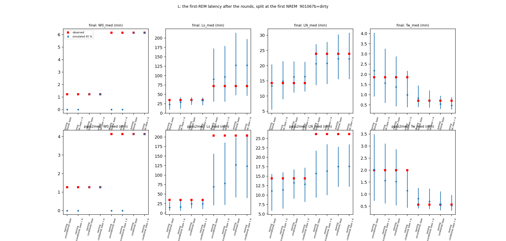

# Sleep-behaviour explore — L: where is the first-REM delay after the rounds? (cohort 2026c) — POST HOC subset: rounds whose record does not start in NREM

**POST HOC (2026-10-09), not in the plan:** run after the pre-registered L showed that half of the post-round records open in NREM (in the first minutes after release into the paddock; wording corrected 2026-10-10). Read with the main [L report](ephys_spikes_sleep_explore_L_2026c.md); check 2 here is identical to the main run (it does not use the subset).

Plan [implementation_plan/2026-10-08-sleep-behaviour-explore.md](../../../../implementation_plan/2026-10-08-sleep-behaviour-explore.md) §12 Amendment 4 (rules written before results). Driver `ephys/sleep_perturb.py runL` (commit 901067b+dirty); bulk `D:\Field2026_analysis_out\2026c\sleep_explore_L_startawake_20261009_1713`; 100 replicates; runtime 4 min. **Technical ledger.**

## Definitions

```
Part L of the sleep-behaviour explore (plan §12, Amendment 4, written before results): where is the first-REM delay
after the battery rounds (#57)? Check 1 splits the latency at the first NREM and simulates conditionally on the observed
pre-onset states; check 2 asks whether the held-out model mispredicts the first REM entry or all REM entries.

Usage:  python ephys/sleep_perturb.py runL [--scorings final pass2med] [--reps 100] [--workers 8]

Definitions (per post-round record, s from its start t0; rounds, records, scorings as parts S / P):
  t_N        start of the first NREM bout (sensitivity, observed split only: the first NREM bout >= 60 s).
  t_R        start of the first REM bout at or after t_N (censored at the record end).
  W0         t_N - t0, the onset wait.     L_s = t_R - t_N, the latency after sleep onset (wall clock; censored).
  in [t_N, min(t_R, end)):  N1 = NREM s (= L_N, the latency on the NREM clock; censored), W1 = WAKE s (awake after onset
             before the first REM), nW1 = WAKE bouts starting there, U1 = unknown s.
  T_wake     time from t_N to the start of the first WAKE bout after onset (any length; censored at the record end).
  summaries  per kind (morning / evening): KM medians of W0, L_s, L_N, T_wake; means over rounds of W1, nW1; observed vs
             100 simulated replicates (2.5-97.5 % of the replicate statistic).
  models     part P's generative base (sleep_sim v2 fitted with every post-round 3 h masked), without and with part P's
             cross-fitted one-phase arousal A (fitted on waking only, by date-parity halves).
  conditional simulation   every observed bout before t_N is a forced block; the simulation starts in NREM at t_N (as after
             any forced block); later long wakes and unknown runs are forced as usual. Only round records are simulated.
  L1   observed W0 vs the unconditional simulation (description).
  L2   conditional simulation: the observed L_s KM median inside the simulated 95 % range for morning AND evening rounds
       -> "the delay is sleep onset / initialisation"; later than the range on both scorings -> "after sleep onset". Read
       for the base and for base + A.
  L3   L_N, W1, nW1, T_wake observed vs the conditional simulation (description).
  F    S's forward-chained held-out steps (heldout_steps_<scoring>, perturbation-blind pb_rem / pb_wake): post-round steps
       (0-3 h) split at the record's first REM; natural long wakes (>= 30 min, 0-3 h after the wake end, not post-round)
       split at the first REM after the wake end (reference). O/E = sum [y = k] / sum p_k, block-bootstrap CI (2000).
       Gap at the first entry = post-round "before" REM O/E CI < 1 and "after" not below 1 (CI upper >= 1), both scorings.
```

## Verdicts

| scores | part | pass | verdict | numbers |
|---|---|---|---|---|
| final | L2 (base) | None | onset / initialisation | morning L_s obs 34.8 min vs 21.8-42.3 (inside); evening L_s obs 72.2 min vs 47.6-214.1 (inside) |
| final | L2 (base + A) | None | onset / initialisation | morning L_s obs 34.8 min vs 21.1-41.7 (inside); evening L_s obs 72.2 min vs 46.4-197.4 (inside) |
| final | F | False | no first-entry gap | natural wake, after the first REM: REM O/E 0.89 [0.81, 1.02]; natural wake, before the first REM: REM O/E 0.69 [0.49, 0.98]; round, after the first REM: REM O/E 1.04 [0.90, 1.24]; round, before the first REM: REM O/E 1.16 [0.98, 1.49] |
| pass2med | L2 (base) | None | mixed | morning L_s obs 34.7 min vs 12.3-36.6 (inside); evening L_s obs 203.9 min vs 41.4-199.2 (above) |
| pass2med | L2 (base + A) | None | onset / initialisation | morning L_s obs 34.7 min vs 10.8-35.9 (inside); evening L_s obs 203.9 min vs 39.7-208.0 (inside) |
| pass2med | F | False | no first-entry gap | natural wake, after the first REM: REM O/E 0.87 [0.80, 0.93]; natural wake, before the first REM: REM O/E 0.85 [0.68, 1.02]; round, after the first REM: REM O/E 0.88 [0.78, 0.99]; round, before the first REM: REM O/E 0.81 [0.69, 0.99] |

## Rounds and arousal parameters

| scores | round_records | without_nrem | rem_before_first_nrem | a_half0 | tau_half0_s | a_half1 | tau_half1_s |
|---|---|---|---|---|---|---|---|
| final | 45 | 0 | 2 | 0.3572 | 1200.0 | 0.3055 | 2400.0 |
| pass2med | 43 | 0 | 2 | 0.3359 | 1200.0 | 0.2349 | 4800.0 |

## Check 1: the latency split, observed vs simulated

| scores | kind | variant | stat | observed | observed_nrem60 | sim_mean | sim_2.5% | sim_97.5% | side | rounds |
|---|---|---|---|---|---|---|---|---|---|---|
| final | morning | unconditional, base | W0_med | 73.0 | 102.0 | 0.0 | 0.0 | 0.0 | above | 19 |
| final | morning | unconditional, base | Ls_med | 2089.0 | 1813.0 | 1404.91 | 583.45 | 2295.05 | inside | 19 |
| final | morning | unconditional, base | LN_med | 854.0 | 854.0 | 798.2 | 333.92 | 1223.92 | inside | 19 |
| final | morning | unconditional, base | Tw_med | 111.0 | 214.0 | 130.86 | 54.95 | 242.2 | inside | 19 |
| final | morning | unconditional, base | W1_mean | 916.84 | 862.84 | 701.71 | 471.69 | 929.68 | inside | 19 |
| final | morning | unconditional, base | nW1_mean | 4.0 | 3.26 | 3.67 | 2.16 | 5.08 | inside | 19 |
| final | morning | unconditional, base + A | W0_med | 73.0 | 102.0 | 0.0 | 0.0 | 0.0 | above | 19 |
| final | morning | unconditional, base + A | Ls_med | 2089.0 | 1813.0 | 1725.67 | 704.95 | 2523.4 | inside | 19 |
| final | morning | unconditional, base + A | LN_med | 854.0 | 854.0 | 893.59 | 537.17 | 1289.62 | inside | 19 |
| final | morning | unconditional, base + A | Tw_med | 111.0 | 214.0 | 94.34 | 35.95 | 195.52 | inside | 19 |
| final | morning | unconditional, base + A | W1_mean | 916.84 | 862.84 | 788.73 | 535.16 | 1022.49 | inside | 19 |
| final | morning | unconditional, base + A | nW1_mean | 4.0 | 3.26 | 4.64 | 3.05 | 6.11 | inside | 19 |
| final | morning | conditional, base | W0_med | 73.0 | 102.0 | 73.0 | 73.0 | 73.0 | inside | 19 |
| final | morning | conditional, base | Ls_med | 2089.0 | 1813.0 | 2059.77 | 1309.8 | 2540.02 | inside | 19 |
| final | morning | conditional, base | LN_med | 854.0 | 854.0 | 979.17 | 667.48 | 1284.52 | inside | 19 |
| final | morning | conditional, base | Tw_med | 111.0 | 214.0 | 82.64 | 25.8 | 172.4 | inside | 19 |
| final | morning | conditional, base | W1_mean | 916.84 | 862.84 | 914.14 | 685.27 | 1209.9 | inside | 19 |
| final | morning | conditional, base | nW1_mean | 4.0 | 3.26 | 4.79 | 3.55 | 6.27 | inside | 19 |
| final | morning | conditional, base + A | W0_med | 73.0 | 102.0 | 73.0 | 73.0 | 73.0 | inside | 19 |
| final | morning | conditional, base + A | Ls_med | 2089.0 | 1813.0 | 2060.11 | 1268.82 | 2503.0 | inside | 19 |
| final | morning | conditional, base + A | LN_med | 854.0 | 854.0 | 983.29 | 688.85 | 1275.65 | inside | 19 |
| final | morning | conditional, base + A | Tw_med | 111.0 | 214.0 | 59.13 | 22.95 | 130.0 | inside | 19 |
| final | morning | conditional, base + A | W1_mean | 916.84 | 862.84 | 947.71 | 735.07 | 1184.96 | inside | 19 |
| final | morning | conditional, base + A | nW1_mean | 4.0 | 3.26 | 5.52 | 4.0 | 7.0 | inside | 19 |
| final | evening | unconditional, base | W0_med | 369.0 | 8311.0 | 0.0 | 0.0 | 0.0 | above | 26 |
| final | evening | unconditional, base | Ls_med | 4333.0 | 2583.0 | 5415.99 | 1842.12 | 10324.95 | inside | 26 |
| final | evening | unconditional, base | LN_med | 1434.0 | 1451.0 | 1238.73 | 817.75 | 1626.9 | inside | 26 |
| final | evening | unconditional, base | Tw_med | 42.0 | 155.0 | 49.98 | 24.0 | 87.0 | inside | 26 |
| final | evening | unconditional, base | W1_mean | 7421.5 | 6082.12 | 8001.14 | 5366.62 | 10626.48 | inside | 26 |
| final | evening | unconditional, base | nW1_mean | 10.81 | 10.46 | 11.13 | 7.84 | 14.21 | inside | 26 |
| final | evening | unconditional, base + A | W0_med | 369.0 | 8311.0 | 0.0 | 0.0 | 0.0 | above | 26 |
| final | evening | unconditional, base + A | Ls_med | 4333.0 | 2583.0 | 5814.08 | 1846.55 | 10738.4 | inside | 26 |
| final | evening | unconditional, base + A | LN_med | 1434.0 | 1451.0 | 1246.26 | 838.2 | 1668.45 | inside | 26 |
| final | evening | unconditional, base + A | Tw_med | 42.0 | 155.0 | 41.31 | 22.0 | 72.52 | inside | 26 |
| final | evening | unconditional, base + A | W1_mean | 7421.5 | 6082.12 | 8264.02 | 5407.77 | 11421.39 | inside | 26 |
| final | evening | unconditional, base + A | nW1_mean | 10.81 | 10.46 | 11.61 | 8.11 | 15.42 | inside | 26 |
| final | evening | conditional, base | W0_med | 369.0 | 8311.0 | 369.0 | 369.0 | 369.0 | inside | 26 |
| final | evening | conditional, base | Ls_med | 4333.0 | 2583.0 | 7644.53 | 2858.4 | 12845.15 | inside | 26 |
| final | evening | conditional, base | LN_med | 1434.0 | 1451.0 | 1337.67 | 930.95 | 1816.85 | inside | 26 |
| final | evening | conditional, base | Tw_med | 42.0 | 155.0 | 32.5 | 18.0 | 56.52 | inside | 26 |
| final | evening | conditional, base | W1_mean | 7421.5 | 6082.12 | 9146.2 | 6497.07 | 12207.3 | inside | 26 |
| final | evening | conditional, base | nW1_mean | 10.81 | 10.46 | 12.21 | 8.73 | 16.06 | inside | 26 |
| final | evening | conditional, base + A | W0_med | 369.0 | 8311.0 | 369.0 | 369.0 | 369.0 | inside | 26 |
| final | evening | conditional, base + A | Ls_med | 4333.0 | 2583.0 | 7647.08 | 2782.52 | 11841.55 | inside | 26 |
| final | evening | conditional, base + A | LN_med | 1434.0 | 1451.0 | 1335.05 | 934.28 | 1850.02 | inside | 26 |
| final | evening | conditional, base + A | Tw_med | 42.0 | 155.0 | 28.4 | 16.48 | 52.57 | inside | 26 |
| final | evening | conditional, base + A | W1_mean | 7421.5 | 6082.12 | 9206.7 | 6732.76 | 12113.08 | inside | 26 |
| final | evening | conditional, base + A | nW1_mean | 10.81 | 10.46 | 12.46 | 9.3 | 16.47 | inside | 26 |
| pass2med | morning | unconditional, base | W0_med | 76.0 | 94.0 | 0.0 | 0.0 | 0.0 | above | 18 |
| pass2med | morning | unconditional, base | Ls_med | 2082.0 | 2082.0 | 903.84 | 383.4 | 1800.52 | above | 18 |
| pass2med | morning | unconditional, base | LN_med | 865.0 | 865.0 | 666.43 | 352.35 | 937.92 | inside | 18 |
| pass2med | morning | unconditional, base | Tw_med | 120.0 | 172.0 | 121.26 | 43.38 | 209.97 | inside | 18 |
| pass2med | morning | unconditional, base | W1_mean | 931.89 | 907.22 | 602.16 | 390.64 | 800.05 | above | 18 |
| pass2med | morning | unconditional, base | nW1_mean | 4.17 | 3.72 | 2.96 | 1.8 | 4.06 | above | 18 |
| pass2med | morning | unconditional, base + A | W0_med | 76.0 | 94.0 | 0.0 | 0.0 | 0.0 | above | 18 |
| pass2med | morning | unconditional, base + A | Ls_med | 2082.0 | 2082.0 | 966.28 | 392.38 | 2037.4 | above | 18 |
| pass2med | morning | unconditional, base + A | LN_med | 865.0 | 865.0 | 683.93 | 387.65 | 965.1 | inside | 18 |
| pass2med | morning | unconditional, base + A | Tw_med | 120.0 | 172.0 | 94.17 | 37.0 | 186.25 | inside | 18 |
| pass2med | morning | unconditional, base + A | W1_mean | 931.89 | 907.22 | 624.77 | 410.12 | 879.33 | above | 18 |
| pass2med | morning | unconditional, base + A | nW1_mean | 4.17 | 3.72 | 3.45 | 2.28 | 5.11 | inside | 18 |
| pass2med | morning | conditional, base | W0_med | 76.0 | 94.0 | 76.0 | 76.0 | 76.0 | inside | 18 |
| pass2med | morning | conditional, base | Ls_med | 2082.0 | 2082.0 | 1471.72 | 740.48 | 2198.4 | inside | 18 |
| pass2med | morning | conditional, base | LN_med | 865.0 | 865.0 | 797.15 | 542.17 | 1007.45 | inside | 18 |
| pass2med | morning | conditional, base | Tw_med | 120.0 | 172.0 | 91.28 | 32.33 | 172.45 | inside | 18 |
| pass2med | morning | conditional, base | W1_mean | 931.89 | 907.22 | 760.55 | 590.5 | 928.6 | above | 18 |
| pass2med | morning | conditional, base | nW1_mean | 4.17 | 3.72 | 3.76 | 2.83 | 4.89 | inside | 18 |
| pass2med | morning | conditional, base + A | W0_med | 76.0 | 94.0 | 76.0 | 76.0 | 76.0 | inside | 18 |
| pass2med | morning | conditional, base + A | Ls_med | 2082.0 | 2082.0 | 1472.98 | 650.28 | 2153.62 | inside | 18 |
| pass2med | morning | conditional, base + A | LN_med | 865.0 | 865.0 | 771.5 | 491.62 | 1036.92 | inside | 18 |
| pass2med | morning | conditional, base + A | Tw_med | 120.0 | 172.0 | 69.02 | 26.38 | 120.62 | inside | 18 |
| pass2med | morning | conditional, base + A | W1_mean | 931.89 | 907.22 | 783.83 | 531.55 | 1031.82 | inside | 18 |
| pass2med | morning | conditional, base + A | nW1_mean | 4.17 | 3.72 | 4.24 | 2.86 | 5.98 | inside | 18 |
| pass2med | evening | unconditional, base | W0_med | 248.0 | 8315.0 | 0.0 | 0.0 | 0.0 | above | 25 |
| pass2med | evening | unconditional, base | Ls_med | 12235.0 | 3727.0 | 4167.97 | 1234.3 | 9366.67 | above | 25 |
| pass2med | evening | unconditional, base | LN_med | 1570.0 | 1487.0 | 944.89 | 560.8 | 1306.68 | above | 25 |
| pass2med | evening | unconditional, base | Tw_med | 34.0 | 168.0 | 48.84 | 24.9 | 76.05 | inside | 25 |
| pass2med | evening | unconditional, base | W1_mean | 7988.24 | 4826.68 | 6359.95 | 4319.12 | 8504.4 | inside | 25 |
| pass2med | evening | unconditional, base | nW1_mean | 11.08 | 9.24 | 8.62 | 5.94 | 11.81 | inside | 25 |
| pass2med | evening | unconditional, base + A | W0_med | 248.0 | 8315.0 | 0.0 | 0.0 | 0.0 | above | 25 |
| pass2med | evening | unconditional, base + A | Ls_med | 12235.0 | 3727.0 | 4686.81 | 1283.5 | 11156.3 | above | 25 |
| pass2med | evening | unconditional, base + A | LN_med | 1570.0 | 1487.0 | 979.8 | 600.52 | 1407.75 | above | 25 |
| pass2med | evening | unconditional, base + A | Tw_med | 34.0 | 168.0 | 41.85 | 23.48 | 74.05 | inside | 25 |
| pass2med | evening | unconditional, base + A | W1_mean | 7988.24 | 4826.68 | 6624.09 | 4592.28 | 9045.79 | inside | 25 |
| pass2med | evening | unconditional, base + A | nW1_mean | 11.08 | 9.24 | 9.2 | 6.73 | 12.94 | inside | 25 |
| pass2med | evening | conditional, base | W0_med | 248.0 | 8315.0 | 248.0 | 248.0 | 248.0 | inside | 25 |
| pass2med | evening | conditional, base | Ls_med | 12235.0 | 3727.0 | 7611.64 | 2482.9 | 11949.65 | above | 25 |
| pass2med | evening | conditional, base | LN_med | 1570.0 | 1487.0 | 1054.34 | 730.75 | 1365.5 | above | 25 |
| pass2med | evening | conditional, base | Tw_med | 34.0 | 168.0 | 35.03 | 19.95 | 67.05 | inside | 25 |
| pass2med | evening | conditional, base | W1_mean | 7988.24 | 4826.68 | 7630.8 | 5516.09 | 9701.09 | inside | 25 |
| pass2med | evening | conditional, base | nW1_mean | 11.08 | 9.24 | 9.82 | 6.92 | 12.41 | inside | 25 |
| pass2med | evening | conditional, base + A | W0_med | 248.0 | 8315.0 | 248.0 | 248.0 | 248.0 | inside | 25 |
| pass2med | evening | conditional, base + A | Ls_med | 12235.0 | 3727.0 | 7397.24 | 2380.82 | 12481.55 | inside | 25 |
| pass2med | evening | conditional, base + A | LN_med | 1570.0 | 1487.0 | 1055.71 | 736.0 | 1403.5 | above | 25 |
| pass2med | evening | conditional, base + A | Tw_med | 34.0 | 168.0 | 31.78 | 19.0 | 58.0 | inside | 25 |
| pass2med | evening | conditional, base + A | W1_mean | 7988.24 | 4826.68 | 7645.39 | 5785.36 | 10052.6 | inside | 25 |
| pass2med | evening | conditional, base + A | nW1_mean | 11.08 | 9.24 | 10.15 | 7.62 | 14.04 | inside | 25 |

## Check 2: REM / WAKE entry before and after the first REM (held-out, perturbation-blind)

| scores | cell | transition | steps | observed | expected | OE | ci_lo | ci_hi | animals_OE_lt_1 | animals |
|---|---|---|---|---|---|---|---|---|---|---|
| final | natural wake, after the first REM | REM | 13731 | 183 | 204.7952 | 0.8936 | 0.8121 | 1.0189 | 5 | 6 |
| final | natural wake, after the first REM | WAKE | 13731 | 578 | 525.0919 | 1.1008 | 0.9692 | 1.2327 | 2 | 6 |
| final | natural wake, before the first REM | REM | 13975 | 75 | 109.103 | 0.6874 | 0.4898 | 0.9843 | 5 | 6 |
| final | natural wake, before the first REM | WAKE | 13975 | 732 | 804.2193 | 0.9102 | 0.8123 | 1.029 | 5 | 6 |
| final | round, after the first REM | REM | 26809 | 618 | 591.6291 | 1.0446 | 0.897 | 1.2408 | 3 | 6 |
| final | round, after the first REM | WAKE | 26809 | 753 | 830.3918 | 0.9068 | 0.7624 | 1.0925 | 6 | 6 |
| final | round, before the first REM | REM | 5756 | 48 | 41.455 | 1.1579 | 0.9775 | 1.4852 | 1 | 6 |
| final | round, before the first REM | WAKE | 5756 | 341 | 226.4272 | 1.506 | 1.2912 | 1.7329 | 1 | 6 |
| pass2med | natural wake, after the first REM | REM | 15836 | 249 | 286.7292 | 0.8684 | 0.805 | 0.9338 | 5 | 6 |
| pass2med | natural wake, after the first REM | WAKE | 15836 | 576 | 554.8116 | 1.0382 | 0.8956 | 1.1631 | 2 | 6 |
| pass2med | natural wake, before the first REM | REM | 13070 | 83 | 97.5639 | 0.8507 | 0.6829 | 1.0178 | 4 | 6 |
| pass2med | natural wake, before the first REM | WAKE | 13070 | 612 | 757.143 | 0.8083 | 0.7719 | 0.8429 | 5 | 6 |
| pass2med | round, after the first REM | REM | 27310 | 631 | 720.9809 | 0.8752 | 0.7834 | 0.9864 | 5 | 6 |
| pass2med | round, after the first REM | WAKE | 27310 | 797 | 816.8851 | 0.9757 | 0.8628 | 1.1192 | 3 | 6 |
| pass2med | round, before the first REM | REM | 5562 | 52 | 63.9566 | 0.8131 | 0.695 | 0.9863 | 5 | 6 |
| pass2med | round, before the first REM | WAKE | 5562 | 311 | 210.7789 | 1.4755 | 1.2881 | 1.7168 | 0 | 6 |



