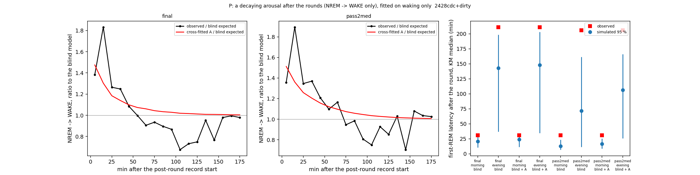

# Sleep-behaviour explore — P: perturbation dynamics (a decaying arousal after the battery rounds), cohort 2026c

Plan [implementation_plan/2026-10-08-sleep-behaviour-explore.md](../../../../implementation_plan/2026-10-08-sleep-behaviour-explore.md) §10 Amendment 2 (rules written before results). Driver `ephys/sleep_perturb.py` (commit 2428cdc+dirty); bulk `D:\Field2026_analysis_out\2026c\sleep_explore_P_20261009_1457`; 100 replicates; runtime 7 min. **Technical ledger.**

## Reading (main session, 2026-10-09; claims #56, #57; #47 corrected)

> **Note (part L, 2026-10-09):** all post-round clocks here start at the recording start = the release into the paddock (corrected 2026-10-10); the rat enters its house on its own minutes later, and half the records open with ~2 min scored NREM; the first-REM delay sits mostly in those records (#59) — see the [L report](ephys_spikes_sleep_explore_L_2026c.md).

**Question (plan §10):** the rounds are a systematic perturbation. Does a decaying arousal, fitted only on whether the
rats woke, capture the acute waking excess (#44) and explain the later first REM (#47), with the REM rules untouched?

**Short answer.** The arousal captures the waking, not the REM timing. A term that multiplies the NREM → WAKE odds by
~1.7 at the start of the post-round record and decays over 20–40 min restores the first-hour waking in held-out
rounds. With it in the simulation, the first REM still comes later than simulated, and after the first hour the rats
sleep more than the simulation. The arousal is not the whole perturbation.

- **The arousal (#56).**
  - a = 0.43–0.64 (odds × 1.5–1.9 at s = 0), τ_A = 20 or 40 min, in both halves, both bases and both scorings.
  - Cross-fitted 0–1-h WAKE O/E: 1.26 → 1.04 [0.89, 1.25] (FINAL) and 1.34 → 1.05 [0.96, 1.17] (pass2med), blind →
    blind + A (blind here = fitted on all blocks without post-round steps; S2b's forward-chained blind gave 1.41 / 1.45).
    REM entry per NREM step in the first hour is untouched by A: O/E 1.23 [1.05, 1.49] (FINAL) / 1.03 [0.87, 1.19].
  - Held-out log-loss on the post-round steps: −0.23 % [−0.44, −0.06], 5/6 (pass2med, holds); −0.11 % [−0.39, +0.12],
    6/6 (FINAL, CI crosses 0).
  - **P1 passes on pass2med and fails on FINAL** (its log-loss part).
- **P1b (rounds vs natural wakes) passes by the letter but cannot be read.** a_nat = −1.20 / −1.81: against the
  symmetric base, rats wake LESS than expected after natural long wakes. That base never saw a bout after a wake
  ≥ 30 min (all are inside the left-out windows), so it extrapolates the preceding-wake term. The clean comparison
  stays S2: after natural long wakes waking O/E ≈ 1 (0.99 / 0.90), after rounds 1.3–1.45 (#44).
- **P2 fails on both scorings (#57).** This was the test allowed to fail.
  - First-REM KM median, observed vs simulated with A:
    - FINAL: morning 30.8 min vs 11.3–31.9 (now inside, at the edge); evening 211 vs 34–203 min (outside).
    - pass2med: morning 30.7 vs 8.5–25.3 (outside); evening 206 vs 26–166 min (outside).
  - The arousal moved the simulated latency ranges by only 1–3 min.
  - Inside of the 14 measures: FINAL 7 (9 without A), pass2med 11 (9 without A).
  - With A, FINAL undershoots the sleep after the first hour: morning NREM in 3 h 117.1 vs 112.9–116.9, REM in 3 h 22.5
    vs 19.3–21.8, REM in 6 h 49.1 vs 44.7–48.9. pass2med evening NREM in 6 h is above too (57.8 vs 54.8–57.3).
  - The rats recover sleep after the first hour beyond what the arousal-reduced simulation produces. This matches S2's
    fewer-than-expected wakes 1–3 h after a round (O/E 0.83–0.88, CIs touching 1).
- **P3 passes:** Step E's checks unchanged, 13/14 (FINAL) and 14/14 (pass2med), with and without A.
- **P4 (description):** morning REM in 3 h rises with the gap length, faster in the data than in the simulation.
  - FINAL: observed 20.4 / 22.3 / 24.7 vs simulated 19.7 / 20.4 / 21.7 min (short / middle / long gaps).
  - pass2med: 20.5 / 21.1 / 25.0 vs 21.2 / 21.9 / 23.2.
  - Each tertile has 14–17 rounds, so this is a direction, not a test. It agrees with G3 on FINAL (the gap's expected
    REM predicts the payback).
- **The REM residual → part Q not triggered.**
  - With A, FINAL's morning REM in 3 h stays above the simulation (22.5 vs 19.3–21.8; pass2med inside).
  - pass2med's day-demeaned debt slope at 3 h stays above (+0.96 vs −0.47..+0.51; FINAL inside).
  - The residuals sit on different quantities on the two scorings. By the plan's rule there is no unified target, so
    part Q is not run and #43 stays Candidate.
- **What this means for a model of the perturbation** (interpretation; the next step is a proposal):
  1. **The first-REM delay is REM-side.** It is not produced by the waking, and a REM-need variable (part Q's first
     candidate) would bring the first REM forward after a REM loss, not delay it. A transient suppression of REM entry
     after handling, then a catch-up, fits the order of events: per NREM step the first-hour REM entry is not lower
     (S2), but the first REM is later and more REM follows. This has not been tested.
  2. **The response has a second phase:** more consolidated sleep 1–3 h after the round (S2 O/E 0.83–0.88), which the
     single decaying arousal cannot make. A two-phase arousal (early excess, later deficit), fitted on waking only,
     would show whether the later sleep recovery, and with it FINAL's extra REM at 3 h, follows from consolidation
     rather than a REM-specific need.
- **Correction to the S reading and #47:** "the later first REM comes from the extra waking" is withdrawn. Adding the
  measured waking excess does not reproduce the delay.
- **Correction to Step E's wording:** Step E has 14 checks per scoring. "27/28 on each scoring" was a wording error for
  27 of 28 in total (13/14 FINAL, 14/14 pass2med). P3 reads the plan's "≥ 27/28" per scoring as ≥ 13/14.

## Definitions

```
Part P of Amendment 2 of the sleep-behaviour explore (plan implementation_plan/2026-10-08-sleep-behaviour-explore.md
§10, written before results): the perturbation dynamics — does a decaying arousal after the battery rounds, fitted only
on whether the rats woke, capture the acute waking excess (#44) and explain the later first REM (#47) without any
REM-side variable?

Usage:  python ephys/sleep_perturb.py run [--scorings final pass2med] [--reps 100] [--workers 8]
        python ephys/sleep_perturb.py --selftest

Definitions (records, 10-s NREM steps, usable round gaps and the two scorings as sleep_model.py / sleep_stability.py):
  arousal term   on the NREM -> WAKE logit only: eta_WAKE += a * exp(-s / tau_A), s = seconds from the start of the
                 post-round record to the step start; tau_A in {600, 1200, 2400, 4800} s. The stay and REM logits are
                 untouched, so P(REM | not WAKE) is unchanged. With the base model's p_WAKE as offset,
                 P(WAKE) = sigmoid(logit p_WAKE + a h(s)), h = exp(-s / tau_A); a = the maximum-likelihood estimate of this
                 binary likelihood (Newton), (a, tau_A) = the grid point with the highest likelihood. Applied to a base
                 prediction: p'_W = sigmoid(logit p_W + a h), p'_stay = p_stay (1 - p'_W) / (1 - p_W), p'_REM likewise.
  base (step level)   B-full at P_tw600_k0 (Step B's spec) fitted on all NREM steps except those in the 3 h after a
                 usable round gap ("blind"). The symmetric base also leaves out the 3 h after natural wakes >= 30 min
                 inside records (steps already post-round count as post-round).
  base (generative)   sleep_sim v2 fitted on the records with every post-round 3 h masked (= S3 blind); the arousal is
                 estimated against its NREM model's predictions of the (unseen) post-round steps.
  cross-fit      rounds split by the parity of the round record's start date (days since 2026-08-30); every round is
                 predicted / simulated with (a, tau_A) fitted on the other half.
  P1   cross-fitted blind + A vs blind on the post-round steps (0-3 h): Delta log-loss % = 100 (sum nll_A - sum nll_b) /
       sum nll_b, 95 % CI by block bootstrap (2000 resamples of day-half blocks), animals better = mean per-step
       difference < 0; pass = CI < 0 and >= 5/6. And the 0-1 h WAKE O/E with A (sum [y = WAKE] / sum p'_W, block
       bootstrap CI) in [0.8, 1.25] with CI including 1.
  P1b  a_round - a_nat, both fitted on all events against the symmetric base, a_nat at the round's tau_A (a_nat at its
       own best tau_A reported); 95 % CI by block bootstrap with a refitted at the fixed tau_A per resample; pass = CI > 0.
  P2   100 replicates of the cross-fitted simulation with A (seeds as S3); per round S3's measures
       (sleep_stability.round_metrics: REM / NREM min and REM bouts in 1 / 3 / 6 h, first-REM latency, KM median over
       rounds); pass = the observed first-REM KM median inside the simulated 2.5-97.5 % range for morning AND evening
       rounds, and >= 12 of the 14 measures (REM / NREM min at 1, 3, 6 h and the latency, x 2 kinds) inside.
  P3   Step E's checks (i), (iii), (iv) (sleep_sim.metrics, Step E's tolerances) on all records simulated with A:
       >= 27 of 28 pass and not fewer than the same blind model without A.
  P4   gap-length tertiles within each kind (gap = the usable round gap before the record; cut points from the observed
       rounds): observed vs simulated (with A) REM / NREM min at 1 and 3 h and the latency; description.
  residual   with A: S3's morning REM at 3 h, and D2's morning REM payback (sleep_explore_d.payback_from_records, slope of
       pay_rem on debt_rem, day-demeaned, B = 1 / 3 h) on the simulated records vs observed. Part Q is warranted only if
       a REM residual lies outside the simulated range in the same direction on both scorings.
```

## Verdicts

| scores | part | pass | numbers |
|---|---|---|---|
| final | P1 | False | Delta -0.11 % [-0.39, +0.12], 6/6; 0-1 h WAKE O/E with A 1.04 [0.89, 1.25] |
| final | P1b | True | a_round +0.37 (tau 20 min) - a_nat -1.20 = +1.57 [+1.28, +1.91] |
| final | P2 | False | 7/14 inside (blind without A: 9); latency morning obs 30.8 min vs 11.3-31.9; evening obs 211.2 min vs 34.3-203.4 |
| final | P3 | True | with A 13/14, without A 13/14 |
| final | residual | None | morning REM payback slope (day-demeaned), B = 1 h: obs +0.04 vs -0.21..+0.28 (inside); morning REM payback mean_y (raw), B = 1 h: obs -2.32 vs -3.01..-1.58 (inside); morning REM payback slope (day-demeaned), B = 3 h: obs -0.06 vs -0.55..+0.60 (inside); morning REM payback mean_y (raw), B = 3 h: obs +0.29 vs -2.12..+0.31 (inside); S3 morning REM min in 3 h: obs +22.46 vs +19.29..+21.84 (above) |
| pass2med | P1 | True | Delta -0.23 % [-0.44, -0.06], 5/6; 0-1 h WAKE O/E with A 1.05 [0.96, 1.17] |
| pass2med | P1b | True | a_round +0.19 (tau 40 min) - a_nat -1.81 = +2.00 [+1.75, +2.26] |
| pass2med | P2 | False | 11/14 inside (blind without A: 9); latency morning obs 30.7 min vs 8.5-25.3; evening obs 206.0 min vs 25.7-166.0 |
| pass2med | P3 | True | with A 14/14, without A 14/14 |
| pass2med | residual | None | morning REM payback slope (day-demeaned), B = 1 h: obs +0.34 vs -0.23..+0.36 (inside); morning REM payback mean_y (raw), B = 1 h: obs -2.83 vs -3.16..-1.62 (inside); morning REM payback slope (day-demeaned), B = 3 h: obs +0.96 vs -0.47..+0.51 (above); morning REM payback mean_y (raw), B = 3 h: obs -0.80 vs -1.95..+0.24 (inside); S3 morning REM min in 3 h: obs +22.21 vs +20.59..+23.56 (inside) |

## Arousal parameters

| scores | base | fit_on | applied_to | tau_s | a | se | ll | n | wakes |
|---|---|---|---|---|---|---|---|---|---|
| final | step-level blind | half != 0 | half 0 | 1200.0 | 0.4289 | 0.1314 | -2852.0568 | 20570.0 | 688.0 |
| final | step-level blind | half != 1 | half 1 | 2400.0 | 0.5353 | 0.0871 | -3325.7675 | 21119.0 | 821.0 |
| final | step-level blind | all rounds | - | 1200.0 | 0.5452 | 0.086 | -6181.7491 | 41689.0 | 1509.0 |
| final | generative (S3 blind) | half != 0 | half 0 | 1200.0 | 0.4727 | 0.1308 | -2853.2725 | 20570.0 | 688.0 |
| final | generative (S3 blind) | half != 1 | half 1 | 2400.0 | 0.5512 | 0.0871 | -3328.5863 | 21119.0 | 821.0 |
| final | generative (S3 blind) | all rounds | - | 1200.0 | 0.5755 | 0.0857 | -6185.7157 | 41689.0 | 1509.0 |
| pass2med | step-level blind | half != 0 | half 0 | 2400.0 | 0.3988 | 0.1021 | -2923.1116 | 20948.0 | 704.0 |
| pass2med | step-level blind | half != 1 | half 1 | 2400.0 | 0.5782 | 0.086 | -3399.4711 | 21251.0 | 840.0 |
| pass2med | step-level blind | all rounds | - | 2400.0 | 0.5013 | 0.0657 | -6323.4916 | 42199.0 | 1544.0 |
| pass2med | generative (S3 blind) | half != 0 | half 0 | 2400.0 | 0.4832 | 0.1023 | -2924.6903 | 20948.0 | 704.0 |
| pass2med | generative (S3 blind) | half != 1 | half 1 | 2400.0 | 0.6381 | 0.0863 | -3400.893 | 21251.0 | 840.0 |
| pass2med | generative (S3 blind) | all rounds | - | 2400.0 | 0.5719 | 0.0659 | -6326.2572 | 42199.0 | 1544.0 |

Likelihood by tau_A:

| tau_s | a | se | ll | n | wakes | scores | fit |
|---|---|---|---|---|---|---|---|
| 600.0 | 0.517 | 0.111 | -6189.868 | 41689 | 1509 | final | step-level blind, all rounds |
| 1200.0 | 0.545 | 0.086 | -6181.749 | 41689 | 1509 | final | step-level blind, all rounds |
| 2400.0 | 0.418 | 0.067 | -6181.979 | 41689 | 1509 | final | step-level blind, all rounds |
| 4800.0 | 0.231 | 0.052 | -6190.192 | 41689 | 1509 | final | step-level blind, all rounds |
| 600.0 | 0.345 | 0.112 | -6212.732 | 41689 | 1509 | final | symmetric base, rounds |
| 1200.0 | 0.368 | 0.087 | -6208.851 | 41689 | 1509 | final | symmetric base, rounds |
| 2400.0 | 0.268 | 0.067 | -6209.661 | 41689 | 1509 | final | symmetric base, rounds |
| 4800.0 | 0.101 | 0.052 | -6215.319 | 41689 | 1509 | final | symmetric base, rounds |
| 600.0 | -1.358 | 0.061 | -9480.107 | 43273 | 2344 | final | symmetric base, natural wakes >= 30 min |
| 1200.0 | -1.203 | 0.047 | -9382.699 | 43273 | 2344 | final | symmetric base, natural wakes >= 30 min |
| 2400.0 | -1.003 | 0.036 | -9336.06 | 43273 | 2344 | final | symmetric base, natural wakes >= 30 min |
| 4800.0 | -0.835 | 0.03 | -9333.893 | 43273 | 2344 | final | symmetric base, natural wakes >= 30 min |
| 600.0 | 0.493 | 0.109 | -6340.494 | 42199 | 1544 | pass2med | step-level blind, all rounds |
| 1200.0 | 0.571 | 0.084 | -6329.371 | 42199 | 1544 | pass2med | step-level blind, all rounds |
| 2400.0 | 0.501 | 0.066 | -6323.492 | 42199 | 1544 | pass2med | step-level blind, all rounds |
| 4800.0 | 0.343 | 0.051 | -6328.476 | 42199 | 1544 | pass2med | step-level blind, all rounds |
| 600.0 | 0.145 | 0.111 | -6460.217 | 42199 | 1544 | pass2med | symmetric base, rounds |
| 1200.0 | 0.227 | 0.086 | -6457.709 | 42199 | 1544 | pass2med | symmetric base, rounds |
| 2400.0 | 0.187 | 0.066 | -6457.239 | 42199 | 1544 | pass2med | symmetric base, rounds |
| 4800.0 | 0.039 | 0.052 | -6460.77 | 42199 | 1544 | pass2med | symmetric base, rounds |
| 600.0 | -2.346 | 0.067 | -10412.098 | 48072 | 2304 | pass2med | symmetric base, natural wakes >= 30 min |
| 1200.0 | -2.151 | 0.05 | -9990.397 | 48072 | 2304 | pass2med | symmetric base, natural wakes >= 30 min |
| 2400.0 | -1.814 | 0.038 | -9730.175 | 48072 | 2304 | pass2med | symmetric base, natural wakes >= 30 min |
| 4800.0 | -1.524 | 0.031 | -9643.855 | 48072 | 2304 | pass2med | symmetric base, natural wakes >= 30 min |

## P1: held-out (cross-fitted) prediction of the post-round steps

| scores | steps | wakes | rems | delta_pct | ci_lo | ci_hi | animals_better | animals | holds |
|---|---|---|---|---|---|---|---|---|---|
| final | 41689 | 1509 | 885 | -0.1122 | -0.3856 | 0.1157 | 6 | 6 | False |
| pass2med | 42199 | 1544 | 916 | -0.2284 | -0.4429 | -0.0609 | 5 | 6 | True |

| scores | window | transition | model | steps | observed | expected | OE | ci_lo | ci_hi | animals_OE_gt_1 | animals |
|---|---|---|---|---|---|---|---|---|---|---|---|
| final | 0-1 h | WAKE | blind | 13340 | 670 | 531.7704 | 1.2599 | 1.0973 | 1.4873 | 6 | 6 |
| final | 0-1 h | WAKE | blind + A (cross-fitted) | 13340 | 670 | 645.1458 | 1.0385 | 0.8896 | 1.251 | 3 | 6 |
| final | 0-1 h | REM | blind | 13340 | 218 | 178.4057 | 1.2219 | 1.0443 | 1.4741 | 5 | 6 |
| final | 0-1 h | REM | blind + A (cross-fitted) | 13340 | 218 | 176.912 | 1.2323 | 1.0536 | 1.4864 | 5 | 6 |
| final | 1-3 h | WAKE | blind | 28349 | 839 | 955.1661 | 0.8784 | 0.7331 | 1.0507 | 0 | 6 |
| final | 1-3 h | WAKE | blind + A (cross-fitted) | 28349 | 839 | 974.1552 | 0.8613 | 0.7169 | 1.0256 | 0 | 6 |
| final | 1-3 h | REM | blind | 28349 | 667 | 631.7749 | 1.0558 | 0.9579 | 1.1678 | 4 | 6 |
| final | 1-3 h | REM | blind + A (cross-fitted) | 28349 | 667 | 631.287 | 1.0566 | 0.9585 | 1.1687 | 4 | 6 |
| pass2med | 0-1 h | WAKE | blind | 13549 | 683 | 510.9975 | 1.3366 | 1.2393 | 1.4767 | 6 | 6 |
| pass2med | 0-1 h | WAKE | blind + A (cross-fitted) | 13549 | 683 | 650.4507 | 1.05 | 0.9645 | 1.1674 | 5 | 6 |
| pass2med | 0-1 h | REM | blind | 13549 | 228 | 224.8915 | 1.0138 | 0.8589 | 1.1736 | 4 | 6 |
| pass2med | 0-1 h | REM | blind + A (cross-fitted) | 13549 | 228 | 222.1295 | 1.0264 | 0.8704 | 1.1878 | 4 | 6 |
| pass2med | 1-3 h | WAKE | blind | 28650 | 861 | 906.3372 | 0.95 | 0.8168 | 1.104 | 2 | 6 |
| pass2med | 1-3 h | WAKE | blind + A (cross-fitted) | 28650 | 861 | 935.5788 | 0.9203 | 0.7902 | 1.0719 | 1 | 6 |
| pass2med | 1-3 h | REM | blind | 28650 | 688 | 696.6735 | 0.9876 | 0.8935 | 1.0906 | 2 | 6 |
| pass2med | 1-3 h | REM | blind + A (cross-fitted) | 28650 | 688 | 695.8804 | 0.9887 | 0.8944 | 1.0921 | 2 | 6 |

## P1b: rounds vs natural wakes >= 30 min (symmetric base)

| scores | tau_round_s | a_round | a_round_se | steps_round | a_nat_at_round_tau | a_nat_se | a_nat_own_tau_s | a_nat_own | steps_nat | diff | diff_ci_lo | diff_ci_hi | holds |
|---|---|---|---|---|---|---|---|---|---|---|---|---|---|
| final | 1200.0 | 0.3678 | 0.087 | 41689 | -1.2032 | 0.0466 | 4800.0 | -0.8351 | 43273 | 1.5711 | 1.2816 | 1.9078 | True |
| pass2med | 2400.0 | 0.1869 | 0.0665 | 42199 | -1.8139 | 0.0382 | 4800.0 | -1.5242 | 48072 | 2.0008 | 1.7535 | 2.2631 | True |

## P2: the simulated post-round response, without and with A

| scores | variant | kind | metric | rounds | observed | sim_mean | sim_2.5% | sim_97.5% | inside |
|---|---|---|---|---|---|---|---|---|---|
| final | blind | morning | rem_min_1h | 50 | 4.465 | 4.65 | 4.036 | 5.391 | True |
| final | blind | morning | nrem_min_1h | 50 | 33.033 | 33.835 | 32.805 | 34.629 | True |
| final | blind | morning | rem_min_3h | 50 | 22.463 | 20.939 | 19.534 | 22.322 | False |
| final | blind | morning | nrem_min_3h | 50 | 117.1 | 115.656 | 113.805 | 117.628 | True |
| final | blind | morning | rem_min_6h | 44 | 49.141 | 47.115 | 44.633 | 49.52 | True |
| final | blind | morning | nrem_min_6h | 44 | 234.873 | 234.154 | 231.021 | 236.948 | True |
| final | blind | morning | rem_bouts_1h | 50 | 3.72 | 3.964 | 3.499 | 4.442 | True |
| final | blind | morning | rem_bouts_3h | 50 | 18.58 | 17.411 | 16.419 | 18.744 | True |
| final | blind | morning | first_REM_latency_KM_median_s | 50 | 1847.0 | 1245.9 | 627.325 | 1808.15 | False |
| final | blind | evening | rem_min_1h | 44 | 1.331 | 1.754 | 1.291 | 2.322 | True |
| final | blind | evening | nrem_min_1h | 44 | 11.445 | 12.689 | 11.861 | 13.311 | False |
| final | blind | evening | rem_min_3h | 44 | 1.784 | 2.254 | 1.726 | 2.863 | True |
| final | blind | evening | nrem_min_3h | 44 | 20.768 | 21.817 | 20.932 | 22.584 | False |
| final | blind | evening | rem_min_6h | 44 | 3.565 | 3.985 | 3.284 | 4.685 | True |
| final | blind | evening | nrem_min_6h | 44 | 53.787 | 52.632 | 51.336 | 53.948 | True |
| final | blind | evening | rem_bouts_1h | 44 | 1.5 | 1.973 | 1.591 | 2.421 | False |
| final | blind | evening | rem_bouts_3h | 44 | 1.909 | 2.535 | 2.112 | 2.989 | False |
| final | blind | evening | first_REM_latency_KM_median_s | 44 | 12673.0 | 8566.08 | 2200.275 | 11913.175 | False |
| final | blind + A | morning | rem_min_1h | 50 | 4.465 | 4.419 | 3.749 | 5.15 | True |
| final | blind + A | morning | nrem_min_1h | 50 | 33.033 | 33.168 | 32.231 | 34.063 | True |
| final | blind + A | morning | rem_min_3h | 50 | 22.463 | 20.613 | 19.288 | 21.844 | False |
| final | blind + A | morning | nrem_min_3h | 50 | 117.1 | 114.873 | 112.894 | 116.937 | False |
| final | blind + A | morning | rem_min_6h | 44 | 49.141 | 46.848 | 44.679 | 48.947 | False |
| final | blind + A | morning | nrem_min_6h | 44 | 234.873 | 233.385 | 230.551 | 236.174 | True |
| final | blind + A | morning | rem_bouts_1h | 50 | 3.72 | 3.766 | 3.24 | 4.281 | True |
| final | blind + A | morning | rem_bouts_3h | 50 | 18.58 | 17.154 | 16.09 | 18.371 | False |
| final | blind + A | morning | first_REM_latency_KM_median_s | 50 | 1847.0 | 1434.81 | 678.9 | 1916.1 | True |
| final | blind + A | evening | rem_min_1h | 44 | 1.331 | 1.676 | 1.254 | 2.166 | True |
| final | blind + A | evening | nrem_min_1h | 44 | 11.445 | 12.359 | 11.83 | 13.071 | False |
| final | blind + A | evening | rem_min_3h | 44 | 1.784 | 2.168 | 1.71 | 2.662 | True |
| final | blind + A | evening | nrem_min_3h | 44 | 20.768 | 21.489 | 20.806 | 22.372 | False |
| final | blind + A | evening | rem_min_6h | 44 | 3.565 | 3.879 | 3.241 | 4.542 | True |
| final | blind + A | evening | nrem_min_6h | 44 | 53.787 | 52.307 | 51.16 | 53.515 | False |
| final | blind + A | evening | rem_bouts_1h | 44 | 1.5 | 1.877 | 1.499 | 2.33 | True |
| final | blind + A | evening | rem_bouts_3h | 44 | 1.909 | 2.421 | 2.023 | 2.886 | False |
| final | blind + A | evening | first_REM_latency_KM_median_s | 44 | 12673.0 | 8880.83 | 2060.825 | 12203.675 | False |
| pass2med | blind | morning | rem_min_1h | 50 | 4.372 | 5.257 | 4.472 | 5.91 | False |
| pass2med | blind | morning | nrem_min_1h | 50 | 33.033 | 33.97 | 33.109 | 35.045 | False |
| pass2med | blind | morning | rem_min_3h | 50 | 22.208 | 22.609 | 21.015 | 23.925 | True |
| pass2med | blind | morning | nrem_min_3h | 50 | 117.568 | 117.032 | 115.285 | 118.84 | True |
| pass2med | blind | morning | rem_min_6h | 44 | 49.325 | 49.297 | 47.292 | 51.656 | True |
| pass2med | blind | morning | nrem_min_6h | 44 | 235.116 | 235.255 | 232.63 | 238.068 | True |
| pass2med | blind | morning | rem_bouts_1h | 50 | 3.66 | 4.623 | 4.12 | 5.151 | False |
| pass2med | blind | morning | rem_bouts_3h | 50 | 18.68 | 19.334 | 18.236 | 20.351 | True |
| pass2med | blind | morning | first_REM_latency_KM_median_s | 50 | 1844.0 | 763.06 | 413.775 | 1409.625 | False |
| pass2med | blind | evening | rem_min_1h | 44 | 1.584 | 2.083 | 1.626 | 2.611 | False |
| pass2med | blind | evening | nrem_min_1h | 44 | 12.201 | 12.887 | 12.194 | 13.525 | True |
| pass2med | blind | evening | rem_min_3h | 44 | 2.123 | 2.632 | 2.104 | 3.29 | True |
| pass2med | blind | evening | nrem_min_3h | 44 | 22.058 | 22.506 | 21.619 | 23.225 | True |
| pass2med | blind | evening | rem_min_6h | 44 | 4.009 | 4.284 | 3.621 | 5.025 | True |
| pass2med | blind | evening | nrem_min_6h | 44 | 57.797 | 56.513 | 54.929 | 57.857 | True |
| pass2med | blind | evening | rem_bouts_1h | 44 | 1.727 | 2.346 | 1.852 | 2.774 | False |
| pass2med | blind | evening | rem_bouts_3h | 44 | 2.205 | 3.012 | 2.477 | 3.466 | False |
| pass2med | blind | evening | first_REM_latency_KM_median_s | 44 | 12358.0 | 4307.6 | 680.2 | 9675.775 | False |
| pass2med | blind + A | morning | rem_min_1h | 50 | 4.372 | 4.909 | 4.338 | 5.691 | True |
| pass2med | blind + A | morning | nrem_min_1h | 50 | 33.033 | 33.304 | 32.194 | 34.324 | True |
| pass2med | blind + A | morning | rem_min_3h | 50 | 22.208 | 22.087 | 20.59 | 23.557 | True |
| pass2med | blind + A | morning | nrem_min_3h | 50 | 117.568 | 116.164 | 114.42 | 118.135 | True |
| pass2med | blind + A | morning | rem_min_6h | 44 | 49.325 | 48.766 | 46.181 | 51.448 | True |
| pass2med | blind + A | morning | nrem_min_6h | 44 | 235.116 | 234.407 | 231.492 | 237.663 | True |
| pass2med | blind + A | morning | rem_bouts_1h | 50 | 3.66 | 4.32 | 3.91 | 4.741 | False |
| pass2med | blind + A | morning | rem_bouts_3h | 50 | 18.68 | 18.883 | 17.888 | 20.152 | True |
| pass2med | blind + A | morning | first_REM_latency_KM_median_s | 50 | 1844.0 | 991.59 | 510.825 | 1516.875 | False |
| pass2med | blind + A | evening | rem_min_1h | 44 | 1.584 | 1.868 | 1.404 | 2.32 | True |
| pass2med | blind + A | evening | nrem_min_1h | 44 | 12.201 | 12.478 | 11.915 | 13.058 | True |
| pass2med | blind + A | evening | rem_min_3h | 44 | 2.123 | 2.413 | 1.943 | 2.912 | True |
| pass2med | blind + A | evening | nrem_min_3h | 44 | 22.058 | 22.087 | 21.229 | 22.848 | True |
| pass2med | blind + A | evening | rem_min_6h | 44 | 4.009 | 4.07 | 3.367 | 4.622 | True |
| pass2med | blind + A | evening | nrem_min_6h | 44 | 57.797 | 56.103 | 54.812 | 57.298 | False |
| pass2med | blind + A | evening | rem_bouts_1h | 44 | 1.727 | 2.074 | 1.591 | 2.545 | True |
| pass2med | blind + A | evening | rem_bouts_3h | 44 | 2.205 | 2.73 | 2.215 | 3.307 | False |
| pass2med | blind + A | evening | first_REM_latency_KM_median_s | 44 | 12358.0 | 6371.61 | 1541.3 | 9962.275 | False |

## P3: Step E's checks without and with A

| scores | variant | metric | observed | sim_mean | rel_diff | tolerance | pass |
|---|---|---|---|---|---|---|---|
| final | blind | rem_h_per_24h | 1.6942 | 1.688 | -0.0037 | 0.25 | True |
| final | blind | nrem_h_per_24h | 9.4636 | 9.3694 | -0.01 | 0.1 | True |
| final | blind | sd_rem_daily | 0.3416 | 0.3493 | 0.0224 | 0.25 | True |
| final | blind | sd_nrem_daily | 1.1026 | 1.0111 | -0.083 | 0.25 | True |
| final | blind | rem_share_light | 0.1737 | 0.1739 | 0.0009 | 0.2 | True |
| final | blind | rem_share_dark | 0.0682 | 0.0743 | 0.0898 | 0.2 | True |
| final | blind | rem_per_h_nrem_light | 11.4096 | 11.8035 | 0.0345 | 0.2 | True |
| final | blind | rem_per_h_nrem_dark | 4.0351 | 4.4152 | 0.0942 | 0.2 | True |
| final | blind | lat_med_light_2-7 | 528.0 | 540.88 | 0.0244 | 0.25 | True |
| final | blind | lat_med_light_7-30 | 779.0 | 695.99 | -0.1066 | 0.25 | True |
| final | blind | lat_med_dark_2-7 | 899.0 | 906.98 | 0.0089 | 0.25 | True |
| final | blind | lat_med_dark_7-30 | 810.0 | 1040.7172 | 0.2848 | 0.25 | False |
| final | blind | lat_med_dark_30-120 | 1370.0 | 1174.53 | -0.1427 | 0.25 | True |
| final | blind | lat_med_dark_>=120 | 1593.0 | 1202.65 | -0.245 | 0.25 | True |
| final | blind + A | rem_h_per_24h | 1.6942 | 1.6809 | -0.0079 | 0.25 | True |
| final | blind + A | nrem_h_per_24h | 9.4636 | 9.3542 | -0.0116 | 0.1 | True |
| final | blind + A | sd_rem_daily | 0.3416 | 0.351 | 0.0274 | 0.25 | True |
| final | blind + A | sd_nrem_daily | 1.1026 | 1.009 | -0.0849 | 0.25 | True |
| final | blind + A | rem_share_light | 0.1737 | 0.1735 | -0.0017 | 0.2 | True |
| final | blind + A | rem_share_dark | 0.0682 | 0.0738 | 0.083 | 0.2 | True |
| final | blind + A | rem_per_h_nrem_light | 11.4096 | 11.771 | 0.0317 | 0.2 | True |
| final | blind + A | rem_per_h_nrem_dark | 4.0351 | 4.3849 | 0.0867 | 0.2 | True |
| final | blind + A | lat_med_light_2-7 | 528.0 | 541.29 | 0.0252 | 0.25 | True |
| final | blind + A | lat_med_light_7-30 | 779.0 | 699.71 | -0.1018 | 0.25 | True |
| final | blind + A | lat_med_dark_2-7 | 899.0 | 912.94 | 0.0155 | 0.25 | True |
| final | blind + A | lat_med_dark_7-30 | 810.0 | 1029.21 | 0.2706 | 0.25 | False |
| final | blind + A | lat_med_dark_30-120 | 1370.0 | 1168.32 | -0.1472 | 0.25 | True |
| final | blind + A | lat_med_dark_>=120 | 1593.0 | 1202.63 | -0.2451 | 0.25 | True |
| pass2med | blind | rem_h_per_24h | 1.7679 | 1.7648 | -0.0017 | 0.25 | True |
| pass2med | blind | nrem_h_per_24h | 9.7844 | 9.7387 | -0.0047 | 0.1 | True |
| pass2med | blind | sd_rem_daily | 0.2944 | 0.3228 | 0.0966 | 0.25 | True |
| pass2med | blind | sd_nrem_daily | 0.8998 | 0.9759 | 0.0845 | 0.25 | True |
| pass2med | blind | rem_share_light | 0.1783 | 0.1764 | -0.0109 | 0.2 | True |
| pass2med | blind | rem_share_dark | 0.0669 | 0.069 | 0.032 | 0.2 | True |
| pass2med | blind | rem_per_h_nrem_light | 11.911 | 12.2043 | 0.0246 | 0.2 | True |
| pass2med | blind | rem_per_h_nrem_dark | 4.2137 | 4.4891 | 0.0653 | 0.2 | True |
| pass2med | blind | lat_med_light_2-7 | 535.0 | 539.22 | 0.0079 | 0.25 | True |
| pass2med | blind | lat_med_light_7-30 | 771.0 | 671.48 | -0.1291 | 0.25 | True |
| pass2med | blind | lat_med_dark_2-7 | 1115.0 | 915.42 | -0.179 | 0.25 | True |
| pass2med | blind | lat_med_dark_7-30 | 1316.0 | 1058.03 | -0.196 | 0.25 | True |
| pass2med | blind | lat_med_dark_30-120 | 1348.0 | 1163.26 | -0.137 | 0.25 | True |
| pass2med | blind | lat_med_dark_>=120 | 1486.0 | 1167.67 | -0.2142 | 0.25 | True |
| pass2med | blind + A | rem_h_per_24h | 1.7679 | 1.7524 | -0.0087 | 0.25 | True |
| pass2med | blind + A | nrem_h_per_24h | 9.7844 | 9.7203 | -0.0065 | 0.1 | True |
| pass2med | blind + A | sd_rem_daily | 0.2944 | 0.3249 | 0.1035 | 0.25 | True |
| pass2med | blind + A | sd_nrem_daily | 0.8998 | 0.9764 | 0.085 | 0.25 | True |
| pass2med | blind + A | rem_share_light | 0.1783 | 0.1756 | -0.0152 | 0.2 | True |
| pass2med | blind + A | rem_share_dark | 0.0669 | 0.069 | 0.0318 | 0.2 | True |
| pass2med | blind + A | rem_per_h_nrem_light | 11.911 | 12.1203 | 0.0176 | 0.2 | True |
| pass2med | blind + A | rem_per_h_nrem_dark | 4.2137 | 4.4861 | 0.0646 | 0.2 | True |
| pass2med | blind + A | lat_med_light_2-7 | 535.0 | 543.31 | 0.0155 | 0.25 | True |
| pass2med | blind + A | lat_med_light_7-30 | 771.0 | 676.6 | -0.1224 | 0.25 | True |
| pass2med | blind + A | lat_med_dark_2-7 | 1115.0 | 923.57 | -0.1717 | 0.25 | True |
| pass2med | blind + A | lat_med_dark_7-30 | 1316.0 | 1060.48 | -0.1942 | 0.25 | True |
| pass2med | blind + A | lat_med_dark_30-120 | 1348.0 | 1161.88 | -0.1381 | 0.25 | True |
| pass2med | blind + A | lat_med_dark_>=120 | 1486.0 | 1136.1 | -0.2355 | 0.25 | True |

## P4: gap-length tertiles (with A)

| scores | kind | tertile | rounds | gap_min_median | rem_min_1h_obs | rem_min_1h_sim | rem_min_1h_lo | rem_min_1h_hi | nrem_min_1h_obs | nrem_min_1h_sim | nrem_min_1h_lo | nrem_min_1h_hi | rem_min_3h_obs | rem_min_3h_sim | rem_min_3h_lo | rem_min_3h_hi | nrem_min_3h_obs | nrem_min_3h_sim | nrem_min_3h_lo | nrem_min_3h_hi | lat_obs_s | lat_sim_s | lat_lo_s | lat_hi_s |
|---|---|---|---|---|---|---|---|---|---|---|---|---|---|---|---|---|---|---|---|---|---|---|---|---|
| final | morning | short | 17 | 49.37 | 3.175 | 3.818 | 2.797 | 5.081 | 31.006 | 31.28 | 29.628 | 32.845 | 20.376 | 19.709 | 17.099 | 22.191 | 118.143 | 115.222 | 111.567 | 118.128 | 2162.0 | 1565.11 | 501.825 | 2372.075 |
| final | morning | middle | 16 | 60.639 | 5.109 | 4.759 | 3.312 | 6.298 | 34.462 | 34.241 | 32.107 | 35.941 | 22.317 | 20.39 | 17.754 | 23.018 | 114.959 | 112.553 | 109.102 | 116.282 | 788.0 | 1003.39 | 349.25 | 2036.85 |
| final | morning | long | 17 | 71.376 | 5.148 | 4.699 | 3.529 | 6.047 | 33.716 | 34.045 | 31.878 | 35.878 | 24.688 | 21.726 | 19.379 | 24.186 | 118.071 | 116.708 | 113.516 | 120.076 | 1879.0 | 1640.45 | 712.775 | 2160.45 |
| final | evening | short | 15 | 44.778 | 0.219 | 0.644 | 0.185 | 1.251 | 6.781 | 7.659 | 6.863 | 8.418 | 0.553 | 1.19 | 0.621 | 2.006 | 21.407 | 21.994 | 20.616 | 23.427 | 14926.0 | 9986.19 | 3953.6 | 15484.425 |
| final | evening | middle | 14 | 51.192 | 0.955 | 1.332 | 0.674 | 2.173 | 11.305 | 11.284 | 10.378 | 12.368 | 1.148 | 1.725 | 1.103 | 2.516 | 20.115 | 19.142 | 17.848 | 20.5 | 12673.0 | 5507.76 | 341.6 | 13083.975 |
| final | evening | long | 15 | 72.29 | 2.793 | 3.029 | 1.938 | 4.12 | 16.24 | 18.062 | 16.734 | 19.636 | 3.609 | 3.559 | 2.493 | 4.784 | 20.739 | 23.174 | 21.652 | 24.703 | 2167.0 | 2018.43 | 954.05 | 3690.275 |
| pass2med | morning | short | 17 | 49.37 | 3.166 | 4.302 | 3.136 | 5.512 | 30.855 | 31.397 | 30.013 | 33.087 | 20.506 | 21.15 | 18.114 | 23.92 | 118.014 | 116.532 | 113.139 | 119.848 | 2158.0 | 1027.61 | 230.525 | 2099.075 |
| pass2med | morning | middle | 16 | 60.639 | 5.071 | 5.278 | 3.918 | 6.769 | 34.876 | 34.974 | 33.178 | 36.638 | 21.099 | 21.875 | 18.86 | 24.325 | 115.977 | 114.722 | 111.736 | 118.155 | 789.0 | 728.56 | 212.45 | 1694.275 |
| pass2med | morning | long | 17 | 71.376 | 4.921 | 5.169 | 3.894 | 6.36 | 33.477 | 33.641 | 31.714 | 35.154 | 24.955 | 23.223 | 20.405 | 26.123 | 118.621 | 117.152 | 113.241 | 120.72 | 1880.0 | 1369.12 | 483.7 | 1875.625 |
| pass2med | evening | short | 15 | 44.778 | 0.478 | 0.901 | 0.43 | 1.51 | 8.286 | 8.126 | 7.181 | 8.822 | 0.817 | 1.556 | 0.966 | 2.26 | 24.08 | 22.743 | 21.325 | 23.97 | 11075.0 | 8799.8 | 1839.55 | 10472.35 |
| pass2med | evening | middle | 14 | 51.192 | 1.418 | 1.549 | 0.878 | 2.368 | 11.692 | 11.594 | 10.661 | 12.552 | 1.867 | 1.966 | 1.226 | 2.86 | 20.598 | 20.239 | 18.715 | 21.614 | 12674.0 | 2809.46 | 134.525 | 9929.575 |
| pass2med | evening | long | 15 | 72.29 | 2.844 | 3.132 | 2.241 | 4.196 | 16.591 | 17.654 | 16.294 | 19.03 | 3.669 | 3.688 | 2.67 | 4.91 | 21.398 | 23.156 | 21.591 | 24.944 | 3787.0 | 1673.55 | 526.8 | 2791.125 |

## The REM residual (decides part Q)

| scores | variant | quantity | observed | sim_mean | sim_2.5% | sim_97.5% | side |
|---|---|---|---|---|---|---|---|
| final | blind | morning REM payback slope (day-demeaned), B = 1 h | 0.0401 | 0.0198 | -0.3091 | 0.2771 | inside |
| final | blind | morning REM payback mean_y (raw), B = 1 h | -2.3202 | -2.086 | -2.8574 | -1.4783 | inside |
| final | blind | morning REM payback slope (day-demeaned), B = 3 h | -0.0622 | 0.0126 | -0.655 | 0.4828 | inside |
| final | blind | morning REM payback mean_y (raw), B = 3 h | 0.2919 | -0.5022 | -1.6174 | 0.3983 | inside |
| final | blind + A | morning REM payback slope (day-demeaned), B = 1 h | 0.0401 | 0.0315 | -0.214 | 0.2778 | inside |
| final | blind + A | morning REM payback mean_y (raw), B = 1 h | -2.3202 | -2.2551 | -3.0149 | -1.5758 | inside |
| final | blind + A | morning REM payback slope (day-demeaned), B = 3 h | -0.0622 | 0.0204 | -0.5516 | 0.5963 | inside |
| final | blind + A | morning REM payback mean_y (raw), B = 3 h | 0.2919 | -0.6605 | -2.1222 | 0.3107 | inside |
| final | blind | S3 morning REM min in 3 h | 22.4633 | 20.9389 | 19.534 | 22.3219 | above |
| final | blind + A | S3 morning REM min in 3 h | 22.4633 | 20.6128 | 19.2878 | 21.8442 | above |
| pass2med | blind | morning REM payback slope (day-demeaned), B = 1 h | 0.3355 | 0.0428 | -0.2455 | 0.3437 | inside |
| pass2med | blind | morning REM payback mean_y (raw), B = 1 h | -2.8313 | -2.2127 | -3.0128 | -1.5464 | inside |
| pass2med | blind | morning REM payback slope (day-demeaned), B = 3 h | 0.9607 | 0.0719 | -0.4627 | 0.4397 | above |
| pass2med | blind | morning REM payback mean_y (raw), B = 3 h | -0.8037 | -0.5929 | -1.7284 | 0.4291 | inside |
| pass2med | blind + A | morning REM payback slope (day-demeaned), B = 1 h | 0.3355 | 0.0357 | -0.2287 | 0.357 | inside |
| pass2med | blind + A | morning REM payback mean_y (raw), B = 1 h | -2.8313 | -2.4264 | -3.1556 | -1.6185 | inside |
| pass2med | blind + A | morning REM payback slope (day-demeaned), B = 3 h | 0.9607 | 0.0467 | -0.4686 | 0.514 | above |
| pass2med | blind + A | morning REM payback mean_y (raw), B = 3 h | -0.8037 | -0.7957 | -1.9461 | 0.2379 | inside |
| pass2med | blind | S3 morning REM min in 3 h | 22.2083 | 22.6085 | 21.0147 | 23.9252 | inside |
| pass2med | blind + A | S3 morning REM min in 3 h | 22.2083 | 22.0867 | 20.5895 | 23.557 | inside |



