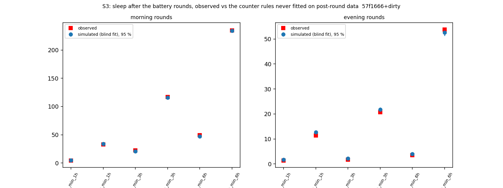

# Sleep-behaviour explore — S: can the counter model predict sleep stability? (cohort 2026c)

Plan [implementation_plan/2026-10-08-sleep-behaviour-explore.md](../../../../implementation_plan/2026-10-08-sleep-behaviour-explore.md) §9 Amendment 1 + addendum (rules written before results). Driver `ephys/sleep_stability.py` (commit 57f1666+dirty); bulk `D:\Field2026_analysis_out\2026c\sleep_explore_S_20261009_1200`; held-out steps `D:\Field2026_analysis_out\2026c\sleep_heldout_steps`; runtime 12 min. **Technical ledger.**

## Reading (main session, 2026-10-09; with part G; claims #43–#47)

**Question (the user):** can the count model predict how stable sleep is — after a battery round (a systematic
perturbation the true model should predict) and when a rat moves but does not wake?

**Short answer.** The count model predicts how much REM and NREM follow a round over 1–6 h, but not the acute
arousal: the first hour after a round has ~1.3–1.45× the waking it predicts, in all six rats, and it cannot tell
which movements will end in waking. A model of sleep stability needs an arousal term that the count rules do not
contain.

- **S1, movements (#45, #46).**
  - Which movements wake: the model's waking propensity ranks movements no better than the model without the count
    (AUC 0.595 vs 0.596 FINAL, 0.593 vs 0.590 pass2med; difference −0.001 [−0.007, +0.004] / +0.003 [+0.000, +0.005]).
    AUC ≈ 0.6 is what the clock and the time in the bout give; the count adds nothing. Same with the late-wake control
    (wake 15–60 s after the movement): 0.594 / 0.593. **S1 fails on both scorings.**
  - How often they wake: first movers wake within 60 s 23 % / 20 % more often than predicted (O/E 1.23 / 1.20;
    random-time controls 1.00 / 0.98), followers 12 % / 11 %, non-movers 3 % / 1 %. A movement is a perturbation the
    model does not contain. **Caveat:** the scorer's EMG is the head IMU, so a sustained head movement is scored
    WAKE; part of the first movers' excess is the definition of WAKE.
- **S2 / S2b, after rounds (#44).**
  - First hour after the round record starts: NREM ends in waking 1.33 / 1.31× as often as the model predicts (FINAL /
    pass2med), 1.41 / 1.45× for the model that never saw a post-round step; CIs exclude 1; 6/6 rats above 1.
  - Hours 1–3: slightly fewer wakes than predicted, 0.87 / 0.88 (blind 0.83 / 0.88), 5/6 rats below 1, CIs touch 1.
  - REM entry per NREM step after rounds: at the model's rate in the first hour (1.16 [0.89, 1.50] / 0.93 [0.73,
    1.15]); in hours 1–3 FINAL 1.02, pass2med 0.85 [0.78, 0.94] (the scorings disagree).
  - After natural long wakes (≥ 30 min, no handling) waking is as predicted (0.99 / 0.90) and REM entry ~15–20 %
    below the model in the first hour (0.82 / 0.86; 6/6 and 5/6 rats). The excess waking is specific to rounds.
- **S3, the simulated response (#47).** The generative model fitted without any post-round hour (100 replicates,
  conditional on the observed waking and gaps) puts 9 of 14 post-round measures inside its 95 % range on each scoring.
  - Inside on both scorings: morning NREM at 3 and 6 h and REM at 6 h; evening REM at 3 and 6 h and NREM at 6 h.
  - Outside on both scorings: **the first REM after a round comes later in wall time than simulated** — morning KM
    median 31 min (both) vs ≤ 30 / ≤ 23 min simulated; evening 3.5 / 3.4 h vs ≤ 3.3 / 2.7 h.
  - Outside on one scoring: FINAL morning REM in 3 h above the range (22.5 vs 19.5–22.3 min; the repayment, #43);
    FINAL evening NREM in 1 h and 3 h below (11.4 vs 11.9–13.3; 20.8 vs 20.9–22.6); pass2med morning REM and NREM in
    1 h below (4.4 vs 4.5–5.9; 33.0 vs 33.1–35.0); pass2med evening REM in 1 h at the lower edge (1.58 vs 1.63–2.61).
    The first hour after a round has less sleep than simulated — the acute arousal of S2.
  - Fitted on all data (it saw the post-round hours), the FINAL latencies come inside; the pass2med ones do not.
- **Reading of the later first REM — WITHDRAWN 2026-10-09 by part P** ([report](ephys_spikes_sleep_explore_P_2026c.md),
  #57). The reading was that the later first REM comes from the extra waking. Part P added the measured waking excess
  (a decaying arousal fitted on waking only, cross-fitted) to the simulation: the first-hour waking was restored, but
  the first REM stayed later than simulated in 3 of 4 kind × scoring cells. (Part P then read this as REM-side; part L
  withdrew that: the delay sits mostly in records that open with scored NREM after release, #59 / #62.)
- **What a model of the perturbation needs** (proposal, not tested):
  1. an acute arousal after handling: waking hazard × ~1.4 decaying within ~1 h, then slightly below baseline;
  2. a movement-arousal term: whether a movement wakes is not predicted by the count (S1);
  3. the REM repayment after morning rounds (#43; part G found no source: dawn timing not excluded (power), no
     handling-specific REM-entry shortfall, the round's own REM loss does not absorb it).
- **Part G** ([report](ephys_spikes_sleep_explore_G_2026c.md)), #43 stays Candidate:
  - G1: D1's null at natural dawn wakes is not informative (MDS 0.49 analytic / 0.27 simulated vs the round slope
    0.34) → dawn timing is not excluded.
  - G2: no handling-specific REM-entry shortfall; power-limited (≤ 3 animals with matched natural wakes). Post-round
    REM entry is, if anything, above that after matched natural long wakes (FINAL Δ O/E +0.83 [+0.36, +1.28]).
  - G3: adding the REM the rat would have had during the unrecorded gap leaves the pass2med pre-round slope unchanged
    (fall 3 % / 2 % at 1 / 3 h; the slope is present in every gap-length tertile). On FINAL, which has no pre-round
    slope (+0.04), the gap's expected REM itself predicts more REM after the round (+0.15 [+0.04, +0.25] per min,
    morning 1 h, day-demeaned) — the two scorings disagree on what is repaid.
  - G4: the slope is larger where the clock-only model predicts more REM entry at 1 h on pass2med (+0.058 [+0.008,
    +0.108]), not at 3 h and not on FINAL → no consistent "gate release".

## Definitions

```
Part S of Amendment 1 of the sleep-behaviour explore (plan implementation_plan/2026-10-08-sleep-behaviour-explore.md §9,
written before results; S2b / S3 added on the user's request before any S result): can the counter model predict
sleep stability — which movements end in waking, and how sleep responds to the battery rounds (a systematic
perturbation)?

Usage:  python ephys/sleep_stability.py predict [--scorings final pass2med] [--workers 6]
        python ephys/sleep_stability.py analyse [--scorings final pass2med] [--reps 100] [--workers 8]
        python ephys/sleep_stability.py --selftest

Definitions:
  held-out step predictions (`predict`)   per 10-s NREM step of the forward-chained test blocks (block k predicted
      by the fit on blocks < k; the first 6 blocks are never predicted), three multinomial models (stay / REM / WAKE):
        B-full  base + L1 + spline ln(1 + P), P = P_tw600_k0 (Step B)          -> p_stay, p_rem, p_wake
        gate    base + L1, no counter                                           -> p_rem_gate, p_wake_gate
        blind   B-full trained WITHOUT the steps in the 3 h after a usable round gap (the perturbation is never seen)
                                                                                -> pb_rem, pb_wake
      post_round = the step lies in the 3 h after the end of a usable round gap (cause round_logged / round_inferred;
      the record starts there). File: <OUT>/2026c/sleep_heldout_steps/heldout_steps_<scoring>.csv.gz.
  S1  Phase-6 event library (events / participants / control_* csv.gz): every participant with pre-state NREM is
      mapped to its animal's NREM step containing the event time t0 (step start <= t0 < start + 10 s); propensity =
      p_wake (or p_wake_gate) of that step.
      (a) AUC of the propensity for woke60 among first movers; bootstrap CI over blocks (2000 resamples of blocks);
          the B-full - gate AUC difference with its CI; per-animal AUC. Late-wake control (A5): events whose first wake
          starts < 15 s after t0 are dropped and the outcome is a wake starting 15-60 s after t0.
      (b) expected woke60 = 1 - (1 - p_wake)^6; O/E for each role and the controls; movement effect = O/E(first
          movers) / O/E(controls).
      Pass (plan): AUC >= 0.60 with CI > 0.5; above gate (difference CI > 0); >= 5/6 rats AUC > 0.5; both scorings.
  S2 / S2b  windows of NREM steps 0-1 h and 1-3 h after (a) the start of a round record and (b) the end of a natural
      wake >= 30 min inside a record (until the next wake >= 30 min or the record end): O/E of NREM -> WAKE (y = 2)
      and NREM -> REM (y = 1) transitions, expected = the sum of the per-step probabilities (S2: B-full; S2b: blind);
      bootstrap CI over blocks; per-animal O/E. Pass (S2 / S2b): WAKE O/E after rounds in [0.8, 1.25] with CI
      including 1 (S2b also REM O/E), both scorings.
  S3  the generative model (sleep_sim v2) refitted on the records with the 3 h after every round masked out (the
      perturbation is never seen), 100 replicates conditional on the observed long wakes and gaps. Per round (from the
      round record's first second): REM min, NREM min and REM bouts in 1 / 3 / 6 h (rounds whose record is shorter
      than the window are dropped from that window), first-REM latency (s; censored at the record end, KM median over
      rounds); observed mean vs the simulated distribution of the mean (2.5-97.5 %), morning and evening separately.
      Pass: the observed means inside the simulated range at 1, 3 and 6 h for REM and NREM minutes and the latency
      median, both scorings. Also reported with the model fitted on all data.
```

## Verdicts

| scores | part | rule | pass | numbers |
|---|---|---|---|---|
| final | S1 | AUC >= 0.60, CI > 0.5, above gate (diff CI > 0), >= 5/6 rats | False | AUC 0.595 [0.586, 0.604], gate diff -0.001 [-0.007, +0.004], rats 6/6 |
| final | S2 WAKE | post-round O/E in [0.8, 1.25], CI includes 1 (0-1 h and 1-3 h) | False | round 0-1 h: 1.33 [1.12, 1.62]; round 1-3 h: 0.87 [0.72, 1.04] |
| final | S2b WAKE | post-round O/E in [0.8, 1.25], CI includes 1 (0-1 h and 1-3 h) | False | round 0-1 h: 1.41 [1.17, 1.76]; round 1-3 h: 0.83 [0.69, 1.00] |
| final | S2b REM | post-round O/E in [0.8, 1.25], CI includes 1 (0-1 h and 1-3 h) | True | round 0-1 h: 1.16 [0.89, 1.50]; round 1-3 h: 1.02 [0.90, 1.19] |
| final | S3 | observed inside the simulated 95 % range: REM / NREM min at 1, 3, 6 h and the latency (blind fit) | False | 9/14 inside; outside: morning rem_min_3h obs 22.5 vs 19.5-22.3, morning first_REM_latency_KM_median_s obs 1847.0 vs 627.3-1808.1, evening nrem_min_1h obs 11.4 vs 11.9-13.3, evening nrem_min_3h obs 20.8 vs 20.9-22.6, evening first_REM_latency_KM_median_s obs 12673.0 vs 2200.3-11913.2 |
| pass2med | S1 | AUC >= 0.60, CI > 0.5, above gate (diff CI > 0), >= 5/6 rats | False | AUC 0.593 [0.579, 0.607], gate diff +0.003 [+0.000, +0.005], rats 6/6 |
| pass2med | S2 WAKE | post-round O/E in [0.8, 1.25], CI includes 1 (0-1 h and 1-3 h) | False | round 0-1 h: 1.31 [1.20, 1.49]; round 1-3 h: 0.88 [0.75, 1.02] |
| pass2med | S2b WAKE | post-round O/E in [0.8, 1.25], CI includes 1 (0-1 h and 1-3 h) | False | round 0-1 h: 1.45 [1.32, 1.64]; round 1-3 h: 0.88 [0.76, 1.01] |
| pass2med | S2b REM | post-round O/E in [0.8, 1.25], CI includes 1 (0-1 h and 1-3 h) | False | round 0-1 h: 0.93 [0.73, 1.15]; round 1-3 h: 0.85 [0.78, 0.94] |
| pass2med | S3 | observed inside the simulated 95 % range: REM / NREM min at 1, 3, 6 h and the latency (blind fit) | False | 9/14 inside; outside: morning rem_min_1h obs 4.4 vs 4.5-5.9, morning nrem_min_1h obs 33.0 vs 33.1-35.0, morning first_REM_latency_KM_median_s obs 1844.0 vs 413.8-1409.6, evening rem_min_1h obs 1.6 vs 1.6-2.6, evening first_REM_latency_KM_median_s obs 12358.0 vs 680.2-9675.8 |

## S1 (a): which movements end in waking — AUC of the model's propensity

| scores | outcome | model | n | events_woke | auc | ci_lo | ci_hi | animals_auc_gt_0.5 | animals |
|---|---|---|---|---|---|---|---|---|---|
| final | woke60 | B-full | 31192 | 8413.0 | 0.5954 | 0.5856 | 0.6043 | 6.0 | 6.0 |
| final | woke60 | gate | 31192 | 8413.0 | 0.5963 | 0.585 | 0.6071 | 6.0 | 6.0 |
| final | woke60 | B-full - gate | 31192 | nan | -0.0009 | -0.0066 | 0.0043 | nan | nan |
| final | wake 15-60 s (A5 control) | B-full | 28374 | 5595.0 | 0.5944 | 0.5835 | 0.6047 | 6.0 | 6.0 |
| final | wake 15-60 s (A5 control) | gate | 28374 | 5595.0 | 0.5955 | 0.5847 | 0.6066 | 6.0 | 6.0 |
| final | wake 15-60 s (A5 control) | B-full - gate | 28374 | nan | -0.0011 | -0.0064 | 0.0038 | nan | nan |
| pass2med | woke60 | B-full | 29893 | 7933.0 | 0.5926 | 0.5794 | 0.6074 | 6.0 | 6.0 |
| pass2med | woke60 | gate | 29893 | 7933.0 | 0.59 | 0.5758 | 0.6063 | 6.0 | 6.0 |
| pass2med | woke60 | B-full - gate | 29893 | nan | 0.0026 | 0.0002 | 0.0052 | nan | nan |
| pass2med | wake 15-60 s (A5 control) | B-full | 27263 | 5303.0 | 0.5926 | 0.5801 | 0.6059 | 6.0 | 6.0 |
| pass2med | wake 15-60 s (A5 control) | gate | 27263 | 5303.0 | 0.5896 | 0.5762 | 0.6045 | 6.0 | 6.0 |
| pass2med | wake 15-60 s (A5 control) | B-full - gate | 27263 | nan | 0.003 | 0.0006 | 0.0056 | nan | nan |

## S1 (b): observed / expected waking by role

| scores | role | n | observed | expected | OE | OE_vs_control |
|---|---|---|---|---|---|---|
| final | control | 64151.0 | 0.1825 | 0.1822 | 1.0016 | 1.0 |
| final | first | 31192.0 | 0.2697 | 0.2195 | 1.2289 | 1.2269 |
| final | follower | 8296.0 | 0.2243 | 0.2006 | 1.1181 | 1.1163 |
| final | non_mover | 63691.0 | 0.1894 | 0.1844 | 1.0267 | 1.025 |
| pass2med | control | 62994.0 | 0.1797 | 0.1837 | 0.9784 | 1.0 |
| pass2med | first | 29893.0 | 0.2654 | 0.2218 | 1.1967 | 1.2231 |
| pass2med | follower | 8024.0 | 0.2213 | 0.1992 | 1.1112 | 1.1358 |
| pass2med | non_mover | 62202.0 | 0.1866 | 0.1847 | 1.0103 | 1.0327 |

## S2 / S2b: transitions after rounds and after natural long wakes, observed / expected

| scores | window | transition | model | steps | observed | expected | OE | ci_lo | ci_hi | animals_OE_lt_1 | animals |
|---|---|---|---|---|---|---|---|---|---|---|---|
| final | natural wake >= 30 min 0-1 h | WAKE | S2 (seen) | 19241 | 1020 | 1029.7333 | 0.9905 | 0.903 | 1.0871 | 3 | 6 |
| final | natural wake >= 30 min 0-1 h | WAKE | S2b (blind) | 19241 | 1020 | 1036.6743 | 0.9839 | 0.9001 | 1.0853 | 3 | 6 |
| final | natural wake >= 30 min 0-1 h | REM | S2 (seen) | 19241 | 129 | 157.0473 | 0.8214 | 0.6858 | 0.9699 | 6 | 6 |
| final | natural wake >= 30 min 0-1 h | REM | S2b (blind) | 19241 | 129 | 158.521 | 0.8138 | 0.675 | 0.9788 | 6 | 6 |
| final | natural wake >= 30 min 1-3 h | WAKE | S2 (seen) | 8465 | 290 | 280.0031 | 1.0357 | 0.8642 | 1.1881 | 3 | 6 |
| final | natural wake >= 30 min 1-3 h | WAKE | S2b (blind) | 8465 | 290 | 292.637 | 0.991 | 0.7924 | 1.1857 | 3 | 6 |
| final | natural wake >= 30 min 1-3 h | REM | S2 (seen) | 8465 | 129 | 158.5179 | 0.8138 | 0.6619 | 1.0638 | 5 | 6 |
| final | natural wake >= 30 min 1-3 h | REM | S2b (blind) | 8465 | 129 | 155.3772 | 0.8302 | 0.6608 | 1.0622 | 4 | 6 |
| final | round 0-1 h | WAKE | S2 (seen) | 10200 | 518 | 389.4292 | 1.3302 | 1.1164 | 1.622 | 0 | 6 |
| final | round 0-1 h | WAKE | S2b (blind) | 10200 | 518 | 366.2332 | 1.4144 | 1.1747 | 1.7573 | 0 | 6 |
| final | round 0-1 h | REM | S2 (seen) | 10200 | 160 | 137.8374 | 1.1608 | 0.8876 | 1.5207 | 2 | 6 |
| final | round 0-1 h | REM | S2b (blind) | 10200 | 160 | 137.874 | 1.1605 | 0.8941 | 1.5046 | 2 | 6 |
| final | round 1-3 h | WAKE | S2 (seen) | 22365 | 576 | 663.0961 | 0.8687 | 0.7225 | 1.0365 | 5 | 6 |
| final | round 1-3 h | WAKE | S2b (blind) | 22365 | 576 | 690.5858 | 0.8341 | 0.6945 | 0.9991 | 5 | 6 |
| final | round 1-3 h | REM | S2 (seen) | 22365 | 506 | 500.9487 | 1.0101 | 0.873 | 1.189 | 2 | 6 |
| final | round 1-3 h | REM | S2b (blind) | 22365 | 506 | 495.21 | 1.0218 | 0.8958 | 1.1936 | 2 | 6 |
| pass2med | natural wake >= 30 min 0-1 h | WAKE | S2 (seen) | 20194 | 939 | 1046.9945 | 0.8969 | 0.8584 | 0.9303 | 5 | 6 |
| pass2med | natural wake >= 30 min 0-1 h | WAKE | S2b (blind) | 20194 | 939 | 1049.0085 | 0.8951 | 0.8655 | 0.9222 | 4 | 6 |
| pass2med | natural wake >= 30 min 0-1 h | REM | S2 (seen) | 20194 | 158 | 183.3058 | 0.8619 | 0.7101 | 1.0226 | 5 | 6 |
| pass2med | natural wake >= 30 min 0-1 h | REM | S2b (blind) | 20194 | 158 | 191.0007 | 0.8272 | 0.679 | 0.9798 | 6 | 6 |
| pass2med | natural wake >= 30 min 1-3 h | WAKE | S2 (seen) | 8712 | 249 | 262.1853 | 0.9497 | 0.7225 | 1.1475 | 4 | 6 |
| pass2med | natural wake >= 30 min 1-3 h | WAKE | S2b (blind) | 8712 | 249 | 262.9461 | 0.947 | 0.6915 | 1.1831 | 4 | 6 |
| pass2med | natural wake >= 30 min 1-3 h | REM | S2 (seen) | 8712 | 174 | 191.4836 | 0.9087 | 0.8424 | 0.9787 | 4 | 6 |
| pass2med | natural wake >= 30 min 1-3 h | REM | S2b (blind) | 8712 | 174 | 193.2923 | 0.9002 | 0.8307 | 0.9751 | 4 | 6 |
| pass2med | round 0-1 h | WAKE | S2 (seen) | 10383 | 523 | 398.6717 | 1.3119 | 1.1965 | 1.4854 | 0 | 6 |
| pass2med | round 0-1 h | WAKE | S2b (blind) | 10383 | 523 | 360.0409 | 1.4526 | 1.3222 | 1.6441 | 0 | 6 |
| pass2med | round 0-1 h | REM | S2 (seen) | 10383 | 166 | 163.7787 | 1.0136 | 0.7781 | 1.2782 | 3 | 6 |
| pass2med | round 0-1 h | REM | S2b (blind) | 10383 | 166 | 179.1287 | 0.9267 | 0.7268 | 1.1526 | 5 | 6 |
| pass2med | round 1-3 h | WAKE | S2 (seen) | 22489 | 585 | 668.4805 | 0.8751 | 0.7525 | 1.0157 | 5 | 6 |
| pass2med | round 1-3 h | WAKE | S2b (blind) | 22489 | 585 | 667.6231 | 0.8762 | 0.757 | 1.0086 | 5 | 6 |
| pass2med | round 1-3 h | REM | S2 (seen) | 22489 | 517 | 597.7323 | 0.8649 | 0.7799 | 0.9663 | 5 | 6 |
| pass2med | round 1-3 h | REM | S2b (blind) | 22489 | 517 | 605.8089 | 0.8534 | 0.7791 | 0.9415 | 5 | 6 |

## S3: the simulated perturbation response

| scores | variant | kind | metric | rounds | observed | sim_mean | sim_2.5% | sim_97.5% | inside |
|---|---|---|---|---|---|---|---|---|---|
| final | blind (post-round 3 h masked in the fit) | morning | rem_min_1h | 50 | 4.465 | 4.65 | 4.036 | 5.391 | True |
| final | blind (post-round 3 h masked in the fit) | morning | nrem_min_1h | 50 | 33.033 | 33.835 | 32.805 | 34.629 | True |
| final | blind (post-round 3 h masked in the fit) | morning | rem_bouts_1h | 50 | 3.72 | 3.964 | 3.499 | 4.442 | True |
| final | blind (post-round 3 h masked in the fit) | morning | rem_min_3h | 50 | 22.463 | 20.939 | 19.534 | 22.322 | False |
| final | blind (post-round 3 h masked in the fit) | morning | nrem_min_3h | 50 | 117.1 | 115.656 | 113.805 | 117.628 | True |
| final | blind (post-round 3 h masked in the fit) | morning | rem_bouts_3h | 50 | 18.58 | 17.411 | 16.419 | 18.744 | True |
| final | blind (post-round 3 h masked in the fit) | morning | rem_min_6h | 44 | 49.141 | 47.115 | 44.633 | 49.52 | True |
| final | blind (post-round 3 h masked in the fit) | morning | nrem_min_6h | 44 | 234.873 | 234.154 | 231.021 | 236.948 | True |
| final | blind (post-round 3 h masked in the fit) | morning | rem_bouts_6h | 44 | 41.932 | 39.542 | 37.873 | 41.502 | False |
| final | blind (post-round 3 h masked in the fit) | morning | first_REM_latency_KM_median_s | 50 | 1847.0 | 1245.9 | 627.325 | 1808.15 | False |
| final | blind (post-round 3 h masked in the fit) | evening | rem_min_1h | 44 | 1.331 | 1.754 | 1.291 | 2.322 | True |
| final | blind (post-round 3 h masked in the fit) | evening | nrem_min_1h | 44 | 11.445 | 12.689 | 11.861 | 13.311 | False |
| final | blind (post-round 3 h masked in the fit) | evening | rem_bouts_1h | 44 | 1.5 | 1.973 | 1.591 | 2.421 | False |
| final | blind (post-round 3 h masked in the fit) | evening | rem_min_3h | 44 | 1.784 | 2.254 | 1.726 | 2.863 | True |
| final | blind (post-round 3 h masked in the fit) | evening | nrem_min_3h | 44 | 20.768 | 21.817 | 20.932 | 22.584 | False |
| final | blind (post-round 3 h masked in the fit) | evening | rem_bouts_3h | 44 | 1.909 | 2.535 | 2.112 | 2.989 | False |
| final | blind (post-round 3 h masked in the fit) | evening | rem_min_6h | 44 | 3.565 | 3.985 | 3.284 | 4.685 | True |
| final | blind (post-round 3 h masked in the fit) | evening | nrem_min_6h | 44 | 53.787 | 52.632 | 51.336 | 53.948 | True |
| final | blind (post-round 3 h masked in the fit) | evening | rem_bouts_6h | 44 | 3.5 | 4.207 | 3.657 | 4.66 | False |
| final | blind (post-round 3 h masked in the fit) | evening | first_REM_latency_KM_median_s | 44 | 12673.0 | 8566.08 | 2200.275 | 11913.175 | False |
| final | fitted on all data | morning | rem_min_1h | 50 | 4.465 | 4.336 | 3.568 | 4.963 | True |
| final | fitted on all data | morning | nrem_min_1h | 50 | 33.033 | 34.088 | 33.185 | 35.088 | False |
| final | fitted on all data | morning | rem_bouts_1h | 50 | 3.72 | 3.771 | 3.25 | 4.292 | True |
| final | fitted on all data | morning | rem_min_3h | 50 | 22.463 | 20.91 | 19.363 | 22.204 | False |
| final | fitted on all data | morning | nrem_min_3h | 50 | 117.1 | 116.699 | 114.856 | 118.276 | True |
| final | fitted on all data | morning | rem_bouts_3h | 50 | 18.58 | 17.579 | 16.428 | 18.52 | False |
| final | fitted on all data | morning | rem_min_6h | 44 | 49.141 | 47.641 | 45.43 | 49.718 | True |
| final | fitted on all data | morning | nrem_min_6h | 44 | 234.873 | 235.26 | 232.091 | 238.152 | True |
| final | fitted on all data | morning | rem_bouts_6h | 44 | 41.932 | 39.779 | 38.26 | 41.299 | False |
| final | fitted on all data | morning | first_REM_latency_KM_median_s | 50 | 1847.0 | 1699.57 | 1236.025 | 2137.875 | True |
| final | fitted on all data | evening | rem_min_1h | 44 | 1.331 | 1.621 | 1.106 | 2.134 | True |
| final | fitted on all data | evening | nrem_min_1h | 44 | 11.445 | 12.67 | 11.973 | 13.346 | False |
| final | fitted on all data | evening | rem_bouts_1h | 44 | 1.5 | 1.818 | 1.352 | 2.318 | True |
| final | fitted on all data | evening | rem_min_3h | 44 | 1.784 | 2.085 | 1.519 | 2.619 | True |
| final | fitted on all data | evening | nrem_min_3h | 44 | 20.768 | 21.713 | 20.677 | 22.538 | True |
| final | fitted on all data | evening | rem_bouts_3h | 44 | 1.909 | 2.349 | 1.841 | 2.887 | True |
| final | fitted on all data | evening | rem_min_6h | 44 | 3.565 | 3.667 | 2.98 | 4.263 | True |
| final | fitted on all data | evening | nrem_min_6h | 44 | 53.787 | 53.294 | 51.974 | 54.867 | True |
| final | fitted on all data | evening | rem_bouts_6h | 44 | 3.5 | 3.896 | 3.273 | 4.422 | True |
| final | fitted on all data | evening | first_REM_latency_KM_median_s | 44 | 12673.0 | 10457.68 | 4113.225 | 13502.175 | True |
| pass2med | blind (post-round 3 h masked in the fit) | morning | rem_min_1h | 50 | 4.372 | 5.257 | 4.472 | 5.91 | False |
| pass2med | blind (post-round 3 h masked in the fit) | morning | nrem_min_1h | 50 | 33.033 | 33.97 | 33.109 | 35.045 | False |
| pass2med | blind (post-round 3 h masked in the fit) | morning | rem_bouts_1h | 50 | 3.66 | 4.623 | 4.12 | 5.151 | False |
| pass2med | blind (post-round 3 h masked in the fit) | morning | rem_min_3h | 50 | 22.208 | 22.609 | 21.015 | 23.925 | True |
| pass2med | blind (post-round 3 h masked in the fit) | morning | nrem_min_3h | 50 | 117.568 | 117.032 | 115.285 | 118.84 | True |
| pass2med | blind (post-round 3 h masked in the fit) | morning | rem_bouts_3h | 50 | 18.68 | 19.334 | 18.236 | 20.351 | True |
| pass2med | blind (post-round 3 h masked in the fit) | morning | rem_min_6h | 44 | 49.325 | 49.297 | 47.292 | 51.656 | True |
| pass2med | blind (post-round 3 h masked in the fit) | morning | nrem_min_6h | 44 | 235.116 | 235.255 | 232.63 | 238.068 | True |
| pass2med | blind (post-round 3 h masked in the fit) | morning | rem_bouts_6h | 44 | 41.614 | 41.723 | 40.028 | 43.547 | True |
| pass2med | blind (post-round 3 h masked in the fit) | morning | first_REM_latency_KM_median_s | 50 | 1844.0 | 763.06 | 413.775 | 1409.625 | False |
| pass2med | blind (post-round 3 h masked in the fit) | evening | rem_min_1h | 44 | 1.584 | 2.083 | 1.626 | 2.611 | False |
| pass2med | blind (post-round 3 h masked in the fit) | evening | nrem_min_1h | 44 | 12.201 | 12.887 | 12.194 | 13.525 | True |
| pass2med | blind (post-round 3 h masked in the fit) | evening | rem_bouts_1h | 44 | 1.727 | 2.346 | 1.852 | 2.774 | False |
| pass2med | blind (post-round 3 h masked in the fit) | evening | rem_min_3h | 44 | 2.123 | 2.632 | 2.104 | 3.29 | True |
| pass2med | blind (post-round 3 h masked in the fit) | evening | nrem_min_3h | 44 | 22.058 | 22.506 | 21.619 | 23.225 | True |
| pass2med | blind (post-round 3 h masked in the fit) | evening | rem_bouts_3h | 44 | 2.205 | 3.012 | 2.477 | 3.466 | False |
| pass2med | blind (post-round 3 h masked in the fit) | evening | rem_min_6h | 44 | 4.009 | 4.284 | 3.621 | 5.025 | True |
| pass2med | blind (post-round 3 h masked in the fit) | evening | nrem_min_6h | 44 | 57.797 | 56.513 | 54.929 | 57.857 | True |
| pass2med | blind (post-round 3 h masked in the fit) | evening | rem_bouts_6h | 44 | 4.159 | 4.878 | 4.272 | 5.523 | False |
| pass2med | blind (post-round 3 h masked in the fit) | evening | first_REM_latency_KM_median_s | 44 | 12358.0 | 4307.6 | 680.2 | 9675.775 | False |
| pass2med | fitted on all data | morning | rem_min_1h | 50 | 4.372 | 4.803 | 4.096 | 5.521 | True |
| pass2med | fitted on all data | morning | nrem_min_1h | 50 | 33.033 | 34.203 | 33.265 | 35.187 | False |
| pass2med | fitted on all data | morning | rem_bouts_1h | 50 | 3.66 | 4.279 | 3.739 | 4.894 | False |
| pass2med | fitted on all data | morning | rem_min_3h | 50 | 22.208 | 21.972 | 20.189 | 23.481 | True |
| pass2med | fitted on all data | morning | nrem_min_3h | 50 | 117.568 | 117.483 | 115.593 | 119.508 | True |
| pass2med | fitted on all data | morning | rem_bouts_3h | 50 | 18.68 | 18.763 | 17.578 | 19.722 | True |
| pass2med | fitted on all data | morning | rem_min_6h | 44 | 49.325 | 48.589 | 45.968 | 51.069 | True |
| pass2med | fitted on all data | morning | nrem_min_6h | 44 | 235.116 | 236.145 | 233.845 | 239.331 | True |
| pass2med | fitted on all data | morning | rem_bouts_6h | 44 | 41.614 | 41.015 | 39.484 | 42.557 | True |
| pass2med | fitted on all data | morning | first_REM_latency_KM_median_s | 50 | 1844.0 | 1271.92 | 592.375 | 1790.85 | False |
| pass2med | fitted on all data | evening | rem_min_1h | 44 | 1.584 | 1.89 | 1.489 | 2.477 | True |
| pass2med | fitted on all data | evening | nrem_min_1h | 44 | 12.201 | 12.89 | 12.153 | 13.552 | True |
| pass2med | fitted on all data | evening | rem_bouts_1h | 44 | 1.727 | 2.105 | 1.714 | 2.489 | True |
| pass2med | fitted on all data | evening | rem_min_3h | 44 | 2.123 | 2.421 | 1.994 | 2.969 | True |
| pass2med | fitted on all data | evening | nrem_min_3h | 44 | 22.058 | 22.48 | 21.469 | 23.302 | True |
| pass2med | fitted on all data | evening | rem_bouts_3h | 44 | 2.205 | 2.74 | 2.341 | 3.196 | False |
| pass2med | fitted on all data | evening | rem_min_6h | 44 | 4.009 | 4.123 | 3.518 | 4.886 | True |
| pass2med | fitted on all data | evening | nrem_min_6h | 44 | 57.797 | 56.863 | 55.494 | 58.172 | True |
| pass2med | fitted on all data | evening | rem_bouts_6h | 44 | 4.159 | 4.633 | 4.102 | 5.347 | True |
| pass2med | fitted on all data | evening | first_REM_latency_KM_median_s | 44 | 12358.0 | 7381.86 | 1875.5 | 10653.0 | False |



