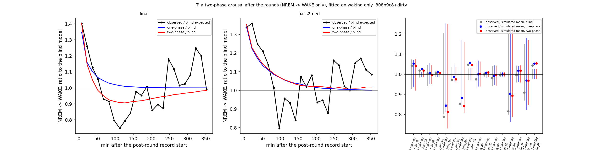

# Sleep-behaviour explore — T: a two-phase arousal after the battery rounds, cohort 2026c

Plan [implementation_plan/2026-10-08-sleep-behaviour-explore.md](../../../../implementation_plan/2026-10-08-sleep-behaviour-explore.md) §11 Amendment 3 (rules written before results). Driver `ephys/sleep_perturb.py runT` (commit 308b9c8+dirty); bulk `D:\Field2026_analysis_out\2026c\sleep_explore_T_20261009_1520`; 100 replicates; runtime 19 min. **Technical ledger.**

## Reading (main session, 2026-10-09; claim #58; #43, #56, #57 updated)

**Question (plan §11):** is there a delayed calm phase of waking after a round, and does it — fitted on waking alone —
produce the sleep recovered 1–6 h after the round?

**Short answer.** No on both counts. A delayed second term did not improve held-out prediction, and it left the
simulated recovery as it was. Changing the base also showed that FINAL's "extra REM at 3 h" depends on how much
post-round data the model was fitted without. The only REM residual that survives every base and variant is pass2med's
debt slope.

- **T1 fails on both scorings (#58).**
  - Two-phase vs one-phase on the post-round steps 0–6 h: +0.005 % [−0.076, +0.088], 3/6 (FINAL); +0.009 % [−0.029,
    +0.048], 2/6 (pass2med).
  - FINAL hints at a calm phase in-sample: b = −0.27 (se 0.05) at τ₂ = 60 min, negative in both halves (−0.31 / −0.18),
    i.e. ~24 % lower waking odds about an hour after the round. Held out it over-corrects hours 3–6 (WAKE O/E 1.08).
  - pass2med: b ≈ 0 (+0.05 / −0.05).
- **T2 fails on both.** REM / NREM minutes inside of 12:
  - FINAL: two-phase 9, one-phase 9, blind 7;
  - pass2med: two-phase 11, one-phase 11, blind 8.
  - The second phase changes nothing the one-phase term had not.
  - Still outside: NREM — FINAL morning 3 h (117.1 vs 113.3–116.9), FINAL evening 1 h (below) and 6 h (above),
    pass2med evening 6 h (57.8 vs 53.6–56.3).
  - All REM measures are inside with either arousal term.
- **T3 fails on FINAL, but not because of the term.** The blind base fails the same checks (11/14 with and without the
  term): fitted without the 6 h after every round, it over-predicts night REM by ~20 % (REM share at night +20–22 %,
  REM bouts per NREM hour at night +21–22 %). It has lost much of the night after the evening rounds. pass2med 14/14.
- **The REM residual depends on the base.**
  - FINAL's morning REM in 3 h (22.5 min) is inside with this 6-h-blind base for every variant, including no arousal
    (20.0–23.1). It was above with part P's 3-h-blind base (19.5–22.3).
  - pass2med's day-demeaned debt slope stays above with every variant and both bases (1 h +0.34 vs ≤ +0.32; 3 h +0.96 vs
    ≤ +0.66).
  - Taken together with part P: the debt slope on fixed thresholds is the only REM residual that is robust here.
  - The evening NREM excess at 6 h may partly be the base's night-REM over-prediction (a simulation with too much REM
    leaves too little NREM).
- **The first-REM delay is unchanged:** 3 of 4 cells outside with either arousal term, as in part P (FINAL morning
  inside at the edge).
- **What stands after parts P and T:**
  1. A single decaying arousal describes the waking after a round (#56). A delayed calm phase is not detectable held
     out (#58).
  2. The first REM is delayed beyond what the waking explains (#57).
  3. The recovery that the model misses is mostly NREM. FINAL's extra REM is base-dependent; pass2med's REM debt slope
     is robust (#43 Candidate).
  4. No REM-need variable is warranted by the rule (plan §10).

## Definitions

```
Part T of the sleep-behaviour explore (plan §11, Amendment 3, written before results): a two-phase arousal after the
battery rounds — an early excess and a delayed consolidation phase — fitted on waking only. Does the second phase exist,
and does it produce the later sleep recovery (part P: more sleep 1-6 h after a round than the one-phase simulation)?

Usage:  python ephys/sleep_perturb.py runT [--scorings final pass2med] [--reps 100] [--workers 8]

Definitions (as part P unless stated):
  two-phase term   on the NREM -> WAKE logit only: eta_WAKE += a exp(-s / tau1) + b (s / tau2) exp(1 - s / tau2), s = s since
                   the post-round record start; the second term is 0 at s = 0 and peaks at s = tau2 with value b.
                   tau1 in {600, 1200, 2400, 4800} s, tau2 in {3600, 5400, 7200, 10800} s; (a, b) = 2-D Newton on the
                   binary WAKE likelihood with the base logit as offset; the grid pair with the highest likelihood.
  one-phase term   part P's a exp(-s / tau) refitted on the same window and bases (comparator).
  window           the 6 h after the post-round record start; both bases (step-level B-full; the generative sleep_sim fit,
                   records masked) leave out these 6 h.
  cross-fit        rounds by date parity, as part P.
  T1   cross-fitted two-phase vs one-phase on the post-round steps 0-6 h: Delta log-loss % (block bootstrap CI) and animals
       better; pass = CI < 0, >= 5/6, and b < 0 in both halves.
  T2   100 replicates of the cross-fitted simulation with the two-phase term (REM rules untouched): pass = the observed mean
       REM and NREM minutes at 1, 3 and 6 h after morning and evening rounds (12 measures) all inside the simulated
       2.5-97.5 % range. Latencies reported.
  T3   Step E's checks with the two-phase term: >= 13/14 per scoring and not fewer than without.
  residual   FINAL's morning REM in 3 h and pass2med's day-demeaned morning REM payback slope at 3 h, with the two-phase term.
```

## Verdicts

| scores | part | pass | numbers |
|---|---|---|---|
| final | T1 | False | two- vs one-phase Delta +0.005 % [-0.076, +0.088], 3/6; b by half -0.31 / -0.18 |
| final | T2 | False | inside of 12: two-phase 9, one-phase 9, blind 7; outside (two-phase): morning nrem_min_3h obs 117.1 vs 113.3-116.9, evening nrem_min_1h obs 11.4 vs 11.6-12.9, evening nrem_min_6h obs 53.8 vs 49.9-53.0 |
| final | T3 | False | two-phase 11/14, blind 11/14 |
| final | residual | None | morning REM payback slope (day-demeaned), B = 1 h: obs +0.04 vs -0.23..+0.29 (inside); morning REM payback slope (day-demeaned), B = 3 h: obs -0.06 vs -0.54..+0.75 (inside); S3 morning REM min in 3 h: obs +22.46 vs +19.81..+23.20 (inside) |
| pass2med | T1 | False | two- vs one-phase Delta +0.009 % [-0.029, +0.048], 2/6; b by half +0.05 / -0.05 |
| pass2med | T2 | False | inside of 12: two-phase 11, one-phase 11, blind 8; outside (two-phase): evening nrem_min_6h obs 57.8 vs 53.6-56.3 |
| pass2med | T3 | True | two-phase 14/14, blind 14/14 |
| pass2med | residual | None | morning REM payback slope (day-demeaned), B = 1 h: obs +0.34 vs -0.23..+0.27 (above); morning REM payback slope (day-demeaned), B = 3 h: obs +0.96 vs -0.55..+0.60 (above); S3 morning REM min in 3 h: obs +22.21 vs +20.84..+23.59 (inside) |

## Parameters

| scores | base | model | fit_on | applied_to | tau_s | a | se | ll | tau1_s | tau2_s | b | se_a | se_b |
|---|---|---|---|---|---|---|---|---|---|---|---|---|---|
| final | step-level blind (6 h) | one-phase | half != 0 | half 0 | 1200.0 | 0.3364 | 0.1315 | -6491.0515 | nan | nan | nan | nan | nan |
| final | step-level blind (6 h) | two-phase | half != 0 | half 0 | nan | 0.4042 | nan | -6485.2969 | 4800.0 | 3600.0 | -0.3137 | 0.1143 | 0.075 |
| final | step-level blind (6 h) | one-phase | half != 1 | half 1 | 2400.0 | 0.4442 | 0.0872 | -6811.5362 | nan | nan | nan | nan | nan |
| final | step-level blind (6 h) | two-phase | half != 1 | half 1 | nan | 0.4868 | nan | -6808.0878 | 4800.0 | 5400.0 | -0.1846 | 0.0843 | 0.0507 |
| final | step-level blind (6 h) | one-phase | all rounds | nan | 1200.0 | 0.4441 | 0.0864 | -13305.4726 | nan | nan | nan | nan | nan |
| final | step-level blind (6 h) | two-phase | all rounds | nan | nan | 0.4874 | nan | -13298.083 | 4800.0 | 3600.0 | -0.2683 | 0.0752 | 0.0513 |
| final | generative (6 h masked) | one-phase | half != 0 | half 0 | 1200.0 | 0.4043 | 0.1316 | -6492.6887 | nan | nan | nan | nan | nan |
| final | generative (6 h masked) | one-phase | half != 1 | half 1 | 2400.0 | 0.4972 | 0.0873 | -6813.5454 | nan | nan | nan | nan | nan |
| final | generative (6 h masked) | two-phase | half != 0 | half 0 | nan | 0.4542 | nan | -6487.5208 | 4800.0 | 3600.0 | -0.3221 | 0.1146 | 0.0753 |
| final | generative (6 h masked) | two-phase | half != 1 | half 1 | nan | 0.5409 | nan | -6809.5355 | 4800.0 | 5400.0 | -0.2017 | 0.0844 | 0.0508 |
| pass2med | step-level blind (6 h) | one-phase | half != 0 | half 0 | 2400.0 | 0.332 | 0.1013 | -6616.225 | nan | nan | nan | nan | nan |
| pass2med | step-level blind (6 h) | two-phase | half != 0 | half 0 | nan | 0.3033 | nan | -6614.9382 | 2400.0 | 10800.0 | 0.0497 | 0.1034 | 0.0308 |
| pass2med | step-level blind (6 h) | one-phase | half != 1 | half 1 | 4800.0 | 0.3674 | 0.0653 | -7009.781 | nan | nan | nan | nan | nan |
| pass2med | step-level blind (6 h) | two-phase | half != 1 | half 1 | nan | 0.4192 | nan | -7008.9647 | 4800.0 | 7200.0 | -0.0516 | 0.0763 | 0.0405 |
| pass2med | step-level blind (6 h) | one-phase | all rounds | nan | 2400.0 | 0.4164 | 0.0653 | -13627.0818 | nan | nan | nan | nan | nan |
| pass2med | step-level blind (6 h) | two-phase | all rounds | nan | nan | 0.4023 | nan | -13626.4563 | 2400.0 | 10800.0 | 0.0247 | 0.0667 | 0.022 |
| pass2med | generative (6 h masked) | one-phase | half != 0 | half 0 | 2400.0 | 0.4659 | 0.1022 | -6614.7828 | nan | nan | nan | nan | nan |
| pass2med | generative (6 h masked) | one-phase | half != 1 | half 1 | 2400.0 | 0.5983 | 0.0865 | -7009.8456 | nan | nan | nan | nan | nan |
| pass2med | generative (6 h masked) | two-phase | half != 0 | half 0 | nan | 0.4383 | nan | -6613.6953 | 2400.0 | 10800.0 | 0.0458 | 0.1044 | 0.0309 |
| pass2med | generative (6 h masked) | two-phase | half != 1 | half 1 | nan | 0.5475 | nan | -7009.0415 | 4800.0 | 5400.0 | -0.1038 | 0.0846 | 0.0505 |

b in the halves:

| scores | b_half0 | b_half1 |
|---|---|---|
| final | -0.3137 | -0.1846 |
| pass2med | 0.0497 | -0.0516 |

Likelihood grids:

| tau_s | a | se | ll | n | wakes | scores | model | tau1_s | tau2_s | b | se_a | se_b |
|---|---|---|---|---|---|---|---|---|---|---|---|---|
| 600.0 | 0.412 | 0.111 | -13311.243 | 85291 | 3251 | final | one-phase | nan | nan | nan | nan | nan |
| 1200.0 | 0.444 | 0.086 | -13305.473 | 85291 | 3251 | final | one-phase | nan | nan | nan | nan | nan |
| 2400.0 | 0.338 | 0.067 | -13305.735 | 85291 | 3251 | final | one-phase | nan | nan | nan | nan | nan |
| 4800.0 | 0.178 | 0.051 | -13311.742 | 85291 | 3251 | final | one-phase | nan | nan | nan | nan | nan |
| nan | 0.426 | nan | -13310.56 | 85291 | 3251 | final | two-phase | 600.0 | 3600.0 | -0.04 | 0.112 | 0.034 |
| nan | 0.424 | nan | -13309.916 | 85291 | 3251 | final | two-phase | 600.0 | 5400.0 | -0.045 | 0.111 | 0.028 |
| nan | 0.419 | nan | -13310.312 | 85291 | 3251 | final | two-phase | 600.0 | 7200.0 | -0.033 | 0.111 | 0.025 |
| nan | 0.415 | nan | -13310.964 | 85291 | 3251 | final | two-phase | 600.0 | 10800.0 | -0.016 | 0.111 | 0.022 |
| nan | 0.494 | nan | -13303.19 | 85291 | 3251 | final | two-phase | 1200.0 | 3600.0 | -0.075 | 0.089 | 0.035 |
| nan | 0.478 | nan | -13302.912 | 85291 | 3251 | final | two-phase | 1200.0 | 5400.0 | -0.064 | 0.087 | 0.028 |
| nan | 0.464 | nan | -13303.814 | 85291 | 3251 | final | two-phase | 1200.0 | 7200.0 | -0.045 | 0.087 | 0.025 |
| nan | 0.451 | nan | -13304.925 | 85291 | 3251 | final | two-phase | 1200.0 | 10800.0 | -0.023 | 0.087 | 0.022 |
| nan | 0.489 | nan | -13298.526 | 85291 | 3251 | final | two-phase | 2400.0 | 3600.0 | -0.149 | 0.076 | 0.04 |
| nan | 0.43 | nan | -13299.825 | 85291 | 3251 | final | two-phase | 2400.0 | 5400.0 | -0.103 | 0.071 | 0.03 |
| nan | 0.393 | nan | -13302.075 | 85291 | 3251 | final | two-phase | 2400.0 | 7200.0 | -0.069 | 0.07 | 0.026 |
| nan | 0.361 | nan | -13304.35 | 85291 | 3251 | final | two-phase | 2400.0 | 10800.0 | -0.037 | 0.068 | 0.022 |
| nan | 0.487 | nan | -13298.083 | 85291 | 3251 | final | two-phase | 4800.0 | 3600.0 | -0.268 | 0.075 | 0.051 |
| nan | 0.369 | nan | -13301.235 | 85291 | 3251 | final | two-phase | 4800.0 | 5400.0 | -0.163 | 0.064 | 0.036 |
| nan | 0.295 | nan | -13305.323 | 85291 | 3251 | final | two-phase | 4800.0 | 7200.0 | -0.103 | 0.06 | 0.029 |
| nan | 0.234 | nan | -13309.075 | 85291 | 3251 | final | two-phase | 4800.0 | 10800.0 | -0.055 | 0.056 | 0.024 |
| 600.0 | 0.331 | 0.109 | -13641.451 | 86643 | 3317 | pass2med | one-phase | nan | nan | nan | nan | nan |
| 1200.0 | 0.438 | 0.084 | -13633.411 | 86643 | 3317 | pass2med | one-phase | nan | nan | nan | nan | nan |
| 2400.0 | 0.416 | 0.065 | -13627.082 | 86643 | 3317 | pass2med | one-phase | nan | nan | nan | nan | nan |
| 4800.0 | 0.309 | 0.05 | -13627.963 | 86643 | 3317 | pass2med | one-phase | nan | nan | nan | nan | nan |
| nan | 0.296 | nan | -13636.663 | 86643 | 3317 | pass2med | two-phase | 600.0 | 3600.0 | 0.107 | 0.11 | 0.034 |
| nan | 0.316 | nan | -13638.727 | 86643 | 3317 | pass2med | two-phase | 600.0 | 5400.0 | 0.066 | 0.11 | 0.028 |
| nan | 0.321 | nan | -13639.112 | 86643 | 3317 | pass2med | two-phase | 600.0 | 7200.0 | 0.053 | 0.109 | 0.024 |
| nan | 0.325 | nan | -13639.093 | 86643 | 3317 | pass2med | two-phase | 600.0 | 10800.0 | 0.047 | 0.109 | 0.022 |
| nan | 0.389 | nan | -13630.992 | 86643 | 3317 | pass2med | two-phase | 1200.0 | 3600.0 | 0.078 | 0.088 | 0.035 |
| nan | 0.414 | nan | -13631.912 | 86643 | 3317 | pass2med | two-phase | 1200.0 | 5400.0 | 0.049 | 0.086 | 0.028 |
| nan | 0.421 | nan | -13631.925 | 86643 | 3317 | pass2med | two-phase | 1200.0 | 7200.0 | 0.042 | 0.085 | 0.025 |
| nan | 0.426 | nan | -13631.64 | 86643 | 3317 | pass2med | two-phase | 1200.0 | 10800.0 | 0.041 | 0.085 | 0.022 |
| nan | 0.401 | nan | -13627.002 | 86643 | 3317 | pass2med | two-phase | 2400.0 | 3600.0 | 0.016 | 0.076 | 0.039 |
| nan | 0.407 | nan | -13627.012 | 86643 | 3317 | pass2med | two-phase | 2400.0 | 5400.0 | 0.011 | 0.07 | 0.03 |
| nan | 0.404 | nan | -13626.863 | 86643 | 3317 | pass2med | two-phase | 2400.0 | 7200.0 | 0.017 | 0.068 | 0.025 |
| nan | 0.402 | nan | -13626.456 | 86643 | 3317 | pass2med | two-phase | 2400.0 | 10800.0 | 0.025 | 0.067 | 0.022 |
| nan | 0.401 | nan | -13626.619 | 86643 | 3317 | pass2med | two-phase | 4800.0 | 3600.0 | -0.083 | 0.075 | 0.051 |
| nan | 0.366 | nan | -13626.89 | 86643 | 3317 | pass2med | two-phase | 4800.0 | 5400.0 | -0.052 | 0.063 | 0.035 |
| nan | 0.337 | nan | -13627.539 | 86643 | 3317 | pass2med | two-phase | 4800.0 | 7200.0 | -0.026 | 0.058 | 0.028 |
| nan | 0.313 | nan | -13627.946 | 86643 | 3317 | pass2med | two-phase | 4800.0 | 10800.0 | -0.004 | 0.055 | 0.024 |

## T1: held-out comparison on the post-round steps (0-6 h)

| scores | comparison | steps | wakes | delta_pct | ci_lo | ci_hi | animals_better | animals | holds |
|---|---|---|---|---|---|---|---|---|---|
| final | two-phase vs one-phase | 85291 | 3251 | 0.0048 | -0.0761 | 0.0878 | 3 | 6 | False |
| final | one-phase vs blind | 85291 | 3251 | -0.0321 | -0.1266 | 0.0558 | 4 | 6 | False |
| final | two-phase vs blind | 85291 | 3251 | -0.0273 | -0.1369 | 0.0655 | 4 | 6 | False |
| pass2med | two-phase vs one-phase | 86643 | 3317 | 0.0093 | -0.0292 | 0.0476 | 2 | 6 | False |
| pass2med | one-phase vs blind | 86643 | 3317 | -0.0695 | -0.1467 | 0.0064 | 5 | 6 | False |
| pass2med | two-phase vs blind | 86643 | 3317 | -0.0602 | -0.1501 | 0.0197 | 5 | 6 | False |

| scores | window | transition | model | steps | observed | expected | OE | ci_lo | ci_hi |
|---|---|---|---|---|---|---|---|---|---|
| final | 0-1 h | WAKE | blind | 13340 | 670 | 553.8243 | 1.2098 | 1.0584 | 1.4122 |
| final | 0-1 h | WAKE | one-phase (cross-fitted) | 13340 | 670 | 647.6869 | 1.0345 | 0.8972 | 1.2242 |
| final | 0-1 h | WAKE | two-phase (cross-fitted) | 13340 | 670 | 635.0432 | 1.055 | 0.9087 | 1.2564 |
| final | 0-1 h | REM | blind | 13340 | 218 | 192.0548 | 1.1351 | 0.9664 | 1.3663 |
| final | 0-1 h | REM | one-phase (cross-fitted) | 13340 | 218 | 190.7274 | 1.143 | 0.9732 | 1.3767 |
| final | 0-1 h | REM | two-phase (cross-fitted) | 13340 | 218 | 191.0706 | 1.1409 | 0.9717 | 1.3735 |
| final | 1-3 h | WAKE | blind | 28349 | 839 | 953.1542 | 0.8802 | 0.7391 | 1.0436 |
| final | 1-3 h | WAKE | one-phase (cross-fitted) | 28349 | 839 | 968.6813 | 0.8661 | 0.7237 | 1.025 |
| final | 1-3 h | WAKE | two-phase (cross-fitted) | 28349 | 839 | 876.6372 | 0.9571 | 0.7958 | 1.1327 |
| final | 1-3 h | REM | blind | 28349 | 667 | 671.2868 | 0.9936 | 0.8993 | 1.0973 |
| final | 1-3 h | REM | one-phase (cross-fitted) | 28349 | 667 | 670.8706 | 0.9942 | 0.8998 | 1.098 |
| final | 1-3 h | REM | two-phase (cross-fitted) | 28349 | 667 | 673.2676 | 0.9907 | 0.8967 | 1.0939 |
| final | 3-6 h | WAKE | blind | 43602 | 1742 | 1683.3219 | 1.0349 | 0.9391 | 1.1262 |
| final | 3-6 h | WAKE | one-phase (cross-fitted) | 43602 | 1742 | 1684.2182 | 1.0343 | 0.9386 | 1.1253 |
| final | 3-6 h | WAKE | two-phase (cross-fitted) | 43602 | 1742 | 1610.7316 | 1.0815 | 0.9774 | 1.1817 |
| final | 3-6 h | REM | blind | 43602 | 1017 | 1034.5008 | 0.9831 | 0.9343 | 1.0336 |
| final | 3-6 h | REM | one-phase (cross-fitted) | 43602 | 1017 | 1034.4783 | 0.9831 | 0.9344 | 1.0336 |
| final | 3-6 h | REM | two-phase (cross-fitted) | 43602 | 1017 | 1036.2753 | 0.9814 | 0.9326 | 1.032 |
| pass2med | 0-1 h | WAKE | blind | 13549 | 683 | 530.6853 | 1.287 | 1.2045 | 1.4135 |
| pass2med | 0-1 h | WAKE | one-phase (cross-fitted) | 13549 | 683 | 648.1103 | 1.0538 | 0.9795 | 1.1661 |
| pass2med | 0-1 h | WAKE | two-phase (cross-fitted) | 13549 | 683 | 653.0003 | 1.0459 | 0.9717 | 1.1588 |
| pass2med | 0-1 h | REM | blind | 13549 | 228 | 226.2545 | 1.0077 | 0.8537 | 1.1669 |
| pass2med | 0-1 h | REM | one-phase (cross-fitted) | 13549 | 228 | 223.9185 | 1.0182 | 0.8627 | 1.1802 |
| pass2med | 0-1 h | REM | two-phase (cross-fitted) | 13549 | 228 | 223.844 | 1.0186 | 0.863 | 1.1805 |
| pass2med | 1-3 h | WAKE | blind | 28650 | 861 | 878.9754 | 0.9795 | 0.843 | 1.1302 |
| pass2med | 1-3 h | WAKE | one-phase (cross-fitted) | 28650 | 861 | 927.5192 | 0.9283 | 0.7948 | 1.0725 |
| pass2med | 1-3 h | WAKE | two-phase (cross-fitted) | 28650 | 861 | 927.0496 | 0.9288 | 0.8003 | 1.0716 |
| pass2med | 1-3 h | REM | blind | 28650 | 688 | 712.955 | 0.965 | 0.8659 | 1.0723 |
| pass2med | 1-3 h | REM | one-phase (cross-fitted) | 28650 | 688 | 711.664 | 0.9667 | 0.8673 | 1.0741 |
| pass2med | 1-3 h | REM | two-phase (cross-fitted) | 28650 | 688 | 711.6282 | 0.9668 | 0.8673 | 1.0746 |
| pass2med | 3-6 h | WAKE | blind | 44444 | 1773 | 1684.4971 | 1.0525 | 0.9439 | 1.1552 |
| pass2med | 3-6 h | WAKE | one-phase (cross-fitted) | 44444 | 1773 | 1697.4103 | 1.0445 | 0.9368 | 1.1442 |
| pass2med | 3-6 h | WAKE | two-phase (cross-fitted) | 44444 | 1773 | 1710.869 | 1.0363 | 0.9279 | 1.1427 |
| pass2med | 3-6 h | REM | blind | 44444 | 1044 | 1041.2982 | 1.0026 | 0.9353 | 1.0605 |
| pass2med | 3-6 h | REM | one-phase (cross-fitted) | 44444 | 1044 | 1040.9668 | 1.0029 | 0.9356 | 1.061 |
| pass2med | 3-6 h | REM | two-phase (cross-fitted) | 44444 | 1044 | 1040.7611 | 1.0031 | 0.9359 | 1.0614 |

## T2: the simulated post-round response

| scores | variant | kind | metric | rounds | observed | sim_mean | sim_2.5% | sim_97.5% | inside |
|---|---|---|---|---|---|---|---|---|---|
| final | blind | morning | rem_min_1h | 50 | 4.465 | 4.641 | 3.902 | 5.445 | True |
| final | blind | morning | nrem_min_1h | 50 | 33.033 | 33.661 | 32.686 | 34.608 | True |
| final | blind | morning | rem_min_3h | 50 | 22.463 | 21.543 | 19.976 | 23.143 | True |
| final | blind | morning | nrem_min_3h | 50 | 117.1 | 114.929 | 113.137 | 116.771 | False |
| final | blind | morning | rem_min_6h | 44 | 49.141 | 48.898 | 46.074 | 51.224 | True |
| final | blind | morning | nrem_min_6h | 44 | 234.873 | 232.958 | 229.832 | 237.021 | True |
| final | blind | morning | first_REM_latency_KM_median_s | 50 | 1847.0 | 1284.5 | 688.575 | 1822.15 | False |
| final | blind | evening | rem_min_1h | 44 | 1.331 | 1.741 | 1.368 | 2.124 | False |
| final | blind | evening | nrem_min_1h | 44 | 11.445 | 12.597 | 12.004 | 13.11 | False |
| final | blind | evening | rem_min_3h | 44 | 1.784 | 2.261 | 1.811 | 2.723 | False |
| final | blind | evening | nrem_min_3h | 44 | 20.768 | 21.368 | 20.622 | 22.181 | True |
| final | blind | evening | rem_min_6h | 44 | 3.565 | 4.175 | 3.533 | 4.864 | True |
| final | blind | evening | nrem_min_6h | 44 | 53.787 | 51.289 | 49.916 | 52.794 | False |
| final | blind | evening | first_REM_latency_KM_median_s | 44 | 12673.0 | 7980.62 | 2042.025 | 10938.725 | False |
| final | one-phase | morning | rem_min_1h | 50 | 4.465 | 4.439 | 3.692 | 5.21 | True |
| final | one-phase | morning | nrem_min_1h | 50 | 33.033 | 33.008 | 32.153 | 33.855 | True |
| final | one-phase | morning | rem_min_3h | 50 | 22.463 | 21.328 | 19.965 | 22.851 | True |
| final | one-phase | morning | nrem_min_3h | 50 | 117.1 | 114.065 | 112.508 | 115.523 | False |
| final | one-phase | morning | rem_min_6h | 44 | 49.141 | 48.78 | 46.46 | 51.505 | True |
| final | one-phase | morning | nrem_min_6h | 44 | 234.873 | 231.979 | 229.143 | 235.179 | True |
| final | one-phase | morning | first_REM_latency_KM_median_s | 50 | 1847.0 | 1511.11 | 823.55 | 2049.8 | True |
| final | one-phase | evening | rem_min_1h | 44 | 1.331 | 1.599 | 1.236 | 2.096 | True |
| final | one-phase | evening | nrem_min_1h | 44 | 11.445 | 12.324 | 11.793 | 12.847 | False |
| final | one-phase | evening | rem_min_3h | 44 | 1.784 | 2.112 | 1.718 | 2.647 | True |
| final | one-phase | evening | nrem_min_3h | 44 | 20.768 | 21.081 | 20.292 | 22.111 | True |
| final | one-phase | evening | rem_min_6h | 44 | 3.565 | 4.031 | 3.373 | 4.721 | True |
| final | one-phase | evening | nrem_min_6h | 44 | 53.787 | 50.984 | 49.451 | 52.577 | False |
| final | one-phase | evening | first_REM_latency_KM_median_s | 44 | 12673.0 | 9082.36 | 2246.25 | 12145.35 | False |
| final | two-phase | morning | rem_min_1h | 50 | 4.465 | 4.445 | 3.657 | 5.268 | True |
| final | two-phase | morning | nrem_min_1h | 50 | 33.033 | 33.073 | 32.156 | 33.923 | True |
| final | two-phase | morning | rem_min_3h | 50 | 22.463 | 21.547 | 19.808 | 23.202 | True |
| final | two-phase | morning | nrem_min_3h | 50 | 117.1 | 114.89 | 113.251 | 116.929 | False |
| final | two-phase | morning | rem_min_6h | 44 | 49.141 | 49.269 | 46.843 | 51.578 | True |
| final | two-phase | morning | nrem_min_6h | 44 | 234.873 | 233.171 | 230.08 | 235.724 | True |
| final | two-phase | morning | first_REM_latency_KM_median_s | 50 | 1847.0 | 1540.6 | 843.55 | 2047.05 | True |
| final | two-phase | evening | rem_min_1h | 44 | 1.331 | 1.621 | 1.134 | 2.171 | True |
| final | two-phase | evening | nrem_min_1h | 44 | 11.445 | 12.347 | 11.571 | 12.861 | False |
| final | two-phase | evening | rem_min_3h | 44 | 1.784 | 2.191 | 1.603 | 2.741 | True |
| final | two-phase | evening | nrem_min_3h | 44 | 20.768 | 21.306 | 20.434 | 22.102 | True |
| final | two-phase | evening | rem_min_6h | 44 | 3.565 | 4.227 | 3.414 | 4.911 | True |
| final | two-phase | evening | nrem_min_6h | 44 | 53.787 | 51.434 | 49.925 | 52.996 | False |
| final | two-phase | evening | first_REM_latency_KM_median_s | 44 | 12673.0 | 8953.59 | 2259.55 | 11200.0 | False |
| pass2med | blind | morning | rem_min_1h | 50 | 4.372 | 5.205 | 4.529 | 6.06 | False |
| pass2med | blind | morning | nrem_min_1h | 50 | 33.033 | 34.059 | 33.086 | 35.078 | False |
| pass2med | blind | morning | rem_min_3h | 50 | 22.208 | 22.766 | 21.174 | 24.101 | True |
| pass2med | blind | morning | nrem_min_3h | 50 | 117.568 | 117.554 | 115.973 | 119.03 | True |
| pass2med | blind | morning | rem_min_6h | 44 | 49.325 | 50.214 | 47.358 | 52.278 | True |
| pass2med | blind | morning | nrem_min_6h | 44 | 235.116 | 236.168 | 233.423 | 239.326 | True |
| pass2med | blind | morning | first_REM_latency_KM_median_s | 50 | 1844.0 | 645.6 | 362.85 | 1314.95 | False |
| pass2med | blind | evening | rem_min_1h | 44 | 1.584 | 2.066 | 1.681 | 2.487 | False |
| pass2med | blind | evening | nrem_min_1h | 44 | 12.201 | 12.755 | 12.081 | 13.34 | True |
| pass2med | blind | evening | rem_min_3h | 44 | 2.123 | 2.6 | 2.081 | 3.126 | True |
| pass2med | blind | evening | nrem_min_3h | 44 | 22.058 | 22.142 | 21.255 | 23.101 | True |
| pass2med | blind | evening | rem_min_6h | 44 | 4.009 | 4.409 | 3.836 | 5.077 | True |
| pass2med | blind | evening | nrem_min_6h | 44 | 57.797 | 55.355 | 54.14 | 56.862 | False |
| pass2med | blind | evening | first_REM_latency_KM_median_s | 44 | 12358.0 | 3554.01 | 554.275 | 9659.475 | False |
| pass2med | one-phase | morning | rem_min_1h | 50 | 4.372 | 4.812 | 4.182 | 5.691 | True |
| pass2med | one-phase | morning | nrem_min_1h | 50 | 33.033 | 33.355 | 32.447 | 34.27 | True |
| pass2med | one-phase | morning | rem_min_3h | 50 | 22.208 | 22.223 | 20.882 | 23.747 | True |
| pass2med | one-phase | morning | nrem_min_3h | 50 | 117.568 | 116.644 | 114.727 | 118.47 | True |
| pass2med | one-phase | morning | rem_min_6h | 44 | 49.325 | 49.709 | 47.049 | 51.956 | True |
| pass2med | one-phase | morning | nrem_min_6h | 44 | 235.116 | 235.26 | 232.726 | 238.167 | True |
| pass2med | one-phase | morning | first_REM_latency_KM_median_s | 50 | 1844.0 | 871.71 | 450.475 | 1670.325 | False |
| pass2med | one-phase | evening | rem_min_1h | 44 | 1.584 | 1.832 | 1.335 | 2.272 | True |
| pass2med | one-phase | evening | nrem_min_1h | 44 | 12.201 | 12.304 | 11.658 | 12.901 | True |
| pass2med | one-phase | evening | rem_min_3h | 44 | 2.123 | 2.351 | 1.795 | 2.887 | True |
| pass2med | one-phase | evening | nrem_min_3h | 44 | 22.058 | 21.677 | 20.816 | 22.566 | True |
| pass2med | one-phase | evening | rem_min_6h | 44 | 4.009 | 4.136 | 3.406 | 4.886 | True |
| pass2med | one-phase | evening | nrem_min_6h | 44 | 57.797 | 54.896 | 53.595 | 56.318 | False |
| pass2med | one-phase | evening | first_REM_latency_KM_median_s | 44 | 12358.0 | 5125.44 | 945.575 | 9813.25 | False |
| pass2med | two-phase | morning | rem_min_1h | 50 | 4.372 | 4.832 | 4.216 | 5.503 | True |
| pass2med | two-phase | morning | nrem_min_1h | 50 | 33.033 | 33.295 | 32.39 | 34.266 | True |
| pass2med | two-phase | morning | rem_min_3h | 50 | 22.208 | 22.188 | 20.841 | 23.592 | True |
| pass2med | two-phase | morning | nrem_min_3h | 50 | 117.568 | 116.527 | 114.933 | 118.264 | True |
| pass2med | two-phase | morning | rem_min_6h | 44 | 49.325 | 49.532 | 46.781 | 51.693 | True |
| pass2med | two-phase | morning | nrem_min_6h | 44 | 235.116 | 235.139 | 232.605 | 238.255 | True |
| pass2med | two-phase | morning | first_REM_latency_KM_median_s | 50 | 1844.0 | 863.84 | 403.8 | 1561.4 | False |
| pass2med | two-phase | evening | rem_min_1h | 44 | 1.584 | 1.844 | 1.414 | 2.339 | True |
| pass2med | two-phase | evening | nrem_min_1h | 44 | 12.201 | 12.31 | 11.696 | 12.907 | True |
| pass2med | two-phase | evening | rem_min_3h | 44 | 2.123 | 2.377 | 1.877 | 2.933 | True |
| pass2med | two-phase | evening | nrem_min_3h | 44 | 22.058 | 21.669 | 20.788 | 22.64 | True |
| pass2med | two-phase | evening | rem_min_6h | 44 | 4.009 | 4.142 | 3.512 | 4.846 | True |
| pass2med | two-phase | evening | nrem_min_6h | 44 | 57.797 | 54.796 | 53.575 | 56.302 | False |
| pass2med | two-phase | evening | first_REM_latency_KM_median_s | 44 | 12358.0 | 4906.86 | 929.125 | 9715.35 | False |

## T3: Step E's checks

| scores | variant | metric | observed | sim_mean | rel_diff | tolerance | pass |
|---|---|---|---|---|---|---|---|
| final | blind | rem_h_per_24h | 1.6942 | 1.7181 | 0.0141 | 0.25 | True |
| final | blind | nrem_h_per_24h | 9.4636 | 9.312 | -0.016 | 0.1 | True |
| final | blind | sd_rem_daily | 0.3416 | 0.3559 | 0.0417 | 0.25 | True |
| final | blind | sd_nrem_daily | 1.1026 | 1.0227 | -0.0725 | 0.25 | True |
| final | blind | rem_share_light | 0.1737 | 0.1765 | 0.0161 | 0.2 | True |
| final | blind | rem_share_dark | 0.0682 | 0.082 | 0.2021 | 0.2 | False |
| final | blind | rem_per_h_nrem_light | 11.4096 | 11.6744 | 0.0232 | 0.2 | True |
| final | blind | rem_per_h_nrem_dark | 4.0351 | 4.8898 | 0.2118 | 0.2 | False |
| final | blind | lat_med_light_2-7 | 528.0 | 529.06 | 0.002 | 0.25 | True |
| final | blind | lat_med_light_7-30 | 779.0 | 679.86 | -0.1273 | 0.25 | True |
| final | blind | lat_med_dark_2-7 | 899.0 | 850.6 | -0.0538 | 0.25 | True |
| final | blind | lat_med_dark_7-30 | 810.0 | 984.39 | 0.2153 | 0.25 | True |
| final | blind | lat_med_dark_30-120 | 1370.0 | 1086.0 | -0.2073 | 0.25 | True |
| final | blind | lat_med_dark_>=120 | 1593.0 | 1124.22 | -0.2943 | 0.25 | False |
| final | one-phase | rem_h_per_24h | 1.6942 | 1.7129 | 0.011 | 0.25 | True |
| final | one-phase | nrem_h_per_24h | 9.4636 | 9.2938 | -0.0179 | 0.1 | True |
| final | one-phase | sd_rem_daily | 0.3416 | 0.3519 | 0.0302 | 0.25 | True |
| final | one-phase | sd_nrem_daily | 1.1026 | 1.0169 | -0.0777 | 0.25 | True |
| final | one-phase | rem_share_light | 0.1737 | 0.1766 | 0.0162 | 0.2 | True |
| final | one-phase | rem_share_dark | 0.0682 | 0.0816 | 0.1967 | 0.2 | True |
| final | one-phase | rem_per_h_nrem_light | 11.4096 | 11.6621 | 0.0221 | 0.2 | True |
| final | one-phase | rem_per_h_nrem_dark | 4.0351 | 4.8782 | 0.2089 | 0.2 | False |
| final | one-phase | lat_med_light_2-7 | 528.0 | 528.93 | 0.0018 | 0.25 | True |
| final | one-phase | lat_med_light_7-30 | 779.0 | 683.8 | -0.1222 | 0.25 | True |
| final | one-phase | lat_med_dark_2-7 | 899.0 | 861.85 | -0.0413 | 0.25 | True |
| final | one-phase | lat_med_dark_7-30 | 810.0 | 984.57 | 0.2155 | 0.25 | True |
| final | one-phase | lat_med_dark_30-120 | 1370.0 | 1088.12 | -0.2058 | 0.25 | True |
| final | one-phase | lat_med_dark_>=120 | 1593.0 | 1130.89 | -0.2901 | 0.25 | False |
| final | two-phase | rem_h_per_24h | 1.6942 | 1.7251 | 0.0182 | 0.25 | True |
| final | two-phase | nrem_h_per_24h | 9.4636 | 9.321 | -0.0151 | 0.1 | True |
| final | two-phase | sd_rem_daily | 0.3416 | 0.3562 | 0.0427 | 0.25 | True |
| final | two-phase | sd_nrem_daily | 1.1026 | 1.021 | -0.074 | 0.25 | True |
| final | two-phase | rem_share_light | 0.1737 | 0.1771 | 0.0192 | 0.2 | True |
| final | two-phase | rem_share_dark | 0.0682 | 0.0828 | 0.2145 | 0.2 | False |
| final | two-phase | rem_per_h_nrem_light | 11.4096 | 11.7061 | 0.026 | 0.2 | True |
| final | two-phase | rem_per_h_nrem_dark | 4.0351 | 4.9341 | 0.2228 | 0.2 | False |
| final | two-phase | lat_med_light_2-7 | 528.0 | 530.59 | 0.0049 | 0.25 | True |
| final | two-phase | lat_med_light_7-30 | 779.0 | 685.93 | -0.1195 | 0.25 | True |
| final | two-phase | lat_med_dark_2-7 | 899.0 | 860.92 | -0.0424 | 0.25 | True |
| final | two-phase | lat_med_dark_7-30 | 810.0 | 998.52 | 0.2327 | 0.25 | True |
| final | two-phase | lat_med_dark_30-120 | 1370.0 | 1068.33 | -0.2202 | 0.25 | True |
| final | two-phase | lat_med_dark_>=120 | 1593.0 | 1115.16 | -0.3 | 0.25 | False |
| pass2med | blind | rem_h_per_24h | 1.7679 | 1.7865 | 0.0105 | 0.25 | True |
| pass2med | blind | nrem_h_per_24h | 9.7844 | 9.7331 | -0.0052 | 0.1 | True |
| pass2med | blind | sd_rem_daily | 0.2944 | 0.3206 | 0.0888 | 0.25 | True |
| pass2med | blind | sd_nrem_daily | 0.8998 | 0.9742 | 0.0826 | 0.25 | True |
| pass2med | blind | rem_share_light | 0.1783 | 0.1764 | -0.0106 | 0.2 | True |
| pass2med | blind | rem_share_dark | 0.0669 | 0.0724 | 0.0834 | 0.2 | True |
| pass2med | blind | rem_per_h_nrem_light | 11.911 | 12.0817 | 0.0143 | 0.2 | True |
| pass2med | blind | rem_per_h_nrem_dark | 4.2137 | 4.6813 | 0.111 | 0.2 | True |
| pass2med | blind | lat_med_light_2-7 | 535.0 | 537.37 | 0.0044 | 0.25 | True |
| pass2med | blind | lat_med_light_7-30 | 771.0 | 680.19 | -0.1178 | 0.25 | True |
| pass2med | blind | lat_med_dark_2-7 | 1115.0 | 882.35 | -0.2087 | 0.25 | True |
| pass2med | blind | lat_med_dark_7-30 | 1316.0 | 1039.89 | -0.2098 | 0.25 | True |
| pass2med | blind | lat_med_dark_30-120 | 1348.0 | 1155.1 | -0.1431 | 0.25 | True |
| pass2med | blind | lat_med_dark_>=120 | 1486.0 | 1128.31 | -0.2407 | 0.25 | True |
| pass2med | one-phase | rem_h_per_24h | 1.7679 | 1.7731 | 0.0029 | 0.25 | True |
| pass2med | one-phase | nrem_h_per_24h | 9.7844 | 9.7128 | -0.0073 | 0.1 | True |
| pass2med | one-phase | sd_rem_daily | 0.2944 | 0.3239 | 0.1002 | 0.25 | True |
| pass2med | one-phase | sd_nrem_daily | 0.8998 | 0.9727 | 0.081 | 0.25 | True |
| pass2med | one-phase | rem_share_light | 0.1783 | 0.1755 | -0.0155 | 0.2 | True |
| pass2med | one-phase | rem_share_dark | 0.0669 | 0.0723 | 0.0812 | 0.2 | True |
| pass2med | one-phase | rem_per_h_nrem_light | 11.911 | 12.0067 | 0.008 | 0.2 | True |
| pass2med | one-phase | rem_per_h_nrem_dark | 4.2137 | 4.6676 | 0.1077 | 0.2 | True |
| pass2med | one-phase | lat_med_light_2-7 | 535.0 | 539.73 | 0.0088 | 0.25 | True |
| pass2med | one-phase | lat_med_light_7-30 | 771.0 | 684.24 | -0.1125 | 0.25 | True |
| pass2med | one-phase | lat_med_dark_2-7 | 1115.0 | 875.58 | -0.2147 | 0.25 | True |
| pass2med | one-phase | lat_med_dark_7-30 | 1316.0 | 1047.1 | -0.2043 | 0.25 | True |
| pass2med | one-phase | lat_med_dark_30-120 | 1348.0 | 1162.95 | -0.1373 | 0.25 | True |
| pass2med | one-phase | lat_med_dark_>=120 | 1486.0 | 1148.5 | -0.2271 | 0.25 | True |
| pass2med | two-phase | rem_h_per_24h | 1.7679 | 1.7686 | 0.0004 | 0.25 | True |
| pass2med | two-phase | nrem_h_per_24h | 9.7844 | 9.709 | -0.0077 | 0.1 | True |
| pass2med | two-phase | sd_rem_daily | 0.2944 | 0.3246 | 0.1026 | 0.25 | True |
| pass2med | two-phase | sd_nrem_daily | 0.8998 | 0.9715 | 0.0797 | 0.25 | True |
| pass2med | two-phase | rem_share_light | 0.1783 | 0.1753 | -0.0169 | 0.2 | True |
| pass2med | two-phase | rem_share_dark | 0.0669 | 0.0719 | 0.0747 | 0.2 | True |
| pass2med | two-phase | rem_per_h_nrem_light | 11.911 | 11.9905 | 0.0067 | 0.2 | True |
| pass2med | two-phase | rem_per_h_nrem_dark | 4.2137 | 4.6665 | 0.1075 | 0.2 | True |
| pass2med | two-phase | lat_med_light_2-7 | 535.0 | 540.97 | 0.0112 | 0.25 | True |
| pass2med | two-phase | lat_med_light_7-30 | 771.0 | 683.47 | -0.1135 | 0.25 | True |
| pass2med | two-phase | lat_med_dark_2-7 | 1115.0 | 881.32 | -0.2096 | 0.25 | True |
| pass2med | two-phase | lat_med_dark_7-30 | 1316.0 | 1044.72 | -0.2061 | 0.25 | True |
| pass2med | two-phase | lat_med_dark_30-120 | 1348.0 | 1147.63 | -0.1486 | 0.25 | True |
| pass2med | two-phase | lat_med_dark_>=120 | 1486.0 | 1136.16 | -0.2354 | 0.25 | True |

## The REM residual

| scores | variant | quantity | observed | sim_mean | sim_2.5% | sim_97.5% | side |
|---|---|---|---|---|---|---|---|
| final | blind | morning REM payback slope (day-demeaned), B = 1 h | 0.0401 | 0.0314 | -0.2063 | 0.3062 | inside |
| final | blind | morning REM payback slope (day-demeaned), B = 3 h | -0.0622 | 0.0983 | -0.379 | 0.6605 | inside |
| final | one-phase | morning REM payback slope (day-demeaned), B = 1 h | 0.0401 | 0.0322 | -0.2377 | 0.3021 | inside |
| final | one-phase | morning REM payback slope (day-demeaned), B = 3 h | -0.0622 | 0.0834 | -0.4059 | 0.7193 | inside |
| final | two-phase | morning REM payback slope (day-demeaned), B = 1 h | 0.0401 | 0.022 | -0.2329 | 0.293 | inside |
| final | two-phase | morning REM payback slope (day-demeaned), B = 3 h | -0.0622 | 0.0179 | -0.5385 | 0.7507 | inside |
| final | blind | S3 morning REM min in 3 h | 22.4633 | 21.5432 | 19.976 | 23.1429 | inside |
| final | one-phase | S3 morning REM min in 3 h | 22.4633 | 21.3282 | 19.9645 | 22.8506 | inside |
| final | two-phase | S3 morning REM min in 3 h | 22.4633 | 21.5471 | 19.8083 | 23.2016 | inside |
| pass2med | blind | morning REM payback slope (day-demeaned), B = 1 h | 0.3355 | 0.0335 | -0.2254 | 0.313 | above |
| pass2med | blind | morning REM payback slope (day-demeaned), B = 3 h | 0.9607 | 0.1035 | -0.4583 | 0.6162 | above |
| pass2med | one-phase | morning REM payback slope (day-demeaned), B = 1 h | 0.3355 | 0.0322 | -0.1741 | 0.3183 | above |
| pass2med | one-phase | morning REM payback slope (day-demeaned), B = 3 h | 0.9607 | 0.0637 | -0.4602 | 0.5803 | above |
| pass2med | two-phase | morning REM payback slope (day-demeaned), B = 1 h | 0.3355 | 0.0289 | -0.2286 | 0.2706 | above |
| pass2med | two-phase | morning REM payback slope (day-demeaned), B = 3 h | 0.9607 | 0.0826 | -0.5489 | 0.6001 | above |
| pass2med | blind | S3 morning REM min in 3 h | 22.2083 | 22.7657 | 21.1738 | 24.1007 | inside |
| pass2med | one-phase | S3 morning REM min in 3 h | 22.2083 | 22.2226 | 20.8824 | 23.7466 | inside |
| pass2med | two-phase | S3 morning REM min in 3 h | 22.2083 | 22.1881 | 20.841 | 23.5919 | inside |



