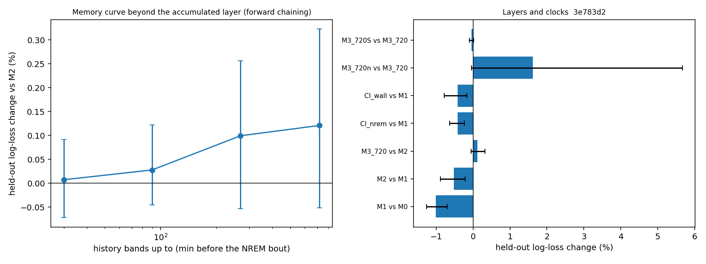
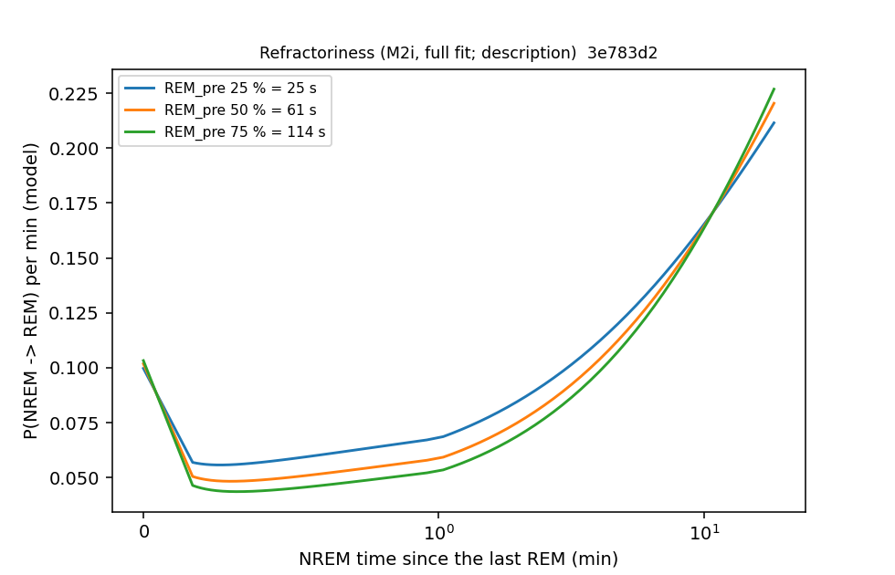

# Internal sleep schedule — Phase 1: memory curve, clocks, cycles ahead, refractoriness (cohort 2026c)

Plan: [2026-10-07-sleep-internal-schedule.md](../../../../implementation_plan/2026-10-07-sleep-internal-schedule.md) (rev. 2). Phase 0: [counts](ephys_spikes_sleep_schedule_phase0_2026c.md). Driver `ephys/sleep_schedule.py phase1` (commit 3e783d2); bulk `D:\Field2026_analysis_out\2026c\sleep_schedule_phase1_20261007_1930`.

**Status: technical ledger; no claim audit yet.**

## Definitions

- Step: 10 s of an NREM bout; outcome stay / REM / Wake at the bout's end (censored at unknown epochs or record ends). History at the bout start, fixed during the bout.
- L0 = animal + $(\sin,\cos)(2\pi k h/24)$, $k=1,2$ + linear experiment day + spline of $\ln(\text{elapsed}+5)$.
- L1 (current state) = $\ln(1+d_{prev})$ (the wake before the bout; 0 after REM), after-REM and unknown-before indicators, wake fraction of the last 10 min.
- L2 (accumulated since the last REM) = spline of $\ln(1+N_{since})$, $\ln(1+W_{since})$, $\ln\text{REM}_{pre}$, has-anchor.
- L3 bands $b$ (min before the bout start) 10–30, 30–90, 90–270, 270–720: $f_{R,b}$, $f_{W,b}$ (REM, wake seconds over recorded seconds), completeness $c_b$; within the record only (Phase 2 extends across gaps).
- Clocks: Cl_nrem / Cl_wall = L0 + L1 + one since-REM clock (NREM time / wall time) + REM_pre + anchor; M3_720n = the L3 bands on NREM time (REM and wake per NREM second in the last X min of NREM).
- S = the other animals' REM share of recorded time in the 3 h before the bout start (+ completeness).
- M2i = M2 + spline($\ln(1+N_{since})$) × $\ln\text{REM}_{pre}$ (refractoriness that scales with REM_pre).
- Validation: forward chaining over the day-half blocks (train on all earlier blocks, test the next; first test block = block 7 of 22). $\Delta$ = held-out log-loss change in % of the smaller model (negative = better); 95 % CI by bootstrap over folds; animals better = per-animal pooled change < 0. **Holds** = CI below 0 and ≥ 5/6 animals better.
- Opportunity / timing split (Larson & Dinse 1985): per held-out bout with an observed end, from the model's step hazards over a 2-h horizon: $\pi=\sum_t S(t-1)h_R(t)$, and $\log S(t^*-1)h_{type}(t^*) = \log P(type) + \log f(t^*\mid type)$; gains in nats per bout (positive = better).
- Cycles ahead (A3): REM cycles inside one SLEEP (Watson units, MA < 40 s counted in $|N|$); OLS of $\ln|N|_k$ on $\ln\text{REM}_0$ with the intervening REM and $|N|$ terms, phase and animal; SEs clustered by block.

Data: 179668 steps, 3880 NREM → REM, 7442 NREM → Wake, 22 blocks, 15 forward folds.

## Comparisons (forward chaining)

| comparison | delta_pct | ci_lo_pct | ci_hi_pct | folds_better | folds | animals_better | animals | holds |
|---|---|---|---|---|---|---|---|---|
| M1 vs M0 | -1.015 | -1.266 | -0.7 | 13 | 15 | 6 | 6 | True |
| M2 vs M1 | -0.519 | -0.881 | -0.212 | 13 | 15 | 5 | 6 | True |
| M3_30 vs M2 | 0.007 | -0.072 | 0.091 | 10 | 15 | 5 | 6 | False |
| M3_90 vs M3_30 | 0.021 | -0.016 | 0.058 | 6 | 15 | 2 | 6 | False |
| M3_270 vs M3_90 | 0.072 | -0.025 | 0.17 | 7 | 15 | 3 | 6 | False |
| M3_720 vs M3_270 | 0.022 | -0.05 | 0.09 | 9 | 15 | 3 | 6 | False |
| Cl_nrem vs M1 | -0.421 | -0.636 | -0.234 | 14 | 15 | 6 | 6 | True |
| Cl_wall vs M1 | -0.42 | -0.783 | -0.17 | 14 | 15 | 6 | 6 | True |
| Cl_wall vs Cl_nrem | 0.001 | -0.179 | 0.169 | 7 | 15 | 2 | 6 | False |
| M3_720 vs M2 | 0.121 | -0.051 | 0.323 | 8 | 15 | 4 | 6 | False |
| M3_720n vs M3_720 | 1.615 | -0.039 | 5.668 | 6 | 15 | 1 | 6 | False |
| M3_720S vs M1S | -0.382 | -0.596 | -0.159 | 13 | 15 | 6 | 6 | True |
| M3_720 vs M1 | -0.399 | -0.637 | -0.169 | 13 | 15 | 5 | 6 | True |
| M3_720S vs M3_720 | -0.045 | -0.104 | 0.009 | 9 | 15 | 4 | 6 | False |
| M2i vs M2 | -0.044 | -0.109 | 0.024 | 9 | 15 | 5 | 6 | False |

## Memory curve: L3 bands added on top of L2 (cumulative)

| comparison | delta_pct | ci_lo_pct | ci_hi_pct | folds_better | folds | animals_better | animals | holds |
|---|---|---|---|---|---|---|---|---|
| M3_30 vs M2 | 0.007 | -0.072 | 0.091 | 10 | 15 | 5 | 6 | False |
| M3_90 vs M2 | 0.028 | -0.046 | 0.123 | 8 | 15 | 5 | 6 | False |
| M3_270 vs M2 | 0.099 | -0.053 | 0.257 | 5 | 15 | 4 | 6 | False |
| M3_720 vs M2 | 0.121 | -0.051 | 0.323 | 8 | 15 | 4 | 6 | False |

## Opportunity vs timing (nats per held-out bout; positive = the larger model is better)

| comparison | bouts | n | gain_total | gain_opportunity | gain_timing | median_iqr_rem_s_a | median_iqr_rem_s_b | mean_residual_b |
|---|---|---|---|---|---|---|---|---|
| M1 vs M0 | all ends | 7333 | 0.0442 | 0.0421 | 0.0021 | 290.0 | 300.0 | 0.0 |
| M1 vs M0 | ends in REM | 2588 | 0.0991 | 0.0591 | 0.04 | 290.0 | 290.0 | 0.0 |
| M1 vs M0 | ends in Wake | 4745 | 0.0143 | 0.0328 | -0.0186 | 290.0 | 310.0 | 0.0 |
| M2 vs M1 | all ends | 7333 | 0.0223 | 0.0057 | 0.0166 | 300.0 | 310.0 | 0.0 |
| M2 vs M1 | ends in REM | 2588 | 0.0288 | 0.0156 | 0.0132 | 290.0 | 290.0 | 0.0 |
| M2 vs M1 | ends in Wake | 4745 | 0.0188 | 0.0003 | 0.0185 | 310.0 | 330.0 | 0.0 |
| M3_720 vs M2 | all ends | 7333 | -0.005 | 0.0013 | -0.0062 | 310.0 | 310.0 | 0.0 |
| M3_720 vs M2 | ends in REM | 2588 | 0.0003 | -0.001 | 0.0013 | 290.0 | 280.0 | 0.0 |
| M3_720 vs M2 | ends in Wake | 4745 | -0.0078 | 0.0025 | -0.0103 | 330.0 | 320.0 | 0.0 |
| M3_720S vs M3_720 | all ends | 7333 | 0.0019 | 0.0005 | 0.0014 | 310.0 | 310.0 | 0.0 |
| M3_720S vs M3_720 | ends in REM | 2588 | 0.004 | 0.0062 | -0.0022 | 280.0 | 290.0 | 0.0 |
| M3_720S vs M3_720 | ends in Wake | 4745 | 0.0008 | -0.0026 | 0.0034 | 320.0 | 320.0 | 0.0 |

## Cycles ahead (A3)

| k_ahead | n_cycles | beta_l_rem0 | se | p | animals_positive | animals |
|---|---|---|---|---|---|---|
| 1 | 3642 | -0.0508 | 0.0485 | 0.2948 | 3 | 6 |
| 2 | 3176 | 0.0939 | 0.0405 | 0.0205 | 4 | 6 |
| 3 | 2781 | 0.0553 | 0.0462 | 0.2315 | 4 | 6 |
| 4 | 2438 | -0.014 | 0.0598 | 0.815 | 2 | 6 |
| 5 | 2146 | 0.0819 | 0.0584 | 0.1605 | 5 | 6 |

## Refractoriness (C2, description)

