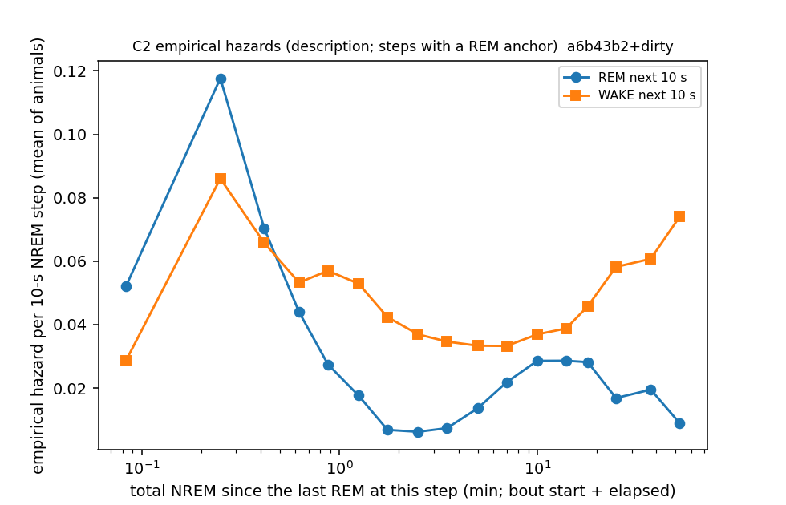
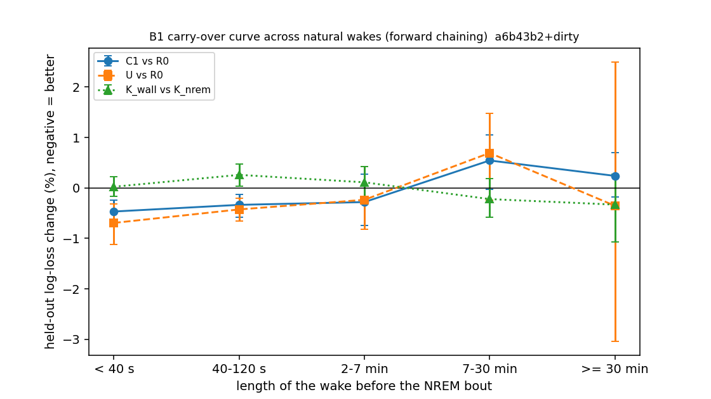
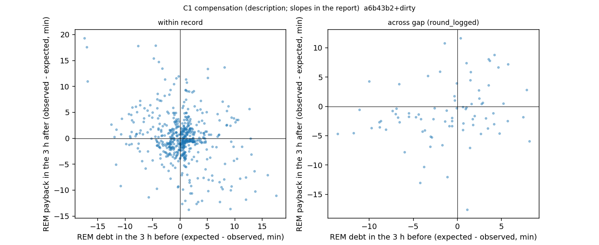

# Internal sleep schedule — Phase 2: carry-over across wakes, compensation, refractoriness (cohort 2026c)

Plan: [2026-10-07-sleep-internal-schedule.md](../../../../implementation_plan/2026-10-07-sleep-internal-schedule.md) (rev. 2 + Amendment 1). Driver `ephys/sleep_schedule.py phase2` → `ephys/sleep_schedule_phase2.py` (commit a6b43b2+dirty); bulk `D:\Field2026_analysis_out\2026c\sleep_schedule_phase2_20261007_2036`. Definitions: the module docstring (copied below).

**Status: technical ledger; no claim audit yet.** Δ = held-out log-loss change in % of the smaller model (negative = better), forward chaining over day-half blocks unless stated; holds = CI below 0 and ≥ 5/6 animals better.

## Definitions

```
Phase 2 of the internal-schedule analysis (plan: implementation_plan/2026-10-07-sleep-internal-schedule.md, rev. 2 +
Amendment 1): carry-over of sleep history across wakes (curve 2), compensation (curve 3), and the corrected
refractoriness description. Called by `python ephys/sleep_schedule.py phase2 [--parts c2 b1 b1b c1 b2]`.

Definitions (FINAL 1-s states; field-PC time; 10-s NREM steps as Phase 1; forward chaining over day-half blocks):
  post-wake bout  an NREM bout whose previous bout is WAKE of length d (s); its history at the bout start:
                  N_pre = NREM s since the last REM (NREM time stops during the wake), W_pre = wake s since the last REM
                  BEFORE this wake (w_since - d), T = wall s since the last REM (includes d), REM_pre, has_anchor.
  B1 models       reset  R0 = L0 + [ln(1+d), fW10]
                  carry  C1 = R0 + spline ln(1+N_pre) + ln(1+W_pre) + [ln REM_pre, has_anchor]
                  update U  = C1 + (spline ln(1+N_pre), ln(1+W_pre), ln REM_pre) x z(ln(1+d))
                  clocks K_nrem = R0 + spline ln(1+N_pre) + [ln REM_pre, anchor];  K_wall = R0 + spline ln(1+T) + same
                  Carry-over curve = held-out log-loss change per wake-length bin (< 40 s, 40-120 s, 2-7 min, 7-30 min,
                  >= 30 min; Watson-2016 marks), from the same fits.
  B1b             every wake >= 7 min followed by NREM in its record: NREM content |N|_k (NREM + MAs < 40 s) before the
                  k-th REM after the wake, k = 1..3 (stop at a wake >= 7 min, an unknown epoch or the record end; only
                  cycles that reach REM are used); OLS ln|N|_k ~ ln d + ln(1+N_pre) + anchor + phase + animal, SEs
                  clustered by block.
  B2              records of an animal joined across the usable gaps (<= 180 min, >= 1 h recorded each side; Phase 0)
                  with the gap as unknown epochs. Post-gap bouts = NREM bouts after a gap >= 600 s and before the first
                  REM after it. Lean models (few events): R0g = L0 + [ln gap, morning]; C1g = R0g + [ln(1+N_pre),
                  ln REM_pre, anchor] (N_pre = NREM since the last REM before the gap). Leave-one-block-out with a
                  purge (the next block's post-gap rows are dropped from training: their history is the left-out block).
                  Battery rounds only (cause round_logged / round_inferred); probe moves and the one unhandled gap are
                  listed. B3 = the same on pass2med_remclean states (fixed per-animal thresholds).
  C1 compensation 10-min bins per animal (recorded s, REM s, NREM s, REM onsets). Baselines fitted leave-one-block-out on
                  animal + (sin, cos)(2 pi k h / 24), k = 1, 2 + linear day: REM and NREM share (binomial GLM,
                  var weights = recorded s), REM onset rate (Poisson GLM, offset ln recorded min), REM bout duration
                  (OLS on ln duration, smearing). Window A (3 h) then B (1 h / 3 h), >= 80 % recorded each:
                    debt_A = E[REM_A] - REM_A ;  payback_B = REM_B - E[REM_B]   (minutes; + slope = compensation)
                  and the same for NREM minutes, REM count and mean REM bout duration (s) in B. Within records (sliding
                  by 1 h) and across battery-round gaps (A = the 3 h before the gap, B = the first 1 h / 3 h after).
                  OLS with SEs clustered by block (of A); per-animal slope signs.
  C2              empirical hazard per 10-s NREM step of REM and of WAKE against the TOTAL NREM since the last REM at
                  that step (bout-start value + elapsed), per animal then averaged (model-free description); and one
                  held-out comparison: M2 (bout-start N_since) vs M2t (step-level N_since + elapsed).
```

## C2 Empirical hazards against the total NREM since the last REM

| nb | hR | hW | animals | steps | n_tot_mid_min |
|---|---|---|---|---|---|
| [0, 10) | 0.0521 | 0.0286 | 6 | 4076 | 0.0833 |
| [10, 20) | 0.1177 | 0.086 | 6 | 4070 | 0.25 |
| [20, 30) | 0.0703 | 0.0658 | 6 | 3462 | 0.4167 |
| [30, 45) | 0.0439 | 0.0533 | 6 | 5695 | 0.625 |
| [45, 60) | 0.0274 | 0.057 | 6 | 3278 | 0.875 |
| [60, 90) | 0.0176 | 0.0529 | 6 | 8069 | 1.25 |
| [90, 120) | 0.0068 | 0.0423 | 6 | 7625 | 1.75 |
| [120, 180) | 0.0062 | 0.0369 | 6 | 14654 | 2.5 |
| [180, 240) | 0.0074 | 0.0346 | 6 | 13928 | 3.5 |
| [240, 360) | 0.0136 | 0.0333 | 6 | 25166 | 5.0 |
| [360, 480) | 0.0218 | 0.0332 | 6 | 20020 | 7.0 |
| [480, 720) | 0.0286 | 0.0369 | 6 | 24850 | 10.0 |
| [720, 960) | 0.0286 | 0.0388 | 6 | 11649 | 14.0 |
| [960, 1200) | 0.0282 | 0.0458 | 6 | 5552 | 18.0 |
| [1200, 1800) | 0.0168 | 0.0582 | 6 | 5350 | 25.0 |
| [1800, 2700) | 0.0195 | 0.0607 | 6 | 2661 | 37.5 |
| [2700, 3600) | 0.0089 | 0.0741 | 5 | 787 | 52.5 |



| comparison | subset | n_steps | n_rem | delta_pct | ci_lo_pct | ci_hi_pct | folds_better | folds | animals_better | animals | holds |
|---|---|---|---|---|---|---|---|---|---|---|---|
| M2t vs M2 | all NREM steps | 126200 | 2588 | -0.834 | -1.197 | -0.376 | 12 | 15 | 5 | 6 | True |

## B1 Carry-over across natural wakes (post-wake NREM bouts)

| comparison | subset | n_steps | n_rem | delta_pct | ci_lo_pct | ci_hi_pct | folds_better | folds | animals_better | animals | holds |
|---|---|---|---|---|---|---|---|---|---|---|---|
| C1 vs R0 | all post-wake | 116717 | 2043 | -0.396 | -0.583 | -0.225 | 13 | 15 | 5.0 | 6.0 | True |
| U vs C1 | all post-wake | 116717 | 2043 | -0.184 | -0.506 | 0.029 | 8 | 15 | 4.0 | 6.0 | False |
| K_wall vs K_nrem | all post-wake | 116717 | 2043 | 0.061 | -0.063 | 0.195 | 5 | 15 | 2.0 | 6.0 | False |
| C1 vs R0 | wake < 40 s | 84806 | 1635 | -0.466 | -0.699 | -0.242 | 13 | 15 | nan | nan | nan |
| U vs R0 | wake < 40 s | 84806 | 1635 | -0.692 | -1.117 | -0.322 | 13 | 15 | nan | nan | nan |
| K_wall vs K_nrem | wake < 40 s | 84806 | 1635 | 0.024 | -0.168 | 0.227 | 6 | 15 | nan | nan | nan |
| C1 vs R0 | wake 40-120 s | 20600 | 303 | -0.334 | -0.575 | -0.122 | 12 | 15 | nan | nan | nan |
| U vs R0 | wake 40-120 s | 20600 | 303 | -0.425 | -0.659 | -0.209 | 13 | 15 | nan | nan | nan |
| K_wall vs K_nrem | wake 40-120 s | 20600 | 303 | 0.26 | 0.032 | 0.474 | 4 | 15 | nan | nan | nan |
| C1 vs R0 | wake 2-7 min | 6862 | 91 | -0.279 | -0.738 | 0.27 | 12 | 15 | nan | nan | nan |
| U vs R0 | wake 2-7 min | 6862 | 91 | -0.235 | -0.817 | 0.43 | 8 | 15 | nan | nan | nan |
| K_wall vs K_nrem | wake 2-7 min | 6862 | 91 | 0.113 | -0.261 | 0.422 | 6 | 15 | nan | nan | nan |
| C1 vs R0 | wake 7-30 min | 2214 | 11 | 0.545 | -0.025 | 1.052 | 7 | 15 | nan | nan | nan |
| U vs R0 | wake 7-30 min | 2214 | 11 | 0.694 | -0.241 | 1.478 | 5 | 15 | nan | nan | nan |
| K_wall vs K_nrem | wake 7-30 min | 2214 | 11 | -0.22 | -0.583 | 0.18 | 10 | 15 | nan | nan | nan |
| C1 vs R0 | wake >= 30 min | 2235 | 3 | 0.24 | -0.179 | 0.7 | 4 | 10 | nan | nan | nan |
| U vs R0 | wake >= 30 min | 2235 | 3 | -0.352 | -3.035 | 2.5 | 5 | 10 | nan | nan | nan |
| K_wall vs K_nrem | wake >= 30 min | 2235 | 3 | -0.33 | -1.069 | 0.271 | 5 | 10 | nan | nan | nan |



Whether / when split of the carry-over gain (C1 vs R0; nats per held-out bout; positive = better):

| comparison | wake_bin | bouts | n | gain_total | gain_whether | gain_when |
|---|---|---|---|---|---|---|
| C1 vs R0 | all | all ends | 6485 | 0.0171 | 0.0057 | 0.0115 |
| C1 vs R0 | all | ends in REM | 2043 | 0.0396 | 0.0144 | 0.0252 |
| C1 vs R0 | all | ends in Wake | 4442 | 0.0068 | 0.0017 | 0.0051 |
| C1 vs R0 | 2-7 min | all ends | 415 | 0.0116 | 0.0013 | 0.0103 |
| C1 vs R0 | 2-7 min | ends in REM | 91 | 0.0538 | 0.0288 | 0.025 |
| C1 vs R0 | 2-7 min | ends in Wake | 324 | -0.0003 | -0.0065 | 0.0062 |
| C1 vs R0 | 40-120 s | all ends | 1231 | 0.0133 | 0.0016 | 0.0117 |
| C1 vs R0 | 40-120 s | ends in REM | 303 | 0.0422 | 0.0081 | 0.0341 |
| C1 vs R0 | 40-120 s | ends in Wake | 928 | 0.0039 | -0.0006 | 0.0044 |
| C1 vs R0 | 7-30 min | all ends | 169 | -0.0199 | -0.0119 | -0.008 |
| C1 vs R0 | 7-30 min | ends in REM | 11 | -0.0121 | -0.0681 | 0.056 |
| C1 vs R0 | 7-30 min | ends in Wake | 158 | -0.0204 | -0.008 | -0.0124 |
| C1 vs R0 | < 40 s | all ends | 4529 | 0.0209 | 0.0082 | 0.0127 |
| C1 vs R0 | < 40 s | ends in REM | 1635 | 0.0387 | 0.0158 | 0.023 |
| C1 vs R0 | < 40 s | ends in Wake | 2894 | 0.0108 | 0.004 | 0.0069 |
| C1 vs R0 | >= 30 min | all ends | 141 | -0.0091 | -0.0059 | -0.0032 |
| C1 vs R0 | >= 30 min | ends in REM | 3 | 0.0258 | -0.2376 | 0.2634 |
| C1 vs R0 | >= 30 min | ends in Wake | 138 | -0.0098 | -0.0009 | -0.009 |

## B1b A long wake (≥ 7 min) and the next three REMs

| k_th_REM_after_wake | n | term | coef | se | p | animals_positive_l_d | animals |
|---|---|---|---|---|---|---|---|
| 1 | 313 | l_d | 0.2598 | 0.06 | 0.0 | 6.0 | 6.0 |
| 1 | 313 | l_npre | -0.0208 | 0.0163 | 0.2018 | nan | nan |
| 2 | 231 | l_d | 0.223 | 0.1452 | 0.1245 | 4.0 | 6.0 |
| 2 | 231 | l_npre | 0.081 | 0.0547 | 0.1385 | nan | nan |
| 3 | 186 | l_d | -0.0029 | 0.183 | 0.9873 | 3.0 | 6.0 |
| 3 | 186 | l_npre | -0.0422 | 0.051 | 0.4084 | nan | nan |

## C1 Compensation (debt = expected − observed before; payback = observed − expected after)

| setting | B_h | outcome | predictor | n_windows | slope | ci_lo | ci_hi | p | animals_positive | animals | mean_debt | mean_payback |
|---|---|---|---|---|---|---|---|---|---|---|---|---|
| across gap (round_logged) | 1 | pay_rem | debt_rem | 81 | 0.043 | -0.051 | 0.137 | 0.369 | 4 | 6 | -1.199 | -1.489 |
| across gap (round_logged) | 1 | pay_rem_n | debt_rem | 81 | 0.003 | -0.094 | 0.101 | 0.947 | 3 | 6 | -1.199 | -1.259 |
| across gap (round_logged) | 1 | pay_rem_dur | debt_rem | 58 | 0.106 | -2.23 | 2.443 | 0.929 | 2 | 4 | -0.581 | 8.137 |
| across gap (round_logged) | 1 | pay_nrem | debt_nrem | 81 | 0.186 | 0.099 | 0.273 | 0.0 | 6 | 6 | -7.343 | -3.368 |
| across gap (round_logged) | 1 | pay_nrem | debt_rem | 81 | -0.011 | -0.374 | 0.352 | 0.954 | 4 | 6 | -1.199 | -3.368 |
| across gap (round_logged) | 3 | pay_rem | debt_rem | 81 | 0.243 | -0.002 | 0.488 | 0.052 | 5 | 6 | -1.199 | -1.052 |
| across gap (round_logged) | 3 | pay_rem_n | debt_rem | 81 | 0.168 | -0.091 | 0.428 | 0.203 | 5 | 6 | -1.199 | -1.0 |
| across gap (round_logged) | 3 | pay_rem_dur | debt_rem | 63 | 0.33 | -0.672 | 1.332 | 0.519 | 3 | 5 | -0.699 | 1.932 |
| across gap (round_logged) | 3 | pay_nrem | debt_nrem | 81 | 0.323 | 0.056 | 0.589 | 0.018 | 5 | 6 | -7.343 | -6.382 |
| across gap (round_logged) | 3 | pay_nrem | debt_rem | 81 | 0.595 | -0.124 | 1.315 | 0.105 | 5 | 6 | -1.199 | -6.382 |
| within record | 1 | pay_rem | debt_rem | 794 | -0.106 | -0.137 | -0.076 | 0.0 | 1 | 6 | 0.191 | 0.085 |
| within record | 1 | pay_rem_n | debt_rem | 794 | -0.086 | -0.138 | -0.035 | 0.001 | 2 | 6 | 0.191 | 0.134 |
| within record | 1 | pay_rem_dur | debt_rem | 471 | -0.312 | -0.853 | 0.229 | 0.258 | 2 | 6 | 0.172 | 2.097 |
| within record | 1 | pay_nrem | debt_nrem | 794 | -0.034 | -0.122 | 0.054 | 0.449 | 1 | 6 | 2.334 | 0.511 |
| within record | 1 | pay_nrem | debt_rem | 794 | 0.266 | -0.037 | 0.568 | 0.085 | 6 | 6 | 0.191 | 0.511 |
| within record | 3 | pay_rem | debt_rem | 557 | -0.276 | -0.45 | -0.101 | 0.002 | 1 | 6 | 0.229 | 0.057 |
| within record | 3 | pay_rem_n | debt_rem | 557 | -0.184 | -0.387 | 0.018 | 0.075 | 1 | 6 | 0.229 | 0.251 |
| within record | 3 | pay_rem_dur | debt_rem | 424 | -0.211 | -0.736 | 0.314 | 0.43 | 3 | 6 | 0.298 | -0.729 |
| within record | 3 | pay_nrem | debt_nrem | 557 | 0.094 | -0.152 | 0.339 | 0.455 | 5 | 6 | 1.443 | -0.714 |
| within record | 3 | pay_nrem | debt_rem | 557 | 0.685 | -0.078 | 1.448 | 0.079 | 5 | 6 | 0.229 | -0.714 |



## B2 / B3 Across battery-round gaps (leave-one-block-out with purge)

| comparison | subset | n_steps | n_rem | delta_pct | ci_lo_pct | ci_hi_pct | folds_better | folds | animals_better | animals | holds | gaps_with_bouts | bouts |
|---|---|---|---|---|---|---|---|---|---|---|---|---|---|
| C1g vs R0g | FINAL: post-gap bouts before the first REM | 11768 | 85 | 0.147 | 0.08 | 0.243 | 3 | 19 | 2 | 6 | False | 92 | 754 |
| C1g vs R0g | B3 pass2med_remclean: post-gap bouts before the first REM | 10686 | 89 | 0.167 | -0.039 | 0.432 | 9 | 19 | 2 | 6 | False | 92 | 671 |

