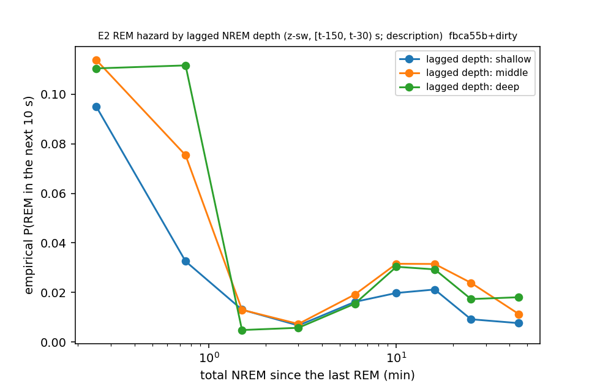
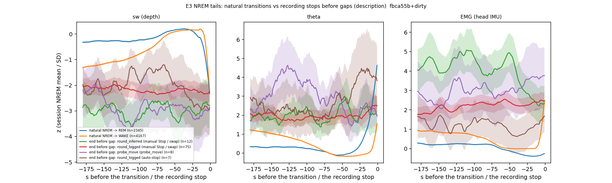

# Internal sleep schedule — Phase 2b: effect sizes, NREM depth, NREM tails, morning vs evening (cohort 2026c)

Plan: [2026-10-07-sleep-internal-schedule.md](../../../../implementation_plan/2026-10-07-sleep-internal-schedule.md) (Amendment 3). Driver `ephys/sleep_schedule.py phase2b` → `ephys/sleep_schedule_phase2b.py` (commit fbca55b+dirty); bulk `D:\Field2026_analysis_out\2026c\sleep_schedule_phase2b_20261007_2203`. **Technical ledger; no claim audit yet.**

## Definitions

```
Phase 2b of the internal-schedule analysis: the user's follow-up questions on Phase 2 (plan Amendment 3).
Called by `python ephys/sleep_schedule.py phase2b`. Reads the Phase-1 / Phase-2 run folders (manifests) for the saved
per-bout predictions and compensation windows; recomputes what it needs from the FINAL 1-s states and metrics.

Definitions (FINAL 1-s states + the scorer's per-second metrics sw, th, emg in the same npz; field-PC time):
  z-metrics      per session, each metric (sw = -IRASA slope 4-90 Hz, the scorer's slow-wave / depth measure; th =
                 theta ratio; emg = head-IMU VeDBA) is z-scored with the mean and SD of that session's NREM seconds, so
                 sessions with different probe positions / thresholds become comparable. NOTE: the scorer defines NREM
                 by sw above a threshold (15-s smoothing), so sw right before a transition is partly the transition's
                 own definition; depth used as a predictor is therefore lagged (below).
  E1 effect size per held-out NREM bout with an observed end, the model's probability that the bout ends in REM (pi, from
                 the Phase-1 / Phase-2 opportunity split); bouts pooled over folds and cut into deciles of pi; reported:
                 the share of bouts that actually ended in REM per decile (top vs bottom), for the model without and with
                 history (Phase 1 M0 vs M2; Phase 2 B1 R0 vs C1).
  E2 depth       (a) long wakes (>= 7 min, as B1b): depth = mean z-sw over the first 120 s of NREM after the wake;
                 OLS depth ~ ln d + phase + animal, then ln|N|_1 ~ ln d + depth + ln(1+N_pre) + anchor + phase + animal
                 (SEs clustered by block): is post-wake NREM deeper after longer wakes, and does the wake-length effect
                 remain with depth controlled?
                 (b) the REM hazard: lagged depth z_sw_lag = mean z-sw over the NREM seconds in [t-150, t-30) s before
                 each 10-s step; held-out comparison M2t vs M2t + [z_sw_lag] (forward chaining), and the empirical REM
                 hazard against total NREM since the last REM per tertile of z_sw_lag (description).
  E3 tails       z-metric traces over the 180 s before: natural NREM -> WAKE and NREM -> REM transitions (>= 60 s NREM
                 before, >= 180 s after the session start), and the END of the last session before a usable gap
                 (Phase-0 gaps; the logger's Record Stop or auto-stop), split by gap cause and by how the cell ended.
                 Reported: mean +- SEM traces, the state in the last second, NREM share of the last 60 s.
  E4 circadian   the across-gap compensation slopes (Phase-2 C1 windows, both scorings) split by morning vs evening rounds.
```

## E1 Effect size on an interpretable scale

Share of held-out NREM bouts that actually ended in REM, among the 10 % the model rated least vs most likely to end in REM.

| source | model | bouts | obs_REM_share_bottom_decile | obs_REM_share_top_decile | pred_pi_bottom | pred_pi_top | pi_p10 | pi_p90 | overall_REM_share |
|---|---|---|---|---|---|---|---|---|---|
| Phase 1, all NREM bouts | M0 | 7333 | 0.113 | 0.522 | 0.089 | 0.518 | 0.153 | 0.487 | 0.353 |
| Phase 1, all NREM bouts | M2 | 7333 | 0.041 | 0.672 | 0.045 | 0.652 | 0.083 | 0.606 | 0.353 |
| Phase 2 B1, post-wake bouts | R0 | 6485 | 0.04 | 0.558 | 0.042 | 0.528 | 0.085 | 0.485 | 0.315 |
| Phase 2 B1, post-wake bouts | C1 | 6485 | 0.04 | 0.579 | 0.034 | 0.566 | 0.069 | 0.516 | 0.315 |

## E2 NREM depth

(a) Long wakes (≥ 7 min): is post-wake NREM deeper after longer wakes, and does the wake-length effect on the NREM before the first REM survive with depth controlled?

| model | term | coef | se | p | n |
|---|---|---|---|---|---|
| depth ~ ln d | l_d | 0.0692 | 0.0487 | 0.155 | 311 |
| ln|N|_1 ~ ln d (+ N_pre, phase, animal) | l_d | 0.2494 | 0.0609 | 0.0 | 311 |
| ln|N|_1 ~ ln d + depth (+ same) | l_d | 0.2504 | 0.0612 | 0.0 | 311 |
| ln|N|_1 ~ ln d + depth (+ same) | depth | -0.0142 | 0.0655 | 0.828 | 311 |

(b) REM hazard: does lagged depth add held-out prediction beyond the running since-REM clock?

| comparison | subset | n_steps | n_rem | delta_pct | ci_lo_pct | ci_hi_pct | folds_better | folds | animals_better | animals | holds |
|---|---|---|---|---|---|---|---|---|---|---|---|
| M2t_depth vs M2t | NREM steps with >= 20 s of NREM in the lag window | 117798 | 2283 | -0.218 | -0.329 | -0.101 | 12 | 15 | 6 | 6 | True |



## E3 NREM tails: natural transitions vs the recording stop before a gap

States and z-metrics in the 180 s before the event. A battery-round stop is a BLE Record Stop (or an auto-stop) before the animal is caught, so its tail shows the state the round interrupted.

| class | n | animals | last_second_NREM | last_second_WAKE | last_second_REM | nrem_share_last_60s | sw_mean_last_30s | sw_mean_-180_-120s | th_mean_last_30s | th_mean_-180_-120s | emg_mean_last_30s | emg_mean_-180_-120s |
|---|---|---|---|---|---|---|---|---|---|---|---|---|
| end before gap: no_handling_recorded (no_handling_recorded) | 2 | 2 | 0.5 | 0.5 | 0.0 | 0.392 | -2.249 | -3.382 | 2.39 | 6.023 | 2.994 | 3.773 |
| end before gap: probe_move (probe_move) | 8 | 4 | 0.5 | 0.5 | 0.0 | 0.542 | -3.14 | -2.619 | 2.289 | 3.366 | 3.641 | 2.685 |
| end before gap: round_inferred (manual Stop / swap) | 12 | 6 | 0.5 | 0.417 | 0.083 | 0.4 | -2.915 | -2.941 | 2.107 | 1.877 | 2.534 | 4.342 |
| end before gap: round_logged (auto-stop) | 7 | 4 | 0.429 | 0.429 | 0.143 | 0.531 | -2.793 | -2.138 | 4.193 | 2.414 | 1.179 | 1.296 |
| end before gap: round_logged (manual Stop / swap) | 75 | 6 | 0.533 | 0.333 | 0.133 | 0.589 | -2.249 | -2.064 | 2.177 | 1.953 | 2.363 | 1.961 |
| natural NREM -> REM | 2345 | 6 | 1.0 | 0.0 | 0.0 | 1.0 | -0.448 | -0.279 | 1.662 | 0.315 | -0.354 | 0.23 |
| natural NREM -> WAKE | 4167 | 6 | 1.0 | 0.0 | 0.0 | 1.0 | -0.178 | -1.162 | 0.184 | 1.026 | 0.389 | 0.864 |



## E4 Compensation across battery rounds: morning vs evening

Across-gap windows of all battery rounds (logged + inferred), split by the round's kind; both scorings.

| scores | setting | B_h | outcome | predictor | n_windows | slope | ci_lo | ci_hi | p | animals_positive | animals | mean_debt | mean_payback |
|---|---|---|---|---|---|---|---|---|---|---|---|---|---|
| FINAL | across gap evening | 1 | pay_rem | debt_rem | 44 | 0.06 | -0.037 | 0.158 | 0.225 | 2 | 3 | -3.867 | -0.783 |
| FINAL | across gap evening | 1 | pay_rem_n | debt_rem | 44 | 0.04 | -0.05 | 0.13 | 0.382 | 1 | 3 | -3.867 | -0.662 |
| FINAL | across gap evening | 1 | pay_nrem | debt_nrem | 44 | 0.273 | 0.116 | 0.431 | 0.001 | 3 | 3 | -11.692 | -5.348 |
| FINAL | across gap evening | 3 | pay_rem | debt_rem | 44 | 0.05 | -0.045 | 0.146 | 0.299 | 2 | 3 | -3.867 | -2.014 |
| FINAL | across gap evening | 3 | pay_rem_n | debt_rem | 44 | 0.041 | -0.044 | 0.126 | 0.346 | 1 | 3 | -3.867 | -1.933 |
| FINAL | across gap evening | 3 | pay_nrem | debt_nrem | 44 | 0.02 | -0.242 | 0.282 | 0.882 | 2 | 3 | -11.692 | -17.924 |
| FINAL | across gap morning | 1 | pay_rem | debt_rem | 49 | 0.183 | -0.011 | 0.377 | 0.065 | 4 | 4 | 0.24 | -2.04 |
| FINAL | across gap morning | 1 | pay_rem_n | debt_rem | 49 | 0.123 | -0.05 | 0.297 | 0.164 | 3 | 4 | 0.24 | -1.66 |
| FINAL | across gap morning | 1 | pay_nrem | debt_nrem | 49 | 0.151 | 0.059 | 0.243 | 0.001 | 4 | 4 | -3.244 | -3.07 |
| FINAL | across gap morning | 3 | pay_rem | debt_rem | 49 | 0.486 | -0.129 | 1.102 | 0.122 | 3 | 4 | 0.24 | 0.171 |
| FINAL | across gap morning | 3 | pay_rem_n | debt_rem | 49 | 0.359 | -0.17 | 0.888 | 0.183 | 3 | 4 | 0.24 | 0.201 |
| FINAL | across gap morning | 3 | pay_nrem | debt_nrem | 49 | 0.302 | 0.085 | 0.519 | 0.006 | 4 | 4 | -3.244 | 0.701 |
| pass2med_remclean | across gap evening | 1 | pay_rem | debt_rem | 44 | 0.06 | -0.032 | 0.153 | 0.201 | 3 | 3 | -2.761 | -0.717 |
| pass2med_remclean | across gap evening | 1 | pay_rem_n | debt_rem | 44 | 0.053 | -0.034 | 0.14 | 0.231 | 3 | 3 | -2.761 | -0.679 |
| pass2med_remclean | across gap evening | 1 | pay_nrem | debt_nrem | 44 | 0.302 | 0.051 | 0.554 | 0.018 | 3 | 3 | -11.885 | -4.78 |
| pass2med_remclean | across gap evening | 3 | pay_rem | debt_rem | 44 | 0.067 | -0.046 | 0.181 | 0.246 | 3 | 3 | -2.761 | -2.001 |
| pass2med_remclean | across gap evening | 3 | pay_rem_n | debt_rem | 44 | 0.054 | -0.053 | 0.161 | 0.322 | 3 | 3 | -2.761 | -2.128 |
| pass2med_remclean | across gap evening | 3 | pay_nrem | debt_nrem | 44 | -0.07 | -0.307 | 0.167 | 0.562 | 2 | 3 | -11.885 | -17.796 |
| pass2med_remclean | across gap morning | 1 | pay_rem | debt_rem | 49 | 0.386 | 0.249 | 0.524 | 0.0 | 4 | 4 | -0.551 | -2.523 |
| pass2med_remclean | across gap morning | 1 | pay_rem_n | debt_rem | 49 | 0.229 | 0.155 | 0.303 | 0.0 | 4 | 4 | -0.551 | -2.111 |
| pass2med_remclean | across gap morning | 1 | pay_nrem | debt_nrem | 49 | 0.17 | 0.097 | 0.244 | 0.0 | 4 | 4 | -4.762 | -3.962 |
| pass2med_remclean | across gap morning | 3 | pay_rem | debt_rem | 49 | 0.717 | 0.542 | 0.891 | 0.0 | 3 | 4 | -0.551 | -0.924 |
| pass2med_remclean | across gap morning | 3 | pay_rem_n | debt_rem | 49 | 0.395 | 0.24 | 0.551 | 0.0 | 3 | 4 | -0.551 | -0.66 |
| pass2med_remclean | across gap morning | 3 | pay_nrem | debt_nrem | 49 | 0.405 | 0.223 | 0.587 | 0.0 | 4 | 4 | -4.762 | -0.795 |

