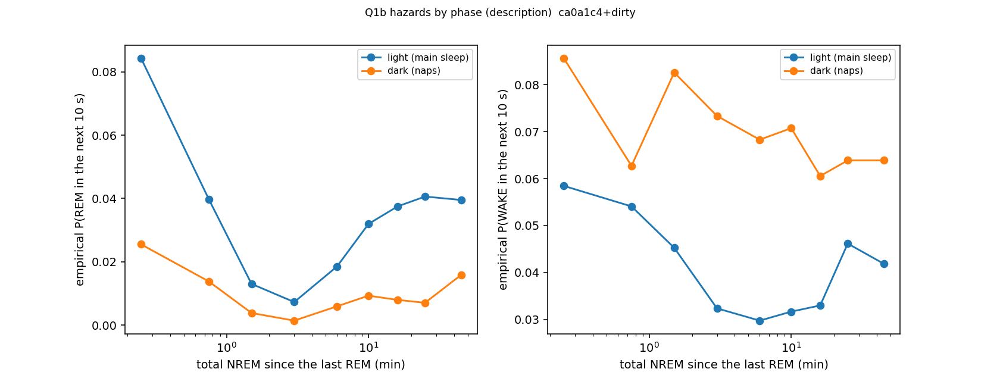
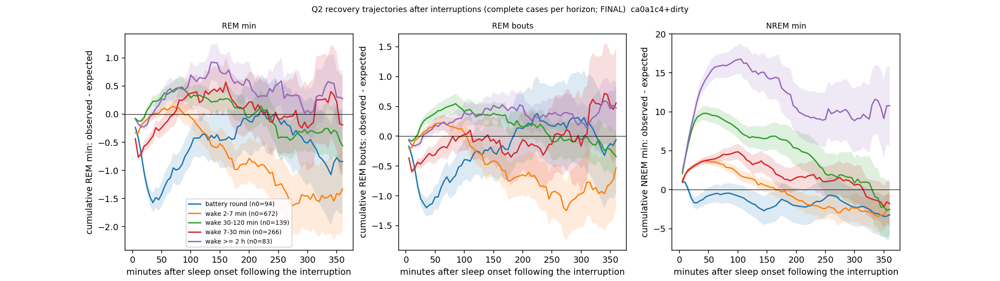

# Internal sleep schedule — Phase 3: the 24/7 record — naps vs day sleep, recovery after interruptions, fragmentation (cohort 2026c)

Plan: [2026-10-07-sleep-internal-schedule.md](../../../../implementation_plan/2026-10-07-sleep-internal-schedule.md) (Amendment 4). Driver `ephys/sleep_schedule.py phase3` → `ephys/sleep_schedule_phase3.py` (commit ca0a1c4+dirty); bulk `D:\Field2026_analysis_out\2026c\sleep_schedule_phase3_20261007_2304`. **Technical ledger; no claim audit yet.**

## Definitions

```
Phase 3 of the internal-schedule analysis: the 24/7 record (plan Amendment 4).
Called by `python ephys/sleep_schedule.py phase3 [--parts q1 q2 q3]`.

Definitions (FINAL 1-s states + per-second z-metrics as Phase 2b; field-PC time; light = sunrise..sunset, NOAA times):
  episode        a maximal stretch of a record with no wake bout > 120 s and no unknown epoch, trimmed to its first and
                 last sleep epoch (Watson-2016 SLEEP rule); SLEEP = >= 20 min, short nap = 5-20 min. Phase of an episode
                 = dark / light at its onset. "Naps" = dark-phase episodes (the rats' main sleep is the light phase).
  per episode    duration; NREM, REM s; REM bouts (n, durations); latency from onset to the first REM onset (censored
                 at the episode end); REM-onset-to-onset intervals; sequential share = intervals whose NREM + MA (< 40 s)
                 content <= 135 s (the v1 two-Gaussian split); pre-episode wake (the wake bout ending at the onset); mean
                 z-theta, z-SW, z-EMG over the episode's REM seconds.
  Q1a            per animal: means by phase; dark - light per animal (6/6 sign); episode-level mixed model
                 outcome ~ dark + ln(duration) (+ animal random intercept). Latency: Kaplan-Meier median per phase.
  Q1b            held out (forward chaining, as Phase 2): M2t vs M2t + dark x [spline ln(1+NREM since REM, running),
                 ln(1+W_since), ln REM_pre]; and the empirical REM hazard against the running NREM since REM by phase.
  Q1c            REM-onset tails (180 s before natural NREM -> REM) by phase: z-theta, z-SW, z-EMG.
  Q1d            24-h budget: per animal and night (sunset d -> sunrise d+1) and the following day (-> sunset d+1),
                 REM observed - expected (min per recorded hour; C1 baselines, >= 50 % recorded); slope of the day
                 deviation on the night deviation (and day d -> night d), per-animal signs.
  Q2             events = natural wakes >= 120 s followed by NREM inside a record, and battery-round gaps (Phase-0
                 usable gaps with cause round_*; t0 = the first NREM onset after the gap). From t0 the record is
                 followed up to 6 h (censored at its end): cumulative NREM s, REM s, REM onsets, observed - expected
                 (C1 baselines per second of recorded time) at horizons 5 .. 360 min; first-REM survival (Kaplan-Meier,
                 censored). Classes: wake 2-7, 7-30, 30-120 min, >= 2 h, battery round; pre-wake REM debt = expected -
                 observed REM over the 3 h before the wake (>= 80 % recorded). At h = 60, 180, 360 min (complete cases):
                 OLS excess ~ ln d + dark + debt + animal, SEs clustered by block, plus per-animal fits (sign counts:
                 with ~22 blocks the clustered SEs are fragile, and long horizons keep only events early in a record;
                 the synthetic smoke test gave a spurious ln d effect at 360 min). Repeated on pass2med_remclean.
  Q3             fragmentation at an NREM bout start: frag60 = wake bouts >= 40 s ending in the previous 60 min; totals
                 held by w60 = wake share of recorded time in the same 60 min. Held out: M2t + w60 vs + frag60.
```

## Q1 Night naps vs day sleep

(a) Episode structure and REM physiology (dark − light; mixed model with ln(duration), animal random intercept; per-animal signs):

| episodes | outcome | light_mean | dark_mean | animals_dark_higher | animals | n_light | n_dark | dark_coef | dark_ci_lo | dark_ci_hi | dark_p |
|---|---|---|---|---|---|---|---|---|---|---|---|
| SLEEP >= 20 min | rem_share | 0.174 | 0.068 | 0.0 | 6.0 | 411.0 | 144.0 | -0.098 | -0.109 | -0.086 | 0.0 |
| SLEEP >= 20 min | rem_per_h_nrem | 11.41 | 4.035 | 0.0 | 6.0 | 411.0 | 144.0 | -6.886 | -7.861 | -5.912 | 0.0 |
| SLEEP >= 20 min | rem_dur_mean | 73.846 | 71.447 | 3.0 | 6.0 | 411.0 | 144.0 | -3.778 | -9.902 | 2.346 | 0.227 |
| SLEEP >= 20 min | ioi_median | 352.158 | 565.691 | 6.0 | 6.0 | 411.0 | 144.0 | 203.328 | 135.847 | 270.809 | 0.0 |
| SLEEP >= 20 min | seq_share | 0.458 | 0.373 | 1.0 | 6.0 | 411.0 | 144.0 | -0.078 | -0.144 | -0.013 | 0.019 |
| SLEEP >= 20 min | pre_wake_s | 385.818 | 4043.685 | 6.0 | 6.0 | 411.0 | 144.0 | 3627.884 | 3161.106 | 4094.662 | 0.0 |
| SLEEP >= 20 min | rem_z_th | 7.081 | 9.855 | 6.0 | 6.0 | 411.0 | 144.0 | 2.42 | 2.042 | 2.798 | 0.0 |
| SLEEP >= 20 min | rem_z_sw | -4.629 | -5.435 | 0.0 | 6.0 | 411.0 | 144.0 | -0.7 | -0.957 | -0.444 | 0.0 |
| SLEEP >= 20 min | rem_z_emg | 0.163 | -0.179 | 0.0 | 6.0 | 411.0 | 144.0 | -0.343 | -0.442 | -0.244 | 0.0 |
| SLEEP >= 20 min | dur_s | 3973.798 | 2405.917 | 0.0 | 6.0 | 411.0 | 144.0 | nan | nan | nan | nan |
| SLEEP >= 20 min | KM median latency to first REM (s), light | 610.0 | nan | nan | nan | 411.0 | nan | nan | nan | nan | nan |
| SLEEP >= 20 min | KM median latency to first REM (s), dark | nan | 1229.0 | nan | nan | nan | 144.0 | nan | nan | nan | nan |
| all >= 5 min | rem_share | 0.149 | 0.048 | 0.0 | 6.0 | 678.0 | 307.0 | -0.087 | -0.098 | -0.075 | 0.0 |
| all >= 5 min | rem_per_h_nrem | 10.414 | 2.851 | 0.0 | 6.0 | 678.0 | 307.0 | -6.949 | -7.956 | -5.942 | 0.0 |
| all >= 5 min | rem_dur_mean | 71.161 | 72.204 | 3.0 | 6.0 | 678.0 | 307.0 | 0.605 | -5.626 | 6.837 | 0.849 |
| all >= 5 min | ioi_median | 324.665 | 528.067 | 6.0 | 6.0 | 678.0 | 307.0 | 205.326 | 143.798 | 266.854 | 0.0 |
| all >= 5 min | seq_share | 0.503 | 0.407 | 2.0 | 6.0 | 678.0 | 307.0 | -0.102 | -0.17 | -0.033 | 0.004 |
| all >= 5 min | pre_wake_s | 367.036 | 3577.293 | 6.0 | 6.0 | 678.0 | 307.0 | 3251.982 | 2906.252 | 3597.712 | 0.0 |
| all >= 5 min | rem_z_th | 7.219 | 10.126 | 6.0 | 6.0 | 678.0 | 307.0 | 2.764 | 2.427 | 3.1 | 0.0 |
| all >= 5 min | rem_z_sw | -4.73 | -5.761 | 0.0 | 6.0 | 678.0 | 307.0 | -1.025 | -1.263 | -0.787 | 0.0 |
| all >= 5 min | rem_z_emg | 0.191 | -0.107 | 0.0 | 6.0 | 678.0 | 307.0 | -0.283 | -0.387 | -0.179 | 0.0 |
| all >= 5 min | dur_s | 2687.993 | 1497.088 | 0.0 | 6.0 | 678.0 | 307.0 | nan | nan | nan | nan |
| all >= 5 min | KM median latency to first REM (s), light | 578.0 | nan | nan | nan | 678.0 | nan | nan | nan | nan | nan |
| all >= 5 min | KM median latency to first REM (s), dark | nan | 1212.0 | nan | nan | nan | 307.0 | nan | nan | nan | nan |

(b) Do the REM-entry rules differ at night? Held out:

| comparison | subset | n_steps | n_rem | delta_pct | ci_lo_pct | ci_hi_pct | folds_better | folds | animals_better | animals | holds |
|---|---|---|---|---|---|---|---|---|---|---|---|
| M2t_dark vs M2t | all NREM steps | 126200 | 2588 | -0.125 | -0.282 | -0.021 | 13 | 15 | 5 | 6 | True |



(c) REM-onset tails by phase (z, last 30 s before REM):

| phase | n | sw_last30 | th_last30 | emg_last30 |
|---|---|---|---|---|
| light | 2172 | -0.458 | 1.634 | -0.346 |
| dark | 173 | -0.324 | 2.005 | -0.451 |

(d) 24-h budget (REM deviation, min per recorded hour):

| predictor | outcome | n_animal_days | slope | ci_lo | ci_hi | p | animals_positive | animals |
|---|---|---|---|---|---|---|---|---|
| night_dev | day_after_dev | 56 | -0.977 | -1.444 | -0.51 | 0.0 | 2 | 6 |
| day_before_dev | night_dev | 50 | -0.017 | -0.089 | 0.056 | 0.654 | 3 | 6 |

## Q2 Recovery trajectories after interruptions

Excess = observed − expected cumulative quantity since the sleep onset after the interruption (complete cases at each horizon; records end at the battery rounds, so long horizons hold fewer events).



Selected horizons (60 / 180 / 360 min) and first-REM survival:

| scores | cls | h_min | quantity | n | excess_mean | excess_se | observed_mean | expected_mean | km_median_first_rem_min | share_no_rem_within_6h_or_followup | dark_share |
|---|---|---|---|---|---|---|---|---|---|---|---|
| FINAL | battery round | 60.0 | REM min | 94 | -1.179 | 0.239 | 3.128 | 4.307 | nan | nan | nan |
| FINAL | battery round | 60.0 | NREM min | 94 | -0.528 | 1.123 | 25.62 | 26.148 | nan | nan | nan |
| FINAL | battery round | 60.0 | REM bouts | 94 | -0.867 | 0.227 | 2.809 | 3.675 | nan | nan | nan |
| FINAL | battery round | 180.0 | REM min | 94 | -0.223 | 0.538 | 13.181 | 13.404 | nan | nan | nan |
| FINAL | battery round | 180.0 | NREM min | 94 | -1.389 | 2.155 | 77.1 | 78.489 | nan | nan | nan |
| FINAL | battery round | 180.0 | REM bouts | 94 | -0.081 | 0.528 | 11.138 | 11.22 | nan | nan | nan |
| FINAL | battery round | 360.0 | REM min | 88 | -0.842 | 0.936 | 26.584 | 27.426 | nan | nan | nan |
| FINAL | battery round | 360.0 | NREM min | 88 | -3.226 | 2.743 | 147.185 | 150.411 | nan | nan | nan |
| FINAL | battery round | 360.0 | REM bouts | 88 | -0.058 | 0.91 | 22.864 | 22.922 | nan | nan | nan |
| FINAL | wake 2-7 min | 60.0 | REM min | 562 | 0.071 | 0.131 | 6.307 | 6.236 | nan | nan | nan |
| FINAL | wake 2-7 min | 60.0 | NREM min | 562 | 3.576 | 0.441 | 34.434 | 30.858 | nan | nan | nan |
| FINAL | wake 2-7 min | 60.0 | REM bouts | 562 | 0.221 | 0.122 | 5.651 | 5.43 | nan | nan | nan |
| FINAL | wake 2-7 min | 180.0 | REM min | 372 | -0.984 | 0.346 | 18.41 | 19.393 | nan | nan | nan |
| FINAL | wake 2-7 min | 180.0 | NREM min | 372 | -0.15 | 1.024 | 92.937 | 93.087 | nan | nan | nan |
| FINAL | wake 2-7 min | 180.0 | REM bouts | 372 | -0.738 | 0.312 | 16.134 | 16.873 | nan | nan | nan |
| FINAL | wake 2-7 min | 360.0 | REM min | 188 | -1.331 | 0.737 | 33.007 | 34.338 | nan | nan | nan |
| FINAL | wake 2-7 min | 360.0 | NREM min | 188 | -2.529 | 2.164 | 166.135 | 168.664 | nan | nan | nan |
| FINAL | wake 2-7 min | 360.0 | REM bouts | 188 | -0.527 | 0.672 | 29.005 | 29.533 | nan | nan | nan |
| FINAL | wake 30-120 min | 60.0 | REM min | 134 | 0.354 | 0.143 | 1.283 | 0.928 | nan | nan | nan |
| FINAL | wake 30-120 min | 60.0 | NREM min | 134 | 9.515 | 1.006 | 20.503 | 10.988 | nan | nan | nan |
| FINAL | wake 30-120 min | 60.0 | REM bouts | 134 | 0.433 | 0.137 | 1.179 | 0.746 | nan | nan | nan |
| FINAL | wake 30-120 min | 180.0 | REM min | 107 | 0.114 | 0.232 | 2.797 | 2.683 | nan | nan | nan |
| FINAL | wake 30-120 min | 180.0 | NREM min | 107 | 6.392 | 1.973 | 38.673 | 32.28 | nan | nan | nan |
| FINAL | wake 30-120 min | 180.0 | REM bouts | 107 | 0.226 | 0.202 | 2.393 | 2.166 | nan | nan | nan |
| FINAL | wake 30-120 min | 360.0 | REM min | 62 | -0.566 | 0.496 | 6.806 | 7.372 | nan | nan | nan |
| FINAL | wake 30-120 min | 360.0 | NREM min | 62 | -2.553 | 3.821 | 72.183 | 74.736 | nan | nan | nan |
| FINAL | wake 30-120 min | 360.0 | REM bouts | 62 | -0.343 | 0.412 | 5.677 | 6.021 | nan | nan | nan |
| FINAL | wake 7-30 min | 60.0 | REM min | 219 | -0.123 | 0.187 | 5.779 | 5.901 | nan | nan | nan |
| FINAL | wake 7-30 min | 60.0 | NREM min | 219 | 3.955 | 0.644 | 33.774 | 29.819 | nan | nan | nan |
| FINAL | wake 7-30 min | 60.0 | REM bouts | 219 | -0.193 | 0.173 | 4.932 | 5.125 | nan | nan | nan |
| FINAL | wake 7-30 min | 180.0 | REM min | 165 | 0.13 | 0.487 | 18.454 | 18.325 | nan | nan | nan |
| FINAL | wake 7-30 min | 180.0 | NREM min | 165 | 1.333 | 1.557 | 91.555 | 90.221 | nan | nan | nan |
| FINAL | wake 7-30 min | 180.0 | REM bouts | 165 | -0.351 | 0.466 | 15.479 | 15.83 | nan | nan | nan |
| FINAL | wake 7-30 min | 360.0 | REM min | 102 | -0.19 | 0.886 | 32.183 | 32.373 | nan | nan | nan |
| FINAL | wake 7-30 min | 360.0 | NREM min | 102 | -1.795 | 2.739 | 161.04 | 162.835 | nan | nan | nan |
| FINAL | wake 7-30 min | 360.0 | REM bouts | 102 | 0.558 | 0.91 | 28.147 | 27.59 | nan | nan | nan |
| FINAL | wake >= 2 h | 60.0 | REM min | 72 | 0.414 | 0.188 | 1.429 | 1.015 | nan | nan | nan |
| FINAL | wake >= 2 h | 60.0 | NREM min | 72 | 15.724 | 1.451 | 28.255 | 12.531 | nan | nan | nan |
| FINAL | wake >= 2 h | 60.0 | REM bouts | 72 | 0.211 | 0.13 | 1.056 | 0.844 | nan | nan | nan |
| FINAL | wake >= 2 h | 180.0 | REM min | 50 | 0.583 | 0.359 | 2.197 | 1.614 | nan | nan | nan |
| FINAL | wake >= 2 h | 180.0 | NREM min | 50 | 12.689 | 3.188 | 40.589 | 27.9 | nan | nan | nan |
| FINAL | wake >= 2 h | 180.0 | REM bouts | 50 | 0.485 | 0.277 | 1.9 | 1.415 | nan | nan | nan |
| FINAL | wake >= 2 h | 360.0 | REM min | 30 | 0.277 | 0.508 | 2.695 | 2.418 | nan | nan | nan |
| FINAL | wake >= 2 h | 360.0 | NREM min | 30 | 10.788 | 5.106 | 62.244 | 51.456 | nan | nan | nan |
| FINAL | wake >= 2 h | 360.0 | REM bouts | 30 | 0.472 | 0.436 | 2.567 | 2.095 | nan | nan | nan |
| FINAL | battery round | nan | first-REM survival | 94 | nan | nan | nan | nan | 34.267 | 0.043 | 0.213 |
| FINAL | wake 2-7 min | nan | first-REM survival | 682 | nan | nan | nan | nan | 10.633 | 0.065 | 0.239 |
| FINAL | wake 30-120 min | nan | first-REM survival | 139 | nan | nan | nan | nan | 52.117 | 0.094 | 0.942 |
| FINAL | wake 7-30 min | nan | first-REM survival | 270 | nan | nan | nan | nan | 15.15 | 0.126 | 0.252 |
| FINAL | wake >= 2 h | nan | first-REM survival | 83 | nan | nan | nan | nan | 37.867 | 0.108 | 1.0 |
| pass2med_remclean | battery round | 60.0 | REM min | 94 | -1.44 | 0.239 | 3.173 | 4.613 | nan | nan | nan |
| pass2med_remclean | battery round | 60.0 | NREM min | 94 | -1.532 | 0.993 | 25.406 | 26.937 | nan | nan | nan |
| pass2med_remclean | battery round | 60.0 | REM bouts | 94 | -1.189 | 0.224 | 2.851 | 4.04 | nan | nan | nan |
| pass2med_remclean | battery round | 180.0 | REM min | 94 | -0.943 | 0.476 | 13.045 | 13.988 | nan | nan | nan |
| pass2med_remclean | battery round | 180.0 | NREM min | 94 | -3.698 | 2.023 | 76.799 | 80.497 | nan | nan | nan |
| pass2med_remclean | battery round | 180.0 | REM bouts | 94 | -0.764 | 0.469 | 11.245 | 12.009 | nan | nan | nan |
| pass2med_remclean | battery round | 360.0 | REM min | 88 | -1.176 | 0.759 | 26.889 | 28.065 | nan | nan | nan |
| pass2med_remclean | battery round | 360.0 | NREM min | 88 | -4.095 | 2.511 | 149.012 | 153.107 | nan | nan | nan |
| pass2med_remclean | battery round | 360.0 | REM bouts | 88 | -0.784 | 0.701 | 23.057 | 23.841 | nan | nan | nan |
| pass2med_remclean | wake 2-7 min | 60.0 | REM min | 473 | 0.129 | 0.126 | 6.729 | 6.6 | nan | nan | nan |
| pass2med_remclean | wake 2-7 min | 60.0 | NREM min | 473 | 3.907 | 0.451 | 35.878 | 31.97 | nan | nan | nan |
| pass2med_remclean | wake 2-7 min | 60.0 | REM bouts | 473 | 0.289 | 0.124 | 6.066 | 5.776 | nan | nan | nan |
| pass2med_remclean | wake 2-7 min | 180.0 | REM min | 319 | -0.452 | 0.292 | 20.186 | 20.638 | nan | nan | nan |
| pass2med_remclean | wake 2-7 min | 180.0 | NREM min | 319 | 1.292 | 0.979 | 98.356 | 97.065 | nan | nan | nan |
| pass2med_remclean | wake 2-7 min | 180.0 | REM bouts | 319 | 0.131 | 0.286 | 18.235 | 18.105 | nan | nan | nan |
| pass2med_remclean | wake 2-7 min | 360.0 | REM min | 169 | -0.487 | 0.562 | 36.634 | 37.121 | nan | nan | nan |
| pass2med_remclean | wake 2-7 min | 360.0 | NREM min | 169 | 1.071 | 1.888 | 180.501 | 179.431 | nan | nan | nan |
| pass2med_remclean | wake 2-7 min | 360.0 | REM bouts | 169 | 0.596 | 0.513 | 33.059 | 32.463 | nan | nan | nan |
| pass2med_remclean | wake 30-120 min | 60.0 | REM min | 156 | 0.26 | 0.126 | 1.263 | 1.003 | nan | nan | nan |
| pass2med_remclean | wake 30-120 min | 60.0 | NREM min | 156 | 9.046 | 1.02 | 21.138 | 12.092 | nan | nan | nan |
| pass2med_remclean | wake 30-120 min | 60.0 | REM bouts | 156 | 0.365 | 0.13 | 1.269 | 0.904 | nan | nan | nan |
| pass2med_remclean | wake 30-120 min | 180.0 | REM min | 127 | 0.021 | 0.228 | 3.007 | 2.986 | nan | nan | nan |
| pass2med_remclean | wake 30-120 min | 180.0 | NREM min | 127 | 5.374 | 2.076 | 41.722 | 36.348 | nan | nan | nan |
| pass2med_remclean | wake 30-120 min | 180.0 | REM bouts | 127 | 0.157 | 0.239 | 2.85 | 2.693 | nan | nan | nan |
| pass2med_remclean | wake 30-120 min | 360.0 | REM min | 71 | -0.639 | 0.383 | 7.526 | 8.164 | nan | nan | nan |
| pass2med_remclean | wake 30-120 min | 360.0 | NREM min | 71 | -2.115 | 3.637 | 78.684 | 80.799 | nan | nan | nan |
| pass2med_remclean | wake 30-120 min | 360.0 | REM bouts | 71 | -0.442 | 0.345 | 6.789 | 7.23 | nan | nan | nan |
| pass2med_remclean | wake 7-30 min | 60.0 | REM min | 227 | -0.073 | 0.153 | 5.781 | 5.855 | nan | nan | nan |
| pass2med_remclean | wake 7-30 min | 60.0 | NREM min | 227 | 5.134 | 0.635 | 34.642 | 29.507 | nan | nan | nan |
| pass2med_remclean | wake 7-30 min | 60.0 | REM bouts | 227 | -0.134 | 0.156 | 5.119 | 5.253 | nan | nan | nan |
| pass2med_remclean | wake 7-30 min | 180.0 | REM min | 169 | 0.168 | 0.359 | 18.049 | 17.881 | nan | nan | nan |
| pass2med_remclean | wake 7-30 min | 180.0 | NREM min | 169 | 4.207 | 1.471 | 92.816 | 88.61 | nan | nan | nan |
| pass2med_remclean | wake 7-30 min | 180.0 | REM bouts | 169 | 0.117 | 0.365 | 16.047 | 15.931 | nan | nan | nan |
| pass2med_remclean | wake 7-30 min | 360.0 | REM min | 101 | 0.016 | 0.703 | 31.565 | 31.549 | nan | nan | nan |
| pass2med_remclean | wake 7-30 min | 360.0 | NREM min | 101 | 3.334 | 3.115 | 165.099 | 161.765 | nan | nan | nan |
| pass2med_remclean | wake 7-30 min | 360.0 | REM bouts | 101 | 0.59 | 0.672 | 28.149 | 27.559 | nan | nan | nan |
| pass2med_remclean | wake >= 2 h | 60.0 | REM min | 70 | 0.4 | 0.189 | 1.514 | 1.114 | nan | nan | nan |
| pass2med_remclean | wake >= 2 h | 60.0 | NREM min | 70 | 16.372 | 1.462 | 29.875 | 13.503 | nan | nan | nan |
| pass2med_remclean | wake >= 2 h | 60.0 | REM bouts | 70 | 0.36 | 0.131 | 1.343 | 0.983 | nan | nan | nan |
| pass2med_remclean | wake >= 2 h | 180.0 | REM min | 50 | 1.114 | 0.306 | 2.96 | 1.846 | nan | nan | nan |
| pass2med_remclean | wake >= 2 h | 180.0 | NREM min | 50 | 13.975 | 2.806 | 45.431 | 31.456 | nan | nan | nan |
| pass2med_remclean | wake >= 2 h | 180.0 | REM bouts | 50 | 0.989 | 0.281 | 2.76 | 1.771 | nan | nan | nan |
| pass2med_remclean | wake >= 2 h | 360.0 | REM min | 32 | 0.707 | 0.457 | 3.255 | 2.548 | nan | nan | nan |
| pass2med_remclean | wake >= 2 h | 360.0 | NREM min | 32 | 11.311 | 4.498 | 69.326 | 58.015 | nan | nan | nan |
| pass2med_remclean | wake >= 2 h | 360.0 | REM bouts | 32 | 0.708 | 0.423 | 3.281 | 2.573 | nan | nan | nan |
| pass2med_remclean | battery round | nan | first-REM survival | 94 | nan | nan | nan | nan | 31.533 | 0.011 | 0.213 |
| pass2med_remclean | wake 2-7 min | nan | first-REM survival | 567 | nan | nan | nan | nan | 10.583 | 0.037 | 0.231 |
| pass2med_remclean | wake 30-120 min | nan | first-REM survival | 160 | nan | nan | nan | nan | 48.283 | 0.062 | 0.95 |
| pass2med_remclean | wake 7-30 min | nan | first-REM survival | 280 | nan | nan | nan | nan | 15.333 | 0.089 | 0.271 |
| pass2med_remclean | wake >= 2 h | nan | first-REM survival | 80 | nan | nan | nan | nan | 29.367 | 0.037 | 1.0 |

Natural wakes, OLS of the excess at each horizon (ln wake length, dark, pre-wake REM debt; animal FE; SEs by block):

| scores | h_min | quantity | term | n | coef | ci_lo | ci_hi | p | animals_positive | animals |
|---|---|---|---|---|---|---|---|---|---|---|
| FINAL | 60 | REM min | l_d | 636 | -0.314 | -0.437 | -0.192 | 0.0 | 0 | 6 |
| FINAL | 60 | REM min | dark | 636 | 1.717 | 1.226 | 2.209 | 0.0 | 6 | 6 |
| FINAL | 60 | REM min | debt | 636 | -0.138 | -0.2 | -0.076 | 0.0 | 0 | 6 |
| FINAL | 60 | NREM min | l_d | 636 | 0.465 | -0.311 | 1.241 | 0.24 | 5 | 6 |
| FINAL | 60 | NREM min | dark | 636 | 9.538 | 6.434 | 12.642 | 0.0 | 6 | 6 |
| FINAL | 60 | NREM min | debt | 636 | 0.146 | -0.123 | 0.415 | 0.287 | 5 | 6 |
| FINAL | 60 | REM bouts | l_d | 636 | -0.296 | -0.406 | -0.186 | 0.0 | 0 | 6 |
| FINAL | 60 | REM bouts | dark | 636 | 1.392 | 0.672 | 2.112 | 0.0 | 5 | 6 |
| FINAL | 60 | REM bouts | debt | 636 | -0.083 | -0.154 | -0.013 | 0.02 | 1 | 6 |
| FINAL | 180 | REM min | l_d | 358 | -0.16 | -0.514 | 0.195 | 0.378 | 2 | 6 |
| FINAL | 180 | REM min | dark | 358 | 2.061 | 0.537 | 3.584 | 0.008 | 4 | 6 |
| FINAL | 180 | REM min | debt | 358 | -0.383 | -0.49 | -0.275 | 0.0 | 0 | 6 |
| FINAL | 180 | NREM min | l_d | 358 | -0.736 | -3.058 | 1.586 | 0.535 | 3 | 6 |
| FINAL | 180 | NREM min | dark | 358 | 10.16 | 0.959 | 19.362 | 0.03 | 3 | 6 |
| FINAL | 180 | NREM min | debt | 358 | 0.624 | -0.077 | 1.326 | 0.081 | 6 | 6 |
| FINAL | 180 | REM bouts | l_d | 358 | -0.287 | -0.58 | 0.006 | 0.055 | 1 | 6 |
| FINAL | 180 | REM bouts | dark | 358 | 2.663 | 1.154 | 4.172 | 0.001 | 4 | 6 |
| FINAL | 180 | REM bouts | debt | 358 | -0.239 | -0.377 | -0.101 | 0.001 | 3 | 6 |
| FINAL | 360 | REM min | l_d | 109 | -0.299 | -0.763 | 0.166 | 0.207 | 2 | 5 |
| FINAL | 360 | REM min | dark | 109 | 5.577 | 0.001 | 11.153 | 0.05 | 4 | 5 |
| FINAL | 360 | REM min | debt | 109 | -1.039 | -1.31 | -0.769 | 0.0 | 1 | 5 |
| FINAL | 360 | NREM min | l_d | 109 | -2.788 | -5.68 | 0.105 | 0.059 | 1 | 5 |
| FINAL | 360 | NREM min | dark | 109 | -1.431 | -21.016 | 18.153 | 0.886 | 2 | 5 |
| FINAL | 360 | NREM min | debt | 109 | -1.065 | -2.425 | 0.296 | 0.125 | 3 | 5 |
| FINAL | 360 | REM bouts | l_d | 109 | -0.188 | -0.668 | 0.293 | 0.444 | 2 | 5 |
| FINAL | 360 | REM bouts | dark | 109 | 2.719 | -0.901 | 6.339 | 0.141 | 3 | 5 |
| FINAL | 360 | REM bouts | debt | 109 | -1.108 | -1.426 | -0.79 | 0.0 | 1 | 5 |
| pass2med_remclean | 60 | REM min | l_d | 584 | -0.212 | -0.315 | -0.109 | 0.0 | 0 | 6 |
| pass2med_remclean | 60 | REM min | dark | 584 | 1.282 | 0.749 | 1.815 | 0.0 | 6 | 6 |
| pass2med_remclean | 60 | REM min | debt | 584 | -0.059 | -0.12 | 0.002 | 0.059 | 1 | 6 |
| pass2med_remclean | 60 | NREM min | l_d | 584 | 0.897 | -0.228 | 2.022 | 0.118 | 6 | 6 |
| pass2med_remclean | 60 | NREM min | dark | 584 | 7.97 | 4.992 | 10.948 | 0.0 | 5 | 6 |
| pass2med_remclean | 60 | NREM min | debt | 584 | 0.299 | 0.022 | 0.576 | 0.034 | 5 | 6 |
| pass2med_remclean | 60 | REM bouts | l_d | 584 | -0.165 | -0.277 | -0.053 | 0.004 | 0 | 6 |
| pass2med_remclean | 60 | REM bouts | dark | 584 | 1.062 | 0.498 | 1.627 | 0.0 | 6 | 6 |
| pass2med_remclean | 60 | REM bouts | debt | 584 | 0.005 | -0.065 | 0.075 | 0.884 | 4 | 6 |
| pass2med_remclean | 180 | REM min | l_d | 335 | -0.05 | -0.38 | 0.28 | 0.767 | 3 | 6 |
| pass2med_remclean | 180 | REM min | dark | 335 | 1.896 | 0.566 | 3.226 | 0.005 | 5 | 6 |
| pass2med_remclean | 180 | REM min | debt | 335 | -0.076 | -0.255 | 0.103 | 0.404 | 2 | 6 |
| pass2med_remclean | 180 | NREM min | l_d | 335 | 0.003 | -2.828 | 2.834 | 0.998 | 4 | 6 |
| pass2med_remclean | 180 | NREM min | dark | 335 | 2.741 | -6.43 | 11.912 | 0.558 | 3 | 6 |
| pass2med_remclean | 180 | NREM min | debt | 335 | 0.776 | -0.137 | 1.69 | 0.096 | 6 | 6 |
| pass2med_remclean | 180 | REM bouts | l_d | 335 | -0.15 | -0.475 | 0.176 | 0.367 | 3 | 6 |
| pass2med_remclean | 180 | REM bouts | dark | 335 | 1.574 | 0.298 | 2.85 | 0.016 | 5 | 6 |
| pass2med_remclean | 180 | REM bouts | debt | 335 | 0.051 | -0.123 | 0.226 | 0.564 | 4 | 6 |
| pass2med_remclean | 360 | REM min | l_d | 102 | 0.056 | -0.519 | 0.631 | 0.849 | 4 | 5 |
| pass2med_remclean | 360 | REM min | dark | 102 | 1.764 | -0.571 | 4.098 | 0.139 | 3 | 5 |
| pass2med_remclean | 360 | REM min | debt | 102 | -0.616 | -0.976 | -0.256 | 0.001 | 1 | 5 |
| pass2med_remclean | 360 | NREM min | l_d | 102 | 0.145 | -4.404 | 4.693 | 0.95 | 2 | 5 |
| pass2med_remclean | 360 | NREM min | dark | 102 | -10.021 | -24.295 | 4.254 | 0.169 | 0 | 5 |
| pass2med_remclean | 360 | NREM min | debt | 102 | -0.654 | -2.553 | 1.246 | 0.5 | 4 | 5 |
| pass2med_remclean | 360 | REM bouts | l_d | 102 | 0.384 | -0.11 | 0.878 | 0.127 | 4 | 5 |
| pass2med_remclean | 360 | REM bouts | dark | 102 | -0.643 | -2.209 | 0.922 | 0.421 | 2 | 5 |
| pass2med_remclean | 360 | REM bouts | debt | 102 | -0.522 | -1.043 | -0.0 | 0.05 | 0 | 5 |

## Q3 Fragmentation beyond the totals

| comparison | subset | n_steps | n_rem | delta_pct | ci_lo_pct | ci_hi_pct | folds_better | folds | animals_better | animals | holds |
|---|---|---|---|---|---|---|---|---|---|---|---|
| B vs A | frag60 beyond the totals | 126200 | 2588 | -0.172 | -0.321 | 0.008 | 11 | 15 | 6 | 6 | False |
| C vs A | frag60 + frag120 | 126200 | 2588 | -0.111 | -0.251 | 0.033 | 9 | 15 | 5 | 6 | False |

