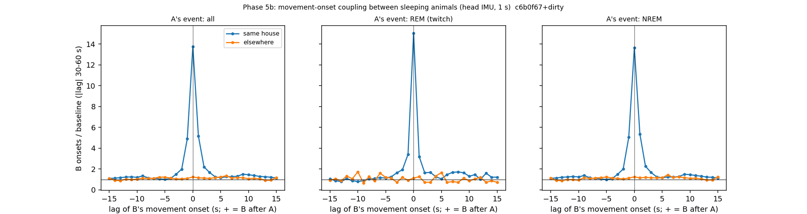

# Internal sleep schedule — Phase 5b: local, fast coupling of movements during sleep (cohort 2026c)

Plan Amendment 8 (written before results). Driver `ephys/sleep_schedule.py phase5b` → `ephys/sleep_sync.py` (commit c6b0f67+dirty); bulk `D:\Field2026_analysis_out\2026c\sleep_schedule_phase5b_20261008_1509`. **Technical ledger.**

## Definitions

```
Local, fast coupling of head-movement onsets during sleep between animals (plan Amendment 8, before results).
Event = IMU state >= 2 after >= 5 s of IMU state 1 (head-IMU seconds cache, field-PC clock), while the FINAL score is
NREM or REM; pairs both asleep, same house vs elsewhere; cross-correlogram -10..+10 s against the baseline at
|lag| 30-60 s; direction +1..+3 vs -1..-3 s; cascade = housemates with an event within +5 s vs +30..+60 s.
```

## Cross-correlogram summary (excess = B onsets at that lag / baseline)

| pairs | A_event_type | A_events | ordered_pairs | baseline_per_bin | excess_lag+0 | excess_lag+1 | excess_lag-1 | excess_lag+2 | excess_lag-2 | excess_lag+3 | excess_lag-3 | direction_plus_over_minus_1to3 | pairs_with_excess_0to3 | pairs_tested |
|---|---|---|---|---|---|---|---|---|---|---|---|---|---|---|
| same house | all | 31176 | 30 | 0.009 | 13.75 | 5.161 | 4.898 | 2.214 | 1.995 | 1.673 | 1.51 | 1.077 | 30 | 30 |
| same house | REM (twitch) | 3472 | 29 | 0.007 | 15.037 | 3.201 | 3.412 | 1.643 | 1.938 | 1.685 | 1.643 | 0.934 | 29 | 29 |
| same house | NREM | 27687 | 30 | 0.009 | 13.625 | 5.352 | 5.044 | 2.27 | 2.002 | 1.673 | 1.499 | 1.088 | 30 | 30 |
| elsewhere | all | 16002 | 28 | 0.007 | 1.236 | 1.164 | 1.11 | 1.137 | 1.065 | 1.101 | 1.048 | 1.056 | 20 | 28 |
| elsewhere | REM (twitch) | 2049 | 24 | 0.007 | 1.133 | 1.267 | 0.933 | 0.733 | 1.2 | 0.733 | 0.733 | 0.953 | 10 | 24 |
| elsewhere | NREM | 13902 | 28 | 0.007 | 1.259 | 1.155 | 1.134 | 1.207 | 1.051 | 1.165 | 1.103 | 1.073 | 20 | 28 |



## Cascade: housemates moving within 5 s of an event vs 30-35 s later

| type | events | mean_mates | share_any_mate_0to5 | share_any_mate_30to35 | mean_mates_0to5 | mean_mates_30to35 | ratio_any |
|---|---|---|---|---|---|---|---|
| NREM | 8193 | 2.788 | 0.428 | 0.118 | 0.609 | 0.146 | 3.638 |
| REM | 1088 | 2.777 | 0.327 | 0.105 | 0.428 | 0.131 | 3.123 |

