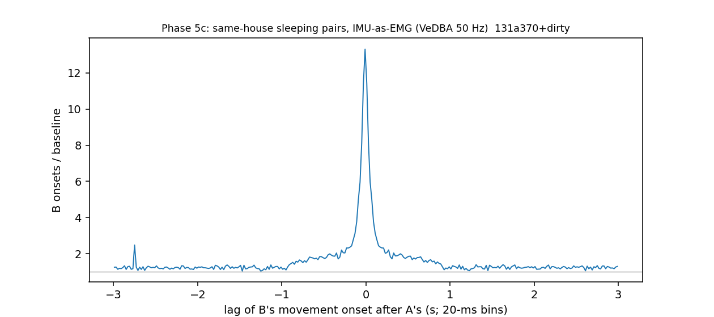

# Internal sleep schedule — Phase 5c: movement coupling at 20 ms (IMU-as-EMG); twitch or awakening? (cohort 2026c)

Plan Amendment 9 (before results). Driver `ephys/sleep_schedule.py phase5c` → `ephys/sleep_sync.py` (commit 131a370+dirty); bulk `D:\Field2026_analysis_out\2026c\sleep_schedule_phase5c_20261008_1524`.

## Definitions

```
The coupling at 20 ms with the IMU-as-EMG signal (plan Amendment 9, before results). VeDBA at 50 Hz from make_imu
(field-PC clock); per animal theta = median + 8 MAD of VeDBA in scored-NREM seconds; event = first sample >= theta after
>= 1 s below, while scored NREM / REM. Same-house pairs (WISER), B asleep: cross-correlogram +-3 s (20-ms bins) vs the rate
at |lag| 30-60 s; peak lag per unordered pair; leader share per animal. Outcome: the score 10 s / 30 s after the event
(asleep = twitch / brief movement; WAKE = awakening), for A's events, B's coupled responses (0-1 s after A) and B's
other events; P(B scored WAKE within 30 s | A event) vs 60 s before.
```



## Per pair: peak lag and excess (both directions pooled; + = the second-named animal later)

| pair | A_events | peak_lag_s (+ = second animal later) | peak_over_baseline | excess_within_100ms | excess_0.1_to_1s |
|---|---|---|---|---|---|
| SF07-SF08 | 6716 | 0.07 | 11.557 | 7.338 | 1.929 |
| SF07-SF09 | 10070 | 0.05 | 12.821 | 7.239 | 1.846 |
| SF07-SF10 | 8249 | 0.03 | 15.218 | 8.589 | 2.052 |
| SF07-SF11 | 4891 | 0.05 | 14.416 | 8.477 | 2.012 |
| SF07-SF12 | 5168 | 0.03 | 8.71 | 6.114 | 1.912 |
| SF08-SF09 | 7592 | -0.01 | 12.478 | 6.969 | 1.651 |
| SF08-SF10 | 10924 | -0.01 | 15.541 | 7.505 | 1.793 |
| SF08-SF11 | 2307 | -0.01 | 13.517 | 7.882 | 1.604 |
| SF08-SF12 | 11760 | 0.01 | 16.636 | 8.745 | 1.852 |
| SF09-SF10 | 8388 | -0.01 | 12.889 | 7.032 | 1.771 |
| SF09-SF11 | 5991 | 0.01 | 17.489 | 9.628 | 1.776 |
| SF09-SF12 | 5249 | 0.01 | 13.989 | 7.856 | 1.7 |
| SF10-SF11 | 3398 | 0.01 | 15.22 | 8.043 | 1.685 |
| SF10-SF12 | 10321 | 0.01 | 15.746 | 8.074 | 1.786 |
| SF11-SF12 | 2477 | 0.01 | 17.395 | 8.367 | 1.751 |

## Who moves first (coupled pairs within +-1 s, >= 60 ms apart)

| animal | moved_first_by_60ms_or_more | moved_second | leader_share |
|---|---|---|---|
| SF07 | 4330 | 3140 | 0.58 |
| SF08 | 3405 | 3962 | 0.462 |
| SF09 | 3303 | 3725 | 0.47 |
| SF10 | 3900 | 3827 | 0.505 |
| SF11 | 1680 | 1900 | 0.469 |
| SF12 | 3513 | 3478 | 0.503 |

## Twitch or awakening: the mover's score 10 s / 30 s later

| event_state | after_a_housemate_moved_0to1s | events | wake_at_10s | rem_at_10s | wake_at_30s | animals |
|---|---|---|---|---|---|---|
| NREM | False | 67066.0 | 0.079 | 0.021 | 0.125 | 6.0 |
| NREM | True | 16230.0 | 0.066 | 0.016 | 0.096 | 6.0 |
| REM | False | 22421.0 | 0.11 | 0.85 | 0.202 | 6.0 |
| REM | True | 3822.0 | 0.128 | 0.819 | 0.208 | 6.0 |

## Is the partner woken? P(B scored WAKE within 30 s after A's event) vs a 30-s window 60 s before

| A | B | events | P_B_wakes_within_30s_after | P_B_wakes_in_30s_window_60s_before | ratio |
|---|---|---|---|---|---|
| SF07 | SF08 | 5871 | 0.149 | 0.104 | 1.423 |
| SF07 | SF09 | 8651 | 0.172 | 0.114 | 1.515 |
| SF07 | SF10 | 7507 | 0.132 | 0.086 | 1.532 |
| SF07 | SF11 | 4029 | 0.21 | 0.115 | 1.829 |
| SF07 | SF12 | 4657 | 0.124 | 0.082 | 1.518 |
| SF08 | SF07 | 7238 | 0.11 | 0.085 | 1.298 |
| SF08 | SF09 | 6601 | 0.155 | 0.106 | 1.463 |
| SF08 | SF10 | 9950 | 0.124 | 0.088 | 1.411 |
| SF08 | SF11 | 1881 | 0.199 | 0.137 | 1.459 |
| SF08 | SF12 | 10645 | 0.142 | 0.093 | 1.528 |
| SF09 | SF07 | 10189 | 0.128 | 0.087 | 1.477 |
| SF09 | SF08 | 6322 | 0.15 | 0.097 | 1.545 |
| SF09 | SF10 | 7512 | 0.13 | 0.091 | 1.429 |
| SF09 | SF11 | 5032 | 0.207 | 0.11 | 1.889 |
| SF09 | SF12 | 4732 | 0.134 | 0.09 | 1.5 |
| SF10 | SF07 | 7933 | 0.121 | 0.078 | 1.546 |
| SF10 | SF08 | 8393 | 0.143 | 0.102 | 1.403 |
| SF10 | SF09 | 7097 | 0.172 | 0.129 | 1.336 |
| SF10 | SF11 | 2770 | 0.207 | 0.135 | 1.532 |
| SF10 | SF12 | 9236 | 0.144 | 0.091 | 1.585 |
| SF11 | SF07 | 4281 | 0.137 | 0.077 | 1.787 |
| SF11 | SF08 | 1634 | 0.173 | 0.096 | 1.803 |
| SF11 | SF09 | 4952 | 0.185 | 0.129 | 1.434 |
| SF11 | SF10 | 2714 | 0.126 | 0.076 | 1.663 |
| SF11 | SF12 | 2193 | 0.147 | 0.097 | 1.512 |
| SF12 | SF07 | 5011 | 0.102 | 0.079 | 1.295 |
| SF12 | SF08 | 9296 | 0.158 | 0.101 | 1.56 |
| SF12 | SF09 | 4864 | 0.169 | 0.113 | 1.492 |
| SF12 | SF10 | 9814 | 0.127 | 0.085 | 1.492 |
| SF12 | SF11 | 2443 | 0.176 | 0.145 | 1.214 |

