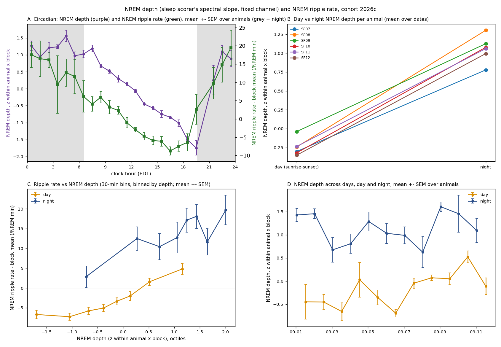

# NREM depth and the NREM ripple rate: day vs night, time of day (2026c)

Generated by `ephys/swr_depth.py run` (repo `a3ca36e+dirty`); plan Part 2 (written before computing) of [`implementation_plan/2026-10-08-swr-temperature.md`](../../../../implementation_plan/2026-10-08-swr-temperature.md). Ripple bins from `D:\Field2026_analysis_out\2026c\swr_temperature_20261008_2343`; depth = the raw spectral slope of the `imu_fixch` sleep scores (storage, read-only).

## Answer

- **S1 day vs night depth:** day - night = -1.31 SD of the within-block depth [-1.48, -1.13] (animal-level, t(5), p 0.000); day deeper in 0 / 6 animals.
- **S2 time of day:** depth is highest at hour 4 (+1.56) and lowest at hour 19 (-1.74); the ripple rate profile is in the figure and the table below.
- **S3 rate on depth (within block):** +6.7 events/NREM min per SD of depth [+4.8, +8.7]; positive in 6 / 6 animals.
  - Time-of-day profile of the rate: peak-to-trough 26.1 -> 19.5 /NREM min with depth in the model (share explained 25 %).
  - Night - day rate: +16.8 [+12.2, +21.4] -> +10.8 [+6.6, +15.0] with depth.
  - Night rate trend across days: +3.25 [+1.77, +4.73] -> +3.31 [+1.80, +4.82] /NREM min per day with depth; night depth itself changes -0.014 SD per day [-0.058, +0.029] (day +0.053 [+0.006, +0.100]).
- Reading rule (plan): depth explains a contrast when adding it removes more than half, the contrast's CI then includes 0, and the rate-depth slope is positive in >= 4 animals.

## Day vs night depth per animal (S1)

| Animal | Dates paired | Day - night depth (SD) | Day deeper (dates) | Night - day ripple rate (/NREM min) |
|---|---|---|---|---|
| SF07 | 6 | -1.08 | 0 / 6 | +5.0 |
| SF08 | 5 | -1.55 | 0 / 5 | +25.3 |
| SF09 | 8 | -1.16 | 0 / 8 | +22.0 |
| SF10 | 9 | -1.40 | 0 / 9 | +28.0 |
| SF11 | 1 | -1.30 | 0 / 1 | +6.8 |
| SF12 | 6 | -1.35 | 0 / 6 | +13.4 |

## Time-of-day profile (S2; hours with >= 3 animals)

| Hour | Animals | Depth (z) | SEM | Ripple rate - block mean | SEM | Outdoor T (degC) |
|---|---|---|---|---|---|---|
| 00 | 6 | +1.27 | 0.14 | +17.5 | 3.5 | 16.4 |
| 01 | 6 | +0.94 | 0.15 | +16.5 | 4.9 | 16.3 |
| 02 | 6 | +1.21 | 0.15 | +16.1 | 2.1 | 17.0 |
| 03 | 4 | +1.24 | 0.06 | +9.4 | 7.8 | 17.7 |
| 04 | 5 | +1.56 | 0.17 | +12.6 | 3.7 | 17.2 |
| 05 | 5 | +0.97 | 0.11 | +11.6 | 4.7 | 16.1 |
| 06 | 6 | +1.02 | 0.11 | +6.2 | 4.3 | 16.2 |
| 07 | 6 | +1.19 | 0.10 | +4.1 | 2.0 | 16.4 |
| 08 | 6 | +0.67 | 0.05 | +5.9 | 1.6 | 17.9 |
| 09 | 6 | +0.52 | 0.06 | +3.2 | 1.8 | 20.3 |
| 10 | 6 | +0.30 | 0.11 | +2.3 | 1.0 | 20.8 |
| 11 | 6 | +0.14 | 0.05 | -1.0 | 1.4 | 21.9 |
| 12 | 6 | -0.07 | 0.05 | -3.0 | 0.6 | 23.2 |
| 13 | 6 | -0.45 | 0.06 | -4.7 | 1.0 | 23.9 |
| 14 | 6 | -0.57 | 0.04 | -5.9 | 1.1 | 24.5 |
| 15 | 6 | -0.75 | 0.10 | -6.1 | 1.3 | 24.5 |
| 16 | 6 | -0.84 | 0.04 | -8.8 | 1.1 | 24.7 |
| 17 | 6 | -1.01 | 0.10 | -7.4 | 1.4 | 24.0 |
| 18 | 6 | -1.51 | 0.09 | -6.4 | 2.4 | 23.2 |
| 19 | 5 | -1.74 | 0.21 | +2.6 | 4.1 | 21.2 |
| 21 | 5 | +0.26 | 0.44 | +9.7 | 4.3 | 19.1 |
| 22 | 6 | +1.09 | 0.19 | +14.8 | 4.7 | 17.8 |
| 23 | 5 | +0.89 | 0.23 | +19.5 | 4.8 | 17.2 |

## Rate on depth per animal (S3)

| Animal | Bins | Slope (/NREM min per SD of depth) [95 % CI] |
|---|---|---|
| SF07 | 206 | 6.1 [3.4, 8.7] |
| SF08 | 195 | 4.8 [0.1, 9.5] |
| SF09 | 251 | 8.5 [4.2, 12.9] |
| SF10 | 263 | 9.8 [8.4, 11.2] |
| SF11 | 44 | 7.9 [-10.7, 26.5] |
| SF12 | 193 | 2.8 [-1.3, 6.9] |

## Definitions

- **Depth** $s_t$ = the sleep scorer's raw slow-wave metric (negative IRASA spectral slope, 4-90 Hz) per second on the animal's fixed sleep channel (variant `imu_fixch`, before the scorer's per-session min-max rescaling); higher = steeper spectrum = more slow-wave power = deeper NREM. $D_k$ = mean $s_t$ over the NREM seconds (final 1-s states) of 30-min bin $k$; $\tilde D_k = (D_k - \bar D_{a,b}) / \mathrm{SD}_{a,b}(D)$ within animal x block (the probe / channel differ between blocks).
- **Ripple rate** $r_k$ = kept NREM SWR events / NREM minutes in the bin (as the temperature analysis); block-demeaned $r_k - \bar r_{a,b}$ (NREM-minute weighted).
- **S1** per animal x biological date (day = sunrise -> sunset of D, night = sunset D -> sunrise D+1; >= 30 NREM min in each): NREM-minute-weighted $\tilde D$ day - night; animal-level mean of the per-animal means with a $t(n-1)$ CI.
- **S3** WLS, weights = NREM minutes, SEs clustered by date (CR1, $t(G-1)$): $r_k = \alpha_{a,b} + \beta \tilde D_k$; hour profile = $\sum_{k=1,2}[a_k \sin + b_k \cos](2\pi k h/24)$ with / without $\tilde D_k$, amplitude = peak-to-trough of the fitted profile; night coefficient in $r_k = \alpha_{a,b} + \beta_N \mathrm{night}_k$ (+ $\tilde D_k$); night trend = the coefficient of days in night bins (+ $\tilde D_k$).
- Sessions / exclusions = the ripple bins (tiers validated / good, to 09-11 19:40, first 30 min of each file, probe-advance settle windows, >= 5 NREM min per bin).

## Limits

- The slope is a broadband spectral measure on one fixed channel per animal; it tracks slow-wave power but is not delta power itself, and its absolute level depends on the probe position (hence z within block).
- Depth and ripple rate are measured on the same LFP: a shared recording factor (contact, noise) could couple them.
- Correlation within a block does not show that depth causes the ripple rate; both may follow sleep pressure.
