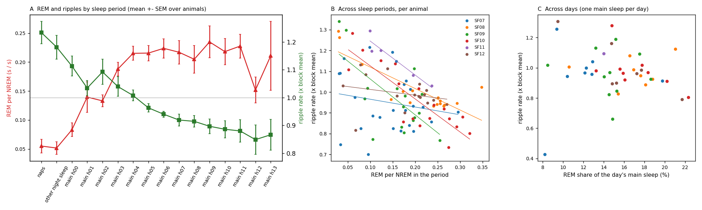

# REM vs sharp-wave ripples at the macro scale (2026c)

Generated by `ephys/swr_rem_naps.py macro` (repo `1a4a1eb+dirty`); plan Amendment 4 of [`implementation_plan/2026-10-09-night-sleep-wiser.md`](../../../../implementation_plan/2026-10-09-night-sleep-wiser.md) (written before computing). The user: competition at the macro scale = REM is scarce in the night naps and abundant in the day sleep, ripples the opposite.

## Answer

- **M1 allocation:** naps REM per NREM 0.055 with ripple rate 1.23 x the block mean; the main sleep goes from REM 0.083 / ripples 1.11 in its first hour to REM 0.211 / ripples 0.87 in its last (main 13).
- **M2 across sleep periods (naps, other night sleep, main-sleep hours):** Spearman rho(REM per NREM, ripple rate) mean -0.54 (p 0.005), negative in 6 / 6 animals; with depth partialled out -0.37 (p 0.018), negative in 6 / 6. Per animal: SF07 -0.16 (-0.12); SF08 -0.56 (-0.70); SF09 -0.44 (-0.09); SF10 -0.78 (-0.65); SF11 -0.90 (-0.30); SF12 -0.38 (-0.33).
- **M3 across days (one main sleep per day):** rho(REM share, ripple rate) mean -0.26 (p 0.196), negative in 3 / 5; depth partialled -0.15 (p 0.459). Per animal: SF07 +0.07 (8 days); SF08 +0.10 (8 days); SF09 -0.15 (10 days); SF10 -0.68 (9 days); SF12 -0.64 (7 days).
- Reading rule (plan): macro reciprocity when M2 rho < 0 in >= 4 animals; the depth partial tells whether depth (sleep pressure) carries it; M3 tells whether it also holds from day to day, outside the clock.

## Allocation by sleep period (M1; mean over animals)

| Period | Animals | REM per NREM | SEM | Ripple rate (x block mean) | SEM | Depth (z) |
|---|---|---|---|---|---|---|
| naps | 6 | 0.055 | 0.012 | 1.23 | 0.04 | +0.61 |
| other night sleep | 6 | 0.052 | 0.011 | 1.18 | 0.04 | +0.31 |
| main 00 | 6 | 0.083 | 0.012 | 1.11 | 0.04 | +0.64 |
| main 01 | 5 | 0.140 | 0.026 | 1.03 | 0.03 | +0.58 |
| main 02 | 5 | 0.133 | 0.010 | 1.09 | 0.05 | +0.38 |
| main 03 | 6 | 0.188 | 0.012 | 1.04 | 0.04 | +0.21 |
| main 04 | 6 | 0.215 | 0.012 | 1.01 | 0.02 | +0.08 |
| main 05 | 5 | 0.215 | 0.013 | 0.96 | 0.02 | +0.07 |
| main 06 | 5 | 0.224 | 0.017 | 0.94 | 0.01 | -0.10 |
| main 07 | 5 | 0.217 | 0.020 | 0.92 | 0.02 | -0.26 |
| main 08 | 5 | 0.205 | 0.024 | 0.91 | 0.02 | -0.29 |
| main 09 | 5 | 0.235 | 0.028 | 0.90 | 0.03 | -0.35 |
| main 10 | 5 | 0.218 | 0.023 | 0.89 | 0.03 | -0.46 |
| main 11 | 5 | 0.228 | 0.020 | 0.88 | 0.04 | -0.61 |
| main 12 | 5 | 0.152 | 0.023 | 0.85 | 0.05 | -0.80 |
| main 13 | 4 | 0.211 | 0.060 | 0.87 | 0.06 | -0.79 |

## Definitions

- **Units** per animal: its strict naps (pooled), its other night sleep (19:00-07:00, before the main sleep onset, not a strict nap), and its main sleep in 1-h bins of time since onset (`main 00` = the first hour); >= 10 NREM min and >= 10 ripple-eligible NREM min.
- **REM per NREM** = REM s / NREM s of the 1-s states in the unit; **REM share** = REM / (NREM + REM).
- **Relative ripple rate** = kept NREM events in the unit / the events expected at the animal x block's overall NREM rate for the unit's eligible NREM minutes (1 = the block mean).
- **M2** per animal Spearman rho over its units, and the partial version (both variables residualised on the unit's mean depth z); animal-level mean, one-sample t. **M3** the same over the animal's main sleeps (one per day; >= 1 h NREM).
