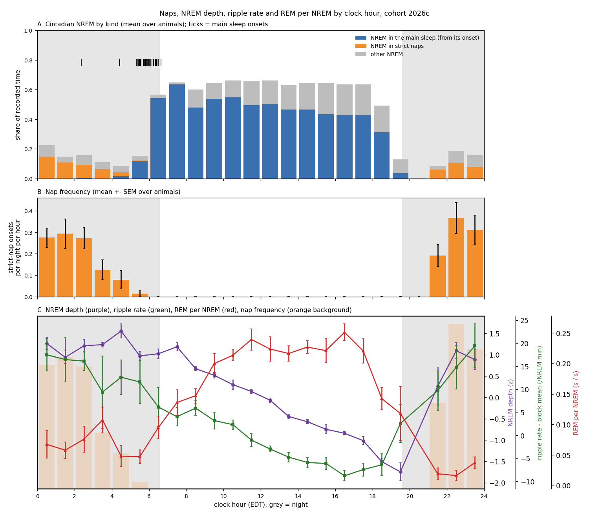
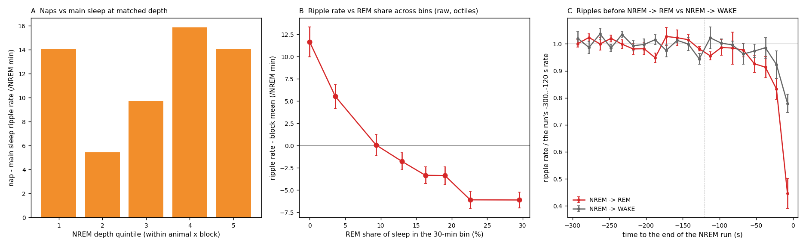

# Naps at equal NREM depth, and REM vs sharp-wave ripples (2026c)

Generated by `ephys/swr_rem_naps.py run` (repo `889eccd+dirty`); plan Amendment 3 of [`implementation_plan/2026-10-09-night-sleep-wiser.md`](../../../../implementation_plan/2026-10-09-night-sleep-wiser.md) (written before computing).

## Answer

- **N1 nap vs main sleep, first 2 h:** nap - main = 10.4 /NREM min [3.5, 17.2] without depth -> **10.9 [4.3, 17.6] with depth** (depth slope 5.3 per SD); positive in 5 / 5 animals (77 naps, 184 units).
- **N1 nap vs all main sleep:** nap - main = 19.4 /NREM min [13.0, 25.8] without depth -> **13.8 [7.6, 20.0] with depth** (depth slope 9.3 per SD); positive in 5 / 5 animals (77 naps, 823 units).
- **N1 depth-matched (quintiles within block):** nap - main = +12.0 /NREM min [+3.3, +20.7] (animal-level t, p 0.016); positive in 6 / 6 animals.
- **R2 ripple rate vs REM share (30-min bins, within block):** -5.81 /NREM min per 10 % REM share alone -> **-2.19 [-3.79, -0.59] with depth + hour** (p 0.012); negative in 4 / 6 animals.
- **R3 transitions:** last-60-s ripple rate / the run's own baseline, NREM -> REM minus NREM -> WAKE = -0.14 (animal-level p 0.025; REM-bound lower in 6 / 6 animals). Per animal: SF07 REM 0.72 / WAKE 0.88; SF08 REM 0.81 / WAKE 0.93; SF09 REM 0.74 / WAKE 0.90; SF10 REM 0.85 / WAKE 0.89; SF11 REM 0.73 / WAKE 1.05; SF12 REM 0.82 / WAKE 0.85.
- **Check - all detected NREM events (theta / movement / LFP-EMG flags ignored):** R3 REM - WAKE = -0.09 (p 0.042; REM-bound lower in 6 / 6; per animal SF07 REM 0.77 / WAKE 0.86; SF08 REM 0.86 / WAKE 0.93; SF09 REM 0.77 / WAKE 0.91; SF10 REM 0.88 / WAKE 0.89; SF11 REM 0.78 / WAKE 0.99; SF12 REM 0.84 / WAKE 0.85); R2 with depth + hour -2.17 [-3.89, -0.45] per 10 % REM, negative in 3 / 6 animals.
- Reading rule (plan): the nap advantage survives depth when gamma with depth excludes 0, is positive in >= 4 animals and the depth-matched difference is positive; REM-SWR competition is supported when R2's REM-share slope is negative beyond depth and hour in >= 4 animals AND R3 shows a pre-REM drop the pre-WAKE runs do not.

## REM per NREM by clock hour (R1)

| Hour | Animals | REM s per NREM s | SEM | REM share of sleep |
|---|---|---|---|---|
| 00 | 6 | 0.067 | 0.023 | 0.061 |
| 01 | 6 | 0.058 | 0.013 | 0.054 |
| 02 | 6 | 0.076 | 0.021 | 0.069 |
| 03 | 5 | 0.107 | 0.021 | 0.096 |
| 04 | 6 | 0.048 | 0.017 | 0.045 |
| 05 | 6 | 0.047 | 0.011 | 0.045 |
| 06 | 6 | 0.095 | 0.019 | 0.086 |
| 07 | 6 | 0.136 | 0.021 | 0.118 |
| 08 | 6 | 0.147 | 0.012 | 0.128 |
| 09 | 6 | 0.200 | 0.016 | 0.166 |
| 10 | 6 | 0.213 | 0.009 | 0.176 |
| 11 | 6 | 0.239 | 0.017 | 0.192 |
| 12 | 6 | 0.224 | 0.020 | 0.182 |
| 13 | 6 | 0.216 | 0.012 | 0.177 |
| 14 | 6 | 0.227 | 0.010 | 0.185 |
| 15 | 6 | 0.221 | 0.020 | 0.180 |
| 16 | 6 | 0.251 | 0.014 | 0.200 |
| 17 | 6 | 0.221 | 0.020 | 0.180 |
| 18 | 6 | 0.142 | 0.018 | 0.123 |
| 19 | 6 | 0.118 | 0.044 | 0.099 |
| 20 | 1 | 0.000 |  | 0.000 |
| 21 | 6 | 0.019 | 0.010 | 0.018 |
| 22 | 6 | 0.016 | 0.009 | 0.016 |
| 23 | 6 | 0.037 | 0.009 | 0.036 |

## Per animal

| Animal | Nap - main first 2 h, with depth [CI] | Depth-matched nap - main | R2 beta per 10 % REM [CI] | R3 REM ratio | R3 WAKE ratio | Transitions REM / WAKE |
|---|---|---|---|---|---|---|
| SF07 | 7.3 [-1.4, 15.9] | 3.3 | 1.47 [-0.24, 3.18] | 0.72 | 0.88 | 106 / 53 |
| SF08 | 16.0 [0.4, 31.6] | 21.0 | -1.98 [-5.14, 1.18] | 0.81 | 0.93 | 101 / 52 |
| SF09 | 25.9 [3.3, 48.4] | 20.4 | -0.14 [-1.60, 1.31] | 0.74 | 0.90 | 100 / 63 |
| SF10 | 9.1 [-0.2, 18.4] | 16.9 | -2.48 [-4.60, -0.37] | 0.85 | 0.89 | 184 / 49 |
| SF11 |  [, ] | 5.4 | 1.80 [-3.47, 7.06] | 0.73 | 1.05 | 9 / 8 |
| SF12 | 4.7 [-7.6, 17.0] | 5.2 | -7.26 [-11.39, -3.13] | 0.82 | 0.85 | 102 / 46 |

## Definitions

- **Depth** = the raw spectral slope of the `imu_fixch` scores per NREM second, z within animal x block; **ripple rate** = kept NREM SWR events / ripple-eligible NREM minutes (tiers validated / good, the temperature analysis' exclusions).
- **N1 units**: each strict nap (night_naps primary), and each 30-min chunk of time since the main sleep onset; >= 5 NREM min. $r_u = \alpha_{a,b} + \gamma\,\mathrm{nap}_u (+ \beta \tilde D_u)$, WLS weights = NREM minutes, SEs clustered by biological night, $t(G-1)$. Depth-matched: quintiles of $\tilde D$ over the block's nap + main NREM seconds; per quintile the nap and main rates; their difference averaged with weights min(nap, main) NREM minutes; per animal, then a one-sample t.
- **R1**: per clock hour, REM seconds / NREM seconds over all included records (hours with >= 5 NREM min), mean over animals.
- **R2**: 30-min clock bins within animal x block (>= 5 eligible NREM min); REM share $s_k$ = REM / (NREM + REM) seconds in the bin; $r_k = \alpha_{a,b} + \beta s_k + \beta_D \tilde D_k$ + 2 hour harmonics; beta per 10 percentage points.
- **R3**: NREM runs >= 300 s followed directly by >= 30 s REM or WAKE (1-s states; only runs with >= 200 ripple-eligible NREM seconds); rate in 15-s bins from -300 s to the transition; ratio = rate in the last 60 s / rate in -300..-120 s, pooled per animal and transition type; REM - WAKE difference per animal, one-sample t.

## Limits

- The last seconds of NREM before REM are intermediate sleep; the 1-s scoring can blur the boundary, and the detector excludes events in REM seconds - the R3 curve stops at the transition.
- Depth and REM come from the same scorer; REM share and ripple rate share the clock - hence the hour harmonics in R2.
