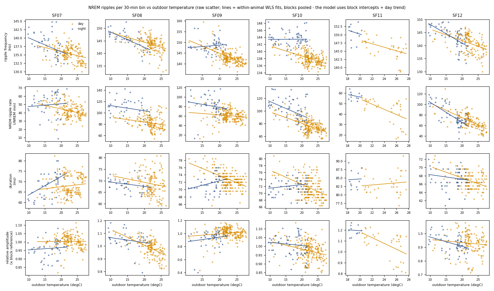
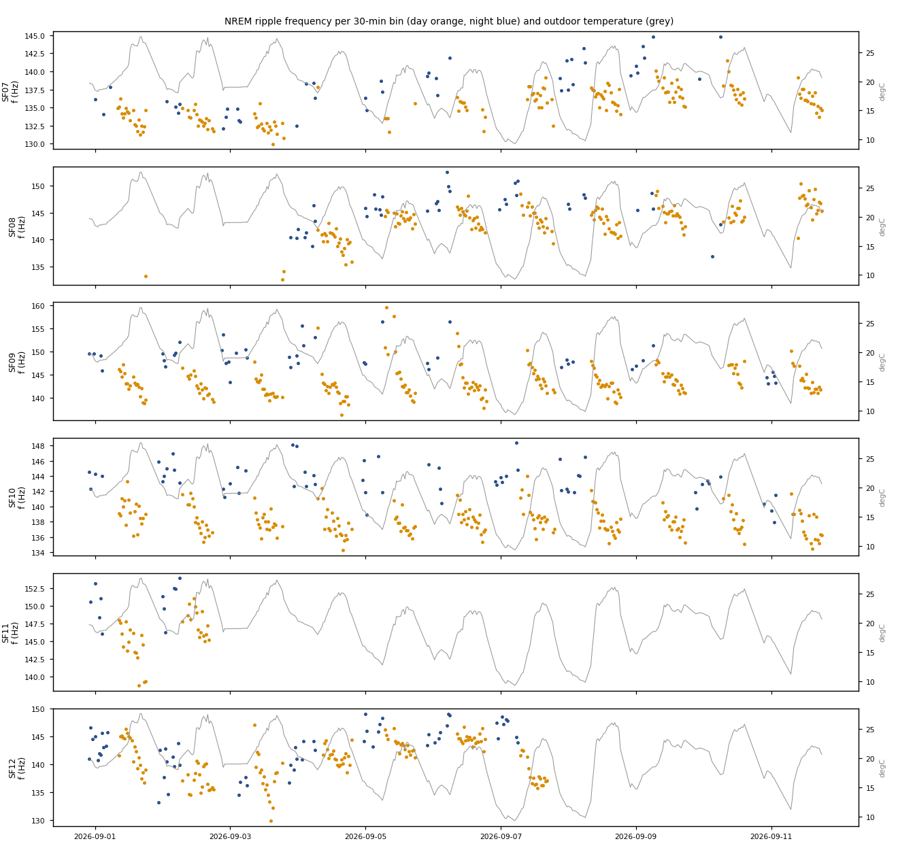
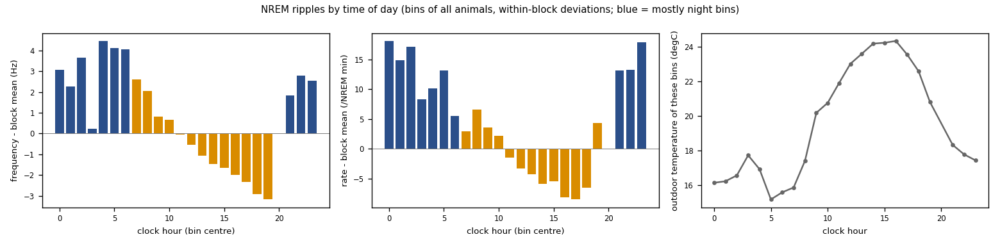

# NREM sharp-wave ripples vs ambient temperature, day vs night (2026c)

Generated by `ephys/swr_temperature.py run` (repo `10d469b+dirty`). Plan with the original definitions and tests fixed before any result, plus **Amendment 1** (written after the first result and a Fable audit): [`implementation_plan/2026-10-08-swr-temperature.md`](../../../../implementation_plan/2026-10-08-swr-temperature.md). Run folder (event / bin tables): `D:\Field2026_analysis_out\2026c\swr_temperature_20261008_2343`.

## Summary

- **Time of day dominates.** Within animal x block, NREM ripple frequency runs from +4.5 Hz (hour 4) to -3.2 Hz (hour 19) around its block mean, and the NREM ripple rate from +18.1 to -8.5 /NREM min (hour profile below). Outdoor temperature follows the same clock, so the original model (no hour term) read part of this as a temperature slope.
- **Ambient temperature effects (Amendment 1 rule, model H = hour of day held fixed): none Established. Candidates (pooled CI excludes 0, another criterion fails): ripple frequency vs outdoor T, day (-0.252; fails: animal-level); ripple frequency vs outdoor T, night (-0.239; fails: animal-level, validated blocks); ripple frequency vs T anomaly (vs the usual for the hour), day (-0.241; fails: animal-level); ripple frequency vs T anomaly (vs the usual for the hour), night (-0.263; fails: animal-level, validated blocks); NREM ripple rate vs outdoor T, day (-0.764; fails: animal-level, sign agreement, validated blocks); NREM ripple rate vs outdoor T, night (-1.998; fails: animal-level, validated blocks); NREM ripple rate vs T anomaly (vs the usual for the hour), day (-0.734; fails: animal-level, sign agreement, validated blocks); NREM ripple rate vs T anomaly (vs the usual for the hour), night (-2.029; fails: animal-level, validated blocks); duration vs outdoor T, night (+0.187; fails: animal-level); duration vs T anomaly (vs the usual for the hour), night (+0.159; fails: animal-level, sign agreement)**
- **Night vs day (descriptive):** night NREM ripples are faster than day NREM ripples in 6 / 6 animals (paired per date +1.6 to +6.3 Hz) and more frequent in 6 / 6. Night is colder, so this is the opposite of a direct warm-outside -> warm-brain -> faster-ripple effect; a brain temperature set by the activity cycle (highest at the end of the active phase) or sleep pressure fits better - neither is measured here (no head / brain temperature).

## Verdict (Amendment 1 rule; model H)

Established = the pooled model-H CI excludes 0 AND the animal-level CI (mean of per-animal slopes, t(n-1)) excludes 0 AND >= 4 animals share the sign AND validated blocks only give the same sign with a CI excluding 0; Candidate = the pooled CI excludes 0 but another criterion fails.

| Outcome | Temperature | Phase | Pooled slope /degC [95 % CI] | Animal-level mean [CI] | Same sign | Validated blocks [CI] | Verdict |
|---|---|---|---|---|---|---|---|
| ripple frequency | temp_C | day | -0.252 [-0.424, -0.081] | -0.163 [-0.607, 0.281] | 4 / 6 | -0.136 [-0.245, -0.028] | **Candidate** |
| ripple frequency | temp_C | night | -0.239 [-0.397, -0.081] | -0.562 [-1.360, 0.235] | 5 / 6 | 0.014 [-0.158, 0.185] | **Candidate** |
| ripple frequency | temp_anom | day | -0.241 [-0.409, -0.072] | -0.146 [-0.625, 0.333] | 4 / 6 | -0.120 [-0.225, -0.014] | **Candidate** |
| ripple frequency | temp_anom | night | -0.263 [-0.422, -0.104] | -0.714 [-1.789, 0.362] | 6 / 6 | -0.037 [-0.216, 0.142] | **Candidate** |
| NREM ripple rate | temp_C | day | -0.764 [-1.456, -0.073] | -0.299 [-2.119, 1.521] | 3 / 6 | 0.265 [-0.803, 1.333] | **Candidate** |
| NREM ripple rate | temp_C | night | -1.998 [-2.844, -1.153] | -0.288 [-3.284, 2.709] | 4 / 6 | -1.104 [-2.393, 0.186] | **Candidate** |
| NREM ripple rate | temp_anom | day | -0.734 [-1.423, -0.045] | -0.342 [-2.109, 1.424] | 3 / 6 | 0.314 [-0.754, 1.383] | **Candidate** |
| NREM ripple rate | temp_anom | night | -2.029 [-2.860, -1.197] | 0.065 [-3.902, 4.031] | 4 / 6 | -1.184 [-2.379, 0.010] | **Candidate** |
| duration | temp_C | day | 0.035 [-0.103, 0.173] | -0.077 [-0.242, 0.089] | 2 / 6 | -0.052 [-0.255, 0.151] | **No** |
| duration | temp_C | night | 0.187 [0.089, 0.286] | 0.263 [-0.180, 0.705] | 4 / 6 | 0.267 [0.156, 0.378] | **Candidate** |
| duration | temp_anom | day | 0.048 [-0.087, 0.183] | -0.024 [-0.236, 0.188] | 4 / 6 | -0.040 [-0.240, 0.160] | **No** |
| duration | temp_anom | night | 0.159 [0.060, 0.258] | 0.043 [-0.182, 0.268] | 3 / 6 | 0.226 [0.105, 0.347] | **Candidate** |
| relative amplitude | temp_C | day | -0.002 [-0.007, 0.003] | -0.001 [-0.010, 0.007] | 3 / 6 | 0.000 [-0.006, 0.006] | **No** |
| relative amplitude | temp_C | night | -0.003 [-0.007, 0.002] | 0.009 [-0.017, 0.035] | 3 / 6 | 0.001 [-0.005, 0.007] | **No** |
| relative amplitude | temp_anom | day | -0.002 [-0.007, 0.003] | -0.002 [-0.010, 0.005] | 3 / 6 | 0.000 [-0.006, 0.006] | **No** |
| relative amplitude | temp_anom | night | -0.002 [-0.007, 0.003] | 0.014 [-0.024, 0.051] | 3 / 6 | 0.001 [-0.005, 0.007] | **No** |

### Leave one animal out (model H)

| Outcome | Temperature | Left out | Day slope [CI] | Night slope [CI] |
|---|---|---|---|---|
| ripple frequency | temp_C | SF07 | -0.316 [-0.523, -0.109] | -0.253 [-0.394, -0.112] |
| ripple frequency | temp_C | SF08 | -0.205 [-0.402, -0.007] | -0.240 [-0.424, -0.055] |
| ripple frequency | temp_C | SF09 | -0.238 [-0.430, -0.046] | -0.317 [-0.499, -0.136] |
| ripple frequency | temp_C | SF10 | -0.285 [-0.519, -0.050] | -0.313 [-0.532, -0.094] |
| ripple frequency | temp_C | SF11 | -0.251 [-0.426, -0.076] | -0.250 [-0.416, -0.084] |
| ripple frequency | temp_C | SF12 | -0.216 [-0.319, -0.112] | -0.050 [-0.184, 0.084] |
| ripple frequency | temp_anom | SF07 | -0.306 [-0.512, -0.100] | -0.275 [-0.414, -0.135] |
| ripple frequency | temp_anom | SF08 | -0.192 [-0.385, 0.001] | -0.264 [-0.452, -0.076] |
| ripple frequency | temp_anom | SF09 | -0.229 [-0.425, -0.034] | -0.331 [-0.508, -0.154] |
| ripple frequency | temp_anom | SF10 | -0.273 [-0.504, -0.042] | -0.335 [-0.554, -0.116] |
| ripple frequency | temp_anom | SF11 | -0.239 [-0.410, -0.067] | -0.275 [-0.442, -0.108] |
| ripple frequency | temp_anom | SF12 | -0.202 [-0.300, -0.103] | -0.089 [-0.230, 0.052] |
| NREM ripple rate | temp_C | SF07 | -1.033 [-1.823, -0.242] | -2.362 [-3.115, -1.609] |
| NREM ripple rate | temp_C | SF08 | -0.555 [-1.535, 0.425] | -1.871 [-3.017, -0.725] |
| NREM ripple rate | temp_C | SF09 | -1.334 [-1.834, -0.833] | -2.293 [-3.159, -1.427] |
| NREM ripple rate | temp_C | SF10 | -0.756 [-1.664, 0.152] | -2.034 [-2.937, -1.132] |
| NREM ripple rate | temp_C | SF11 | -0.762 [-1.453, -0.072] | -1.980 [-2.838, -1.123] |
| NREM ripple rate | temp_C | SF12 | -0.142 [-0.904, 0.620] | -1.286 [-2.175, -0.396] |
| NREM ripple rate | temp_anom | SF07 | -1.002 [-1.776, -0.227] | -2.387 [-3.170, -1.605] |
| NREM ripple rate | temp_anom | SF08 | -0.506 [-1.505, 0.493] | -1.936 [-3.046, -0.825] |
| NREM ripple rate | temp_anom | SF09 | -1.320 [-1.837, -0.804] | -2.300 [-3.154, -1.447] |
| NREM ripple rate | temp_anom | SF10 | -0.732 [-1.624, 0.160] | -2.052 [-2.950, -1.153] |
| NREM ripple rate | temp_anom | SF11 | -0.730 [-1.417, -0.043] | -2.015 [-2.855, -1.174] |
| NREM ripple rate | temp_anom | SF12 | -0.114 [-0.865, 0.637] | -1.317 [-2.168, -0.467] |

## Time-of-day profile (descriptive, Amendment 1)

| Hour | Bins | Animals | Night share | Outdoor T (degC) | f - block mean (Hz) | r - block mean (/min) | d - block mean (ms) | A - block mean |
|---|---|---|---|---|---|---|---|---|
| 00 | 39 | 6 | 1.00 | 16.2 | 3.05 | 18.1 | 0.13 | 0.019 |
| 01 | 26 | 6 | 1.00 | 16.2 | 2.27 | 14.8 | -0.73 | -0.026 |
| 02 | 29 | 6 | 1.00 | 16.6 | 3.66 | 17.1 | -0.43 | 0.003 |
| 03 | 18 | 4 | 1.00 | 17.7 | 0.23 | 8.3 | -0.47 | 0.015 |
| 04 | 12 | 5 | 1.00 | 16.9 | 4.46 | 10.1 | 0.86 | 0.009 |
| 05 | 26 | 5 | 1.00 | 15.2 | 4.12 | 13.1 | 1.61 | 0.024 |
| 06 | 33 | 6 | 1.00 | 15.6 | 4.05 | 5.5 | 1.72 | -0.015 |
| 07 | 36 | 6 | 0.00 | 15.9 | 2.62 | 2.9 | 3.65 | -0.012 |
| 08 | 40 | 6 | 0.00 | 17.4 | 2.05 | 6.6 | 1.37 | 0.012 |
| 09 | 73 | 6 | 0.00 | 20.2 | 0.82 | 3.6 | 1.01 | 0.023 |
| 10 | 91 | 6 | 0.00 | 20.8 | 0.67 | 2.1 | 0.98 | 0.023 |
| 11 | 96 | 6 | 0.00 | 21.9 | -0.04 | -1.5 | 0.70 | 0.014 |
| 12 | 94 | 6 | 0.00 | 23.0 | -0.54 | -3.3 | 0.35 | 0.015 |
| 13 | 89 | 6 | 0.00 | 23.6 | -1.07 | -4.3 | -0.49 | 0.005 |
| 14 | 93 | 6 | 0.00 | 24.2 | -1.45 | -5.9 | -0.57 | -0.010 |
| 15 | 86 | 6 | 0.00 | 24.2 | -1.63 | -5.5 | -1.07 | -0.021 |
| 16 | 85 | 6 | 0.00 | 24.4 | -1.99 | -8.2 | -1.16 | -0.020 |
| 17 | 64 | 6 | 0.00 | 23.6 | -2.32 | -8.5 | -1.50 | -0.020 |
| 18 | 46 | 6 | 0.00 | 22.6 | -2.93 | -6.5 | -2.46 | -0.043 |
| 19 | 8 | 5 | 0.00 | 20.8 | -3.17 | 4.3 | -4.58 | -0.042 |
| 21 | 17 | 5 | 1.00 | 18.3 | 1.83 | 13.1 | -0.88 | 0.004 |
| 22 | 29 | 6 | 1.00 | 17.8 | 2.80 | 13.3 | -0.58 | -0.004 |
| 23 | 22 | 5 | 1.00 | 17.5 | 2.55 | 17.9 | -1.26 | -0.030 |

## Data

- 134 sessions of tier validated / good (quality guide); 1,501,245 kept NREM events loaded after the exclusions, 1,422,586 of them in the 1152 30-min bins with >= 5 min NREM that are not crossed by sunrise / sunset and have weather; 12 dates, to 09-11 19:40.

| Animal | Bins | NREM h | Dates | Events in bins | Outdoor T range (degC) |
|---|---|---|---|---|---|
| SF07 | 206 | 63.2 | 11 | 165,216 | 9.8 - 27.6 |
| SF08 | 195 | 58.2 | 10 | 299,159 | 9.3 - 26.4 |
| SF09 | 251 | 76.6 | 12 | 293,449 | 11.0 - 27.6 |
| SF10 | 263 | 80.9 | 12 | 389,136 | 9.5 - 27.6 |
| SF11 | 44 | 11.2 | 3 | 31,545 | 18.2 - 27.6 |
| SF12 | 193 | 57.1 | 8 | 244,081 | 9.5 - 27.6 |

## All slopes: original pre-registered model P (no hour term) and model H

Slopes per degC (95 % CI, SEs clustered by date, t(G-1)); weights = NREM minutes; animal x block intercepts + day trend.

| Model | Outcome | Temperature | Day slope | Night slope | Night - day at mean T (model P only) | Animal-level day / night |
|---|---|---|---|---|---|---|
| P | ripple frequency | temp_C | -0.427 [-0.575, -0.279] | -0.302 [-0.485, -0.118] | 1.89 [0.73, 3.05] | -0.461 / -0.421 |
| P | ripple frequency | temp_anom | -0.228 [-0.470, 0.014] | -0.242 [-0.417, -0.067] | 3.80 [3.14, 4.45] | -0.345 / -0.538 |
| P | NREM ripple rate | temp_C | -1.372 [-1.994, -0.749] | -2.017 [-2.964, -1.070] | 6.76 [-0.27, 13.80] | -1.264 / -0.997 |
| P | NREM ripple rate | temp_anom | -0.684 [-2.037, 0.669] | -1.986 [-2.909, -1.062] | 17.74 [13.96, 21.52] | -0.687 / 0.363 |
| P | duration | temp_C | -0.249 [-0.369, -0.130] | 0.087 [-0.008, 0.182] | 0.48 [-0.12, 1.09] | -0.251 / -0.011 |
| P | duration | temp_anom | 0.048 [-0.190, 0.286] | 0.181 [0.096, 0.267] | 0.41 [-0.32, 1.13] | -0.017 / 0.107 |
| P | relative amplitude | temp_C | -0.003 [-0.007, 0.001] | -0.003 [-0.008, 0.002] | -0.02 [-0.04, 0.01] | -0.007 / 0.002 |
| P | relative amplitude | temp_anom | -0.002 [-0.006, 0.001] | -0.003 [-0.007, 0.002] | 0.00 [-0.02, 0.02] | -0.006 / 0.015 |
| H | ripple frequency | temp_C | -0.252 [-0.424, -0.081] | -0.239 [-0.397, -0.081] |  | -0.163 / -0.562 |
| H | ripple frequency | temp_anom | -0.241 [-0.409, -0.072] | -0.263 [-0.422, -0.104] |  | -0.146 / -0.714 |
| H | NREM ripple rate | temp_C | -0.764 [-1.456, -0.073] | -1.998 [-2.844, -1.153] |  | -0.299 / -0.288 |
| H | NREM ripple rate | temp_anom | -0.734 [-1.423, -0.045] | -2.029 [-2.860, -1.197] |  | -0.342 / 0.065 |
| H | duration | temp_C | 0.035 [-0.103, 0.173] | 0.187 [0.089, 0.286] |  | -0.077 / 0.263 |
| H | duration | temp_anom | 0.048 [-0.087, 0.183] | 0.159 [0.060, 0.258] |  | -0.024 / 0.043 |
| H | relative amplitude | temp_C | -0.002 [-0.007, 0.003] | -0.003 [-0.007, 0.002] |  | -0.001 / 0.009 |
| H | relative amplitude | temp_anom | -0.002 [-0.007, 0.003] | -0.002 [-0.007, 0.003] |  | -0.002 / 0.014 |

The original verdict rule (CI excludes 0 + >= 4 animals share the sign) applied to model P passed frequency day / night and night anomaly; the audit showed these are time of day and two non-validated animals - see the verdict above.

### Per animal (model H)

| Outcome | Temperature | SF07 | SF08 | SF09 | SF10 | SF11 | SF12 |
|---|---|---|---|---|---|---|---|
| ripple frequency | temp_C | d 0.08 / n -0.17 | d -0.48 / n -0.45 | d -0.30 / n 0.09 | d -0.12 / n -0.01 | d 0.51 / n -1.93 | d -0.67 / n -0.92 |
| ripple frequency | temp_anom | d 0.09 / n -0.20 | d -0.47 / n -0.46 | d -0.28 / n -0.01 | d -0.12 / n -0.02 | d 0.60 / n -2.69 | d -0.70 / n -0.90 |
| NREM ripple rate | temp_C | d 0.52 / n 0.23 | d -1.16 / n -1.84 | d 1.20 / n -0.20 | d -0.68 / n -1.85 | d 1.48 / n 5.00 | d -3.14 / n -3.07 |
| NREM ripple rate | temp_anom | d 0.53 / n 0.19 | d -1.17 / n -1.81 | d 1.28 / n -0.44 | d -0.64 / n -1.89 | d 1.09 / n 7.41 | d -3.16 / n -3.06 |
| duration | temp_C | d 0.05 / n -0.03 | d 0.09 / n 0.14 | d -0.25 / n 0.24 | d -0.01 / n 0.36 | d -0.06 / n 1.03 | d -0.29 / n -0.17 |
| duration | temp_anom | d 0.07 / n -0.06 | d 0.10 / n 0.11 | d -0.25 / n 0.23 | d 0.00 / n 0.33 | d 0.22 / n -0.18 | d -0.29 / n -0.18 |
| relative amplitude | temp_C | d 0.00 / n 0.00 | d -0.01 / n -0.00 | d 0.00 / n 0.01 | d -0.00 / n -0.00 | d 0.01 / n 0.06 | d -0.01 / n -0.01 |
| relative amplitude | temp_anom | d 0.00 / n 0.00 | d -0.01 / n -0.00 | d 0.00 / n 0.01 | d -0.00 / n -0.00 | d 0.00 / n 0.09 | d -0.01 / n -0.01 |

## Day vs night (descriptive; per animal, NREM-minute-weighted bin means; paired = night(D) - day(D) over dates)

| Animal | NREM h day / night | f day / night (Hz) | night - day f (SEM, days) | r day / night | night - day r | d day / night (ms) | A day / night |
|---|---|---|---|---|---|---|---|
| SF07 | 54.0 / 9.2 | 135.4 / 137.4 | 2.67 (0.77, 8) | 42.5 / 49.6 | 11.05 | 67.9 / 69.2 | 1.00 / 0.96 |
| SF08 | 50.2 / 7.9 | 143.8 / 145.6 | 3.17 (1.58, 7) | 82.2 / 108.2 | 27.05 | 68.8 / 68.5 | 0.99 / 1.05 |
| SF09 | 66.0 / 10.6 | 143.4 / 148.4 | 4.76 (1.07, 8) | 61.1 / 81.3 | 22.04 | 72.9 / 71.7 | 1.01 / 0.92 |
| SF10 | 67.7 / 13.1 | 138.1 / 143.4 | 4.98 (0.47, 9) | 76.4 / 99.8 | 27.98 | 71.6 / 72.2 | 0.97 / 1.01 |
| SF11 | 8.5 / 2.6 | 146.0 / 150.7 | 6.28 (, 1) | 43.8 / 57.4 | 6.83 | 83.3 / 84.6 | 1.07 / 1.20 |
| SF12 | 42.4 / 14.8 | 140.9 / 143.3 | 1.59 (1.26, 6) | 68.8 / 78.1 | 13.37 | 66.9 / 67.5 | 0.93 / 0.93 |

## Sensitivity (ripple frequency; models P and H)

| Model | Analysis | Temperature | Day slope [CI] | Night slope [CI] | Bins |
|---|---|---|---|---|---|
| P | no day trend | temp_C | -0.418 [-0.568, -0.267] | -0.286 [-0.441, -0.131] | 1152 |
| P | + check sessions | temp_C | -0.474 [-0.624, -0.324] | -0.367 [-0.622, -0.113] | 1267 |
| P | to the paddock end (females) | temp_C | -0.394 [-0.528, -0.261] | -0.273 [-0.431, -0.115] | 1202 |
| P | validated blocks only | temp_C | -0.425 [-0.576, -0.273] | -0.036 [-0.218, 0.147] | 698 |
| P | 1-h bins | temp_C | -0.433 [-0.583, -0.284] | -0.293 [-0.475, -0.110] | 663 |
| P | event level (400k events) | temp_C | -0.381 [-0.524, -0.238] | -0.180 [-0.287, -0.074] | 400000 |
| P | no day trend | temp_anom | -0.231 [-0.436, -0.027] | -0.245 [-0.389, -0.100] | 1152 |
| P | + check sessions | temp_anom | -0.373 [-0.725, -0.022] | -0.315 [-0.587, -0.044] | 1267 |
| P | to the paddock end (females) | temp_anom | -0.235 [-0.459, -0.010] | -0.214 [-0.380, -0.048] | 1202 |
| P | validated blocks only | temp_anom | -0.086 [-0.405, 0.233] | 0.050 [-0.121, 0.221] | 698 |
| P | 1-h bins | temp_anom | -0.229 [-0.482, 0.024] | -0.232 [-0.408, -0.057] | 663 |
| P | event level (400k events) | temp_anom | -0.194 [-0.460, 0.071] | -0.131 [-0.241, -0.022] | 400000 |
| H | no day trend | temp_C | -0.256 [-0.456, -0.057] | -0.243 [-0.390, -0.095] | 1152 |
| H | + check sessions | temp_C | -0.378 [-0.613, -0.144] | -0.329 [-0.581, -0.077] | 1267 |
| H | to the paddock end (females) | temp_C | -0.234 [-0.391, -0.077] | -0.209 [-0.345, -0.072] | 1202 |
| H | validated blocks only | temp_C | -0.136 [-0.245, -0.028] | 0.014 [-0.158, 0.185] | 698 |
| H | 1-h bins | temp_C | -0.254 [-0.427, -0.081] | -0.235 [-0.396, -0.074] | 663 |
| H | event level (400k events) | temp_C | -0.210 [-0.418, -0.002] | -0.128 [-0.223, -0.034] | 400000 |
| H | no day trend | temp_anom | -0.245 [-0.441, -0.048] | -0.267 [-0.417, -0.117] | 1152 |
| H | + check sessions | temp_anom | -0.373 [-0.608, -0.139] | -0.340 [-0.582, -0.097] | 1267 |
| H | to the paddock end (females) | temp_anom | -0.224 [-0.380, -0.068] | -0.225 [-0.362, -0.088] | 1202 |
| H | validated blocks only | temp_anom | -0.120 [-0.225, -0.014] | -0.037 [-0.216, 0.142] | 698 |
| H | 1-h bins | temp_anom | -0.243 [-0.411, -0.074] | -0.261 [-0.418, -0.104] | 663 |
| H | event level (400k events) | temp_anom | -0.203 [-0.415, 0.009] | -0.141 [-0.232, -0.050] | 400000 |

## Definitions

Bins: animal $a$, channel block $b$, 30-min clock bin $k$; $N_k$ = NREM minutes (final 1-s states) after the exclusions; $E_k$ = the bin's kept NREM events.

- **NREM ripple rate** $r_k = |E_k|/N_k$ (events per NREM minute).
- **Ripple frequency** $f_k = \operatorname{median}_{e\in E_k} f_e$ (Hz); $f_e$ = DetectSWR's frequency at the event's peak trough = the Hilbert phase derivative of the 80-250 Hz filtered ripple channel (`swr_detect.troughs`). Single values are unbounded (about 10 % below 100 Hz), hence the median per bin.
- **Duration** $d_k = \operatorname{median}_{e\in E_k} \mathrm{duration}_e$ (ms).
- **Relative amplitude** $A_k = \operatorname{median}_{e\in E_k}\mathrm{amp}_e / \operatorname{median}_{e\in\mathrm{NREM(ref}_b)}\mathrm{amp}_e$ (amplitude relative to the block's reference session; raw uV depend on channel and probe).
- **Temperature** $T_k$ = mean outdoor `temp_C` of the bin's 5-min weather samples (degC); $T^{anom}_k$ = mean `temp_anom` = temp_C minus its fit on (sin, cos)(2 pi k h / 24), k = 1, 2, over the cohort (warmer + / colder - than usual for the hour).
- **Phase** day = the bin centre in [sunrise, sunset) at the paddock; night = otherwise; bins containing sunrise or sunset dropped.
- **Model P** (pre-registered) $y_k = \alpha_{a,b} + \beta_T T_k + \beta_N\,\mathrm{night}_k + \beta_{TN} T_k\,\mathrm{night}_k + \gamma\,\mathrm{day}_k + \varepsilon_k$, WLS weights $N_k$, day slope $\beta_T$, night slope $\beta_T+\beta_{TN}$, SEs clustered by calendar date (CR1), CI / p from $t(G-1)$.
- **Model H** (Amendment 1) = model P $+ \sum_{k=1,2}[a_k\sin(2\pi k h_k/24) + b_k\cos(2\pi k h_k/24)]$, $h_k$ = clock hour of the bin centre. Text: the temperature slope at a fixed time of day; with $T^{anom}$, warmer vs colder days at the same hour.
- **Animal-level CI**: mean of the per-animal model slopes $\bar s$, $\bar s \pm t_{0.975}(n-1)\,\mathrm{SD}/\sqrt n$.
- **Hour profile**: $y_k - \bar y_{a,b}$ (NREM-minute-weighted block mean), averaged (weights $N_k$) over bins of the same clock hour.
- **Exclusions**: after use_until; after 09-11 19:40 (females); the first 30 min of each session file (handling; also file splits - conservative); probe-advance settle windows; bins with < 5 min NREM.

## Reading rules and limits

- Day and night differ in temperature, and so do the hours within a phase: only model H and the anomaly speak to temperature, and even they cannot separate ambient temperature from anything that varies with the weather from day to day.
- Outdoor temperature is not brain temperature: the rats sleep huddled in insulated houses; no logger / head temperature exists.
- SF08 block 1 (over-selection, late reference) and SF12 block 1 (shank-1 degradation) are the least trustworthy blocks (quality guide); results carried by them are flagged by the validated-blocks criterion.
- The frequency estimator correlates weakly with amplitude (r about 0.2 within bins), but amplitude has no temperature slope and the slopes survive conditioning on amplitude, duration and rate (audit): event composition explains <= ~0.3 Hz.
