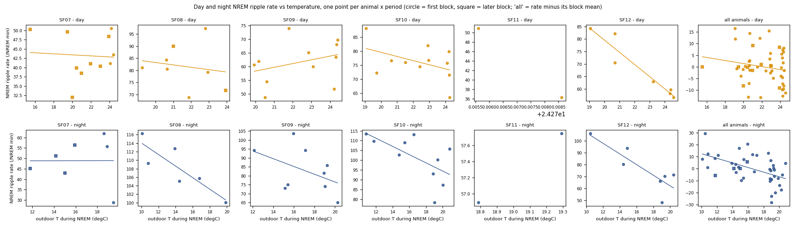

# Day and night NREM ripple RATE vs temperature (2026c)

Generated by `ephys/swr_temperature.py rate` (repo `191d92c+dirty`) from the 30-min bins of `D:\Field2026_analysis_out\2026c\swr_temperature_20261008_2343`. Plan Amendment 2 ([plan](../../../../implementation_plan/2026-10-08-swr-temperature.md)): written after the bin-level rate slopes were seen, at the user's correction ('day / night ripple RATE vs temperature'). Bin-level analysis and its audit: [`ephys_spikes_swr_temperature_2026c.md`](ephys_spikes_swr_temperature_2026c.md).

## Answer

- **Day ripple rate:** -0.90 events/NREM min per degC [-2.70, 0.89] (50 animal-periods, 11 dates); per animal 3 / 5 with that sign (Pearson r: SF07 0.29, SF08 -0.15, SF09 0.33, SF10 -0.44, SF11 , SF12 -0.95); animal-level mean -0.73 [-4.15, 2.69]; validated blocks 0.80 [-1.65, 3.26]; hour-adjusted -1.15 [-2.69, 0.38]; vs the anomaly -0.67 [-2.10, 0.77]. Amplitude check 0.001 per degC [-0.009, 0.011]. **Verdict: No.**
- **Night ripple rate:** -1.87 events/NREM min per degC [-2.93, -0.82] (41 animal-periods, 11 dates); per animal 4 / 5 with that sign (Pearson r: SF07 0.04, SF08 -0.86, SF09 -0.45, SF10 -0.63, SF11 , SF12 -0.85); animal-level mean -1.87 [-4.23, 0.50]; validated blocks -1.33 [-2.93, 0.26]; hour-adjusted -1.73 [-2.76, -0.71]; vs the anomaly -1.87 [-3.06, -0.68]. Amplitude check -0.005 per degC [-0.010, -0.000]. **Verdict: Candidate.**

## All tests

Per phase: WLS y = animal x block intercepts + beta T + gamma day, weights NREM minutes, SEs clustered by date, t(G-1). Verdict = the Amendment 1 rule (pooled CI excludes 0, animal-level CI excludes 0, >= 4 animals same sign, validated blocks agree).

| Outcome | Temperature | Phase | Slope /degC [95 % CI] | p | Animal-level [CI] | Same sign | Validated blocks [CI] | No trend [CI] | Verdict |
|---|---|---|---|---|---|---|---|---|---|
| rate | T | day | -0.903 [-2.697, 0.891] | 0.288 | -0.730 [-4.147, 2.687] | 3 / 5 | 0.802 [-1.653, 3.258] | -1.263 [-2.902, 0.376] | **No** |
| rate | T | night | -1.873 [-2.931, -0.815] | 0.003 | -1.868 [-4.231, 0.495] | 4 / 5 | -1.334 [-2.926, 0.258] | -2.730 [-3.788, -1.673] | **Candidate** |
| rate | T_anom | day | -0.667 [-2.100, 0.766] | 0.324 | -0.912 [-4.301, 2.477] | 3 / 5 | 0.882 [-1.082, 2.845] | -1.035 [-2.540, 0.470] | **No** |
| rate | T_anom | night | -1.871 [-3.057, -0.685] | 0.006 | -1.878 [-4.196, 0.441] | 4 / 5 | -1.198 [-2.918, 0.522] | -2.730 [-3.842, -1.618] | **Candidate** |
| hour-adjusted rate | T | day | -1.153 [-2.685, 0.380] | 0.125 | -1.023 [-4.101, 2.055] | 3 / 5 | 0.481 [-1.761, 2.723] | -1.432 [-2.887, 0.023] | **No** |
| hour-adjusted rate | T | night | -1.735 [-2.763, -0.707] | 0.004 | -1.718 [-4.120, 0.685] | 4 / 5 | -1.199 [-2.710, 0.312] | -2.591 [-3.649, -1.534] | **Candidate** |
| hour-adjusted rate | T_anom | day | -0.960 [-2.182, 0.261] | 0.110 | -1.181 [-4.325, 1.964] | 3 / 5 | 0.530 [-1.251, 2.310] | -1.253 [-2.568, 0.062] | **No** |
| hour-adjusted rate | T_anom | night | -1.705 [-2.849, -0.560] | 0.008 | -1.709 [-4.082, 0.664] | 4 / 5 | -1.047 [-2.690, 0.596] | -2.574 [-3.680, -1.468] | **Candidate** |
| relative amplitude (check) | T | day | 0.001 [-0.009, 0.011] | 0.775 | 0.000 [-0.016, 0.017] | 3 / 5 | 0.002 [-0.011, 0.015] | 0.000 [-0.008, 0.008] | **No** |
| relative amplitude (check) | T | night | -0.005 [-0.010, -0.000] | 0.047 | -0.003 [-0.008, 0.001] | 4 / 5 | -0.003 [-0.011, 0.005] | -0.003 [-0.008, 0.002] | **Candidate** |
| relative amplitude (check) | T_anom | day | -0.000 [-0.009, 0.009] | 0.988 | -0.001 [-0.014, 0.012] | 2 / 5 | 0.002 [-0.009, 0.012] | -0.001 [-0.008, 0.007] | **No** |
| relative amplitude (check) | T_anom | night | -0.005 [-0.010, -0.000] | 0.045 | -0.003 [-0.008, 0.002] | 4 / 5 | -0.003 [-0.011, 0.005] | -0.003 [-0.008, 0.002] | **Candidate** |

## Per animal (rate vs outdoor T)

| Animal | Phase | Periods | Slope /degC | Pearson r | Spearman rho |
|---|---|---|---|---|---|
| SF07 | day | 11 | 2.13 | 0.29 | 0.14 |
| SF08 | day | 8 | -0.55 | -0.15 | -0.36 |
| SF09 | day | 11 | 1.18 | 0.33 | 0.42 |
| SF10 | day | 11 | -1.44 | -0.44 | -0.42 |
| SF11 | day | 2 |  |  |  |
| SF12 | day | 7 | -4.96 | -0.95 | -0.93 |
| SF07 | night | 7 | 1.04 | 0.04 | 0.20 |
| SF08 | night | 6 | -1.43 | -0.86 | -0.89 |
| SF09 | night | 9 | -2.52 | -0.45 | -0.37 |
| SF10 | night | 10 | -2.27 | -0.63 | -0.65 |
| SF11 | night | 2 |  |  |  |
| SF12 | night | 7 | -4.16 | -0.85 | -0.64 |

## The periods

| Animal | Block | Date | Phase | NREM min | Rate /min | Outdoor T (degC) | T anomaly | Rel. amplitude |
|---|---|---|---|---|---|---|---|---|
| SF07 | start | 09-01 | day | 333 | 41.1 | 24.1 | +2.1 | 0.99 |
| SF07 | start | 09-01 | night | 54 | 62.0 | 18.6 | +3.0 | 1.00 |
| SF07 | start | 09-02 | day | 337 | 43.5 | 24.4 | +2.2 | 1.00 |
| SF07 | start | 09-02 | night | 74 | 55.7 | 18.9 | +2.7 | 1.00 |
| SF07 | start | 09-03 | day | 308 | 50.6 | 24.2 | +2.2 | 1.00 |
| SF07 | start | 09-03 | night | 72 | 28.9 | 19.5 | +3.8 | 0.92 |
| SF07 | 2026-09-04 14:00:54.476 | 09-04 | night | 95 | 51.2 | 14.2 | -1.8 | 1.01 |
| SF07 | 2026-09-04 14:00:54.476 | 09-05 | day | 88 | 50.3 | 15.5 | -1.4 | 1.00 |
| SF07 | 2026-09-05 13:31:18.469 | 09-05 | night | 60 | 43.0 | 15.0 | -1.4 | 0.89 |
| SF07 | 2026-09-05 13:31:18.469 | 09-06 | day | 169 | 49.6 | 19.5 | -0.8 | 1.00 |
| SF07 | 2026-09-06 13:29:42.035 | 09-06 | day | 73 | 31.9 | 20.0 | -1.9 | 0.86 |
| SF07 | 2026-09-06 13:29:42.035 | 09-07 | day | 338 | 39.9 | 20.4 | -2.2 | 0.99 |
| SF07 | 2026-09-06 13:29:42.035 | 09-07 | night | 81 | 45.1 | 11.8 | -4.8 | 0.96 |
| SF07 | 2026-09-06 13:29:42.035 | 09-08 | day | 485 | 40.4 | 23.0 | +1.1 | 1.00 |
| SF07 | 2026-09-06 13:29:42.035 | 09-08 | night | 67 | 56.4 | 15.9 | -0.4 | 0.94 |
| SF07 | 2026-09-06 13:29:42.035 | 09-09 | day | 423 | 41.0 | 21.9 | -0.0 | 1.02 |
| SF07 | 2026-09-06 13:29:42.035 | 09-10 | day | 273 | 48.4 | 23.9 | +2.5 | 1.05 |
| SF07 | 2026-09-06 13:29:42.035 | 09-11 | day | 366 | 38.5 | 21.0 | -1.8 | 1.03 |
| SF08 | start | 09-03 | night | 102 | 100.1 | 19.9 | +3.8 | 1.06 |
| SF08 | start | 09-04 | day | 411 | 97.4 | 22.8 | +0.9 | 0.90 |
| SF08 | start | 09-04 | night | 79 | 112.7 | 13.9 | -1.8 | 1.03 |
| SF08 | start | 09-05 | day | 337 | 80.5 | 20.7 | -1.4 | 1.00 |
| SF08 | start | 09-05 | night | 92 | 105.1 | 14.4 | -1.4 | 1.09 |
| SF08 | start | 09-06 | day | 416 | 84.3 | 20.6 | -1.5 | 1.02 |
| SF08 | start | 09-06 | night | 75 | 116.3 | 10.1 | -5.8 | 1.08 |
| SF08 | start | 09-07 | day | 385 | 81.1 | 19.3 | -2.6 | 1.02 |
| SF08 | start | 09-07 | night | 55 | 109.3 | 10.8 | -5.2 | 1.03 |
| SF08 | start | 09-08 | day | 442 | 79.2 | 22.9 | +1.1 | 0.99 |
| SF08 | start | 09-08 | night | 56 | 105.7 | 16.8 | +0.9 | 1.01 |
| SF08 | start | 09-09 | day | 395 | 68.8 | 21.9 | +0.1 | 1.03 |
| SF08 | 2026-09-09 18:50:36.554 | 09-10 | day | 256 | 71.7 | 23.9 | +2.4 | 0.93 |
| SF08 | 2026-09-09 18:50:36.554 | 09-11 | day | 340 | 89.9 | 21.0 | -1.8 | 1.00 |
| SF09 | start | 08-31 | night | 45 | 81.4 | 18.9 | +2.7 | 0.98 |
| SF09 | start | 09-01 | day | 337 | 63.4 | 24.3 | +2.2 | 1.00 |
| SF09 | start | 09-01 | night | 78 | 85.8 | 19.2 | +3.4 | 1.00 |
| SF09 | start | 09-02 | day | 288 | 68.1 | 24.3 | +2.2 | 1.07 |
| SF09 | start | 09-02 | night | 113 | 74.0 | 19.0 | +2.6 | 0.97 |
| SF09 | start | 09-03 | day | 381 | 51.8 | 24.2 | +2.1 | 1.02 |
| SF09 | start | 09-03 | night | 97 | 65.1 | 20.2 | +3.8 | 0.82 |
| SF09 | start | 09-04 | day | 397 | 60.0 | 23.1 | +0.9 | 0.97 |
| SF09 | start | 09-04 | night | 49 | 75.1 | 15.4 | -1.0 | 0.85 |
| SF09 | start | 09-05 | day | 363 | 48.8 | 20.5 | -1.5 | 0.92 |
| SF09 | start | 09-05 | night | 70 | 73.1 | 15.1 | -1.4 | 0.80 |
| SF09 | start | 09-06 | day | 439 | 54.5 | 20.6 | -1.5 | 1.00 |
| SF09 | start | 09-07 | day | 321 | 62.0 | 20.2 | -2.3 | 1.02 |
| SF09 | start | 09-07 | night | 57 | 94.3 | 12.1 | -4.7 | 0.98 |
| SF09 | start | 09-08 | day | 469 | 65.1 | 22.8 | +1.0 | 1.00 |
| SF09 | start | 09-08 | night | 61 | 103.7 | 16.0 | -0.3 | 0.94 |
| SF09 | start | 09-09 | day | 364 | 74.0 | 21.8 | +0.0 | 1.07 |
| SF09 | start | 09-10 | day | 195 | 69.8 | 24.4 | +2.7 | 0.93 |
| SF09 | start | 09-10 | night | 65 | 94.2 | 17.1 | +0.6 | 0.99 |
| SF09 | start | 09-11 | day | 404 | 60.6 | 19.9 | -2.2 | 1.03 |
| SF10 | start | 08-31 | night | 65 | 78.3 | 19.0 | +2.3 | 1.00 |
| SF10 | start | 09-01 | day | 325 | 63.5 | 24.3 | +2.2 | 0.90 |
| SF10 | start | 09-01 | night | 83 | 100.2 | 19.4 | +3.5 | 0.95 |
| SF10 | start | 09-02 | day | 337 | 71.5 | 24.2 | +2.0 | 0.96 |
| SF10 | start | 09-02 | night | 98 | 92.9 | 18.8 | +2.2 | 1.08 |
| SF10 | start | 09-03 | day | 320 | 79.9 | 24.2 | +2.2 | 1.02 |
| SF10 | start | 09-03 | night | 131 | 87.2 | 20.0 | +3.9 | 1.02 |
| SF10 | start | 09-04 | day | 429 | 76.7 | 22.9 | +0.9 | 1.00 |
| SF10 | start | 09-04 | night | 82 | 102.7 | 14.8 | -1.3 | 1.02 |
| SF10 | start | 09-05 | day | 318 | 76.0 | 21.5 | -1.5 | 0.98 |
| SF10 | start | 09-05 | night | 59 | 109.0 | 15.4 | -0.6 | 1.00 |
| SF10 | start | 09-06 | day | 449 | 76.6 | 20.6 | -1.5 | 1.00 |
| SF10 | start | 09-06 | night | 80 | 113.6 | 10.8 | -5.6 | 1.03 |
| SF10 | start | 09-07 | day | 402 | 88.1 | 19.1 | -2.7 | 1.00 |
| SF10 | start | 09-07 | night | 84 | 109.8 | 11.7 | -4.8 | 1.02 |
| SF10 | start | 09-08 | day | 443 | 82.0 | 22.9 | +1.0 | 1.00 |
| SF10 | start | 09-09 | day | 363 | 74.4 | 22.4 | -0.5 | 0.98 |
| SF10 | start | 09-09 | night | 58 | 105.8 | 20.8 | +3.9 | 0.97 |
| SF10 | start | 09-10 | day | 283 | 75.8 | 24.1 | +2.5 | 0.94 |
| SF10 | start | 09-10 | night | 47 | 113.2 | 16.6 | -0.2 | 0.95 |
| SF10 | start | 09-11 | day | 394 | 72.2 | 19.7 | -2.1 | 0.92 |
| SF11 | start | 08-31 | night | 66 | 56.9 | 18.8 | +2.6 | 1.22 |
| SF11 | start | 09-01 | day | 263 | 50.9 | 24.3 | +2.1 | 1.15 |
| SF11 | start | 09-01 | night | 92 | 57.7 | 19.3 | +3.4 | 1.18 |
| SF11 | start | 09-02 | day | 250 | 36.3 | 24.3 | +2.0 | 0.98 |
| SF12 | start | 08-31 | night | 157 | 66.2 | 18.8 | +2.8 | 0.95 |
| SF12 | start | 09-01 | day | 297 | 59.6 | 24.4 | +2.2 | 0.98 |
| SF12 | start | 09-01 | night | 152 | 70.2 | 19.4 | +3.3 | 0.88 |
| SF12 | start | 09-02 | day | 339 | 56.6 | 24.6 | +2.2 | 0.91 |
| SF12 | start | 09-02 | night | 66 | 48.4 | 19.0 | +3.5 | 0.93 |
| SF12 | start | 09-03 | day | 312 | 58.2 | 24.3 | +2.2 | 0.88 |
| SF12 | start | 09-03 | night | 136 | 71.5 | 20.4 | +3.9 | 0.91 |
| SF12 | start | 09-04 | day | 386 | 62.9 | 23.2 | +0.9 | 0.96 |
| SF12 | start | 09-04 | night | 116 | 80.4 | 14.4 | -1.5 | 0.94 |
| SF12 | start | 09-05 | day | 380 | 70.5 | 20.7 | -1.5 | 0.97 |
| SF12 | start | 09-05 | night | 128 | 93.7 | 14.9 | -1.3 | 0.92 |
| SF12 | start | 09-06 | day | 465 | 82.1 | 20.7 | -1.6 | 1.00 |
| SF12 | start | 09-06 | night | 132 | 106.1 | 10.5 | -5.7 | 0.98 |
| SF12 | start | 09-07 | day | 362 | 84.2 | 19.1 | -2.8 | 0.79 |

## Definitions

- **Period**: for biological date D, day = [sunrise D, sunset D), night = [sunset D, sunrise D+1); the 30-min bins of the bin-level analysis (same exclusions: tiers validated / good, after use_until, to 09-11 19:40, first 30 min of each file, probe-advance settle windows, bins with >= 5 min NREM not crossed by sunrise / sunset).
- **Period rate** $R_p = \sum_{k\in p} n_k / \sum_{k\in p} N_k$ (kept NREM SWR events per NREM minute); periods with >= 30 NREM minutes. Text: how often ripples occur during that day's / night's NREM.
- **Period temperature** $T_p = \sum_k N_k T_k / \sum_k N_k$ (degC): outdoor temperature while the animal was in NREM; $T^{anom}_p$ the same for the anomaly (vs the usual for the hour).
- **Hour-adjusted rate** $R^{adj}_p = \sum_k N_k (r_k - \bar r_{h(k)}) / \sum_k N_k$, $\bar r_h$ = the cohort hour profile (within-block deviation by clock hour): removes differences in when within the period the NREM fell.
- **Model** per phase: $R_p = \alpha_{a,b} + \beta T_p + \gamma\,\mathrm{day}_p$, WLS weights = NREM minutes, SEs clustered by biological date, $t(G-1)$; per animal the same without the trend (few dates); animal-level CI = mean of the per-animal slopes, $t(n-1)$.
- **Relative amplitude** (check): NREM-minute-weighted mean of the bins' median amplitude / the block reference's NREM median: if the rate slope came with an amplitude slope, a fixed detection boundary could produce it.

## Limits

- Outdoor air, not the house or the brain; the rats sleep huddled in insulated houses.
- Rate depends on the detection boundary (fixed per block in raw units); the amplitude check tests the obvious route. SF08 block 1 and SF12 block 1 are the least trustworthy blocks (quality guide).
- One value per animal per period and 12 dates: weather varies little between dates within a phase; a slope across dates can also carry anything else that changed from day to day (handling, disturbance, the probe).
