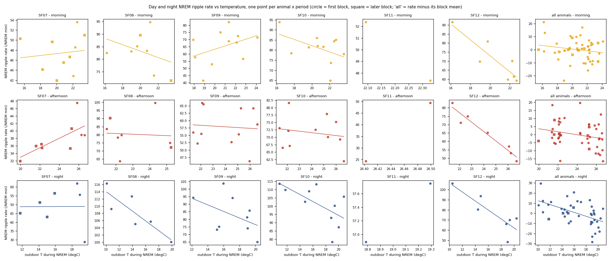

# Day and night NREM ripple RATE vs temperature (2026c) - day split at solar noon

Day split as the user asked (10-09): morning = sunrise -> solar noon (the midpoint of sunrise and sunset, about 13:00 EDT), afternoon = solar noon -> sunset; a 30-min bin goes by its centre. The night is unchanged.

Generated by `ephys/swr_temperature.py rate` (repo `191d92c+dirty`) from the 30-min bins of `D:\Field2026_analysis_out\2026c\swr_temperature_20261008_2343`. Plan Amendment 2 ([plan](../../../../implementation_plan/2026-10-08-swr-temperature.md)): written after the bin-level rate slopes were seen, at the user's correction ('day / night ripple RATE vs temperature'). Bin-level analysis and its audit: [`ephys_spikes_swr_temperature_2026c.md`](ephys_spikes_swr_temperature_2026c.md).

## Answer

- **Morning ripple rate:** -0.64 events/NREM min per degC [-2.14, 0.85] (49 animal-periods, 11 dates); per animal 3 / 5 with that sign (Pearson r: SF07 0.33, SF08 -0.27, SF09 0.40, SF10 -0.46, SF11 , SF12 -0.88); animal-level mean -0.67 [-4.02, 2.69]; validated blocks 0.57 [-1.62, 2.76]; hour-adjusted -0.68 [-2.23, 0.86]; vs the anomaly -0.47 [-1.70, 0.75]. Amplitude check 0.002 per degC [-0.010, 0.014]. **Verdict: No.**
- **Afternoon ripple rate:** -1.48 events/NREM min per degC [-2.70, -0.26] (48 animal-periods, 11 dates); per animal 3 / 5 with that sign (Pearson r: SF07 0.28, SF08 -0.07, SF09 -0.08, SF10 -0.18, SF11 , SF12 -0.97); animal-level mean -1.12 [-4.28, 2.03]; validated blocks -0.12 [-1.19, 0.95]; hour-adjusted -1.54 [-2.78, -0.29]; vs the anomaly -1.43 [-2.80, -0.06]. Amplitude check -0.006 per degC [-0.011, -0.002]. **Verdict: Candidate.**
- **Night ripple rate:** -1.87 events/NREM min per degC [-2.93, -0.82] (41 animal-periods, 11 dates); per animal 4 / 5 with that sign (Pearson r: SF07 0.04, SF08 -0.86, SF09 -0.45, SF10 -0.63, SF11 , SF12 -0.85); animal-level mean -1.87 [-4.23, 0.50]; validated blocks -1.33 [-2.93, 0.26]; hour-adjusted -1.73 [-2.76, -0.71]; vs the anomaly -1.87 [-3.06, -0.68]. Amplitude check -0.005 per degC [-0.010, -0.000]. **Verdict: Candidate.**

## All tests

Per phase: WLS y = animal x block intercepts + beta T + gamma day, weights NREM minutes, SEs clustered by date, t(G-1). Verdict = the Amendment 1 rule (pooled CI excludes 0, animal-level CI excludes 0, >= 4 animals same sign, validated blocks agree).

| Outcome | Temperature | Phase | Slope /degC [95 % CI] | p | Animal-level [CI] | Same sign | Validated blocks [CI] | No trend [CI] | Verdict |
|---|---|---|---|---|---|---|---|---|---|
| rate | T | morning | -0.645 [-2.144, 0.854] | 0.361 | -0.669 [-4.024, 2.686] | 3 / 5 | 0.571 [-1.618, 2.759] | -1.014 [-2.541, 0.513] | **No** |
| rate | T | afternoon | -1.480 [-2.704, -0.257] | 0.022 | -1.121 [-4.276, 2.034] | 3 / 5 | -0.118 [-1.190, 0.955] | -1.280 [-2.605, 0.044] | **Candidate** |
| rate | T | night | -1.873 [-2.931, -0.815] | 0.003 | -1.868 [-4.231, 0.495] | 4 / 5 | -1.334 [-2.926, 0.258] | -2.730 [-3.788, -1.673] | **Candidate** |
| rate | T_anom | morning | -0.474 [-1.698, 0.751] | 0.409 | -0.857 [-4.556, 2.842] | 3 / 5 | 0.785 [-1.321, 2.892] | -0.832 [-2.113, 0.449] | **No** |
| rate | T_anom | afternoon | -1.428 [-2.799, -0.057] | 0.043 | -1.034 [-4.259, 2.190] | 3 / 5 | -0.110 [-1.192, 0.972] | -1.218 [-2.714, 0.278] | **Candidate** |
| rate | T_anom | night | -1.871 [-3.057, -0.685] | 0.006 | -1.878 [-4.196, 0.441] | 4 / 5 | -1.198 [-2.918, 0.522] | -2.730 [-3.842, -1.618] | **Candidate** |
| hour-adjusted rate | T | morning | -0.685 [-2.229, 0.859] | 0.346 | -0.757 [-4.001, 2.487] | 3 / 5 | 0.531 [-1.716, 2.778] | -1.060 [-2.643, 0.523] | **No** |
| hour-adjusted rate | T | afternoon | -1.537 [-2.780, -0.293] | 0.020 | -1.169 [-4.275, 1.937] | 3 / 5 | -0.174 [-1.204, 0.855] | -1.312 [-2.597, -0.027] | **Candidate** |
| hour-adjusted rate | T | night | -1.735 [-2.763, -0.707] | 0.004 | -1.718 [-4.120, 0.685] | 4 / 5 | -1.199 [-2.710, 0.312] | -2.591 [-3.649, -1.534] | **Candidate** |
| hour-adjusted rate | T_anom | morning | -0.563 [-1.795, 0.668] | 0.332 | -0.961 [-4.551, 2.628] | 3 / 5 | 0.677 [-1.430, 2.783] | -0.924 [-2.239, 0.390] | **No** |
| hour-adjusted rate | T_anom | afternoon | -1.477 [-2.892, -0.063] | 0.042 | -1.073 [-4.252, 2.107] | 3 / 5 | -0.159 [-1.221, 0.903] | -1.243 [-2.702, 0.215] | **Candidate** |
| hour-adjusted rate | T_anom | night | -1.705 [-2.849, -0.560] | 0.008 | -1.709 [-4.082, 0.664] | 4 / 5 | -1.047 [-2.690, 0.596] | -2.574 [-3.680, -1.468] | **Candidate** |
| relative amplitude (check) | T | morning | 0.002 [-0.010, 0.014] | 0.735 | 0.003 [-0.011, 0.016] | 3 / 5 | 0.002 [-0.014, 0.017] | 0.002 [-0.008, 0.011] | **No** |
| relative amplitude (check) | T | afternoon | -0.006 [-0.011, -0.002] | 0.009 | -0.006 [-0.021, 0.009] | 4 / 5 | -0.003 [-0.011, 0.005] | -0.006 [-0.012, 0.000] | **Candidate** |
| relative amplitude (check) | T | night | -0.005 [-0.010, -0.000] | 0.047 | -0.003 [-0.008, 0.001] | 4 / 5 | -0.003 [-0.011, 0.005] | -0.003 [-0.008, 0.002] | **Candidate** |
| relative amplitude (check) | T_anom | morning | 0.002 [-0.009, 0.013] | 0.735 | 0.002 [-0.011, 0.016] | 3 / 5 | 0.003 [-0.011, 0.017] | 0.001 [-0.007, 0.010] | **No** |
| relative amplitude (check) | T_anom | afternoon | -0.007 [-0.011, -0.004] | 0.001 | -0.007 [-0.021, 0.006] | 3 / 5 | -0.005 [-0.011, 0.001] | -0.006 [-0.013, 0.001] | **Candidate** |
| relative amplitude (check) | T_anom | night | -0.005 [-0.010, -0.000] | 0.045 | -0.003 [-0.008, 0.002] | 4 / 5 | -0.003 [-0.011, 0.005] | -0.003 [-0.008, 0.002] | **Candidate** |

## Per animal (rate vs outdoor T)

| Animal | Phase | Periods | Slope /degC | Pearson r | Spearman rho |
|---|---|---|---|---|---|
| SF07 | morning | 10 | 1.68 | 0.33 | 0.54 |
| SF08 | morning | 8 | -1.04 | -0.27 | -0.21 |
| SF09 | morning | 11 | 2.15 | 0.40 | 0.29 |
| SF10 | morning | 11 | -1.64 | -0.46 | -0.30 |
| SF11 | morning | 2 |  |  |  |
| SF12 | morning | 7 | -4.50 | -0.88 | -0.75 |
| SF07 | afternoon | 9 | 0.25 | 0.28 | 0.03 |
| SF08 | afternoon | 8 | 0.49 | -0.07 | -0.38 |
| SF09 | afternoon | 11 | -0.42 | -0.08 | 0.06 |
| SF10 | afternoon | 11 | -0.30 | -0.18 | -0.21 |
| SF11 | afternoon | 2 |  |  |  |
| SF12 | afternoon | 7 | -5.62 | -0.97 | -0.96 |
| SF07 | night | 7 | 1.04 | 0.04 | 0.20 |
| SF08 | night | 6 | -1.43 | -0.86 | -0.89 |
| SF09 | night | 9 | -2.52 | -0.45 | -0.37 |
| SF10 | night | 10 | -2.27 | -0.63 | -0.65 |
| SF11 | night | 2 |  |  |  |
| SF12 | night | 7 | -4.16 | -0.85 | -0.64 |

## The periods

| Animal | Block | Date | Phase | NREM min | Rate /min | Outdoor T (degC) | T anomaly | Rel. amplitude |
|---|---|---|---|---|---|---|---|---|
| SF07 | start | 09-01 | afternoon | 147 | 38.9 | 26.6 | +2.8 | 0.96 |
| SF07 | start | 09-01 | morning | 187 | 42.8 | 22.1 | +1.5 | 1.01 |
| SF07 | start | 09-01 | night | 54 | 62.0 | 18.6 | +3.0 | 1.00 |
| SF07 | start | 09-02 | afternoon | 179 | 39.0 | 26.3 | +2.6 | 0.98 |
| SF07 | start | 09-02 | morning | 158 | 48.6 | 22.3 | +1.7 | 1.02 |
| SF07 | start | 09-02 | night | 74 | 55.7 | 18.9 | +2.7 | 1.00 |
| SF07 | start | 09-03 | afternoon | 153 | 47.5 | 25.8 | +2.2 | 0.99 |
| SF07 | start | 09-03 | morning | 155 | 53.6 | 22.5 | +2.2 | 1.01 |
| SF07 | start | 09-03 | night | 72 | 28.9 | 19.5 | +3.8 | 0.92 |
| SF07 | 2026-09-04 14:00:54.476 | 09-04 | night | 95 | 51.2 | 14.2 | -1.8 | 1.01 |
| SF07 | 2026-09-04 14:00:54.476 | 09-05 | morning | 88 | 50.3 | 15.5 | -1.4 | 1.00 |
| SF07 | 2026-09-05 13:31:18.469 | 09-05 | night | 60 | 43.0 | 15.0 | -1.4 | 0.89 |
| SF07 | 2026-09-06 13:29:42.035 | 09-06 | afternoon | 73 | 31.9 | 20.0 | -1.9 | 0.86 |
| SF07 | 2026-09-05 13:31:18.469 | 09-06 | morning | 169 | 49.6 | 19.5 | -0.8 | 1.00 |
| SF07 | 2026-09-06 13:29:42.035 | 09-07 | afternoon | 188 | 36.5 | 22.2 | -1.4 | 0.98 |
| SF07 | 2026-09-06 13:29:42.035 | 09-07 | morning | 150 | 44.1 | 18.3 | -3.3 | 1.00 |
| SF07 | 2026-09-06 13:29:42.035 | 09-07 | night | 81 | 45.1 | 11.8 | -4.8 | 0.96 |
| SF07 | 2026-09-06 13:29:42.035 | 09-08 | afternoon | 243 | 35.3 | 25.1 | +1.7 | 0.99 |
| SF07 | 2026-09-06 13:29:42.035 | 09-08 | morning | 242 | 45.5 | 20.9 | +0.5 | 1.01 |
| SF07 | 2026-09-06 13:29:42.035 | 09-08 | night | 67 | 56.4 | 15.9 | -0.4 | 0.94 |
| SF07 | 2026-09-06 13:29:42.035 | 09-09 | afternoon | 212 | 35.5 | 22.2 | -1.5 | 1.02 |
| SF07 | 2026-09-06 13:29:42.035 | 09-09 | morning | 211 | 46.6 | 21.6 | +1.5 | 1.02 |
| SF07 | 2026-09-06 13:29:42.035 | 09-10 | afternoon | 68 | 40.6 | 25.3 | +1.2 | 1.02 |
| SF07 | 2026-09-06 13:29:42.035 | 09-10 | morning | 205 | 51.0 | 23.5 | +3.0 | 1.06 |
| SF07 | 2026-09-06 13:29:42.035 | 09-11 | afternoon | 213 | 36.0 | 21.6 | -2.0 | 1.03 |
| SF07 | 2026-09-06 13:29:42.035 | 09-11 | morning | 153 | 41.9 | 20.0 | -1.6 | 1.02 |
| SF08 | start | 09-03 | night | 102 | 100.1 | 19.9 | +3.8 | 1.06 |
| SF08 | start | 09-04 | afternoon | 216 | 99.7 | 24.3 | +0.9 | 0.86 |
| SF08 | start | 09-04 | morning | 195 | 94.8 | 21.1 | +1.0 | 0.94 |
| SF08 | start | 09-04 | night | 79 | 112.7 | 13.9 | -1.8 | 1.03 |
| SF08 | start | 09-05 | afternoon | 182 | 78.3 | 22.1 | -1.7 | 0.99 |
| SF08 | start | 09-05 | morning | 155 | 83.1 | 19.0 | -1.1 | 1.01 |
| SF08 | start | 09-05 | night | 92 | 105.1 | 14.4 | -1.4 | 1.09 |
| SF08 | start | 09-06 | afternoon | 224 | 83.6 | 21.4 | -2.1 | 0.99 |
| SF08 | start | 09-06 | morning | 193 | 85.2 | 19.6 | -0.9 | 1.06 |
| SF08 | start | 09-06 | night | 75 | 116.3 | 10.1 | -5.8 | 1.08 |
| SF08 | start | 09-07 | afternoon | 193 | 79.7 | 22.3 | -1.3 | 0.98 |
| SF08 | start | 09-07 | morning | 192 | 82.5 | 16.2 | -3.9 | 1.05 |
| SF08 | start | 09-07 | night | 55 | 109.3 | 10.8 | -5.2 | 1.03 |
| SF08 | start | 09-08 | afternoon | 218 | 75.0 | 25.2 | +1.7 | 0.95 |
| SF08 | start | 09-08 | morning | 224 | 83.4 | 20.7 | +0.4 | 1.04 |
| SF08 | start | 09-08 | night | 56 | 105.7 | 16.8 | +0.9 | 1.01 |
| SF08 | start | 09-09 | afternoon | 192 | 63.7 | 22.2 | -1.6 | 1.03 |
| SF08 | start | 09-09 | morning | 204 | 73.5 | 21.5 | +1.6 | 1.03 |
| SF08 | 2026-09-09 18:50:36.554 | 09-10 | afternoon | 66 | 72.2 | 25.3 | +1.2 | 0.91 |
| SF08 | 2026-09-09 18:50:36.554 | 09-10 | morning | 189 | 71.5 | 23.5 | +2.9 | 0.94 |
| SF08 | 2026-09-09 18:50:36.554 | 09-11 | afternoon | 207 | 90.2 | 21.7 | -2.0 | 0.98 |
| SF08 | 2026-09-09 18:50:36.554 | 09-11 | morning | 132 | 89.6 | 20.0 | -1.6 | 1.03 |
| SF09 | start | 08-31 | night | 45 | 81.4 | 18.9 | +2.7 | 0.98 |
| SF09 | start | 09-01 | afternoon | 165 | 58.7 | 26.6 | +2.9 | 0.98 |
| SF09 | start | 09-01 | morning | 173 | 67.9 | 22.1 | +1.5 | 1.02 |
| SF09 | start | 09-01 | night | 78 | 85.8 | 19.2 | +3.4 | 1.00 |
| SF09 | start | 09-02 | afternoon | 151 | 64.2 | 26.3 | +2.5 | 1.06 |
| SF09 | start | 09-02 | morning | 137 | 72.5 | 22.2 | +1.8 | 1.09 |
| SF09 | start | 09-02 | night | 113 | 74.0 | 19.0 | +2.6 | 0.97 |
| SF09 | start | 09-03 | afternoon | 176 | 46.2 | 26.0 | +2.2 | 1.00 |
| SF09 | start | 09-03 | morning | 205 | 56.6 | 22.7 | +2.0 | 1.04 |
| SF09 | start | 09-03 | night | 97 | 65.1 | 20.2 | +3.8 | 0.82 |
| SF09 | start | 09-04 | afternoon | 219 | 52.7 | 24.5 | +0.9 | 0.94 |
| SF09 | start | 09-04 | morning | 179 | 68.9 | 21.3 | +0.9 | 1.02 |
| SF09 | start | 09-04 | night | 49 | 75.1 | 15.4 | -1.0 | 0.85 |
| SF09 | start | 09-05 | afternoon | 187 | 55.5 | 22.0 | -1.6 | 0.99 |
| SF09 | start | 09-05 | morning | 176 | 41.6 | 18.9 | -1.2 | 0.84 |
| SF09 | start | 09-05 | night | 70 | 73.1 | 15.1 | -1.4 | 0.80 |
| SF09 | start | 09-06 | afternoon | 235 | 56.0 | 21.4 | -2.1 | 1.02 |
| SF09 | start | 09-06 | morning | 204 | 52.8 | 19.7 | -0.9 | 0.97 |
| SF09 | start | 09-07 | afternoon | 166 | 66.0 | 22.1 | -1.5 | 1.05 |
| SF09 | start | 09-07 | morning | 155 | 57.7 | 18.1 | -3.3 | 0.99 |
| SF09 | start | 09-07 | night | 57 | 94.3 | 12.1 | -4.7 | 0.98 |
| SF09 | start | 09-08 | afternoon | 237 | 55.4 | 25.1 | +1.7 | 0.95 |
| SF09 | start | 09-08 | morning | 232 | 75.1 | 20.5 | +0.3 | 1.05 |
| SF09 | start | 09-08 | night | 61 | 103.7 | 16.0 | -0.3 | 0.94 |
| SF09 | start | 09-09 | afternoon | 179 | 65.5 | 22.2 | -1.6 | 1.07 |
| SF09 | start | 09-09 | morning | 185 | 82.2 | 21.4 | +1.6 | 1.08 |
| SF09 | start | 09-10 | afternoon | 47 | 64.2 | 25.3 | +1.3 | 0.96 |
| SF09 | start | 09-10 | morning | 149 | 71.5 | 24.1 | +3.1 | 0.92 |
| SF09 | start | 09-10 | night | 65 | 94.2 | 17.1 | +0.6 | 0.99 |
| SF09 | start | 09-11 | afternoon | 213 | 52.2 | 21.8 | -2.1 | 1.02 |
| SF09 | start | 09-11 | morning | 191 | 70.0 | 17.9 | -2.3 | 1.05 |
| SF10 | start | 08-31 | night | 65 | 78.3 | 19.0 | +2.3 | 1.00 |
| SF10 | start | 09-01 | afternoon | 155 | 61.9 | 26.7 | +2.9 | 0.90 |
| SF10 | start | 09-01 | morning | 171 | 64.9 | 22.1 | +1.5 | 0.89 |
| SF10 | start | 09-01 | night | 83 | 100.2 | 19.4 | +3.5 | 0.95 |
| SF10 | start | 09-02 | afternoon | 167 | 69.3 | 26.3 | +2.5 | 0.95 |
| SF10 | start | 09-02 | morning | 170 | 73.6 | 22.2 | +1.6 | 0.97 |
| SF10 | start | 09-02 | night | 98 | 92.9 | 18.8 | +2.2 | 1.08 |
| SF10 | start | 09-03 | afternoon | 156 | 75.2 | 26.0 | +2.3 | 1.00 |
| SF10 | start | 09-03 | morning | 164 | 84.4 | 22.5 | +2.1 | 1.04 |
| SF10 | start | 09-03 | night | 131 | 87.2 | 20.0 | +3.9 | 1.02 |
| SF10 | start | 09-04 | afternoon | 234 | 72.6 | 24.3 | +0.9 | 0.98 |
| SF10 | start | 09-04 | morning | 196 | 81.7 | 21.3 | +0.9 | 1.02 |
| SF10 | start | 09-04 | night | 82 | 102.7 | 14.8 | -1.3 | 1.02 |
| SF10 | start | 09-05 | afternoon | 193 | 72.2 | 22.1 | -1.7 | 0.99 |
| SF10 | start | 09-05 | morning | 124 | 82.0 | 20.6 | -1.2 | 0.97 |
| SF10 | start | 09-05 | night | 59 | 109.0 | 15.4 | -0.6 | 1.00 |
| SF10 | start | 09-06 | afternoon | 259 | 73.1 | 21.4 | -2.1 | 0.98 |
| SF10 | start | 09-06 | morning | 189 | 81.4 | 19.7 | -0.8 | 1.02 |
| SF10 | start | 09-06 | night | 80 | 113.6 | 10.8 | -5.6 | 1.03 |
| SF10 | start | 09-07 | afternoon | 191 | 81.6 | 22.1 | -1.4 | 0.98 |
| SF10 | start | 09-07 | morning | 212 | 93.9 | 16.3 | -3.9 | 1.03 |
| SF10 | start | 09-07 | night | 84 | 109.8 | 11.7 | -4.8 | 1.02 |
| SF10 | start | 09-08 | afternoon | 223 | 77.9 | 25.2 | +1.7 | 0.98 |
| SF10 | start | 09-08 | morning | 220 | 86.1 | 20.6 | +0.3 | 1.03 |
| SF10 | start | 09-09 | afternoon | 215 | 67.1 | 22.2 | -1.6 | 0.96 |
| SF10 | start | 09-09 | morning | 148 | 85.2 | 22.7 | +1.3 | 1.01 |
| SF10 | start | 09-09 | night | 58 | 105.8 | 20.8 | +3.9 | 0.97 |
| SF10 | start | 09-10 | afternoon | 80 | 70.1 | 25.3 | +1.2 | 0.95 |
| SF10 | start | 09-10 | morning | 203 | 78.0 | 23.6 | +2.9 | 0.93 |
| SF10 | start | 09-10 | night | 47 | 113.2 | 16.6 | -0.2 | 0.95 |
| SF10 | start | 09-11 | afternoon | 206 | 66.4 | 21.6 | -1.9 | 0.91 |
| SF10 | start | 09-11 | morning | 188 | 78.5 | 17.6 | -2.4 | 0.93 |
| SF11 | start | 08-31 | night | 66 | 56.9 | 18.8 | +2.6 | 1.22 |
| SF11 | start | 09-01 | afternoon | 130 | 49.4 | 26.5 | +2.8 | 1.13 |
| SF11 | start | 09-01 | morning | 133 | 52.4 | 22.1 | +1.5 | 1.18 |
| SF11 | start | 09-01 | night | 92 | 57.7 | 19.3 | +3.4 | 1.18 |
| SF11 | start | 09-02 | afternoon | 120 | 24.3 | 26.4 | +2.3 | 0.86 |
| SF11 | start | 09-02 | morning | 130 | 47.4 | 22.3 | +1.7 | 1.10 |
| SF12 | start | 08-31 | night | 157 | 66.2 | 18.8 | +2.8 | 0.95 |
| SF12 | start | 09-01 | afternoon | 142 | 48.2 | 26.7 | +3.0 | 0.96 |
| SF12 | start | 09-01 | morning | 155 | 70.2 | 22.2 | +1.5 | 1.00 |
| SF12 | start | 09-01 | night | 152 | 70.2 | 19.4 | +3.3 | 0.88 |
| SF12 | start | 09-02 | afternoon | 193 | 52.9 | 26.2 | +2.6 | 0.91 |
| SF12 | start | 09-02 | morning | 146 | 61.4 | 22.4 | +1.7 | 0.91 |
| SF12 | start | 09-02 | night | 66 | 48.4 | 19.0 | +3.5 | 0.93 |
| SF12 | start | 09-03 | afternoon | 152 | 57.1 | 26.1 | +2.3 | 0.85 |
| SF12 | start | 09-03 | morning | 160 | 59.3 | 22.7 | +2.1 | 0.91 |
| SF12 | start | 09-03 | night | 136 | 71.5 | 20.4 | +3.9 | 0.91 |
| SF12 | start | 09-04 | afternoon | 218 | 65.2 | 24.3 | +0.9 | 0.95 |
| SF12 | start | 09-04 | morning | 168 | 59.9 | 21.8 | +0.9 | 0.98 |
| SF12 | start | 09-04 | night | 116 | 80.4 | 14.4 | -1.5 | 0.94 |
| SF12 | start | 09-05 | afternoon | 210 | 71.0 | 22.1 | -1.7 | 0.96 |
| SF12 | start | 09-05 | morning | 171 | 69.8 | 19.0 | -1.2 | 0.98 |
| SF12 | start | 09-05 | night | 128 | 93.7 | 14.9 | -1.3 | 0.92 |
| SF12 | start | 09-06 | afternoon | 261 | 83.0 | 21.4 | -2.1 | 0.95 |
| SF12 | start | 09-06 | morning | 203 | 80.9 | 19.8 | -0.9 | 1.05 |
| SF12 | start | 09-06 | night | 132 | 106.1 | 10.5 | -5.7 | 0.98 |
| SF12 | start | 09-07 | afternoon | 161 | 75.0 | 22.7 | -1.3 | 0.74 |
| SF12 | start | 09-07 | morning | 202 | 91.6 | 16.2 | -3.9 | 0.82 |

## Definitions

- **Period**: for biological date D, day = [sunrise D, sunset D), night = [sunset D, sunrise D+1); the 30-min bins of the bin-level analysis (same exclusions: tiers validated / good, after use_until, to 09-11 19:40, first 30 min of each file, probe-advance settle windows, bins with >= 5 min NREM not crossed by sunrise / sunset).
- **Period rate** $R_p = \sum_{k\in p} n_k / \sum_{k\in p} N_k$ (kept NREM SWR events per NREM minute); periods with >= 30 NREM minutes. Text: how often ripples occur during that day's / night's NREM.
- **Period temperature** $T_p = \sum_k N_k T_k / \sum_k N_k$ (degC): outdoor temperature while the animal was in NREM; $T^{anom}_p$ the same for the anomaly (vs the usual for the hour).
- **Hour-adjusted rate** $R^{adj}_p = \sum_k N_k (r_k - \bar r_{h(k)}) / \sum_k N_k$, $\bar r_h$ = the cohort hour profile (within-block deviation by clock hour): removes differences in when within the period the NREM fell.
- **Model** per phase: $R_p = \alpha_{a,b} + \beta T_p + \gamma\,\mathrm{day}_p$, WLS weights = NREM minutes, SEs clustered by biological date, $t(G-1)$; per animal the same without the trend (few dates); animal-level CI = mean of the per-animal slopes, $t(n-1)$.
- **Relative amplitude** (check): NREM-minute-weighted mean of the bins' median amplitude / the block reference's NREM median: if the rate slope came with an amplitude slope, a fixed detection boundary could produce it.

## Limits

- Outdoor air, not the house or the brain; the rats sleep huddled in insulated houses.
- Rate depends on the detection boundary (fixed per block in raw units); the amplitude check tests the obvious route. SF08 block 1 and SF12 block 1 are the least trustworthy blocks (quality guide).
- One value per animal per period and 12 dates: weather varies little between dates within a phase; a slope across dates can also carry anything else that changed from day to day (handling, disturbance, the probe).
